# Master Database Architecture — Relationships-Only Entity Relationship Diagram (ERD)

> **Database Engine**: PostgreSQL 18.x  
> **Schema Migrations**: 001 through 015 (`database/migrations/`)  
> **Total Tables**: 33 application domain tables  
> **Purpose**: High-level structural view illustrating all table entities and cross-subsystem relational connections without column-level attributes or row fields. For the complete schema with field types and column definitions, see [**`master_database_erd.md`**](./master_database_erd.md).

---

## 1. Unified Relationships-Only Entity-Relationship Diagram

```mermaid
erDiagram

    %% ========================================================
    %% 1. USER MANAGEMENT & RBAC SUBSYSTEM (7 Tables)
    %% ========================================================
    ROLES { }
    PERMISSIONS { }
    ROLE_PERMISSIONS { }
    USERS { }
    USER_ROLES { }
    SESSIONS { }
    AUDIT_LOGS { }

    %% ========================================================
    %% 2. SYSTEM EVENT HISTORY LOGS (1 Table)
    %% ========================================================
    HISTORY_LOGS { }

    %% ========================================================
    %% 3. FLEET & MAINTENANCE SUBSYSTEM (10 Tables)
    %% ========================================================
    VEHICLES { }
    MAINTENANCE_TYPES { }
    INCIDENT_TYPES { }
    VEHICLE_ODOMETER_LOGS { }
    VEHICLE_INSPECTIONS { }
    INCIDENT_REPORTS { }
    WORK_ORDERS { }
    APPROVAL_REQUESTS { }
    MAINTENANCE_LOGS { }
    WORK_ORDER_RECEIPTS { }

    %% ========================================================
    %% 4. INVENTORY SUBSYSTEM (3 Tables)
    %% ========================================================
    PRODUCTS { }
    PLANT_INVENTORY { }
    PLANT_STOCK_ADJUSTMENTS { }

    %% ========================================================
    %% 5. SALES & DELIVERY SUBSYSTEM (5 Tables)
    %% ========================================================
    CUSTOMERS { }
    SALES_TRANSACTIONS { }
    SALES_TRANSACTION_ITEMS { }
    SALES_INVOICES { }
    CANISTER_LEDGER { }

    %% ========================================================
    %% 6. SCHEDULE & TRIP SUBSYSTEM (7 Tables)
    %% ========================================================
    SERVICE_ZONES { }
    SCHEDULE_TEMPLATES { }
    TRUCK_SCHEDULES { }
    TRIPS { }
    TRIP_LOADS { }
    TRIP_LOAD_ITEMS { }
    TRIP_STOCK_RECONCILIATIONS { }

    %% ========================================================
    %% CROSS-SUBSYSTEM RELATIONSHIPS
    %% ========================================================

    %% Users & RBAC Internal
    ROLES ||--|{ ROLE_PERMISSIONS : "defines"
    PERMISSIONS ||--|{ ROLE_PERMISSIONS : "grants"
    ROLES ||--o{ USERS : "primary_role"
    USERS ||--|{ USER_ROLES : "holds"
    ROLES ||--o{ USER_ROLES : "membership"
    USERS ||--o{ SESSIONS : "establishes"
    USERS ||--o{ AUDIT_LOGS : "logs_admin_action"

    %% Users -> History Logs
    USERS ||--o{ HISTORY_LOGS : "acts_in"

    %% Users -> Fleet
    USERS ||--o| VEHICLES : "soft_bound_driver"
    USERS ||--o{ VEHICLE_ODOMETER_LOGS : "recorded_by"
    USERS ||--o{ VEHICLE_INSPECTIONS : "inspected_by"
    USERS ||--o{ INCIDENT_REPORTS : "reported_by"
    USERS ||--o{ WORK_ORDERS : "created_by"
    USERS ||--o{ APPROVAL_REQUESTS : "decided_by"
    USERS ||--o{ WORK_ORDER_RECEIPTS : "uploaded_by"

    %% Fleet Internal
    VEHICLES ||--o{ VEHICLE_ODOMETER_LOGS : "has_readings"
    VEHICLES ||--o{ VEHICLE_INSPECTIONS : "undergoes"
    VEHICLES ||--o{ INCIDENT_REPORTS : "involved_in"
    VEHICLES ||--o{ WORK_ORDERS : "serviced_by"
    MAINTENANCE_TYPES ||--o{ WORK_ORDERS : "classified_as"
    MAINTENANCE_TYPES ||--o{ MAINTENANCE_LOGS : "categorized_as"
    INCIDENT_TYPES ||--o{ INCIDENT_REPORTS : "typed_as"
    VEHICLE_INSPECTIONS ||--o| WORK_ORDERS : "triggers"
    INCIDENT_REPORTS ||--o| WORK_ORDERS : "triggers"
    WORK_ORDERS ||--o{ APPROVAL_REQUESTS : "cost_requests"
    WORK_ORDERS ||--o| MAINTENANCE_LOGS : "finalized_as"
    WORK_ORDERS ||--o{ WORK_ORDER_RECEIPTS : "receipt_evidence"

    %% Users -> Schedules & Trips
    USERS ||--o{ SCHEDULE_TEMPLATES : "default_sales_rep"
    USERS ||--o{ TRUCK_SCHEDULES : "assigned_sales_rep"
    USERS ||--o{ TRUCK_SCHEDULES : "created_schedule"
    USERS ||--o{ TRIPS : "driver_snapshot"
    USERS ||--o{ TRIPS : "sales_rep_snapshot"
    USERS ||--o{ TRIPS : "dispatched_by"
    USERS ||--o{ TRIP_LOADS : "recorded_by"
    USERS ||--o{ TRIP_STOCK_RECONCILIATIONS : "verified_by"

    %% Users -> Inventory
    USERS ||--o{ PLANT_STOCK_ADJUSTMENTS : "recorded_by"

    %% Inventory Internal
    PRODUCTS ||--|| PLANT_INVENTORY : "tracks_stock_for"
    PRODUCTS ||--o{ PLANT_STOCK_ADJUSTMENTS : "adjusts"

    %% Fleet -> Schedules & Trips
    VEHICLES ||--o{ SCHEDULE_TEMPLATES : "assigned_truck"
    VEHICLES ||--o{ TRUCK_SCHEDULES : "assigned_truck"
    VEHICLES ||--o{ TRIPS : "assigned_truck"
    VEHICLE_ODOMETER_LOGS ||--o| TRIPS : "return_odometer"

    %% Service Zones -> Schedules & Trips
    SERVICE_ZONES ||--o{ SCHEDULE_TEMPLATES : "zoned_for"
    SERVICE_ZONES ||--o{ TRUCK_SCHEDULES : "zoned_for"
    SERVICE_ZONES ||--o{ TRIPS : "destined_for"

    %% Schedules -> Trips
    TRUCK_SCHEDULES |o--o| TRIPS : "executed_as"

    %% Trips -> Inventory Movement
    TRIPS ||--o{ TRIP_LOADS : "manifests"
    TRIP_LOADS ||--|{ TRIP_LOAD_ITEMS : "items"
    PRODUCTS ||--o{ TRIP_LOAD_ITEMS : "manifest_item"

    %% Trips -> Stock Reconciliation
    TRIPS ||--o| TRIP_STOCK_RECONCILIATIONS : "reconciled_via"

    %% Sales & Delivery Subsystem
    SERVICE_ZONES ||--o{ CUSTOMERS : "locates"
    USERS ||--o{ CUSTOMERS : "registered_by"
    TRIPS ||--o{ SALES_TRANSACTIONS : "delivers"
    CUSTOMERS ||--o{ SALES_TRANSACTIONS : "purchases"
    USERS ||--o{ SALES_TRANSACTIONS : "recorded_by"
    USERS ||--o{ SALES_TRANSACTIONS : "cancelled_by"
    SALES_TRANSACTIONS ||--|{ SALES_TRANSACTION_ITEMS : "contains"
    PRODUCTS ||--o{ SALES_TRANSACTION_ITEMS : "catalog_item"
    SALES_TRANSACTIONS ||--|| SALES_INVOICES : "bills"
    USERS ||--o{ SALES_INVOICES : "verified_by"
    CUSTOMERS ||--o{ CANISTER_LEDGER : "owes_receivables"
    PRODUCTS ||--o{ CANISTER_LEDGER : "sku"
    TRIPS ||--o{ CANISTER_LEDGER : "trip_attribution"
    SALES_TRANSACTIONS ||--o{ CANISTER_LEDGER : "generates"
```

---

## 2. Subsystem Domain Directory

| Subsystem | Table Count | Domain Tables | Documentation File |
| :--- | :--- | :--- | :--- |
| **User Management & RBAC** | 7 | `roles`, `permissions`, `role_permissions`, `users`, `user_roles`, `sessions`, `audit_logs` | [`users_and_rbac_erd.md`](./users_and_rbac_erd.md) |
| **System Event History Logs** | 1 | `history_logs` | [`system_history_logs_erd.md`](./system_history_logs_erd.md) |
| **Fleet & Maintenance** | 10 | `vehicles`, `maintenance_types`, `incident_types`, `vehicle_odometer_logs`, `vehicle_inspections`, `incident_reports`, `work_orders`, `approval_requests`, `maintenance_logs`, `work_order_receipts` | [`fleet_and_maintenance_erd.md`](./fleet_and_maintenance_erd.md) |
| **Inventory** | 3 | `products`, `plant_inventory`, `plant_stock_adjustments` | [`inventory_erd.md`](./inventory_erd.md) |
| **Sales & Delivery** | 5 | `customers`, `sales_transactions`, `sales_transaction_items`, `sales_invoices`, `canister_ledger` | [`sales_and_delivery_erd.md`](./sales_and_delivery_erd.md) |
| **Schedule & Trips** | 7 | `service_zones`, `schedule_templates`, `truck_schedules`, `trips`, `trip_loads`, `trip_load_items`, `trip_stock_reconciliations` | [`schedule_and_trip_erd.md`](./schedule_and_trip_erd.md) |
