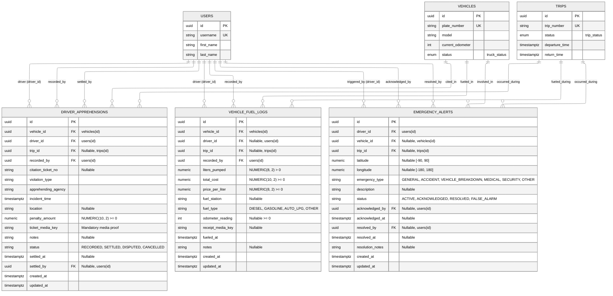

# Frontline Operations Subsystem — Entity Relationship Diagram (ERD)

> **Module**: Frontline Operations Subsystem (`src/features/operations/`)  
> **Target Database**: PostgreSQL 18.x  
> **Schema Migrations**: `016_operational_logging_subsystems.sql`, `018_remove_driver_attendance.sql`  
> **Key Architecture Decisions**:
> - **Road Apprehensions & Citations**: Tracks traffic citations with mandatory photographic ticket proof (`ticket_media_key`), penalty amounts, and settlement/dispute lifecycle (`RECORDED`, `SETTLED`, `DISPUTED`, `CANCELLED`).
> - **Vehicle Fuel Logging & Telemetry**: Captures fuel intake, pricing, fuel type, receipt evidence (`receipt_media_key`), and optional odometer readings that advance vehicle telemetry.
> - **One-Action SOS Emergency Alerts**: Supports single-action mobile emergency dispatches with GPS coordinates (`latitude`, `longitude`), emergency classification, and supervisor triage (`ACTIVE`, `ACKNOWLEDGED`, `RESOLVED`, `FALSE_ALARM`).
> - **Attendance Removal**: `duty_attendance` (originally introduced in Migration `016`) was completely removed in Migration `018`.

---

## 1. Mermaid Entity-Relationship Diagram

---

## 2. Table Specifications

### `driver_apprehensions`
Records roadside traffic apprehensions, regulatory citations, and ticket settlement status.

| Column | Data Type | Nullable | Default / Constraints | Description |
| :--- | :--- | :--- | :--- | :--- |
| `id` | `UUID` | No | `PRIMARY KEY DEFAULT gen_random_uuid()` | Unique apprehension record identifier |
| `vehicle_id` | `UUID` | No | `FK -> vehicles(id) ON DELETE RESTRICT` | Vehicle involved in the citation |
| `driver_id` | `UUID` | No | `FK -> users(id) ON DELETE RESTRICT` | Apprehended driver |
| `trip_id` | `UUID` | Yes | `FK -> trips(id) ON DELETE SET NULL` | Active trip during which apprehension occurred |
| `recorded_by` | `UUID` | No | `FK -> users(id) ON DELETE RESTRICT` | User who logged the apprehension |
| `citation_ticket_no` | `VARCHAR(100)` | Yes | `NULL` | Official traffic citation ticket number |
| `violation_type` | `VARCHAR(100)` | No | Non-empty | Traffic or regulatory violation classification |
| `apprehending_agency` | `VARCHAR(100)` | No | Non-empty | Issuing agency (e.g. LTO, CTTMO, HPG) |
| `incident_time` | `TIMESTAMPTZ` | No | `DEFAULT CURRENT_TIMESTAMP` | Timestamp of the traffic stop |
| `location` | `VARCHAR(255)` | Yes | `NULL` | Street or landmark location of apprehension |
| `penalty_amount` | `NUMERIC(10, 2)` | No | `DEFAULT 0.00 CHECK (penalty_amount >= 0)` | Assessed fine or penalty amount |
| `ticket_media_key` | `VARCHAR(255)` | No | Non-empty | Canonical media key for citation ticket photo |
| `notes` | `TEXT` | Yes | `NULL` | Additional context or remarks |
| `status` | `VARCHAR(20)` | No | `DEFAULT 'RECORDED'` (`'RECORDED'`, `'SETTLED'`, `'DISPUTED'`, `'CANCELLED'`) | Ticket resolution status |
| `settled_at` | `TIMESTAMPTZ` | Yes | `NULL` | Timestamp when ticket was settled |
| `settled_by` | `UUID` | Yes | `FK -> users(id) ON DELETE SET NULL` | Supervisor who settled/closed the ticket |
| `created_at` | `TIMESTAMPTZ` | No | `DEFAULT CURRENT_TIMESTAMP` | Record creation timestamp |
| `updated_at` | `TIMESTAMPTZ` | No | `DEFAULT CURRENT_TIMESTAMP` | Managed automatically via trigger |

**Indexes:**
- `idx_driver_apprehensions_vehicle_id`, `idx_driver_apprehensions_driver_id`, `idx_driver_apprehensions_trip_id`, `idx_driver_apprehensions_incident_time (DESC)`, `idx_driver_apprehensions_status`.

---

### `vehicle_fuel_logs`
Tracks vehicle fuel intake, expenditure, station details, and odometer telemetry.

| Column | Data Type | Nullable | Default / Constraints | Description |
| :--- | :--- | :--- | :--- | :--- |
| `id` | `UUID` | No | `PRIMARY KEY DEFAULT gen_random_uuid()` | Unique fuel log identifier |
| `vehicle_id` | `UUID` | No | `FK -> vehicles(id) ON DELETE RESTRICT` | Fueled vehicle |
| `driver_id` | `UUID` | Yes | `FK -> users(id) ON DELETE SET NULL` | Driver operating the vehicle |
| `trip_id` | `UUID` | Yes | `FK -> trips(id) ON DELETE SET NULL` | Associated delivery trip (if fueled en route) |
| `recorded_by` | `UUID` | No | `FK -> users(id) ON DELETE RESTRICT` | User who recorded the fuel log |
| `liters_pumped` | `NUMERIC(8, 2)` | No | `CHECK (liters_pumped > 0)` | Volume of fuel pumped in liters |
| `total_cost` | `NUMERIC(10, 2)` | No | `CHECK (total_cost >= 0)` | Total fuel expenditure |
| `price_per_liter` | `NUMERIC(8, 2)` | No | `CHECK (price_per_liter >= 0)` | Unit price per liter |
| `fuel_station` | `VARCHAR(150)` | Yes | `NULL` | Fuel station name or branch |
| `fuel_type` | `VARCHAR(50)` | No | `DEFAULT 'DIESEL'` (`'DIESEL'`, `'GASOLINE'`, `'AUTO_LPG'`, `'OTHER'`) | Fuel classification |
| `odometer_reading` | `INTEGER` | Yes | `CHECK (odometer_reading IS NULL OR odometer_reading >= 0)` | Odometer reading at refueling |
| `receipt_media_key` | `VARCHAR(255)` | Yes | `NULL` | Canonical media key for fuel receipt photo |
| `fueled_at` | `TIMESTAMPTZ` | No | `DEFAULT CURRENT_TIMESTAMP` | Timestamp of refueling |
| `notes` | `TEXT` | Yes | `NULL` | Remarks or fuel efficiency observations |
| `created_at` | `TIMESTAMPTZ` | No | `DEFAULT CURRENT_TIMESTAMP` | Record creation timestamp |
| `updated_at` | `TIMESTAMPTZ` | No | `DEFAULT CURRENT_TIMESTAMP` | Managed automatically via trigger |

**Indexes:**
- `idx_vehicle_fuel_logs_vehicle_id`, `idx_vehicle_fuel_logs_driver_id`, `idx_vehicle_fuel_logs_trip_id`, `idx_vehicle_fuel_logs_fueled_at (DESC)`.

---

### `emergency_alerts`
Stores one-action driver SOS dispatches, GPS coordinates, and supervisory triage lifecycle.

| Column | Data Type | Nullable | Default / Constraints | Description |
| :--- | :--- | :--- | :--- | :--- |
| `id` | `UUID` | No | `PRIMARY KEY DEFAULT gen_random_uuid()` | Unique emergency alert identifier |
| `driver_id` | `UUID` | No | `FK -> users(id) ON DELETE CASCADE` | Driver who triggered the SOS alert |
| `vehicle_id` | `UUID` | Yes | `FK -> vehicles(id) ON DELETE SET NULL` | Vehicle associated with the emergency |
| `trip_id` | `UUID` | Yes | `FK -> trips(id) ON DELETE SET NULL` | Active trip during the emergency |
| `latitude` | `NUMERIC(10, 7)` | Yes | `CHECK (latitude IS NULL OR (latitude >= -90.0 AND latitude <= 90.0))` | GPS latitude coordinate |
| `longitude` | `NUMERIC(10, 7)` | Yes | `CHECK (longitude IS NULL OR (longitude >= -180.0 AND longitude <= 180.0))` | GPS longitude coordinate |
| `emergency_type` | `VARCHAR(50)` | No | `DEFAULT 'GENERAL'` (`'GENERAL'`, `'ACCIDENT'`, `'VEHICLE_BREAKDOWN'`, `'MEDICAL'`, `'SECURITY'`, `'OTHER'`) | Emergency classification |
| `description` | `TEXT` | Yes | `NULL` | Optional driver description of the situation |
| `status` | `VARCHAR(20)` | No | `DEFAULT 'ACTIVE'` (`'ACTIVE'`, `'ACKNOWLEDGED'`, `'RESOLVED'`, `'FALSE_ALARM'`) | Triage lifecycle state |
| `acknowledged_by` | `UUID` | Yes | `FK -> users(id) ON DELETE SET NULL` | Supervisor who acknowledged the alert |
| `acknowledged_at` | `TIMESTAMPTZ` | Yes | `NULL` | Acknowledgement timestamp |
| `resolved_by` | `UUID` | Yes | `FK -> users(id) ON DELETE SET NULL` | Supervisor who resolved/closed the alert |
| `resolved_at` | `TIMESTAMPTZ` | Yes | `NULL` | Resolution timestamp |
| `resolution_notes` | `TEXT` | Yes | `NULL` | Post-incident resolution notes |
| `created_at` | `TIMESTAMPTZ` | No | `DEFAULT CURRENT_TIMESTAMP` | Alert creation timestamp |
| `updated_at` | `TIMESTAMPTZ` | No | `DEFAULT CURRENT_TIMESTAMP` | Managed automatically via trigger |

**Indexes:**
- `idx_emergency_alerts_driver_id`, `idx_emergency_alerts_vehicle_id`, `idx_emergency_alerts_trip_id`, `idx_emergency_alerts_status`, `idx_emergency_alerts_created_at (DESC)`.

---

## 3. Triggers & Automation

- **`trigger_update_driver_apprehensions_updated_at`**: `BEFORE UPDATE` trigger on `driver_apprehensions` executing `update_timestamp_column()`.
- **`trigger_update_vehicle_fuel_logs_updated_at`**: `BEFORE UPDATE` trigger on `vehicle_fuel_logs` executing `update_timestamp_column()`.
- **`trigger_update_emergency_alerts_updated_at`**: `BEFORE UPDATE` trigger on `emergency_alerts` executing `update_timestamp_column()`.
