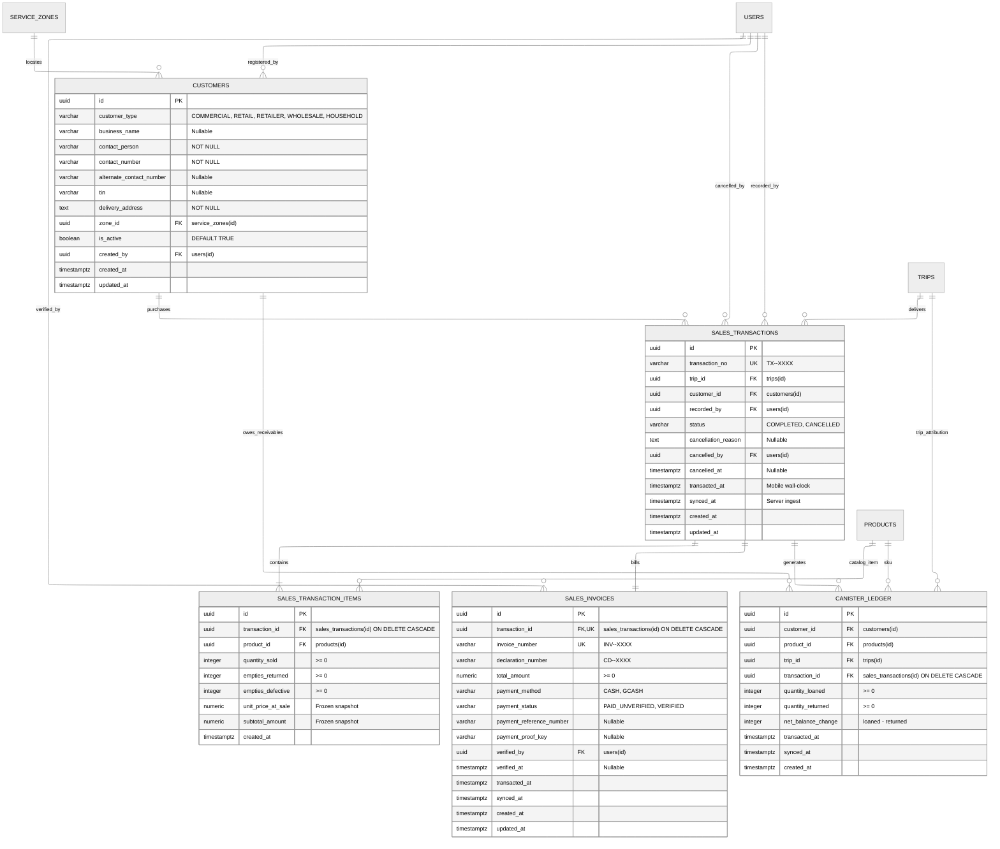

# Sales & Delivery Subsystem — Entity Relationship Diagram (ERD)

> **Module**: Sales & Delivery Subsystem  
> **Target Database**: PostgreSQL 18.x  
> **Status**: Phase 1 Implemented in Migration 015 (`015_sales_and_delivery_phase1.sql`) and Seed 008 (`008_sales_and_delivery_seed.sql`). Frontline transactional sales orders, line items, invoices, and append-only canister receivables ledger are established.

---

## 1. Mermaid Entity-Relationship Diagram

---

## 2. Table Specifications

### `customers`
Stores customer master profiles and institutional accounts for LPG distribution, orders, and delivery dispatch.

| Column | Data Type | Nullable | Default / Constraints | Description |
| :--- | :--- | :--- | :--- | :--- |
| `id` | `UUID` | No | `PRIMARY KEY DEFAULT gen_random_uuid()` | Unique customer identifier |
| `name` | `VARCHAR(255)` | No | Auto-synced via trigger | Legacy trade/full name for backward compatibility |
| `business_name` | `VARCHAR(150)` | Yes | — | Registered business/trade entity name |
| `contact_person` | `VARCHAR(100)` | No | Auto-synced from `name` | Primary contact name |
| `contact_number` | `VARCHAR(50)` | No | Standardized E.164 | Primary phone number |
| `alternate_contact_number` | `VARCHAR(30)` | Yes | Standardized E.164 | Secondary phone or landline |
| `tin` | `VARCHAR(30)` | Yes | — | Tax identification number |
| `address` | `TEXT` | No | Auto-synced via trigger | Legacy address column |
| `delivery_address` | `TEXT` | No | Auto-synced from `address` | Full delivery physical address |
| `customer_type` | `VARCHAR(30)` | No | `'COMMERCIAL'`, `'RETAIL'`, `'RETAILER'`, `'WHOLESALE'`, `'HOUSEHOLD'` | Account segment |
| `zone_id` | `UUID` | Yes | `REFERENCES service_zones(id)` | Assigned delivery route zone |
| `is_active` | `BOOLEAN` | No | `DEFAULT TRUE` | Soft-deactivation indicator |
| `created_by` | `UUID` | Yes | `REFERENCES users(id)` | User who registered the profile |
| `created_at` | `TIMESTAMPTZ` | No | `DEFAULT NOW()` | Record creation timestamp |
| `updated_at` | `TIMESTAMPTZ` | No | `DEFAULT NOW()` | Managed automatically via trigger |

---

### `sales_transactions`
Frontline delivery orders recorded in-field on the mobile register and synced idempotently.

| Column | Data Type | Nullable | Default / Constraints | Description |
| :--- | :--- | :--- | :--- | :--- |
| `id` | `UUID` | No | `PRIMARY KEY DEFAULT gen_random_uuid()` | Client-generated or server UUID |
| `transaction_no` | `VARCHAR(50)` | No | `UNIQUE` | Human-readable sequential reference |
| `trip_id` | `UUID` | No | `REFERENCES trips(id)` | Trip attribution |
| `customer_id` | `UUID` | No | `REFERENCES customers(id)` | Purchasing customer |
| `recorded_by` | `UUID` | No | `REFERENCES users(id)` | Sales Agent who processed order |
| `status` | `VARCHAR(20)` | No | `DEFAULT 'COMPLETED'` (`'COMPLETED'`, `'CANCELLED'`) | Order status |
| `cancellation_reason`| `TEXT` | Yes | — | Audit reason for cancellation |
| `cancelled_by` | `UUID` | Yes | `REFERENCES users(id)` | Supervisor who voided the sale |
| `cancelled_at` | `TIMESTAMPTZ`| Yes | — | Timestamp of cancellation |
| `transacted_at` | `TIMESTAMPTZ`| No | Mobile wall-clock | Time recorded on mobile device |
| `synced_at` | `TIMESTAMPTZ`| No | `DEFAULT NOW()` | Server ingestion timestamp |
| `created_at` | `TIMESTAMPTZ`| No | `DEFAULT NOW()` | Server record timestamp |
| `updated_at` | `TIMESTAMPTZ`| No | `DEFAULT NOW()` | Update timestamp |

---

### `sales_transaction_items`
Individual product line items within a sales order with frozen catalog pricing.

| Column | Data Type | Nullable | Default / Constraints | Description |
| :--- | :--- | :--- | :--- | :--- |
| `id` | `UUID` | No | `PRIMARY KEY DEFAULT gen_random_uuid()` | Line item identifier |
| `transaction_id` | `UUID` | No | `REFERENCES sales_transactions(id) ON DELETE CASCADE` | Parent transaction |
| `product_id` | `UUID` | No | `REFERENCES products(id)` | Catalog SKU |
| `quantity_sold` | `INTEGER` | No | `CHECK (quantity_sold >= 0)` | Number of full units sold |
| `empties_returned` | `INTEGER`| No | `DEFAULT 0 CHECK (empties_returned >= 0)` | Empty units swapped/returned |
| `empties_defective`| `INTEGER`| No | `DEFAULT 0 CHECK (empties_defective >= 0)`| Defective empty units |
| `unit_price_at_sale`|`NUMERIC(10,2)`| No | `CHECK (unit_price_at_sale >= 0)` | Frozen snapshot price per unit |
| `subtotal_amount` | `NUMERIC(12,2)`| No | `CHECK (subtotal_amount >= 0)` | Frozen total amount for line |
| `created_at` | `TIMESTAMPTZ`| No | `DEFAULT NOW()` | Creation timestamp |

---

### `sales_invoices`
Transactional invoices, customer declaration slips, and payment settlements.

| Column | Data Type | Nullable | Default / Constraints | Description |
| :--- | :--- | :--- | :--- | :--- |
| `id` | `UUID` | No | `PRIMARY KEY DEFAULT gen_random_uuid()` | Unique invoice identifier |
| `transaction_id` | `UUID` | No | `UNIQUE REFERENCES sales_transactions(id) ON DELETE CASCADE` | 1-to-1 transaction link |
| `invoice_number` | `VARCHAR(50)` | No | `UNIQUE` | Sequential invoice series |
| `declaration_number`| `VARCHAR(50)`| No | Sequential declaration series | Cylinder declaration number |
| `total_amount` | `NUMERIC(12,2)`| No | `CHECK (total_amount >= 0)` | Total invoice price |
| `payment_method` | `VARCHAR(20)` | No | `'CASH'`, `'GCASH'` | Mode of payment |
| `payment_status` | `VARCHAR(20)` | No | `DEFAULT 'PAID_UNVERIFIED'` (`'PAID_UNVERIFIED'`, `'VERIFIED'`) | Verification state |
| `payment_reference_number`| `VARCHAR(100)`| Yes | — | GCash reference string |
| `payment_proof_key` | `VARCHAR(255)`| Yes | — | Media attachment key for receipt screenshot |
| `verified_by` | `UUID` | Yes | `REFERENCES users(id)` | Cashier/supervisor who verified payment |
| `verified_at` | `TIMESTAMPTZ` | Yes | — | Verification timestamp |
| `transacted_at` | `TIMESTAMPTZ` | No | Mobile wall-clock | Transaction time |
| `synced_at` | `TIMESTAMPTZ` | No | `DEFAULT NOW()` | Ingestion timestamp |
| `created_at` | `TIMESTAMPTZ` | No | `DEFAULT NOW()` | Record creation timestamp |
| `updated_at` | `TIMESTAMPTZ` | No | `DEFAULT NOW()` | Record update timestamp |

---

### `canister_ledger`
Append-only ledger tracking loaned canisters, customer cylinder debt, and returns per product SKU.

| Column | Data Type | Nullable | Default / Constraints | Description |
| :--- | :--- | :--- | :--- | :--- |
| `id` | `UUID` | No | `PRIMARY KEY DEFAULT gen_random_uuid()` | Unique ledger entry identifier |
| `customer_id` | `UUID` | No | `REFERENCES customers(id)` | Debtor customer |
| `product_id` | `UUID` | No | `REFERENCES products(id)` | Product SKU |
| `trip_id` | `UUID` | No | `REFERENCES trips(id)` | Trip attribution for discrepancy reconciliation |
| `transaction_id` | `UUID` | No | `REFERENCES sales_transactions(id) ON DELETE CASCADE` | Originating sales order |
| `quantity_loaned` | `INTEGER` | No | `DEFAULT 0 CHECK (quantity_loaned >= 0)` | `GREATEST(0, sold - returned)` |
| `quantity_returned`| `INTEGER` | No | `DEFAULT 0 CHECK (quantity_returned >= 0)`| `GREATEST(0, returned - sold)` |
| `net_balance_change`|`INTEGER` | No | `CHECK (net_balance_change = quantity_loaned - quantity_returned)` | Signed delta |
| `transacted_at` | `TIMESTAMPTZ` | No | Mobile wall-clock | Ledger entry timestamp |
| `synced_at` | `TIMESTAMPTZ` | No | `DEFAULT NOW()` | Server ingestion timestamp |
| `created_at` | `TIMESTAMPTZ` | No | `DEFAULT NOW()` | Record creation timestamp |

---

## 3. Triggers & Automation

- **`trigger_sync_customer_profile`**: `BEFORE INSERT OR UPDATE` trigger on `customers` that synchronizes legacy `name`/`address` fields with modern `contact_person`/`business_name`/`delivery_address` fields.
- **`trigger_update_customers_updated_at`**: `BEFORE UPDATE` trigger on `customers` that automatically refreshes `updated_at`.
- **`trigger_update_sales_transactions_updated_at`**: `BEFORE UPDATE` trigger on `sales_transactions` that automatically refreshes `updated_at`.
- **`trigger_update_sales_invoices_updated_at`**: `BEFORE UPDATE` trigger on `sales_invoices` that automatically refreshes `updated_at`.
