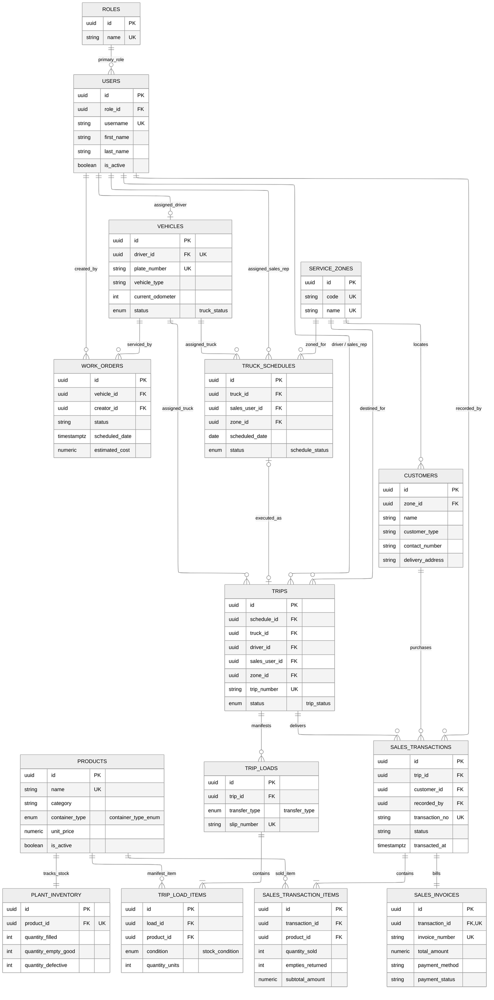

# Simplified Master Database Architecture — Core ERD

> **Database Engine**: PostgreSQL 18.x  
> **Scope**: 15 Core Operational Tables (distilled from the 38-table [`master_database_erd.md`](./master_database_erd.md))  
> **Purpose**: Presentation-friendly (PPT) entity-relationship diagram highlighting the core tables, primary keys, foreign keys, essential business fields, and cross-subsystem relationships.

---

## 1. Simplified Core Mermaid ERD

---

## 2. Core Subsystem Breakdown

| Subsystem | Core Tables Included | Role in System Flow |
| :--- | :--- | :--- |
| **1. User Management** | `roles`, `users` | Defines system actors (Admin, Driver, Sales Rep, Supervisor) and their primary roles. |
| **2. Fleet & Maintenance** | `vehicles`, `work_orders` | Tracks delivery trucks, assigned drivers, odometer readings, and maintenance work orders. |
| **3. Inventory** | `products`, `plant_inventory` | Defines LPG products/containers and tracks filled, empty-good, and defective plant stock. |
| **4. Schedule & Trips** | `service_zones`, `truck_schedules`, `trips`, `trip_loads`, `trip_load_items` | Plans daily truck routes, executes dispatch trips, and records outbound/return stock manifests. |
| **5. Sales & Delivery** | `customers`, `sales_transactions`, `sales_transaction_items`, `sales_invoices` | Manages customer profiles, field sales transactions, line-item quantities, and payment invoices. |

> For the complete 38-table schema including RBAC junctions, audit/history logs, odometer/fuel telemetry, stock reconciliations, and canister ledgers, see [`master_database_erd.md`](./master_database_erd.md).
