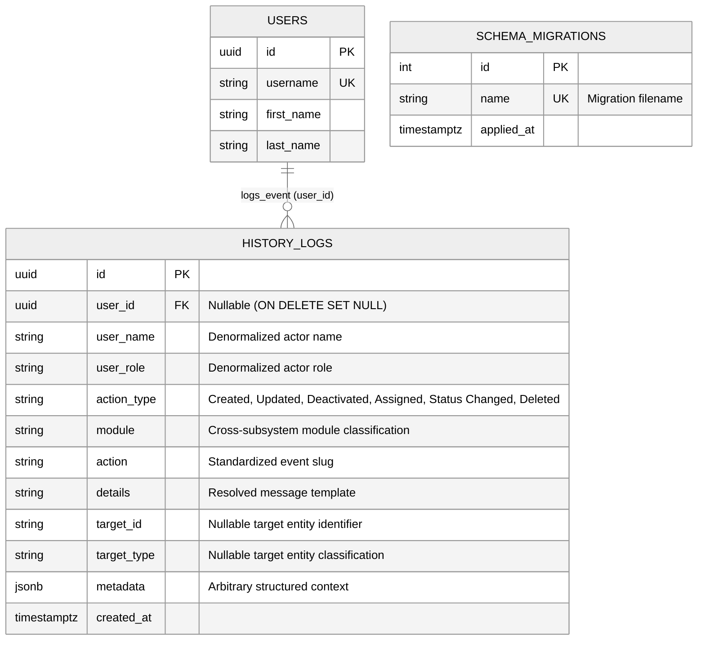

# System Logic (Cross-Cutting Infrastructure) — Entity Relationship Diagram (ERD)

> **Classification**: Cross-Cutting System Logic & Infrastructure *(Non-Subsystem)*  
> **Target Database**: PostgreSQL 18.x  
> **Scope**: Houses cross-cutting event history auditing (`history_logs`) and schema migration tracking (`schema_migrations`) that support all 5 main business subsystems without belonging to a single domain subsystem.

---

## 1. Mermaid Entity-Relationship Diagram

---

## 2. Table Specifications

### `history_logs`
Chronological event ledger recording operational, financial, route, and administrative actions across all 5 main subsystems.

| Column | Data Type | Nullable | Default / Constraints | Description |
| :--- | :--- | :--- | :--- | :--- |
| `id` | `UUID` | No | `PRIMARY KEY DEFAULT gen_random_uuid()` | Unique log identifier |
| `user_id` | `UUID` | Yes | `FK -> users(id) ON DELETE SET NULL` | Performing authenticated user (system events use NULL) |
| `user_name` | `VARCHAR(150)` | No | Non-empty | Snapshot of actor's full name at log time |
| `user_role` | `VARCHAR(100)` | No | Non-empty | Snapshot of actor's active role at log time |
| `action_type` | `VARCHAR(50)` | No | Non-empty | High-level action category: `Created`, `Updated`, `Deactivated`, `Assigned`, `Status Changed`, `Deleted` |
| `module` | `VARCHAR(100)` | No | Non-empty | Domain classification (e.g. `User Management`, `Fleet Management`, `Inventory Management`, `Sales & Delivery`, `SCHEDULE`, `TRIP`) |
| `action` | `VARCHAR(100)` | No | Non-empty | Standard event key (e.g. `TRIP_DISPATCHED`, `PRODUCT_CREATED`) |
| `details` | `TEXT` | No | Non-empty | Resolved descriptive message |
| `target_id` | `VARCHAR(255)` | Yes | `NULL` | ID of the affected entity |
| `target_type` | `VARCHAR(100)` | Yes | `NULL` | Entity type (e.g. `TRIP`, `VEHICLE`, `PRODUCT`, `USER`) |
| `metadata` | `JSONB` | Yes | `DEFAULT '{}'::jsonb` | Structured JSON payload for auxiliary event data |
| `created_at` | `TIMESTAMPTZ` | No | `DEFAULT NOW()` | Event recording timestamp |

### `schema_migrations`
Internal PostgreSQL migration tracking ledger managed by `database/scripts/migrate.js`.

| Column | Data Type | Nullable | Default / Constraints | Description |
| :--- | :--- | :--- | :--- | :--- |
| `id` | `SERIAL` | No | `PRIMARY KEY` | Sequential migration execution ID |
| `name` | `VARCHAR(255)` | No | `UNIQUE` | Executed SQL migration filename |
| `applied_at` | `TIMESTAMPTZ` | No | `DEFAULT CURRENT_TIMESTAMP` | Migration execution timestamp |
