This file is a merged representation of a subset of the codebase, containing files not matching ignore patterns, combined into a single document by Repomix.

# File Summary

## Purpose
This file contains a packed representation of a subset of the repository's contents that is considered the most important context.
It is designed to be easily consumable by AI systems for analysis, code review,
or other automated processes.

## File Format
The content is organized as follows:
1. This summary section
2. Repository information
3. Directory structure
4. Repository files (if enabled)
5. Multiple file entries, each consisting of:
  a. A header with the file path (## File: path/to/file)
  b. The full contents of the file in a code block

## Usage Guidelines
- This file should be treated as read-only. Any changes should be made to the
  original repository files, not this packed version.
- When processing this file, use the file path to distinguish
  between different files in the repository.
- Be aware that this file may contain sensitive information. Handle it with
  the same level of security as you would the original repository.

## Notes
- Some files may have been excluded based on .gitignore rules and Repomix's configuration
- Binary files are not included in this packed representation. Please refer to the Repository Structure section for a complete list of file paths, including binary files
- Files matching these patterns are excluded: **/.agents/**, **/.github/**, **/.husky/**, **/.idea/**, **/.vscode/**, **/coverage/**, **/build/**, **/*.log, .env, .env.*, **/*.min.js, **/*.map
- Files matching patterns in .gitignore are excluded
- Files matching default ignore patterns are excluded
- Files are sorted by Git change count (files with more changes are at the bottom)

# Directory Structure
`````
database/
  migrations/
    001_initial-setup.sql
    002_fleet_and_maintenance.sql
    003_products.sql
    004_customers.sql
    005_history_logs.sql
    006_roles_and_permissions_expansion.sql
    007_multi_role_and_org_chart_roles.sql
    008_maintenance_and_work_orders.sql
    009_vehicles_and_receipts_refactor.sql
    010_schedules_and_trips.sql
    011_plant_inventory_and_reconciliation.sql
    012_normalize_work_order_receipts.sql
    013_plant_and_vehicle_stock_permissions.sql
    014_hardening_schedules_trips_and_inventory.sql
    015_sales_and_delivery_phase1.sql
    016_operational_logging_subsystems.sql
    017_ensure_driver_route_permissions.sql
    018_remove_driver_attendance.sql
    019_user_profile_avatar.sql
    020_add_returned_to_trip_status.sql
    021_trip_handling_and_reconciliation_flow.sql
    022_finalize_roles_and_permissions.sql
    023_restrict_dashboard_to_admins.sql
    024_system_settings.sql
    025_product_unit_price.sql
    026_logistics_fleet_only_sales_trips.sql
    027_sales_invoice_flagging.sql
  scripts/
    export-schema.js
    migrate.js
    reset.js
    seed.js
    setup.js
  seeds/
    001_user_management_seed.sql
    002_fleet_and_maintenance_seed.sql
    003_inventory_products_seed.sql
    004_sales_customers_seed.sql
    005_history_logs_seed.sql
    006_schedules_and_trips_seed.sql
    007_plant_inventory_seed.sql
    008_sales_and_delivery_seed.sql
    009_fuel_and_operations_seed.sql
  snapshots/
    schema.sql
  connection.js
docs/
  api-contracts/
    _archive/
      fleet-and-maintenance.api.md
      history-log.api.md
      inventory-products.api.md
      sales-customer.api.md
      user-management.api.md
    dashboard/
      dashboard.api.md
    fleet/
      availability.api.md
      drivers.api.md
      maintenance.api.md
      vehicles.api.md
    history/
      history.api.md
    inventory/
      plant-inventory-and-reconciliation.api.md
      products.api.md
    media/
      media.api.md
    sales/
      customer.api.md
      sync.api.md
      transactions.api.md
    schedules/
      schedules.api.md
    settings/
      settings.api.md
    trips/
      trips.api.md
    users/
      auth.api.md
      management.api.md
      profile.api.md
      roles.api.md
    README.md
    websockets.md
  ERD_mermaid/
    fleet_and_maintenance_erd.md
    inventory_erd.md
    master_database_erd.md
    master_database_relationships_erd.md
    README.md
    sales_and_delivery_erd.md
    schedule_and_trip_erd.md
    system_logic_erd.md
    users_and_rbac_erd.md
  guides/
    backend-developer-guide.md
    frontend-integration-guide.md
  QA/
    _seed_credentials.md
    (1)_qa-testing-guide.md
    [example] postman_testing_guide.md
  temp/
    temp_seed_receipts/
      mock1.jpg
      mock10.jpg
      mock2.jpg
      mock3.jpg
      mock4.jpg
      mock5.jpg
      mock6.jpg
      mock7.jpg
      mock8.jpg
      mock9.jpg
    [update] user_management.md
    from-frontend.txt
  database_table_documentation.md
  database_table_structures.md
  erd-documentation.csv
  erd-documentation.md
  erd-tables-summary.csv
  frontend-media-integration-prompt.md
  permissions.md
  subsystem_modules_overview.md
scripts/
  check-node.js
  upload-seed-media.js
src/
  config/
    cookie.js
    cors.js
    env.js
    system.config.js
  features/
    dashboard/
      dashboard.controller.js
      dashboard.repository.js
      dashboard.routes.js
      dashboard.service.js
      index.js
    fleet/
      availability/
        availability.controller.js
        availability.repository.js
        availability.service.js
      maintenance/
        index.js
        maintenance.controller.js
        maintenance.repository.js
        maintenance.routes.js
        maintenance.service.js
      vehicles/
        vehicles.controller.js
        vehicles.repository.js
        vehicles.service.js
      fleet.routes.js
      index.js
    history/
      history.controller.js
      history.events.js
      history.repository.js
      history.routes.js
      history.service.js
      index.js
    inventory/
      products/
        products.controller.js
        products.repository.js
        products.service.js
      index.js
      inventory.controller.js
      inventory.repository.js
      inventory.routes.js
      inventory.service.js
    media/
      index.js
      media.controller.js
      media.middleware.js
      media.routes.js
      media.service.js
      media.storage.js
    operations/
      alerts/
        alerts.controller.js
        alerts.notifier.js
        alerts.repository.js
        alerts.routes.js
        alerts.service.js
      apprehensions/
        apprehensions.controller.js
        apprehensions.repository.js
        apprehensions.routes.js
        apprehensions.service.js
      fuel/
        fuel.controller.js
        fuel.repository.js
        fuel.routes.js
        fuel.service.js
      index.js
      operations.routes.js
    sales/
      customers/
        customer.controller.js
        customer.repository.js
        customer.routes.js
        customer.service.js
        index.js
      invoices/
        index.js
        invoices.controller.js
        invoices.repository.js
        invoices.routes.js
        invoices.service.js
      sync/
        index.js
        sync.controller.js
        sync.routes.js
        sync.service.js
      transactions/
        index.js
        transactions.controller.js
        transactions.repository.js
        transactions.routes.js
        transactions.service.js
      index.js
      sales.routes.js
    schedules/
      templates/
        templates.controller.js
        templates.repository.js
        templates.service.js
      zones/
        zones.controller.js
        zones.repository.js
        zones.service.js
      index.js
      schedules.controller.js
      schedules.repository.js
      schedules.routes.js
      schedules.service.js
    settings/
      index.js
      settings.controller.js
      settings.repository.js
      settings.routes.js
      settings.service.js
    trips/
      loads/
        loads.repository.js
      reconciliation/
        reconciliation.repository.js
      index.js
      trips.controller.js
      trips.repository.js
      trips.routes.js
      trips.service.js
    users/
      auth.service.js
      index.js
      management.service.js
      permission.service.js
      profile.service.js
      users.controller.js
      users.repository.js
      users.routes.js
  middleware/
    auth.middleware.js
    cookie.middleware.js
    error.middleware.js
  routes/
    index.js
  test/
    auth.test.js
    cors.auth.test.js
    customer.test.js
    dashboard.test.js
    fleet.maintenance.test.js
    fleet.test.js
    fuel.analysis.test.js
    history.test.js
    inventory.reconciliation.test.js
    inventory.test.js
    management.test.js
    media.test.js
    operations.logging.test.js
    pagination.test.js
    permission.test.js
    phone.test.js
    profile.avatar.test.js
    profile.test.js
    sales.analytics.test.js
    sales.customer.test.js
    sales.transactions.test.js
    schedules.trips.test.js
    settings.test.js
    socket.test.js
    trips.reconciliation.audit.test.js
  utils/
    asyncHandler.js
    pagination.js
    passwordGenerator.js
    phoneParser.js
    ttlCache.js
    usernameGenerator.js
  app.js
  server.js
  socket.js
.gitattributes
.gitignore
.npmrc
.nvmrc
.repomixignore
.test
AGENTS.md
LICENSE
nodemon.json
package.json
README.md
repomix.config.json
`````

# Files

## File: database/migrations/001_initial-setup.sql
`````sql
CREATE EXTENSION IF NOT EXISTS "pgcrypto";

CREATE TABLE "roles" (
    "id" UUID DEFAULT gen_random_uuid(),
    "name" VARCHAR(50) NOT NULL,
    "description" TEXT,
    "created_at" TIMESTAMPTZ NOT NULL DEFAULT NOW(),

    PRIMARY KEY ("id"),
    CONSTRAINT "UQ_roles_name" UNIQUE ("name")
);


CREATE TABLE "permissions" (
    "id" UUID DEFAULT gen_random_uuid(),
    "name" VARCHAR(100) NOT NULL,
    "description" TEXT,

    PRIMARY KEY ("id"),
    CONSTRAINT "UQ_permissions_name" UNIQUE ("name")
);


CREATE TABLE "role_permissions" (
    "role_id" UUID NOT NULL,
    "permission_id" UUID NOT NULL,

    PRIMARY KEY ("role_id", "permission_id"),

    CONSTRAINT "FK_role_permissions_role_id"
        FOREIGN KEY ("role_id")
        REFERENCES "roles"("id"),

    CONSTRAINT "FK_role_permissions_permission_id"
        FOREIGN KEY ("permission_id")
        REFERENCES "permissions"("id")
);


CREATE TABLE "users" (
    "id" UUID DEFAULT gen_random_uuid(),
    "username" VARCHAR(50) NOT NULL,
    "password_hash" TEXT NOT NULL,
    "first_name" VARCHAR(100) NOT NULL,
    "last_name" VARCHAR(100) NOT NULL,
    "phone" VARCHAR(20),
    "birthdate" DATE,
    "role_id" UUID NOT NULL,
    "is_active" BOOLEAN NOT NULL DEFAULT TRUE,
    "is_blocked" BOOLEAN NOT NULL DEFAULT FALSE,
    "must_change_password" BOOLEAN NOT NULL DEFAULT TRUE,
    "created_at" TIMESTAMPTZ NOT NULL DEFAULT NOW(),

    PRIMARY KEY ("id"),

    CONSTRAINT "UQ_users_username" UNIQUE ("username"),

    CONSTRAINT "FK_users_role_id"
        FOREIGN KEY ("role_id")
        REFERENCES "roles"("id")
);


CREATE TABLE "audit_logs" (
    "id" UUID DEFAULT gen_random_uuid(),
    "user_id" UUID NOT NULL,
    "target_user_id" UUID,
    "action" VARCHAR(100) NOT NULL,
    "description" TEXT,
    "created_at" TIMESTAMPTZ NOT NULL DEFAULT NOW(),

    PRIMARY KEY ("id"),

    CONSTRAINT "FK_audit_logs_user_id"
        FOREIGN KEY ("user_id")
        REFERENCES "users"("id"),

    CONSTRAINT "FK_audit_logs_target_user_id"
        FOREIGN KEY ("target_user_id")
        REFERENCES "users"("id")
);


CREATE TABLE "sessions" (
    "id" UUID DEFAULT gen_random_uuid(),
    "user_id" UUID NOT NULL,
    "token_hash" VARCHAR(255) NOT NULL,
    "created_at" TIMESTAMPTZ NOT NULL DEFAULT NOW(),
    "expires_at" TIMESTAMPTZ NOT NULL,
    "revoked_at" TIMESTAMPTZ,

    PRIMARY KEY ("id"),

    CONSTRAINT "FK_sessions_user_id"
        FOREIGN KEY ("user_id")
        REFERENCES "users"("id")
);
`````

## File: database/scripts/migrate.js
`````javascript
const fs = require("fs");
const path = require("path");
const { pool } = require("../connection");

require("dotenv").config();

const MIGRATIONS_DIR = path.join(__dirname, "..", "migrations");

/**
 * Ensure the migration tracking table exists.
 */
async function ensureMigrationTable(client) {
  await client.query(`
        CREATE TABLE IF NOT EXISTS schema_migrations (
            id SERIAL PRIMARY KEY,
            filename TEXT NOT NULL UNIQUE,
            applied_at TIMESTAMPTZ NOT NULL DEFAULT NOW()
        );
    `);
}

/**
 * Get all SQL migration files.
 */
function getMigrationFiles() {
  if (!fs.existsSync(MIGRATIONS_DIR)) {
    throw new Error(`Migration directory not found: ${MIGRATIONS_DIR}`);
  }

  return fs
    .readdirSync(MIGRATIONS_DIR)
    .filter((file) => file.endsWith(".sql"))
    .sort();
}

/**
 * Get filenames of migrations already applied.
 */
async function getAppliedMigrations(client) {
  const result = await client.query(`
        SELECT filename
        FROM schema_migrations
    `);

  return new Set(result.rows.map((row) => row.filename));
}

/**
 * Apply a single migration using a transaction.
 */
async function applyMigration(client, filename) {
  const filePath = path.join(MIGRATIONS_DIR, filename);

  const sql = fs.readFileSync(filePath, "utf8");

  console.log(`→ Applying ${filename}`);

  await client.query("BEGIN");

  try {
    await client.query(sql);

    await client.query(
      `
            INSERT INTO schema_migrations (filename)
            VALUES ($1)
            `,
      [filename],
    );

    await client.query("COMMIT");

    console.log(`✓ Applied ${filename}`);
  } catch (error) {
    await client.query("ROLLBACK");

    throw new Error(`Migration failed: ${filename}\n${error.message}`);
  }
}

/**
 * Run all pending migrations.
 */
async function migrate() {
  const client = await pool.connect();

  try {
    console.log("Running database migrations...\n");

    await ensureMigrationTable(client);

    const migrationFiles = getMigrationFiles();
    const appliedMigrations = await getAppliedMigrations(client);

    const pendingMigrations = migrationFiles.filter(
      (file) => !appliedMigrations.has(file),
    );

    if (pendingMigrations.length === 0) {
      console.log("✓ Database is already up to date.");
      return;
    }

    console.log(`Found ${pendingMigrations.length} pending migration(s).\n`);

    for (const filename of pendingMigrations) {
      await applyMigration(client, filename);
    }

    console.log("\n✓ Database migration completed.");
  } finally {
    client.release();
  }
}

async function main() {
  try {
    await migrate();
  } catch (error) {
    console.error("\n✗ Migration failed.");
    console.error(error.message);

    process.exitCode = 1;
  } finally {
    await pool.end();
  }
}

module.exports = {
  migrate,
};

if (require.main === module) {
  main();
}
`````

## File: docs/QA/(1)_qa-testing-guide.md
`````markdown
# MadayawGas: QA Testing Guide & Strategy

Welcome to the MadayawGas QA Guide! This handbook explains **your role as the QA engineer**, **how to test any feature in the system**, and **what specific test scenarios to execute**.

---

## 1. What is the QA's Role?

As the QA engineer, your mission is to be the **system defender and user advocate**:

1. **Prevent Bad Data**: Ensure the API rejects incomplete, malformed, or malicious inputs with clear error messages.
2. **Enforce Security & Permissions**: Ensure users can only see and do what their assigned role permits (RBAC).
3. **Verify Business Rules & State Transitions**: Verify that business workflows (sales, deliveries, inventory, user accounts) work smoothly and fail safely.
4. **Report Bugs Clearly**: Give developers exact reproduction steps so bugs get fixed on the first attempt.

---

## 2. General Testing Principles (For the Entire System)

Whenever a developer builds _any_ endpoint or feature (e.g., Sales, Inventory, Fleet, Users), run through these **5 General QA Checks**:

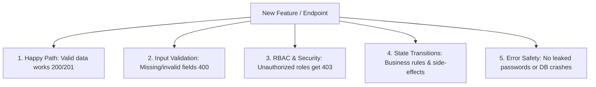

### 1. Happy Path Testing (Valid Inputs)

- Send complete, valid data.
- Verify the HTTP status code is `200 OK` or `201 Created`.
- Verify the response contains expected fields in the **JSend format** (`{ status: "success", data: { ... } }`).

### 2. Form & Input Validation (Unhappy Path)

Test what happens when the user sends bad data:

- **Missing Required Fields**: Send `{}` or omit fields (e.g., missing `price`, `username`, `quantity`). The API must return `400 Bad Request` with a helpful message, **never crash**.
- **Invalid Data Types**: Send text `"abc"` where a number is expected, or invalid date strings.
- **Boundary & Length Limits**:
  - Passwords with < 8 characters or usernames with < 3 characters.
  - Negative quantities or prices (e.g., `-10` LPG tanks).
  - Extremely long strings (e.g., 500 characters in a name field).
- **Duplicate Entries**: Attempt to register duplicate usernames, duplicate license plates, or duplicate SKU numbers. Must return `400 Bad Request`.

### 3. Role-Based Access Control (RBAC) Checks

Every endpoint has an authorized role. Always test permissions:

- **Unauthenticated Request (No Cookie)** ➔ Must return `401 Unauthorized`.
- **Wrong Role (e.g., Sales Person calling Admin route)** ➔ Must return `403 Forbidden`.
- **Correct Role (e.g., Super Admin calling Admin route)** ➔ Must return `200 OK` / `201 Created`.

### 4. State Transitions & Business Logic

Verify that state changes take effect across the system:

- When an account is **deactivated or blocked**, verify their active session is immediately revoked (`401 Unauthorized`) and they cannot log in.
- When a user changes their password, verify the old password immediately stops working.
- When inventory stock is 0, verify the system prevents creating a new sales delivery.

### 5. Security & Error Safety

- **No Sensitive Data Leaks**: Responses must **never** include `password`, `password_hash`, or internal database stack traces.
- **SQL Injection Test**: Try inputting `' OR '1'='1` in fields. The system must safely sanitize inputs and return standard error responses.

---

## 3. How to Write a High-Quality Bug Report

When you find a bug, copy and paste this standard template into your bug tracking system:

````markdown
### [BUG] Short Descriptive Title (e.g., Deactivated user can still access /me endpoint)

- **Severity**: Critical / High / Medium / Low
- **Endpoint**: `PATCH /api/users/:id/status`
- **Logged-in User Role**: Super Admin

#### Steps to Reproduce:

1. Log in as `superadmin`.
2. Deactivate `sales_user` via `PATCH /api/users/<id>/status` with body `{"isActive": false}`.
3. Switch to `sales_user`'s session and call `GET /api/users/me`.

#### Expected Result:

`GET /api/users/me` should return `401 Unauthorized` because the user was deactivated.

#### Actual Result:

`GET /api/users/me` returns `200 OK` with profile data.

#### Payload / Response Snippet:

```json
{
  "status": "success",
  "data": { ... }
}
```
````

```

```
`````

## File: docs/QA/[example] postman_testing_guide.md
`````markdown
# Postman Testing Guide: Authentication & RBAC

This guide contains everything you need to test Login, Logout, Profile Management, Admin Operations, and **RBAC Permission Denials / Access Grants** in Postman or cURL.

---

## 1. Test Accounts & Credentials

The database comes pre-seeded with accounts for testing different roles and permission levels:

| Username | Password | Role | Phone | Permissions Overview |
| :--- | :--- | :--- | :--- | :--- |
| **`superadmin`** | `Superadmin123!` | **Super Admin** | `+639170000001` | **Full access**: Can manage all users, fleet, routes, sales, inventory, and deliveries. Cannot be blocked or deactivated. |
| **`admin_user`** | `AdminPass123!` | **Admin** | `+639170000002` | **Administrator access**: Can manage users, fleet, inventory, and view reports. |
| **`fleet_user`** | `FleetPass123!` | **Fleet Manager** | `+639170000003` | **Fleet & routes access**: `fleet.*`, `route.*`, `dashboard.view`. Cannot manage user accounts (`403 Forbidden`). |
| **`sales_user`** | `SalesPass123!` | **Sales Person** | `+639170000004` | **Sales representative**: `sales.view_own`, `sales.create`, `delivery.view_own`. Cannot access admin or fleet management (`403 Forbidden`). |

---

## 2. How Authentication Works in Postman

* **Stateful Session Cookie**: When you send a `POST /api/users/login`, the backend returns a `Set-Cookie: mg_sid=...` header.
* **Automatic Cookie Jar**: Postman automatically stores and attaches this `mg_sid` cookie to all subsequent requests to `http://localhost:3000`. You do not need to manually copy-paste tokens!
* **To Switch Users**: Call `POST /api/users/logout` or click **Cookies** in Postman (top right under the Send button) to clear `mg_sid`, then log in with the other account.

---

## 3. Step-by-Step Test Scenarios

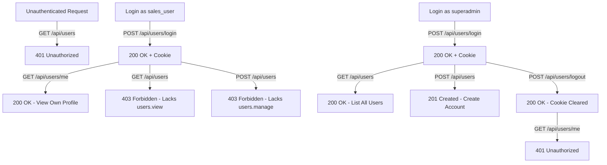

---

### Scenario A: Unauthenticated Request (401 Unauthorized)

Test calling a protected endpoint before logging in.

* **Method**: `GET`
* **URL**: `http://localhost:3000/api/users`
* **Headers**: `None`

#### Expected Response (`401 Unauthorized`)
```json
{
  "status": "fail",
  "message": "Unauthorized"
}
```

---

### Scenario B: Login as `sales_user` (Normal User)

* **Method**: `POST`
* **URL**: `http://localhost:3000/api/users/login`
* **Headers**: `Content-Type: application/json`
* **Body** (raw JSON):
  ```json
  {
    "username": "sales_user",
    "password": "SalesPass123!"
  }
  ```

#### Expected Response (`200 OK`)
Sets `mg_sid` cookie.
```json
{
  "status": "success",
  "data": {
    "user": {
      "id": "ece43b18-ae50-467b-a578-66092cc92ce7",
      "username": "sales_user",
      "firstName": "Juan",
      "lastName": "Sales",
      "birthdate": null,
      "role": "Sales Person",
      "roleId": "98b3be70-2bd5-4a6d-be32-a9174cb1cb84",
      "isActive": true,
      "isBlocked": false,
      "permissions": [
        "dashboard.view",
        "route.view_own",
        "sales.view_own",
        "sales.create",
        "sales.update",
        "delivery.view_own",
        "delivery.update_own"
      ]
    }
  }
}
```

---

### Scenario C: RBAC Access Denied (`sales_user` attempts Admin operations)

While logged in as `sales_user`, attempt to access endpoints that require `users.view` or `users.manage`.

#### Test 1: List all users (`GET /api/users` - requires `users.view`)
* **Method**: `GET`
* **URL**: `http://localhost:3000/api/users`

**Expected Response (`403 Forbidden`)**:
```json
{
  "status": "fail",
  "message": "Forbidden"
}
```

#### Test 2: Create a user (`POST /api/users` - requires `users.manage`)
* **Method**: `POST`
* **URL**: `http://localhost:3000/api/users`
* **Body**:
  ```json
  {
    "username": "hacker_account",
    "password": "Password123!",
    "firstName": "Bad",
    "lastName": "Actor",
    "roleId": "98b3be70-2bd5-4a6d-be32-a9174cb1cb84"
  }
  ```

**Expected Response (`403 Forbidden`)**:
```json
{
  "status": "fail",
  "message": "Forbidden"
}
```

#### Test 3: Access Admin-only test route (`GET /api/users/admin-only-test`)
* **Method**: `GET`
* **URL**: `http://localhost:3000/api/users/admin-only-test`

**Expected Response (`403 Forbidden`)**:
```json
{
  "status": "fail",
  "message": "Forbidden"
}
```

---

### Scenario D: Allowed Operations for `sales_user`

#### Test 1: View Own Profile (`GET /api/users/me`)
* **Method**: `GET`
* **URL**: `http://localhost:3000/api/users/me`

**Expected Response (`200 OK`)**:
```json
{
  "status": "success",
  "data": {
    "user": {
      "id": "ece43b18-ae50-467b-a578-66092cc92ce7",
      "username": "sales_user",
      "firstName": "Juan",
      "lastName": "Sales",
      "role": "Sales Person",
      "permissions": [...]
    }
  }
}
```

#### Test 2: Update Own Profile (`PATCH /api/users/me`)
* **Method**: `PATCH`
* **URL**: `http://localhost:3000/api/users/me`
* **Body**:
  ```json
  {
    "firstName": "Juanito",
    "lastName": "Dela Cruz",
    "birthdate": "1994-06-15"
  }
  ```

**Expected Response (`200 OK`)**:
```json
{
  "status": "success",
  "data": {
    "user": {
      "id": "ece43b18-ae50-467b-a578-66092cc92ce7",
      "username": "sales_user",
      "firstName": "Juanito",
      "lastName": "Dela Cruz",
      "birthdate": "1994-06-15T00:00:00.000Z",
      "role": "Sales Person"
    }
  }
}
```

---

### Scenario E: Login as `superadmin` (Full Access)

* **Method**: `POST`
* **URL**: `http://localhost:3000/api/users/login`
* **Body**:
  ```json
  {
    "username": "superadmin",
    "password": "Superadmin123!"
  }
  ```

#### Test 1: List all users (`GET /api/users` - Allowed)
* **Method**: `GET`
* **URL**: `http://localhost:3000/api/users`

**Expected Response (`200 OK`)**:
```json
{
  "status": "success",
  "data": {
    "users": [
      { "username": "superadmin", "role": "Super Admin" },
      { "username": "sales_user", "role": "Sales Person" },
      { "username": "fleet_user", "role": "Fleet Manager" }
    ]
  }
}
```

#### Test 2: Admin-only route (`GET /api/users/admin-only-test` - Allowed)
* **Method**: `GET`
* **URL**: `http://localhost:3000/api/users/admin-only-test`

**Expected Response (`200 OK`)**:
```json
{
  "status": "success",
  "message": "Access granted"
}
```

#### Test 3: List System Roles (`GET /api/users/roles`)
* **Method**: `GET`
* **URL**: `http://localhost:3000/api/users/roles`

**Expected Response (`200 OK`)**:
```json
{
  "status": "success",
  "data": {
    "roles": [
      { "id": "69f0702c-...", "name": "Admin" },
      { "id": "5f60e166-...", "name": "Fleet Manager" },
      { "id": "98b3be70-...", "name": "Sales Person" },
      { "id": "d710521e-...", "name": "Super Admin" }
    ]
  }
}
```

---

### Scenario F: User Logout

* **Method**: `POST`
* **URL**: `http://localhost:3000/api/users/logout`

**Expected Response (`200 OK`)**:
```json
{
  "status": "success",
  "message": "Successfully logged out"
}
```

After logout, sending `GET /api/users/me` immediately returns:
```json
{
  "status": "fail",
  "message": "Unauthorized"
}
```
`````

## File: scripts/check-node.js
`````javascript
const REQUIRED_MAJOR = 22;
const REQUIRED_VERSION = "22.19.0";

const currentVersion = process.versions.node;
const currentMajor = parseInt(currentVersion.split(".")[0], 10);

if (currentMajor !== REQUIRED_MAJOR) {
  console.error("");
  console.error("❌ Incorrect Node.js version.");
  console.error("");
  console.error(`Required: v${REQUIRED_VERSION}`);
  console.error(`Current : v${currentVersion}`);
  console.error("");
  console.error(
    "Please switch to Node.js 22.19.0 before installing dependencies.",
  );
  console.error("");

  process.exit(1);
}

console.log(`✔ Using Node.js v${currentVersion}`);
`````

## File: src/features/users/index.js
`````javascript
const usersRoutes = require('./users.routes');
const usersController = require('./users.controller');
const authService = require('./auth.service');
const profileService = require('./profile.service');
const managementService = require('./management.service');
const permissionService = require('./permission.service');
const usersRepository = require('./users.repository');

module.exports = {
  routes: usersRoutes,
  controller: usersController,
  authService,
  profileService,
  managementService,
  permissionService,
  usersRepository,
};
`````

## File: src/middleware/cookie.middleware.js
`````javascript
/**
 * Lightweight cookie parsing middleware (zero external dependencies)
 */
const cookieParser = (req, res, next) => {
  const cookieHeader = req.headers.cookie;
  const cookies = {};

  if (cookieHeader) {
    cookieHeader.split(';').forEach((cookie) => {
      const parts = cookie.split('=');
      const name = parts.shift().trim();
      const value = parts.join('=').trim();
      if (name) {
        try {
          cookies[name] = decodeURIComponent(value);
        } catch {
          cookies[name] = value;
        }
      }
    });
  }

  req.cookies = cookies;
  next();
};

module.exports = cookieParser;
`````

## File: src/utils/asyncHandler.js
`````javascript
/**
 * Higher-order function to catch errors from async express route handlers
 * and forward them to express error handling middleware.
 *
 * @param {Function} fn - Async controller/middleware function
 * @returns {Function} Express middleware function
 */
const asyncHandler = (fn) => (req, res, next) => {
  Promise.resolve(fn(req, res, next)).catch(next);
};

module.exports = asyncHandler;
`````

## File: src/utils/passwordGenerator.js
`````javascript
const crypto = require('crypto');

/**
 * Generates a cryptographically strong, user-friendly temporary password.
 * Format: Mg# + 8 alphanumeric random characters + ! (e.g. Mg#8xK9pL2!)
 */
function generateTemporaryPassword() {
  const chars = 'ABCDEFGHJKLMNPQRSTUVWXYZabcdefghijkmnpqrstuvwxyz23456789';
  const randomBytes = crypto.randomBytes(8);
  let randomString = '';
  for (let i = 0; i < 8; i++) {
    randomString += chars[randomBytes[i] % chars.length];
  }
  return `Mg#${randomString}!`;
}

module.exports = {
  generateTemporaryPassword,
};
`````

## File: src/utils/usernameGenerator.js
`````javascript
/**
 * Cleans and normalizes a name string (removes accents, spaces, and non-alphanumeric characters).
 */
function sanitizeName(str) {
  if (!str || typeof str !== 'string') return '';
  return str
    .normalize('NFD')
    .replace(/[\u0300-\u036f]/g, '') // remove diacritics / accents
    .replace(/[^a-zA-Z0-9]/g, '')    // keep only alphanumeric
    .toLowerCase();
}

/**
 * Generates a base username from firstName and lastName.
 * Format: first letter of firstName + lastName (e.g. John Doe -> jdoe)
 */
function generateBaseUsername(firstName, lastName) {
  const cleanFirst = sanitizeName(firstName);
  const cleanLast = sanitizeName(lastName);

  if (!cleanFirst || !cleanLast) {
    throw new Error('Valid first name and last name are required to generate username');
  }

  return `${cleanFirst[0]}${cleanLast}`;
}

/**
 * Resolves a unique username against an array/set of existing usernames in the database.
 * If base is 'jdoe' and 'jdoe' exists, tries 'jdoe1', 'jdoe2', etc.
 */
function resolveUniqueUsername(baseUsername, existingUsernames = []) {
  const existingSet = new Set(existingUsernames.map((u) => u.toLowerCase()));

  if (!existingSet.has(baseUsername.toLowerCase())) {
    return baseUsername.toLowerCase();
  }

  let counter = 1;
  while (existingSet.has(`${baseUsername.toLowerCase()}${counter}`)) {
    counter++;
  }

  return `${baseUsername.toLowerCase()}${counter}`;
}

module.exports = {
  sanitizeName,
  generateBaseUsername,
  resolveUniqueUsername,
};
`````

## File: .npmrc
`````
engine-strict=true
`````

## File: .nvmrc
`````
22.19.0
`````

## File: README.md
`````markdown
# Prerequisites

Before cloning the project, install the following:

- Git
- nvm: https://www.nvmnode.com/guide/download.html

---

# Setup

## 1. Clone the repository

```bash
git clone <repository-url>
cd madayawgas-backend
```

## 2. Check your current Node.js version

```bash
node -v
```

If the output is:

```text
v22.19.0
```

you can skip to **Step 5**.

Otherwise, continue to Step 3.

---

## 3. Install Node.js 22.19.0

```bash
nvm install 22.19.0
```

> This only needs to be done once.

---

## 4. Switch to Node.js 22.19.0

```bash
nvm use 22.19.0
```

Verify:

```bash
node -v
```

Expected:

```text
v22.19.0
```

---

## 5. Install project dependencies

```bash
npm install
```

---

## 6. Start the development server

```bash
npm run dev
```
`````

## File: database/migrations/004_customers.sql
`````sql
-- ============================================================
-- SALES & DELIVERY SUBSYSTEM: CUSTOMERS MIGRATION
-- ============================================================

-- Create custom ENUM type for customer types (guarded)
DO $$ BEGIN
    IF NOT EXISTS (SELECT 1 FROM pg_type WHERE typname = 'customer_type_enum') THEN
        CREATE TYPE customer_type_enum AS ENUM ('RETAIL', 'COMMERCIAL', 'WHOLESALE');
    END IF;
END $$;

CREATE TABLE IF NOT EXISTS "customers" (
    "id" UUID DEFAULT gen_random_uuid(),
    "name" VARCHAR(255) NOT NULL,
    "address" TEXT NOT NULL,
    "contact_number" VARCHAR(50) NOT NULL,
    "customer_type" customer_type_enum NOT NULL,
    "is_active" BOOLEAN NOT NULL DEFAULT TRUE,
    "created_at" TIMESTAMPTZ NOT NULL DEFAULT NOW(),
    "updated_at" TIMESTAMPTZ NOT NULL DEFAULT NOW(),

    PRIMARY KEY ("id")
);

-- Performance and lookup indexes
CREATE INDEX IF NOT EXISTS "idx_customers_name" ON "customers" ("name");
CREATE INDEX IF NOT EXISTS "idx_customers_customer_type" ON "customers" ("customer_type");
CREATE INDEX IF NOT EXISTS "idx_customers_is_active" ON "customers" ("is_active");

-- Trigger function to automatically update updated_at timestamp
CREATE OR REPLACE FUNCTION update_customers_updated_at_column()
RETURNS TRIGGER AS $$
BEGIN
    NEW.updated_at = NOW();
    RETURN NEW;
END;
$$ LANGUAGE plpgsql;

DROP TRIGGER IF EXISTS trigger_update_customers_updated_at ON "customers";
CREATE TRIGGER trigger_update_customers_updated_at
    BEFORE UPDATE ON "customers"
    FOR EACH ROW
    EXECUTE FUNCTION update_customers_updated_at_column();
`````

## File: database/migrations/005_history_logs.sql
`````sql
-- ============================================================
-- SYSTEM EVENT HISTORY LOGS MIGRATION
-- ============================================================

CREATE TABLE IF NOT EXISTS "history_logs" (
    "id" UUID DEFAULT gen_random_uuid(),
    "user_id" UUID,
    "user_name" VARCHAR(150) NOT NULL,
    "user_role" VARCHAR(100) NOT NULL,
    "action_type" VARCHAR(50) NOT NULL,
    "module" VARCHAR(100) NOT NULL,
    "action" VARCHAR(100) NOT NULL,
    "details" TEXT NOT NULL,
    "target_id" VARCHAR(255),
    "target_type" VARCHAR(100),
    "metadata" JSONB DEFAULT '{}'::jsonb,
    "created_at" TIMESTAMPTZ NOT NULL DEFAULT NOW(),

    PRIMARY KEY ("id"),
    CONSTRAINT "FK_history_logs_user_id"
        FOREIGN KEY ("user_id")
        REFERENCES "users"("id")
        ON DELETE SET NULL
);

-- Performance and lookup indexes
CREATE INDEX IF NOT EXISTS "idx_history_logs_module" ON "history_logs" ("module");
CREATE INDEX IF NOT EXISTS "idx_history_logs_action_type" ON "history_logs" ("action_type");
CREATE INDEX IF NOT EXISTS "idx_history_logs_user_id" ON "history_logs" ("user_id");
CREATE INDEX IF NOT EXISTS "idx_history_logs_created_at" ON "history_logs" ("created_at" DESC);

-- ============================================================
-- RBAC PERMISSION: history.view
-- ============================================================

INSERT INTO permissions (name, description)
VALUES ('history.view', 'View system event history logs.')
ON CONFLICT (name) DO NOTHING;

-- Grant history.view to Super Admin and Admin roles
INSERT INTO role_permissions (role_id, permission_id)
SELECT r.id, p.id
FROM roles r
CROSS JOIN permissions p
WHERE r.name IN ('Super Admin', 'Admin')
  AND p.name = 'history.view'
ON CONFLICT DO NOTHING;
`````

## File: database/migrations/006_roles_and_permissions_expansion.sql
`````sql
-- ============================================================
-- Migration 006: Roles and Permissions Expansion
-- Adds 'Sales Manager' and 'Driver' roles, and assigns default
-- permissions to 'Sales Manager'.
-- ============================================================

-- 1. Insert Sales Manager and Driver roles if they do not exist
INSERT INTO roles (name, description)
VALUES
    (
        'Sales Manager',
        'Oversees sales, customers, transactions, inventory products, and delivery fulfillment.'
    ),
    (
        'Driver',
        'Vehicle driver assigned to fleet trucks. Does not have login/system permissions.'
    )
ON CONFLICT (name) DO NOTHING;

-- 2. Assign default permissions to Sales Manager
INSERT INTO role_permissions (role_id, permission_id)
SELECT
    r.id,
    p.id
FROM roles r
JOIN permissions p
    ON p.name IN (
        -- Dashboard
        'dashboard.view',

        -- Inventory
        'inventory.view',
        'inventory.manage',

        -- Sales
        'sales.view',
        'sales.update',
        'sales.delete',

        -- Deliveries
        'delivery.view',
        'delivery.update',

        -- History Logs
        'history.view'
    )
WHERE r.name = 'Sales Manager'
ON CONFLICT DO NOTHING;
`````

## File: database/migrations/007_multi_role_and_org_chart_roles.sql
`````sql
-- ============================================================
-- Migration 007: Multi-Role Architecture & Org Chart Roles Alignment
-- 1. Creates 'user_roles' junction table for many-to-many user-role assignment.
-- 2. Backfills 'user_roles' from existing 'users.role_id'.
-- 3. Adds 'Plant Supervisor' role (permissions pending plant subsystem implementation).
-- 4. Aligns 'Fleet Manager' -> 'Logistics Supervisor' and 'Sales Manager' -> 'Sales Supervisor'.
-- ============================================================

-- 1. Create user_roles junction table
CREATE TABLE IF NOT EXISTS "user_roles" (
    "user_id" UUID NOT NULL,
    "role_id" UUID NOT NULL,
    "is_primary" BOOLEAN NOT NULL DEFAULT FALSE,
    "assigned_at" TIMESTAMPTZ NOT NULL DEFAULT NOW(),

    PRIMARY KEY ("user_id", "role_id"),

    CONSTRAINT "FK_user_roles_user_id"
        FOREIGN KEY ("user_id")
        REFERENCES "users"("id")
        ON DELETE CASCADE,

    CONSTRAINT "FK_user_roles_role_id"
        FOREIGN KEY ("role_id")
        REFERENCES "roles"("id")
        ON DELETE RESTRICT
);

-- Indexes for fast query lookup in authorization and session validation
CREATE INDEX IF NOT EXISTS "idx_user_roles_user_id" ON "user_roles" ("user_id");
CREATE INDEX IF NOT EXISTS "idx_user_roles_role_id" ON "user_roles" ("role_id");

-- 2. Backfill user_roles using existing users.role_id
INSERT INTO "user_roles" ("user_id", "role_id", "is_primary")
SELECT "id", "role_id", TRUE
FROM "users"
WHERE "role_id" IS NOT NULL
ON CONFLICT ("user_id", "role_id") DO NOTHING;

-- 3. Insert Plant Supervisor role (no permissions assigned yet, placeholder for plant subsystem)
INSERT INTO "roles" ("name", "description")
VALUES (
    'Plant Supervisor',
    'Oversees plant operations, cylinder refilling, and plant inventory. Permissions pending plant subsystem implementation.'
)
ON CONFLICT ("name") DO NOTHING;

-- 4. Ensure Fleet Manager and Logistics Supervisor exist
INSERT INTO "roles" ("name", "description")
VALUES
    ('Logistics Supervisor', 'Manages logistics, fleet, route dispatch, and operational truck activities.'),
    ('Fleet Manager', 'Manages fleet, route dispatch, and operational activities.')
ON CONFLICT ("name") DO NOTHING;

-- 5. Ensure Sales Supervisor and Sales Manager exist
INSERT INTO "roles" ("name", "description")
VALUES
    ('Sales Supervisor', 'Oversees sales, customers, transactions, inventory products, and delivery fulfillment.'),
    ('Sales Manager', 'Oversees sales, customers, transactions, inventory products, and delivery fulfillment.')
ON CONFLICT ("name") DO NOTHING;

-- 6. Assign default permissions to Logistics Supervisor and Fleet Manager
INSERT INTO "role_permissions" ("role_id", "permission_id")
SELECT
    r.id,
    p.id
FROM "roles" r
JOIN "permissions" p
    ON p.name IN (
        -- Dashboard
        'dashboard.view',

        -- Fleet & Maintenance
        'fleet.view',
        'fleet.manage',

        -- Route Dispatch
        'route.view',
        'route.manage',

        -- Deliveries
        'delivery.view',
        'delivery.update',

        -- History Logs
        'history.view'
    )
WHERE r.name IN ('Logistics Supervisor', 'Fleet Manager')
ON CONFLICT DO NOTHING;

-- 7. Assign default permissions to Sales Supervisor and Sales Manager
-- Delete any erroneous sales.create assigned during migration
DELETE FROM "role_permissions"
WHERE role_id IN (SELECT id FROM "roles" WHERE name IN ('Sales Manager', 'Sales Supervisor'))
  AND permission_id IN (SELECT id FROM "permissions" WHERE name = 'sales.create');

INSERT INTO "role_permissions" ("role_id", "permission_id")
SELECT
    r.id,
    p.id
FROM "roles" r
JOIN "permissions" p
    ON p.name IN (
        -- Dashboard
        'dashboard.view',

        -- Inventory
        'inventory.view',
        'inventory.manage',

        -- Sales
        'sales.view',
        'sales.update',
        'sales.delete',

        -- Deliveries
        'delivery.view',
        'delivery.update',

        -- History Logs
        'history.view'
    )
WHERE r.name IN ('Sales Supervisor', 'Sales Manager')
ON CONFLICT DO NOTHING;
`````

## File: database/migrations/008_maintenance_and_work_orders.sql
`````sql
-- ============================================================
-- FLEET & MAINTENANCE SUBSYSTEM MIGRATION (PART 1)
-- Migration 008: Maintenance & Work Orders Baseline
-- ============================================================

BEGIN;

-- ============================================================
-- 1. MODIFICATIONS TO EXISTING TRUCKS TABLE
-- ============================================================

ALTER TABLE "trucks" ADD COLUMN IF NOT EXISTS "current_odometer" INTEGER NOT NULL DEFAULT 0;
ALTER TABLE "trucks" ADD COLUMN IF NOT EXISTS "last_pm_odometer" INTEGER NOT NULL DEFAULT 0;

DO $$ BEGIN
    IF NOT EXISTS (SELECT 1 FROM pg_constraint WHERE conname = 'CHK_trucks_current_odometer') THEN
        ALTER TABLE "trucks" ADD CONSTRAINT "CHK_trucks_current_odometer" CHECK ("current_odometer" >= 0);
    END IF;
    IF NOT EXISTS (SELECT 1 FROM pg_constraint WHERE conname = 'CHK_trucks_last_pm_odometer') THEN
        ALTER TABLE "trucks" ADD CONSTRAINT "CHK_trucks_last_pm_odometer" CHECK ("last_pm_odometer" >= 0);
    END IF;
END $$;


-- ============================================================
-- 2. LOOKUP & CLASSIFICATION TABLES
-- ============================================================

-- Defensive drops for legacy or draft tables in strict dependency order
DROP TABLE IF EXISTS "maintenance_logs" CASCADE;
DROP TABLE IF EXISTS "approval_requests" CASCADE;
DROP TABLE IF EXISTS "work_orders" CASCADE;
DROP TABLE IF EXISTS "incident_reports" CASCADE;
DROP TABLE IF EXISTS "vehicle_inspections" CASCADE;
DROP TABLE IF EXISTS "vehicle_odometer_logs" CASCADE;
DROP TABLE IF EXISTS "incident_types" CASCADE;
DROP TABLE IF EXISTS "maintenance_types" CASCADE;

CREATE TABLE "maintenance_types" (
    "id" SERIAL PRIMARY KEY,
    "type_name" VARCHAR(50) UNIQUE NOT NULL,
    "created_at" TIMESTAMPTZ NOT NULL DEFAULT NOW()
);

CREATE TABLE "incident_types" (
    "id" SERIAL PRIMARY KEY,
    "type_name" VARCHAR(50) UNIQUE NOT NULL,
    "created_at" TIMESTAMPTZ NOT NULL DEFAULT NOW()
);


-- ============================================================
-- 3. ODOMETER TRACKING
-- ============================================================

CREATE TABLE "vehicle_odometer_logs" (
    "id" UUID DEFAULT gen_random_uuid() PRIMARY KEY,
    "truck_id" UUID NOT NULL REFERENCES "trucks"("id") ON DELETE CASCADE,
    "odometer_reading" INTEGER NOT NULL,
    "logged_by" UUID REFERENCES "users"("id") ON DELETE SET NULL,
    "source" VARCHAR(30) NOT NULL DEFAULT 'POST_DISPATCH_RETURN',
    "notes" TEXT,
    "logged_at" TIMESTAMPTZ NOT NULL DEFAULT CURRENT_TIMESTAMP,

    CONSTRAINT "CHK_odometer_logs_reading" CHECK ("odometer_reading" >= 0)
);

CREATE INDEX "IX_vehicle_odometer_logs_truck_id" ON "vehicle_odometer_logs" ("truck_id");
CREATE INDEX "IX_vehicle_odometer_logs_logged_at" ON "vehicle_odometer_logs" ("logged_at");


-- ============================================================
-- 4. VEHICLE INSPECTIONS (Reporting & Findings Only - No Checklist)
-- ============================================================

CREATE TABLE "vehicle_inspections" (
    "id" UUID DEFAULT gen_random_uuid() PRIMARY KEY,
    "truck_id" UUID NOT NULL REFERENCES "trucks"("id") ON DELETE CASCADE,
    "inspector_id" UUID REFERENCES "users"("id") ON DELETE SET NULL,
    "result" VARCHAR(20) NOT NULL,
    "findings" TEXT NOT NULL,
    "issue_detected" BOOLEAN NOT NULL DEFAULT TRUE,
    "inspection_date" TIMESTAMPTZ NOT NULL DEFAULT CURRENT_TIMESTAMP,

    CONSTRAINT "CHK_vehicle_inspections_result" CHECK ("result" IN ('PASSED', 'NEEDS_ATTENTION', 'FAILED'))
);

CREATE INDEX "IX_vehicle_inspections_truck_id" ON "vehicle_inspections" ("truck_id");
CREATE INDEX "IX_vehicle_inspections_result" ON "vehicle_inspections" ("result");
CREATE INDEX "IX_vehicle_inspections_inspection_date" ON "vehicle_inspections" ("inspection_date");


-- ============================================================
-- 5. INCIDENT REPORTS
-- ============================================================

CREATE TABLE "incident_reports" (
    "id" UUID DEFAULT gen_random_uuid() PRIMARY KEY,
    "truck_id" UUID NOT NULL REFERENCES "trucks"("id") ON DELETE CASCADE,
    "reporter_id" UUID REFERENCES "users"("id") ON DELETE SET NULL,
    "incident_type_id" INTEGER NOT NULL REFERENCES "incident_types"("id") ON DELETE RESTRICT,
    "severity" VARCHAR(20) NOT NULL,
    "incident_location" VARCHAR(255),
    "description" TEXT NOT NULL,
    "report_date" TIMESTAMPTZ NOT NULL DEFAULT CURRENT_TIMESTAMP,

    CONSTRAINT "CHK_incident_reports_severity" CHECK ("severity" IN ('LOW', 'MEDIUM', 'HIGH', 'CRITICAL'))
);

CREATE INDEX "IX_incident_reports_truck_id" ON "incident_reports" ("truck_id");
CREATE INDEX "IX_incident_reports_severity" ON "incident_reports" ("severity");
CREATE INDEX "IX_incident_reports_report_date" ON "incident_reports" ("report_date");


-- ============================================================
-- 6. WORK ORDERS
-- ============================================================

CREATE TABLE "work_orders" (
    "id" UUID DEFAULT gen_random_uuid() PRIMARY KEY,
    "truck_id" UUID NOT NULL REFERENCES "trucks"("id") ON DELETE CASCADE,
    "creator_id" UUID REFERENCES "users"("id") ON DELETE SET NULL,
    "maintenance_type_id" INTEGER NOT NULL REFERENCES "maintenance_types"("id") ON DELETE RESTRICT,
    "status" VARCHAR(20) NOT NULL DEFAULT 'PENDING',
    "inspection_id" UUID REFERENCES "vehicle_inspections"("id") ON DELETE SET NULL,
    "incident_report_id" UUID REFERENCES "incident_reports"("id") ON DELETE SET NULL,
    "request_date" TIMESTAMPTZ NOT NULL DEFAULT CURRENT_TIMESTAMP,
    "scheduled_date" TIMESTAMPTZ,
    "shop_name" VARCHAR(150),
    "estimated_cost" NUMERIC(12, 2) NOT NULL DEFAULT 0.00,
    "description" TEXT NOT NULL,
    "created_at" TIMESTAMPTZ NOT NULL DEFAULT CURRENT_TIMESTAMP,
    "updated_at" TIMESTAMPTZ NOT NULL DEFAULT CURRENT_TIMESTAMP,

    CONSTRAINT "CHK_work_orders_status" CHECK ("status" IN ('PENDING', 'APPROVED', 'SCHEDULED', 'IN_PROGRESS', 'COMPLETED', 'CANCELLED')),
    CONSTRAINT "CHK_work_orders_estimated_cost" CHECK ("estimated_cost" >= 0)
);

-- Trigger function to automatically update updated_at timestamp on work_orders
CREATE OR REPLACE FUNCTION update_work_orders_updated_at_column()
RETURNS TRIGGER AS $$
BEGIN
    NEW.updated_at = CURRENT_TIMESTAMP;
    RETURN NEW;
END;
$$ LANGUAGE plpgsql;

DROP TRIGGER IF EXISTS trigger_update_work_orders_updated_at ON "work_orders";
CREATE TRIGGER trigger_update_work_orders_updated_at
    BEFORE UPDATE ON "work_orders"
    FOR EACH ROW
    EXECUTE FUNCTION update_work_orders_updated_at_column();

CREATE INDEX "IX_work_orders_truck_id" ON "work_orders" ("truck_id");
CREATE INDEX "IX_work_orders_status" ON "work_orders" ("status");
CREATE INDEX "IX_work_orders_maintenance_type_id" ON "work_orders" ("maintenance_type_id");


-- ============================================================
-- 7. APPROVAL REQUESTS
-- ============================================================

CREATE TABLE "approval_requests" (
    "id" UUID DEFAULT gen_random_uuid() PRIMARY KEY,
    "work_order_id" UUID NOT NULL UNIQUE REFERENCES "work_orders"("id") ON DELETE CASCADE,
    "decider_id" UUID REFERENCES "users"("id") ON DELETE SET NULL,
    "requested_date" TIMESTAMPTZ NOT NULL DEFAULT CURRENT_TIMESTAMP,
    "decided_date" TIMESTAMPTZ,
    "amount_requested" NUMERIC(12, 2) NOT NULL,
    "is_approved" BOOLEAN DEFAULT NULL,
    "remarks" TEXT,
    "created_at" TIMESTAMPTZ NOT NULL DEFAULT CURRENT_TIMESTAMP,

    CONSTRAINT "UQ_approval_requests_work_order_id" UNIQUE ("work_order_id"),
    CONSTRAINT "CHK_approval_requests_amount_requested" CHECK ("amount_requested" >= 0)
);

CREATE INDEX "IX_approval_requests_work_order_id" ON "approval_requests" ("work_order_id");
CREATE INDEX "IX_approval_requests_is_approved" ON "approval_requests" ("is_approved");


-- ============================================================
-- 8. MAINTENANCE LOGS
-- ============================================================

CREATE TABLE "maintenance_logs" (
    "id" UUID DEFAULT gen_random_uuid() PRIMARY KEY,
    "work_order_id" UUID NOT NULL UNIQUE REFERENCES "work_orders"("id") ON DELETE CASCADE,
    "maintenance_type_id" INTEGER NOT NULL REFERENCES "maintenance_types"("id") ON DELETE RESTRICT,
    "severity" VARCHAR(20) NOT NULL,
    "date_started" TIMESTAMPTZ NOT NULL,
    "date_resolved" TIMESTAMPTZ NOT NULL,
    "parts_cost" NUMERIC(12, 2) NOT NULL DEFAULT 0.00,
    "labor_cost" NUMERIC(12, 2) NOT NULL DEFAULT 0.00,
    "downtime_days" INTEGER NOT NULL DEFAULT 0,
    "odometer_at_service" INTEGER NOT NULL,
    "official_receipt_number" VARCHAR(100) UNIQUE NOT NULL,
    "created_at" TIMESTAMPTZ NOT NULL DEFAULT CURRENT_TIMESTAMP,

    CONSTRAINT "UQ_maintenance_logs_work_order_id" UNIQUE ("work_order_id"),
    CONSTRAINT "CHK_maintenance_logs_severity" CHECK ("severity" IN ('LOW', 'MEDIUM', 'HIGH', 'CRITICAL')),
    CONSTRAINT "CHK_maintenance_logs_parts_cost" CHECK ("parts_cost" >= 0),
    CONSTRAINT "CHK_maintenance_logs_labor_cost" CHECK ("labor_cost" >= 0),
    CONSTRAINT "CHK_maintenance_logs_downtime_days" CHECK ("downtime_days" >= 0),
    CONSTRAINT "CHK_maintenance_logs_odometer_at_service" CHECK ("odometer_at_service" >= 0)
);

CREATE INDEX "IX_maintenance_logs_work_order_id" ON "maintenance_logs" ("work_order_id");
CREATE INDEX "IX_maintenance_logs_official_receipt_number" ON "maintenance_logs" ("official_receipt_number");

COMMIT;
`````

## File: database/migrations/009_vehicles_and_receipts_refactor.sql
`````sql
-- ============================================================
-- FLEET & MAINTENANCE SUBSYSTEM MIGRATION (PART 2)
-- Migration 009: Generalize TRUCKS to VEHICLES, Add Receipts & Refactor Work Orders
-- ============================================================

BEGIN;

-- ============================================================
-- 1. RENAME TRUCKS TO VEHICLES & EXTEND SPECIFICATIONS
-- ============================================================

ALTER TABLE "trucks" RENAME TO "vehicles";

-- Add vehicle_type classification
ALTER TABLE "vehicles" ADD COLUMN IF NOT EXISTS "vehicle_type" VARCHAR(30) NOT NULL DEFAULT 'DELIVERY_TRUCK';

DO $$ BEGIN
    IF NOT EXISTS (SELECT 1 FROM pg_constraint WHERE conname = 'CHK_vehicles_vehicle_type') THEN
        ALTER TABLE "vehicles" ADD CONSTRAINT "CHK_vehicles_vehicle_type" 
            CHECK ("vehicle_type" IN ('DELIVERY_TRUCK', 'SERVICE_PICKUP', 'MOTORCYCLE', 'UTILITY_VAN'));
    END IF;
END $$;

-- Add automated PM due flag as a stored generated column
ALTER TABLE "vehicles" ADD COLUMN IF NOT EXISTS "pm_due_flag" BOOLEAN 
    GENERATED ALWAYS AS (("current_odometer" - "last_pm_odometer") >= 5000) STORED;

-- Rebind updated_at trigger for vehicles
DROP TRIGGER IF EXISTS trigger_update_trucks_updated_at ON "vehicles";

CREATE OR REPLACE FUNCTION update_vehicles_updated_at_column()
RETURNS TRIGGER AS $$
BEGIN
    NEW.updated_at = NOW();
    RETURN NEW;
END;
$$ LANGUAGE plpgsql;

DROP TRIGGER IF EXISTS trigger_update_vehicles_updated_at ON "vehicles";
CREATE TRIGGER trigger_update_vehicles_updated_at
    BEFORE UPDATE ON "vehicles"
    FOR EACH ROW
    EXECUTE FUNCTION update_vehicles_updated_at_column();

-- Rename vehicle index if exists
ALTER INDEX IF EXISTS "IX_trucks_driver_id" RENAME TO "IX_vehicles_driver_id";


-- ============================================================
-- 2. UPDATE FOREIGN KEYS IN TELEMETRY & WORKFLOW TABLES
-- ============================================================

-- vehicle_odometer_logs
ALTER TABLE "vehicle_odometer_logs" RENAME COLUMN "truck_id" TO "vehicle_id";
ALTER INDEX IF EXISTS "IX_vehicle_odometer_logs_truck_id" RENAME TO "IX_vehicle_odometer_logs_vehicle_id";

-- vehicle_inspections: rename truck_id and add allow_dispatch discretion flag
ALTER TABLE "vehicle_inspections" RENAME COLUMN "truck_id" TO "vehicle_id";
ALTER TABLE "vehicle_inspections" ADD COLUMN IF NOT EXISTS "allow_dispatch" BOOLEAN NOT NULL DEFAULT TRUE;
ALTER INDEX IF EXISTS "IX_vehicle_inspections_truck_id" RENAME TO "IX_vehicle_inspections_vehicle_id";

-- incident_reports
ALTER TABLE "incident_reports" RENAME COLUMN "truck_id" TO "vehicle_id";
ALTER INDEX IF EXISTS "IX_incident_reports_truck_id" RENAME TO "IX_incident_reports_vehicle_id";

-- work_orders
ALTER TABLE "work_orders" RENAME COLUMN "truck_id" TO "vehicle_id";
ALTER INDEX IF EXISTS "IX_work_orders_truck_id" RENAME TO "IX_work_orders_vehicle_id";


-- ============================================================
-- 3. APPROVAL REQUESTS: 1:N MULTI-REQUEST WITH PENDING GUARD
-- ============================================================

-- Drop 1:1 unique constraint on work_order_id to allow revisions after rejection
ALTER TABLE "approval_requests" DROP CONSTRAINT IF EXISTS "UQ_approval_requests_work_order_id";

-- Enforce at most ONE pending approval request per work order
CREATE UNIQUE INDEX IF NOT EXISTS "UQ_approval_requests_pending" 
    ON "approval_requests" ("work_order_id") 
    WHERE "is_approved" IS NULL;


-- ============================================================
-- 4. MAINTENANCE LOGS: DECOUPLE OR & COMPUTE TOTAL COST
-- ============================================================

-- Drop unique receipt constraint, index, and column
ALTER TABLE "maintenance_logs" DROP CONSTRAINT IF EXISTS "maintenance_logs_official_receipt_number_key";
DROP INDEX IF EXISTS "IX_maintenance_logs_official_receipt_number";
ALTER TABLE "maintenance_logs" DROP COLUMN IF EXISTS "official_receipt_number";

-- Add stored generated total_cost (parts_cost + labor_cost)
ALTER TABLE "maintenance_logs" ADD COLUMN IF NOT EXISTS "total_cost" NUMERIC(12, 2) 
    GENERATED ALWAYS AS ("parts_cost" + "labor_cost") STORED;


-- ============================================================
-- 5. WORK ORDER RECEIPTS TABLE (0..N PER WORK ORDER)
-- ============================================================

CREATE TABLE IF NOT EXISTS "work_order_receipts" (
    "id" UUID DEFAULT gen_random_uuid() PRIMARY KEY,
    "work_order_id" UUID NOT NULL REFERENCES "work_orders"("id") ON DELETE CASCADE,
    "uploaded_by" UUID REFERENCES "users"("id") ON DELETE SET NULL,
    "file_url" TEXT NOT NULL,
    "receipt_number" VARCHAR(100),
    "vendor_name" VARCHAR(150),
    "amount" NUMERIC(12, 2) NOT NULL DEFAULT 0.00,
    "receipt_type" VARCHAR(30) NOT NULL DEFAULT 'PARTS',
    "receipt_date" TIMESTAMPTZ,
    "created_at" TIMESTAMPTZ NOT NULL DEFAULT CURRENT_TIMESTAMP,

    CONSTRAINT "CHK_work_order_receipts_receipt_type" CHECK ("receipt_type" IN ('PARTS', 'LABOR', 'MISC')),
    CONSTRAINT "CHK_work_order_receipts_amount" CHECK ("amount" >= 0)
);

CREATE INDEX IF NOT EXISTS "IX_work_order_receipts_work_order_id" ON "work_order_receipts" ("work_order_id");
CREATE INDEX IF NOT EXISTS "IX_work_order_receipts_receipt_type" ON "work_order_receipts" ("receipt_type");

COMMIT;
`````

## File: database/migrations/010_schedules_and_trips.sql
`````sql
-- ============================================================
-- SCHEDULE & TRIP SUBSYSTEM MIGRATION
-- Migration 010: Service Zones, Schedule Templates, Truck Schedules,
-- Trips, Multi-Load Stock Transfers, and Stock Reconciliations
-- ============================================================

BEGIN;

-- ============================================================
-- 1. ENUMS
-- ============================================================

DO $$ BEGIN
    IF NOT EXISTS (SELECT 1 FROM pg_type WHERE typname = 'schedule_status') THEN
        CREATE TYPE schedule_status AS ENUM ('SCHEDULED', 'DISPATCHED', 'CANCELLED');
    END IF;

    IF NOT EXISTS (SELECT 1 FROM pg_type WHERE typname = 'trip_status') THEN
        CREATE TYPE trip_status AS ENUM ('PENDING', 'IN_PROGRESS', 'COMPLETED', 'CANCELLED');
    END IF;

    IF NOT EXISTS (SELECT 1 FROM pg_type WHERE typname = 'transfer_type') THEN
        CREATE TYPE transfer_type AS ENUM ('DISPATCH_LOAD', 'RETURN_UNLOAD');
    END IF;

    IF NOT EXISTS (SELECT 1 FROM pg_type WHERE typname = 'stock_condition') THEN
        CREATE TYPE stock_condition AS ENUM ('FILLED', 'EMPTY_GOOD', 'DEFECTIVE');
    END IF;

    IF NOT EXISTS (SELECT 1 FROM pg_type WHERE typname = 'reconciliation_status') THEN
        CREATE TYPE reconciliation_status AS ENUM ('AWAITING_SYNC', 'SETTLED', 'FLAGGED_VARIANCE');
    END IF;
END $$;


-- ============================================================
-- 2. SERVICE ZONES
-- ============================================================

CREATE TABLE IF NOT EXISTS "service_zones" (
    "id" UUID DEFAULT gen_random_uuid() PRIMARY KEY,
    "code" VARCHAR(50) NOT NULL UNIQUE,
    "name" VARCHAR(100) NOT NULL UNIQUE,
    "description" TEXT,
    "is_active" BOOLEAN NOT NULL DEFAULT TRUE,
    "created_at" TIMESTAMPTZ NOT NULL DEFAULT CURRENT_TIMESTAMP,
    "updated_at" TIMESTAMPTZ NOT NULL DEFAULT CURRENT_TIMESTAMP
);

CREATE INDEX IF NOT EXISTS "IX_service_zones_code" ON "service_zones" ("code");
CREATE INDEX IF NOT EXISTS "IX_service_zones_is_active" ON "service_zones" ("is_active");


-- ============================================================
-- 3. SCHEDULE TEMPLATES (WEEKLY ROUTE MASTER TEMPLATES)
-- ============================================================

CREATE TABLE IF NOT EXISTS "schedule_templates" (
    "id" UUID DEFAULT gen_random_uuid() PRIMARY KEY,
    "truck_id" UUID NOT NULL REFERENCES "vehicles"("id") ON DELETE CASCADE,
    "zone_id" UUID NOT NULL REFERENCES "service_zones"("id") ON DELETE RESTRICT,
    "day_of_week" INT NOT NULL CHECK ("day_of_week" BETWEEN 1 AND 7),
    "default_sales_user_id" UUID REFERENCES "users"("id") ON DELETE SET NULL,
    "is_active" BOOLEAN NOT NULL DEFAULT TRUE,
    "created_at" TIMESTAMPTZ NOT NULL DEFAULT CURRENT_TIMESTAMP,
    "updated_at" TIMESTAMPTZ NOT NULL DEFAULT CURRENT_TIMESTAMP,

    CONSTRAINT "UQ_schedule_templates_truck_day" UNIQUE ("truck_id", "day_of_week")
);

CREATE INDEX IF NOT EXISTS "IX_schedule_templates_truck_id" ON "schedule_templates" ("truck_id");
CREATE INDEX IF NOT EXISTS "IX_schedule_templates_zone_id" ON "schedule_templates" ("zone_id");
CREATE INDEX IF NOT EXISTS "IX_schedule_templates_day_of_week" ON "schedule_templates" ("day_of_week");
CREATE INDEX IF NOT EXISTS "IX_schedule_templates_is_active" ON "schedule_templates" ("is_active");


-- ============================================================
-- 4. TRUCK SCHEDULES (OPERATIONAL DATE-STAMPED ASSIGNMENTS)
-- ============================================================

CREATE TABLE IF NOT EXISTS "truck_schedules" (
    "id" UUID DEFAULT gen_random_uuid() PRIMARY KEY,
    "scheduled_date" DATE NOT NULL,
    "truck_id" UUID NOT NULL REFERENCES "vehicles"("id") ON DELETE RESTRICT,
    "sales_user_id" UUID NOT NULL REFERENCES "users"("id") ON DELETE RESTRICT,
    "zone_id" UUID NOT NULL REFERENCES "service_zones"("id") ON DELETE RESTRICT,
    "created_by" UUID REFERENCES "users"("id") ON DELETE SET NULL,
    "status" schedule_status NOT NULL DEFAULT 'SCHEDULED',
    "notes" TEXT,
    "created_at" TIMESTAMPTZ NOT NULL DEFAULT CURRENT_TIMESTAMP,
    "updated_at" TIMESTAMPTZ NOT NULL DEFAULT CURRENT_TIMESTAMP,

    CONSTRAINT "UQ_truck_schedules_truck_date" UNIQUE ("truck_id", "scheduled_date")
);

CREATE INDEX IF NOT EXISTS "IX_truck_schedules_scheduled_date" ON "truck_schedules" ("scheduled_date");
CREATE INDEX IF NOT EXISTS "IX_truck_schedules_truck_id" ON "truck_schedules" ("truck_id");
CREATE INDEX IF NOT EXISTS "IX_truck_schedules_sales_user_id" ON "truck_schedules" ("sales_user_id");
CREATE INDEX IF NOT EXISTS "IX_truck_schedules_zone_id" ON "truck_schedules" ("zone_id");
CREATE INDEX IF NOT EXISTS "IX_truck_schedules_status" ON "truck_schedules" ("status");


-- ============================================================
-- 5. TRIPS (EXECUTION LIFECYCLE & FROZEN CREW SNAPSHOTS)
-- ============================================================

CREATE TABLE IF NOT EXISTS "trips" (
    "id" UUID DEFAULT gen_random_uuid() PRIMARY KEY,
    "schedule_id" UUID REFERENCES "truck_schedules"("id") ON DELETE SET NULL,
    "truck_id" UUID NOT NULL REFERENCES "vehicles"("id") ON DELETE RESTRICT,
    "driver_id" UUID NOT NULL REFERENCES "users"("id") ON DELETE RESTRICT,
    "sales_user_id" UUID NOT NULL REFERENCES "users"("id") ON DELETE RESTRICT,
    "zone_id" UUID NOT NULL REFERENCES "service_zones"("id") ON DELETE RESTRICT,
    "dispatched_by" UUID REFERENCES "users"("id") ON DELETE SET NULL,
    "return_odometer_log_id" UUID UNIQUE REFERENCES "vehicle_odometer_logs"("id") ON DELETE SET NULL,
    "trip_number" VARCHAR(50) NOT NULL UNIQUE,
    "status" trip_status NOT NULL DEFAULT 'IN_PROGRESS',
    "departure_time" TIMESTAMPTZ NOT NULL DEFAULT CURRENT_TIMESTAMP,
    "return_time" TIMESTAMPTZ,
    "notes" TEXT,
    "created_at" TIMESTAMPTZ NOT NULL DEFAULT CURRENT_TIMESTAMP,
    "updated_at" TIMESTAMPTZ NOT NULL DEFAULT CURRENT_TIMESTAMP
);

CREATE UNIQUE INDEX IF NOT EXISTS "UQ_trips_schedule_id" ON "trips" ("schedule_id") WHERE "schedule_id" IS NOT NULL;
CREATE INDEX IF NOT EXISTS "IX_trips_truck_id" ON "trips" ("truck_id");
CREATE INDEX IF NOT EXISTS "IX_trips_driver_id" ON "trips" ("driver_id");
CREATE INDEX IF NOT EXISTS "IX_trips_sales_user_id" ON "trips" ("sales_user_id");
CREATE INDEX IF NOT EXISTS "IX_trips_zone_id" ON "trips" ("zone_id");
CREATE INDEX IF NOT EXISTS "IX_trips_status" ON "trips" ("status");
CREATE INDEX IF NOT EXISTS "IX_trips_departure_time" ON "trips" ("departure_time");


-- ============================================================
-- 6. TRIP LOADS (MULTI-LOAD STOCK TRANSFER SLIPS)
-- ============================================================

CREATE TABLE IF NOT EXISTS "trip_loads" (
    "id" UUID DEFAULT gen_random_uuid() PRIMARY KEY,
    "trip_id" UUID NOT NULL REFERENCES "trips"("id") ON DELETE CASCADE,
    "transfer_type" transfer_type NOT NULL,
    "slip_number" VARCHAR(50) NOT NULL UNIQUE,
    "recorded_by" UUID REFERENCES "users"("id") ON DELETE SET NULL,
    "recorded_at" TIMESTAMPTZ NOT NULL DEFAULT CURRENT_TIMESTAMP,
    "remarks" TEXT
);

CREATE INDEX IF NOT EXISTS "IX_trip_loads_trip_id" ON "trip_loads" ("trip_id");
CREATE INDEX IF NOT EXISTS "IX_trip_loads_transfer_type" ON "trip_loads" ("transfer_type");
CREATE INDEX IF NOT EXISTS "IX_trip_loads_slip_number" ON "trip_loads" ("slip_number");


-- ============================================================
-- 7. TRIP LOAD ITEMS (CANONICAL PACKAGING LINE ITEMS)
-- ============================================================

CREATE TABLE IF NOT EXISTS "trip_load_items" (
    "id" UUID DEFAULT gen_random_uuid() PRIMARY KEY,
    "load_id" UUID NOT NULL REFERENCES "trip_loads"("id") ON DELETE CASCADE,
    "product_id" UUID NOT NULL REFERENCES "products"("id") ON DELETE RESTRICT,
    "condition" stock_condition NOT NULL,
    "quantity_units" INT NOT NULL CHECK ("quantity_units" >= 0)
);

CREATE INDEX IF NOT EXISTS "IX_trip_load_items_load_id" ON "trip_load_items" ("load_id");
CREATE INDEX IF NOT EXISTS "IX_trip_load_items_product_id" ON "trip_load_items" ("product_id");
CREATE INDEX IF NOT EXISTS "IX_trip_load_items_condition" ON "trip_load_items" ("condition");


-- ============================================================
-- 8. TRIP STOCK RECONCILIATIONS (POST-TRIP SETTLEMENT & DISCREPANCY)
-- ============================================================

CREATE TABLE IF NOT EXISTS "trip_stock_reconciliations" (
    "id" UUID DEFAULT gen_random_uuid() PRIMARY KEY,
    "trip_id" UUID NOT NULL UNIQUE REFERENCES "trips"("id") ON DELETE CASCADE,
    "verified_by" UUID REFERENCES "users"("id") ON DELETE SET NULL,
    "total_loaded_full" INT NOT NULL DEFAULT 0 CHECK ("total_loaded_full" >= 0),
    "total_sold_full" INT NOT NULL DEFAULT 0 CHECK ("total_sold_full" >= 0),
    "total_returned_full" INT NOT NULL DEFAULT 0 CHECK ("total_returned_full" >= 0),
    "total_returned_empty_good" INT NOT NULL DEFAULT 0 CHECK ("total_returned_empty_good" >= 0),
    "total_returned_defective" INT NOT NULL DEFAULT 0 CHECK ("total_returned_defective" >= 0),
    "net_customer_debt_created" INT NOT NULL DEFAULT 0,
    "status" reconciliation_status NOT NULL DEFAULT 'AWAITING_SYNC',
    "supervisor_notes" TEXT,
    "reconciled_at" TIMESTAMPTZ,
    "created_at" TIMESTAMPTZ NOT NULL DEFAULT CURRENT_TIMESTAMP,
    "updated_at" TIMESTAMPTZ NOT NULL DEFAULT CURRENT_TIMESTAMP
);

CREATE INDEX IF NOT EXISTS "IX_trip_stock_reconciliations_trip_id" ON "trip_stock_reconciliations" ("trip_id");
CREATE INDEX IF NOT EXISTS "IX_trip_stock_reconciliations_status" ON "trip_stock_reconciliations" ("status");


-- ============================================================
-- 9. UPDATED_AT TRIGGER FUNCTIONS
-- ============================================================

CREATE OR REPLACE FUNCTION update_timestamp_column()
RETURNS TRIGGER AS $$
BEGIN
    NEW.updated_at = CURRENT_TIMESTAMP;
    RETURN NEW;
END;
$$ LANGUAGE plpgsql;

DROP TRIGGER IF EXISTS trigger_update_service_zones_updated_at ON "service_zones";
CREATE TRIGGER trigger_update_service_zones_updated_at
    BEFORE UPDATE ON "service_zones"
    FOR EACH ROW
    EXECUTE FUNCTION update_timestamp_column();

DROP TRIGGER IF EXISTS trigger_update_schedule_templates_updated_at ON "schedule_templates";
CREATE TRIGGER trigger_update_schedule_templates_updated_at
    BEFORE UPDATE ON "schedule_templates"
    FOR EACH ROW
    EXECUTE FUNCTION update_timestamp_column();

DROP TRIGGER IF EXISTS trigger_update_truck_schedules_updated_at ON "truck_schedules";
CREATE TRIGGER trigger_update_truck_schedules_updated_at
    BEFORE UPDATE ON "truck_schedules"
    FOR EACH ROW
    EXECUTE FUNCTION update_timestamp_column();

DROP TRIGGER IF EXISTS trigger_update_trips_updated_at ON "trips";
CREATE TRIGGER trigger_update_trips_updated_at
    BEFORE UPDATE ON "trips"
    FOR EACH ROW
    EXECUTE FUNCTION update_timestamp_column();

DROP TRIGGER IF EXISTS trigger_update_trip_stock_reconciliations_updated_at ON "trip_stock_reconciliations";
CREATE TRIGGER trigger_update_trip_stock_reconciliations_updated_at
    BEFORE UPDATE ON "trip_stock_reconciliations"
    FOR EACH ROW
    EXECUTE FUNCTION update_timestamp_column();

COMMIT;
`````

## File: database/migrations/012_normalize_work_order_receipts.sql
`````sql
-- ============================================================
-- FLEET & MAINTENANCE SUBSYSTEM MIGRATION
-- Migration 012: Normalize work_order_receipts to Visual Attachment Ledger
-- ============================================================

BEGIN;

DROP TABLE IF EXISTS "work_order_receipts" CASCADE;

CREATE TABLE "work_order_receipts" (
    "id" UUID PRIMARY KEY DEFAULT gen_random_uuid(),
    "work_order_id" UUID NOT NULL REFERENCES "work_orders"("id") ON DELETE CASCADE,
    "uploaded_by" UUID REFERENCES "users"("id") ON DELETE SET NULL,
    "file_url" TEXT NOT NULL,
    "created_at" TIMESTAMPTZ NOT NULL DEFAULT CURRENT_TIMESTAMP
);

CREATE INDEX "idx_work_order_receipts_wo_id" ON "work_order_receipts"("work_order_id");

COMMIT;
`````

## File: database/migrations/013_plant_and_vehicle_stock_permissions.sql
`````sql
-- ============================================================
-- Migration 013: Plant and Vehicle Stock Permissions Refactoring
-- Separates master physical plant stock management from vehicle fleet stock management.
-- 1. Adds 'inventory.plant.manage' and 'inventory.vehicle.manage' permissions.
-- 2. Grants 'inventory.plant.manage' to Plant Supervisor, Admin, Super Admin.
-- 3. Grants 'inventory.vehicle.manage' to Sales Supervisor, Logistics Supervisor, Admin, Super Admin.
-- 4. Revokes 'inventory.manage' from Plant Supervisor and Sales Supervisor/Manager so product catalog CRUD is restricted to Admins.
-- ============================================================

-- 1. Insert new granular permissions
INSERT INTO "permissions" ("name", "description")
VALUES
    (
        'inventory.plant.manage',
        'Manage master plant physical stock, supplier restocks, and yard defect quarantines.'
    ),
    (
        'inventory.vehicle.manage',
        'Manage vehicle fleet stock, transfers between plant and trucks, and route reconciliations.'
    )
ON CONFLICT ("name") DO NOTHING;

-- 2. Assign permissions to Super Admin and Admin (receive all permissions)
INSERT INTO "role_permissions" ("role_id", "permission_id")
SELECT
    r.id,
    p.id
FROM "roles" r
CROSS JOIN "permissions" p
WHERE r.name IN ('Super Admin', 'Admin')
  AND p.name IN ('inventory.plant.manage', 'inventory.vehicle.manage')
ON CONFLICT DO NOTHING;

-- 3. Update Plant Supervisor permissions
-- Add inventory.plant.manage
INSERT INTO "role_permissions" ("role_id", "permission_id")
SELECT
    r.id,
    p.id
FROM "roles" r
JOIN "permissions" p
    ON p.name = 'inventory.plant.manage'
WHERE r.name = 'Plant Supervisor'
ON CONFLICT DO NOTHING;

-- Remove broad inventory.manage from Plant Supervisor
DELETE FROM "role_permissions"
WHERE role_id IN (SELECT id FROM "roles" WHERE name = 'Plant Supervisor')
  AND permission_id IN (SELECT id FROM "permissions" WHERE name = 'inventory.manage');

-- 4. Update Sales Supervisor & Sales Manager permissions
-- Add inventory.vehicle.manage
INSERT INTO "role_permissions" ("role_id", "permission_id")
SELECT
    r.id,
    p.id
FROM "roles" r
JOIN "permissions" p
    ON p.name = 'inventory.vehicle.manage'
WHERE r.name IN ('Sales Supervisor', 'Sales Manager')
ON CONFLICT DO NOTHING;

-- Remove broad inventory.manage from Sales Supervisor & Sales Manager
DELETE FROM "role_permissions"
WHERE role_id IN (SELECT id FROM "roles" WHERE name IN ('Sales Supervisor', 'Sales Manager'))
  AND permission_id IN (SELECT id FROM "permissions" WHERE name = 'inventory.manage');

-- 5. Update Logistics Supervisor & Fleet Manager permissions
-- Add inventory.vehicle.manage
INSERT INTO "role_permissions" ("role_id", "permission_id")
SELECT
    r.id,
    p.id
FROM "roles" r
JOIN "permissions" p
    ON p.name = 'inventory.vehicle.manage'
WHERE r.name IN ('Logistics Supervisor', 'Fleet Manager')
ON CONFLICT DO NOTHING;
`````

## File: database/migrations/014_hardening_schedules_trips_and_inventory.sql
`````sql
-- ============================================================
-- HARDENING SCHEDULES, TRIPS, AND INVENTORY DATA INTEGRITY
-- Migration 014: Status-Filtered Partial Unique Indexes
-- and Active Trip Guards
-- ============================================================

-- 1. Drop unconditional unique constraint on truck_schedules (truck_id, scheduled_date)
ALTER TABLE "truck_schedules" DROP CONSTRAINT IF EXISTS "UQ_truck_schedules_truck_date";

-- 2. Clean up any historical duplicate assignments before creating partial unique indexes
WITH duplicates AS (
    SELECT id,
           ROW_NUMBER() OVER (PARTITION BY sales_user_id, scheduled_date ORDER BY created_at ASC) as rn
    FROM truck_schedules
    WHERE status != 'CANCELLED'
),
alternate_sales AS (
    SELECT id FROM users WHERE username = 'suser1' LIMIT 1
)
UPDATE truck_schedules ts
SET sales_user_id = (SELECT id FROM alternate_sales)
WHERE ts.id IN (SELECT id FROM duplicates WHERE rn > 1)
  AND (SELECT id FROM alternate_sales) IS NOT NULL;

UPDATE trips t
SET sales_user_id = ts.sales_user_id
FROM truck_schedules ts
WHERE t.schedule_id = ts.id
  AND t.sales_user_id != ts.sales_user_id;

-- 3. Create partial unique indexes for truck_schedules
-- Allows re-scheduling a truck on the same date if the prior schedule was CANCELLED
CREATE UNIQUE INDEX IF NOT EXISTS "UQ_truck_schedules_active_truck_date" 
    ON "truck_schedules" ("truck_id", "scheduled_date") 
    WHERE "status" != 'CANCELLED';

-- Enforce that a Sales Person cannot be scheduled on multiple vehicles on the same date
CREATE UNIQUE INDEX IF NOT EXISTS "UQ_truck_schedules_active_sales_date" 
    ON "truck_schedules" ("sales_user_id", "scheduled_date") 
    WHERE "status" != 'CANCELLED';

-- 4. Create partial unique index for schedule_templates
-- Prevent assigning the same default sales person to multiple active templates on the same weekday
CREATE UNIQUE INDEX IF NOT EXISTS "UQ_schedule_templates_active_sales_day" 
    ON "schedule_templates" ("default_sales_user_id", "day_of_week") 
    WHERE "is_active" = TRUE AND "default_sales_user_id" IS NOT NULL;

-- 5. Create partial unique indexes for active trips
-- Guarantees that at most 1 active trip (PENDING or IN_PROGRESS) can exist per truck, driver, and sales rep
CREATE UNIQUE INDEX IF NOT EXISTS "UQ_trips_active_truck" 
    ON "trips" ("truck_id") 
    WHERE "status" IN ('PENDING', 'IN_PROGRESS');

CREATE UNIQUE INDEX IF NOT EXISTS "UQ_trips_active_driver" 
    ON "trips" ("driver_id") 
    WHERE "status" IN ('PENDING', 'IN_PROGRESS');

CREATE UNIQUE INDEX IF NOT EXISTS "UQ_trips_active_sales_user" 
    ON "trips" ("sales_user_id") 
    WHERE "status" IN ('PENDING', 'IN_PROGRESS');

-- 6. Index for fast querying of overdue unclosed trips
CREATE INDEX IF NOT EXISTS "IX_trips_overdue_checkin" 
    ON "trips" ("departure_time") 
    WHERE "status" IN ('PENDING', 'IN_PROGRESS');
`````

## File: database/migrations/015_sales_and_delivery_phase1.sql
`````sql
-- ============================================================
-- SALES & DELIVERY SUBSYSTEM (PHASE 1: TRANSACTIONS & RECEIVABLES)
-- Migration 015: Customer Schema Extension, Sales Transactions,
-- Line Items, Sales Invoices, and Canister Receivables Ledger
-- ============================================================

BEGIN;

-- ============================================================
-- 1. HELPER TRIGGER FUNCTION FOR UPDATED_AT
-- ============================================================

CREATE OR REPLACE FUNCTION update_timestamp_column()
RETURNS TRIGGER AS $$
BEGIN
    NEW.updated_at = CURRENT_TIMESTAMP;
    RETURN NEW;
END;
$$ LANGUAGE plpgsql;


-- ============================================================
-- 2. EXTEND CUSTOMERS TABLE SCHEMA & CONSTRAINTS
-- ============================================================

-- Convert customer_type column from customer_type_enum to VARCHAR(30) with check constraint
-- to accommodate RETAIL, RETAILER, COMMERCIAL, WHOLESALE, and HOUSEHOLD gracefully
ALTER TABLE "customers" ALTER COLUMN "customer_type" TYPE VARCHAR(30) USING customer_type::text;

DO $$ BEGIN
    IF NOT EXISTS (SELECT 1 FROM pg_constraint WHERE conname = 'CHK_customers_customer_type') THEN
        ALTER TABLE "customers" ADD CONSTRAINT "CHK_customers_customer_type" 
            CHECK (customer_type IN ('COMMERCIAL', 'RETAIL', 'RETAILER', 'WHOLESALE', 'HOUSEHOLD'));
    END IF;
END $$;

-- Add extended customer profile attributes
ALTER TABLE "customers" ADD COLUMN IF NOT EXISTS "business_name" VARCHAR(150);
ALTER TABLE "customers" ADD COLUMN IF NOT EXISTS "contact_person" VARCHAR(100);
ALTER TABLE "customers" ADD COLUMN IF NOT EXISTS "alternate_contact_number" VARCHAR(30);
ALTER TABLE "customers" ADD COLUMN IF NOT EXISTS "tin" VARCHAR(30);
ALTER TABLE "customers" ADD COLUMN IF NOT EXISTS "delivery_address" TEXT;
ALTER TABLE "customers" ADD COLUMN IF NOT EXISTS "zone_id" UUID REFERENCES "service_zones"("id") ON DELETE RESTRICT;
ALTER TABLE "customers" ADD COLUMN IF NOT EXISTS "created_by" UUID REFERENCES "users"("id") ON DELETE SET NULL;

-- Backfill existing customer rows
UPDATE "customers"
SET contact_person = name
WHERE contact_person IS NULL;

UPDATE "customers"
SET delivery_address = address
WHERE delivery_address IS NULL;

-- Trigger to maintain synchronization between legacy (name, address) and new (contact_person, business_name, delivery_address) fields
CREATE OR REPLACE FUNCTION sync_customer_profile_columns()
RETURNS TRIGGER AS $$
BEGIN
    -- Sync address and delivery_address
    IF NEW.delivery_address IS NULL AND NEW.address IS NOT NULL THEN
        NEW.delivery_address = NEW.address;
    ELSIF NEW.address IS NULL AND NEW.delivery_address IS NOT NULL THEN
        NEW.address = NEW.delivery_address;
    END IF;

    -- Sync name, business_name, contact_person
    IF NEW.name IS NULL THEN
        NEW.name = COALESCE(NEW.business_name, NEW.contact_person, 'Customer');
    END IF;
    IF NEW.contact_person IS NULL THEN
        NEW.contact_person = NEW.name;
    END IF;

    RETURN NEW;
END;
$$ LANGUAGE plpgsql;

DROP TRIGGER IF EXISTS trigger_sync_customer_profile ON "customers";
CREATE TRIGGER trigger_sync_customer_profile
    BEFORE INSERT OR UPDATE ON "customers"
    FOR EACH ROW
    EXECUTE FUNCTION sync_customer_profile_columns();

-- Customer performance & lookup indexes
CREATE INDEX IF NOT EXISTS "idx_customers_zone_id" ON "customers" ("zone_id");
CREATE INDEX IF NOT EXISTS "idx_customers_business_name" ON "customers" ("business_name");
CREATE INDEX IF NOT EXISTS "idx_customers_contact_person" ON "customers" ("contact_person");


-- ============================================================
-- 3. SALES TRANSACTIONS (FRONTLINE VEHICLE ORDER HEADERS)
-- ============================================================

CREATE TABLE IF NOT EXISTS "sales_transactions" (
    "id" UUID DEFAULT gen_random_uuid() PRIMARY KEY,
    "transaction_no" VARCHAR(50) NOT NULL UNIQUE,
    "trip_id" UUID NOT NULL REFERENCES "trips"("id") ON DELETE RESTRICT,
    "customer_id" UUID NOT NULL REFERENCES "customers"("id") ON DELETE RESTRICT,
    "recorded_by" UUID NOT NULL REFERENCES "users"("id") ON DELETE RESTRICT,
    "status" VARCHAR(20) NOT NULL DEFAULT 'COMPLETED' CHECK ("status" IN ('COMPLETED', 'CANCELLED')),
    "cancellation_reason" TEXT,
    "cancelled_by" UUID REFERENCES "users"("id") ON DELETE SET NULL,
    "cancelled_at" TIMESTAMPTZ,
    "transacted_at" TIMESTAMPTZ NOT NULL,
    "synced_at" TIMESTAMPTZ NOT NULL DEFAULT CURRENT_TIMESTAMP,
    "created_at" TIMESTAMPTZ NOT NULL DEFAULT CURRENT_TIMESTAMP,
    "updated_at" TIMESTAMPTZ NOT NULL DEFAULT CURRENT_TIMESTAMP
);

CREATE INDEX IF NOT EXISTS "idx_sales_transactions_trip_id" ON "sales_transactions" ("trip_id");
CREATE INDEX IF NOT EXISTS "idx_sales_transactions_customer_id" ON "sales_transactions" ("customer_id");
CREATE INDEX IF NOT EXISTS "idx_sales_transactions_recorded_by" ON "sales_transactions" ("recorded_by");
CREATE INDEX IF NOT EXISTS "idx_sales_transactions_status" ON "sales_transactions" ("status");
CREATE INDEX IF NOT EXISTS "idx_sales_transactions_transacted_at" ON "sales_transactions" ("transacted_at");
CREATE INDEX IF NOT EXISTS "idx_sales_transactions_synced_at" ON "sales_transactions" ("synced_at");

DROP TRIGGER IF EXISTS trigger_update_sales_transactions_updated_at ON "sales_transactions";
CREATE TRIGGER trigger_update_sales_transactions_updated_at
    BEFORE UPDATE ON "sales_transactions"
    FOR EACH ROW
    EXECUTE FUNCTION update_timestamp_column();


-- ============================================================
-- 4. SALES TRANSACTION ITEMS (FROZEN MULTI-SKU LINE ITEMS)
-- ============================================================

CREATE TABLE IF NOT EXISTS "sales_transaction_items" (
    "id" UUID DEFAULT gen_random_uuid() PRIMARY KEY,
    "transaction_id" UUID NOT NULL REFERENCES "sales_transactions"("id") ON DELETE CASCADE,
    "product_id" UUID NOT NULL REFERENCES "products"("id") ON DELETE RESTRICT,
    "quantity_sold" INTEGER NOT NULL CHECK ("quantity_sold" >= 0),
    "empties_returned" INTEGER NOT NULL DEFAULT 0 CHECK ("empties_returned" >= 0),
    "empties_defective" INTEGER NOT NULL DEFAULT 0 CHECK ("empties_defective" >= 0),
    "unit_price_at_sale" NUMERIC(10, 2) NOT NULL CHECK ("unit_price_at_sale" >= 0),
    "subtotal_amount" NUMERIC(12, 2) NOT NULL CHECK ("subtotal_amount" >= 0),
    "created_at" TIMESTAMPTZ NOT NULL DEFAULT CURRENT_TIMESTAMP
);

CREATE INDEX IF NOT EXISTS "idx_sales_transaction_items_transaction_id" ON "sales_transaction_items" ("transaction_id");
CREATE INDEX IF NOT EXISTS "idx_sales_transaction_items_product_id" ON "sales_transaction_items" ("product_id");


-- ============================================================
-- 5. SALES INVOICES (BILLING, SETTLEMENT & GCASH PAYMENT PROOF)
-- ============================================================

CREATE TABLE IF NOT EXISTS "sales_invoices" (
    "id" UUID DEFAULT gen_random_uuid() PRIMARY KEY,
    "transaction_id" UUID NOT NULL UNIQUE REFERENCES "sales_transactions"("id") ON DELETE CASCADE,
    "invoice_number" VARCHAR(50) NOT NULL UNIQUE,
    "declaration_number" VARCHAR(50) NOT NULL,
    "total_amount" NUMERIC(12, 2) NOT NULL CHECK ("total_amount" >= 0),
    "payment_method" VARCHAR(20) NOT NULL CHECK ("payment_method" IN ('CASH', 'GCASH')),
    "payment_status" VARCHAR(20) NOT NULL DEFAULT 'PAID_UNVERIFIED' CHECK ("payment_status" IN ('PAID_UNVERIFIED', 'VERIFIED')),
    "payment_reference_number" VARCHAR(100),
    "payment_proof_key" VARCHAR(255),
    "verified_by" UUID REFERENCES "users"("id") ON DELETE SET NULL,
    "verified_at" TIMESTAMPTZ,
    "transacted_at" TIMESTAMPTZ NOT NULL,
    "synced_at" TIMESTAMPTZ NOT NULL DEFAULT CURRENT_TIMESTAMP,
    "created_at" TIMESTAMPTZ NOT NULL DEFAULT CURRENT_TIMESTAMP,
    "updated_at" TIMESTAMPTZ NOT NULL DEFAULT CURRENT_TIMESTAMP
);

CREATE INDEX IF NOT EXISTS "idx_sales_invoices_transaction_id" ON "sales_invoices" ("transaction_id");
CREATE INDEX IF NOT EXISTS "idx_sales_invoices_invoice_number" ON "sales_invoices" ("invoice_number");
CREATE INDEX IF NOT EXISTS "idx_sales_invoices_declaration_number" ON "sales_invoices" ("declaration_number");
CREATE INDEX IF NOT EXISTS "idx_sales_invoices_payment_method" ON "sales_invoices" ("payment_method");
CREATE INDEX IF NOT EXISTS "idx_sales_invoices_payment_status" ON "sales_invoices" ("payment_status");

DROP TRIGGER IF EXISTS trigger_update_sales_invoices_updated_at ON "sales_invoices";
CREATE TRIGGER trigger_update_sales_invoices_updated_at
    BEFORE UPDATE ON "sales_invoices"
    FOR EACH ROW
    EXECUTE FUNCTION update_timestamp_column();


-- ============================================================
-- 6. CANISTER LEDGER (APPEND-ONLY RECEIVABLES & DEBT LEDGER)
-- ============================================================

CREATE TABLE IF NOT EXISTS "canister_ledger" (
    "id" UUID DEFAULT gen_random_uuid() PRIMARY KEY,
    "customer_id" UUID NOT NULL REFERENCES "customers"("id") ON DELETE RESTRICT,
    "product_id" UUID NOT NULL REFERENCES "products"("id") ON DELETE RESTRICT,
    "trip_id" UUID NOT NULL REFERENCES "trips"("id") ON DELETE RESTRICT,
    "transaction_id" UUID NOT NULL REFERENCES "sales_transactions"("id") ON DELETE CASCADE,
    "quantity_loaned" INTEGER NOT NULL DEFAULT 0 CHECK ("quantity_loaned" >= 0),
    "quantity_returned" INTEGER NOT NULL DEFAULT 0 CHECK ("quantity_returned" >= 0),
    "net_balance_change" INTEGER NOT NULL,
    "transacted_at" TIMESTAMPTZ NOT NULL,
    "synced_at" TIMESTAMPTZ NOT NULL DEFAULT CURRENT_TIMESTAMP,
    "created_at" TIMESTAMPTZ NOT NULL DEFAULT CURRENT_TIMESTAMP,

    CONSTRAINT "CHK_canister_ledger_net_balance" CHECK ("net_balance_change" = ("quantity_loaned" - "quantity_returned"))
);

CREATE INDEX IF NOT EXISTS "idx_canister_ledger_customer_product" ON "canister_ledger" ("customer_id", "product_id");
CREATE INDEX IF NOT EXISTS "idx_canister_ledger_trip_id" ON "canister_ledger" ("trip_id");
CREATE INDEX IF NOT EXISTS "idx_canister_ledger_transaction_id" ON "canister_ledger" ("transaction_id");
CREATE INDEX IF NOT EXISTS "idx_canister_ledger_transacted_at" ON "canister_ledger" ("transacted_at");

COMMIT;
`````

## File: database/migrations/017_ensure_driver_route_permissions.sql
`````sql
-- ============================================================
-- Migration 017: Ensure Driver Route Scoping Permissions
-- Idempotently ensures 'route.view_own' exists in permissions
-- and assigns it to 'Driver', 'Super Admin', and 'Admin'.
-- ============================================================

BEGIN;

-- 1. Ensure route.view_own exists in permissions
INSERT INTO "permissions" ("name", "description")
VALUES (
    'route.view_own',
    'View routes and trip schedules assigned to the current user.'
)
ON CONFLICT ("name") DO NOTHING;

-- 2. Grant route.view_own to Driver role
INSERT INTO "role_permissions" ("role_id", "permission_id")
SELECT r.id, p.id
FROM "roles" r
JOIN "permissions" p ON p.name = 'route.view_own'
WHERE r.name = 'Driver'
ON CONFLICT DO NOTHING;

-- 3. Ensure Super Admin and Admin possess route.view_own
INSERT INTO "role_permissions" ("role_id", "permission_id")
SELECT r.id, p.id
FROM "roles" r
JOIN "permissions" p ON p.name = 'route.view_own'
WHERE r.name IN ('Super Admin', 'Admin')
ON CONFLICT DO NOTHING;

COMMIT;
`````

## File: database/migrations/018_remove_driver_attendance.sql
`````sql
-- ============================================================
-- Migration 018: Complete Removal of Driver Attendance Feature
-- Drops duty_attendance table and associated objects,
-- and purges attendance permissions and role assignments.
-- ============================================================

BEGIN;

-- 1. Drop duty attendance table and dependent objects (indexes, triggers)
DROP TABLE IF EXISTS "duty_attendance" CASCADE;

-- 2. Remove role permission bindings for attendance
DELETE FROM "role_permissions"
WHERE "permission_id" IN (
    SELECT "id" FROM "permissions"
    WHERE "name" IN (
        'attendance.view',
        'attendance.view_own',
        'attendance.record',
        'attendance.manage'
    )
);

-- 3. Delete attendance permissions from permissions catalog
DELETE FROM "permissions"
WHERE "name" IN (
    'attendance.view',
    'attendance.view_own',
    'attendance.record',
    'attendance.manage'
);

COMMIT;
`````

## File: database/migrations/019_user_profile_avatar.sql
`````sql
-- Migration 019: Add user profile avatar media key
-- ============================================================

BEGIN;

ALTER TABLE "users"
ADD COLUMN IF NOT EXISTS "avatar_media_key" VARCHAR(255) DEFAULT NULL;

COMMENT ON COLUMN "users"."avatar_media_key" IS 'Canonical relative storage key for user profile avatar (e.g. users/avatars/4b2a8f9c1d0e.jpg)';

COMMIT;
`````

## File: database/migrations/020_add_returned_to_trip_status.sql
`````sql
-- ============================================================
-- ADD 'RETURNED' VALUE TO TRIP_STATUS ENUM
-- Migration 020: Isolated enum alteration committed before value usage
-- ============================================================

DO $$
BEGIN
    IF NOT EXISTS (
        SELECT 1
        FROM pg_enum e
        JOIN pg_type t ON t.oid = e.enumtypid
        WHERE t.typname = 'trip_status' AND e.enumlabel = 'RETURNED'
    ) THEN
        ALTER TYPE trip_status ADD VALUE 'RETURNED' AFTER 'IN_PROGRESS';
    END IF;
END $$;
`````

## File: database/migrations/021_trip_handling_and_reconciliation_flow.sql
`````sql
-- ============================================================
-- REVISED TRIP HANDLING & RECONCILIATION FLOW MIGRATION
-- Migration 021: Driver 'ended_by' attribution, partial unique index,
-- and 'route.end_own' permission
-- ============================================================

-- 1. Add 'ended_by' column to trips table for 3NF crew attribution
ALTER TABLE "trips" 
    ADD COLUMN IF NOT EXISTS "ended_by" UUID REFERENCES "users"("id") ON DELETE SET NULL;

CREATE INDEX IF NOT EXISTS "IX_trips_ended_by" ON "trips" ("ended_by");

-- 2. Update partial unique index on truck_id to include 'RETURNED'
-- Guarantees a truck cannot be dispatched on a new trip until its returned cylinders
-- have been physically counted and reconciled (status = 'COMPLETED')
DROP INDEX IF EXISTS "UQ_trips_active_truck";
CREATE UNIQUE INDEX "UQ_trips_active_truck" 
    ON "trips" ("truck_id") 
    WHERE "status" IN ('PENDING', 'IN_PROGRESS', 'RETURNED');

-- 3. Register 'route.end_own' permission in permissions catalog
INSERT INTO "permissions" ("name", "description")
VALUES (
    'route.end_own',
    'End an active delivery trip and record final vehicle return odometer reading (Driver).'
)
ON CONFLICT ("name") DO NOTHING;

-- 4. Assign 'route.end_own' to Driver, Logistics Supervisor, Admin, and Super Admin
-- (Strictly excluded from Sales Person per operational role design)
INSERT INTO "role_permissions" ("role_id", "permission_id")
SELECT r.id, p.id
FROM "roles" r
JOIN "permissions" p ON p.name = 'route.end_own'
WHERE r.name IN ('Driver', 'Logistics Supervisor', 'Admin', 'Super Admin')
ON CONFLICT DO NOTHING;
`````

## File: database/migrations/022_finalize_roles_and_permissions.sql
`````sql
-- ============================================================
-- Migration 022: Finalize Canonical Roles & RBAC Permissions Matrix
-- 1. Ensures all 36 canonical permissions exist.
-- 2. Ensures the 7 canonical roles exist with updated descriptions.
-- 3. Migrates any user/user_roles references from legacy alias roles
--    ('Fleet Manager' -> 'Logistics Supervisor', 'Sales Manager' -> 'Sales Supervisor')
--    and removes the legacy alias roles.
-- 4. Reconciles exact role_permissions mappings for all 7 canonical roles.
-- ============================================================

BEGIN;

-- 1. Ensure all 36 canonical permissions exist
INSERT INTO "permissions" ("name", "description")
VALUES
    ('dashboard.view', 'View the main operational dashboard.'),
    ('fleet.view', 'View fleet and maintenance overview and vehicle profiles.'),
    ('fleet.view_own', 'View details and maintenance records for own assigned vehicle.'),
    ('fleet.manage', 'Register vehicles, update info, set condition, assign drivers, and manage maintenance.'),
    ('route.view', 'View all route dispatch schedules and trip logs.'),
    ('route.view_own', 'View routes and trip schedules assigned to the current user.'),
    ('route.end_own', 'End an active delivery trip and record final vehicle return odometer reading.'),
    ('route.manage', 'Create, update, assign, and dispatch delivery routes.'),
    ('inventory.view', 'View inventory product catalog and stock levels.'),
    ('inventory.manage', 'Register, update, and deactivate product catalog items.'),
    ('inventory.plant.manage', 'Manage master plant physical stock, supplier restocks, and yard defect quarantines.'),
    ('inventory.vehicle.manage', 'Manage vehicle fleet stock, transfers between plant and trucks, and route reconciliations.'),
    ('sales.view', 'View all sales and customer profiles across the organization.'),
    ('sales.view_own', 'View customer profiles and sales created by the current user.'),
    ('sales.create', 'Register new sales customers and create frontline sales orders.'),
    ('sales.update', 'Update sales customer profiles and sales orders.'),
    ('sales.delete', 'Delete, cancel, or void sales records.'),
    ('delivery.view', 'View all delivery fulfillment transactions.'),
    ('delivery.view_own', 'View delivery fulfillment assigned to the current user.'),
    ('delivery.update', 'Update delivery statuses and completion records.'),
    ('delivery.update_own', 'Update delivery progress assigned to the current user.'),
    ('apprehensions.view', 'View all roadside traffic apprehension records.'),
    ('apprehensions.view_own', 'View roadside apprehensions involving own vehicle or trip.'),
    ('apprehensions.create', 'Record road traffic apprehension with mandatory ticket proof.'),
    ('apprehensions.manage', 'Update, settle, or dispute road apprehension tickets.'),
    ('fuel.view', 'View all vehicle fuel intake records and consumption summaries.'),
    ('fuel.view_own', 'View fuel intake logs for assigned vehicle only.'),
    ('fuel.create', 'Record vehicle fuel intake, cost, and odometer reading.'),
    ('fuel.manage', 'Edit or delete vehicle fuel log records.'),
    ('alerts.view', 'View organizational driver emergency alerts feed.'),
    ('alerts.view_own', 'View own submitted driver emergency alerts.'),
    ('alerts.trigger', 'Single-action mobile emergency alert SOS dispatch.'),
    ('alerts.manage', 'Acknowledge and resolve driver emergency alerts.'),
    ('users.view', 'View employee profiles and user lists.'),
    ('users.manage', 'Create accounts, reset credentials, deactivate, and manage roles & permissions.'),
    ('history.view', 'View system event historical audit logs.')
ON CONFLICT ("name") DO NOTHING;

-- 2. Ensure the 7 canonical roles exist with updated descriptions
INSERT INTO "roles" ("name", "description")
VALUES
    (
        'Super Admin',
        'System owner with unrestricted access. This role cannot be deleted.'
    ),
    (
        'Admin',
        'Administrator with unrestricted access to the system.'
    ),
    (
        'Plant Supervisor',
        'Oversees plant operations, product catalog, cylinder refilling, and master plant inventory.'
    ),
    (
        'Logistics Supervisor',
        'Manages logistics, fleet, route dispatch, vehicle inventory transfers, and operational truck activities.'
    ),
    (
        'Sales Supervisor',
        'Oversees sales, customers, transactions, vehicle stock reconciliation, and delivery fulfillment.'
    ),
    (
        'Sales Person',
        'Handles frontline customer accounts, sales transactions, and deliveries assigned to the user.'
    ),
    (
        'Driver',
        'Vehicle driver assigned to fleet trucks with mobile access for trips, fuel logs, apprehensions, and SOS alerts.'
    )
ON CONFLICT ("name") DO UPDATE SET
    "description" = EXCLUDED."description";

-- 3. Migrate references from legacy alias roles to canonical roles and remove aliases
UPDATE "users"
SET "role_id" = (SELECT "id" FROM "roles" WHERE "name" = 'Logistics Supervisor')
WHERE "role_id" IN (SELECT "id" FROM "roles" WHERE "name" = 'Fleet Manager');

UPDATE "users"
SET "role_id" = (SELECT "id" FROM "roles" WHERE "name" = 'Sales Supervisor')
WHERE "role_id" IN (SELECT "id" FROM "roles" WHERE "name" = 'Sales Manager');

INSERT INTO "user_roles" ("user_id", "role_id", "is_primary", "assigned_at")
SELECT ur."user_id", target_r."id", ur."is_primary", ur."assigned_at"
FROM "user_roles" ur
JOIN "roles" old_r ON ur."role_id" = old_r."id"
JOIN "roles" target_r ON target_r."name" = 'Logistics Supervisor'
WHERE old_r."name" = 'Fleet Manager'
ON CONFLICT ("user_id", "role_id") DO UPDATE SET
    "is_primary" = ("user_roles"."is_primary" OR EXCLUDED."is_primary");

INSERT INTO "user_roles" ("user_id", "role_id", "is_primary", "assigned_at")
SELECT ur."user_id", target_r."id", ur."is_primary", ur."assigned_at"
FROM "user_roles" ur
JOIN "roles" old_r ON ur."role_id" = old_r."id"
JOIN "roles" target_r ON target_r."name" = 'Sales Supervisor'
WHERE old_r."name" = 'Sales Manager'
ON CONFLICT ("user_id", "role_id") DO UPDATE SET
    "is_primary" = ("user_roles"."is_primary" OR EXCLUDED."is_primary");

DELETE FROM "user_roles"
WHERE "role_id" IN (SELECT "id" FROM "roles" WHERE "name" IN ('Fleet Manager', 'Sales Manager'));

DELETE FROM "role_permissions"
WHERE "role_id" IN (SELECT "id" FROM "roles" WHERE "name" IN ('Fleet Manager', 'Sales Manager'));

DELETE FROM "roles"
WHERE "name" IN ('Fleet Manager', 'Sales Manager');

-- 4. Reset and re-apply exact finalized role_permissions for all 7 canonical roles
DELETE FROM "role_permissions"
WHERE "role_id" IN (
    SELECT "id" FROM "roles"
    WHERE "name" IN (
        'Super Admin',
        'Admin',
        'Plant Supervisor',
        'Logistics Supervisor',
        'Sales Supervisor',
        'Sales Person',
        'Driver'
    )
);

-- 4.1 Super Admin (all permissions)
INSERT INTO "role_permissions" ("role_id", "permission_id")
SELECT r."id", p."id"
FROM "roles" r
CROSS JOIN "permissions" p
WHERE r."name" = 'Super Admin'
ON CONFLICT DO NOTHING;

-- 4.2 Admin (all permissions)
INSERT INTO "role_permissions" ("role_id", "permission_id")
SELECT r."id", p."id"
FROM "roles" r
CROSS JOIN "permissions" p
WHERE r."name" = 'Admin'
ON CONFLICT DO NOTHING;

-- 4.3 Plant Supervisor
INSERT INTO "role_permissions" ("role_id", "permission_id")
SELECT r."id", p."id"
FROM "roles" r
JOIN "permissions" p ON p."name" IN (
    'dashboard.view',
    'inventory.view',
    'inventory.manage',
    'inventory.plant.manage',
    'route.view',
    'history.view'
)
WHERE r."name" = 'Plant Supervisor'
ON CONFLICT DO NOTHING;

-- 4.4 Logistics Supervisor
INSERT INTO "role_permissions" ("role_id", "permission_id")
SELECT r."id", p."id"
FROM "roles" r
JOIN "permissions" p ON p."name" IN (
    'dashboard.view',
    'fleet.view',
    'fleet.view_own',
    'fleet.manage',
    'route.view',
    'route.end_own',
    'route.manage',
    'inventory.view',
    'inventory.vehicle.manage',
    'delivery.view',
    'delivery.update',
    'apprehensions.view',
    'apprehensions.view_own',
    'apprehensions.create',
    'apprehensions.manage',
    'fuel.view',
    'fuel.view_own',
    'fuel.create',
    'fuel.manage',
    'alerts.view',
    'alerts.view_own',
    'alerts.trigger',
    'alerts.manage',
    'history.view'
)
WHERE r."name" = 'Logistics Supervisor'
ON CONFLICT DO NOTHING;

-- 4.5 Sales Supervisor
INSERT INTO "role_permissions" ("role_id", "permission_id")
SELECT r."id", p."id"
FROM "roles" r
JOIN "permissions" p ON p."name" IN (
    'dashboard.view',
    'route.view',
    'inventory.view',
    'inventory.vehicle.manage',
    'sales.view',
    'sales.create',
    'sales.update',
    'sales.delete',
    'delivery.view',
    'delivery.update',
    'history.view'
)
WHERE r."name" = 'Sales Supervisor'
ON CONFLICT DO NOTHING;

-- 4.6 Sales Person
INSERT INTO "role_permissions" ("role_id", "permission_id")
SELECT r."id", p."id"
FROM "roles" r
JOIN "permissions" p ON p."name" IN (
    'dashboard.view',
    'route.view_own',
    'sales.view_own',
    'sales.create',
    'sales.update',
    'delivery.view_own',
    'delivery.update_own'
)
WHERE r."name" = 'Sales Person'
ON CONFLICT DO NOTHING;

-- 4.7 Driver
INSERT INTO "role_permissions" ("role_id", "permission_id")
SELECT r."id", p."id"
FROM "roles" r
JOIN "permissions" p ON p."name" IN (
    'fleet.view_own',
    'route.view_own',
    'route.end_own',
    'apprehensions.create',
    'apprehensions.view_own',
    'fuel.create',
    'fuel.view_own',
    'alerts.trigger',
    'alerts.view_own'
)
WHERE r."name" = 'Driver'
ON CONFLICT DO NOTHING;

COMMIT;
`````

## File: database/migrations/023_restrict_dashboard_to_admins.sql
`````sql
-- ============================================================
-- Migration 023: Restrict dashboard.view to Super Admin & Admin
-- Removes dashboard.view from supervisor and frontline roles.
-- ============================================================

BEGIN;

DELETE FROM "role_permissions" rp
USING "roles" r, "permissions" p
WHERE rp."role_id" = r."id"
  AND rp."permission_id" = p."id"
  AND p."name" = 'dashboard.view'
  AND r."name" IN (
    'Plant Supervisor',
    'Logistics Supervisor',
    'Sales Supervisor',
    'Sales Person',
    'Driver'
  );

-- Ensure Super Admin and Admin retain dashboard.view
INSERT INTO "role_permissions" ("role_id", "permission_id")
SELECT r."id", p."id"
FROM "roles" r
JOIN "permissions" p ON p."name" = 'dashboard.view'
WHERE r."name" IN ('Super Admin', 'Admin')
ON CONFLICT DO NOTHING;

COMMIT;
`````

## File: database/migrations/024_system_settings.sql
`````sql
-- ============================================================
-- Migration 024: Business System Settings & Dynamic PM Threshold
-- 1. Creates system_settings table and seeds 6 core business variables.
-- 2. Adds settings.view and settings.manage permissions (Admin & Super Admin only).
-- 3. Drops static generated column pm_due_flag from vehicles so PM due status
--    is evaluated dynamically against fleet.pm_odometer_threshold_km.
-- ============================================================

BEGIN;

-- 1. Create system_settings table
CREATE TABLE IF NOT EXISTS "system_settings" (
    "key" VARCHAR(100) PRIMARY KEY,
    "value" TEXT NOT NULL,
    "value_type" VARCHAR(20) NOT NULL CHECK ("value_type" IN ('INTEGER', 'NUMBER', 'BOOLEAN', 'STRING')),
    "category" VARCHAR(50) NOT NULL,
    "label" VARCHAR(150) NOT NULL,
    "description" TEXT,
    "unit" VARCHAR(30),
    "min_value" NUMERIC,
    "max_value" NUMERIC,
    "updated_by" UUID REFERENCES "users"("id") ON DELETE SET NULL,
    "created_at" TIMESTAMPTZ NOT NULL DEFAULT NOW(),
    "updated_at" TIMESTAMPTZ NOT NULL DEFAULT NOW()
);

-- 2. Seed core business operations variables
INSERT INTO "system_settings" (
    "key", "value", "value_type", "category", "label", "description", "unit", "min_value", "max_value"
)
VALUES
    (
        'fleet.pm_odometer_threshold_km',
        '5000',
        'INTEGER',
        'FLEET',
        'PM Odometer Threshold',
        'Distance traveled since last preventive maintenance (PM) at which a vehicle is flagged as due for PM.',
        'km',
        500,
        50000
    ),
    (
        'fleet.work_order_approval_threshold',
        '5000',
        'NUMBER',
        'FLEET',
        'Work Order Approval Threshold',
        'Estimated repair cost at or above which a maintenance work order automatically requires financial approval.',
        'PHP',
        0,
        NULL
    ),
    (
        'operations.fuel_efficiency_variance_percent',
        '5',
        'NUMBER',
        'OPERATIONS',
        'Fuel Efficiency Variance Threshold',
        'Percentage variance from fleet average km/L used to classify vehicle fuel efficiency as ABOVE_AVERAGE or BELOW_AVERAGE.',
        '%',
        1,
        50
    ),
    (
        'operations.sos_dedup_window_seconds',
        '60',
        'INTEGER',
        'OPERATIONS',
        'SOS Alert Deduplication Window',
        'Time window in seconds during which repeated SOS emergency alerts from the same driver are deduplicated.',
        'seconds',
        5,
        3600
    ),
    (
        'inventory.canisters_per_crate',
        '24',
        'INTEGER',
        'INVENTORY',
        'Canisters per Crate',
        'Number of canister units per crate used to compute crate counts in inventory summaries.',
        'units',
        1,
        100
    ),
    (
        'schedules.max_generation_days',
        '31',
        'INTEGER',
        'SCHEDULES',
        'Max Schedule Generation Days',
        'Maximum date range in days allowed when bulk-generating daily truck schedules from weekly templates.',
        'days',
        1,
        365
    )
ON CONFLICT ("key") DO NOTHING;

-- 3. Add Admin-only RBAC permissions
INSERT INTO "permissions" ("name", "description")
VALUES
    ('settings.view', 'View organization business system settings and variable configurations.'),
    ('settings.manage', 'Update organization business system settings and variable configurations.')
ON CONFLICT ("name") DO NOTHING;

INSERT INTO "role_permissions" ("role_id", "permission_id")
SELECT r."id", p."id"
FROM "roles" r
JOIN "permissions" p ON p."name" IN ('settings.view', 'settings.manage')
WHERE r."name" IN ('Super Admin', 'Admin')
ON CONFLICT DO NOTHING;

-- 4. Drop static generated column pm_due_flag from vehicles
ALTER TABLE "vehicles" DROP COLUMN IF EXISTS "pm_due_flag";

COMMIT;
`````

## File: database/migrations/025_product_unit_price.sql
`````sql
-- ============================================================
-- Migration 025: Product Unit Price
-- Adds unit_price column to products table with non-negative
-- check constraint and backfills standard catalog prices.
-- ============================================================

BEGIN;

ALTER TABLE "products"
  ADD COLUMN IF NOT EXISTS "unit_price" NUMERIC(10, 2) NOT NULL DEFAULT 0.00;

DO $$ BEGIN
  IF NOT EXISTS (
    SELECT 1 FROM pg_constraint WHERE conname = 'CHK_products_unit_price'
  ) THEN
    ALTER TABLE "products"
      ADD CONSTRAINT "CHK_products_unit_price" CHECK ("unit_price" >= 0);
  END IF;
END $$;

UPDATE "products" SET "unit_price" = 95.00   WHERE "name" = 'Butane Canister 250g' AND "unit_price" = 0.00;
UPDATE "products" SET "unit_price" = 75.00   WHERE "name" = 'Butane Canister 170g' AND "unit_price" = 0.00;
UPDATE "products" SET "unit_price" = 980.00  WHERE "name" = '11kg LPG Cylinder'    AND "unit_price" = 0.00;
UPDATE "products" SET "unit_price" = 1950.00 WHERE "name" = '22kg LPG Cylinder'    AND "unit_price" = 0.00;
UPDATE "products" SET "unit_price" = 3950.00 WHERE "name" = '50kg LPG Cylinder'    AND "unit_price" = 0.00;

COMMIT;
`````

## File: database/migrations/026_logistics_fleet_only_sales_trips.sql
`````sql
-- ============================================================
-- Migration 026: Restrict Logistics Supervisor to Fleet-Only &
--                Transfer Trip/Dispatch Management to Sales Supervisor
-- 1. Updates role descriptions for Logistics Supervisor and Sales Supervisor.
-- 2. Removes route, inventory, and delivery permissions from Logistics Supervisor.
-- 3. Grants 'route.manage' to Sales Supervisor.
-- ============================================================

BEGIN;

-- 1. Update canonical role descriptions
UPDATE "roles"
SET "description" = 'Manages fleet, vehicles, maintenance, and operational truck activities (fuel, apprehensions, SOS alerts).'
WHERE "name" = 'Logistics Supervisor';

UPDATE "roles"
SET "description" = 'Oversees sales, customers, transactions, route dispatch, vehicle stock reconciliation, and delivery fulfillment.'
WHERE "name" = 'Sales Supervisor';

-- 2. Remove trip, dispatch, vehicle stock, inventory, and delivery permissions from Logistics Supervisor
DELETE FROM "role_permissions" rp
USING "roles" r, "permissions" p
WHERE rp."role_id" = r."id"
  AND rp."permission_id" = p."id"
  AND r."name" = 'Logistics Supervisor'
  AND p."name" IN (
    'route.view',
    'route.end_own',
    'route.manage',
    'inventory.view',
    'inventory.vehicle.manage',
    'delivery.view',
    'delivery.update'
  );

-- 3. Grant route.manage to Sales Supervisor
INSERT INTO "role_permissions" ("role_id", "permission_id")
SELECT r."id", p."id"
FROM "roles" r
JOIN "permissions" p ON p."name" = 'route.manage'
WHERE r."name" = 'Sales Supervisor'
ON CONFLICT DO NOTHING;

COMMIT;
`````

## File: database/migrations/027_sales_invoice_flagging.sql
`````sql
-- ============================================================
-- Migration 027: Sales Invoice Flagging & Resolution Support
-- Adds 'FLAGGED' to sales_invoices.payment_status and records
-- flag reason, review notes, actor, and timestamp.
-- ============================================================

BEGIN;

ALTER TABLE "sales_invoices"
    DROP CONSTRAINT IF EXISTS "sales_invoices_payment_status_check";

ALTER TABLE "sales_invoices"
    ADD CONSTRAINT "sales_invoices_payment_status_check"
    CHECK ("payment_status" IN ('PAID_UNVERIFIED', 'FLAGGED', 'VERIFIED'));

ALTER TABLE "sales_invoices"
    ADD COLUMN IF NOT EXISTS "flag_reason" VARCHAR(100),
    ADD COLUMN IF NOT EXISTS "flag_notes" TEXT,
    ADD COLUMN IF NOT EXISTS "flagged_by" UUID REFERENCES "users"("id") ON DELETE SET NULL,
    ADD COLUMN IF NOT EXISTS "flagged_at" TIMESTAMPTZ;

CREATE INDEX IF NOT EXISTS "idx_sales_invoices_flagged"
    ON "sales_invoices" ("payment_status")
    WHERE "payment_status" = 'FLAGGED';

COMMIT;
`````

## File: database/scripts/export-schema.js
`````javascript
const { execFileSync } = require("child_process");
const fs = require("fs");
const path = require("path");
const { getDatabaseUrl } = require("../connection");
require("dotenv").config();

const REQUIRED_POSTGRES_MAJOR = 18;

/**
 * Find pg_dump without requiring PostgreSQL
 * to be added to the system PATH.
 */
function findPgDump() {
    // Try pg_dump from PATH first.
    try {
        execFileSync("pg_dump", ["--version"], {
            stdio: "ignore",
        });

        return "pg_dump";
    } catch {
        // pg_dump is not in PATH.
    }

    // Search the default Windows PostgreSQL installation directory.
    const postgresDir = "C:\\Program Files\\PostgreSQL";

    if (!fs.existsSync(postgresDir)) {
        return null;
    }

    const versions = fs
        .readdirSync(postgresDir, { withFileTypes: true })
        .filter((entry) => entry.isDirectory())
        .map((entry) => entry.name)
        .filter((name) => /^\d+$/.test(name))
        .sort((a, b) => Number(b) - Number(a));

    for (const version of versions) {
        const pgDumpPath = path.join(
            postgresDir,
            version,
            "bin",
            "pg_dump.exe"
        );

        if (fs.existsSync(pgDumpPath)) {
            return pgDumpPath;
        }
    }

    return null;
}

/**
 * Get the major PostgreSQL version from pg_dump.
 */
function getPostgresVersion(pgDump) {
    const output = execFileSync(pgDump, ["--version"], {
        encoding: "utf8",
    }).trim();

    const match = output.match(/PostgreSQL\)?\s+(\d+)\./);

    if (!match) {
        throw new Error(
            `Could not determine PostgreSQL version.\npg_dump returned: ${output}`
        );
    }

    return Number(match[1]);
}

/**
 * Remove information from pg_dump that changes between exports
 * but does not represent a database schema change.
 */
function cleanDump(content) {
    return (
        content
            // Normalize Windows and Unix line endings.
            .replace(/\r\n/g, "\n")
            .replace(/\r/g, "\n")

            // Remove PostgreSQL 18 random restrict tokens.
            .replace(/^\\restrict\s+\S+\n/gm, "")
            .replace(/^\\unrestrict\s+\S+\n/gm, "")

            // Remove version-specific information.
            .replace(
                /^-- Dumped from database version .*\n/gm,
                ""
            )
            .replace(
                /^-- Dumped by pg_dump version .*\n/gm,
                ""
            )

            // Collapse excessive blank lines.
            .replace(/\n{3,}/g, "\n\n")

            // Remove unnecessary whitespace at the end of lines.
            .replace(/[ \t]+$/gm, "")

            // Ensure exactly one newline at the end of the file.
            .trimEnd() + "\n"
    );
}

/**
 * Export the current database schema.
 */
function exportSchema(pgDump) {
    const snapshotsDir = path.join(
        __dirname,
        "..",
        "snapshots"
    );

    fs.mkdirSync(snapshotsDir, { recursive: true });

    const outputFile = path.join(
        snapshotsDir,
        "schema.sql"
    );

    const databaseUrl = getDatabaseUrl();

    const args = [
        "--schema-only",
        "--no-owner",
        "--no-privileges",
        "--no-comments",
        "--no-publications",
        "--no-subscriptions",
        "--dbname",
        databaseUrl,
        "--file",
        outputFile,
    ];

    execFileSync(pgDump, args, {
        stdio: "inherit",
    });

    // Clean the generated dump for Git.
    const rawDump = fs.readFileSync(outputFile, "utf8");
    const cleanedDump = cleanDump(rawDump);

    fs.writeFileSync(outputFile, cleanedDump, {
        encoding: "utf8",
        newline: "\n",
    });

    return outputFile;
}

function main() {
    console.log("Exporting database schema...\n");

    const databaseUrl = getDatabaseUrl();
    if (!databaseUrl) {
        console.error("✗ No active database URL is defined in .env");
        process.exit(1);
    }

    const pgDump = findPgDump();

    if (!pgDump) {
        console.error("✗ pg_dump could not be found.");
        console.error(
            "Please make sure PostgreSQL 18 is installed."
        );
        process.exit(1);
    }

    const version = getPostgresVersion(pgDump);

    console.log(`PostgreSQL version detected: ${version}.x`);

    if (version !== REQUIRED_POSTGRES_MAJOR) {
        console.error(
            `✗ PostgreSQL ${REQUIRED_POSTGRES_MAJOR}.x is required.`
        );
        console.error(
            `You have PostgreSQL ${version}.x installed.`
        );
        process.exit(1);
    }

    console.log(
        `✓ PostgreSQL ${REQUIRED_POSTGRES_MAJOR}.x is supported.`
    );

    const outputFile = exportSchema(pgDump);

    console.log(`✓ Schema exported to ${outputFile}`);
}

try {
    main();
} catch (error) {
    console.error("\n✗ Schema export failed:");
    console.error(error.message);
    process.exit(1);
}
`````

## File: database/scripts/reset.js
`````javascript
const { Client } = require("pg");
const { migrate } = require("./migrate");
const { seed } = require("./seed");
const { pool, isProduction, getDatabaseUrl } = require("../connection");

require("dotenv").config();

const databaseUrl = getDatabaseUrl();

if (!databaseUrl) {
  console.error("✗ No active database URL is defined in .env");
  process.exit(1);
}

if (isProduction) {
  console.error("❌ Refusing to run db:reset in PRODUCTION mode!");
  console.error("   Dropping the remote/production database is blocked to prevent accidental data loss.");
  console.error("   To reset local development data, set PRODUCTION=false in your .env");
  process.exit(1);
}

/**
 * Terminate active connections, drop the database,
 * and create a fresh one.
 */
async function dropAndRecreateDatabase() {
  const url = new URL(databaseUrl);
  const databaseName = decodeURIComponent(url.pathname.slice(1));

  url.pathname = "/postgres";

  const client = new Client({
    connectionString: url.toString(),
  });

  try {
    await client.connect();

    console.log(`→ Terminating active connections to "${databaseName}"...`);
    await client.query(
      `SELECT pg_terminate_backend(pid)
       FROM pg_stat_activity
       WHERE datname = $1 AND pid <> pg_backend_pid()`,
      [databaseName]
    );

    console.log(`→ Dropping database "${databaseName}"...`);
    const safeDatabaseName = databaseName.replace(/"/g, '""');
    await client.query(`DROP DATABASE IF EXISTS "${safeDatabaseName}"`);

    console.log(`→ Creating fresh database "${databaseName}"...`);
    await client.query(`CREATE DATABASE "${safeDatabaseName}"`);

    console.log(`✓ Database "${databaseName}" recreated successfully.\n`);
  } finally {
    await client.end();
  }
}

/**
 * Orchestrate complete database reset:
 * 1. Drop & Recreate DB
 * 2. Run all migrations
 * 3. Run all seeds
 */
async function reset() {
  try {
    console.log("==========================================");
    console.log("Resetting MadayawGas Database...");
    console.log("==========================================\n");

    await dropAndRecreateDatabase();

    await migrate();

    console.log("");

    await seed();

    console.log("\n==========================================");
    console.log("✓ Database reset, migrations, and seeds completed successfully.");
    console.log("==========================================");
  } catch (error) {
    console.error("\n✗ Database reset failed:");
    console.error(error.message);
    process.exitCode = 1;
  } finally {
    await pool.end();
  }
}

if (require.main === module) {
  reset();
}

module.exports = {
  reset,
};
`````

## File: database/scripts/seed.js
`````javascript
const fs = require('fs');
const path = require('path');
const { pool } = require('../connection');

require('dotenv').config();

const SEEDS_DIR = path.join(__dirname, '..', 'seeds');
const SOURCE_SEED_MEDIA_DIR = path.resolve(__dirname, '..', '..', 'docs', 'temp', 'temp_seed_receipts');

function syncSeedMedia() {
  if (!fs.existsSync(SOURCE_SEED_MEDIA_DIR)) {
    return;
  }

  const localRoot = path.resolve(process.env.LOCAL_MEDIA_PATH || './uploads');
  const targetDir = path.join(localRoot, 'seed');
  fs.mkdirSync(targetDir, { recursive: true });

  const files = fs
    .readdirSync(SOURCE_SEED_MEDIA_DIR)
    .filter((f) => /\.(jpe?g|png|webp)$/i.test(f));

  for (const file of files) {
    fs.copyFileSync(
      path.join(SOURCE_SEED_MEDIA_DIR, file),
      path.join(targetDir, file)
    );
  }

  console.log(`\n✓ Synced ${files.length} seed media file(s) to ${targetDir}`);
}

async function seed() {
  const client = await pool.connect();

  try {
    console.log('Seeding database...\n');

    const seedFiles = fs
      .readdirSync(SEEDS_DIR)
      .filter((file) => file.endsWith('.sql'))
      .sort();

    for (const filename of seedFiles) {
      const filePath = path.join(SEEDS_DIR, filename);
      const sql = fs.readFileSync(filePath, 'utf8');
      console.log(`→ Executing seed: ${filename}`);
      await client.query(sql);
      console.log(`✓ Seed applied: ${filename}`);
    }

    syncSeedMedia();
    console.log('\n✓ Database seeding completed successfully.');
  } finally {
    client.release();
  }
}

async function main() {
  try {
    await seed();
  } catch (error) {
    console.error('\n✗ Database seeding failed:');
    console.error(error.message);
    process.exitCode = 1;
  } finally {
    await pool.end();
  }
}

if (require.main === module) {
  main();
}

module.exports = { seed };
`````

## File: database/scripts/setup.js
`````javascript
const { Client } = require("pg");
const fs = require("fs");
const path = require("path");
const { execFileSync } = require("child_process");
const { migrate } = require("./migrate");
const { pool, isProduction, getDatabaseUrl } = require("../connection");

require("dotenv").config();

const REQUIRED_POSTGRES_MAJOR = 18;
const databaseUrl = getDatabaseUrl();

if (!databaseUrl) {
  console.error("✗ No active database URL is defined in .env");
  process.exit(1);
}

/**
 * Find pg_dump without requiring the user
 * to add PostgreSQL to PATH.
 */
function findPgDump() {
  try {
    execFileSync("pg_dump", ["--version"], {
      stdio: "ignore",
    });

    return "pg_dump";
  } catch {
    // Continue searching.
  }

  const postgresDir = "C:\\Program Files\\PostgreSQL";

  if (!fs.existsSync(postgresDir)) {
    return null;
  }

  const versions = fs
    .readdirSync(postgresDir, {
      withFileTypes: true,
    })
    .filter((entry) => entry.isDirectory())
    .map((entry) => entry.name)
    .filter((name) => /^\d+$/.test(name))
    .sort((a, b) => Number(b) - Number(a));

  for (const version of versions) {
    const pgDumpPath = path.join(postgresDir, version, "bin", "pg_dump.exe");

    if (fs.existsSync(pgDumpPath)) {
      return pgDumpPath;
    }
  }

  return null;
}

/**
 * Check PostgreSQL version.
 */
function checkPostgresVersion() {
  const pgDump = findPgDump();

  if (!pgDump) {
    throw new Error(
      "pg_dump could not be found. Please make sure PostgreSQL 18 is installed.",
    );
  }

  const output = execFileSync(pgDump, ["--version"], {
    encoding: "utf8",
  }).trim();

  const match = output.match(/(\d+)\.(\d+)(?:\.\d+)?/);

  if (!match) {
    throw new Error(
      `Could not determine PostgreSQL version.\npg_dump returned: ${output}`,
    );
  }

  const majorVersion = Number(match[1]);

  console.log(`PostgreSQL version detected: ${majorVersion}.x`);

  if (majorVersion !== REQUIRED_POSTGRES_MAJOR) {
    throw new Error(
      `PostgreSQL ${REQUIRED_POSTGRES_MAJOR}.x is required. You have PostgreSQL ${majorVersion}.x installed.`,
    );
  }

  console.log(`✓ PostgreSQL ${REQUIRED_POSTGRES_MAJOR}.x is supported.`);
}

/**
 * Create the project database if it doesn't exist.
 */
async function createDatabaseIfNotExists() {
  const url = new URL(databaseUrl);

  const databaseName = decodeURIComponent(url.pathname.slice(1));

  url.pathname = "/postgres";

  const client = new Client({
    connectionString: url.toString(),
  });

  try {
    await client.connect();

    const result = await client.query(
      "SELECT 1 FROM pg_database WHERE datname = $1",
      [databaseName],
    );

    if (result.rowCount === 0) {
      const safeDatabaseName = databaseName.replace(/"/g, '""');

      await client.query(`CREATE DATABASE "${safeDatabaseName}"`);

      console.log(`✓ Database "${databaseName}" created.`);
    } else {
      console.log(`✓ Database "${databaseName}" already exists.`);
    }
  } finally {
    await client.end();
  }
}

async function setup() {
  try {
    console.log("Setting up MadayawGas database...\n");

    if (isProduction) {
      console.log("⚡ Production environment detected (Supabase / Remote Cloud).");
      console.log("→ Skipping local pg_dump verification and CREATE DATABASE.");
      console.log("→ Executing database migrations directly on the remote database...\n");

      await migrate();

      console.log("\n✓ Database setup complete.");
      return;
    }

    checkPostgresVersion();

    await createDatabaseIfNotExists();

    await migrate();

    console.log("\n✓ Database setup complete.");
  } catch (error) {
    console.error("\n✗ Database setup failed:");
    console.error(error.message);

    process.exitCode = 1;
  } finally {
    await pool.end();
  }
}

setup();
`````

## File: database/seeds/009_fuel_and_operations_seed.sql
`````sql
-- ============================================================
-- FUEL MONITORING & OPERATIONAL TELEMETRY SEED
-- Seed 009: Vehicle Fuel Logs (2025-2026 Monotonic Odometer + Distance),
-- Driver Road Apprehensions, and Driver Emergency Alerts.
-- Receipt & ticket media keys cycle deterministically through
-- seed/mock1.jpg .. seed/mock10.jpg.
-- ============================================================

DO $$
DECLARE
    v_sup_id UUID;
    v_admin_id UUID;

    v_abc1001 UUID;
    v_abc1002 UUID;
    v_abc1003 UUID;
    v_abc1004 UUID;

    v_drv1 UUID;
    v_drv2 UUID;
    v_drv3 UUID;

    v_proof_keys TEXT[] := ARRAY[
        'seed/mock1.jpg',
        'seed/mock2.jpg',
        'seed/mock3.jpg',
        'seed/mock4.jpg',
        'seed/mock5.jpg',
        'seed/mock6.jpg',
        'seed/mock7.jpg',
        'seed/mock8.jpg',
        'seed/mock9.jpg',
        'seed/mock10.jpg'
    ];

    v_stations TEXT[] := ARRAY[
        'Petron Bajada',
        'Shell Matina Crossing',
        'Caltex Toril',
        'Seaoil Buhangin',
        'Phoenix Panacan',
        'Petron Calinan'
    ];

    v_step INT;
    v_total_steps CONSTANT INT := 70;
    v_days_ago INT;
    v_fuel_time TIMESTAMPTZ;
    v_month_num INT;
    v_price NUMERIC(8, 2);
    v_liters NUMERIC(8, 2);
    v_total_cost NUMERIC(10, 2);
    v_odo INT;
    v_trip_id UUID;
    v_station VARCHAR(150);
    v_proof_key VARCHAR(255);
    v_log_idx INT := 0;
    v_tag VARCHAR(100);
BEGIN
    SELECT id INTO v_sup_id FROM users WHERE username = 'logistics_supervisor' LIMIT 1;
    SELECT id INTO v_admin_id FROM users WHERE username = 'admin_user' LIMIT 1;
    IF v_sup_id IS NULL THEN SELECT id INTO v_sup_id FROM users LIMIT 1; END IF;
    IF v_admin_id IS NULL THEN v_admin_id := v_sup_id; END IF;

    SELECT id, driver_id INTO v_abc1001, v_drv1 FROM vehicles WHERE plate_number = 'ABC-1001' LIMIT 1;
    SELECT id, driver_id INTO v_abc1002, v_drv2 FROM vehicles WHERE plate_number = 'ABC-1002' LIMIT 1;
    SELECT id, driver_id INTO v_abc1004, v_drv3 FROM vehicles WHERE plate_number = 'ABC-1004' LIMIT 1;
    SELECT id INTO v_abc1003 FROM vehicles WHERE plate_number = 'ABC-1003' LIMIT 1;

    IF v_drv1 IS NULL THEN SELECT id INTO v_drv1 FROM users WHERE username = 'driver_user' LIMIT 1; END IF;
    IF v_drv2 IS NULL THEN v_drv2 := v_drv1; END IF;
    IF v_drv3 IS NULL THEN v_drv3 := v_drv1; END IF;

    -- ============================================================
    -- 1. CHRONOLOGICAL VEHICLE FUEL LOGS (JAN 2025 - NOV 2026)
    -- ============================================================
    -- 70 cycles (~every 9-10 days) across active trucks -> ~260+ fill-up records

    FOR v_step IN 0..(v_total_steps - 1) LOOP
        v_days_ago := ((v_total_steps - v_step) * 9) + 1;
        v_fuel_time := (CURRENT_DATE - v_days_ago) + TIME '17:10:00';
        v_month_num := EXTRACT(MONTH FROM v_fuel_time)::INT;

        -- Seasonal Davao diesel pump price (PHP 56.80 - 64.40)
        v_price := 58.20 + ((v_month_num % 6) * 0.95) + ((v_step % 4) * 0.35);

        -- A. ABC-1001 (Isuzu Elf N-Series: 31,580 -> 45,100 km, ~7.1 km/L)
        IF v_abc1001 IS NOT NULL THEN
            v_log_idx := v_log_idx + 1;
            v_tag := 'FUEL-HIST-1001-' || LPAD(v_step::TEXT, 3, '0');
            IF NOT EXISTS (SELECT 1 FROM vehicle_fuel_logs WHERE notes LIKE v_tag || '%') THEN
                v_odo := 31580 + ROUND((v_step::NUMERIC / (v_total_steps - 1)) * (45100 - 31580))::INT;
                v_liters := 25.50 + ((v_step * 7) % 6) * 1.40;
                v_total_cost := ROUND(v_liters * v_price, 2);
                v_station := v_stations[1 + (v_log_idx % ARRAY_LENGTH(v_stations, 1))];
                v_proof_key := v_proof_keys[1 + (v_log_idx % ARRAY_LENGTH(v_proof_keys, 1))];

                SELECT t.id INTO v_trip_id
                FROM trips t
                WHERE t.truck_id = v_abc1001
                  AND t.departure_time::date <= v_fuel_time::date
                ORDER BY t.departure_time DESC
                LIMIT 1;

                INSERT INTO vehicle_fuel_logs (
                    vehicle_id, driver_id, trip_id, recorded_by,
                    liters_pumped, total_cost, price_per_liter,
                    fuel_station, fuel_type, odometer_reading,
                    receipt_media_key, fueled_at, notes
                ) VALUES (
                    v_abc1001, v_drv1, v_trip_id, COALESCE(v_drv1, v_sup_id),
                    v_liters, v_total_cost, v_price,
                    v_station, 'DIESEL', v_odo,
                    v_proof_key, v_fuel_time, v_tag || ' - Post-route diesel refill'
                );
            END IF;
        END IF;

        -- B. ABC-1002 (Fuso Canter FE71: 46,120 -> 62,420 km, ~6.6 km/L)
        IF v_abc1002 IS NOT NULL THEN
            v_log_idx := v_log_idx + 1;
            v_tag := 'FUEL-HIST-1002-' || LPAD(v_step::TEXT, 3, '0');
            IF NOT EXISTS (SELECT 1 FROM vehicle_fuel_logs WHERE notes LIKE v_tag || '%') THEN
                v_odo := 46120 + ROUND((v_step::NUMERIC / (v_total_steps - 1)) * (62420 - 46120))::INT;
                v_liters := 32.00 + ((v_step * 5) % 7) * 1.60;
                v_total_cost := ROUND(v_liters * v_price, 2);
                v_station := v_stations[1 + ((v_log_idx + 2) % ARRAY_LENGTH(v_stations, 1))];
                v_proof_key := v_proof_keys[1 + (v_log_idx % ARRAY_LENGTH(v_proof_keys, 1))];

                SELECT t.id INTO v_trip_id
                FROM trips t
                WHERE t.truck_id = v_abc1002
                  AND t.departure_time::date <= v_fuel_time::date
                ORDER BY t.departure_time DESC
                LIMIT 1;

                INSERT INTO vehicle_fuel_logs (
                    vehicle_id, driver_id, trip_id, recorded_by,
                    liters_pumped, total_cost, price_per_liter,
                    fuel_station, fuel_type, odometer_reading,
                    receipt_media_key, fueled_at, notes
                ) VALUES (
                    v_abc1002, v_drv2, v_trip_id, COALESCE(v_drv2, v_sup_id),
                    v_liters, v_total_cost, v_price,
                    v_station, 'DIESEL', v_odo,
                    v_proof_key, v_fuel_time + INTERVAL '25 minutes', v_tag || ' - Post-route diesel refill'
                );
            END IF;
        END IF;

        -- C. ABC-1004 (Toyota Hilux Single Cab: 95,150 -> 114,900 km, ~10.2 km/L)
        IF v_abc1004 IS NOT NULL THEN
            v_log_idx := v_log_idx + 1;
            v_tag := 'FUEL-HIST-1004-' || LPAD(v_step::TEXT, 3, '0');
            IF NOT EXISTS (SELECT 1 FROM vehicle_fuel_logs WHERE notes LIKE v_tag || '%') THEN
                v_odo := 95150 + ROUND((v_step::NUMERIC / (v_total_steps - 1)) * (114900 - 95150))::INT;
                v_liters := 25.00 + ((v_step * 3) % 6) * 1.35;
                v_total_cost := ROUND(v_liters * v_price, 2);
                v_station := v_stations[1 + ((v_log_idx + 4) % ARRAY_LENGTH(v_stations, 1))];
                v_proof_key := v_proof_keys[1 + (v_log_idx % ARRAY_LENGTH(v_proof_keys, 1))];

                SELECT t.id INTO v_trip_id
                FROM trips t
                WHERE t.truck_id = v_abc1004
                  AND t.departure_time::date <= v_fuel_time::date
                ORDER BY t.departure_time DESC
                LIMIT 1;

                INSERT INTO vehicle_fuel_logs (
                    vehicle_id, driver_id, trip_id, recorded_by,
                    liters_pumped, total_cost, price_per_liter,
                    fuel_station, fuel_type, odometer_reading,
                    receipt_media_key, fueled_at, notes
                ) VALUES (
                    v_abc1004, v_drv3, v_trip_id, COALESCE(v_drv3, v_sup_id),
                    v_liters, v_total_cost, v_price,
                    v_station, 'DIESEL', v_odo,
                    v_proof_key, v_fuel_time + INTERVAL '45 minutes', v_tag || ' - Field service & delivery refill'
                );
            END IF;
        END IF;

        -- D. ABC-1003 (Hino 300 Series: 21,050 -> 27,920 km, logged up until 6 days ago before maintenance)
        IF v_abc1003 IS NOT NULL AND v_days_ago >= 7 AND (v_step % 2 = 0) THEN
            v_log_idx := v_log_idx + 1;
            v_tag := 'FUEL-HIST-1003-' || LPAD(v_step::TEXT, 3, '0');
            IF NOT EXISTS (SELECT 1 FROM vehicle_fuel_logs WHERE notes LIKE v_tag || '%') THEN
                v_odo := 21050 + ROUND((v_step::NUMERIC / (v_total_steps - 1)) * (27920 - 21050))::INT;
                v_liters := 28.00 + ((v_step * 5) % 5) * 1.50;
                v_total_cost := ROUND(v_liters * v_price, 2);
                v_station := v_stations[1 + ((v_log_idx + 1) % ARRAY_LENGTH(v_stations, 1))];
                v_proof_key := v_proof_keys[1 + (v_log_idx % ARRAY_LENGTH(v_proof_keys, 1))];

                INSERT INTO vehicle_fuel_logs (
                    vehicle_id, driver_id, trip_id, recorded_by,
                    liters_pumped, total_cost, price_per_liter,
                    fuel_station, fuel_type, odometer_reading,
                    receipt_media_key, fueled_at, notes
                ) VALUES (
                    v_abc1003, v_drv1, NULL, v_sup_id,
                    v_liters, v_total_cost, v_price,
                    v_station, 'DIESEL', v_odo,
                    v_proof_key, v_fuel_time + INTERVAL '10 minutes', v_tag || ' - Pre-maintenance historical refill'
                );
            END IF;
        END IF;
    END LOOP;

    -- ============================================================
    -- 2. DRIVER ROAD APPREHENSIONS
    -- ============================================================
    IF v_abc1001 IS NOT NULL AND NOT EXISTS (SELECT 1 FROM driver_apprehensions WHERE citation_ticket_no = 'CTTMO-2025-8841') THEN
        INSERT INTO driver_apprehensions (
            vehicle_id, driver_id, recorded_by, citation_ticket_no, violation_type,
            apprehending_agency, incident_time, location, penalty_amount,
            ticket_media_key, notes, status, settled_at, settled_by
        ) VALUES
        (
            v_abc1001, v_drv1, v_sup_id, 'CTTMO-2025-8841', 'Truck Ban / Loading Zone Violation',
            'CTTMO Davao', NOW() - INTERVAL '240 days', 'C.M. Recto Ave., Davao City', 1500.00,
            'seed/mock6.jpg', 'Unloading window exceeded by 10 minutes; citation settled via City Treasurer.', 'SETTLED',
            NOW() - INTERVAL '235 days', v_admin_id
        ),
        (
            v_abc1002, v_drv2, v_sup_id, 'LTO-XI-2026-1029', 'Defective Tail Light Indicator',
            'LTO Region XI', NOW() - INTERVAL '95 days', 'MacArthur Highway, Matina, Davao City', 2000.00,
            'seed/mock7.jpg', 'Right rear indicator bulb failed mid-route; bulb replaced and fine settled.', 'SETTLED',
            NOW() - INTERVAL '90 days', v_admin_id
        ),
        (
            v_abc1004, v_drv3, v_sup_id, 'CTTMO-2026-4412', 'No Entry / One-Way Signage',
            'CTTMO Davao', NOW() - INTERVAL '12 days', 'San Pedro St., Poblacion, Davao City', 1000.00,
            'seed/mock8.jpg', 'Awaiting supervisor verification and City Treasurer payment.', 'RECORDED',
            NULL, NULL
        ),
        (
            v_abc1001, v_drv1, v_sup_id, 'LTO-XI-2026-5503', 'Overloading / Cargo Restraint Check',
            'LTO Region XI', NOW() - INTERVAL '32 days', 'Panacan Diversion Road, Davao City', 3000.00,
            'seed/mock9.jpg', 'Disputed with dashcam & dispatch load slip showing compliant gross weight.', 'DISPUTED',
            NULL, NULL
        );
    END IF;

    -- ============================================================
    -- 3. DRIVER EMERGENCY ALERTS
    -- ============================================================
    IF v_abc1002 IS NOT NULL AND NOT EXISTS (SELECT 1 FROM emergency_alerts WHERE description LIKE 'Rear outer tire blowout along Buhangin%') THEN
        INSERT INTO emergency_alerts (
            driver_id, vehicle_id, latitude, longitude, emergency_type, description,
            status, acknowledged_by, acknowledged_at, resolved_by, resolved_at,
            resolution_notes, created_at
        ) VALUES
        (
            v_drv2, v_abc1002, 7.1142500, 125.6184200, 'VEHICLE_BREAKDOWN',
            'Rear outer tire blowout along Buhangin Diversion Road; truck safely pulled over on shoulder.',
            'RESOLVED', v_sup_id, NOW() - INTERVAL '145 days' + INTERVAL '4 minutes',
            v_sup_id, NOW() - INTERVAL '145 days' + INTERVAL '2 hours',
            'Mobile vulcanizing crew dispatched; spare mounted and truck cleared.', NOW() - INTERVAL '145 days'
        ),
        (
            v_drv1, v_abc1003, 7.0431800, 125.5421100, 'VEHICLE_BREAKDOWN',
            'Spongy brake pedal reported descending Davao-Cotabato Highway km 18.',
            'RESOLVED', v_sup_id, NOW() - INTERVAL '4 days' + INTERVAL '3 minutes',
            v_sup_id, NOW() - INTERVAL '4 days' + INTERVAL '3 hours',
            'Vehicle towed to Bunawan yard and placed UNDER_MAINTENANCE.', NOW() - INTERVAL '4 days'
        ),
        (
            v_drv3, v_abc1004, 7.1520100, 125.6410800, 'GENERAL',
            'Accidental SOS trigger while securing tailgate cylinder straps in Panacan.',
            'FALSE_ALARM', v_sup_id, NOW() - INTERVAL '20 days' + INTERVAL '2 minutes',
            v_sup_id, NOW() - INTERVAL '20 days' + INTERVAL '6 minutes',
            'Confirmed via phone call with driver Eduardo; no assistance needed.', NOW() - INTERVAL '20 days'
        ),
        (
            v_drv1, v_abc1001, 7.0189400, 125.4956300, 'SECURITY',
            'Roadside checkpoint delay and crowd congestion near Toril Public Market.',
            'ACKNOWLEDGED', v_sup_id, NOW() - INTERVAL '1 day' + INTERVAL '5 minutes',
            NULL, NULL,
            'Logistics supervisor monitoring route delay.', NOW() - INTERVAL '1 day'
        );
    END IF;
END $$;
`````

## File: docs/api-contracts/_archive/history-log.api.md
`````markdown
# MadayawGas API Contract: System Event History Log

This document specifies the HTTP endpoints, payload structures, headers, authentication mechanics, RBAC permissions, and response schemas for System Event History Logs in the MadayawGas Backend API.

---

## General Information

- **Base URL Path**: `/api/history` (or `/api/history-logs`)
- **Request / Response Format**: `application/json`
- **Authentication**: Server-side session via HTTP-Only cookie (`mg_sid`).
- **Authorization**: Role-Based Access Control (RBAC).

---

## Permissions Summary

| Permission | Description | Allowed Roles (Default) |
| :--- | :--- | :--- |
| `history.view` | View system event history logs across all modules | Super Admin, Admin |

---

## History Log Data Model & Format

### Frontend-Ready Object Format

Each log entry is formatted for direct display in frontend tables and filters:

| Field | Type | Description | Example |
| :--- | :--- | :--- | :--- |
| `id` | String (UUID) | Unique log entry identifier | `"1b9d6bcd-bbfd-4b2d-9b5d-ab8dfbbd4bed"` |
| `date` | String | Formatted date string (`MMM DD, YYYY`) | `"Aug 24, 2026"` |
| `time` | String | Formatted 12-hour time string (`hh:mm A`) | `"08:30 AM"` |
| `userName` | String | Full name of acting user or `'System'` | `"Alejandro Doe"` |
| `userRole` | String | Role name of acting user | `"System Admin"` |
| `actionType` | String | Human-readable action type | `"Created"`, `"Updated"`, `"Deactivated"`, `"Assigned"`, `"Status Changed"` |
| `module` | String | System module classification | `"User Management"`, `"Fleet Management"`, `"Inventory Management"`, `"Sales & Delivery"`, `"Route Dispatch"` |
| `details` | String | Concise summary of the logged event | `"Created new user account for 'Juan Dela Cruz'"` |
| `action` | String | System machine action code | `"USER_CREATED"`, `"TRUCK_CREATED"`, `"PRODUCT_CREATED"`, `"CUSTOMER_CREATED"` |
| `targetId` | String \| null | UUID of the entity modified | `"27d6365b-bfb0-4ca7-b286-63d1bcfa2520"` |
| `targetType` | String \| null | Entity type classification | `"user"`, `"truck"`, `"product"`, `"customer"` |
| `metadata` | Object | Arbitrary JSON metadata for event details | `{"containerType": "CANISTER", "netWeightKg": 0.25}` |
| `createdAt` | String (ISO 8601) | Precise timestamp of event occurrence | `"2026-08-24T08:30:00.000Z"` |

---

## Endpoints

### 1. View History Logs (List, Filter, Search & Pagination)

Retrieves a paginated list of system history logs with support for module filtering, action type filtering, keyword search, and pagination.

- **HTTP Method**: `GET`
- **URL**: `/api/history` (or `/api/history-logs`)
- **Authentication**: Required (`mg_sid` cookie)
- **Permission Required**: `history.view` (or dashboard/module view permissions)

#### Query Parameters

| Parameter | Type | Required | Default | Description |
| :--- | :--- | :--- | :--- | :--- |
| `module` | String | No | `All Modules` | Filter by module name (e.g. `'User Management'`, `'Fleet Management'`, `'Inventory Management'`, `'Sales & Delivery'`) |
| `actionType` | String | No | None | Filter by action type (e.g. `'Created'`, `'Updated'`, `'Deactivated'`, `'Assigned'`) |
| `search` | String | No | None | Case-insensitive search across `userName`, `details`, `actionType`, `module`, and `action` |
| `limit` | Number | No | `100` | Number of records to return per page |
| `offset` | Number | No | `0` | Offset for pagination |
| `startDate` | String (ISO) | No | None | Filter records created on or after date |
| `endDate` | String (ISO) | No | None | Filter records created on or before date |

#### Response: `200 OK` (Success)

```json
{
  "status": "success",
  "data": {
    "count": 3,
    "total": 12,
    "logs": [
      {
        "id": "c1f725a3-7649-4eb5-8e5a-2cb7ea4c03b1",
        "date": "Aug 24, 2026",
        "time": "08:30 AM",
        "userName": "Alejandro Doe",
        "userRole": "System Admin",
        "actionType": "Created",
        "module": "User Management",
        "details": "Created new user account for 'Juan Dela Cruz'",
        "action": "USER_CREATED",
        "targetId": "d522513f-3665-4f7a-b9c1-5bb7d825c0a1",
        "targetType": "user",
        "metadata": {
          "username": "jcruz",
          "role": "Sales Person"
        },
        "createdAt": "2026-08-24T08:30:00.000Z"
      },
      {
        "id": "b2e6149a-6538-4da4-7d49-1ba6d93b02a0",
        "date": "Aug 24, 2026",
        "time": "09:15 AM",
        "userName": "Carlos Fleet",
        "userRole": "Fleet Manager",
        "actionType": "Assigned",
        "module": "Fleet Management",
        "details": "Assigned driver 'Juan Sales' to truck 'ABC-1001'",
        "action": "TRUCK_DRIVER_ASSIGNED",
        "targetId": "f47ac10b-58cc-4372-a567-0e02b2c3d479",
        "targetType": "truck",
        "metadata": {},
        "createdAt": "2026-08-24T09:15:00.000Z"
      },
      {
        "id": "a3d50389-5427-4c93-6c38-0a95c82a019f",
        "date": "Aug 24, 2026",
        "time": "11:20 AM",
        "userName": "Alejandro Doe",
        "userRole": "System Admin",
        "actionType": "Deactivated",
        "module": "User Management",
        "details": "Deactivated account access for 'jcruz'",
        "action": "USER_DEACTIVATED",
        "targetId": "d522513f-3665-4f7a-b9c1-5bb7d825c0a1",
        "targetType": "user",
        "metadata": {
          "isActive": false,
          "isBlocked": false
        },
        "createdAt": "2026-08-24T11:20:00.000Z"
      }
    ]
  }
}
```

#### Error Responses

- **`401 Unauthorized`**: Missing or invalid session cookie (`mg_sid`).
- **`403 Forbidden`**: User has temporary credentials (`MUST_CHANGE_PASSWORD`) or lacks required permissions.

---

### 2. View Single History Log Detail

Retrieves a single system history log by its UUID.

- **HTTP Method**: `GET`
- **URL**: `/api/history/:id`
- **Authentication**: Required (`mg_sid` cookie)
- **Permission Required**: `history.view`

#### URL Parameters

| Parameter | Type | Required | Description |
| :--- | :--- | :--- | :--- |
| `id` | UUID | Yes | Unique identifier of the history log entry |

#### Response: `200 OK` (Success)

```json
{
  "status": "success",
  "data": {
    "log": {
      "id": "c1f725a3-7649-4eb5-8e5a-2cb7ea4c03b1",
      "date": "Aug 24, 2026",
      "time": "08:30 AM",
      "userName": "Alejandro Doe",
      "userRole": "System Admin",
      "actionType": "Created",
      "module": "User Management",
      "details": "Created new user account for 'Juan Dela Cruz'",
      "action": "USER_CREATED",
      "targetId": "d522513f-3665-4f7a-b9c1-5bb7d825c0a1",
      "targetType": "user",
      "metadata": {
        "username": "jcruz",
        "role": "Sales Person"
      },
      "createdAt": "2026-08-24T08:30:00.000Z"
    }
  }
}
```

#### Error Responses

- **`404 Not Found`**:
  ```json
  {
    "status": "fail",
    "message": "History log not found"
  }
  ```
`````

## File: docs/api-contracts/_archive/inventory-products.api.md
`````markdown
# MadayawGas API Contract: Inventory Item/Product CRUD (Item Profile)

This document specifies the HTTP endpoints, payload structures, headers, authentication mechanics, RBAC permissions, and response schemas for Item Profile and Product management in the MadayawGas Backend API.

---

## General Information

- **Base URL Path**: `/api/inventory`
- **Request / Response Format**: `application/json`
- **Authentication**: Server-side session via HTTP-Only cookie (`mg_sid`).
- **Authorization**: Role-Based Access Control (RBAC).

---

## Permissions Summary

| Permission | Description | Allowed Roles (Default) |
| :--- | :--- | :--- |
| `inventory.view` | View inventory items, product listings, and item profiles | Super Admin, Admin, Fleet Manager |
| `inventory.manage` | Register new products, update item profiles, and deactivate products | Super Admin, Admin |

---

## Product Catalog & Data Model

### Company Standard Products
MadayawGas distributes three standard product lines:
1. **Butane Canister 250g** (*Main Product*): Container type `CANISTER`, Net weight `0.250` kg, Category `Canister`.
2. **11kg LPG Cylinder**: Container type `CYLINDER`, Net weight `11.000` kg, Category `LPG Cylinder`.
3. **22kg LPG Cylinder**: Container type `CYLINDER`, Net weight `22.000` kg, Category `LPG Cylinder`.

### `products` Table Schema

| Column | Type | Nullable | Constraints & Defaults | Description |
| :--- | :--- | :--- | :--- | :--- |
| `id` | `UUID` | No | `PRIMARY KEY DEFAULT gen_random_uuid()` | Unique product identifier (automatically generated) |
| `name` | `VARCHAR(255)` | No | `UNIQUE`, Non-empty | Unique product item name |
| `category` | `VARCHAR(100)` | No | Non-empty | Product classification / category |
| `container_type` | `container_type_enum` | No | `'CYLINDER'` \| `'CANISTER'` | Container type category |
| `net_weight_kg` | `NUMERIC(6, 3)` | No | `CHECK (net_weight_kg > 0)` | Net gas capacity in kilograms |
| `is_active` | `BOOLEAN` | No | `DEFAULT true` | Active operational status indicator |
| `created_at` | `TIMESTAMPTZ` | No | `DEFAULT CURRENT_TIMESTAMP` | Record creation timestamp |
| `updated_at` | `TIMESTAMPTZ` | No | `DEFAULT CURRENT_TIMESTAMP` | Record last updated timestamp |

---

## Endpoints

### 1. Register Item / Product

Registers a new product item into the inventory system.

- **HTTP Method**: `POST`
- **URL**: `/api/inventory/products`
- **Authentication**: Required (`mg_sid` cookie)
- **Permission Required**: `inventory.manage`

#### Request Headers

```http
Content-Type: application/json
```

#### Request Body

```json
{
  "name": "Butane Canister 250g",
  "category": "Canister",
  "containerType": "CANISTER",
  "netWeightKg": 0.250,
  "isActive": true
}
```

| Field | Type | Required | Description |
| :--- | :--- | :--- | :--- |
| `name` | String | Yes | Unique name of the product item (1-255 characters) |
| `category` | String | Yes | Product category (1-100 characters) |
| `containerType` | String | Yes | Container type (`CYLINDER` or `CANISTER`) |
| `netWeightKg` | Number | Yes | Positive numeric weight in kg (`> 0`, max `999.999`) |
| `isActive` | Boolean | No | Optional initial status (defaults to `true`) |

#### Response: `201 Created` (Success)

```json
{
  "status": "success",
  "data": {
    "product": {
      "id": "e9b21f37-142c-4f76-96f3-a3d8b02e7b91",
      "name": "Butane Canister 250g",
      "category": "Canister",
      "containerType": "CANISTER",
      "netWeightKg": 0.25,
      "isActive": true,
      "createdAt": "2026-08-28T12:20:00.000Z",
      "updatedAt": "2026-08-28T12:20:00.000Z"
    }
  }
}
```

#### Error Responses

- **`400 Bad Request`**: Missing required fields, invalid container type, or invalid net weight.
  ```json
  {
    "status": "fail",
    "message": "Net weight (kg) must be a positive number greater than 0"
  }
  ```
- **`401 Unauthorized`**: Missing or invalid session cookie (`mg_sid`).
- **`403 Forbidden`**: Insufficient permissions (requires `inventory.manage`).
- **`409 Conflict`**: Product with the specified name already exists.
  ```json
  {
    "status": "fail",
    "message": "Product with name 'Butane Canister 250g' already exists"
  }
  ```

---

### 2. View Item Profiles (List & Search)

Retrieves a list of product items with optional filtering by status, container type, category, or search term.

- **HTTP Method**: `GET`
- **URL**: `/api/inventory/products`
- **Authentication**: Required (`mg_sid` cookie)
- **Permission Required**: `inventory.view`

#### Query Parameters

| Parameter | Type | Required | Description |
| :--- | :--- | :--- | :--- |
| `isActive` | Boolean / String | No | Filter by active flag (`true` / `false`) |
| `status` | String | No | Filter by status string (`ACTIVE` / `INACTIVE`) |
| `containerType` | String | No | Filter by container type (`CYLINDER` / `CANISTER`) |
| `category` | String | No | Filter by category (case-insensitive substring match) |
| `search` | String | No | Search across product `name` or `category` |

#### Response: `200 OK` (Success)

```json
{
  "status": "success",
  "data": {
    "count": 3,
    "products": [
      {
        "id": "e9b21f37-142c-4f76-96f3-a3d8b02e7b91",
        "name": "Butane Canister 250g",
        "category": "Canister",
        "containerType": "CANISTER",
        "netWeightKg": 0.25,
        "isActive": true,
        "createdAt": "2026-08-28T12:20:00.000Z",
        "updatedAt": "2026-08-28T12:20:00.000Z"
      },
      {
        "id": "27d6365b-bfb0-4ca7-b286-63d1bcfa2520",
        "name": "11kg LPG Cylinder",
        "category": "LPG Cylinder",
        "containerType": "CYLINDER",
        "netWeightKg": 11,
        "isActive": true,
        "createdAt": "2026-08-28T12:20:00.000Z",
        "updatedAt": "2026-08-28T12:20:00.000Z"
      },
      {
        "id": "84fc2e10-c4a1-4328-98e3-509f6e6f1f44",
        "name": "22kg LPG Cylinder",
        "category": "LPG Cylinder",
        "containerType": "CYLINDER",
        "netWeightKg": 22,
        "isActive": true,
        "createdAt": "2026-08-28T12:20:00.000Z",
        "updatedAt": "2026-08-28T12:20:00.000Z"
      }
    ]
  }
}
```

---

### 3. View Single Item Profile

Retrieves the complete profile information of a single product item by UUID.

- **HTTP Method**: `GET`
- **URL**: `/api/inventory/products/:id`
- **Authentication**: Required (`mg_sid` cookie)
- **Permission Required**: `inventory.view`

#### URL Parameters

| Parameter | Type | Required | Description |
| :--- | :--- | :--- | :--- |
| `id` | UUID | Yes | Unique identifier of the product |

#### Response: `200 OK` (Success)

```json
{
  "status": "success",
  "data": {
    "product": {
      "id": "e9b21f37-142c-4f76-96f3-a3d8b02e7b91",
      "name": "Butane Canister 250g",
      "category": "Canister",
      "containerType": "CANISTER",
      "netWeightKg": 0.25,
      "isActive": true,
      "createdAt": "2026-08-28T12:20:00.000Z",
      "updatedAt": "2026-08-28T12:20:00.000Z"
    }
  }
}
```

#### Error Responses

- **`404 Not Found`**: Product with specified UUID does not exist.
  ```json
  {
    "status": "fail",
    "message": "Product not found"
  }
  ```

---

### 4. Update Item Profile

Updates one or more attributes of an existing product item.

- **HTTP Method**: `PATCH`
- **URL**: `/api/inventory/products/:id`
- **Authentication**: Required (`mg_sid` cookie)
- **Permission Required**: `inventory.manage`

#### Request Headers

```http
Content-Type: application/json
```

#### Request Body (Partial updates supported)

```json
{
  "name": "11kg Standard Blue LPG Cylinder",
  "category": "LPG Cylinder",
  "containerType": "CYLINDER",
  "netWeightKg": 11.000,
  "isActive": true
}
```

| Field | Type | Required | Description |
| :--- | :--- | :--- | :--- |
| `name` | String | No | Updated unique product name (non-empty, max 255 chars) |
| `category` | String | No | Updated category (non-empty, max 100 chars) |
| `containerType` | String | No | Updated container type (`CYLINDER` or `CANISTER`) |
| `netWeightKg` | Number | No | Updated net weight (> 0, max 999.999) |
| `isActive` | Boolean | No | Updated active status |

#### Response: `200 OK` (Success)

```json
{
  "status": "success",
  "data": {
    "product": {
      "id": "27d6365b-bfb0-4ca7-b286-63d1bcfa2520",
      "name": "11kg Standard Blue LPG Cylinder",
      "category": "LPG Cylinder",
      "containerType": "CYLINDER",
      "netWeightKg": 11,
      "isActive": true,
      "createdAt": "2026-08-28T12:20:00.000Z",
      "updatedAt": "2026-08-28T12:25:00.000Z"
    }
  }
}
```

#### Error Responses

- **`400 Bad Request`**: Validation error on supplied values.
- **`404 Not Found`**: Product ID not found.
- **`409 Conflict`**: New product name is already in use by another item.

---

### 5. Deactivate Item

> [!CAUTION]
> **Dangerous Operation**: Soft-deactivating an inventory product item marks it as inactive (`isActive = false`) and excludes it from active inventory listings. Requires password confirmation.

Deactivates a product item so it is no longer treated as active (`is_active = false`).

- **HTTP Method**: `PATCH`
- **URL**: `/api/inventory/products/:id/deactivate`
- **Authentication**: Required (`mg_sid` cookie)
- **Permission Required**: `inventory.manage`
- **Dangerous Operation Guard**: Requires password confirmation (`confirmPassword` in body or `x-confirm-password` header)

#### URL Parameters

| Parameter | Type | Required | Description |
| :--- | :--- | :--- | :--- |
| `id` | UUID | Yes | Unique identifier of the product |

#### Request Body

```json
{
  "confirmPassword": "YourCurrentPassword123!"
}
```

| Field | Type | Required | Description |
| :--- | :--- | :--- | :--- |
| `confirmPassword` | String | Yes | Acting manager/admin's current account password |

#### Response: `200 OK` (Success)

```json
{
  "status": "success",
  "message": "Product successfully deactivated",
  "data": {
    "product": {
      "id": "84fc2e10-c4a1-4328-98e3-509f6e6f1f44",
      "name": "22kg LPG Cylinder",
      "category": "LPG Cylinder",
      "containerType": "CYLINDER",
      "netWeightKg": 22,
      "isActive": false,
      "createdAt": "2026-08-28T12:20:00.000Z",
      "updatedAt": "2026-08-28T12:30:00.000Z"
    }
  }
}
```

#### Error Responses

- **`404 Not Found`**: Product ID not found.
  ```json
  {
    "status": "fail",
    "message": "Product not found"
  }
  ```
`````

## File: docs/api-contracts/_archive/sales-customer.api.md
`````markdown
# MadayawGas API Contract: Sales Customer Profile CRUD

This document specifies the HTTP endpoints, payload structures, headers, authentication mechanics, RBAC permissions, and response schemas for Customer Profile management in the MadayawGas Backend API (Sales & Delivery subsystem).

---

## General Information

- **Base URL Path**: `/api/sales`
- **Request / Response Format**: `application/json`
- **Authentication**: Server-side session via HTTP-Only cookie (`mg_sid`).
- **Authorization**: Role-Based Access Control (RBAC).

---

## Permissions Summary

| Permission | Description | Allowed Roles (Default) |
| :--- | :--- | :--- |
| `sales.view` / `sales.view_own` | View customer overview, list, search, and individual customer profiles | Super Admin, Admin, Fleet Manager, Sales Person |
| `sales.create` | Register new customer records | Super Admin, Admin, Sales Person |
| `sales.update` | Update customer profiles and soft-deactivate customers | Super Admin, Admin, Sales Person |

---

## Customer Data Model & Database Schema

### `customers` Table Schema

| Column | Type | Nullable | Constraints & Defaults | Description |
| :--- | :--- | :--- | :--- | :--- |
| `id` | `UUID` | No | `PRIMARY KEY DEFAULT gen_random_uuid()` | Unique customer identifier |
| `name` | `VARCHAR(255)` | No | Non-empty | Full name / Business name of customer |
| `address` | `TEXT` | No | Non-empty | Delivery / Physical address |
| `contact_number` | `VARCHAR(50)` | No | Non-empty | Phone or mobile contact number |
| `customer_type` | `customer_type_enum` | No | `'RETAIL'` \| `'COMMERCIAL'` \| `'WHOLESALE'` | Customer segment category |
| `is_active` | `BOOLEAN` | No | `DEFAULT true` | Active customer status indicator |
| `created_at` | `TIMESTAMPTZ` | No | `DEFAULT CURRENT_TIMESTAMP` | Record creation timestamp |
| `updated_at` | `TIMESTAMPTZ` | No | `DEFAULT CURRENT_TIMESTAMP` | Record last updated timestamp (via trigger) |

### Customer Segments (`customer_type_enum`)

1. **`RETAIL`**: Household and end-user retail consumers.
2. **`COMMERCIAL`**: Restaurants, bakeries, hotels, eateries, and commercial establishments.
3. **`WHOLESALE`**: LPG dealers, sub-dealers, and bulk distributors.

---

## Endpoints

### 1. Register Customer

Registers a new customer record into the sales system.

- **HTTP Method**: `POST`
- **URL**: `/api/sales/customers`
- **Authentication**: Required (`mg_sid` cookie)
- **Permission Required**: `sales.create`

#### Request Headers

```http
Content-Type: application/json
```

#### Request Body

```json
{
  "name": "Davao Central Bakery",
  "address": "Corner San Pedro St, Davao City",
  "contactNumber": "+63822245678",
  "customerType": "COMMERCIAL",
  "isActive": true
}
```

| Field | Type | Required | Description |
| :--- | :--- | :--- | :--- |
| `name` | String | Yes | Full customer or business name (1-255 chars) |
| `address` | String | Yes | Complete delivery/location address (non-empty) |
| `contactNumber` | String | Yes | Philippine Mobile or Landline number in any standard format (e.g. `+639171234567`, `0917-123-4567`, `(+63) 917 123 4567`, `(082) 224-5678`, `(02) 8123-4567`). Automatically standardized to `+63...` format in database and response. |
| `customerType` | String | Yes | Customer category (`RETAIL`, `COMMERCIAL`, `WHOLESALE`) |
| `isActive` | Boolean | No | Active status flag (defaults to `true`) |

#### Response: `201 Created` (Success)

```json
{
  "status": "success",
  "data": {
    "customer": {
      "id": "7b8f9e6a-5432-41a9-83bc-9d0e12345678",
      "name": "Davao Central Bakery",
      "address": "Corner San Pedro St, Davao City",
      "contactNumber": "+63822245678",
      "customerType": "COMMERCIAL",
      "isActive": true,
      "createdAt": "2026-08-28T14:40:00.000Z",
      "updatedAt": "2026-08-28T14:40:00.000Z"
    }
  }
}
```

#### Error Responses

- **`400 Bad Request`**: Missing required fields or invalid customer type.
  ```json
  {
    "status": "fail",
    "message": "Customer name is required"
  }
  ```
- **`401 Unauthorized`**: Missing or invalid session cookie (`mg_sid`).
- **`403 Forbidden`**: Insufficient permissions (requires `sales.create`).

---

### 2. View Customer Overview (List & Search)

Retrieves a list of customers with optional filtering by status, active flag, customer type, or text search across name, address, and contact number.

- **HTTP Method**: `GET`
- **URL**: `/api/sales/customers`
- **Authentication**: Required (`mg_sid` cookie)
- **Permission Required**: `sales.view` OR `sales.view_own`

#### Query Parameters

| Parameter | Type | Required | Description |
| :--- | :--- | :--- | :--- |
| `isActive` | Boolean / String | No | Filter by active flag (`true` / `false`) |
| `status` | String | No | Filter by status string (`ACTIVE` / `INACTIVE`) |
| `customerType` | String | No | Filter by customer type (`RETAIL` / `COMMERCIAL` / `WHOLESALE`) |
| `search` | String | No | Case-insensitive substring search in `name`, `address`, or `contact_number` |

#### Response: `200 OK` (Success)

```json
{
  "status": "success",
  "data": {
    "count": 3,
    "customers": [
      {
        "id": "7b8f9e6a-5432-41a9-83bc-9d0e12345678",
        "name": "Davao Central Bakery",
        "address": "Corner San Pedro St, Davao City",
        "contactNumber": "+63822245678",
        "customerType": "COMMERCIAL",
        "isActive": true,
        "createdAt": "2026-08-28T14:40:00.000Z",
        "updatedAt": "2026-08-28T14:40:00.000Z"
      },
      {
        "id": "c1a2b3c4-d5e6-7f80-1234-56789abcdef0",
        "name": "Juan Dela Cruz",
        "address": "123 Mabini St., Poblacion, Davao City",
        "contactNumber": "+639171234567",
        "customerType": "RETAIL",
        "isActive": true,
        "createdAt": "2026-08-28T14:00:00.000Z",
        "updatedAt": "2026-08-28T14:00:00.000Z"
      }
    ]
  }
}
```

---

### 3. View Single Customer Profile

Retrieves detailed profile information for a specific customer by UUID.

- **HTTP Method**: `GET`
- **URL**: `/api/sales/customers/:id`
- **Authentication**: Required (`mg_sid` cookie)
- **Permission Required**: `sales.view` OR `sales.view_own`

#### URL Parameters

| Parameter | Type | Required | Description |
| :--- | :--- | :--- | :--- |
| `id` | UUID | Yes | Unique identifier of the customer |

#### Response: `200 OK` (Success)

```json
{
  "status": "success",
  "data": {
    "customer": {
      "id": "7b8f9e6a-5432-41a9-83bc-9d0e12345678",
      "name": "Davao Central Bakery",
      "address": "Corner San Pedro St, Davao City",
      "contactNumber": "+63822245678",
      "customerType": "COMMERCIAL",
      "isActive": true,
      "createdAt": "2026-08-28T14:40:00.000Z",
      "updatedAt": "2026-08-28T14:40:00.000Z"
    }
  }
}
```

#### Error Responses

- **`404 Not Found`**: Customer with specified UUID does not exist.
  ```json
  {
    "status": "fail",
    "message": "Customer not found"
  }
  ```

---

### 4. Update Customer Profile

Updates one or more attributes of an existing customer record.

- **HTTP Method**: `PATCH`
- **URL**: `/api/sales/customers/:id`
- **Authentication**: Required (`mg_sid` cookie)
- **Permission Required**: `sales.update`

#### Request Headers

```http
Content-Type: application/json
```

#### Request Body (Partial updates supported)

```json
{
  "name": "Davao Central Bakery & Cafe",
  "address": "Corner San Pedro St and Bolton St, Davao City",
  "contactNumber": "+63822249999",
  "customerType": "COMMERCIAL"
}
```

| Field | Type | Required | Description |
| :--- | :--- | :--- | :--- |
| `name` | String | No | Updated customer/business name (non-empty, max 255 chars) |
| `address` | String | No | Updated address (non-empty) |
| `contactNumber` | String | No | Updated phone number in any supported mobile/landline format. Automatically standardized to `+63...`. |
| `customerType` | String | No | Updated customer type (`RETAIL`, `COMMERCIAL`, `WHOLESALE`) |
| `isActive` | Boolean | No | Updated active status |

#### Response: `200 OK` (Success)

```json
{
  "status": "success",
  "data": {
    "customer": {
      "id": "7b8f9e6a-5432-41a9-83bc-9d0e12345678",
      "name": "Davao Central Bakery & Cafe",
      "address": "Corner San Pedro St and Bolton St, Davao City",
      "contactNumber": "+63822249999",
      "customerType": "COMMERCIAL",
      "isActive": true,
      "createdAt": "2026-08-28T14:40:00.000Z",
      "updatedAt": "2026-08-28T14:45:00.000Z"
    }
  }
}
```

#### Error Responses

- **`400 Bad Request`**: Validation error on supplied values.
- **`404 Not Found`**: Customer ID not found.

---

### 5. Deactivate Customer

> [!CAUTION]
> **Dangerous Operation**: Soft-deactivating a customer profile marks it as inactive (`isActive = false`) and prevents new orders or deliveries from being dispatched. Requires password confirmation.

Soft-deactivates a customer profile (`is_active = false`) so they are not treated as active in the system.

- **HTTP Method**: `PATCH`
- **URL**: `/api/sales/customers/:id/deactivate`
- **Authentication**: Required (`mg_sid` cookie)
- **Permission Required**: `sales.update`
- **Dangerous Operation Guard**: Requires password confirmation (`confirmPassword` in body or `x-confirm-password` header)

#### URL Parameters

| Parameter | Type | Required | Description |
| :--- | :--- | :--- | :--- |
| `id` | UUID | Yes | Unique identifier of the customer |

#### Request Body

```json
{
  "confirmPassword": "YourCurrentPassword123!"
}
```

| Field | Type | Required | Description |
| :--- | :--- | :--- | :--- |
| `confirmPassword` | String | Yes | Acting representative/admin's current account password |

#### Response: `200 OK` (Success)

```json
{
  "status": "success",
  "message": "Customer successfully deactivated",
  "data": {
    "customer": {
      "id": "7b8f9e6a-5432-41a9-83bc-9d0e12345678",
      "name": "Davao Central Bakery & Cafe",
      "address": "Corner San Pedro St and Bolton St, Davao City",
      "contactNumber": "+63822249999",
      "customerType": "COMMERCIAL",
      "isActive": false,
      "createdAt": "2026-08-28T14:40:00.000Z",
      "updatedAt": "2026-08-28T14:50:00.000Z"
    }
  }
}
```

#### Error Responses

- **`404 Not Found`**: Customer ID not found.
  ```json
  {
    "status": "fail",
    "message": "Customer not found"
  }
  ```
`````

## File: docs/api-contracts/_archive/user-management.api.md
`````markdown
# MadayawGas API Contract: User & Authentication Endpoints

This document specifies the HTTP endpoints, payload structures, headers, authentication mechanics, and response schemas for user authentication, session management, and user administration in the MadayawGas Backend API.

---

## General Information

- **Base URL Path**: `/api/users`
- **Request / Response Format**: `application/json`
- **Authentication**: Server-side sessions using HTTP-Only cookies.

---

## Session & Security Specifications

- **Cookie Name**: `mg_sid`
- **Cookie Security**: `HttpOnly`, `SameSite=Lax`, `Path=/`, `Secure` (production only).
- **Session Expiration Rules**:
  - **Idle Expiration**: 8 Hours (activity extends idle expiration).
  - **Absolute Expiration**: 30 Days (hard limit from creation, never extended by activity).

---

## Authentication Endpoints

### 1. User Login

Authenticates user credentials and creates a server-side session.

- **HTTP Method**: `POST`
- **URL**: `/api/users/login`
- **Authentication**: Public

#### Request Body

```json
{
  "username": "superadmin",
  "password": "Superadmin123!"
}
```

| Field | Type | Required | Description |
| :--- | :--- | :--- | :--- |
| `username` | String | Yes | User username |
| `password` | String | Yes | User password |

#### Response: `200 OK` (Success)

Sets HTTP-Only `mg_sid` cookie.

```json
{
  "status": "success",
  "data": {
    "user": {
      "id": "08df2719-0473-4a31-8b5c-dc977d6006c5",
      "username": "superadmin",
      "firstName": "Super",
      "lastName": "Admin",
      "phone": "+639170000001",
      "birthdate": null,
      "role": "Super Admin",
      "roleId": "d710521e-2549-43dd-a890-470fc0988ef8",
      "roles": [
        {
          "id": "d710521e-2549-43dd-a890-470fc0988ef8",
          "name": "Super Admin",
          "isPrimary": true
        }
      ],
      "roleNames": [
        "Super Admin"
      ],
      "isActive": true,
      "isBlocked": false,
      "mustChangePassword": false,
      "permissions": [
        "dashboard.view",
        "fleet.view",
        "fleet.manage",
        "route.view",
        "route.view_own",
        "route.manage",
        "inventory.view",
        "inventory.manage",
        "sales.view",
        "sales.view_own",
        "sales.create",
        "sales.update",
        "sales.delete",
        "delivery.view",
        "delivery.view_own",
        "delivery.update",
        "delivery.update_own",
        "users.view",
        "users.manage"
      ]
    }
  }
}
```

#### Response: `401 Unauthorized` (Invalid Credentials)

```json
{
  "status": "fail",
  "message": "Invalid credentials"
}
```

---

### 2. User Logout

Invalidates the active server-side session in the database and clears the `mg_sid` cookie.

- **HTTP Method**: `POST`
- **URL**: `/api/users/logout`
- **Authentication**: Required (`mg_sid` cookie)

#### Response: `200 OK` (Success)

Clears `mg_sid` cookie (`Max-Age=0`).

```json
{
  "status": "success",
  "message": "Successfully logged out"
}
```

---

### 3. Change Password (Self)

Changes the authenticated user's password, sets `mustChangePassword = false`, and revokes all active sessions for security.

- **HTTP Method**: `POST`
- **URL**: `/api/users/change-password`
- **Authentication**: Required (`mg_sid` cookie)

#### Request Body (First Login / `mustChangePassword: true`)
When logging in for the first time with a temporary password, `currentPassword` is **not required**:
```json
{
  "newPassword": "NewSecurePassword456!"
}
```

#### Request Body (Voluntary Profile Change / `mustChangePassword: false`)
When an established user voluntarily changes their password:
```json
{
  "currentPassword": "OldPassword123!",
  "newPassword": "NewSecurePassword456!"
}
```

#### Response: `200 OK` (Success)

Clears current session cookie.

```json
{
  "status": "success",
  "message": "Password changed successfully. Please log in again."
}
```

---

## User Profile Endpoints

### 4. Get Current User Profile (`/me`)

Fetches profile details and permissions of the currently logged-in user.

- **HTTP Method**: `GET`
- **URL**: `/api/users/me`
- **Authentication**: Required (`mg_sid` cookie)

#### Response: `200 OK` (Success)

```json
{
  "status": "success",
  "data": {
    "user": {
      "id": "08df2719-0473-4a31-8b5c-dc977d6006c5",
      "username": "superadmin",
      "firstName": "Super",
      "lastName": "Admin",
      "phone": "+639170000001",
      "birthdate": null,
      "role": "Super Admin",
      "roleId": "d710521e-2549-43dd-a890-470fc0988ef8",
      "roles": [
        {
          "id": "d710521e-2549-43dd-a890-470fc0988ef8",
          "name": "Super Admin",
          "isPrimary": true
        }
      ],
      "roleNames": [
        "Super Admin"
      ],
      "isActive": true,
      "isBlocked": false,
      "mustChangePassword": false,
      "permissions": [...]
    }
  }
}
```

---

### 5. Update Current User Profile (`/me`)

Updates personal profile information of the currently authenticated user (`firstName`, `lastName`, `phone`, `birthdate`).

- **HTTP Method**: `PATCH`
- **URL**: `/api/users/me`
- **Authentication**: Required (`mg_sid` cookie)

#### Request Body

```json
{
  "firstName": "Juan",
  "lastName": "Dela Cruz",
  "phone": "+639171234567",
  "birthdate": "1990-05-15"
}
```

#### Response: `200 OK` (Success)

```json
{
  "status": "success",
  "data": {
    "user": {
      "id": "08df2719-0473-4a31-8b5c-dc977d6006c5",
      "username": "superadmin",
      "firstName": "Juan",
      "lastName": "Dela Cruz",
      "phone": "+639171234567",
      "birthdate": "1990-05-15T00:00:00.000Z",
      "role": "Super Admin",
      "roleId": "d710521e-2549-43dd-a890-470fc0988ef8",
      "roles": [
        {
          "id": "d710521e-2549-43dd-a890-470fc0988ef8",
          "name": "Super Admin",
          "isPrimary": true
        }
      ],
      "roleNames": [
        "Super Admin"
      ],
      "isActive": true,
      "isBlocked": false,
      "mustChangePassword": false
    }
  }
}
```

---

## User Administration Endpoints (Admin)

### 6. List All Users

Returns a list of all user accounts.

- **HTTP Method**: `GET`
- **URL**: `/api/users`
- **Authentication**: Required (`mg_sid` cookie)
- **Permission**: `users.view` or `users.manage`

#### Response: `200 OK` (Success)

```json
{
  "status": "success",
  "data": {
    "users": [
      {
        "id": "08df2719-0473-4a31-8b5c-dc977d6006c5",
        "username": "superadmin",
        "firstName": "Super",
        "lastName": "Admin",
        "phone": "+639170000001",
        "birthdate": null,
        "role": "Super Admin",
        "roleId": "d710521e-2549-43dd-a890-470fc0988ef8",
        "roles": [
          {
            "id": "d710521e-2549-43dd-a890-470fc0988ef8",
            "name": "Super Admin",
            "isPrimary": true
          }
        ],
        "isActive": true,
        "isBlocked": false,
        "mustChangePassword": false,
        "createdAt": "2026-08-25T08:37:47.789Z"
      }
    ]
  }
}
```

---

### 7. Register / Create User Account

Creates a new user account. **The system automatically generates the username (firstName[0] + lastName, e.g. jdoe) and temporary password.** Supports single-role assignment (`roleId`) or multi-role assignment (`roleIds` + `primaryRoleId`).

- **HTTP Method**: `POST`
- **URL**: `/api/users`
- **Authentication**: Required (`mg_sid` cookie)
- **Permission**: `users.manage`

#### Request Body (Single Role)

```json
{
  "firstName": "Juan",
  "lastName": "Cruz",
  "phone": "+639171234567",
  "birthdate": "1995-10-20",
  "roleId": "98b3be70-2bd5-4a6d-be32-a9174cb1cb84"
}
```

#### Request Body (Multi-Role)

```json
{
  "firstName": "Samantha",
  "lastName": "Doe",
  "phone": "+639171234588",
  "birthdate": "1992-04-10",
  "roleIds": [
    "5752c002-125c-42ae-9bc6-e78fffeaa583",
    "f2fef090-ffb9-47ff-b52e-6d9b4c4897f2"
  ],
  "primaryRoleId": "5752c002-125c-42ae-9bc6-e78fffeaa583"
}
```

| Field | Type | Required | Description |
| :--- | :--- | :--- | :--- |
| `firstName` | String | Yes | User first name |
| `lastName` | String | Yes | User last name |
| `phone` | String | No | Contact phone number in any supported format. Automatically standardized to `+63...`. |
| `birthdate` | Date/String | No | User birthdate (YYYY-MM-DD or null) |
| `roleId` | UUID | Optional* | Target primary role ID (Required if `roleIds` is not provided) |
| `roleIds` | Array<UUID> | Optional* | Array of role IDs for multi-role assignment (e.g. Sales Supervisor + Logistics Supervisor) |
| `primaryRoleId` | UUID | Optional | Designates primary role among `roleIds` (defaults to first ID if omitted) |

#### Response: `201 Created` (Success)

```json
{
  "status": "success",
  "data": {
    "user": {
      "id": "c1f7a4e2-...",
      "username": "jcruz",
      "firstName": "Juan",
      "lastName": "Cruz",
      "phone": "+639171234567",
      "birthdate": "1995-10-20",
      "role": "Sales Person",
      "roleId": "98b3be70-2bd5-4a6d-be32-a9174cb1cb84",
      "roles": [
        {
          "id": "98b3be70-2bd5-4a6d-be32-a9174cb1cb84",
          "name": "Sales Person",
          "isPrimary": true
        }
      ],
      "roleNames": [
        "Sales Person"
      ],
      "isActive": true,
      "isBlocked": false,
      "mustChangePassword": true,
      "createdAt": "2026-08-25T16:30:00.000Z"
    },
    "temporaryPassword": "Mg#8xK9pL2!"
  }
}
```

---

### 8. View User Profile by ID

Retrieves details for a specific user.

- **HTTP Method**: `GET`
- **URL**: `/api/users/:id`
- **Authentication**: Required (`mg_sid` cookie)
- **Permission**: `users.view` OR Self (`id === req.user.id`)

#### Response: `200 OK` (Success)

```json
{
  "status": "success",
  "data": {
    "user": {
      "id": "c1f7a4e2-...",
      "username": "jcruz",
      "firstName": "Juan",
      "lastName": "Cruz",
      "phone": "+639171234567",
      "birthdate": "1995-10-20",
      "role": "Sales Person",
      "roleId": "98b3be70-2bd5-4a6d-be32-a9174cb1cb84",
      "roles": [
        {
          "id": "98b3be70-2bd5-4a6d-be32-a9174cb1cb84",
          "name": "Sales Person",
          "isPrimary": true
        }
      ],
      "roleNames": [
        "Sales Person"
      ],
      "isActive": true,
      "isBlocked": false,
      "mustChangePassword": true,
      "permissions": [...],
      "createdAt": "2026-08-25T16:30:00.000Z"
    }
  }
}
```

---

### 9. Update User Profile by ID

Updates profile information for a target user. Admins can update roles; users can update their own personal details.

- **HTTP Method**: `PATCH`
- **URL**: `/api/users/:id`
- **Authentication**: Required (`mg_sid` cookie)
- **Permission**: `users.manage` OR Self (`id === req.user.id`)

#### Request Body

```json
{
  "firstName": "Juanito",
  "lastName": "Cruz",
  "phone": "+639179998877",
  "birthdate": "1995-10-20",
  "roleId": "5f60e166-8de5-4dd9-bfdb-58e71ec5244b"
}
```

| Field | Type | Required | Description |
| :--- | :--- | :--- | :--- |
| `firstName` | String | No | Updated first name |
| `lastName` | String | No | Updated last name |
| `phone` | String | No | Updated contact number |
| `birthdate` | Date/String | No | Updated birthdate |
| `roleId` | UUID | No | Single role ID (Admin only, requires `users.manage`) |
| `roleIds` | Array<UUID> | No | Array of role IDs for multi-role (Admin only, requires `users.manage`) |
| `primaryRoleId` | UUID | No | Designates primary role among `roleIds` (Admin only) |

#### Response: `200 OK` (Success)

```json
{
  "status": "success",
  "data": {
    "user": {
      "id": "c1f7a4e2-...",
      "username": "jcruz",
      "firstName": "Juanito",
      "lastName": "Cruz",
      "phone": "+639179998877",
      "birthdate": "1995-10-20",
      "role": "Fleet Manager",
      "roleId": "5f60e166-8de5-4dd9-bfdb-58e71ec5244b",
      "roles": [
        {
          "id": "5f60e166-8de5-4dd9-bfdb-58e71ec5244b",
          "name": "Fleet Manager",
          "isPrimary": true
        }
      ],
      "roleNames": [
        "Fleet Manager"
      ],
      "isActive": true,
      "isBlocked": false,
      "mustChangePassword": true
    }
  }
}
```

---

### 10. Change User Role (Admin)

> [!CAUTION]
> **Dangerous Operation**: Modifying user roles alters system access permissions and immediately revokes all active sessions for the target user. Requires administrator password confirmation.

Updates a user's system role and reconfigures their permissions. Supports single-role (`roleId`) or multi-role (`roleIds` + `primaryRoleId`). Revokes all active sessions for the user so updated permissions apply immediately.

- **HTTP Method**: `PATCH`
- **URL**: `/api/users/:id/role`
- **Authentication**: Required (`mg_sid` cookie)
- **Permission**: `users.manage`
- **Dangerous Operation Guard**: Requires password confirmation (`confirmPassword` / `adminPassword` in body or `x-confirm-password` header)

#### Request Body (Single Role)

```json
{
  "roleId": "5f60e166-8de5-4dd9-bfdb-58e71ec5244b",
  "confirmPassword": "AdminPassword123!"
}
```

#### Request Body (Multi-Role)

```json
{
  "roleIds": [
    "5752c002-125c-42ae-9bc6-e78fffeaa583",
    "f2fef090-ffb9-47ff-b52e-6d9b4c4897f2"
  ],
  "primaryRoleId": "5752c002-125c-42ae-9bc6-e78fffeaa583",
  "confirmPassword": "AdminPassword123!"
}
```

| Field | Type | Required | Description |
| :--- | :--- | :--- | :--- |
| `roleId` | UUID | Optional* | Valid Role UUID to assign (Required if `roleIds` is not provided) |
| `roleIds` | Array<UUID> | Optional* | Array of valid Role UUIDs for multi-role assignment (e.g. Sales Supervisor + Logistics Supervisor) |
| `primaryRoleId` | UUID | Optional | Designates primary role among `roleIds` (defaults to first ID if omitted) |
| `confirmPassword` | String | **Yes** | Acting administrator's current account password |

#### Response: `200 OK` (Success)

```json
{
  "status": "success",
  "message": "User role updated successfully",
  "data": {
    "user": {
      "id": "c1f7a4e2-...",
      "username": "jcruz",
      "firstName": "Juan",
      "lastName": "Cruz",
      "phone": "+639171234567",
      "birthdate": "1995-10-20",
      "role": "Fleet Manager",
      "roleId": "5f60e166-8de5-4dd9-bfdb-58e71ec5244b",
      "roles": [
        {
          "id": "5f60e166-8de5-4dd9-bfdb-58e71ec5244b",
          "name": "Fleet Manager",
          "isPrimary": true
        }
      ],
      "roleNames": [
        "Fleet Manager"
      ],
      "isActive": true,
      "isBlocked": false,
      "mustChangePassword": false,
      "permissions": [
        "dashboard.view",
        "fleet.view",
        "fleet.manage",
        "route.view",
        "route.manage",
        "delivery.view",
        "delivery.update"
      ],
      "createdAt": "2026-08-25T16:30:00.000Z"
    }
  }
}
```

---

### 11. Update User Credentials / Reset Password (Admin Reset)

> [!CAUTION]
> **Dangerous Operation**: Resetting credentials generates a new temporary password and immediately invalidates all active sessions for the target user. Requires administrator password confirmation.

Allows an administrator to update a user's `username` or trigger a password reset. **Requires the administrator's password confirmation (`adminPassword` or `confirmPassword`)**. Automatically generates a new temporary password and revokes all existing sessions.

- **HTTP Method**: `PATCH`
- **URL**: `/api/users/:id/credentials`
- **Authentication**: Required (`mg_sid` cookie)
- **Permission**: `users.manage`
- **Dangerous Operation Guard**: Requires password confirmation (`confirmPassword` / `adminPassword` in body or `x-confirm-password` header)

#### Request Body

```json
{
  "resetPassword": true,
  "username": "jcruz_updated",
  "confirmPassword": "Superadmin123!"
}
```

| Field | Type | Required | Description |
| :--- | :--- | :--- | :--- |
| `confirmPassword` | String | **Yes** | Logged-in administrator's password to confirm action |
| `resetPassword` | Boolean | Optional | Set to `true` to auto-generate a new temporary password |
| `username` | String | Optional | Updated unique username (min 3 chars) |

#### Response: `200 OK` (Success)

```json
{
  "status": "success",
  "data": {
    "id": "c1f7a4e2-...",
    "username": "jcruz_updated",
    "firstName": "Juanito",
    "lastName": "Cruz",
    "role": "Fleet Manager",
    "roleId": "5f60e166-8de5-4dd9-bfdb-58e71ec5244b",
    "mustChangePassword": true,
    "temporaryPassword": "Mg#4aB7zX9!",
    "message": "Temporary password generated. Target user must log in and change their password."
  }
}
```

---

### 12. Deactivate / Activate or Block / Unblock User Account

> [!CAUTION]
> **Dangerous Operation**: Deactivating or blocking a user immediately disables account access and terminates all active sessions. Requires administrator password confirmation. Super Admin accounts cannot be deactivated or blocked.

Updates a user account's active or blocked status. **Requires the administrator's password confirmation (`adminPassword` or `confirmPassword`)**. Revoking access (`isActive = false` or `isBlocked = true`) immediately invalidates all active sessions. Super Admin accounts cannot be deactivated or blocked.

- **HTTP Method**: `PATCH`
- **URL**: `/api/users/:id/status`
- **Authentication**: Required (`mg_sid` cookie)
- **Permission**: `users.manage`
- **Dangerous Operation Guard**: Requires password confirmation (`confirmPassword` / `adminPassword` in body or `x-confirm-password` header)

#### Request Body

```json
{
  "isActive": false,
  "isBlocked": true,
  "confirmPassword": "Superadmin123!"
}
```

| Field | Type | Required | Description |
| :--- | :--- | :--- | :--- |
| `confirmPassword` | String | **Yes** | Logged-in administrator's password to confirm action |
| `isActive` | Boolean | Optional | Set user active state (`true` or `false`) |
| `isBlocked` | Boolean | Optional | Set user blocked state (`true` or `false`) |


#### Response: `200 OK` (Success)

```json
{
  "status": "success",
  "data": {
    "user": {
      "id": "c1f7a4e2-...",
      "username": "jcruz",
      "firstName": "Juanito",
      "lastName": "Cruz",
      "phone": "+639179998877",
      "role": "Fleet Manager",
      "isActive": false,
      "isBlocked": true,
      "mustChangePassword": true
    }
  }
}
```

---

### 13. Get System Roles List

Retrieves all system roles along with their assigned permissions and user counts.

- **HTTP Method**: `GET`
- **URL**: `/api/users/roles`
- **Authentication**: Required (`mg_sid` cookie)
- **Permission**: `users.manage`

#### Response: `200 OK` (Success)

```json
{
  "status": "success",
  "data": {
    "roles": [
      {
        "id": "69f0702c-5b29-4d69-a1b7-769cf3500aa1",
        "name": "Admin",
        "description": "Administrator with unrestricted access to the system.",
        "permissions": [
          "dashboard.view",
          "fleet.view",
          "fleet.manage",
          "inventory.view",
          "inventory.manage",
          "sales.view",
          "users.manage",
          "history.view"
        ],
        "userCount": 2,
        "createdAt": "2026-08-25T16:00:00.000Z"
      },
      {
        "id": "5f60e166-8de5-4dd9-bfdb-58e71ec5244b",
        "name": "Fleet Manager",
        "description": "Manages fleet, route dispatch, and operational activities.",
        "permissions": [
          "dashboard.view",
          "fleet.view",
          "fleet.manage",
          "route.view",
          "route.manage"
        ],
        "userCount": 1,
        "createdAt": "2026-08-25T16:00:00.000Z"
      }
    ]
  }
}
```

---

### 14. Get Single Role Details

Retrieves details for a single role by UUID.

- **HTTP Method**: `GET`
- **URL**: `/api/users/roles/:id`
- **Authentication**: Required (`mg_sid` cookie)
- **Permission**: `users.manage`

#### URL Parameters

| Parameter | Type | Required | Description |
| :--- | :--- | :--- | :--- |
| `id` | UUID | Yes | Role unique identifier |

#### Response: `200 OK` (Success)

```json
{
  "status": "success",
  "data": {
    "role": {
      "id": "5f60e166-8de5-4dd9-bfdb-58e71ec5244b",
      "name": "Fleet Manager",
      "description": "Manages fleet, route dispatch, and operational activities.",
      "permissions": [
        "dashboard.view",
        "fleet.view",
        "fleet.manage",
        "route.view",
        "route.manage"
      ],
      "userCount": 1,
      "createdAt": "2026-08-25T16:00:00.000Z"
    }
  }
}
```

---

### 15. Get System Permissions Catalog

Retrieves the complete list of system permissions available for role assignment.

- **HTTP Method**: `GET`
- **URL**: `/api/users/permissions`
- **Authentication**: Required (`mg_sid` cookie)
- **Permission**: `users.manage`

#### Response: `200 OK` (Success)

```json
{
  "status": "success",
  "data": {
    "permissions": [
      {
        "id": "11111111-2222-3333-4444-555555555555",
        "name": "dashboard.view",
        "description": "View the dashboard."
      },
      {
        "id": "22222222-3333-4444-5555-666666666666",
        "name": "fleet.view",
        "description": "View fleet and maintenance information."
      },
      {
        "id": "33333333-4444-5555-6666-777777777777",
        "name": "fleet.manage",
        "description": "Create, update, and manage fleet and maintenance records."
      }
    ]
  }
}
```

---

### 16. Create System Role

Creates a new custom role and optionally assigns permissions.

- **HTTP Method**: `POST`
- **URL**: `/api/users/roles`
- **Authentication**: Required (`mg_sid` cookie)
- **Permission**: `users.manage`

#### Request Body

```json
{
  "name": "Quality Inspector",
  "description": "Inspects LPG cylinder safety and truck condition",
  "permissions": [
    "dashboard.view",
    "fleet.view",
    "inventory.view"
  ]
}
```

| Field | Type | Required | Description |
| :--- | :--- | :--- | :--- |
| `name` | String | **Yes** | Unique role name (minimum 2 characters) |
| `description` | String | No | Human-readable role description |
| `permissions` | Array<String> | No | Array of valid permission names to assign |

#### Response: `201 Created` (Success)

```json
{
  "status": "success",
  "message": "Role created successfully",
  "data": {
    "role": {
      "id": "99999999-aaaa-bbbb-cccc-dddddddddddd",
      "name": "Quality Inspector",
      "description": "Inspects LPG cylinder safety and truck condition",
      "permissions": [
        "dashboard.view",
        "fleet.view",
        "inventory.view"
      ],
      "userCount": 0,
      "createdAt": "2026-08-29T21:40:00.000Z"
    }
  }
}
```

---

### 17. Update System Role

Updates an existing role's name, description, or assigned permissions. Automatically revokes active sessions for all users holding this role.

- **HTTP Method**: `PATCH`
- **URL**: `/api/users/roles/:id`
- **Authentication**: Required (`mg_sid` cookie)
- **Permission**: `users.manage`

#### Request Body

```json
{
  "name": "Lead Quality Inspector",
  "description": "Oversees safety and vehicle inspection standards",
  "permissions": [
    "dashboard.view",
    "fleet.view",
    "fleet.manage",
    "inventory.view",
    "inventory.manage"
  ]
}
```

| Field | Type | Required | Description |
| :--- | :--- | :--- | :--- |
| `name` | String | No | Updated unique role name (min 2 chars) |
| `description` | String | No | Updated role description |
| `permissions` | Array<String> | No | Complete replacement array of permission names |

#### Response: `200 OK` (Success)

```json
{
  "status": "success",
  "message": "Role updated successfully",
  "data": {
    "role": {
      "id": "99999999-aaaa-bbbb-cccc-dddddddddddd",
      "name": "Lead Quality Inspector",
      "description": "Oversees safety and vehicle inspection standards",
      "permissions": [
        "dashboard.view",
        "fleet.view",
        "fleet.manage",
        "inventory.view",
        "inventory.manage"
      ],
      "userCount": 0,
      "createdAt": "2026-08-29T21:40:00.000Z"
    }
  }
}
```

---

### 18. Delete System Role

> [!CAUTION]
> **Dangerous Operation**: Permanently deletes a custom system role. Core system default roles cannot be deleted. Roles with assigned users cannot be deleted. Requires password confirmation.

- **HTTP Method**: `DELETE`
- **URL**: `/api/users/roles/:id`
- **Authentication**: Required (`mg_sid` cookie)
- **Permission**: `users.manage`
- **Dangerous Operation Guard**: Requires password confirmation (`confirmPassword` in body or `x-confirm-password` header)

#### URL Parameters

| Parameter | Type | Required | Description |
| :--- | :--- | :--- | :--- |
| `id` | UUID | Yes | Role unique identifier |

#### Request Body

```json
{
  "confirmPassword": "AdminPassword123!"
}
```

| Field | Type | Required | Description |
| :--- | :--- | :--- | :--- |
| `confirmPassword` | String | **Yes** | Logged-in administrator's password to confirm action |

#### Response: `200 OK` (Success)

```json
{
  "status": "success",
  "message": "Role 'Lead Quality Inspector' successfully deleted"
}
```

#### Error Responses

- **`400 Bad Request`**: Role is a protected system default role (`Super Admin`, `Admin`, `Plant Supervisor`, `Logistics Supervisor`, `Sales Supervisor`, `Fleet Manager`, `Sales Manager`, `Sales Person`, `Driver`) or has active assigned users.
- **`401 Unauthorized`**: Missing or incorrect confirmation password.
- **`404 Not Found`**: Role ID not found.
`````

## File: docs/api-contracts/dashboard/dashboard.api.md
`````markdown
# Executive Dashboard API Contract

**Endpoint:** `GET /api/dashboard/overview`  
**Authentication:** Session cookie (`mg_sid`) or `Authorization: Bearer <token>`  
**Permission:** `dashboard.view` (`Super Admin` and `Admin`)

---

## Overview

Aggregates cross-domain operational KPIs across Fleet, Trips & Schedules, Operations (SOS Alerts, Apprehensions, Fuel), Plant Inventory, and Sales in a single parallelized query response.

## Response: `200 OK`

```json
{
  "status": "success",
  "data": {
    "fleet": {
      "totalVehicles": 12,
      "activeVehicles": 10,
      "underMaintenance": 1,
      "inactiveOrRetired": 1,
      "pmDueCount": 2
    },
    "trips": {
      "activeTrips": 4,
      "returnedAwaitingReconciliation": 1,
      "completedToday": 3,
      "scheduledToday": 6
    },
    "operations": {
      "activeSosAlerts": 0,
      "pendingApprehensions": 1,
      "fuelCostToday": 4500.00,
      "fuelCost30d": 128400.00,
      "fuelLiters30d": 2140.50
    },
    "inventory": {
      "totalFilled": 1450,
      "totalEmptyGood": 620,
      "totalDefective": 18
    },
    "sales": {
      "transactionsToday": 24,
      "transactions30d": 612,
      "revenueToday": 48500.00,
      "revenue30d": 1245000.00,
      "unverifiedInvoicesCount": 3
    },
    "generatedAt": "2026-11-17T02:15:00.000Z"
  }
}
```
`````

## File: docs/api-contracts/settings/settings.api.md
`````markdown
# System Settings API Contract

> **Base Path**: `/api/settings`  
> **Classification**: System Logic (Cross-Cutting Configuration)  
> **Source**: `src/features/settings/settings.routes.js`

---

## 1. Endpoints Overview

| Method | Endpoint | Description | Required Permission |
| :--- | :--- | :--- | :--- |
| `GET` | `/api/settings/effective` | Retrieve non-secret effective operational thresholds and bounds for authenticated clients | Authenticated (any active role) |
| `GET` | `/api/settings` | List all configurable business system settings | `settings.view` |
| `GET` | `/api/settings/:key` | Retrieve a single system setting by its dot-delimited key | `settings.view` |
| `PATCH` | `/api/settings/:key` | Update a configurable system setting value (validated against type and min/max bounds) | `settings.manage` |

---

## 2. Endpoint Details

### 2.1 Get Effective Operational Config (`GET /api/settings/effective`)
Returns the current resolved operational thresholds (such as `fleet.pm_odometer_threshold_km`, `fleet.work_order_approval_threshold`, `operations.fuel_efficiency_variance_percent`, `operations.sos_dedup_window_seconds`, `inventory.canisters_per_crate`, and `schedules.max_generation_days`) for any authenticated user.

### 2.2 List All System Settings (`GET /api/settings`)
Requires `settings.view` (`Super Admin`, `Admin`). Returns all rows from `system_settings` including `key`, `value`, `value_type`, `category`, `label`, `description`, `unit`, `min_value`, `max_value`, `updated_by`, `created_at`, and `updated_at`.

### 2.3 Get Setting by Key (`GET /api/settings/:key`)
Requires `settings.view` (`Super Admin`, `Admin`). Returns the single setting matching `:key` or `404 Not Found` if it does not exist.

### 2.4 Update System Setting (`PATCH /api/settings/:key`)
Requires `settings.manage` (`Super Admin`, `Admin`).

**Request Body**:
```json
{
  "value": "5000"
}
```

Validates `value` against the setting's `value_type` (`INTEGER`, `NUMBER`, `BOOLEAN`, `STRING`) and optional `min_value` / `max_value` bounds, updates `updated_by` and `updated_at`, and records a system event in `history_logs`.
`````

## File: docs/api-contracts/users/auth.api.md
`````markdown
# MadayawGas API Contract: User Authentication & Sessions

This document specifies the HTTP endpoints, payload structures, cookie specifications, authentication mechanics, and response schemas for user authentication and session management in the MadayawGas Backend API.

---

## General Information

- **Base URL Path**: `/api/users`
- **Request / Response Format**: `application/json`
- **Authentication**: Server-side sessions using HTTP-Only cookies.

---

## Session & Security Specifications

- **Cookie Name**: `mg_sid`
- **Cookie Security**: `HttpOnly`, `SameSite=Lax`, `Path=/`, `Secure` (production only).
- **Session Expiration Rules**:
  - **Idle Expiration**: 8 Hours (activity extends idle expiration).
  - **Absolute Expiration**: 30 Days (hard limit from creation, never extended by activity).
- **First-Login Gatekeeper**:
  - Accounts with `mustChangePassword: true` are blocked from accessing operational endpoints with `403 Forbidden` (`code: MUST_CHANGE_PASSWORD`).
  - Permitted endpoints while in first-login state: `POST /api/users/change-password`, `GET /api/users/me`, and `POST /api/users/logout`.

---

## Endpoints

### 1. User Login

Authenticates user credentials and creates a server-side session.

- **HTTP Method**: `POST`
- **URL**: `/api/users/login`
- **Authentication**: Public

#### Request Body

```json
{
  "username": "superadmin",
  "password": "Superadmin123!"
}
```

| Field | Type | Required | Description |
| :--- | :--- | :--- | :--- |
| `username` | String | Yes | User username |
| `password` | String | Yes | User password |

#### Response: `200 OK` (Success)

Sets HTTP-Only `mg_sid` cookie.

```json
{
  "status": "success",
  "data": {
    "user": {
      "id": "08df2719-0473-4a31-8b5c-dc977d6006c5",
      "username": "superadmin",
      "firstName": "Super",
      "lastName": "Admin",
      "phone": "+639170000001",
      "birthdate": null,
      "role": "Super Admin",
      "roleId": "d710521e-2549-43dd-a890-470fc0988ef8",
      "roles": [
        {
          "id": "d710521e-2549-43dd-a890-470fc0988ef8",
          "name": "Super Admin",
          "isPrimary": true
        }
      ],
      "roleNames": [
        "Super Admin"
      ],
      "isActive": true,
      "isBlocked": false,
      "mustChangePassword": false,
      "permissions": [
        "dashboard.view",
        "fleet.view",
        "fleet.manage",
        "route.view",
        "route.view_own",
        "route.manage",
        "inventory.view",
        "inventory.manage",
        "sales.view",
        "sales.view_own",
        "sales.create",
        "sales.update",
        "sales.delete",
        "delivery.view",
        "delivery.view_own",
        "delivery.update",
        "delivery.update_own",
        "users.view",
        "users.manage"
      ]
    }
  }
}
```

#### Response: `401 Unauthorized` (Invalid Credentials)

```json
{
  "status": "fail",
  "message": "Invalid credentials"
}
```

---

### 2. User Logout

Invalidates the active server-side session in the database and clears the `mg_sid` cookie.

- **HTTP Method**: `POST`
- **URL**: `/api/users/logout`
- **Authentication**: Required (`mg_sid` cookie)

#### Response: `200 OK` (Success)

Clears `mg_sid` cookie (`Max-Age=0`).

```json
{
  "status": "success",
  "message": "Successfully logged out"
}
```

---

### 3. Change Password (Self)

Changes the authenticated user's password, sets `mustChangePassword = false`, and revokes all active sessions for security.

- **HTTP Method**: `POST`
- **URL**: `/api/users/change-password`
- **Authentication**: Required (`mg_sid` cookie)

#### Request Body (First Login / `mustChangePassword: true`)
When logging in for the first time with a temporary password, `currentPassword` is **not required**:
```json
{
  "newPassword": "NewSecurePassword456!"
}
```

#### Request Body (Voluntary Profile Change / `mustChangePassword: false`)
When an established user voluntarily changes their password:
```json
{
  "currentPassword": "OldPassword123!",
  "newPassword": "NewSecurePassword456!"
}
```

#### Response: `200 OK` (Success)

Clears current session cookie.

```json
{
  "status": "success",
  "message": "Password changed successfully. Please log in again."
}
```

#### Response: `400 Bad Request` (Invalid Password)

```json
{
  "status": "fail",
  "message": "Current password is incorrect"
}
```
`````

## File: docs/api-contracts/users/roles.api.md
`````markdown
# MadayawGas API Contract: Role & Permission Management

This document specifies the HTTP endpoints, payload structures, headers, authentication mechanics, RBAC permissions, and response schemas for system role CRUD operations and system permission catalog queries in the MadayawGas Backend API.

---

## General Information

- **Base URL Path**: `/api/users`
- **Request / Response Format**: `application/json`
- **Authentication**: Server-side session via HTTP-Only cookie (`mg_sid`).
- **Authorization**: Role-Based Access Control (RBAC).

---

## Protected Default Roles

Core system default roles cannot be deleted:
- `Super Admin`
- `Admin`
- `Plant Supervisor`
- `Logistics Supervisor`
- `Sales Supervisor`
- `Fleet Manager`
- `Sales Manager`
- `Sales Person`
- `Driver`

Custom roles created by administrators can be updated and deleted (provided no users are currently assigned to them).

---

## Endpoints

### 1. Get System Roles List

Retrieves all system roles along with their assigned permissions and user counts.

- **HTTP Method**: `GET`
- **URL**: `/api/users/roles`
- **Authentication**: Required (`mg_sid` cookie)
- **Permission**: `users.manage`

#### Response: `200 OK` (Success)

```json
{
  "status": "success",
  "data": {
    "roles": [
      {
        "id": "69f0702c-5b29-4d69-a1b7-769cf3500aa1",
        "name": "Admin",
        "description": "Administrator with unrestricted access to the system.",
        "permissions": [
          "dashboard.view",
          "fleet.view",
          "fleet.manage",
          "inventory.view",
          "inventory.manage",
          "sales.view",
          "users.manage",
          "history.view"
        ],
        "userCount": 2,
        "createdAt": "2026-08-25T16:00:00.000Z"
      },
      {
        "id": "5f60e166-8de5-4dd9-bfdb-58e71ec5244b",
        "name": "Fleet Manager",
        "description": "Manages fleet, route dispatch, and operational activities.",
        "permissions": [
          "dashboard.view",
          "fleet.view",
          "fleet.manage",
          "route.view",
          "route.manage"
        ],
        "userCount": 1,
        "createdAt": "2026-08-25T16:00:00.000Z"
      }
    ]
  }
}
```

---

### 2. Get Single Role Details

Retrieves details for a single role by UUID.

- **HTTP Method**: `GET`
- **URL**: `/api/users/roles/:id`
- **Authentication**: Required (`mg_sid` cookie)
- **Permission**: `users.manage`

#### URL Parameters

| Parameter | Type | Required | Description |
| :--- | :--- | :--- | :--- |
| `id` | UUID | Yes | Role unique identifier |

#### Response: `200 OK` (Success)

```json
{
  "status": "success",
  "data": {
    "role": {
      "id": "5f60e166-8de5-4dd9-bfdb-58e71ec5244b",
      "name": "Fleet Manager",
      "description": "Manages fleet, route dispatch, and operational activities.",
      "permissions": [
        "dashboard.view",
        "fleet.view",
        "fleet.manage",
        "route.view",
        "route.manage"
      ],
      "userCount": 1,
      "createdAt": "2026-08-25T16:00:00.000Z"
    }
  }
}
```

---

### 3. Get System Permissions Catalog

Retrieves the complete list of system permissions available for role assignment.

- **HTTP Method**: `GET`
- **URL**: `/api/users/permissions`
- **Authentication**: Required (`mg_sid` cookie)
- **Permission**: `users.manage`

#### Response: `200 OK` (Success)

```json
{
  "status": "success",
  "data": {
    "permissions": [
      {
        "id": "11111111-2222-3333-4444-555555555555",
        "name": "dashboard.view",
        "description": "View the dashboard."
      },
      {
        "id": "22222222-3333-4444-5555-666666666666",
        "name": "fleet.view",
        "description": "View fleet and maintenance information."
      },
      {
        "id": "33333333-4444-5555-6666-777777777777",
        "name": "fleet.manage",
        "description": "Create, update, and manage fleet and maintenance records."
      }
    ]
  }
}
```

---

### 4. Create System Role

Creates a new custom role and optionally assigns permissions.

- **HTTP Method**: `POST`
- **URL**: `/api/users/roles`
- **Authentication**: Required (`mg_sid` cookie)
- **Permission**: `users.manage`

#### Request Body

```json
{
  "name": "Quality Inspector",
  "description": "Inspects LPG cylinder safety and truck condition",
  "permissions": [
    "dashboard.view",
    "fleet.view",
    "inventory.view"
  ]
}
```

| Field | Type | Required | Description |
| :--- | :--- | :--- | :--- |
| `name` | String | **Yes** | Unique role name (minimum 2 characters) |
| `description` | String | No | Human-readable role description |
| `permissions` | Array<String> | No | Array of valid permission names to assign |

#### Response: `201 Created` (Success)

```json
{
  "status": "success",
  "message": "Role created successfully",
  "data": {
    "role": {
      "id": "99999999-aaaa-bbbb-cccc-dddddddddddd",
      "name": "Quality Inspector",
      "description": "Inspects LPG cylinder safety and truck condition",
      "permissions": [
        "dashboard.view",
        "fleet.view",
        "inventory.view"
      ],
      "userCount": 0,
      "createdAt": "2026-08-29T21:40:00.000Z"
    }
  }
}
```

---

### 5. Update System Role

Updates an existing role's name, description, or assigned permissions. Automatically revokes active sessions for all users holding this role.

- **HTTP Method**: `PATCH`
- **URL**: `/api/users/roles/:id`
- **Authentication**: Required (`mg_sid` cookie)
- **Permission**: `users.manage`

#### Request Body

```json
{
  "name": "Lead Quality Inspector",
  "description": "Oversees safety and vehicle inspection standards",
  "permissions": [
    "dashboard.view",
    "fleet.view",
    "fleet.manage",
    "inventory.view",
    "inventory.manage"
  ]
}
```

| Field | Type | Required | Description |
| :--- | :--- | :--- | :--- |
| `name` | String | No | Updated unique role name (min 2 chars) |
| `description` | String | No | Updated role description |
| `permissions` | Array<String> | No | Complete replacement array of permission names |

#### Response: `200 OK` (Success)

```json
{
  "status": "success",
  "message": "Role updated successfully",
  "data": {
    "role": {
      "id": "99999999-aaaa-bbbb-cccc-dddddddddddd",
      "name": "Lead Quality Inspector",
      "description": "Oversees safety and vehicle inspection standards",
      "permissions": [
        "dashboard.view",
        "fleet.view",
        "fleet.manage",
        "inventory.view",
        "inventory.manage"
      ],
      "userCount": 0,
      "createdAt": "2026-08-29T21:40:00.000Z"
    }
  }
}
```

---

### 6. Delete System Role

> [!CAUTION]
> **Dangerous Operation**: Permanently deletes a custom system role. Core system default roles cannot be deleted. Roles with assigned users cannot be deleted. Requires password confirmation.

- **HTTP Method**: `DELETE`
- **URL**: `/api/users/roles/:id`
- **Authentication**: Required (`mg_sid` cookie)
- **Permission**: `users.manage`
- **Dangerous Operation Guard**: Requires password confirmation (`confirmPassword` in body or `x-confirm-password` header)

#### URL Parameters

| Parameter | Type | Required | Description |
| :--- | :--- | :--- | :--- |
| `id` | UUID | Yes | Role unique identifier |

#### Request Body

```json
{
  "confirmPassword": "AdminPassword123!"
}
```

| Field | Type | Required | Description |
| :--- | :--- | :--- | :--- |
| `confirmPassword` | String | **Yes** | Logged-in administrator's password to confirm action |

#### Response: `200 OK` (Success)

```json
{
  "status": "success",
  "message": "Role 'Lead Quality Inspector' successfully deleted"
}
```

#### Error Responses

- **`400 Bad Request`**: Role is a protected system default role (`Super Admin`, `Admin`, `Plant Supervisor`, `Logistics Supervisor`, `Sales Supervisor`, `Fleet Manager`, `Sales Manager`, `Sales Person`, `Driver`) or has active assigned users.
- **`401 Unauthorized`**: Missing or incorrect confirmation password.
- **`404 Not Found`**: Role ID not found.
`````

## File: docs/temp/[update] user_management.md
`````markdown
# MadayawGas: User Management & Authentication

## 1. Executive Summary: What Changed & What's New

1. **Automatic Username Generation**:
   * Admins no longer create or type usernames.
   * The system automatically generates the username using the formula: **first letter of First Name + Last Name** (e.g., `Juan Cruz` ➔ `jcruz`).
   * If `jcruz` is already taken, the system automatically handles the collision (e.g., `jcruz1`, `jcruz2`).

2. **Automatic Temporary Password Generation**:
   * Admins no longer create or type user passwords.
   * The system automatically creates a secure, random temporary password (e.g., `Mg#8xK9pL2!`) and shows it to the Admin **only once** upon account creation.
   * Plain text passwords are **never stored in the database** and can never be retrieved by anyone.

3. **Contact Phone Number Field (`phone`)**:
   * User profiles now include an optional contact phone number (e.g. `+639171234567`) for direct contact with drivers and sales staff.

4. **Mandatory First-Login Password Change**:
   * When an employee logs in for the first time with their temporary password, the system forces them to create their own private password before they can access any feature (Sales, Fleet, Routes, Inventory).
   * **Zero Redundancy**: On first login, the user only has to type their **new** password. They do not need to re-type the complicated temporary password.

5. **Admin Password Confirmation on Dangerous Actions**:
   * To prevent accidental mistakes or unauthorized actions on an unattended laptop, an Admin must enter their **own secret password** to confirm:
     * Deactivating or activating an account.
     * Blocking or unblocking an account.
     * Resetting another user's password.

6. **Stateful Server Sessions**:
   * No complex token management in frontend storage. Sessions are securely held in HTTP-Only cookies (`mg_sid`).
   * **8-Hour Idle Timeout**: Sessions expire if inactive for 8 hours.
   * **30-Day Absolute Lifetime**: Sessions hard-expire after 30 days regardless of activity.

---

## 2. Core User Flows & Step-by-Step Workflows

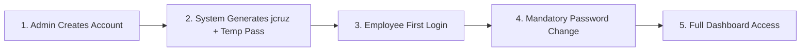

---

### Flow 1: Employee Onboarding (Account Creation to First Login)

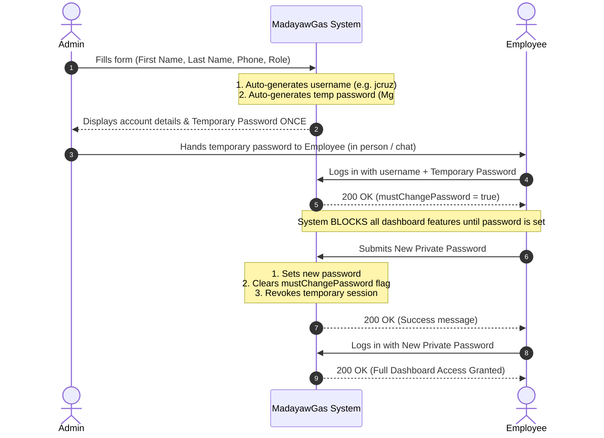

#### What QA Should Test:
- [ ] Admin submits without providing a username or password ➔ Account is created successfully.
- [ ] System returns username in `first_name[0] + last_name` format.
- [ ] Employee logs in with temporary password ➔ Can ONLY access the change-password screen; calling other APIs (Fleet, Sales, Inventory) returns `403 Forbidden`.
- [ ] Employee sets new password with only `newPassword` (no `currentPassword` required).
- [ ] Employee can log in with new password and access dashboard.

---

### Flow 2: Daily Employee Login & Session Expiration

1. Employee enters username and private password.
2. System sets an encrypted, secure cookie (`mg_sid`).
3. **Active Use**: Every time the employee clicks around or makes requests, the 8-hour idle timer refreshes.
4. **Inactivity**: If the employee leaves their computer idle for 8+ hours, the session expires and redirects to login.
5. **Logout**: Clicking "Log Out" immediately destroys the session in the database and clears the cookie.

---

### Flow 3: Voluntary Password Change (From Profile)

When an established employee wants to update their password from their profile:

1. Employee goes to **Profile / Settings -> Change Password**.
2. Employee enters **Current Password** and **New Password** (minimum 8 characters).
3. System verifies the current password, updates to the new password, and invalidates all active sessions for safety.
4. Employee logs in again with the new password.

---

### Flow 4: Forgot Password / Admin Password Reset

Because truck drivers and yard staff do not have company email inboxes and SMS is costly, password resets are **Admin-Assisted**:

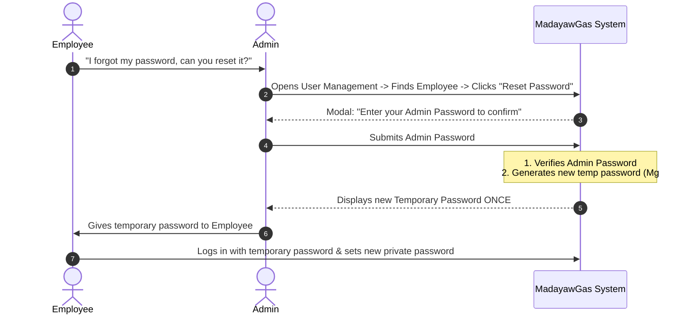

---

### Flow 5: Deactivating or Blocking an Employee

When an employee leaves the company or is suspended:

1. Admin goes to **User Management** -> selects employee -> toggles **Deactivate** or **Block**.
2. System prompts Admin to enter their **Admin Password** to confirm.
3. Upon confirmation:
   * The user is marked inactive or blocked in PostgreSQL.
   * **Instant Lockout**: All of that employee's active sessions across all devices are immediately revoked.
   * Future login attempts return `401 Invalid credentials`.
4. **Super Admin Safety Rule**: The system strictly prevents deactivating or blocking the Super Admin account.

---

### Flow 6: Changing an Employee's Role (User Administration)

When an employee is promoted, transferred, or needs their system responsibilities updated:

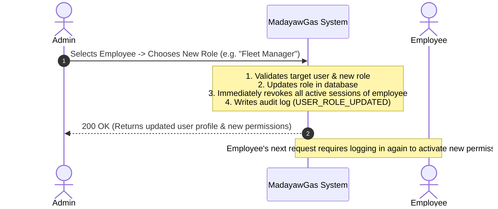

#### Key Rules:
- **Instant Security**: When an Admin updates a user's role, the target user's active session is immediately revoked so they cannot perform outdated permissions.
- **Super Admin Protection**: The primary Super Admin account cannot have its role changed or demoted.

---

## 3. System Roles & Permissions Matrix

The MadayawGas system uses **Role-Based Access Control (RBAC)**. Here is what each role is permitted to do:

| Feature / Action | Super Admin | Admin | Fleet Manager | Sales Person |
| :--- | :---: | :---: | :---: | :---: |
| **View Dashboard** | ✅ | ✅ | ✅ | ✅ |
| **Manage Users (Create, Reset, Deactivate)** | ✅ | ✅ | ❌ | ❌ |
| **View All Users List** | ✅ | ✅ | ❌ | ❌ |
| **Manage Fleet Vehicles & Maintenance** | ✅ | ✅ | ✅ | ❌ |
| **View Fleet & Route Operations** | ✅ | ✅ | ✅ | ❌ |
| **View Own Assigned Route** | ✅ | ✅ | ✅ | ✅ |
| **Manage Inventory & Stock** | ✅ | ✅ | ❌ | ❌ |
| **Create & Update Sales** | ✅ | ✅ | ❌ | ✅ |
| **View All Sales Records** | ✅ | ✅ | ❌ | ❌ (Own only) |
| **Update Deliveries** | ✅ | ✅ | ✅ | ❌ (Own only) |

---

## 4. Pre-Configured Test Accounts (Seed Credentials)

The database includes permanent test accounts ready for Postman and QA testing (`must_change_password = FALSE`):

| Username | Password | Role | Phone | Notes |
| :--- | :--- | :--- | :--- | :--- |
| **`superadmin`** | `Superadmin123!` | **Super Admin** | `+639170000001` | Full permissions. Cannot be deactivated. |
| **`admin_user`** | `AdminPass123!` | **Admin** | `+639170000002` | Admin access for users, fleet, inventory. |
| **`fleet_user`** | `FleetPass123!` | **Fleet Manager** | `+639170000003` | Fleet management. Cannot manage users. |
| **`sales_user`** | `SalesPass123!` | **Sales Person** | `+639170000004` | Sales rep. Own sales/deliveries only. |

---

## 5. QA Quick Test Checklist

When testing user management in Postman or on the web app:

1. **Happy Path User Creation**:
   - [ ] Admin creates user with `{ firstName: "Maria", lastName: "Santos", phone: "+639170001122", roleId: "<role_uuid>" }`.
   - [ ] Verify returned username is `msantos`.
   - [ ] Verify returned `temporaryPassword` starts with `Mg#`.
2. **Duplicate Name / Collision Handling**:
   - [ ] Admin creates another user with `{ firstName: "Mark", lastName: "Santos", ... }`.
   - [ ] Verify returned username is `msantos1`.
3. **First Login & Gatekeeper**:
   - [ ] Log in as `msantos` with temporary password.
   - [ ] Attempt calling `/api/users/roles` or other business endpoints ➔ Expect `403 Forbidden` (`MUST_CHANGE_PASSWORD`).
   - [ ] Call `/api/users/change-password` with only `{ "newPassword": "MySecretPass123!" }` ➔ Expect `200 OK`.
   - [ ] Log in with new password ➔ Expect full access.
4. **Dangerous Action Password Confirmation**:
   - [ ] Try deactivating an account without `adminPassword` ➔ Expect `401 Unauthorized`.
   - [ ] Try deactivating with wrong `adminPassword` ➔ Expect `401 Unauthorized`.
   - [ ] Provide correct `adminPassword` ➔ Expect `200 OK` and target user's active session is revoked immediately.
`````

## File: docs/temp/from-frontend.txt
`````
import React, { useState, useEffect, useMemo } from "react";
import HistoryTable from "../../components/history log/HistoryTable";
import FilterDropdown from "../../components/ui/FilterDropdown"; 
import SearchBar from "../../components/ui/SearchBar"; 
import { historyApi } from "../../api/history";

export default function HistoryLog() {
  const [searchTerm, setSearchTerm] = useState("");
  const [selectedModule, setSelectedModule] = useState("All Modules");
  
  const [historyLogs, setHistoryLogs] = useState([]);
  const [isLoading, setIsLoading] = useState(true);

  const filterOptions = [
    "All Modules",
    "User Management",
    "Fleet Management",
    "Route Dispatch",
    "Inventory Management"
  ];

  useEffect(() => {
    const fetchLogs = async () => {
      try {
        setIsLoading(true);
        const logs = await historyApi.getHistoryLogs();
        setHistoryLogs(logs || []);
      } catch (error) {
        console.error("Failed to fetch history logs", error);
      } finally {
        setIsLoading(false);
      }
    };
    
    fetchLogs();
  }, []);

  const filteredLogs = useMemo(() => {
    return historyLogs.filter((log) => {
      const matchesModule = selectedModule === "All Modules" || log.module === selectedModule;
      const searchLower = searchTerm.toLowerCase();
      const matchesSearch = 
        log.userName.toLowerCase().includes(searchLower) ||
        log.details.toLowerCase().includes(searchLower) ||
        log.actionType.toLowerCase().includes(searchLower);

      return matchesModule && matchesSearch;
    });
  }, [searchTerm, selectedModule, historyLogs]);

  return (
    <div className="p-8">
      {/* Header Section */}
      <div className="flex flex-col md:flex-row md:items-center mb-6 gap-6 border-b border-[#6D8AA2] pb-4">
        <h1 className="text-3xl font-bold text-[#1B4B75]">History</h1>
        
        <div className="flex items-center gap-3 flex-1 w-full">
          <FilterDropdown 
            label="Module" 
            options={filterOptions} 
            value={selectedModule} 
            onChange={setSelectedModule} 
          />
          
          <div className="flex-1">
            <SearchBar 
              placeholder="Search..." 
              value={searchTerm} 
              onChange={(e) => setSearchTerm(e.target.value)} 
            />
          </div>
        </div>
      </div>

      {/* Table Section */}
      {isLoading ? (
        <div className="flex justify-center p-8 text-gray-500">Loading history logs...</div>
      ) : (
        <HistoryTable logs={filteredLogs} />
      )}
    </div>
  );
}


Mock Data:
{
  "status": "success",
  "data": {
    "logs": [
      {
        "id": 1,
        "date": "Aug 24, 2026",
        "time": "08:30 AM",
        "userName": "Alejandro Doe",
        "userRole": "System Admin",
        "actionType": "Created",
        "module": "User Management",
        "details": "Created new user account for 'Juan Dela Cruz'"
      },
      {
        "id": 2,
        "date": "Aug 24, 2026",
        "time": "09:15 AM",
        "userName": "Samantha Doe",
        "userRole": "Sales Supervisor",
        "actionType": "Updated",
        "module": "Route Dispatch",
        "details": "Assigned Truck #3 to Downtown Route"
      },
      {
        "id": 3,
        "date": "Aug 24, 2026",
        "time": "11:20 AM",
        "userName": "Alejandro Doe",
        "userRole": "System Admin",
        "actionType": "Deactivated",
        "module": "User Management",
        "details": "Suspended account access for 'Juan Dela Cruz'"
      }
    ]
  }
}
`````

## File: docs/frontend-media-integration-prompt.md
`````markdown
# Frontend Integration Guide & Prompt: Media Subsystem & Work Order Receipts

> **Target Audience:** Frontend Engineers / AI Agent working on the MadayawGas Frontend  
> **Topic:** Resolving Image Display 404s, Eliminating Duplicate Supabase Uploads, and Integrating the Media Subsystem  
> **Status:** Backend updates deployed and verified (100% test coverage)

---

## 1. Executive Summary & Root Cause Analysis

During recent production testing on Vercel (`https://madayawgas.vercel.app`) connected to the Render backend and Supabase Storage, two issues occurred:

### Issue 1: Images do not show up on the page (404 Not Found)
* **What Happened:** When viewing a work order or attached receipts, images failed to render, or broken image placeholders appeared.
* **Root Cause:** Work order endpoints previously returned raw relative storage keys in the `fileUrl` field (e.g. `"maintenance/receipts/1791549646264-b9e397ab54b9.jpg"`). In the frontend JSX/HTML, passing this directly to `` caused the browser to request `https://madayawgas.vercel.app/maintenance/receipts/...`, which 404'd on Vercel because the asset actually lives in the public Supabase bucket (`https://<project-ref>.supabase.co/storage/v1/object/public/madayawgas-media/maintenance/receipts/...`).

### Issue 2: Duplicate / Orphaned Files in Supabase Storage
* **What Happened:** Selecting a file created files in Supabase before clicking "Confirm" or "Save" on the work order. If the file was selected twice or modified, 2 separate duplicate files were stored.
* **Root Cause:** 
  1. The frontend executed `POST /api/media/upload` immediately on the `onChange` event of the `<input type="file">` element (eager upload).
  2. The backend previously generated storage keys using random timestamps (`{timestamp}-{randomHex}.jpg`), which meant uploading the same image twice generated two distinct filenames.
  3. No deletion mechanism was called if the user cancelled the modal or changed their mind before saving the work order.

---

## 2. Backend Changes & Features Added to Support You

The backend has implemented the following enhancements to solve these issues:

### 1. Auto-Resolved Public URLs
All endpoints returning receipts now automatically resolve `fileUrl` to the **fully qualified, publicly accessible URL**:
* In **Production** (`PRODUCTION=true`): Resolves to the public Supabase bucket URL:  
  `https://<project>.supabase.co/storage/v1/object/public/madayawgas-media/maintenance/receipts/...`
* In **Development** (`PRODUCTION=false`): Resolves to the backend static media URL:  
  `http://localhost:5000/media/maintenance/receipts/...`
* **Both fields are now returned**:
  * `fileUrl`: The ready-to-use public image URL for `src` or `href`.
  * `storageKey`: The canonical relative key (e.g. `maintenance/receipts/...`) if needed for reference.

### 2. Flexible URL Normalization
When submitting a receipt to `POST /api/fleet/maintenance/work-orders/:id/receipts` or finalizing a work order via `POST .../finalize`, you can send **either** the full URL (`uploadResponse.data.url`) **or** the relative storage key (`uploadResponse.data.storageKey`). The backend automatically parses and normalizes it to the canonical storage key before saving it to the database.

### 3. Content-Addressed Deduplication & Upsert
The backend `POST /api/media/upload` endpoint now generates storage keys using a **SHA-256 content-hash** of the file buffer:
* Formula: `{domain}/{sha256(buffer).slice(0, 16)}{extension}` (e.g., `maintenance/receipts/bbd42de30c5f1be8.jpg`).
* Uploading the identical receipt multiple times produces the exact same storage key.
* The Supabase Storage driver now runs with `upsert: true`, so repeated uploads safely overwrite the identical asset without creating orphaned duplicate files in your Supabase bucket.

### 4. Direct Asset Deletion Endpoint (`DELETE /api/media`)
A new endpoint has been deployed:
* **Endpoint:** `DELETE /api/media`
* **Headers:** `Content-Type: application/json`, Cookie / Bearer Token
* **Body:** `{ "storageKey": "maintenance/receipts/..." }` *(or query parameter `?storageKey=...`)*
* Accepts either the relative storage key or the full Supabase URL.
* If a receipt is deleted via `DELETE /api/fleet/maintenance/receipts/:receiptId`, the backend now **automatically deletes the physical asset from storage** as well!

---

## 3. Frontend Implementation Guide & Instructions

Copy and provide this section to the frontend developer or frontend AI agent:

```markdown
### FRONTEND INSTRUCTIONS: Fixing Media Display & Upload Workflow

#### 1. Rendering Receipts / Images in UI Components
In your Work Order Details modal, Receipt Gallery, or Table views:
- Use `receipt.fileUrl` directly as the `src` attribute of your `` tag or download `<a>` tag.
- DO NOT prepend your API host, Vercel host, or Supabase URL manually.
- The backend already supplies the complete, environment-aware public URL.

```tsx
// Example Receipt Item Component
interface ReceiptItem {
  id: string;
  receiptNumber?: string;
  vendorName?: string;
  amount: number;
  receiptType: 'PARTS' | 'LABOR' | 'MISC';
  fileUrl: string;    // Already fully qualified public URL
  storageKey: string; // Canonical relative key
}

export function WorkOrderReceiptCard({ receipt }: { receipt: ReceiptItem }) {
  const isPdf = receipt.fileUrl.toLowerCase().endsWith('.pdf');

  return (
    <div className="receipt-card border rounded p-3">
      {isPdf ? (
        <a 
          href={receipt.fileUrl} 
          target="_blank" 
          rel="noopener noreferrer"
          className="text-blue-600 underline"
        >
          View PDF Invoice ({receipt.receiptNumber || 'No OR #'})
        </a>
      ) : (
        
      )}
      <div className="mt-2 text-sm">
        <p className="font-semibold">{receipt.vendorName || 'Independent Vendor'}</p>
        <p className="text-gray-600">₱{receipt.amount.toLocaleString()}</p>
      </div>
    </div>
  );
}
```

---

#### 2. Managing the Upload Lifecycle (Preventing Orphaned Files)

You have two recommended patterns for handling file uploads in modals/forms:

##### Recommended Pattern A: Deferred Upload on Form Submit (Cleanest)
Instead of uploading immediately when the user selects a file in `<input type="file">`, hold the `File` object in local component state. Only perform the upload when the user clicks "Save" / "Confirm":

```tsx
const [selectedFile, setSelectedFile] = useState<File | null>(null);
const [isSubmitting, setIsSubmitting] = useState(false);

const handleFileChange = (e: React.ChangeEvent<HTMLInputElement>) => {
  if (e.target.files && e.target.files[0]) {
    setSelectedFile(e.target.files[0]);
  }
};

const handleSubmit = async () => {
  if (!selectedFile) return;
  setIsSubmitting(true);

  try {
    // 1. Upload file to media subsystem
    const formData = new FormData();
    formData.append('domain', 'maintenance/receipts');
    formData.append('file', selectedFile);

    const uploadRes = await api.post('/api/media/upload', formData, {
      headers: { 'Content-Type': 'multipart/form-data' },
    });
    const { storageKey, url } = uploadRes.data.data;

    // 2. Attach receipt to work order
    await api.post(`/api/fleet/maintenance/work-orders/${workOrderId}/receipts`, {
      fileUrl: storageKey, // or url (both work!)
      receiptNumber,
      vendorName,
      amount: Number(amount),
      receiptType,
    });

    onSuccess();
  } catch (error) {
    console.error('Failed to attach receipt:', error);
  } finally {
    setIsSubmitting(false);
  }
};
```

##### Pattern B: Eager Upload with Cleanup on Modal Cancel
If you prefer showing an instant uploaded image preview immediately after selection:
1. Call `POST /api/media/upload` when the file is chosen and store `uploadedStorageKey` in state.
2. If the user clicks **Cancel** or closes the modal **without submitting**, send a cleanup request:

```tsx
const handleCancel = async () => {
  if (stagedStorageKey && !isSaved) {
    try {
      await api.delete('/api/media', {
        data: { storageKey: stagedStorageKey },
      });
    } catch (err) {
      console.warn('Failed to clean up cancelled staged media:', err);
    }
  }
  onClose();
};
```

---

#### 3. API Contract Reference Summary

1. **Upload File:**
   - `POST /api/media/upload`
   - Header: `Content-Type: multipart/form-data`
   - Body fields:
     - `domain`: `"maintenance/receipts"` *(or `fleet/vehicles`, `maintenance/inspections`, `sales/receipts`, `sales/payments`, `users/avatars`)*
     - `file`: `<binary>` (Max 5MB; JPEG, PNG, WebP, PDF)
   - Response (`201 Created`):
     ```json
     {
       "status": "success",
       "data": {
         "storageKey": "maintenance/receipts/bbd42de30c5f1be8.jpg",
         "url": "https://<supabase>.supabase.co/storage/v1/object/public/madayawgas-media/maintenance/receipts/bbd42de30c5f1be8.jpg",
         "mimeType": "image/jpeg",
         "sizeBytes": 245192,
         "originalName": "receipt.jpg"
       }
     }
     ```

2. **Attach Receipt to Work Order:**
   - `POST /api/fleet/maintenance/work-orders/:id/receipts`
   - Body:
     ```json
     {
       "fileUrl": "maintenance/receipts/bbd42de30c5f1be8.jpg",
       "receiptNumber": "OR-10023",
       "vendorName": "Bunawan Parts Depot",
       "amount": 3500.00,
       "receiptType": "PARTS"
     }
     ```

3. **Delete Media (Cancelation Cleanup):**
   - `DELETE /api/media`
   - Body: `{ "storageKey": "maintenance/receipts/bbd42de30c5f1be8.jpg" }`
```
`````

## File: scripts/upload-seed-media.js
`````javascript
require('dotenv').config();
const fs = require('fs');
const path = require('path');
const { createClient } = require('@supabase/supabase-js');

const TEMP_SEED_MEDIA_DIR = path.resolve(__dirname, '..', 'docs', 'temp', 'temp_seed_receipts');
const UPLOADS_SEED_MEDIA_DIR = path.resolve(__dirname, '..', 'uploads', 'seed');
const SEED_MEDIA_DIR = fs.existsSync(TEMP_SEED_MEDIA_DIR) ? TEMP_SEED_MEDIA_DIR : UPLOADS_SEED_MEDIA_DIR;

const MIME_BY_EXT = {
  '.jpg': 'image/jpeg',
  '.jpeg': 'image/jpeg',
  '.png': 'image/png',
  '.webp': 'image/webp',
};

async function uploadSeedMedia() {
  const supabaseUrl = process.env.SUPABASE_URL;
  const serviceRoleKey = process.env.SUPABASE_SERVICE_ROLE_KEY;
  const bucket = process.env.SUPABASE_MEDIA_BUCKET || 'madayawgas-media';

  if (!supabaseUrl || !serviceRoleKey) {
    throw new Error(
      'Missing SUPABASE_URL or SUPABASE_SERVICE_ROLE_KEY in environment (.env).'
    );
  }

  if (!fs.existsSync(SEED_MEDIA_DIR)) {
    throw new Error(`Seed media directory not found: ${SEED_MEDIA_DIR}`);
  }

  const files = fs
    .readdirSync(SEED_MEDIA_DIR)
    .filter((f) => Object.prototype.hasOwnProperty.call(MIME_BY_EXT, path.extname(f).toLowerCase()))
    .sort();

  if (files.length === 0) {
    console.log('No image files found in uploads/seed/.');
    return;
  }

  const supabase = createClient(supabaseUrl, serviceRoleKey, {
    auth: { persistSession: false, autoRefreshToken: false },
  });

  console.log(`Uploading ${files.length} seed media files to Supabase bucket '${bucket}'...\n`);

  for (const filename of files) {
    const ext = path.extname(filename).toLowerCase();
    const mimeType = MIME_BY_EXT[ext];
    const storageKey = `seed/${filename}`;
    const fileBuffer = fs.readFileSync(path.join(SEED_MEDIA_DIR, filename));

    const { error } = await supabase.storage
      .from(bucket)
      .upload(storageKey, fileBuffer, {
        contentType: mimeType,
        upsert: true,
      });

    if (error) {
      throw new Error(`Failed to upload ${storageKey}: ${error.message}`);
    }

    console.log(`✓ Uploaded ${storageKey} (${mimeType})`);
  }

  console.log('\n✓ All seed media files uploaded successfully.');
}

uploadSeedMedia().catch((err) => {
  console.error('\n✗ Seed media upload failed:', err.message);
  process.exitCode = 1;
});
`````

## File: src/config/system.config.js
`````javascript
/**
 * Central Non-Secret System Configuration
 *
 * Holds:
 * 1. `businessDefaults`: Canonical fallback defaults for the 6 DB-backed
 *    `system_settings` variables (which are editable in the System Settings UI).
 * 2. `system`: System-wide non-secret operational constants (cache TTLs, upload
 *    ceilings, pagination bounds, session lifetimes, fleet operational bounds).
 *
 * NOTE: Secrets, credentials, and environment-specific URLs belong in `.env`
 * and `src/config/env.js`, NOT here.
 */
module.exports = {
  businessDefaults: {
    'fleet.pm_odometer_threshold_km': 5000,
    'fleet.work_order_approval_threshold': 5000.0,
    'operations.fuel_efficiency_variance_percent': 5,
    'operations.sos_dedup_window_seconds': 60,
    'inventory.canisters_per_crate': 24,
    'schedules.max_generation_days': 31,
  },
  system: {
    settingsCacheTtlMs: 60 * 1000, // 1 minute
    maxUploadFileSizeBytes: 5 * 1024 * 1024, // 5 MB
    pagination: {
      defaultLimit: 20,
      maxLimit: 100,
    },
    auth: {
      idleTimeoutMs: 8 * 60 * 60 * 1000, // 8 hours
      absoluteLifetimeMs: 30 * 24 * 60 * 60 * 1000, // 30 days
    },
    fleet: {
      maxOdometerKm: 999999,
      pmApproachingRatio: 0.8,
    },
  },
};
`````

## File: src/features/dashboard/dashboard.controller.js
`````javascript
const dashboardService = require('./dashboard.service');

/**
 * Dashboard Controller
 */
class DashboardController {
  /**
   * GET /api/dashboard/overview
   */
  async getOverview(req, res) {
    const data = await dashboardService.getOverview();
    return res.status(200).json({
      status: 'success',
      data,
    });
  }
}

module.exports = new DashboardController();
`````

## File: src/features/dashboard/dashboard.repository.js
`````javascript
const { query } = require('../../../database/connection');

/**
 * Dashboard Repository
 * Aggregates cross-domain operational KPIs for executive dashboard views.
 */
class DashboardRepository {
  /**
   * Retrieves fleet, trips, operations, plant inventory, and sales KPIs in parallel.
   * @returns {Promise<Object>}
   */
  async getOverviewMetrics() {
    const [
      fleetRes,
      tripsRes,
      schedulesRes,
      operationsRes,
      fuelRes,
      inventoryRes,
      salesRes,
      invoicesRes,
    ] = await Promise.all([
      query(`
        SELECT
          COUNT(*)::int AS total_vehicles,
          COUNT(*) FILTER (WHERE v.status = 'ACTIVE')::int AS active_vehicles,
          COUNT(*) FILTER (WHERE v.status = 'UNDER_MAINTENANCE')::int AS under_maintenance,
          COUNT(*) FILTER (WHERE v.status IN ('INACTIVE', 'RETIRED'))::int AS inactive_or_retired,
          COUNT(*) FILTER (
            WHERE v.status NOT IN ('INACTIVE', 'RETIRED')
              AND (v.current_odometer - v.last_pm_odometer) >= COALESCE(
                (SELECT NULLIF(value, '')::numeric FROM system_settings WHERE key = 'fleet.pm_odometer_threshold_km'),
                5000
              )
          )::int AS pm_due_count
        FROM vehicles v
      `),
      query(`
        SELECT
          COUNT(*) FILTER (WHERE status = 'IN_PROGRESS')::int AS active_trips,
          COUNT(*) FILTER (WHERE status = 'RETURNED')::int AS returned_awaiting_reconciliation,
          COUNT(*) FILTER (WHERE status = 'COMPLETED' AND departure_time >= CURRENT_DATE)::int AS completed_today
        FROM trips
      `),
      query(`
        SELECT
          COUNT(*) FILTER (WHERE scheduled_date = CURRENT_DATE AND status != 'CANCELLED')::int AS scheduled_today
        FROM truck_schedules
      `),
      query(`
        SELECT
          (SELECT COUNT(*)::int FROM emergency_alerts WHERE status IN ('ACTIVE', 'ACKNOWLEDGED')) AS active_sos_alerts,
          (SELECT COUNT(*)::int FROM driver_apprehensions WHERE status = 'PENDING') AS pending_apprehensions
      `),
      query(`
        SELECT
          COALESCE(SUM(total_cost) FILTER (WHERE fueled_at >= CURRENT_DATE), 0)::numeric(12,2) AS fuel_cost_today,
          COALESCE(SUM(total_cost) FILTER (WHERE fueled_at >= NOW() - INTERVAL '30 days'), 0)::numeric(12,2) AS fuel_cost_30d,
          COALESCE(SUM(liters_pumped) FILTER (WHERE fueled_at >= NOW() - INTERVAL '30 days'), 0)::numeric(12,2) AS fuel_liters_30d
        FROM vehicle_fuel_logs
      `),
      query(`
        SELECT
          COALESCE(SUM(pi.quantity_filled), 0)::int AS total_filled,
          COALESCE(SUM(pi.quantity_empty_good), 0)::int AS total_empty_good,
          COALESCE(SUM(pi.quantity_defective), 0)::int AS total_defective
        FROM plant_inventory pi
        JOIN products p ON p.id = pi.product_id
        WHERE p.is_active = TRUE
      `),
      query(`
        SELECT
          COUNT(*) FILTER (WHERE st.status = 'COMPLETED' AND st.transacted_at >= CURRENT_DATE)::int AS transactions_today,
          COUNT(*) FILTER (WHERE st.status = 'COMPLETED' AND st.transacted_at >= NOW() - INTERVAL '30 days')::int AS transactions_30d,
          COALESCE(SUM(si.total_amount) FILTER (WHERE st.status = 'COMPLETED' AND st.transacted_at >= CURRENT_DATE), 0)::numeric(12,2) AS revenue_today,
          COALESCE(SUM(si.total_amount) FILTER (WHERE st.status = 'COMPLETED' AND st.transacted_at >= NOW() - INTERVAL '30 days'), 0)::numeric(12,2) AS revenue_30d
        FROM sales_transactions st
        LEFT JOIN sales_invoices si ON si.transaction_id = st.id
      `),
      query(`
        SELECT
          COUNT(*) FILTER (WHERE si.payment_status = 'PAID_UNVERIFIED' AND st.status = 'COMPLETED')::int AS unverified_invoices_count
        FROM sales_invoices si
        JOIN sales_transactions st ON st.id = si.transaction_id
      `),
    ]);

    return {
      fleet: fleetRes.rows[0],
      trips: tripsRes.rows[0],
      schedules: schedulesRes.rows[0],
      operations: operationsRes.rows[0],
      fuel: fuelRes.rows[0],
      inventory: inventoryRes.rows[0],
      sales: salesRes.rows[0],
      invoices: invoicesRes.rows[0],
    };
  }
}

module.exports = new DashboardRepository();
`````

## File: src/features/dashboard/dashboard.routes.js
`````javascript
const express = require('express');
const router = express.Router();

const dashboardController = require('./dashboard.controller');
const { authenticate, requirePermission } = require('../../middleware/auth.middleware');
const asyncHandler = require('../../utils/asyncHandler');

router.get(
  '/overview',
  authenticate,
  requirePermission('dashboard.view'),
  asyncHandler(dashboardController.getOverview.bind(dashboardController))
);

module.exports = router;
`````

## File: src/features/dashboard/dashboard.service.js
`````javascript
const dashboardRepository = require('./dashboard.repository');

/**
 * Dashboard Service
 * Formats cross-domain KPIs for executive dashboard views.
 */
class DashboardService {
  /**
   * Returns unified operational overview KPIs.
   * @returns {Promise<Object>}
   */
  async getOverview() {
    const raw = await dashboardRepository.getOverviewMetrics();

    return {
      fleet: {
        totalVehicles: Number(raw.fleet?.total_vehicles || 0),
        activeVehicles: Number(raw.fleet?.active_vehicles || 0),
        underMaintenance: Number(raw.fleet?.under_maintenance || 0),
        inactiveOrRetired: Number(raw.fleet?.inactive_or_retired || 0),
        pmDueCount: Number(raw.fleet?.pm_due_count || 0),
      },
      trips: {
        activeTrips: Number(raw.trips?.active_trips || 0),
        returnedAwaitingReconciliation: Number(raw.trips?.returned_awaiting_reconciliation || 0),
        completedToday: Number(raw.trips?.completed_today || 0),
        scheduledToday: Number(raw.schedules?.scheduled_today || 0),
      },
      operations: {
        activeSosAlerts: Number(raw.operations?.active_sos_alerts || 0),
        pendingApprehensions: Number(raw.operations?.pending_apprehensions || 0),
        fuelCostToday: Number(raw.fuel?.fuel_cost_today || 0),
        fuelCost30d: Number(raw.fuel?.fuel_cost_30d || 0),
        fuelLiters30d: Number(raw.fuel?.fuel_liters_30d || 0),
      },
      inventory: {
        totalFilled: Number(raw.inventory?.total_filled || 0),
        totalEmptyGood: Number(raw.inventory?.total_empty_good || 0),
        totalDefective: Number(raw.inventory?.total_defective || 0),
      },
      sales: {
        transactionsToday: Number(raw.sales?.transactions_today || 0),
        transactions30d: Number(raw.sales?.transactions_30d || 0),
        revenueToday: Number(raw.sales?.revenue_today || 0),
        revenue30d: Number(raw.sales?.revenue_30d || 0),
        unverifiedInvoicesCount: Number(raw.invoices?.unverified_invoices_count || 0),
      },
      generatedAt: new Date().toISOString(),
    };
  }
}

module.exports = new DashboardService();
`````

## File: src/features/dashboard/index.js
`````javascript
const dashboardRoutes = require('./dashboard.routes');
const dashboardService = require('./dashboard.service');
const dashboardController = require('./dashboard.controller');
const dashboardRepository = require('./dashboard.repository');

module.exports = {
  dashboardRoutes,
  dashboardService,
  dashboardController,
  dashboardRepository,
};
`````

## File: src/features/fleet/maintenance/index.js
`````javascript
const maintenanceRepository = require('./maintenance.repository');
const maintenanceService = require('./maintenance.service');
const maintenanceController = require('./maintenance.controller');
const maintenanceRoutes = require('./maintenance.routes');

module.exports = {
  maintenanceRepository,
  maintenanceService,
  maintenanceController,
  maintenanceRoutes,
};
`````

## File: src/features/history/history.routes.js
`````javascript
const express = require('express');
const router = express.Router();
const historyController = require('./history.controller');
const { authenticate, requirePermission } = require('../../middleware/auth.middleware');

// Route Protection: Requires valid session and history viewing permissions
router.use(authenticate);
router.use(requirePermission(['history.view', 'dashboard.view', 'users.view', 'fleet.view', 'inventory.view', 'sales.view']));

// GET /api/history - Retrieve system event history logs
router.get('/', (req, res, next) => historyController.getHistoryLogs(req, res, next));

// GET /api/history/:id - Retrieve a single history log by ID
router.get('/:id', (req, res, next) => historyController.getHistoryLogById(req, res, next));

module.exports = router;
`````

## File: src/features/operations/alerts/alerts.controller.js
`````javascript
const alertsService = require('./alerts.service');
const { parsePaginationQuery, formatPaginatedEnvelope } = require('../../../utils/pagination');

/**
 * Driver Emergency Alerts Controller
 * Handles HTTP requests, parameter extraction, and JSON response envelopes.
 */
class AlertsController {
  /**
   * POST /api/operations/alerts
   * Triggers emergency SOS alert.
   */
  async triggerAlert(req, res) {
    const data = await alertsService.triggerAlert(req.user, req.body || {});
    const statusCode = data.isDuplicate ? 200 : 201;
    return res.status(statusCode).json({
      status: 'success',
      message: data.isDuplicate
        ? data.message
        : 'Emergency alert dispatched successfully. Operations team has been notified.',
      data,
    });
  }

  /**
   * GET /api/operations/alerts/active
   * Retrieves all currently active and ongoing alerts.
   */
  async getActiveAlerts(req, res) {
    const alerts = await alertsService.getActiveAlerts();
    return res.status(200).json({
      status: 'success',
      data: {
        count: alerts.length,
        alerts,
      },
    });
  }

  /**
   * GET /api/operations/alerts/poll
   * Delta polling endpoint for dashboard subscribers (?since=<ISO_TIMESTAMP>).
   */
  async getPollAlerts(req, res) {
    const alerts = await alertsService.getPollAlerts(req.query?.since);
    return res.status(200).json({
      status: 'success',
      data: {
        count: alerts.length,
        alerts,
        polledAt: new Date().toISOString(),
      },
    });
  }

  /**
   * GET /api/operations/alerts/:id
   * Retrieves single emergency alert detail.
   */
  async getAlertById(req, res) {
    const data = await alertsService.getAlertById(req.params.id, req.user);
    return res.status(200).json({
      status: 'success',
      data,
    });
  }

  /**
   * PATCH /api/operations/alerts/:id/acknowledge
   * Marks an emergency alert as acknowledged by a supervisor/admin.
   */
  async acknowledgeAlert(req, res) {
    const data = await alertsService.acknowledgeAlert(req.params.id, req.user);
    return res.status(200).json({
      status: 'success',
      message: 'Emergency alert acknowledged.',
      data,
    });
  }

  /**
   * PATCH /api/operations/alerts/:id/resolve
   * Resolves an emergency alert with resolution notes and status.
   */
  async resolveAlert(req, res) {
    const data = await alertsService.resolveAlert(req.params.id, req.user, req.body || {});
    return res.status(200).json({
      status: 'success',
      message: 'Emergency alert resolved successfully.',
      data,
    });
  }

  /**
   * GET /api/operations/alerts
   * Retrieves paginated emergency alert logs with filtering.
   */
  async getAlerts(req, res) {
    const { status, driverId, vehicleId, emergencyType, startDate, endDate } = req.query || {};

    const pagination = parsePaginationQuery(req.query, {
      defaultLimit: 20,
      maxLimit: 100,
      defaultSort: 'createdAt',
      defaultOrder: 'DESC',
    });

    if (!pagination.isPaginated) {
      const alerts = await alertsService.getAlerts(
        req.user,
        { status, driverId, vehicleId, emergencyType, startDate, endDate },
        null
      );
      return res.status(200).json({
        status: 'success',
        data: {
          count: alerts.length,
          alerts,
        },
      });
    }

    const { items, meta } = await alertsService.getAlerts(
      req.user,
      { status, driverId, vehicleId, emergencyType, startDate, endDate },
      pagination
    );

    return res.status(200).json(formatPaginatedEnvelope(items, meta));
  }
}

module.exports = new AlertsController();
`````

## File: src/features/operations/alerts/alerts.repository.js
`````javascript
const { query } = require('../../../../database/connection');

/**
 * Driver Emergency Alerts Repository
 * Pure SQL data access layer for one-action SOS distress dispatches and operational resolution.
 */
class AlertsRepository {
  /**
   * Inserts an emergency alert record.
   * @param {Object} data
   * @returns {Promise<Object>} Created row
   */
  async createAlert({
    driverId,
    vehicleId,
    tripId,
    latitude,
    longitude,
    emergencyType,
    description,
  }) {
    const sql = `
      INSERT INTO emergency_alerts (
        driver_id,
        vehicle_id,
        trip_id,
        latitude,
        longitude,
        emergency_type,
        description,
        status
      )
      VALUES ($1, $2, $3, $4, $5, COALESCE($6, 'GENERAL'), $7, 'ACTIVE')
      RETURNING *;
    `;

    const result = await query(sql, [
      driverId,
      vehicleId || null,
      tripId || null,
      latitude !== undefined && latitude !== null ? latitude : null,
      longitude !== undefined && longitude !== null ? longitude : null,
      emergencyType || 'GENERAL',
      description || null,
    ]);

    return result.rows[0];
  }

  /**
   * Finds a recent active alert by driver within a specified time window (anti-spam idempotency).
   * @param {string} driverId
   * @param {number} [windowSeconds=60]
   * @returns {Promise<Object|null>}
   */
  async findRecentActiveAlertByDriverId(driverId, windowSeconds = 60) {
    const sql = `
      SELECT *
      FROM emergency_alerts
      WHERE driver_id = $1 
        AND status = 'ACTIVE' 
        AND created_at >= NOW() - ($2 || ' seconds')::interval
      ORDER BY created_at DESC
      LIMIT 1;
    `;

    const result = await query(sql, [driverId, windowSeconds]);
    return result.rows[0] || null;
  }

  /**
   * Retrieves single alert with complete driver and vehicle context.
   * @param {string} id - Alert UUID
   * @returns {Promise<Object|null>}
   */
  async getAlertById(id) {
    const sql = `
      SELECT 
        a.id,
        a.driver_id,
        a.vehicle_id,
        a.trip_id,
        a.latitude,
        a.longitude,
        a.emergency_type,
        a.description,
        a.status,
        a.acknowledged_by,
        a.acknowledged_at,
        a.resolved_by,
        a.resolved_at,
        a.resolution_notes,
        a.created_at,
        a.updated_at,
        v.plate_number AS vehicle_plate_number,
        v.model AS vehicle_model,
        v.vehicle_type,
        d.username AS driver_username,
        d.first_name AS driver_first_name,
        d.last_name AS driver_last_name,
        d.phone AS driver_phone,
        ab.username AS acknowledged_by_username,
        rb.username AS resolved_by_username,
        t.trip_number
      FROM emergency_alerts a
      JOIN users d ON a.driver_id = d.id
      LEFT JOIN vehicles v ON a.vehicle_id = v.id
      LEFT JOIN trips t ON a.trip_id = t.id
      LEFT JOIN users ab ON a.acknowledged_by = ab.id
      LEFT JOIN users rb ON a.resolved_by = rb.id
      WHERE a.id = $1;
    `;

    const result = await query(sql, [id]);
    return result.rows[0] || null;
  }

  /**
   * Acknowledges an active emergency alert.
   * @param {string} id
   * @param {string} acknowledgedBy - User UUID
   * @returns {Promise<Object|null>}
   */
  async acknowledgeAlert(id, acknowledgedBy) {
    const sql = `
      UPDATE emergency_alerts
      SET 
        status = 'ACKNOWLEDGED',
        acknowledged_by = $2,
        acknowledged_at = NOW(),
        updated_at = NOW()
      WHERE id = $1
      RETURNING *;
    `;

    const result = await query(sql, [id, acknowledgedBy]);
    return result.rows[0] || null;
  }

  /**
   * Resolves an emergency alert with notes.
   * @param {string} id
   * @param {Object} data - { resolvedBy, resolutionNotes, status }
   * @returns {Promise<Object|null>}
   */
  async resolveAlert(id, { resolvedBy, resolutionNotes, status = 'RESOLVED' }) {
    const sql = `
      UPDATE emergency_alerts
      SET 
        status = COALESCE($3, 'RESOLVED'),
        resolved_by = $2,
        resolved_at = NOW(),
        resolution_notes = $4,
        updated_at = NOW()
      WHERE id = $1
      RETURNING *;
    `;

    const result = await query(sql, [
      id,
      resolvedBy,
      status || 'RESOLVED',
      resolutionNotes || null,
    ]);

    return result.rows[0] || null;
  }

  /**
   * Retrieves all currently active and unacknowledged/ongoing emergency alerts.
   * @returns {Promise<Array<Object>>}
   */
  async getActiveAlerts() {
    const sql = `
      SELECT 
        a.id,
        a.driver_id,
        a.vehicle_id,
        a.trip_id,
        a.latitude,
        a.longitude,
        a.emergency_type,
        a.description,
        a.status,
        a.acknowledged_by,
        a.acknowledged_at,
        a.resolved_by,
        a.resolved_at,
        a.resolution_notes,
        a.created_at,
        a.updated_at,
        v.plate_number AS vehicle_plate_number,
        v.model AS vehicle_model,
        v.vehicle_type,
        d.username AS driver_username,
        d.first_name AS driver_first_name,
        d.last_name AS driver_last_name,
        d.phone AS driver_phone,
        ab.username AS acknowledged_by_username,
        t.trip_number
      FROM emergency_alerts a
      JOIN users d ON a.driver_id = d.id
      LEFT JOIN vehicles v ON a.vehicle_id = v.id
      LEFT JOIN trips t ON a.trip_id = t.id
      LEFT JOIN users ab ON a.acknowledged_by = ab.id
      WHERE a.status IN ('ACTIVE', 'ACKNOWLEDGED')
      ORDER BY a.created_at DESC;
    `;

    const result = await query(sql);
    return result.rows;
  }

  /**
   * Retrieves alerts created or modified since a given timestamp (for delta dashboard polling).
   * @param {string} sinceTimestamp - ISO date string
   * @returns {Promise<Array<Object>>}
   */
  async getPollAlerts(sinceTimestamp) {
    const sql = `
      SELECT 
        a.id,
        a.driver_id,
        a.vehicle_id,
        a.trip_id,
        a.latitude,
        a.longitude,
        a.emergency_type,
        a.description,
        a.status,
        a.acknowledged_by,
        a.acknowledged_at,
        a.resolved_by,
        a.resolved_at,
        a.resolution_notes,
        a.created_at,
        a.updated_at,
        v.plate_number AS vehicle_plate_number,
        v.model AS vehicle_model,
        v.vehicle_type,
        d.username AS driver_username,
        d.first_name AS driver_first_name,
        d.last_name AS driver_last_name,
        d.phone AS driver_phone,
        ab.username AS acknowledged_by_username,
        rb.username AS resolved_by_username,
        t.trip_number
      FROM emergency_alerts a
      JOIN users d ON a.driver_id = d.id
      LEFT JOIN vehicles v ON a.vehicle_id = v.id
      LEFT JOIN trips t ON a.trip_id = t.id
      LEFT JOIN users ab ON a.acknowledged_by = ab.id
      LEFT JOIN users rb ON a.resolved_by = rb.id
      WHERE a.updated_at >= $1 OR a.created_at >= $1
      ORDER BY a.updated_at DESC;
    `;

    const result = await query(sql, [sinceTimestamp]);
    return result.rows;
  }

  /**
   * Retrieves paginated alerts with filtering.
   * @param {Object} filters - { status, driverId, vehicleId, emergencyType, startDate, endDate }
   * @param {Object|null} pagination
   */
  async getAlerts(filters = {}, pagination = null) {
    const { status, driverId, vehicleId, emergencyType, startDate, endDate } = filters;
    const conditions = [];
    const params = [];
    let paramIndex = 1;

    if (status) {
      conditions.push(`a.status = $${paramIndex++}`);
      params.push(status.toUpperCase());
    }

    if (driverId) {
      conditions.push(`a.driver_id = $${paramIndex++}`);
      params.push(driverId);
    }

    if (vehicleId) {
      conditions.push(`a.vehicle_id = $${paramIndex++}`);
      params.push(vehicleId);
    }

    if (emergencyType) {
      conditions.push(`a.emergency_type = $${paramIndex++}`);
      params.push(emergencyType.toUpperCase());
    }

    if (startDate) {
      conditions.push(`a.created_at >= $${paramIndex++}`);
      params.push(startDate);
    }

    if (endDate) {
      conditions.push(`a.created_at <= $${paramIndex++}`);
      params.push(endDate);
    }

    const whereClause = conditions.length > 0 ? `WHERE ${conditions.join(' AND ')}` : '';

    const baseSql = `
      FROM emergency_alerts a
      JOIN users d ON a.driver_id = d.id
      LEFT JOIN vehicles v ON a.vehicle_id = v.id
      LEFT JOIN trips t ON a.trip_id = t.id
      LEFT JOIN users ab ON a.acknowledged_by = ab.id
      LEFT JOIN users rb ON a.resolved_by = rb.id
      ${whereClause}
    `;

    const selectSql = `
      SELECT 
        a.id,
        a.driver_id,
        a.vehicle_id,
        a.trip_id,
        a.latitude,
        a.longitude,
        a.emergency_type,
        a.description,
        a.status,
        a.acknowledged_by,
        a.acknowledged_at,
        a.resolved_by,
        a.resolved_at,
        a.resolution_notes,
        a.created_at,
        a.updated_at,
        v.plate_number AS vehicle_plate_number,
        v.model AS vehicle_model,
        v.vehicle_type,
        d.username AS driver_username,
        d.first_name AS driver_first_name,
        d.last_name AS driver_last_name,
        d.phone AS driver_phone,
        ab.username AS acknowledged_by_username,
        rb.username AS resolved_by_username,
        t.trip_number
      ${baseSql}
      ORDER BY a.created_at DESC
    `;

    if (!pagination || !pagination.isPaginated) {
      const result = await query(selectSql, params);
      return result.rows;
    }

    const limit = pagination.limit || 20;
    const offset = pagination.offset || 0;

    const dataSql = `${selectSql} LIMIT $${params.length + 1} OFFSET $${params.length + 2}`;
    const countSql = `SELECT COUNT(*) AS total ${baseSql}`;

    const [dataResult, countResult] = await Promise.all([
      query(dataSql, [...params, limit, offset]),
      query(countSql, params),
    ]);

    return {
      rows: dataResult.rows,
      total: parseInt(countResult.rows[0].total, 10),
    };
  }
}

module.exports = new AlertsRepository();
`````

## File: src/features/operations/alerts/alerts.routes.js
`````javascript
const express = require('express');
const router = express.Router();
const alertsController = require('./alerts.controller');
const { authenticate, requirePermission } = require('../../../middleware/auth.middleware');
const asyncHandler = require('../../../utils/asyncHandler');

// ============================================================
// Driver Emergency Alerts Routes
// Base Path (when mounted): /api/operations/alerts
// ============================================================

/**
 * POST /api/operations/alerts
 * Single-action mobile emergency alert SOS dispatch.
 */
router.post(
  '/',
  authenticate,
  requirePermission('alerts.trigger'),
  asyncHandler(alertsController.triggerAlert.bind(alertsController))
);

/**
 * GET /api/operations/alerts/active
 * Retrieves all currently active (ACTIVE, ACKNOWLEDGED) emergency alerts for dispatchers.
 * (Declared before parameterized :id to prevent collision)
 */
router.get(
  '/active',
  authenticate,
  requirePermission('alerts.view'),
  asyncHandler(alertsController.getActiveAlerts.bind(alertsController))
);

/**
 * GET /api/operations/alerts/poll
 * Polling endpoint for administrative monitoring dashboards (?since=<ISO_TIMESTAMP>).
 * (Declared before parameterized :id to prevent collision)
 */
router.get(
  '/poll',
  authenticate,
  requirePermission('alerts.view'),
  asyncHandler(alertsController.getPollAlerts.bind(alertsController))
);

/**
 * GET /api/operations/alerts/:id
 * Retrieves single emergency alert details.
 */
router.get(
  '/:id',
  authenticate,
  requirePermission(['alerts.view', 'alerts.view_own']),
  asyncHandler(alertsController.getAlertById.bind(alertsController))
);

/**
 * PATCH /api/operations/alerts/:id/acknowledge
 * Acknowledges an emergency alert by a supervisor or dispatcher.
 */
router.patch(
  '/:id/acknowledge',
  authenticate,
  requirePermission('alerts.manage'),
  asyncHandler(alertsController.acknowledgeAlert.bind(alertsController))
);

/**
 * PATCH /api/operations/alerts/:id/resolve
 * Resolves an emergency alert with notes.
 */
router.patch(
  '/:id/resolve',
  authenticate,
  requirePermission('alerts.manage'),
  asyncHandler(alertsController.resolveAlert.bind(alertsController))
);

/**
 * GET /api/operations/alerts
 * Retrieves paginated emergency alert logs with filtering.
 */
router.get(
  '/',
  authenticate,
  requirePermission(['alerts.view', 'alerts.view_own']),
  asyncHandler(alertsController.getAlerts.bind(alertsController))
);

module.exports = router;
`````

## File: src/features/sales/customers/customer.controller.js
`````javascript
const { z } = require('zod');
const customerService = require('./customer.service');
const { parsePaginationQuery, formatPaginatedEnvelope } = require('../../../utils/pagination');

const ALLOWED_CUSTOMER_SORT_FIELDS = Object.freeze({
  createdAt: 'c.created_at',
  created_at: 'c.created_at',
  name: 'c.name',
  businessName: 'c.business_name',
  business_name: 'c.business_name',
  contactPerson: 'c.contact_person',
  contact_person: 'c.contact_person',
  customerType: 'c.customer_type',
  customer_type: 'c.customer_type',
  isActive: 'c.is_active',
  is_active: 'c.is_active',
});

const createCustomerZodSchema = z.object({
  customer_type: z.enum(['COMMERCIAL', 'RETAILER', 'WHOLESALE', 'HOUSEHOLD', 'RETAIL']).optional(),
  customerType: z.enum(['COMMERCIAL', 'RETAILER', 'WHOLESALE', 'HOUSEHOLD', 'RETAIL']).optional(),
  contact_person: z.string().optional(),
  contactPerson: z.string().optional(),
  name: z.string().optional(),
  contact_number: z.string().optional(),
  contactNumber: z.string().optional(),
  alternate_contact_number: z.string().optional().nullable(),
  alternateContactNumber: z.string().optional().nullable(),
  tin: z.string().optional().nullable(),
  delivery_address: z.string().optional(),
  deliveryAddress: z.string().optional(),
  address: z.string().optional(),
  business_name: z.string().optional().nullable(),
  businessName: z.string().optional().nullable(),
  zone_id: z.string().uuid('Invalid zone ID format').optional().nullable(),
  zoneId: z.string().uuid('Invalid zone ID format').optional().nullable(),
  is_active: z.boolean().optional(),
  isActive: z.boolean().optional(),
});

/**
 * Customer Controller
 * Handles HTTP requests, parameter extraction, and status response formatting for Sales customers.
 */
class CustomerController {
  /**
   * GET /api/sales/customers
   * Retrieves paginated slice or complete listing with filters.
   */
  async getAllCustomers(req, res) {
    try {
      const pagination = parsePaginationQuery(req.query, {
        defaultLimit: 20,
        maxLimit: 100,
        defaultSort: 'createdAt',
        defaultOrder: 'DESC',
        allowedSortFields: ALLOWED_CUSTOMER_SORT_FIELDS,
      });

      if (!pagination.isPaginated) {
        const customers = await customerService.getCustomers(req.query || {});
        return res.status(200).json({
          status: 'success',
          data: {
            count: customers.length,
            customers,
          },
        });
      }

      const { items, meta } = await customerService.getCustomers(req.query || {});
      return res.status(200).json(formatPaginatedEnvelope(items, meta));
    } catch (err) {
      return res.status(400).json({
        status: 'fail',
        message: err.message,
      });
    }
  }

  /**
   * GET /api/sales/customers/:id
   * Retrieves single customer profile by UUID along with canister debt breakdown.
   */
  async getCustomerById(req, res) {
    try {
      const { id } = req.params;
      const customer = await customerService.getCustomerDetails(id);
      return res.status(200).json({
        status: 'success',
        data: { customer },
      });
    } catch (err) {
      const isNotFound = err.message === 'Customer not found';
      return res.status(isNotFound ? 404 : 400).json({
        status: 'fail',
        message: err.message,
      });
    }
  }

  /**
   * POST /api/sales/customers
   * Registers a new customer profile.
   */
  async createCustomer(req, res) {
    try {
      const customer = await customerService.registerCustomer(req.user, req.body || {});
      return res.status(201).json({
        status: 'success',
        data: { customer },
      });
    } catch (err) {
      const isConflict = err.message && err.message.includes('already exists');
      return res.status(isConflict ? 409 : 400).json({
        status: 'fail',
        message: err.message,
      });
    }
  }

  /**
   * PATCH /api/sales/customers/:id
   * Updates an existing customer profile.
   */
  async updateCustomer(req, res) {
    try {
      const { id } = req.params;
      const customer = await customerService.updateCustomer(req.user, id, req.body || {});
      return res.status(200).json({
        status: 'success',
        data: { customer },
      });
    } catch (err) {
      const isNotFound = err.message === 'Customer not found';
      return res.status(isNotFound ? 404 : 400).json({
        status: 'fail',
        message: err.message,
      });
    }
  }

  /**
   * PATCH /api/sales/customers/:id/deactivate
   * Soft-deactivates customer account (requires supervisor password confirmation).
   */
  async deactivateCustomer(req, res) {
    try {
      const { id } = req.params;
      const customer = await customerService.toggleCustomerStatus(req.user, id, false);
      return res.status(200).json({
        status: 'success',
        message: 'Customer successfully deactivated',
        data: { customer },
      });
    } catch (err) {
      const isNotFound = err.message === 'Customer not found';
      return res.status(isNotFound ? 404 : 400).json({
        status: 'fail',
        message: err.message,
      });
    }
  }

  /**
   * PATCH /api/sales/customers/:id/activate
   * Re-activates customer account.
   */
  async activateCustomer(req, res) {
    try {
      const { id } = req.params;
      const customer = await customerService.toggleCustomerStatus(req.user, id, true);
      return res.status(200).json({
        status: 'success',
        message: 'Customer successfully activated',
        data: { customer },
      });
    } catch (err) {
      const isNotFound = err.message === 'Customer not found';
      return res.status(isNotFound ? 404 : 400).json({
        status: 'fail',
        message: err.message,
      });
    }
  }
}

module.exports = new CustomerController();
`````

## File: src/features/sales/customers/customer.repository.js
`````javascript
const { query: defaultQuery } = require('../../../../database/connection');

/**
 * Customer Repository
 * Handles parameterized SQL operations for the customers table and canister_ledger aggregation.
 */
class CustomerRepository {
  /**
   * Helper to normalize client runner.
   * If first argument is a pg client with .query, returns [client.query.bind(client), secondArg, thirdArg].
   */
  _resolveRunner(clientOrParam, ...rest) {
    if (clientOrParam && typeof clientOrParam.query === 'function') {
      return [clientOrParam.query.bind(clientOrParam), ...rest];
    }
    if (clientOrParam === null || clientOrParam === undefined) {
      return [defaultQuery, ...rest];
    }
    return [defaultQuery, clientOrParam, ...rest];
  }

  /**
   * Retrieves paginated or complete customer list with optional filtering and net canister debt aggregation.
   * @param {Object} [client] - Optional database client
   * @param {Object} [filters] - { search, zoneId, customerType, isActive, status }
   * @param {Object} [pagination] - { page, limit, offset, sortColumn, sortOrder }
   * @returns {Promise<Array|{rows: Array, total: number}>}
   */
  async findPaginatedCustomers(client, filters = {}, pagination = null) {
    const [dbQuery, actualFilters, actualPagination] = this._resolveRunner(client, filters, pagination);
    const { isActive, status, customerType, zoneId, search } = actualFilters || {};

    const conditions = [];
    const params = [];
    let paramIndex = 1;

    // Filter by isActive boolean or status string
    if (isActive !== undefined && isActive !== null && isActive !== '') {
      const boolVal = isActive === true || isActive === 'true' || isActive === 1 || isActive === '1';
      conditions.push(`c.is_active = $${paramIndex++}`);
      params.push(boolVal);
    } else if (status) {
      if (status.toUpperCase() === 'ACTIVE') {
        conditions.push(`c.is_active = $${paramIndex++}`);
        params.push(true);
      } else if (status.toUpperCase() === 'INACTIVE') {
        conditions.push(`c.is_active = $${paramIndex++}`);
        params.push(false);
      }
    }

    // Filter by customerType
    if (customerType && typeof customerType === 'string' && customerType.trim() !== '') {
      conditions.push(`c.customer_type = $${paramIndex++}`);
      params.push(customerType.toUpperCase().trim());
    }

    // Filter by zoneId
    if (zoneId && typeof zoneId === 'string' && zoneId.trim() !== '') {
      conditions.push(`c.zone_id = $${paramIndex++}`);
      params.push(zoneId.trim());
    }

    // Search across business_name, contact_person, name, or contact_number
    if (search && typeof search === 'string' && search.trim() !== '') {
      const rawSearch = search.trim();
      const searchPlaceholder = `$${paramIndex++}`;
      params.push(`%${rawSearch}%`);

      // If digits present, also match against sanitized phone numbers (e.g. 0917 -> 917)
      const digitsOnly = rawSearch.replace(/\D/g, '');
      let phoneClause = '';
      if (digitsOnly.length >= 7) {
        const strippedPhone = digitsOnly.startsWith('0')
          ? digitsOnly.slice(1)
          : (digitsOnly.startsWith('63') ? digitsOnly.slice(2) : digitsOnly);
        const phonePlaceholder = `$${paramIndex++}`;
        phoneClause = ` OR c.contact_number ILIKE ${phonePlaceholder}`;
        params.push(`%${strippedPhone}%`);
      }

      conditions.push(`(
        c.business_name ILIKE ${searchPlaceholder} OR 
        c.contact_person ILIKE ${searchPlaceholder} OR 
        c.name ILIKE ${searchPlaceholder} OR 
        c.contact_number ILIKE ${searchPlaceholder} OR
        c.delivery_address ILIKE ${searchPlaceholder} OR
        c.address ILIKE ${searchPlaceholder}${phoneClause}
      )`);
    }

    const whereClause = conditions.length > 0 ? `WHERE ${conditions.join(' AND ')}` : '';

    if (!actualPagination) {
      const sql = `
        SELECT 
          c.id,
          c.customer_type,
          c.business_name,
          c.contact_person,
          c.contact_number,
          c.alternate_contact_number,
          c.tin,
          c.delivery_address,
          c.zone_id,
          z.name AS zone_name,
          z.code AS zone_code,
          c.is_active,
          c.name,
          c.address,
          c.created_by,
          u.username AS created_by_username,
          CONCAT(u.first_name, ' ', u.last_name) AS created_by_name,
          COALESCE(cl_agg.total_debt, 0)::int AS total_net_canister_debt,
          c.created_at,
          c.updated_at
        FROM customers c
        LEFT JOIN service_zones z ON z.id = c.zone_id
        LEFT JOIN users u ON u.id = c.created_by
        LEFT JOIN (
          SELECT customer_id, SUM(quantity_loaned - quantity_returned) AS total_debt
          FROM canister_ledger
          GROUP BY customer_id
        ) cl_agg ON cl_agg.customer_id = c.id
        ${whereClause}
        ORDER BY c.created_at DESC, c.id DESC
      `;

      const result = await dbQuery(sql, params);
      return result.rows;
    }

    const sortColumn = actualPagination.sortColumn || 'c.created_at';
    const sortOrder = actualPagination.sortOrder === 'ASC' ? 'ASC' : 'DESC';
    const limit = actualPagination.limit || 20;
    const offset = actualPagination.offset || 0;

    const dataParams = [...params, limit, offset];
    const limitPlaceholder = `$${params.length + 1}`;
    const offsetPlaceholder = `$${params.length + 2}`;

    const dataSql = `
      SELECT 
        c.id,
        c.customer_type,
        c.business_name,
        c.contact_person,
        c.contact_number,
        c.alternate_contact_number,
        c.tin,
        c.delivery_address,
        c.zone_id,
        z.name AS zone_name,
        z.code AS zone_code,
        c.is_active,
        c.name,
        c.address,
        c.created_by,
        u.username AS created_by_username,
        CONCAT(u.first_name, ' ', u.last_name) AS created_by_name,
        COALESCE(cl_agg.total_debt, 0)::int AS total_net_canister_debt,
        c.created_at,
        c.updated_at
      FROM customers c
      LEFT JOIN service_zones z ON z.id = c.zone_id
      LEFT JOIN users u ON u.id = c.created_by
      LEFT JOIN (
        SELECT customer_id, SUM(quantity_loaned - quantity_returned) AS total_debt
        FROM canister_ledger
        GROUP BY customer_id
      ) cl_agg ON cl_agg.customer_id = c.id
      ${whereClause}
      ORDER BY ${sortColumn} ${sortOrder}, c.id DESC
      LIMIT ${limitPlaceholder} OFFSET ${offsetPlaceholder}
    `;

    const countSql = `
      SELECT COUNT(*) AS count
      FROM customers c
      LEFT JOIN service_zones z ON z.id = c.zone_id
      ${whereClause}
    `;

    const [dataRes, countRes] = await Promise.all([
      dbQuery(dataSql, dataParams),
      dbQuery(countSql, params),
    ]);

    return {
      rows: dataRes.rows,
      total: parseInt(countRes.rows[0]?.count || 0, 10),
    };
  }

  /**
   * Retrieves a single customer profile by UUID along with zone and creator user details.
   * @param {Object} [client] - Optional db client
   * @param {string} customerId - Customer UUID
   * @returns {Promise<Object|null>}
   */
  async findCustomerById(client, customerId) {
    const [dbQuery, actualId] = this._resolveRunner(client, customerId);

    const sql = `
      SELECT 
        c.id,
        c.customer_type,
        c.business_name,
        c.contact_person,
        c.contact_number,
        c.alternate_contact_number,
        c.tin,
        c.delivery_address,
        c.zone_id,
        z.name AS zone_name,
        z.code AS zone_code,
        c.is_active,
        c.name,
        c.address,
        c.created_by,
        u.username AS created_by_username,
        CONCAT(u.first_name, ' ', u.last_name) AS created_by_name,
        c.created_at,
        c.updated_at
      FROM customers c
      LEFT JOIN service_zones z ON z.id = c.zone_id
      LEFT JOIN users u ON u.id = c.created_by
      WHERE c.id = $1
    `;

    const result = await dbQuery(sql, [actualId]);
    return result.rows[0] || null;
  }

  /**
   * Aggregates active canister receivables per product SKU from canister_ledger.
   * @param {Object} [client] - Optional db client
   * @param {string} customerId - Customer UUID
   * @returns {Promise<Array>} Array of SKU balances
   */
  async findCustomerCanisterBalances(client, customerId) {
    const [dbQuery, actualId] = this._resolveRunner(client, customerId);

    const sql = `
      SELECT 
        cl.product_id,
        p.name AS product_name,
        p.category,
        p.container_type,
        p.net_weight_kg,
        COALESCE(SUM(cl.quantity_loaned - cl.quantity_returned), 0)::int AS net_balance,
        COALESCE(SUM(cl.quantity_loaned), 0)::int AS total_loaned,
        COALESCE(SUM(cl.quantity_returned), 0)::int AS total_returned
      FROM canister_ledger cl
      JOIN products p ON p.id = cl.product_id
      WHERE cl.customer_id = $1
      GROUP BY cl.product_id, p.name, p.category, p.container_type, p.net_weight_kg
      ORDER BY p.name ASC
    `;

    const result = await dbQuery(sql, [actualId]);
    return result.rows;
  }

  /**
   * Finds customer by exact name (case-insensitive) for duplication checking.
   * @param {Object} [client] - Optional db client
   * @param {string} name - Name to look up
   * @returns {Promise<Object|null>}
   */
  async findCustomerByName(client, name) {
    const [dbQuery, actualName] = this._resolveRunner(client, name);

    const sql = `
      SELECT *
      FROM customers
      WHERE LOWER(TRIM(name)) = LOWER(TRIM($1))
         OR LOWER(TRIM(COALESCE(business_name, ''))) = LOWER(TRIM($1))
      LIMIT 1
    `;

    const result = await dbQuery(sql, [actualName]);
    return result.rows[0] || null;
  }

  /**
   * Inserts a new customer record with optional client-generated UUID and upsert handling.
   * @param {Object} [client] - Optional db client
   * @param {Object} customerData
   * @returns {Promise<Object>}
   */
  async insertCustomer(client, customerData) {
    const [dbQuery, data] = this._resolveRunner(client, customerData);

    const {
      id = null,
      customerType,
      customer_type,
      businessName,
      business_name,
      contactPerson,
      contact_person,
      name,
      contactNumber,
      contact_number,
      alternateContactNumber,
      alternate_contact_number,
      tin,
      deliveryAddress,
      delivery_address,
      address,
      zoneId,
      zone_id,
      createdBy,
      created_by,
      isActive = true,
      is_active,
    } = data;

    const resolvedCustomerType = customerType || customer_type || 'COMMERCIAL';
    const resolvedBusinessName = businessName !== undefined ? businessName : (business_name || null);
    const resolvedContactPerson = contactPerson || contact_person || name || 'Customer';
    const resolvedContactNumber = contactNumber || contact_number;
    const resolvedAltContact = alternateContactNumber !== undefined ? alternateContactNumber : (alternate_contact_number || null);
    const resolvedTin = tin !== undefined ? tin : null;
    const resolvedAddress = deliveryAddress || delivery_address || address || '';
    const resolvedZoneId = zoneId || zone_id || null;
    const resolvedCreatedBy = createdBy || created_by || null;
    const resolvedIsActive = isActive !== undefined ? Boolean(isActive) : (is_active !== undefined ? Boolean(is_active) : true);

    const sql = `
      INSERT INTO customers (
        id,
        customer_type,
        business_name,
        contact_person,
        contact_number,
        alternate_contact_number,
        tin,
        delivery_address,
        zone_id,
        created_by,
        is_active
      )
      VALUES (
        COALESCE($1, gen_random_uuid()),
        $2, $3, $4, $5, $6, $7, $8, $9, $10, $11
      )
      ON CONFLICT (id) DO UPDATE SET
        customer_type = EXCLUDED.customer_type,
        business_name = EXCLUDED.business_name,
        contact_person = EXCLUDED.contact_person,
        contact_number = EXCLUDED.contact_number,
        alternate_contact_number = EXCLUDED.alternate_contact_number,
        tin = EXCLUDED.tin,
        delivery_address = EXCLUDED.delivery_address,
        zone_id = EXCLUDED.zone_id,
        is_active = EXCLUDED.is_active,
        updated_at = CURRENT_TIMESTAMP
      RETURNING *
    `;

    const result = await dbQuery(sql, [
      id,
      resolvedCustomerType,
      resolvedBusinessName,
      resolvedContactPerson,
      resolvedContactNumber,
      resolvedAltContact,
      resolvedTin,
      resolvedAddress,
      resolvedZoneId,
      resolvedCreatedBy,
      resolvedIsActive,
    ]);

    return result.rows[0];
  }

  /**
   * Updates an existing customer profile.
   * @param {Object} [client] - Optional db client
   * @param {string} customerId - Customer UUID
   * @param {Object} updateData - Fields to update
   * @returns {Promise<Object|null>}
   */
  async updateCustomer(client, customerId, updateData) {
    const [dbQuery, actualId, actualData] = this._resolveRunner(client, customerId, updateData);

    const fields = [];
    const params = [];
    let paramIndex = 1;

    if (actualData.businessName !== undefined || actualData.business_name !== undefined) {
      fields.push(`business_name = $${paramIndex++}`);
      params.push(actualData.businessName !== undefined ? actualData.businessName : actualData.business_name);
    }

    if (actualData.contactPerson !== undefined || actualData.contact_person !== undefined) {
      const val = actualData.contactPerson !== undefined ? actualData.contactPerson : actualData.contact_person;
      fields.push(`contact_person = $${paramIndex++}`);
      params.push(val);
    } else if (actualData.name !== undefined) {
      fields.push(`name = $${paramIndex++}`);
      params.push(actualData.name);
    }

    if (actualData.contactNumber !== undefined || actualData.contact_number !== undefined) {
      fields.push(`contact_number = $${paramIndex++}`);
      params.push(actualData.contactNumber !== undefined ? actualData.contactNumber : actualData.contact_number);
    }

    if (actualData.alternateContactNumber !== undefined || actualData.alternate_contact_number !== undefined) {
      fields.push(`alternate_contact_number = $${paramIndex++}`);
      params.push(actualData.alternateContactNumber !== undefined ? actualData.alternateContactNumber : actualData.alternate_contact_number);
    }

    if (actualData.tin !== undefined) {
      fields.push(`tin = $${paramIndex++}`);
      params.push(actualData.tin);
    }

    if (actualData.deliveryAddress !== undefined || actualData.delivery_address !== undefined) {
      const addr = actualData.deliveryAddress !== undefined ? actualData.deliveryAddress : actualData.delivery_address;
      fields.push(`delivery_address = $${paramIndex++}`);
      params.push(addr);
    } else if (actualData.address !== undefined) {
      fields.push(`address = $${paramIndex++}`);
      params.push(actualData.address);
    }

    if (actualData.zoneId !== undefined || actualData.zone_id !== undefined) {
      fields.push(`zone_id = $${paramIndex++}`);
      params.push(actualData.zoneId !== undefined ? actualData.zoneId : actualData.zone_id);
    }

    if (actualData.customerType !== undefined || actualData.customer_type !== undefined) {
      const type = actualData.customerType !== undefined ? actualData.customerType : actualData.customer_type;
      fields.push(`customer_type = $${paramIndex++}`);
      params.push(type);
    }

    if (actualData.isActive !== undefined || actualData.is_active !== undefined) {
      const active = actualData.isActive !== undefined ? actualData.isActive : actualData.is_active;
      fields.push(`is_active = $${paramIndex++}`);
      params.push(active);
    }

    if (fields.length === 0) {
      return this.findCustomerById(dbQuery, actualId);
    }

    params.push(actualId);
    const sql = `
      UPDATE customers
      SET ${fields.join(', ')}, updated_at = CURRENT_TIMESTAMP
      WHERE id = $${paramIndex}
      RETURNING *
    `;

    const result = await dbQuery(sql, params);
    return result.rows[0] || null;
  }

  /**
   * Sets customer activation status (active or inactive).
   * @param {Object} [client] - Optional db client
   * @param {string} customerId - Customer UUID
   * @param {boolean} isActive - New status
   * @returns {Promise<Object|null>}
   */
  async setCustomerActiveStatus(client, customerId, isActive) {
    const [dbQuery, actualId, actualActive] = this._resolveRunner(client, customerId, isActive);

    const sql = `
      UPDATE customers
      SET is_active = $2, updated_at = CURRENT_TIMESTAMP
      WHERE id = $1
      RETURNING *
    `;

    const result = await dbQuery(sql, [actualId, Boolean(actualActive)]);
    return result.rows[0] || null;
  }

  // ============================================================
  // Backward Compatibility Aliases for Legacy Tests & Calls
  // ============================================================

  async getAllCustomers(filters = {}, pagination = null) {
    return this.findPaginatedCustomers(null, filters, pagination);
  }

  async getCustomerById(id) {
    return this.findCustomerById(null, id);
  }

  async createCustomer(customerData) {
    return this.insertCustomer(null, customerData);
  }

  async deactivateCustomer(id) {
    return this.setCustomerActiveStatus(null, id, false);
  }
}

module.exports = new CustomerRepository();
`````

## File: src/features/sales/customers/customer.routes.js
`````javascript
const express = require('express');
const router = express.Router();

const customerController = require('./customer.controller');
const {
  authenticate,
  requirePermission,
  requirePasswordConfirmation,
} = require('../../../middleware/auth.middleware');
const asyncHandler = require('../../../utils/asyncHandler');

// ============================================================
// 1. Action Endpoints (Declared BEFORE :id to avoid param collision)
// ============================================================

/**
 * PATCH /api/sales/customers/:id/deactivate
 * Soft-deactivates customer profile (guarded by supervisor password confirmation).
 */
router.patch(
  '/:id/deactivate',
  authenticate,
  requirePermission('sales.update'),
  requirePasswordConfirmation,
  asyncHandler(customerController.deactivateCustomer.bind(customerController))
);

/**
 * PATCH /api/sales/customers/:id/activate
 * Re-activates customer profile.
 */
router.patch(
  '/:id/activate',
  authenticate,
  requirePermission('sales.update'),
  asyncHandler(customerController.activateCustomer.bind(customerController))
);

// ============================================================
// 2. Collection Endpoints
// ============================================================

/**
 * GET /api/sales/customers
 * List all customers with optional filtering, search, and pagination.
 */
router.get(
  '/',
  authenticate,
  requirePermission(['sales.view', 'sales.view_own']),
  asyncHandler(customerController.getAllCustomers.bind(customerController))
);

/**
 * POST /api/sales/customers
 * Registers a new customer profile with immediate activation.
 */
router.post(
  '/',
  authenticate,
  requirePermission('sales.create'),
  asyncHandler(customerController.createCustomer.bind(customerController))
);

// ============================================================
// 3. Generic Parameterized Endpoints (:id)
// ============================================================

/**
 * GET /api/sales/customers/:id
 * Retrieves single customer profile with dynamic canister receivables breakdown.
 */
router.get(
  '/:id',
  authenticate,
  requirePermission(['sales.view', 'sales.view_own']),
  asyncHandler(customerController.getCustomerById.bind(customerController))
);

/**
 * PATCH /api/sales/customers/:id
 * Updates customer profile details.
 */
router.patch(
  '/:id',
  authenticate,
  requirePermission('sales.update'),
  asyncHandler(customerController.updateCustomer.bind(customerController))
);

module.exports = router;
`````

## File: src/features/sales/customers/customer.service.js
`````javascript
const customerRepository = require('./customer.repository');
const { historyService } = require('../../history');
const { EVENTS } = require('../../history/history.events');
const { parsePhoneNumber } = require('../../../utils/phoneParser');
const { parsePaginationQuery, calculateOffset, buildPaginationMeta } = require('../../../utils/pagination');
const { query } = require('../../../../database/connection');

const ALLOWED_CUSTOMER_TYPES = Object.freeze([
  'COMMERCIAL',
  'RETAIL',
  'RETAILER',
  'WHOLESALE',
  'HOUSEHOLD',
]);

const ALLOWED_CUSTOMER_SORT_FIELDS = Object.freeze({
  createdAt: 'c.created_at',
  created_at: 'c.created_at',
  name: 'c.name',
  businessName: 'c.business_name',
  business_name: 'c.business_name',
  contactPerson: 'c.contact_person',
  contact_person: 'c.contact_person',
  customerType: 'c.customer_type',
  customer_type: 'c.customer_type',
  isActive: 'c.is_active',
  is_active: 'c.is_active',
});

/**
 * Formats a raw database row into the standardized customer DTO.
 */
function formatCustomer(row) {
  if (!row) return null;

  const contactPerson = row.contact_person || row.name || 'Customer';
  const businessName = row.business_name || null;
  const displayName = businessName || contactPerson || row.name || 'Customer';
  const deliveryAddress = row.delivery_address || row.address || '';

  return {
    id: row.id,
    customerType: row.customer_type,
    customer_type: row.customer_type,
    businessName,
    business_name: businessName,
    contactPerson,
    contact_person: contactPerson,
    name: displayName,
    contactNumber: row.contact_number,
    contact_number: row.contact_number,
    alternateContactNumber: row.alternate_contact_number || null,
    alternate_contact_number: row.alternate_contact_number || null,
    tin: row.tin || null,
    deliveryAddress,
    delivery_address: deliveryAddress,
    address: deliveryAddress,
    zoneId: row.zone_id || null,
    zone_id: row.zone_id || null,
    zone: row.zone_id
      ? {
          id: row.zone_id,
          name: row.zone_name,
          code: row.zone_code,
        }
      : null,
    isActive: Boolean(row.is_active),
    is_active: Boolean(row.is_active),
    totalNetCanisterDebt:
      row.total_net_canister_debt !== undefined
        ? parseInt(row.total_net_canister_debt, 10)
        : 0,
    createdBy: row.created_by
      ? {
          id: row.created_by,
          username: row.created_by_username,
          fullName: row.created_by_name ? row.created_by_name.trim() : null,
        }
      : null,
    createdAt: row.created_at,
    updatedAt: row.updated_at,
  };
}

/**
 * Customer Service
 * Handles business rules, validations, canister debt calculation, and history logging.
 */
class CustomerService {
  /**
   * Retrieves customers with optional pagination, search, and zone/type filtering.
   * @param {Object} queryFilters - Raw request query parameters
   * @returns {Promise<{items: Array, meta: Object}|Array>}
   */
  async getCustomers(queryFilters = {}) {
    const pagination = parsePaginationQuery(queryFilters, {
      defaultLimit: 20,
      maxLimit: 100,
      defaultSort: 'createdAt',
      defaultOrder: 'DESC',
      allowedSortFields: ALLOWED_CUSTOMER_SORT_FIELDS,
    });

    const filters = {
      isActive: queryFilters.isActive !== undefined ? queryFilters.isActive : queryFilters.is_active,
      status: queryFilters.status,
      customerType: queryFilters.customerType || queryFilters.customer_type,
      zoneId: queryFilters.zoneId || queryFilters.zone_id,
      search: queryFilters.search,
    };

    if (!pagination.isPaginated) {
      const rows = await customerRepository.findPaginatedCustomers(null, filters, null);
      return rows.map(formatCustomer);
    }

    const calcOffset = calculateOffset(pagination.page, pagination.limit);
    const paginationParams = {
      limit: pagination.limit,
      offset: calcOffset,
      sortColumn: pagination.sortColumn,
      sortOrder: pagination.sortOrder,
    };

    const { rows, total } = await customerRepository.findPaginatedCustomers(
      null,
      filters,
      paginationParams
    );

    const items = rows.map(formatCustomer);
    const meta = buildPaginationMeta(total, pagination.page, pagination.limit);

    return {
      items,
      meta,
    };
  }

  /**
   * Retrieves single customer profile along with product SKU-by-SKU canister balance breakdown.
   * @param {string} customerId - Customer UUID
   * @returns {Promise<Object>} Detailed customer DTO
   */
  async getCustomerDetails(customerId) {
    if (!customerId || typeof customerId !== 'string') {
      throw new Error('Customer ID is required');
    }

    const row = await customerRepository.findCustomerById(null, customerId);
    if (!row) {
      throw new Error('Customer not found');
    }

    const balanceRows = await customerRepository.findCustomerCanisterBalances(null, customerId);

    const canisterBalances = balanceRows.map((b) => ({
      productId: b.product_id,
      productName: b.product_name,
      category: b.category,
      containerType: b.container_type,
      netWeightKg: Number(b.net_weight_kg),
      netBalance: parseInt(b.net_balance, 10) || 0,
      totalLoaned: parseInt(b.total_loaned, 10) || 0,
      totalReturned: parseInt(b.total_returned, 10) || 0,
    }));

    const totalNetCanisterDebt = canisterBalances.reduce(
      (sum, item) => sum + item.netBalance,
      0
    );

    const customerDto = formatCustomer(row);
    customerDto.canisterBalances = canisterBalances;
    customerDto.totalNetCanisterDebt = totalNetCanisterDebt;

    return customerDto;
  }

  /**
   * Registers a new customer into the system with immediate activation.
   * @param {Object} actorUser - Authenticated user context
   * @param {Object} data - Customer payload
   * @returns {Promise<Object>} Created customer DTO
   */
  async registerCustomer(actorUser, data = {}) {
    const rawName = data.contact_person || data.contactPerson || data.name;
    const rawAddress = data.delivery_address || data.deliveryAddress || data.address;
    const rawContactNumber = data.contact_number !== undefined ? data.contact_number : data.contactNumber;
    const rawCustomerType = data.customer_type || data.customerType;
    const rawZoneId = data.zone_id || data.zoneId;

    // 1. Validate contact name
    if (!rawName || typeof rawName !== 'string' || rawName.trim().length === 0) {
      throw new Error('Customer name is required');
    }
    const cleanContactPerson = rawName.trim();
    if (cleanContactPerson.length > 255) {
      throw new Error('Customer name cannot exceed 255 characters');
    }

    // 2. Validate address
    if (!rawAddress || typeof rawAddress !== 'string' || rawAddress.trim().length === 0) {
      throw new Error('Address is required');
    }
    const cleanDeliveryAddress = rawAddress.trim();

    // 3. Validate and standardize contact number
    const cleanContactNumber = parsePhoneNumber(rawContactNumber, { required: true });

    // 4. Validate customer type
    if (!rawCustomerType || typeof rawCustomerType !== 'string') {
      throw new Error('Customer type is required');
    }
    const normalizedCustomerType = rawCustomerType.trim().toUpperCase();
    if (!ALLOWED_CUSTOMER_TYPES.includes(normalizedCustomerType)) {
      throw new Error(
        `Invalid customer type '${rawCustomerType}'. Allowed values: ${ALLOWED_CUSTOMER_TYPES.join(', ')}`
      );
    }

    // 5. If zone_id is provided, verify it exists and is active
    let cleanZoneId = null;
    if (rawZoneId && typeof rawZoneId === 'string' && rawZoneId.trim().length > 0) {
      cleanZoneId = rawZoneId.trim();
      const zoneRes = await query(
        `SELECT id, is_active FROM service_zones WHERE id = $1`,
        [cleanZoneId]
      );
      if (zoneRes.rows.length === 0 || !zoneRes.rows[0].is_active) {
        throw new Error('Service zone not found or inactive');
      }
    }

    // 6. Optional fields
    const businessName =
      data.business_name !== undefined
        ? data.business_name
        : (data.businessName || null);
    const alternateContactNumber = data.alternate_contact_number || data.alternateContactNumber;
    const cleanAltContact = alternateContactNumber
      ? parsePhoneNumber(alternateContactNumber, { required: false })
      : null;
    const tin = data.tin !== undefined ? data.tin : null;

    // 7. Insert customer
    const createdRow = await customerRepository.insertCustomer(null, {
      id: data.id || null,
      customerType: normalizedCustomerType,
      businessName,
      contactPerson: cleanContactPerson,
      contactNumber: cleanContactNumber,
      alternateContactNumber: cleanAltContact,
      tin,
      deliveryAddress: cleanDeliveryAddress,
      zoneId: cleanZoneId,
      createdBy: actorUser?.id || null,
      isActive: data.isActive !== undefined ? Boolean(data.isActive) : (data.is_active !== undefined ? Boolean(data.is_active) : true),
    });

    const fullRow = await customerRepository.findCustomerById(null, createdRow.id);
    const result = formatCustomer(fullRow || createdRow);

    // 8. Centralized audit logging
    await historyService.log(EVENTS.SALES_CUSTOMER_REGISTERED, {
      actorUser,
      targetId: result.id,
      payload: {
        customerName: result.businessName || result.contactPerson || result.name,
        customerType: result.customerType,
      },
      metadata: {
        customerType: result.customerType,
        contactNumber: result.contactNumber,
        zoneId: result.zoneId,
      },
    });

    return result;
  }

  /**
   * Updates an existing customer profile.
   * @param {Object} actorUser - Authenticated user context
   * @param {string} customerId - Customer UUID
   * @param {Object} data - Update fields
   * @returns {Promise<Object>} Updated customer DTO
   */
  async updateCustomer(actorUser, customerId, data = {}) {
    if (!customerId || typeof customerId !== 'string') {
      throw new Error('Customer ID is required');
    }

    const existing = await customerRepository.findCustomerById(null, customerId);
    if (!existing) {
      throw new Error('Customer not found');
    }

    const updateFields = {};

    // Validate name/contact_person if provided
    const rawName = data.contact_person !== undefined ? data.contact_person : (data.contactPerson !== undefined ? data.contactPerson : data.name);
    if (rawName !== undefined) {
      if (typeof rawName !== 'string' || rawName.trim().length === 0) {
        throw new Error('Customer name cannot be empty');
      }
      if (rawName.trim().length > 255) {
        throw new Error('Customer name cannot exceed 255 characters');
      }
      updateFields.contactPerson = rawName.trim();
    }

    if (data.business_name !== undefined || data.businessName !== undefined) {
      updateFields.businessName = data.business_name !== undefined ? data.business_name : data.businessName;
    }

    // Validate address if provided
    const rawAddress = data.delivery_address !== undefined ? data.delivery_address : (data.deliveryAddress !== undefined ? data.deliveryAddress : data.address);
    if (rawAddress !== undefined) {
      if (typeof rawAddress !== 'string' || rawAddress.trim().length === 0) {
        throw new Error('Address cannot be empty');
      }
      updateFields.deliveryAddress = rawAddress.trim();
    }

    // Validate contact number if provided
    const rawContact = data.contact_number !== undefined ? data.contact_number : data.contactNumber;
    if (rawContact !== undefined) {
      updateFields.contactNumber = parsePhoneNumber(rawContact, { required: true });
    }

    const rawAltContact = data.alternate_contact_number !== undefined ? data.alternate_contact_number : data.alternateContactNumber;
    if (rawAltContact !== undefined) {
      updateFields.alternateContactNumber = parsePhoneNumber(rawAltContact, { required: false });
    }

    if (data.tin !== undefined) {
      updateFields.tin = data.tin;
    }

    // Validate customer type if provided
    const rawType = data.customer_type || data.customerType;
    if (rawType !== undefined) {
      if (typeof rawType !== 'string') {
        throw new Error('Customer type must be a string');
      }
      const normalizedType = rawType.trim().toUpperCase();
      if (!ALLOWED_CUSTOMER_TYPES.includes(normalizedType)) {
        throw new Error(
          `Invalid customer type '${rawType}'. Allowed values: ${ALLOWED_CUSTOMER_TYPES.join(', ')}`
        );
      }
      updateFields.customerType = normalizedType;
    }

    // Validate zone if provided
    const rawZone = data.zone_id !== undefined ? data.zone_id : data.zoneId;
    if (rawZone !== undefined) {
      if (rawZone) {
        const zoneRes = await query(
          `SELECT id, is_active FROM service_zones WHERE id = $1`,
          [rawZone.trim()]
        );
        if (zoneRes.rows.length === 0 || !zoneRes.rows[0].is_active) {
          throw new Error('Service zone not found or inactive');
        }
        updateFields.zoneId = rawZone.trim();
      } else {
        updateFields.zoneId = null;
      }
    }

    if (data.is_active !== undefined || data.isActive !== undefined) {
      updateFields.isActive = data.isActive !== undefined ? Boolean(data.isActive) : Boolean(data.is_active);
    }

    const updatedRow = await customerRepository.updateCustomer(null, customerId, updateFields);
    const fullRow = await customerRepository.findCustomerById(null, customerId);
    const result = formatCustomer(fullRow || updatedRow);

    await historyService.log(EVENTS.SALES_CUSTOMER_UPDATED, {
      actorUser,
      targetId: result.id,
      payload: {
        customerName: result.businessName || result.contactPerson || result.name,
      },
      metadata: { updateData: updateFields },
    });

    return result;
  }

  /**
   * Toggles customer active status (activate or deactivate).
   * @param {Object} actorUser - Authenticated user context
   * @param {string} customerId - Customer UUID
   * @param {boolean} isActive - True for active, False for inactive
   * @returns {Promise<Object>} Updated customer DTO
   */
  async toggleCustomerStatus(actorUser, customerId, isActive) {
    if (!customerId || typeof customerId !== 'string') {
      throw new Error('Customer ID is required');
    }

    const existing = await customerRepository.findCustomerById(null, customerId);
    if (!existing) {
      throw new Error('Customer not found');
    }

    const updatedRow = await customerRepository.setCustomerActiveStatus(null, customerId, isActive);
    const fullRow = await customerRepository.findCustomerById(null, customerId);
    const result = formatCustomer(fullRow || updatedRow);

    const eventKey = isActive
      ? EVENTS.SALES_CUSTOMER_ACTIVATED
      : EVENTS.SALES_CUSTOMER_DEACTIVATED;

    await historyService.log(eventKey, {
      actorUser,
      targetId: result.id,
      payload: {
        customerName: result.businessName || result.contactPerson || result.name,
        customerType: result.customerType,
      },
      metadata: {
        customerType: result.customerType,
        isActive,
      },
    });

    return result;
  }

  // ============================================================
  // Backward Compatibility Facade Methods
  // ============================================================

  async getAllCustomers(filters = {}, pagination = null) {
    if (!pagination) {
      return this.getCustomers(filters);
    }
    return this.getCustomers({ ...filters, ...pagination });
  }

  async getCustomerById(id) {
    return this.getCustomerDetails(id);
  }

  async createCustomer(actorUser, data) {
    return this.registerCustomer(actorUser, data);
  }

  async deactivateCustomer(actorUser, customerId) {
    return this.toggleCustomerStatus(actorUser, customerId, false);
  }

  async activateCustomer(actorUser, customerId) {
    return this.toggleCustomerStatus(actorUser, customerId, true);
  }
}

module.exports = new CustomerService();
`````

## File: src/features/sales/customers/index.js
`````javascript
const customerRepository = require('./customer.repository');
const customerService = require('./customer.service');
const customerController = require('./customer.controller');
const customerRoutes = require('./customer.routes');

module.exports = {
  customerRepository,
  customerService,
  customerController,
  customerRoutes,
};
`````

## File: src/features/sales/invoices/index.js
`````javascript
const invoicesRepository = require('./invoices.repository');
const invoicesService = require('./invoices.service');
const invoicesController = require('./invoices.controller');
const invoicesRoutes = require('./invoices.routes');

module.exports = {
  invoicesRepository,
  invoicesService,
  invoicesController,
  invoicesRoutes,
};
`````

## File: src/features/sales/sync/index.js
`````javascript
const syncService = require('./sync.service');
const syncController = require('./sync.controller');
const syncRoutes = require('./sync.routes');

module.exports = {
  syncService,
  syncController,
  syncRoutes,
};
`````

## File: src/features/sales/sync/sync.routes.js
`````javascript
const express = require('express');
const router = express.Router();

const syncController = require('./sync.controller');
const {
  authenticate,
  requirePermission,
} = require('../../../middleware/auth.middleware');
const asyncHandler = require('../../../utils/asyncHandler');

/**
 * POST /api/sales/sync-batch
 * Ingests a batch of offline frontline sales transactions, items, invoices, and canister ledger entries.
 */
router.post(
  '/',
  authenticate,
  requirePermission(['sales.create', 'sales.view_own']),
  asyncHandler(syncController.syncBatch.bind(syncController))
);

module.exports = router;
`````

## File: src/features/sales/transactions/index.js
`````javascript
const transactionsRepository = require('./transactions.repository');
const transactionsService = require('./transactions.service');
const transactionsController = require('./transactions.controller');
const transactionsRoutes = require('./transactions.routes');

module.exports = {
  transactionsRepository,
  transactionsService,
  transactionsController,
  transactionsRoutes,
};
`````

## File: src/features/schedules/templates/templates.repository.js
`````javascript
const { query } = require('../../../../database/connection');

/**
 * Schedule Templates Repository
 * Data access layer for recurring weekly route master templates.
 */
class TemplatesRepository {
  /**
   * Retrieves all schedule templates with joined truck, zone, and sales user details.
   * @param {Object} filters - { truckId, dayOfWeek, zoneId, isActive }
   */
  async getAllTemplates(filters = {}) {
    const { truckId, dayOfWeek, zoneId, isActive } = filters;
    const conditions = [];
    const params = [];
    let paramIndex = 1;

    if (truckId) {
      conditions.push(`st.truck_id = $${paramIndex++}`);
      params.push(truckId);
    }

    if (dayOfWeek !== undefined && dayOfWeek !== null && dayOfWeek !== '') {
      conditions.push(`st.day_of_week = $${paramIndex++}`);
      params.push(parseInt(dayOfWeek, 10));
    }

    if (zoneId) {
      conditions.push(`st.zone_id = $${paramIndex++}`);
      params.push(zoneId);
    }

    if (isActive !== undefined && isActive !== null && isActive !== '') {
      conditions.push(`st.is_active = $${paramIndex++}`);
      params.push(isActive === true || isActive === 'true');
    }

    const whereClause = conditions.length > 0 ? `WHERE ${conditions.join(' AND ')}` : '';

    const sql = `
      SELECT 
        st.id,
        st.truck_id,
        st.zone_id,
        st.day_of_week,
        st.default_sales_user_id,
        st.is_active,
        st.created_at,
        st.updated_at,
        v.plate_number AS truck_plate_number,
        v.model AS truck_model,
        v.status AS truck_status,
        v.vehicle_type AS truck_vehicle_type,
        v.driver_id AS truck_driver_id,
        z.code AS zone_code,
        z.name AS zone_name,
        u.username AS default_sales_username,
        u.first_name AS default_sales_first_name,
        u.last_name AS default_sales_last_name
      FROM schedule_templates st
      JOIN vehicles v ON st.truck_id = v.id
      JOIN service_zones z ON st.zone_id = z.id
      LEFT JOIN users u ON st.default_sales_user_id = u.id
      ${whereClause}
      ORDER BY st.day_of_week ASC, v.plate_number ASC, st.id ASC
    `;

    const result = await query(sql, params);
    return result.rows;
  }

  /**
   * Retrieves a single schedule template by UUID.
   * @param {string} id - Template UUID
   */
  async getTemplateById(id) {
    const sql = `
      SELECT 
        st.id,
        st.truck_id,
        st.zone_id,
        st.day_of_week,
        st.default_sales_user_id,
        st.is_active,
        st.created_at,
        st.updated_at,
        v.plate_number AS truck_plate_number,
        v.model AS truck_model,
        v.status AS truck_status,
        v.vehicle_type AS truck_vehicle_type,
        v.driver_id AS truck_driver_id,
        z.code AS zone_code,
        z.name AS zone_name,
        u.username AS default_sales_username,
        u.first_name AS default_sales_first_name,
        u.last_name AS default_sales_last_name
      FROM schedule_templates st
      JOIN vehicles v ON st.truck_id = v.id
      JOIN service_zones z ON st.zone_id = z.id
      LEFT JOIN users u ON st.default_sales_user_id = u.id
      WHERE st.id = $1
    `;

    const result = await query(sql, [id]);
    return result.rows[0] || null;
  }

  /**
   * Finds an existing template for a specific truck and day of week.
   * @param {string} truckId
   * @param {number} dayOfWeek
   */
  async findByTruckAndDay(truckId, dayOfWeek) {
    const sql = `
      SELECT *
      FROM schedule_templates
      WHERE truck_id = $1 AND day_of_week = $2
    `;

    const result = await query(sql, [truckId, dayOfWeek]);
    return result.rows[0] || null;
  }

  /**
   * Inserts a new schedule template.
   * @param {Object} data
   */
  async createTemplate({ truckId, zoneId, dayOfWeek, defaultSalesUserId = null, isActive = true }) {
    const sql = `
      INSERT INTO schedule_templates (
        truck_id,
        zone_id,
        day_of_week,
        default_sales_user_id,
        is_active
      )
      VALUES ($1, $2, $3, $4, $5)
      RETURNING *
    `;

    const result = await query(sql, [
      truckId,
      zoneId,
      dayOfWeek,
      defaultSalesUserId,
      isActive,
    ]);

    return this.getTemplateById(result.rows[0].id);
  }

  /**
   * Updates an existing schedule template.
   * @param {string} id - Template UUID
   * @param {Object} updateData
   */
  async updateTemplate(id, updateData) {
    const fields = [];
    const params = [];
    let paramIndex = 1;

    if (updateData.truckId !== undefined) {
      fields.push(`truck_id = $${paramIndex++}`);
      params.push(updateData.truckId);
    }

    if (updateData.zoneId !== undefined) {
      fields.push(`zone_id = $${paramIndex++}`);
      params.push(updateData.zoneId);
    }

    if (updateData.dayOfWeek !== undefined) {
      fields.push(`day_of_week = $${paramIndex++}`);
      params.push(updateData.dayOfWeek);
    }

    if (updateData.defaultSalesUserId !== undefined) {
      fields.push(`default_sales_user_id = $${paramIndex++}`);
      params.push(updateData.defaultSalesUserId);
    }

    if (updateData.isActive !== undefined) {
      fields.push(`is_active = $${paramIndex++}`);
      params.push(updateData.isActive);
    }

    if (fields.length === 0) {
      return this.getTemplateById(id);
    }

    params.push(id);
    const sql = `
      UPDATE schedule_templates
      SET ${fields.join(', ')}
      WHERE id = $${paramIndex}
      RETURNING *
    `;

    await query(sql, params);
    return this.getTemplateById(id);
  }

  /**
   * Deactivates or deletes a template.
   * @param {string} id
   */
  async deleteTemplate(id) {
    const sql = `
      DELETE FROM schedule_templates
      WHERE id = $1
      RETURNING *
    `;

    const result = await query(sql, [id]);
    return result.rows[0] || null;
  }
}

module.exports = new TemplatesRepository();
`````

## File: src/features/schedules/zones/zones.controller.js
`````javascript
const zonesService = require('./zones.service');

/**
 * Service Zones Controller
 * Handles HTTP requests and JSON response formatting for service zones.
 */
class ZonesController {
  /**
   * GET /api/schedules/zones
   * List all service zones.
   */
  async getAllZones(req, res) {
    const { isActive, search } = req.query || {};
    const zones = await zonesService.getAllZones({ isActive, search });

    return res.status(200).json({
      status: 'success',
      data: {
        count: zones.length,
        zones,
      },
    });
  }

  /**
   * GET /api/schedules/zones/:id
   * Retrieve single service zone by UUID.
   */
  async getZoneById(req, res) {
    try {
      const zone = await zonesService.getZoneById(req.params.id);
      return res.status(200).json({
        status: 'success',
        data: { zone },
      });
    } catch (err) {
      return res.status(err.statusCode || 400).json({
        status: 'fail',
        message: err.message,
      });
    }
  }

  /**
   * POST /api/schedules/zones
   * Register a new service zone.
   */
  async createZone(req, res) {
    try {
      const zone = await zonesService.createZone(req.user, req.body || {});
      return res.status(201).json({
        status: 'success',
        data: { zone },
      });
    } catch (err) {
      return res.status(err.statusCode || 400).json({
        status: 'fail',
        message: err.message,
      });
    }
  }

  /**
   * PATCH /api/schedules/zones/:id
   * Update service zone properties.
   */
  async updateZone(req, res) {
    try {
      const zone = await zonesService.updateZone(req.params.id, req.user, req.body || {});
      return res.status(200).json({
        status: 'success',
        data: { zone },
      });
    } catch (err) {
      return res.status(err.statusCode || 400).json({
        status: 'fail',
        message: err.message,
      });
    }
  }
}

module.exports = new ZonesController();
`````

## File: src/features/schedules/zones/zones.repository.js
`````javascript
const { query } = require('../../../../database/connection');

/**
 * Service Zones Repository
 * Data access layer for delivery service zones and regional routing.
 */
class ZonesRepository {
  /**
   * Retrieves all service zones with optional active filter and search.
   * @param {Object} filters - { isActive, search }
   */
  async getAllZones(filters = {}) {
    const { isActive, search } = filters;
    const conditions = [];
    const params = [];
    let paramIndex = 1;

    if (isActive !== undefined && isActive !== null && isActive !== '') {
      conditions.push(`is_active = $${paramIndex++}`);
      params.push(isActive === true || isActive === 'true');
    }

    if (search && typeof search === 'string' && search.trim() !== '') {
      conditions.push(`(code ILIKE $${paramIndex} OR name ILIKE $${paramIndex} OR description ILIKE $${paramIndex})`);
      params.push(`%${search.trim()}%`);
      paramIndex++;
    }

    const whereClause = conditions.length > 0 ? `WHERE ${conditions.join(' AND ')}` : '';
    const sql = `
      SELECT 
        id, 
        code, 
        name, 
        description, 
        is_active, 
        created_at, 
        updated_at
      FROM service_zones
      ${whereClause}
      ORDER BY name ASC, id ASC
    `;

    const result = await query(sql, params);
    return result.rows;
  }

  /**
   * Retrieves a single service zone by UUID.
   * @param {string} id - Zone UUID
   */
  async getZoneById(id) {
    const sql = `
      SELECT 
        id, 
        code, 
        name, 
        description, 
        is_active, 
        created_at, 
        updated_at
      FROM service_zones
      WHERE id = $1
    `;

    const result = await query(sql, [id]);
    return result.rows[0] || null;
  }

  /**
   * Finds a zone by unique code (case-insensitive).
   * @param {string} code
   */
  async getZoneByCode(code) {
    const sql = `
      SELECT *
      FROM service_zones
      WHERE UPPER(code) = UPPER($1)
    `;

    const result = await query(sql, [code]);
    return result.rows[0] || null;
  }

  /**
   * Finds a zone by unique name (case-insensitive).
   * @param {string} name
   */
  async getZoneByName(name) {
    const sql = `
      SELECT *
      FROM service_zones
      WHERE UPPER(name) = UPPER($1)
    `;

    const result = await query(sql, [name]);
    return result.rows[0] || null;
  }

  /**
   * Inserts a new service zone.
   * @param {Object} zoneData
   */
  async createZone({ code, name, description = null, isActive = true }) {
    const sql = `
      INSERT INTO service_zones (code, name, description, is_active)
      VALUES ($1, $2, $3, $4)
      RETURNING *
    `;

    const result = await query(sql, [code.toUpperCase().trim(), name.trim(), description, isActive]);
    return result.rows[0];
  }

  /**
   * Updates an existing service zone.
   * @param {string} id - Zone UUID
   * @param {Object} updateData
   */
  async updateZone(id, updateData) {
    const fields = [];
    const params = [];
    let paramIndex = 1;

    if (updateData.code !== undefined) {
      fields.push(`code = $${paramIndex++}`);
      params.push(updateData.code.toUpperCase().trim());
    }

    if (updateData.name !== undefined) {
      fields.push(`name = $${paramIndex++}`);
      params.push(updateData.name.trim());
    }

    if (updateData.description !== undefined) {
      fields.push(`description = $${paramIndex++}`);
      params.push(updateData.description);
    }

    if (updateData.isActive !== undefined) {
      fields.push(`is_active = $${paramIndex++}`);
      params.push(updateData.isActive);
    }

    if (fields.length === 0) {
      return this.getZoneById(id);
    }

    params.push(id);
    const sql = `
      UPDATE service_zones
      SET ${fields.join(', ')}
      WHERE id = $${paramIndex}
      RETURNING *
    `;

    const result = await query(sql, params);
    return result.rows[0] || null;
  }
}

module.exports = new ZonesRepository();
`````

## File: src/features/schedules/zones/zones.service.js
`````javascript
const zonesRepository = require('./zones.repository');

/**
 * Service Zones Service
 * Business logic and validation for service zone routing management.
 */
class ZonesService {
  /**
   * Retrieves all service zones.
   * @param {Object} filters
   */
  async getAllZones(filters = {}) {
    return zonesRepository.getAllZones(filters);
  }

  /**
   * Retrieves a single service zone by UUID.
   * @param {string} id
   */
  async getZoneById(id) {
    if (!id || typeof id !== 'string') {
      const err = new Error('Zone ID is required');
      err.statusCode = 400;
      throw err;
    }

    const zone = await zonesRepository.getZoneById(id);
    if (!zone) {
      const err = new Error('Service zone not found');
      err.statusCode = 404;
      throw err;
    }

    return zone;
  }

  /**
   * Registers a new service zone.
   * @param {Object} actorUser
   * @param {Object} data - { code, name, description, isActive }
   */
  async createZone(actorUser, data = {}) {
    const { code, name, description, isActive } = data;

    if (!code || typeof code !== 'string' || code.trim().length === 0) {
      const err = new Error('Zone code is required');
      err.statusCode = 400;
      throw err;
    }

    if (!name || typeof name !== 'string' || name.trim().length === 0) {
      const err = new Error('Zone name is required');
      err.statusCode = 400;
      throw err;
    }

    const existingCode = await zonesRepository.getZoneByCode(code.trim());
    if (existingCode) {
      const err = new Error(`Zone code '${code.trim().toUpperCase()}' already exists`);
      err.statusCode = 409;
      throw err;
    }

    const existingName = await zonesRepository.getZoneByName(name.trim());
    if (existingName) {
      const err = new Error(`Zone name '${name.trim()}' already exists`);
      err.statusCode = 409;
      throw err;
    }

    return zonesRepository.createZone({
      code: code.trim().toUpperCase(),
      name: name.trim(),
      description: description ? description.trim() : null,
      isActive: isActive !== undefined ? Boolean(isActive) : true,
    });
  }

  /**
   * Updates an existing service zone.
   * @param {string} id
   * @param {Object} actorUser
   * @param {Object} data
   */
  async updateZone(id, actorUser, data = {}) {
    await this.getZoneById(id);

    const updatePayload = {};

    if (data.code !== undefined) {
      if (typeof data.code !== 'string' || data.code.trim().length === 0) {
        const err = new Error('Zone code cannot be empty');
        err.statusCode = 400;
        throw err;
      }
      const existingCode = await zonesRepository.getZoneByCode(data.code.trim());
      if (existingCode && existingCode.id !== id) {
        const err = new Error(`Zone code '${data.code.trim().toUpperCase()}' already exists`);
        err.statusCode = 409;
        throw err;
      }
      updatePayload.code = data.code.trim().toUpperCase();
    }

    if (data.name !== undefined) {
      if (typeof data.name !== 'string' || data.name.trim().length === 0) {
        const err = new Error('Zone name cannot be empty');
        err.statusCode = 400;
        throw err;
      }
      const existingName = await zonesRepository.getZoneByName(data.name.trim());
      if (existingName && existingName.id !== id) {
        const err = new Error(`Zone name '${data.name.trim()}' already exists`);
        err.statusCode = 409;
        throw err;
      }
      updatePayload.name = data.name.trim();
    }

    if (data.description !== undefined) {
      updatePayload.description = data.description ? data.description.trim() : null;
    }

    if (data.isActive !== undefined) {
      updatePayload.isActive = Boolean(data.isActive);
    }

    return zonesRepository.updateZone(id, updatePayload);
  }
}

module.exports = new ZonesService();
`````

## File: src/features/schedules/index.js
`````javascript
const schedulesRoutes = require('./schedules.routes');
const schedulesService = require('./schedules.service');
const schedulesRepository = require('./schedules.repository');
const schedulesController = require('./schedules.controller');

const zonesService = require('./zones/zones.service');
const zonesRepository = require('./zones/zones.repository');
const zonesController = require('./zones/zones.controller');

const templatesService = require('./templates/templates.service');
const templatesRepository = require('./templates/templates.repository');
const templatesController = require('./templates/templates.controller');

module.exports = {
  schedulesRoutes,
  schedulesService,
  schedulesRepository,
  schedulesController,
  zonesService,
  zonesRepository,
  zonesController,
  templatesService,
  templatesRepository,
  templatesController,
};
`````

## File: src/features/settings/index.js
`````javascript
const settingsRepository = require('./settings.repository');
const settingsService = require('./settings.service');
const settingsController = require('./settings.controller');
const settingsRoutes = require('./settings.routes');

module.exports = {
  settingsRepository,
  settingsService,
  settingsController,
  settingsRoutes,
};
`````

## File: src/features/settings/settings.repository.js
`````javascript
const { query } = require('../../../database/connection');

/**
 * Data access layer for organization-wide business system settings.
 */
class SettingsRepository {
  /**
   * Lists all system settings, optionally filtered by category.
   * @param {Object} [filters]
   * @param {string} [filters.category]
   * @returns {Promise<Array<Object>>}
   */
  async findAll({ category } = {}) {
    const conditions = [];
    const params = [];

    if (category && typeof category === 'string' && category.trim().length > 0) {
      params.push(category.trim().toUpperCase());
      conditions.push(`s.category = $${params.length}`);
    }

    const whereClause = conditions.length > 0 ? `WHERE ${conditions.join(' AND ')}` : '';

    const sql = `
      SELECT
        s.key,
        s.value,
        s.value_type,
        s.category,
        s.label,
        s.description,
        s.unit,
        s.min_value,
        s.max_value,
        s.updated_by,
        u.username AS updated_by_username,
        u.first_name AS updated_by_first_name,
        u.last_name AS updated_by_last_name,
        s.created_at,
        s.updated_at
      FROM system_settings s
      LEFT JOIN users u ON s.updated_by = u.id
      ${whereClause}
      ORDER BY s.category ASC, s.key ASC
    `;

    const result = await query(sql, params);
    return result.rows;
  }

  /**
   * Fetches a single system setting by key.
   * @param {string} key
   * @returns {Promise<Object|null>}
   */
  async findByKey(key) {
    const sql = `
      SELECT
        s.key,
        s.value,
        s.value_type,
        s.category,
        s.label,
        s.description,
        s.unit,
        s.min_value,
        s.max_value,
        s.updated_by,
        u.username AS updated_by_username,
        u.first_name AS updated_by_first_name,
        u.last_name AS updated_by_last_name,
        s.created_at,
        s.updated_at
      FROM system_settings s
      LEFT JOIN users u ON s.updated_by = u.id
      WHERE s.key = $1
      LIMIT 1
    `;

    const result = await query(sql, [key]);
    return result.rows[0] || null;
  }

  /**
   * Updates a system setting's value and audit fields.
   * @param {string} key
   * @param {Object} data - { value, updatedBy }
   * @returns {Promise<Object|null>}
   */
  async updateByKey(key, { value, updatedBy }) {
    const sql = `
      UPDATE system_settings
      SET
        value = $1,
        updated_by = $2,
        updated_at = NOW()
      WHERE key = $3
      RETURNING key
    `;

    const result = await query(sql, [String(value), updatedBy || null, key]);
    if (result.rows.length === 0) return null;
    return this.findByKey(key);
  }
}

module.exports = new SettingsRepository();
`````

## File: src/features/trips/index.js
`````javascript
const tripsRoutes = require('./trips.routes');
const tripsService = require('./trips.service');
const tripsRepository = require('./trips.repository');
const tripsController = require('./trips.controller');

const loadsRepository = require('./loads/loads.repository');
const reconciliationRepository = require('./reconciliation/reconciliation.repository');

module.exports = {
  tripsRoutes,
  tripsService,
  tripsRepository,
  tripsController,
  loadsRepository,
  reconciliationRepository,
};
`````

## File: src/features/users/permission.service.js
`````javascript
const usersRepository = require('./users.repository');

/**
 * Service dedicated strictly to permission evaluation and authorization logic.
 * Usable by middleware and domain services across subsystems (Sales, Fleet, Inventory, etc.).
 */
class PermissionService {
  /**
   * Fetches permission string list for a role ID.
   */
  async getPermissionsForRole(roleId) {
    if (!roleId) return [];
    return usersRepository.getPermissionsByRoleId(roleId);
  }

  /**
   * Fetches unified deduplicated permission string list for a user ID across all their assigned roles.
   */
  async getPermissionsForUser(userId) {
    if (!userId) return [];
    return usersRepository.getPermissionsByUserId(userId);
  }

  /**
   * Helper to extract permission list from either a user context object or permissions array.
   */
  _extractPermissions(userOrPermissions) {
    if (!userOrPermissions) return [];
    if (Array.isArray(userOrPermissions)) return userOrPermissions;
    if (Array.isArray(userOrPermissions.permissions)) return userOrPermissions.permissions;
    return [];
  }

  /**
   * Evaluates whether a user has a specific permission string (e.g. 'sales.create').
   */
  can(userOrPermissions, permission) {
    if (!permission) return false;
    const permissions = this._extractPermissions(userOrPermissions);
    return permissions.includes(permission);
  }

  /**
   * Evaluates whether a user has ALL of the specified permissions.
   */
  canAll(userOrPermissions, permissionsList = []) {
    if (!Array.isArray(permissionsList) || permissionsList.length === 0) return false;
    return permissionsList.every((perm) => this.can(userOrPermissions, perm));
  }

  /**
   * Evaluates whether a user has AT LEAST ONE of the specified permissions.
   */
  canAny(userOrPermissions, permissionsList = []) {
    if (!Array.isArray(permissionsList) || permissionsList.length === 0) return false;
    return permissionsList.some((perm) => this.can(userOrPermissions, perm));
  }

  /**
   * Determines if a user's access for a specific domain is restricted to their own records.
   * e.g., returns true if user has 'sales.view_own' but lacks global 'sales.view' / 'sales.manage'.
   */
  isScopedToOwn(userOrPermissions, domain) {
    if (!domain) return false;
    const hasGlobal =
      this.can(userOrPermissions, `${domain}.view`) ||
      this.can(userOrPermissions, `${domain}.manage`);
    const hasOwn =
      this.can(userOrPermissions, `${domain}.view_own`) ||
      this.can(userOrPermissions, `${domain}.update_own`);

    return hasOwn && !hasGlobal;
  }
}

module.exports = new PermissionService();
`````

## File: src/test/auth.test.js
`````javascript
const { test, before, after, beforeEach } = require('node:test');
const assert = require('node:assert/strict');
const crypto = require('crypto');
const bcrypt = require('bcrypt');
const app = require('../app');
const { query, pool } = require('../../database/connection');

let server;
let baseUrl;

before(async () => {
  await new Promise((resolve) => {
    server = app.listen(0, () => {
      const port = server.address().port;
      baseUrl = `http://localhost:${port}`;
      resolve();
    });
  });
});

after(async () => {
  if (server) {
    server.close();
  }
  await pool.end();
});

// Helper to extract cookies from response headers
function parseCookieHeader(res) {
  const setCookie = res.headers.get('set-cookie');
  if (!setCookie) return null;
  const match = setCookie.match(/mg_sid=([^;]+)/);
  return match ? match[1] : null;
}

test('Authentication & Session Lifecycle Tests', async (t) => {
  let testRoleId;

  beforeEach(async () => {
    // Clean test_auth sessions & users
    await query(`DELETE FROM history_logs WHERE user_id IN (SELECT id FROM users WHERE username LIKE 'test_auth_%')`);
    await query(`DELETE FROM audit_logs WHERE user_id IN (SELECT id FROM users WHERE username LIKE 'test_auth_%') OR target_user_id IN (SELECT id FROM users WHERE username LIKE 'test_auth_%')`);
    await query(`DELETE FROM sessions WHERE user_id IN (SELECT id FROM users WHERE username LIKE 'test_auth_%')`);
    await query(`DELETE FROM users WHERE username LIKE 'test_auth_%'`);

    // Get Super Admin role ID
    const roleRes = await query(`SELECT id FROM roles WHERE name = 'Super Admin'`);
    testRoleId = roleRes.rows[0].id;

    // Create test superadmin user
    const passwordHash = await bcrypt.hash('TestPass123!', 10);
    await query(
      `INSERT INTO users (username, password_hash, first_name, last_name, phone, role_id, is_active, is_blocked, must_change_password)
       VALUES ($1, $2, $3, $4, $5, $6, TRUE, FALSE, FALSE)`,
      ['test_auth_superadmin', passwordHash, 'Test', 'Admin', '+639170000001', testRoleId]
    );
  });

  await t.test('1. Login Success - sets secure cookie and returns user profile without sensitive fields', async () => {
    const res = await fetch(`${baseUrl}/api/users/login`, {
      method: 'POST',
      headers: { 'Content-Type': 'application/json' },
      body: JSON.stringify({
        username: 'test_auth_superadmin',
        password: 'TestPass123!',
      }),
    });

    assert.equal(res.status, 200);
    const cookieToken = parseCookieHeader(res);
    assert.ok(cookieToken, 'Session cookie mg_sid should be set');

    const body = await res.json();
    assert.equal(body.status, 'success');
    assert.ok(body.data.user);
    assert.equal(body.data.user.username, 'test_auth_superadmin');
    assert.equal(body.data.user.phone, '+639170000001');
    assert.equal(body.data.user.role, 'Super Admin');
    assert.equal(body.data.user.mustChangePassword, false);
    assert.ok(Array.isArray(body.data.user.permissions));
    assert.equal(body.data.user.password, undefined);
    assert.equal(body.data.user.password_hash, undefined);
  });

  await t.test('2. Login Failure - non-existent user or wrong password returns generic 401 Invalid credentials', async () => {
    const res1 = await fetch(`${baseUrl}/api/users/login`, {
      method: 'POST',
      headers: { 'Content-Type': 'application/json' },
      body: JSON.stringify({
        username: 'test_auth_nonexistent',
        password: 'TestPass123!',
      }),
    });
    assert.equal(res1.status, 401);
    const body1 = await res1.json();
    assert.equal(body1.message, 'Invalid credentials');

    const res2 = await fetch(`${baseUrl}/api/users/login`, {
      method: 'POST',
      headers: { 'Content-Type': 'application/json' },
      body: JSON.stringify({
        username: 'test_auth_superadmin',
        password: 'WrongPassword!',
      }),
    });
    assert.equal(res2.status, 401);
    const body2 = await res2.json();
    assert.equal(body2.message, 'Invalid credentials');
  });

  await t.test('3. Authenticated Session Access (/api/users/me)', async () => {
    const loginRes = await fetch(`${baseUrl}/api/users/login`, {
      method: 'POST',
      headers: { 'Content-Type': 'application/json' },
      body: JSON.stringify({ username: 'test_auth_superadmin', password: 'TestPass123!' }),
    });
    const cookieToken = parseCookieHeader(loginRes);

    const meRes = await fetch(`${baseUrl}/api/users/me`, {
      headers: { Cookie: `mg_sid=${cookieToken}` },
    });

    assert.equal(meRes.status, 200);
    const meBody = await meRes.json();
    assert.equal(meBody.status, 'success');
    assert.equal(meBody.data.user.username, 'test_auth_superadmin');
    assert.equal(meBody.data.user.phone, '+639170000001');
  });

  await t.test('4. Session Expiration - Idle Timeout (8 hours)', async () => {
    const loginRes = await fetch(`${baseUrl}/api/users/login`, {
      method: 'POST',
      headers: { 'Content-Type': 'application/json' },
      body: JSON.stringify({ username: 'test_auth_superadmin', password: 'TestPass123!' }),
    });
    const cookieToken = parseCookieHeader(loginRes);

    const tokenHash = crypto.createHash('sha256').update(cookieToken).digest('hex');
    const pastExpiresAt = new Date(Date.now() - 9 * 60 * 60 * 1000);
    await query(`UPDATE sessions SET expires_at = $1 WHERE token_hash = $2`, [pastExpiresAt, tokenHash]);

    const meRes = await fetch(`${baseUrl}/api/users/me`, {
      headers: { Cookie: `mg_sid=${cookieToken}` },
    });
    assert.equal(meRes.status, 401);
  });

  await t.test('5. Session Expiration - Absolute Lifetime (30 days)', async () => {
    const loginRes = await fetch(`${baseUrl}/api/users/login`, {
      method: 'POST',
      headers: { 'Content-Type': 'application/json' },
      body: JSON.stringify({ username: 'test_auth_superadmin', password: 'TestPass123!' }),
    });
    const cookieToken = parseCookieHeader(loginRes);

    const tokenHash = crypto.createHash('sha256').update(cookieToken).digest('hex');
    const pastCreatedAt = new Date(Date.now() - 31 * 24 * 60 * 60 * 1000);
    const validIdleAt = new Date(Date.now() + 2 * 60 * 60 * 1000);
    await query(`UPDATE sessions SET created_at = $1, expires_at = $2 WHERE token_hash = $3`, [
      pastCreatedAt,
      validIdleAt,
      tokenHash,
    ]);

    const meRes = await fetch(`${baseUrl}/api/users/me`, {
      headers: { Cookie: `mg_sid=${cookieToken}` },
    });
    assert.equal(meRes.status, 401);
  });

  await t.test('6. Logout Endpoint - invalidates session in DB and clears cookie', async () => {
    const loginRes = await fetch(`${baseUrl}/api/users/login`, {
      method: 'POST',
      headers: { 'Content-Type': 'application/json' },
      body: JSON.stringify({ username: 'test_auth_superadmin', password: 'TestPass123!' }),
    });
    const cookieToken = parseCookieHeader(loginRes);

    const logoutRes = await fetch(`${baseUrl}/api/users/logout`, {
      method: 'POST',
      headers: { Cookie: `mg_sid=${cookieToken}` },
    });
    assert.equal(logoutRes.status, 200);

    const tokenHash = crypto.createHash('sha256').update(cookieToken).digest('hex');
    const dbRes = await query(`SELECT revoked_at FROM sessions WHERE token_hash = $1`, [tokenHash]);
    assert.ok(dbRes.rows[0].revoked_at, 'Session should have revoked_at populated');

    const meRes = await fetch(`${baseUrl}/api/users/me`, {
      headers: { Cookie: `mg_sid=${cookieToken}` },
    });
    assert.equal(meRes.status, 401);
  });

  await t.test('7. Password Change Flow (Self) - First-login (no currentPassword required) vs Voluntary, and route blocking', async () => {
    // Insert user with must_change_password = true
    const tempHash = await bcrypt.hash('TempPassword123!', 10);
    await query(
      `INSERT INTO users (username, password_hash, first_name, last_name, phone, role_id, is_active, is_blocked, must_change_password)
       VALUES ($1, $2, $3, $4, $5, $6, TRUE, FALSE, TRUE)`,
      ['test_auth_tempuser', tempHash, 'Temp', 'User', '+639170000099', testRoleId]
    );

    // 1) Login with temporary credentials
    const loginRes = await fetch(`${baseUrl}/api/users/login`, {
      method: 'POST',
      headers: { 'Content-Type': 'application/json' },
      body: JSON.stringify({ username: 'test_auth_tempuser', password: 'TempPassword123!' }),
    });
    assert.equal(loginRes.status, 200);
    const loginBody = await loginRes.json();
    assert.equal(loginBody.data.user.mustChangePassword, true);
    const cookieToken = parseCookieHeader(loginRes);

    // 2) Protected route access should be blocked with 403 MUST_CHANGE_PASSWORD
    const blockedRes = await fetch(`${baseUrl}/api/users/roles`, {
      headers: { Cookie: `mg_sid=${cookieToken}` },
    });
    assert.equal(blockedRes.status, 403);
    const blockedBody = await blockedRes.json();
    assert.equal(blockedBody.code, 'MUST_CHANGE_PASSWORD');

    // 3) First login password change succeeds with ONLY newPassword (no currentPassword required!)
    const changeRes = await fetch(`${baseUrl}/api/users/change-password`, {
      method: 'POST',
      headers: {
        'Content-Type': 'application/json',
        Cookie: `mg_sid=${cookieToken}`,
      },
      body: JSON.stringify({
        newPassword: 'NewSecurePassword456!',
      }),
    });
    assert.equal(changeRes.status, 200);

    // 4) Old temporary password fails
    const oldLogin = await fetch(`${baseUrl}/api/users/login`, {
      method: 'POST',
      headers: { 'Content-Type': 'application/json' },
      body: JSON.stringify({ username: 'test_auth_tempuser', password: 'TempPassword123!' }),
    });
    assert.equal(oldLogin.status, 401);

    // 5) New permanent password succeeds and mustChangePassword is false
    const newLogin = await fetch(`${baseUrl}/api/users/login`, {
      method: 'POST',
      headers: { 'Content-Type': 'application/json' },
      body: JSON.stringify({ username: 'test_auth_tempuser', password: 'NewSecurePassword456!' }),
    });
    assert.equal(newLogin.status, 200);
    const newLoginBody = await newLogin.json();
    assert.equal(newLoginBody.data.user.mustChangePassword, false);
    const newCookieToken = parseCookieHeader(newLogin);

    // 6) Now that user is established (mustChangePassword = false), voluntary password change REQUIRES currentPassword
    const voluntaryNoCurrent = await fetch(`${baseUrl}/api/users/change-password`, {
      method: 'POST',
      headers: {
        'Content-Type': 'application/json',
        Cookie: `mg_sid=${newCookieToken}`,
      },
      body: JSON.stringify({
        newPassword: 'ThirdPassword789!',
      }),
    });
    assert.equal(voluntaryNoCurrent.status, 400);
    const errBody = await voluntaryNoCurrent.json();
    assert.equal(errBody.message, 'Current password is required');

    // 7) Voluntary change with wrong currentPassword fails
    const voluntaryWrongCurrent = await fetch(`${baseUrl}/api/users/change-password`, {
      method: 'POST',
      headers: {
        'Content-Type': 'application/json',
        Cookie: `mg_sid=${newCookieToken}`,
      },
      body: JSON.stringify({
        currentPassword: 'WrongPassword!',
        newPassword: 'ThirdPassword789!',
      }),
    });
    assert.equal(voluntaryWrongCurrent.status, 400);

    // 8) Voluntary change with correct currentPassword succeeds
    const voluntarySuccess = await fetch(`${baseUrl}/api/users/change-password`, {
      method: 'POST',
      headers: {
        'Content-Type': 'application/json',
        Cookie: `mg_sid=${newCookieToken}`,
      },
      body: JSON.stringify({
        currentPassword: 'NewSecurePassword456!',
        newPassword: 'ThirdPassword789!',
      }),
    });
    assert.equal(voluntarySuccess.status, 200);
  });
});
`````

## File: src/test/dashboard.test.js
`````javascript
const { test, before, after, beforeEach } = require('node:test');
const assert = require('node:assert/strict');
const bcrypt = require('bcrypt');
const app = require('../app');
const { query, pool } = require('../../database/connection');

let server;
let baseUrl;

before(async () => {
  await new Promise((resolve) => {
    server = app.listen(0, () => {
      baseUrl = `http://localhost:${server.address().port}`;
      resolve();
    });
  });
});

after(async () => {
  if (server) {
    server.close();
  }
  await pool.end();
});

function parseCookieHeader(res) {
  const setCookie = res.headers.get('set-cookie');
  if (!setCookie) return null;
  const match = setCookie.match(/mg_sid=([^;]+)/);
  return match ? match[1] : null;
}

test('Unified Dashboard Overview Subsystem Tests', async (t) => {
  let adminCookie;
  let driverCookie;
  let salesSupervisorCookie;

  beforeEach(async () => {
    await query(`DELETE FROM sessions WHERE user_id IN (SELECT id FROM users WHERE username LIKE 'test_dash_%')`);
    await query(`DELETE FROM users WHERE username LIKE 'test_dash_%'`);

    const adminRole = (await query(`SELECT id FROM roles WHERE name = 'Admin'`)).rows[0].id;
    const driverRole = (await query(`SELECT id FROM roles WHERE name = 'Driver'`)).rows[0].id;
    const salesSupRole = (await query(`SELECT id FROM roles WHERE name = 'Sales Supervisor'`)).rows[0].id;

    const passwordHash = await bcrypt.hash('DashPass123!', 10);

    await query(
      `INSERT INTO users (username, password_hash, first_name, last_name, phone, role_id, is_active, is_blocked, must_change_password)
       VALUES ($1, $2, 'Dash', 'Admin', '+639179900001', $3, TRUE, FALSE, FALSE)`,
      ['test_dash_admin', passwordHash, adminRole]
    );
    await query(
      `INSERT INTO users (username, password_hash, first_name, last_name, phone, role_id, is_active, is_blocked, must_change_password)
       VALUES ($1, $2, 'Dash', 'Driver', '+639179900002', $3, TRUE, FALSE, FALSE)`,
      ['test_dash_driver', passwordHash, driverRole]
    );
    await query(
      `INSERT INTO users (username, password_hash, first_name, last_name, phone, role_id, is_active, is_blocked, must_change_password)
       VALUES ($1, $2, 'Dash', 'SalesSup', '+639179900003', $3, TRUE, FALSE, FALSE)`,
      ['test_dash_salessup', passwordHash, salesSupRole]
    );

    const login = async (username) => {
      const res = await fetch(`${baseUrl}/api/users/login`, {
        method: 'POST',
        headers: { 'Content-Type': 'application/json' },
        body: JSON.stringify({ username, password: 'DashPass123!' }),
      });
      return parseCookieHeader(res);
    };

    adminCookie = await login('test_dash_admin');
    driverCookie = await login('test_dash_driver');
    salesSupervisorCookie = await login('test_dash_salessup');
  });

  await t.test('1. RBAC & Overview KPI Aggregation (GET /api/dashboard/overview)', async () => {
    const unauth = await fetch(`${baseUrl}/api/dashboard/overview`);
    assert.equal(unauth.status, 401);

    const driverRes = await fetch(`${baseUrl}/api/dashboard/overview`, {
      headers: { Cookie: `mg_sid=${driverCookie}` },
    });
    assert.equal(driverRes.status, 403);

    const salesSupRes = await fetch(`${baseUrl}/api/dashboard/overview`, {
      headers: { Cookie: `mg_sid=${salesSupervisorCookie}` },
    });
    assert.equal(salesSupRes.status, 403);

    const adminRes = await fetch(`${baseUrl}/api/dashboard/overview`, {
      headers: { Cookie: `mg_sid=${adminCookie}` },
    });
    assert.equal(adminRes.status, 200);
    const body = await adminRes.json();
    assert.equal(body.status, 'success');
    assert.ok(body.data.fleet);
    assert.equal(typeof body.data.fleet.totalVehicles, 'number');
    assert.ok(body.data.trips);
    assert.equal(typeof body.data.trips.activeTrips, 'number');
    assert.ok(body.data.operations);
    assert.equal(typeof body.data.operations.activeSosAlerts, 'number');
    assert.ok(body.data.inventory);
    assert.equal(typeof body.data.inventory.totalFilled, 'number');
    assert.ok(body.data.sales);
    assert.equal(typeof body.data.sales.revenue30d, 'number');
    assert.ok(body.data.generatedAt);
  });
});
`````

## File: src/test/permission.test.js
`````javascript
const { test, before, after, beforeEach } = require('node:test');
const assert = require('node:assert/strict');
const bcrypt = require('bcrypt');
const app = require('../app');
const { query, pool } = require('../../database/connection');
const permissionService = require('../features/users/permission.service');

let server;
let baseUrl;

before(async () => {
  await new Promise((resolve) => {
    server = app.listen(0, () => {
      const port = server.address().port;
      baseUrl = `http://localhost:${port}`;
      resolve();
    });
  });
});

after(async () => {
  if (server) {
    server.close();
  }
  await pool.end();
});

function parseCookieHeader(res) {
  const setCookie = res.headers.get('set-cookie');
  if (!setCookie) return null;
  const match = setCookie.match(/mg_sid=([^;]+)/);
  return match ? match[1] : null;
}

test('Permission & RBAC Authorization Tests', async (t) => {
  let testRoleId;
  let salesPersonRoleId;

  beforeEach(async () => {
    // Clean test_perm sessions & users
    await query(`DELETE FROM history_logs WHERE user_id IN (SELECT id FROM users WHERE username LIKE 'test_perm_%')`);
    await query(`DELETE FROM audit_logs WHERE user_id IN (SELECT id FROM users WHERE username LIKE 'test_perm_%') OR target_user_id IN (SELECT id FROM users WHERE username LIKE 'test_perm_%')`);
    await query(`DELETE FROM sessions WHERE user_id IN (SELECT id FROM users WHERE username LIKE 'test_perm_%')`);
    await query(`DELETE FROM users WHERE username LIKE 'test_perm_%'`);

    const roleRes = await query(`SELECT id FROM roles WHERE name = 'Super Admin'`);
    testRoleId = roleRes.rows[0].id;

    const salesRoleRes = await query(`SELECT id FROM roles WHERE name = 'Sales Person'`);
    salesPersonRoleId = salesRoleRes.rows[0].id;

    const passwordHash = await bcrypt.hash('TestPass123!', 10);
    await query(
      `INSERT INTO users (username, password_hash, first_name, last_name, phone, role_id, is_active, is_blocked, must_change_password)
       VALUES ($1, $2, $3, $4, $5, $6, TRUE, FALSE, FALSE)`,
      ['test_perm_superadmin', passwordHash, 'Test', 'Admin', '+639170000001', testRoleId]
    );

  });

  await t.test('1. RBAC Route Protection - 401 Unauthorized vs 403 Forbidden vs 200 OK', async () => {
    // 1) Unauthenticated request -> 401 Unauthorized
    const unauthRes = await fetch(`${baseUrl}/api/users/admin-only-test`);
    assert.equal(unauthRes.status, 401);

    // Create user with Sales Person role (lacks 'users.manage' permission)
    const salesPasswordHash = await bcrypt.hash('SalesPass123!', 10);
    await query(
      `INSERT INTO users (username, password_hash, first_name, last_name, phone, role_id, is_active, is_blocked, must_change_password)
       VALUES ($1, $2, $3, $4, $5, $6, TRUE, FALSE, FALSE)`,
      ['test_perm_sales', salesPasswordHash, 'Sales', 'User', '+639170000004', salesPersonRoleId]
    );


    // Login as Sales Person
    const salesLogin = await fetch(`${baseUrl}/api/users/login`, {
      method: 'POST',
      headers: { 'Content-Type': 'application/json' },
      body: JSON.stringify({ username: 'test_perm_sales', password: 'SalesPass123!' }),
    });
    const salesCookie = parseCookieHeader(salesLogin);

    // 2) Authenticated user lacking required permission -> 403 Forbidden
    const forbiddenRes = await fetch(`${baseUrl}/api/users/admin-only-test`, {
      headers: { Cookie: `mg_sid=${salesCookie}` },
    });
    assert.equal(forbiddenRes.status, 403);
    const forbiddenBody = await forbiddenRes.json();
    assert.equal(forbiddenBody.message, 'Forbidden');

    // Login as Super Admin
    const adminLogin = await fetch(`${baseUrl}/api/users/login`, {
      method: 'POST',
      headers: { 'Content-Type': 'application/json' },
      body: JSON.stringify({ username: 'test_perm_superadmin', password: 'TestPass123!' }),
    });
    const adminCookie = parseCookieHeader(adminLogin);

    // 3) Authenticated user with required permission -> 200 OK
    const allowedRes = await fetch(`${baseUrl}/api/users/admin-only-test`, {
      headers: { Cookie: `mg_sid=${adminCookie}` },
    });
    assert.equal(allowedRes.status, 200);
    const allowedBody = await allowedRes.json();
    assert.equal(allowedBody.message, 'Access granted');
  });

  await t.test('2. PermissionService Evaluation Helpers (can, canAll, canAny, isScopedToOwn)', async () => {
    const salesUser = {
      permissions: ['sales.view_own', 'sales.create', 'sales.update', 'delivery.view_own'],
    };

    const adminUser = {
      permissions: ['sales.view', 'sales.create', 'sales.update', 'sales.delete', 'users.manage'],
    };

    // can()
    assert.equal(permissionService.can(salesUser, 'sales.create'), true);
    assert.equal(permissionService.can(salesUser, 'users.manage'), false);

    // canAll()
    assert.equal(permissionService.canAll(salesUser, ['sales.create', 'sales.update']), true);
    assert.equal(permissionService.canAll(salesUser, ['sales.create', 'users.manage']), false);

    // canAny()
    assert.equal(permissionService.canAny(salesUser, ['users.manage', 'sales.create']), true);
    assert.equal(permissionService.canAny(salesUser, ['users.manage', 'users.view']), false);

    // isScopedToOwn()
    assert.equal(permissionService.isScopedToOwn(salesUser, 'sales'), true);
    assert.equal(permissionService.isScopedToOwn(adminUser, 'sales'), false);
  });
});
`````

## File: src/test/phone.test.js
`````javascript
const { test } = require('node:test');
const assert = require('node:assert/strict');
const { parsePhoneNumber, isValidPhoneNumber, getPhoneType } = require('../utils/phoneParser');

test('Philippine Phone Number Parser & Normalizer Unit Tests', async (t) => {
  await t.test('1. Mobile Formats Normalization to +639XXXXXXXXX', () => {
    const mobileSamples = [
      // Standard international format with +
      '+639171234567',
      // Standard local with leading zero
      '09171234567',
      // Formatted with brackets and spaces
      '(+63) 917 123 4567',
      // Space separated
      '+63 917 123 4567',
      '0917 123 4567',
      // Hyphenated
      '0917-123-4567',
      '(+63) 917-123-4567',
      '+63-917-123-4567',
      // Domestic without +
      '639171234567',
    ];

    for (const sample of mobileSamples) {
      const result = parsePhoneNumber(sample);
      assert.equal(result, '+639171234567', `Failed for sample: ${sample}`);
      assert.equal(isValidPhoneNumber(sample), true);
      assert.equal(getPhoneType(sample), 'MOBILE');
    }
  });

  await t.test('2. Landline Formats (Metro Manila, Area Code 02)', () => {
    const landlineSamples = [
      '+63281234567',
      '(02) 8123-4567',
      '02-8123-4567',
      '(02) 8123 4567',
      '0281234567',
      '+63 2 8123 4567',
    ];

    for (const sample of landlineSamples) {
      const result = parsePhoneNumber(sample);
      assert.equal(result, '+63281234567', `Failed for sample: ${sample}`);
      assert.equal(isValidPhoneNumber(sample), true);
      assert.equal(getPhoneType(sample), 'LANDLINE');
    }
  });

  await t.test('3. Landline Formats (Provincial, 2-digit Area Codes e.g. 082 Davao, 032 Cebu)', () => {
    const davaoSamples = [
      '+63822245678',
      '(082) 224-5678',
      '0822245678',
      '082-224-5678',
      '+63 82 224 5678',
      '(+6382) 224-5678',
    ];

    for (const sample of davaoSamples) {
      const result = parsePhoneNumber(sample);
      assert.equal(result, '+63822245678', `Failed for sample: ${sample}`);
      assert.equal(isValidPhoneNumber(sample), true);
      assert.equal(getPhoneType(sample), 'LANDLINE');
    }
  });

  await t.test('4. Optional Phone Handling (required: false)', () => {
    assert.equal(parsePhoneNumber(null, { required: false }), null);
    assert.equal(parsePhoneNumber(undefined, { required: false }), null);
    assert.equal(parsePhoneNumber('', { required: false }), null);
    assert.equal(parsePhoneNumber('   ', { required: false }), null);
  });

  await t.test('5. Invalid Phone Numbers Rejection', () => {
    const invalidSamples = [
      '12345',               // Too short
      '091712345',           // Missing digit
      '091712345678',        // Extra digit
      'abc0917123456',       // Alphanumeric
      '+14155552671',        // US international number
      '+6309171234567',      // Double prefix
      '00000000000',         // Invalid prefix
    ];

    for (const sample of invalidSamples) {
      assert.throws(
        () => parsePhoneNumber(sample),
        /Invalid Philippine phone number format/,
        `Should throw for invalid sample: ${sample}`
      );
      assert.equal(isValidPhoneNumber(sample), false);
      assert.equal(getPhoneType(sample), null);
    }
  });

  await t.test('6. Required Missing Phone Number Rejection', () => {
    assert.throws(() => parsePhoneNumber(null, { required: true }), /Contact number is required/);
    assert.throws(() => parsePhoneNumber('', { required: true }), /Contact number is required/);
  });
});
`````

## File: src/test/sales.customer.test.js
`````javascript
const { test, before, after, beforeEach } = require('node:test');
const assert = require('node:assert/strict');
const bcrypt = require('bcrypt');
const app = require('../app');
const { query, pool } = require('../../database/connection');

let server;
let baseUrl;

before(async () => {
  await new Promise((resolve) => {
    server = app.listen(0, () => {
      const port = server.address().port;
      baseUrl = `http://localhost:${port}`;
      resolve();
    });
  });
});

after(async () => {
  if (server) {
    server.close();
  }
  // Cleanup lingering records
  await query(`DELETE FROM canister_ledger WHERE customer_id IN (SELECT id FROM customers WHERE contact_person LIKE 'TEST-SALES-%' OR business_name LIKE 'TEST-SALES-%' OR name LIKE 'TEST-SALES-%')`);
  await query(`DELETE FROM sales_transactions WHERE transaction_no LIKE 'TEST-SALES-%'`);
  await query(`DELETE FROM trips WHERE trip_number LIKE 'TEST-SALES-%'`);
  await query(`DELETE FROM customers WHERE contact_person LIKE 'TEST-SALES-%' OR business_name LIKE 'TEST-SALES-%' OR name LIKE 'TEST-SALES-%'`);
  await query(`DELETE FROM vehicles WHERE plate_number LIKE 'TEST-SALES-%'`);
  await query(`DELETE FROM service_zones WHERE code LIKE 'TEST-SALES-%'`);
  await query(`DELETE FROM history_logs WHERE user_id IN (SELECT id FROM users WHERE username LIKE 'test_sales_cust_%') OR details LIKE '%TEST-SALES-%'`);
  await query(`DELETE FROM sessions WHERE user_id IN (SELECT id FROM users WHERE username LIKE 'test_sales_cust_%')`);
  await query(`DELETE FROM users WHERE username LIKE 'test_sales_cust_%'`);
  await pool.end();
});

function parseCookieHeader(res) {
  const setCookie = res.headers.get('set-cookie');
  if (!setCookie) return null;
  const match = setCookie.match(/mg_sid=([^;]+)/);
  return match ? match[1] : null;
}

test('Sales Customer Master Data Management & Receivables (Phase 2 & 3)', async (t) => {
  let superAdminCookie;
  let salesPersonCookie;
  let driverCookie;
  let superAdminUser;
  let salesPersonUser;
  let testZoneId;
  let testZoneId2;
  let butaneProductId;
  let lpg11kgProductId;

  beforeEach(async () => {
    // 1. Clean test records with isolation prefix test_sales_cust_ and TEST-SALES-
    await query(`DELETE FROM canister_ledger WHERE customer_id IN (SELECT id FROM customers WHERE contact_person LIKE 'TEST-SALES-%' OR business_name LIKE 'TEST-SALES-%' OR name LIKE 'TEST-SALES-%')`);
    await query(`DELETE FROM sales_transactions WHERE transaction_no LIKE 'TEST-SALES-%'`);
    await query(`DELETE FROM trips WHERE trip_number LIKE 'TEST-SALES-%'`);
    await query(`DELETE FROM customers WHERE contact_person LIKE 'TEST-SALES-%' OR business_name LIKE 'TEST-SALES-%' OR name LIKE 'TEST-SALES-%'`);
    await query(`DELETE FROM vehicles WHERE plate_number LIKE 'TEST-SALES-%'`);
    await query(`DELETE FROM service_zones WHERE code LIKE 'TEST-SALES-%'`);
    await query(`DELETE FROM history_logs WHERE user_id IN (SELECT id FROM users WHERE username LIKE 'test_sales_cust_%') OR details LIKE '%TEST-SALES-%'`);
    await query(`DELETE FROM audit_logs WHERE user_id IN (SELECT id FROM users WHERE username LIKE 'test_sales_cust_%') OR target_user_id IN (SELECT id FROM users WHERE username LIKE 'test_sales_cust_%')`);
    await query(`DELETE FROM sessions WHERE user_id IN (SELECT id FROM users WHERE username LIKE 'test_sales_cust_%')`);
    await query(`DELETE FROM users WHERE username LIKE 'test_sales_cust_%'`);

    // 2. Fetch role IDs
    const superAdminRole = (await query(`SELECT id FROM roles WHERE name = 'Super Admin'`)).rows[0].id;
    const salesPersonRole = (await query(`SELECT id FROM roles WHERE name = 'Sales Person'`)).rows[0].id;
    const driverRole = (await query(`SELECT id FROM roles WHERE name = 'Driver'`)).rows[0].id;

    // 3. Create test users
    const passwordHash = await bcrypt.hash('CustSalesPass123!', 10);

    const saRes = await query(
      `INSERT INTO users (username, password_hash, first_name, last_name, phone, role_id, is_active, is_blocked, must_change_password)
       VALUES ($1, $2, $3, $4, $5, $6, TRUE, FALSE, FALSE) RETURNING id, username`,
      ['test_sales_cust_superadmin', passwordHash, 'Super', 'Admin', '+639174000001', superAdminRole]
    );
    superAdminUser = saRes.rows[0];

    const spRes = await query(
      `INSERT INTO users (username, password_hash, first_name, last_name, phone, role_id, is_active, is_blocked, must_change_password)
       VALUES ($1, $2, $3, $4, $5, $6, TRUE, FALSE, FALSE) RETURNING id, username`,
      ['test_sales_cust_salesrep', passwordHash, 'Sales', 'Rep', '+639174000002', salesPersonRole]
    );
    salesPersonUser = spRes.rows[0];

    await query(
      `INSERT INTO users (username, password_hash, first_name, last_name, phone, role_id, is_active, is_blocked, must_change_password)
       VALUES ($1, $2, $3, $4, $5, $6, TRUE, FALSE, FALSE)`,
      ['test_sales_cust_driver', passwordHash, 'Delivery', 'Driver', '+639174000003', driverRole]
    );

    // 4. Authenticate users to obtain session cookies
    const saLogin = await fetch(`${baseUrl}/api/users/login`, {
      method: 'POST',
      headers: { 'Content-Type': 'application/json' },
      body: JSON.stringify({ username: 'test_sales_cust_superadmin', password: 'CustSalesPass123!' }),
    });
    superAdminCookie = parseCookieHeader(saLogin);

    const spLogin = await fetch(`${baseUrl}/api/users/login`, {
      method: 'POST',
      headers: { 'Content-Type': 'application/json' },
      body: JSON.stringify({ username: 'test_sales_cust_salesrep', password: 'CustSalesPass123!' }),
    });
    salesPersonCookie = parseCookieHeader(spLogin);

    const driverLogin = await fetch(`${baseUrl}/api/users/login`, {
      method: 'POST',
      headers: { 'Content-Type': 'application/json' },
      body: JSON.stringify({ username: 'test_sales_cust_driver', password: 'CustSalesPass123!' }),
    });
    driverCookie = parseCookieHeader(driverLogin);

    // 5. Create test service zones
    const zone1Res = await query(
      `INSERT INTO service_zones (code, name, description, is_active)
       VALUES ('TEST-SALES-ZONE-1', 'Test Matina Hub', 'Test Matina service route', TRUE) RETURNING id`
    );
    testZoneId = zone1Res.rows[0].id;

    const zone2Res = await query(
      `INSERT INTO service_zones (code, name, description, is_active)
       VALUES ('TEST-SALES-ZONE-2', 'Test Toril Hub', 'Test Toril service route', TRUE) RETURNING id`
    );
    testZoneId2 = zone2Res.rows[0].id;

    // 6. Fetch test product IDs
    const butaneRow = (await query(`SELECT id FROM products WHERE name = 'Butane Canister 170g'`)).rows[0];
    if (butaneRow) {
      butaneProductId = butaneRow.id;
    } else {
      const pRes = await query(
        `INSERT INTO products (name, category, container_type, net_weight_kg, is_active)
         VALUES ('Butane Canister 170g', 'Canister', 'CANISTER', 0.170, TRUE) RETURNING id`
      );
      butaneProductId = pRes.rows[0].id;
    }

    const lpgRow = (await query(`SELECT id FROM products WHERE name = '11kg LPG Cylinder'`)).rows[0];
    if (lpgRow) {
      lpg11kgProductId = lpgRow.id;
    } else {
      const pRes = await query(
        `INSERT INTO products (name, category, container_type, net_weight_kg, is_active)
         VALUES ('11kg LPG Cylinder', 'LPG Cylinder', 'CYLINDER', 11.000, TRUE) RETURNING id`
      );
      lpg11kgProductId = pRes.rows[0].id;
    }
  });

  // ============================================================
  // Subtest 1: Field Registration & Immediate Activation
  // ============================================================
  await t.test('1. Customer Registration - Field Registration, Immediate Activation & Validation', async () => {
    // A. Unauthenticated request -> 401
    const unauthRes = await fetch(`${baseUrl}/api/sales/customers`, {
      method: 'POST',
      headers: { 'Content-Type': 'application/json' },
      body: JSON.stringify({ name: 'TEST-SALES- Unauthorized' }),
    });
    assert.equal(unauthRes.status, 401);

    // B. Unauthorized role (Driver lacks sales.create) -> 403
    const driverRes = await fetch(`${baseUrl}/api/sales/customers`, {
      method: 'POST',
      headers: { 'Content-Type': 'application/json', Cookie: `mg_sid=${driverCookie}` },
      body: JSON.stringify({ name: 'TEST-SALES- Driver Create' }),
    });
    assert.equal(driverRes.status, 403);

    // C. Successful registration by Sales Person in the field (Immediate Activation)
    const createRes = await fetch(`${baseUrl}/api/sales/customers`, {
      method: 'POST',
      headers: { 'Content-Type': 'application/json', Cookie: `mg_sid=${salesPersonCookie}` },
      body: JSON.stringify({
        contactPerson: 'TEST-SALES- Maria Santos',
        businessName: 'TEST-SALES- Santos Eatery',
        customerType: 'COMMERCIAL',
        contactNumber: '0917-888-9999',
        deliveryAddress: 'Matina Aplaya, Davao City',
        zoneId: testZoneId,
      }),
    });
    assert.equal(createRes.status, 201);
    const createJson = await createRes.json();
    assert.equal(createJson.status, 'success');
    const createdCust = createJson.data.customer;

    assert.equal(createdCust.isActive, true);
    assert.equal(createdCust.contactPerson, 'TEST-SALES- Maria Santos');
    assert.equal(createdCust.businessName, 'TEST-SALES- Santos Eatery');
    assert.equal(createdCust.customerType, 'COMMERCIAL');
    assert.equal(createdCust.contactNumber, '+639178889999');
    assert.equal(createdCust.deliveryAddress, 'Matina Aplaya, Davao City');
    assert.equal(createdCust.zoneId, testZoneId);
    assert.equal(createdCust.zone.name, 'Test Matina Hub');
    assert.equal(createdCust.zone.code, 'TEST-SALES-ZONE-1');
    assert.equal(createdCust.totalNetCanisterDebt, 0);

    // D. Validation: Missing contact name
    const noNameRes = await fetch(`${baseUrl}/api/sales/customers`, {
      method: 'POST',
      headers: { 'Content-Type': 'application/json', Cookie: `mg_sid=${salesPersonCookie}` },
      body: JSON.stringify({
        deliveryAddress: 'Toril, Davao City',
        contactNumber: '09170001111',
        customerType: 'RETAIL',
      }),
    });
    assert.equal(noNameRes.status, 400);
    const noNameJson = await noNameRes.json();
    assert.match(noNameJson.message, /Customer name is required/i);

    // E. Validation: Missing address
    const noAddrRes = await fetch(`${baseUrl}/api/sales/customers`, {
      method: 'POST',
      headers: { 'Content-Type': 'application/json', Cookie: `mg_sid=${salesPersonCookie}` },
      body: JSON.stringify({
        contactPerson: 'TEST-SALES- No Address',
        contactNumber: '09170001111',
        customerType: 'RETAIL',
      }),
    });
    assert.equal(noAddrRes.status, 400);
    const noAddrJson = await noAddrRes.json();
    assert.match(noAddrJson.message, /Address is required/i);

    // F. Validation: Missing contact number
    const noPhoneRes = await fetch(`${baseUrl}/api/sales/customers`, {
      method: 'POST',
      headers: { 'Content-Type': 'application/json', Cookie: `mg_sid=${salesPersonCookie}` },
      body: JSON.stringify({
        contactPerson: 'TEST-SALES- No Phone',
        deliveryAddress: 'Toril, Davao City',
        customerType: 'RETAIL',
      }),
    });
    assert.equal(noPhoneRes.status, 400);
    const noPhoneJson = await noPhoneRes.json();
    assert.match(noPhoneJson.message, /Contact number is required/i);

    // G. Validation: Invalid Philippine phone number
    const badPhoneRes = await fetch(`${baseUrl}/api/sales/customers`, {
      method: 'POST',
      headers: { 'Content-Type': 'application/json', Cookie: `mg_sid=${salesPersonCookie}` },
      body: JSON.stringify({
        contactPerson: 'TEST-SALES- Bad Phone',
        deliveryAddress: 'Toril, Davao City',
        contactNumber: '999999',
        customerType: 'RETAIL',
      }),
    });
    assert.equal(badPhoneRes.status, 400);
    const badPhoneJson = await badPhoneRes.json();
    assert.match(badPhoneJson.message, /Invalid Philippine phone number format/i);

    // H. Validation: Invalid customer type
    const badTypeRes = await fetch(`${baseUrl}/api/sales/customers`, {
      method: 'POST',
      headers: { 'Content-Type': 'application/json', Cookie: `mg_sid=${salesPersonCookie}` },
      body: JSON.stringify({
        contactPerson: 'TEST-SALES- Bad Type',
        deliveryAddress: 'Toril, Davao City',
        contactNumber: '09170001111',
        customerType: 'NON_EXISTENT_TYPE',
      }),
    });
    assert.equal(badTypeRes.status, 400);
    const badTypeJson = await badTypeRes.json();
    assert.match(badTypeJson.message, /Invalid customer type/i);

    // I. Validation: Non-existent zone ID
    const badZoneRes = await fetch(`${baseUrl}/api/sales/customers`, {
      method: 'POST',
      headers: { 'Content-Type': 'application/json', Cookie: `mg_sid=${salesPersonCookie}` },
      body: JSON.stringify({
        contactPerson: 'TEST-SALES- Bad Zone',
        deliveryAddress: 'Toril, Davao City',
        contactNumber: '09170001111',
        customerType: 'RETAIL',
        zoneId: '00000000-0000-0000-0000-000000000000',
      }),
    });
    assert.equal(badZoneRes.status, 400);
    const badZoneJson = await badZoneRes.json();
    assert.match(badZoneJson.message, /Service zone not found or inactive/i);
  });

  // ============================================================
  // Subtest 2: Directory Browsing, Dual-Envelope Pagination & Filtering
  // ============================================================
  await t.test('2. Directory Browsing - Dual Envelopes, Search-on-Submit & Zone Filtering', async () => {
    // 1. Seed 3 distinct customers
    const c1 = await fetch(`${baseUrl}/api/sales/customers`, {
      method: 'POST',
      headers: { 'Content-Type': 'application/json', Cookie: `mg_sid=${superAdminCookie}` },
      body: JSON.stringify({
        contactPerson: 'TEST-SALES- Alice Alpha',
        businessName: 'TEST-SALES- Alpha Bakery',
        customerType: 'COMMERCIAL',
        contactNumber: '09171112221',
        deliveryAddress: 'Matina, Davao City',
        zoneId: testZoneId,
      }),
    });
    const c1Data = (await c1.json()).data.customer;

    const c2 = await fetch(`${baseUrl}/api/sales/customers`, {
      method: 'POST',
      headers: { 'Content-Type': 'application/json', Cookie: `mg_sid=${superAdminCookie}` },
      body: JSON.stringify({
        contactPerson: 'TEST-SALES- Bob Bravo',
        businessName: 'TEST-SALES- Bravo Sari-Sari',
        customerType: 'RETAILER',
        contactNumber: '09171112222',
        deliveryAddress: 'Toril, Davao City',
        zoneId: testZoneId2,
      }),
    });
    const c2Data = (await c2.json()).data.customer;

    const c3 = await fetch(`${baseUrl}/api/sales/customers`, {
      method: 'POST',
      headers: { 'Content-Type': 'application/json', Cookie: `mg_sid=${superAdminCookie}` },
      body: JSON.stringify({
        contactPerson: 'TEST-SALES- Charlie Charlie',
        businessName: 'TEST-SALES- Charlie Depot',
        customerType: 'WHOLESALE',
        contactNumber: '09171112223',
        deliveryAddress: 'Matina, Davao City',
        zoneId: testZoneId,
      }),
    });
    const c3Data = (await c3.json()).data.customer;

    // 2. Unpaginated listing -> Legacy envelope { status: 'success', data: { count, customers } }
    const unpaginatedRes = await fetch(`${baseUrl}/api/sales/customers`, {
      headers: { Cookie: `mg_sid=${salesPersonCookie}` },
    });
    assert.equal(unpaginatedRes.status, 200);
    const unpaginatedJson = await unpaginatedRes.json();
    assert.equal(unpaginatedJson.status, 'success');
    assert.ok(typeof unpaginatedJson.data.count === 'number');
    assert.ok(Array.isArray(unpaginatedJson.data.customers));
    const testCusts = unpaginatedJson.data.customers.filter((c) =>
      c.contactPerson?.startsWith('TEST-SALES-') || c.businessName?.startsWith('TEST-SALES-')
    );
    assert.equal(testCusts.length, 3);

    // 3. Paginated listing -> Standard pagination envelope { status: 'success', data: [...], meta: { ... } }
    const paginatedRes = await fetch(`${baseUrl}/api/sales/customers?page=1&limit=2`, {
      headers: { Cookie: `mg_sid=${salesPersonCookie}` },
    });
    assert.equal(paginatedRes.status, 200);
    const paginatedJson = await paginatedRes.json();
    assert.equal(paginatedJson.status, 'success');
    assert.ok(Array.isArray(paginatedJson.data));
    assert.equal(paginatedJson.data.length, 2);
    assert.equal(paginatedJson.meta.page, 1);
    assert.equal(paginatedJson.meta.limit, 2);
    assert.ok(paginatedJson.meta.totalItems >= 3);
    assert.ok(paginatedJson.meta.totalPages >= 2);
    assert.equal(paginatedJson.meta.hasNextPage, true);
    assert.equal(paginatedJson.meta.hasPrevPage, false);

    // 4. Filter by zoneId (Zone 1 has c1 and c3)
    const zoneFilterRes = await fetch(`${baseUrl}/api/sales/customers?zoneId=${testZoneId}`, {
      headers: { Cookie: `mg_sid=${salesPersonCookie}` },
    });
    const zoneJson = await zoneFilterRes.json();
    const zoneMatches = zoneJson.data.customers.filter((c) =>
      c.contactPerson?.startsWith('TEST-SALES-') || c.businessName?.startsWith('TEST-SALES-')
    );
    assert.equal(zoneMatches.length, 2);
    assert.ok(zoneMatches.some((c) => c.id === c1Data.id));
    assert.ok(zoneMatches.some((c) => c.id === c3Data.id));
    assert.ok(!zoneMatches.some((c) => c.id === c2Data.id));

    // 5. Filter by customerType = RETAILER (Only c2)
    const typeFilterRes = await fetch(`${baseUrl}/api/sales/customers?customerType=RETAILER`, {
      headers: { Cookie: `mg_sid=${salesPersonCookie}` },
    });
    const typeJson = await typeFilterRes.json();
    const typeMatches = typeJson.data.customers.filter((c) =>
      c.contactPerson?.startsWith('TEST-SALES-') || c.businessName?.startsWith('TEST-SALES-')
    );
    assert.equal(typeMatches.length, 1);
    assert.equal(typeMatches[0].id, c2Data.id);

    // 6. Search by businessName ('Bakery')
    const searchRes = await fetch(`${baseUrl}/api/sales/customers?search=Bakery`, {
      headers: { Cookie: `mg_sid=${salesPersonCookie}` },
    });
    const searchJson = await searchRes.json();
    const searchMatches = searchJson.data.customers.filter((c) =>
      c.contactPerson?.startsWith('TEST-SALES-') || c.businessName?.startsWith('TEST-SALES-')
    );
    assert.equal(searchMatches.length, 1);
    assert.equal(searchMatches[0].id, c1Data.id);

    // 7. Search by contactNumber ('09171112222')
    const phoneSearchRes = await fetch(`${baseUrl}/api/sales/customers?search=09171112222`, {
      headers: { Cookie: `mg_sid=${salesPersonCookie}` },
    });
    const phoneSearchJson = await phoneSearchRes.json();
    const phoneMatches = phoneSearchJson.data.customers.filter((c) =>
      c.contactPerson?.startsWith('TEST-SALES-') || c.businessName?.startsWith('TEST-SALES-')
    );
    assert.equal(phoneMatches.length, 1);
    assert.equal(phoneMatches[0].id, c2Data.id);
  });

  // ============================================================
  // Subtest 3: Dynamic Canister Debt Calculation (Append-Only Grouped SKU Receivables)
  // ============================================================
  await t.test('3. Dynamic Canister Debt - Append-Only Ledger Evaluation & SKU-Grouped Receivables', async () => {
    // 1. Create a customer for debt testing
    const custRes = await fetch(`${baseUrl}/api/sales/customers`, {
      method: 'POST',
      headers: { 'Content-Type': 'application/json', Cookie: `mg_sid=${superAdminCookie}` },
      body: JSON.stringify({
        contactPerson: 'TEST-SALES- Debt Test Customer',
        businessName: 'TEST-SALES- Debt Eatery',
        customerType: 'COMMERCIAL',
        contactNumber: '09179998877',
        deliveryAddress: 'Toril, Davao City',
        zoneId: testZoneId,
      }),
    });
    const customer = (await custRes.json()).data.customer;

    // 2. Create vehicle and trip records for foreign key integrity
    const vehRes = await query(
      `INSERT INTO vehicles (plate_number, model, year_model, status)
       VALUES ('TEST-SALES-TRK01', 'Isuzu Elf', 2022, 'ACTIVE') RETURNING id`
    );
    const vehicleId = vehRes.rows[0].id;

    const tripRes = await query(
      `INSERT INTO trips (truck_id, driver_id, sales_user_id, zone_id, trip_number, status)
       VALUES ($1, $2, $3, $4, 'TEST-SALES-TRIP01', 'IN_PROGRESS') RETURNING id`,
      [vehicleId, salesPersonUser.id, salesPersonUser.id, testZoneId]
    );
    const tripId = tripRes.rows[0].id;

    // 3. Create a sales transaction
    const txnRes = await query(
      `INSERT INTO sales_transactions (transaction_no, trip_id, customer_id, recorded_by, status, transacted_at)
       VALUES ('TEST-SALES-TXN01', $1, $2, $3, 'COMPLETED', CURRENT_TIMESTAMP) RETURNING id`,
      [tripId, customer.id, salesPersonUser.id]
    );
    const txnId = txnRes.rows[0].id;

    // 4. Insert append-only canister ledger entries:
    // SKU 1 (Butane 170g): Loaned 10, Returned 6 -> Net Debt +4
    await query(
      `INSERT INTO canister_ledger (customer_id, product_id, trip_id, transaction_id, quantity_loaned, quantity_returned, net_balance_change, transacted_at)
       VALUES ($1, $2, $3, $4, 10, 0, 10, CURRENT_TIMESTAMP)`,
      [customer.id, butaneProductId, tripId, txnId]
    );
    await query(
      `INSERT INTO canister_ledger (customer_id, product_id, trip_id, transaction_id, quantity_loaned, quantity_returned, net_balance_change, transacted_at)
       VALUES ($1, $2, $3, $4, 0, 6, -6, CURRENT_TIMESTAMP)`,
      [customer.id, butaneProductId, tripId, txnId]
    );

    // SKU 2 (11kg LPG Cylinder): Loaned 2, Returned 0 -> Net Debt +2
    await query(
      `INSERT INTO canister_ledger (customer_id, product_id, trip_id, transaction_id, quantity_loaned, quantity_returned, net_balance_change, transacted_at)
       VALUES ($1, $2, $3, $4, 2, 0, 2, CURRENT_TIMESTAMP)`,
      [customer.id, lpg11kgProductId, tripId, txnId]
    );

    // 5. Fetch single customer profile details (GET /api/sales/customers/:id)
    const detailRes = await fetch(`${baseUrl}/api/sales/customers/${customer.id}`, {
      headers: { Cookie: `mg_sid=${salesPersonCookie}` },
    });
    assert.equal(detailRes.status, 200);
    const detailJson = await detailRes.json();
    assert.equal(detailJson.status, 'success');
    const custDetail = detailJson.data.customer;

    // Invariant verification: Overall net debt is 4 + 2 = 6
    assert.equal(custDetail.totalNetCanisterDebt, 6);
    assert.ok(Array.isArray(custDetail.canisterBalances));
    assert.equal(custDetail.canisterBalances.length, 2);

    const butaneBalance = custDetail.canisterBalances.find((b) => b.productId === butaneProductId);
    assert.ok(butaneBalance, 'Butane balance should be present in canisterBalances');
    assert.equal(butaneBalance.productName, 'Butane Canister 170g');
    assert.equal(butaneBalance.containerType, 'CANISTER');
    assert.equal(butaneBalance.totalLoaned, 10);
    assert.equal(butaneBalance.totalReturned, 6);
    assert.equal(butaneBalance.netBalance, 4);

    const lpgBalance = custDetail.canisterBalances.find((b) => b.productId === lpg11kgProductId);
    assert.ok(lpgBalance, 'LPG balance should be present in canisterBalances');
    assert.equal(lpgBalance.productName, '11kg LPG Cylinder');
    assert.equal(lpgBalance.containerType, 'CYLINDER');
    assert.equal(lpgBalance.totalLoaned, 2);
    assert.equal(lpgBalance.totalReturned, 0);
    assert.equal(lpgBalance.netBalance, 2);

    // 6. Verify directory overview also aggregates the computed totalNetCanisterDebt
    const overviewRes = await fetch(`${baseUrl}/api/sales/customers?search=Debt%20Eatery`, {
      headers: { Cookie: `mg_sid=${salesPersonCookie}` },
    });
    const overviewJson = await overviewRes.json();
    const matchedCustomer = overviewJson.data.customers.find((c) => c.id === customer.id);
    assert.ok(matchedCustomer);
    assert.equal(matchedCustomer.totalNetCanisterDebt, 6);
  });

  // ============================================================
  // Subtest 4: Password-Protected Deactivation
  // ============================================================
  await t.test('4. Customer Deactivation - Password Guard & Soft-Deactivation Reflection', async () => {
    // 1. Create active customer
    const createRes = await fetch(`${baseUrl}/api/sales/customers`, {
      method: 'POST',
      headers: { 'Content-Type': 'application/json', Cookie: `mg_sid=${superAdminCookie}` },
      body: JSON.stringify({
        contactPerson: 'TEST-SALES- Deact Test Customer',
        businessName: 'TEST-SALES- Deact Shop',
        customerType: 'RETAIL',
        contactNumber: '09175551234',
        deliveryAddress: 'Lanang, Davao City',
      }),
    });
    const cust = (await createRes.json()).data.customer;
    assert.equal(cust.isActive, true);

    // 2. Reject without password confirmation
    const noPassRes = await fetch(`${baseUrl}/api/sales/customers/${cust.id}/deactivate`, {
      method: 'PATCH',
      headers: { Cookie: `mg_sid=${superAdminCookie}` },
    });
    assert.equal(noPassRes.status, 401);
    const noPassJson = await noPassRes.json();
    assert.equal(noPassJson.code, 'PASSWORD_CONFIRMATION_REQUIRED');

    // 3. Reject with wrong password confirmation
    const wrongPassRes = await fetch(`${baseUrl}/api/sales/customers/${cust.id}/deactivate`, {
      method: 'PATCH',
      headers: { 'Content-Type': 'application/json', Cookie: `mg_sid=${superAdminCookie}` },
      body: JSON.stringify({ confirmPassword: 'IncorrectPassword999!' }),
    });
    assert.equal(wrongPassRes.status, 401);
    const wrongPassJson = await wrongPassRes.json();
    assert.equal(wrongPassJson.code, 'INVALID_CONFIRMATION_PASSWORD');

    // 4. Successfully deactivate with valid password
    const deactRes = await fetch(`${baseUrl}/api/sales/customers/${cust.id}/deactivate`, {
      method: 'PATCH',
      headers: { 'Content-Type': 'application/json', Cookie: `mg_sid=${superAdminCookie}` },
      body: JSON.stringify({ confirmPassword: 'CustSalesPass123!' }),
    });
    assert.equal(deactRes.status, 200);
    const deactJson = await deactRes.json();
    assert.equal(deactJson.status, 'success');
    assert.equal(deactJson.message, 'Customer successfully deactivated');
    assert.equal(deactJson.data.customer.isActive, false);

    // 5. Verify single detail view reflects isActive = false
    const getRes = await fetch(`${baseUrl}/api/sales/customers/${cust.id}`, {
      headers: { Cookie: `mg_sid=${superAdminCookie}` },
    });
    const getJson = await getRes.json();
    assert.equal(getJson.data.customer.isActive, false);

    // 6. Verify isActive=true filter excludes this customer
    const activeFilterRes = await fetch(`${baseUrl}/api/sales/customers?isActive=true&search=Deact%20Shop`, {
      headers: { Cookie: `mg_sid=${superAdminCookie}` },
    });
    const activeJson = await activeFilterRes.json();
    const match = activeJson.data.customers.find((c) => c.id === cust.id);
    assert.equal(match, undefined);
  });

  // ============================================================
  // Subtest 5: Account Re-activation
  // ============================================================
  await t.test('5. Customer Activation - Account Re-activation Workflow', async () => {
    // 1. Create and deactivate a customer
    const createRes = await fetch(`${baseUrl}/api/sales/customers`, {
      method: 'POST',
      headers: { 'Content-Type': 'application/json', Cookie: `mg_sid=${superAdminCookie}` },
      body: JSON.stringify({
        contactPerson: 'TEST-SALES- Reactivate Customer',
        businessName: 'TEST-SALES- Reactivate Store',
        customerType: 'RETAIL',
        contactNumber: '09176662345',
        deliveryAddress: 'Buhangin, Davao City',
      }),
    });
    const cust = (await createRes.json()).data.customer;

    await fetch(`${baseUrl}/api/sales/customers/${cust.id}/deactivate`, {
      method: 'PATCH',
      headers: { 'Content-Type': 'application/json', Cookie: `mg_sid=${superAdminCookie}` },
      body: JSON.stringify({ confirmPassword: 'CustSalesPass123!' }),
    });

    // 2. Re-activate customer (PATCH /api/sales/customers/:id/activate)
    const reactRes = await fetch(`${baseUrl}/api/sales/customers/${cust.id}/activate`, {
      method: 'PATCH',
      headers: { Cookie: `mg_sid=${superAdminCookie}` },
    });
    assert.equal(reactRes.status, 200);
    const reactJson = await reactRes.json();
    assert.equal(reactJson.status, 'success');
    assert.equal(reactJson.message, 'Customer successfully activated');
    assert.equal(reactJson.data.customer.isActive, true);

    // 3. Verify single detail view shows isActive = true
    const getRes = await fetch(`${baseUrl}/api/sales/customers/${cust.id}`, {
      headers: { Cookie: `mg_sid=${superAdminCookie}` },
    });
    const getJson = await getRes.json();
    assert.equal(getJson.data.customer.isActive, true);
  });

  // ============================================================
  // Subtest 6: Centralized Audit Trail Verification
  // ============================================================
  await t.test('6. Audit Trail - Event History Logging & Dynamic Template Resolvers', async () => {
    // 1. Perform registration, deactivation, and activation
    const createRes = await fetch(`${baseUrl}/api/sales/customers`, {
      method: 'POST',
      headers: { 'Content-Type': 'application/json', Cookie: `mg_sid=${superAdminCookie}` },
      body: JSON.stringify({
        contactPerson: 'TEST-SALES- Audit Target',
        businessName: 'TEST-SALES- Audit Supermarket',
        customerType: 'WHOLESALE',
        contactNumber: '09177773456',
        deliveryAddress: 'Bajada, Davao City',
      }),
    });
    const cust = (await createRes.json()).data.customer;

    await fetch(`${baseUrl}/api/sales/customers/${cust.id}/deactivate`, {
      method: 'PATCH',
      headers: { 'Content-Type': 'application/json', Cookie: `mg_sid=${superAdminCookie}` },
      body: JSON.stringify({ confirmPassword: 'CustSalesPass123!' }),
    });

    await fetch(`${baseUrl}/api/sales/customers/${cust.id}/activate`, {
      method: 'PATCH',
      headers: { Cookie: `mg_sid=${superAdminCookie}` },
    });

    // 2. Query history_logs for target customer
    const logsRes = await query(
      `SELECT module, action_type, details FROM history_logs
       WHERE details LIKE '%TEST-SALES- Audit Supermarket%'
       ORDER BY created_at ASC`
    );

    assert.ok(logsRes.rows.length >= 3, 'Should record at least 3 audit log entries');

    // 3. Verify SALES_CUSTOMER_REGISTERED
    const regLog = logsRes.rows.find((l) => l.action_type === 'Created');
    assert.ok(regLog, 'Registration log should exist');
    assert.equal(regLog.module, 'Sales & Delivery');
    assert.match(regLog.details, /Registered new customer: TEST-SALES- Audit Supermarket \(WHOLESALE\)/);

    // 4. Verify SALES_CUSTOMER_DEACTIVATED
    const deactLog = logsRes.rows.find((l) => l.details.includes('Deactivated customer account:'));
    assert.ok(deactLog, 'Deactivation log should exist');
    assert.equal(deactLog.module, 'Sales & Delivery');
    assert.match(deactLog.details, /Deactivated customer account: TEST-SALES- Audit Supermarket/);

    // 5. Verify SALES_CUSTOMER_ACTIVATED
    const actLog = logsRes.rows.find((l) => l.details.includes('Re-activated customer account:'));
    assert.ok(actLog, 'Re-activation log should exist');
    assert.equal(actLog.module, 'Sales & Delivery');
    assert.match(actLog.details, /Re-activated customer account: TEST-SALES- Audit Supermarket/);
  });
});
`````

## File: src/test/trips.reconciliation.audit.test.js
`````javascript
const { test } = require('node:test');
const assert = require('node:assert/strict');

const tripsService = require('../features/trips/trips.service');
const tripsRepository = require('../features/trips/trips.repository');
const loadsRepository = require('../features/trips/loads/loads.repository');
const reconciliationRepository = require('../features/trips/reconciliation/reconciliation.repository');
const productsRepository = require('../features/inventory/products/products.repository');
const inventoryRepository = require('../features/inventory/inventory.repository');
const { historyService } = require('../features/history');
const { pool } = require('../../database/connection');

test('Trip Reconciliation Audit & Discrepancy Visibility Unit Tests', async (t) => {
  await t.test('1. attachDetailsToTrips & _formatReconciliation expose fullDiscrepancy and emptyDiscrepancy', async () => {
    const origGetLoads = loadsRepository.getLoadsByTripIds;
    const origGetRecons = reconciliationRepository.getByTripIds;

    loadsRepository.getLoadsByTripIds = async () => ({
      'trip-1': [{ id: 'load-1', transferType: 'DISPATCH_LOAD', items: [] }],
    });
    reconciliationRepository.getByTripIds = async () => ({
      'trip-1': {
        id: 'recon-1',
        trip_id: 'trip-1',
        status: 'FLAGGED_VARIANCE',
        total_loaded_full: 25,
        total_sold_full: 15,
        total_returned_full: 0,
        total_returned_empty_good: 15,
        total_returned_defective: 5,
        net_customer_debt_created: 0,
        supervisor_notes: '5 units missing',
      },
    });

    try {
      const result = await tripsService.attachDetailsToTrips([{ id: 'trip-1', status: 'COMPLETED' }]);
      assert.equal(result.length, 1);
      assert.equal(result[0].reconciliation.status, 'FLAGGED_VARIANCE');
      assert.equal(result[0].reconciliation.fullDiscrepancy, 5);
      assert.equal(result[0].reconciliation.emptyDiscrepancy, 0);
      assert.equal(result[0].reconciliation.isSettled, false);
    } finally {
      loadsRepository.getLoadsByTripIds = origGetLoads;
      reconciliationRepository.getByTripIds = origGetRecons;
    }
  });

  await t.test('2. reconcileTrip rejects FLAGGED_VARIANCE without supervisorNotes before mutating plant stock', async () => {
    const origGetTripById = tripsRepository.getTripById;
    const origCalcSummary = loadsRepository.calculateTripStockSummary;
    const origGetProduct = productsRepository.getProductById;
    const origGetRecon = reconciliationRepository.getByTripId;
    const origPoolConnect = pool.connect;

    let poolConnected = false;

    tripsRepository.getTripById = async () => ({
      id: 'trip-qa-1',
      trip_number: 'TRIP-QA-01',
      truck_plate_number: 'ABC-1234',
      status: 'RETURNED',
      notes: null,
    });
    productsRepository.getProductById = async (id) => ({ id, name: '11kg LPG', is_active: true });
    loadsRepository.calculateTripStockSummary = async () => ({
      total_loaded_full: 25,
      total_returned_full: 0,
      total_returned_empty_good: 0,
      total_returned_defective: 0,
    });
    reconciliationRepository.getByTripId = async () => null;
    pool.connect = async () => {
      poolConnected = true;
      return origPoolConnect.call(pool);
    };

    try {
      await assert.rejects(
        () =>
          tripsService.reconcileTrip(
            'trip-qa-1',
            { id: 'user-1', username: 'supervisor' },
            {
              returnLoads: [
                { productId: 'prod-1', condition: 'EMPTY_GOOD', quantityUnits: 15 },
                { productId: 'prod-1', condition: 'DEFECTIVE', quantityUnits: 5 },
              ],
              totalSoldFull: 15,
              netCustomerDebtCreated: 0,
              supervisorNotes: '   ',
            }
          ),
        (err) => {
          assert.equal(err.statusCode, 400);
          assert.match(err.message, /Supervisor notes are required/i);
          return true;
        }
      );
      assert.equal(poolConnected, false, 'Must not open DB transaction or record RETURN_UNLOAD when validation fails');
    } finally {
      tripsRepository.getTripById = origGetTripById;
      loadsRepository.calculateTripStockSummary = origCalcSummary;
      productsRepository.getProductById = origGetProduct;
      reconciliationRepository.getByTripId = origGetRecon;
      pool.connect = origPoolConnect;
    }
  });

  await t.test('3. reconcileTrip settles QA scenario (25 loaded, 15 sold, 15 empty, 5 defect) as FLAGGED_VARIANCE with notes, and re-reconcile preserves notes without duplicating unloads', async () => {
    const origGetTripById = tripsRepository.getTripById;
    const origCalcSummary = loadsRepository.calculateTripStockSummary;
    const origGetRecon = reconciliationRepository.getByTripId;
    const origUpsertRecon = reconciliationRepository.upsertReconciliation;
    const origUpdateTrip = tripsRepository.updateTrip;
    const origHistoryLog = historyService.log;
    const origPoolConnect = pool.connect;

    let unloadCreatedCount = 0;
    let savedReconArgs = null;

    tripsRepository.getTripById = async () => ({
      id: 'trip-qa-2',
      trip_number: 'TRIP-QA-02',
      truck_plate_number: 'XYZ-999',
      status: 'COMPLETED',
      notes: null,
    });
    loadsRepository.calculateTripStockSummary = async () => ({
      total_loaded_full: 25,
      total_returned_full: 0,
      total_returned_empty_good: 15,
      total_returned_defective: 5,
    });
    reconciliationRepository.getByTripId = async () => ({
      id: 'recon-2',
      trip_id: 'trip-qa-2',
      supervisor_notes: '5 full units unreturned; driver following up',
    });
    reconciliationRepository.upsertReconciliation = async (args) => {
      savedReconArgs = args;
      return {
        ...args,
        status: args.status,
        supervisor_notes: args.supervisorNotes || '5 full units unreturned; driver following up',
        reconciled_at: args.reconciledAt,
      };
    };
    tripsRepository.updateTrip = async (id, data) => ({ id, status: data.status });
    historyService.log = async () => {};
    pool.connect = async () => {
      unloadCreatedCount++;
      return origPoolConnect.call(pool);
    };

    try {
      const res = await tripsService.reconcileTrip(
        'trip-qa-2',
        { id: 'user-1', username: 'supervisor' },
        {
          totalSoldFull: 15,
          netCustomerDebtCreated: 0,
          // supervisorNotes omitted (e.g. automated re-reconciliation after late sales sync)
        }
      );

      assert.equal(unloadCreatedCount, 0, 'Re-reconciliation without returnLoads must not create duplicate RETURN_UNLOAD');
      assert.equal(res.status, 'FLAGGED_VARIANCE');
      assert.equal(res.fullDiscrepancy, 5);
      assert.equal(res.emptyDiscrepancy, 0);
      assert.equal(savedReconArgs.status, 'FLAGGED_VARIANCE');
      assert.equal(res.supervisorNotes, '5 full units unreturned; driver following up');
    } finally {
      tripsRepository.getTripById = origGetTripById;
      loadsRepository.calculateTripStockSummary = origCalcSummary;
      reconciliationRepository.getByTripId = origGetRecon;
      reconciliationRepository.upsertReconciliation = origUpsertRecon;
      tripsRepository.updateTrip = origUpdateTrip;
      historyService.log = origHistoryLog;
      pool.connect = origPoolConnect;
    }
  });

  await t.test('4. reconcileTrip with updated returnLoads on COMPLETED trip reverses prior RETURN_UNLOAD deltas and replaces slip without double-counting', async () => {
    const origGetTripById = tripsRepository.getTripById;
    const origCalcSummary = loadsRepository.calculateTripStockSummary;
    const origGetReturnItems = loadsRepository.getReturnUnloadItemsByTripId;
    const origDeleteReturns = loadsRepository.deleteReturnUnloadsByTripId;
    const origCreateLoad = loadsRepository.createLoadWithItems;
    const origGetProduct = productsRepository.getProductById;
    const origAdjustStock = inventoryRepository.adjustPlantStock;
    const origGetRecon = reconciliationRepository.getByTripId;
    const origUpsertRecon = reconciliationRepository.upsertReconciliation;
    const origUpdateTrip = tripsRepository.updateTrip;
    const origHistoryLog = historyService.log;
    const origPoolConnect = pool.connect;

    const stockAdjustments = [];
    let deletedTripId = null;
    let createdLoadItems = null;

    tripsRepository.getTripById = async () => ({
      id: 'trip-qa-3',
      trip_number: 'TRIP-QA-03',
      truck_plate_number: 'ABC-777',
      status: 'COMPLETED',
      notes: null,
    });
    productsRepository.getProductById = async (id) => ({ id, name: '11kg LPG', is_active: true });
    loadsRepository.calculateTripStockSummary = async () => ({
      total_loaded_full: 25,
      total_returned_full: 0,
      total_returned_empty_good: 20,
      total_returned_defective: 5,
    });
    loadsRepository.getReturnUnloadItemsByTripId = async () => [
      { product_id: 'prod-1', condition: 'EMPTY_GOOD', quantity_units: 15 },
      { product_id: 'prod-1', condition: 'DEFECTIVE', quantity_units: 5 },
    ];
    loadsRepository.deleteReturnUnloadsByTripId = async (tripId) => {
      deletedTripId = tripId;
    };
    loadsRepository.createLoadWithItems = async (data) => {
      createdLoadItems = data.items;
      return { id: 'new-load', ...data };
    };
    inventoryRepository.adjustPlantStock = async (adj) => {
      stockAdjustments.push(adj);
    };
    reconciliationRepository.getByTripId = async () => ({
      id: 'recon-3',
      trip_id: 'trip-qa-3',
      supervisor_notes: 'Initial count',
    });
    reconciliationRepository.upsertReconciliation = async (args) => ({
      ...args,
      status: args.status,
      supervisor_notes: args.supervisorNotes,
      reconciled_at: args.reconciledAt,
    });
    tripsRepository.updateTrip = async (id, data) => ({ id, status: data.status });
    historyService.log = async () => {};
    pool.connect = async () => ({
      query: async () => ({ rows: [] }),
      release: () => {},
    });

    try {
      const res = await tripsService.reconcileTrip(
        'trip-qa-3',
        { id: 'user-1', username: 'supervisor' },
        {
          returnLoads: [
            { productId: 'prod-1', condition: 'EMPTY_GOOD', quantityUnits: 20 },
            { productId: 'prod-1', condition: 'DEFECTIVE', quantityUnits: 5 },
          ],
          totalSoldFull: 20,
          netCustomerDebtCreated: 0,
          supervisorNotes: 'Recounted 20 empties',
        }
      );

      assert.equal(deletedTripId, 'trip-qa-3');
      assert.deepEqual(stockAdjustments, [
        { productId: 'prod-1', deltaFilled: 0, deltaEmptyGood: -15, deltaDefective: 0 },
        { productId: 'prod-1', deltaFilled: 0, deltaEmptyGood: 0, deltaDefective: -5 },
        { productId: 'prod-1', deltaFilled: 0, deltaEmptyGood: 20, deltaDefective: 0 },
        { productId: 'prod-1', deltaFilled: 0, deltaEmptyGood: 0, deltaDefective: 5 },
      ]);
      assert.equal(createdLoadItems.length, 2);
      assert.equal(res.status, 'SETTLED');
      assert.equal(res.fullDiscrepancy, 0);
      assert.equal(res.emptyDiscrepancy, 0);
    } finally {
      tripsRepository.getTripById = origGetTripById;
      loadsRepository.calculateTripStockSummary = origCalcSummary;
      loadsRepository.getReturnUnloadItemsByTripId = origGetReturnItems;
      loadsRepository.deleteReturnUnloadsByTripId = origDeleteReturns;
      loadsRepository.createLoadWithItems = origCreateLoad;
      productsRepository.getProductById = origGetProduct;
      inventoryRepository.adjustPlantStock = origAdjustStock;
      reconciliationRepository.getByTripId = origGetRecon;
      reconciliationRepository.upsertReconciliation = origUpsertRecon;
      tripsRepository.updateTrip = origUpdateTrip;
      historyService.log = origHistoryLog;
      pool.connect = origPoolConnect;
    }
  });
});
`````

## File: src/utils/phoneParser.js
`````javascript
/**
 * Philippine Phone Number Parser & Normalizer
 * Standardizes mobile and landline phone numbers into canonical E.164 (+63...) format.
 */

/**
 * Normalizes and validates Philippine phone numbers (mobile & landline)
 * to standard E.164 international format (+63...).
 *
 * Supported formats:
 * - Mobile Formats:
 *   • +639171234567
 *   • 09171234567
 *   • (+63) 917 123 4567 or +63 917 123 4567
 *   • 0917-123-4567 or 0917 123 4567
 *   -> Normalized: +639171234567
 *
 * - Landline Formats (Metro Manila, Area Code 2):
 *   • +63281234567
 *   • (02) 8123-4567 or 02-8123-4567 or (02) 8123 4567 or 0281234567
 *   -> Normalized: +63281234567
 *
 * - Landline Formats (Provincial, 2-digit Area Codes e.g. 82 Davao, 32 Cebu, etc.):
 *   • +63822245678
 *   • (082) 224-5678 or 0822245678 or 082-224-5678 or +63 82 224 5678
 *   -> Normalized: +63822245678
 *
 * @param {string|null|undefined} input - Raw phone number string
 * @param {Object} [options]
 * @param {boolean} [options.required=true] - If true, throws when empty/null; if false, returns null
 * @returns {string|null} Canonical E.164 phone number (+63XXXXXXXXXX)
 */
function parsePhoneNumber(input, { required = true } = {}) {
  if (input === null || input === undefined || (typeof input === 'string' && input.trim().length === 0)) {
    if (required) {
      throw new Error('Contact number is required');
    }
    return null;
  }

  if (typeof input !== 'string') {
    throw new Error('Contact number must be a string');
  }

  const raw = input.trim();

  // Strip common separating punctuation: spaces, parentheses, hyphens, dots
  let cleaned = raw.replace(/[\s\(\)\-\.]/g, '');

  // Extract national subscriber digits
  let nationalNumber = cleaned;

  if (cleaned.startsWith('+63')) {
    nationalNumber = cleaned.slice(3);
  } else if (cleaned.startsWith('63') && cleaned.length >= 10) {
    nationalNumber = cleaned.slice(2);
  } else if (cleaned.startsWith('0')) {
    nationalNumber = cleaned.slice(1);
  }

  // Must contain only numeric digits
  if (!/^\d+$/.test(nationalNumber)) {
    throw new Error('Invalid Philippine phone number format');
  }

  // 1. Mobile Check: Starts with '9' and exactly 10 digits (e.g. 9171234567)
  if (/^9\d{9}$/.test(nationalNumber)) {
    return `+63${nationalNumber}`;
  }

  // 2. Landline Check (Metro Manila area code '2'):
  // 8-digit local subscriber number (standard) or 7-digit legacy
  if (/^2\d{7,8}$/.test(nationalNumber)) {
    return `+63${nationalNumber}`;
  }

  // 3. Landline Check (Provincial 2-digit area codes: 32-38, 42-49, 52-56, 72-78, 82-88):
  // 2-digit area code + 5 to 7 digits local subscriber number (typically 7 digits)
  // Total digits: 7 to 9 digits
  if (/^[3-8]\d{1}\d{5,7}$/.test(nationalNumber)) {
    return `+63${nationalNumber}`;
  }

  throw new Error('Invalid Philippine phone number format');
}

/**
 * Checks if an input string is a valid Philippine phone number.
 * @param {string} input
 * @returns {boolean}
 */
function isValidPhoneNumber(input) {
  try {
    parsePhoneNumber(input, { required: true });
    return true;
  } catch {
    return false;
  }
}

/**
 * Returns the classification of the phone number ('MOBILE', 'LANDLINE', or null).
 * @param {string} input
 * @returns {'MOBILE'|'LANDLINE'|null}
 */
function getPhoneType(input) {
  try {
    const canonical = parsePhoneNumber(input, { required: true });
    if (!canonical) return null;
    const digits = canonical.slice(3);
    if (digits.startsWith('9')) return 'MOBILE';
    return 'LANDLINE';
  } catch {
    return null;
  }
}

module.exports = {
  parsePhoneNumber,
  isValidPhoneNumber,
  getPhoneType,
};
`````

## File: src/utils/ttlCache.js
`````javascript
// src/utils/ttlCache.js
/**
 * Lightweight in-memory TTL cache with prefix invalidation.
 * Designed for high-frequency dashboard/analytics read endpoints that are
 * invalidated immediately when domain WebSocket events are emitted.
 */
class TtlCache {
  constructor() {
    this.store = new Map();
  }

  get(key) {
    const entry = this.store.get(key);
    if (!entry) return undefined;
    if (Date.now() > entry.expiresAt) {
      this.store.delete(key);
      return undefined;
    }
    return entry.value;
  }

  set(key, value, ttlMs = 60000) {
    this.store.set(key, {
      value,
      expiresAt: Date.now() + ttlMs,
    });
  }

  invalidatePrefix(prefix) {
    for (const key of this.store.keys()) {
      if (key.startsWith(prefix)) {
        this.store.delete(key);
      }
    }
  }

  clear() {
    this.store.clear();
  }
}

module.exports = new TtlCache();
`````

## File: .gitattributes
`````
graphify-out/graph.json merge=graphify
`````

## File: .repomixignore
`````
# Add patterns to ignore here, one per line
# Example:
# *.log
# tmp/
`````

## File: LICENSE
`````
MIT License

Copyright (c) 2026 Madayaw Gas

Permission is hereby granted, free of charge, to any person obtaining a copy
of this software and associated documentation files (the "Software"), to deal
in the Software without restriction, including without limitation the rights
to use, copy, modify, merge, publish, distribute, sublicense, and/or sell
copies of the Software, and to permit persons to whom the Software is
furnished to do so, subject to the following conditions:

The above copyright notice and this permission notice shall be included in all
copies or substantial portions of the Software.

THE SOFTWARE IS PROVIDED "AS IS", WITHOUT WARRANTY OF ANY KIND, EXPRESS OR
IMPLIED, INCLUDING BUT NOT LIMITED TO THE WARRANTIES OF MERCHANTABILITY,
FITNESS FOR A PARTICULAR PURPOSE AND NONINFRINGEMENT. IN NO EVENT SHALL THE
AUTHORS OR COPYRIGHT HOLDERS BE LIABLE FOR ANY CLAIM, DAMAGES OR OTHER
LIABILITY, WHETHER IN AN ACTION OF CONTRACT, TORT OR OTHERWISE, ARISING FROM,
OUT OF OR IN CONNECTION WITH THE SOFTWARE OR THE USE OR OTHER DEALINGS IN THE
SOFTWARE.
`````

## File: nodemon.json
`````json
{
  "watch": [
    "src",
    "database",
    ".env"
  ],
  "ext": "js,json,sql,env"
}
`````

## File: repomix.config.json
`````json
{
  "$schema": "https://repomix.com/schemas/latest/schema.json",
  "output": {
    "filePath": "repomix-backend.md",
    "style": "markdown",
    "fileSummary": true,
    "directoryStructure": true
  },
  "ignore": {
    "useGitignore": true,
    "useDefaultPatterns": true,
    "customPatterns": [
      "**/.agents/**",
      "**/.github/**",
      "**/.husky/**",
      "**/.idea/**",
      "**/.vscode/**",
      "**/coverage/**",
      "**/build/**",
      "**/*.log",
      ".env",
      ".env.*",
      "!.env.example",
      "**/*.min.js",
      "**/*.map"
    ]
  }
}
`````

## File: database/migrations/003_products.sql
`````sql
-- ============================================================
-- INVENTORY SUBSYSTEM: PRODUCTS MIGRATION
-- ============================================================

-- Create custom ENUM type for container categories (guarded)
DO $$ BEGIN
    IF NOT EXISTS (SELECT 1 FROM pg_type WHERE typname = 'container_type_enum') THEN
        CREATE TYPE container_type_enum AS ENUM ('CYLINDER', 'CANISTER');
    END IF;
END $$;

CREATE TABLE IF NOT EXISTS "products" (
    "id" UUID DEFAULT gen_random_uuid(),
    "name" VARCHAR(255) NOT NULL,
    "category" VARCHAR(100) NOT NULL,
    "container_type" container_type_enum NOT NULL,
    "net_weight_kg" NUMERIC(6, 3) NOT NULL,
    "is_active" BOOLEAN NOT NULL DEFAULT TRUE,
    "created_at" TIMESTAMPTZ NOT NULL DEFAULT NOW(),
    "updated_at" TIMESTAMPTZ NOT NULL DEFAULT NOW(),

    PRIMARY KEY ("id"),
    CONSTRAINT "UQ_products_name" UNIQUE ("name"),
    CONSTRAINT "CHK_products_net_weight_kg" CHECK ("net_weight_kg" > 0)
);

-- Trigger function to automatically update updated_at timestamp
CREATE OR REPLACE FUNCTION update_products_updated_at_column()
RETURNS TRIGGER AS $$
BEGIN
    NEW.updated_at = NOW();
    RETURN NEW;
END;
$$ LANGUAGE plpgsql;

DROP TRIGGER IF EXISTS trigger_update_products_updated_at ON "products";
CREATE TRIGGER trigger_update_products_updated_at
    BEFORE UPDATE ON "products"
    FOR EACH ROW
    EXECUTE FUNCTION update_products_updated_at_column();
`````

## File: database/migrations/011_plant_inventory_and_reconciliation.sql
`````sql
-- ============================================================
-- INVENTORY & ROUTE RECONCILIATION SUBSYSTEM MIGRATION
-- Migration 011: Plant Bulk Inventory, Plant Stock Adjustments,
-- Trip Stock Reconciliation Enhancements, Compatibility Views,
-- and Plant Supervisor RBAC Permissions
-- ============================================================

BEGIN;

-- ============================================================
-- 1. ENUMS & TYPES
-- ============================================================

DO $$ BEGIN
    IF NOT EXISTS (SELECT 1 FROM pg_type WHERE typname = 'plant_adjustment_type') THEN
        CREATE TYPE plant_adjustment_type AS ENUM ('SUPPLIER_PURCHASE', 'DEFECT_ADJUSTMENT', 'PHYSICAL_COUNT');
    END IF;

    IF NOT EXISTS (SELECT 1 FROM pg_type WHERE typname = 'inventory_transfer_type') THEN
        CREATE TYPE inventory_transfer_type AS ENUM ('DISPATCH_LOAD', 'RETURN_UNLOAD', 'SUPPLIER_PURCHASE', 'DEFECT_ADJUSTMENT');
    END IF;

    IF NOT EXISTS (SELECT 1 FROM pg_type WHERE typname = 'stock_condition') THEN
        CREATE TYPE stock_condition AS ENUM ('FILLED', 'EMPTY_GOOD', 'DEFECTIVE');
    END IF;

    IF NOT EXISTS (SELECT 1 FROM pg_type WHERE typname = 'reconciliation_status') THEN
        CREATE TYPE reconciliation_status AS ENUM ('AWAITING_SYNC', 'SETTLED', 'FLAGGED_VARIANCE');
    END IF;
END $$;


-- ============================================================
-- 2. PLANT INVENTORY (MASTER PHYSICAL BULK STOCK AT YARD)
-- ============================================================

CREATE TABLE IF NOT EXISTS "plant_inventory" (
    "id" UUID DEFAULT gen_random_uuid() PRIMARY KEY,
    "product_id" UUID NOT NULL UNIQUE REFERENCES "products"("id") ON DELETE CASCADE,
    "quantity_filled" INT NOT NULL DEFAULT 0 CHECK ("quantity_filled" >= 0),
    "quantity_empty_good" INT NOT NULL DEFAULT 0 CHECK ("quantity_empty_good" >= 0),
    "quantity_defective" INT NOT NULL DEFAULT 0 CHECK ("quantity_defective" >= 0),
    "last_counted_at" TIMESTAMPTZ NOT NULL DEFAULT CURRENT_TIMESTAMP,
    "created_at" TIMESTAMPTZ NOT NULL DEFAULT CURRENT_TIMESTAMP,
    "updated_at" TIMESTAMPTZ NOT NULL DEFAULT CURRENT_TIMESTAMP
);

CREATE INDEX IF NOT EXISTS "IX_plant_inventory_product_id" ON "plant_inventory" ("product_id");

DROP TRIGGER IF EXISTS trigger_update_plant_inventory_updated_at ON "plant_inventory";
CREATE TRIGGER trigger_update_plant_inventory_updated_at
    BEFORE UPDATE ON "plant_inventory"
    FOR EACH ROW
    EXECUTE FUNCTION update_timestamp_column();


-- ============================================================
-- 3. PLANT STOCK ADJUSTMENTS (SUPPLIER RESTOCK & DEFECT QUARANTINE)
-- ============================================================

CREATE TABLE IF NOT EXISTS "plant_stock_adjustments" (
    "id" UUID DEFAULT gen_random_uuid() PRIMARY KEY,
    "product_id" UUID NOT NULL REFERENCES "products"("id") ON DELETE CASCADE,

    "recorded_by" UUID REFERENCES "users"("id") ON DELETE SET NULL,
    "adjustment_type" plant_adjustment_type NOT NULL,
    "target_condition" stock_condition NOT NULL,
    "delta_quantity" INT NOT NULL,
    "source_condition" stock_condition,
    "supplier_invoice_number" VARCHAR(100),
    "reason" TEXT NOT NULL,
    "recorded_at" TIMESTAMPTZ NOT NULL DEFAULT CURRENT_TIMESTAMP,
    "created_at" TIMESTAMPTZ NOT NULL DEFAULT CURRENT_TIMESTAMP
);

CREATE INDEX IF NOT EXISTS "IX_plant_stock_adjustments_product_id" ON "plant_stock_adjustments" ("product_id");
CREATE INDEX IF NOT EXISTS "IX_plant_stock_adjustments_recorded_by" ON "plant_stock_adjustments" ("recorded_by");
CREATE INDEX IF NOT EXISTS "IX_plant_stock_adjustments_adjustment_type" ON "plant_stock_adjustments" ("adjustment_type");
CREATE INDEX IF NOT EXISTS "IX_plant_stock_adjustments_recorded_at" ON "plant_stock_adjustments" ("recorded_at");


-- ============================================================
-- 4. TRIP STOCK RECONCILIATIONS (SCHEMA ENHANCEMENT)
-- Add per-product structured breakdown and explicit discrepancy metrics
-- ============================================================

ALTER TABLE "trip_stock_reconciliations"
    ADD COLUMN IF NOT EXISTS "full_discrepancy" INT NOT NULL DEFAULT 0,
    ADD COLUMN IF NOT EXISTS "empty_discrepancy" INT NOT NULL DEFAULT 0,
    ADD COLUMN IF NOT EXISTS "reconciliation_data" JSONB NOT NULL DEFAULT '[]'::jsonb;


-- ============================================================
-- 5. COMPATIBILITY VIEWS
-- Bridges trip_loads / trip_load_items with trip_stock_transfers nomenclature
-- ============================================================

CREATE OR REPLACE VIEW trip_stock_transfers AS 
SELECT 
    id,
    trip_id,
    transfer_type,
    slip_number,
    recorded_by,
    recorded_at,
    remarks
FROM trip_loads;

CREATE OR REPLACE VIEW trip_stock_transfer_items AS 
SELECT 
    id,
    load_id,
    load_id AS transfer_id,
    product_id,
    condition,
    quantity_units
FROM trip_load_items;


-- ============================================================
-- 6. RBAC PERMISSIONS FOR PLANT SUPERVISOR
-- Grants inventory management and route viewing capabilities
-- ============================================================

INSERT INTO "role_permissions" ("role_id", "permission_id")
SELECT
    r.id,
    p.id
FROM "roles" r
JOIN "permissions" p
    ON p.name IN (
        'dashboard.view',
        'inventory.view',
        'inventory.manage'
    )
WHERE r.name = 'Plant Supervisor'
ON CONFLICT DO NOTHING;


COMMIT;
`````

## File: database/migrations/016_operational_logging_subsystems.sql
`````sql
-- ============================================================
-- OPERATIONAL LOGGING SUBSYSTEMS MIGRATION
-- Migration 016: Duty Attendance, Driver Apprehensions,
-- Vehicle Fuel Logging, and Driver Emergency Alerts
-- ============================================================

BEGIN;

-- Helper updated_at trigger function if not exists
CREATE OR REPLACE FUNCTION update_timestamp_column()
RETURNS TRIGGER AS $$
BEGIN
    NEW.updated_at = CURRENT_TIMESTAMP;
    RETURN NEW;
END;
$$ LANGUAGE plpgsql;

-- ============================================================
-- 1. DUTY ATTENDANCE (CLOCK-IN & CLOCK-OUT RECORDS)
-- ============================================================

CREATE TABLE IF NOT EXISTS "duty_attendance" (
    "id" UUID DEFAULT gen_random_uuid() PRIMARY KEY,
    "user_id" UUID NOT NULL REFERENCES "users"("id") ON DELETE CASCADE,
    "clock_in_time" TIMESTAMPTZ NOT NULL DEFAULT CURRENT_TIMESTAMP,
    "clock_out_time" TIMESTAMPTZ,
    "clock_in_recorded_by" UUID REFERENCES "users"("id") ON DELETE SET NULL,
    "clock_out_recorded_by" UUID REFERENCES "users"("id") ON DELETE SET NULL,
    "clock_in_notes" TEXT,
    "clock_out_notes" TEXT,
    "duration_minutes" INTEGER,
    "status" VARCHAR(20) NOT NULL DEFAULT 'ACTIVE' CHECK ("status" IN ('ACTIVE', 'COMPLETED', 'VOIDED')),
    "created_at" TIMESTAMPTZ NOT NULL DEFAULT CURRENT_TIMESTAMP,
    "updated_at" TIMESTAMPTZ NOT NULL DEFAULT CURRENT_TIMESTAMP
);

-- Invariant: User cannot initiate a new clock-in if they already have an open active duty cycle
CREATE UNIQUE INDEX IF NOT EXISTS "UQ_duty_attendance_active_user" 
    ON "duty_attendance" ("user_id") 
    WHERE "clock_out_time" IS NULL AND "status" = 'ACTIVE';

CREATE INDEX IF NOT EXISTS "idx_duty_attendance_user_id" ON "duty_attendance" ("user_id");
CREATE INDEX IF NOT EXISTS "idx_duty_attendance_clock_in_time" ON "duty_attendance" ("clock_in_time" DESC);
CREATE INDEX IF NOT EXISTS "idx_duty_attendance_status" ON "duty_attendance" ("status");

DROP TRIGGER IF EXISTS trigger_update_duty_attendance_updated_at ON "duty_attendance";
CREATE TRIGGER trigger_update_duty_attendance_updated_at
    BEFORE UPDATE ON "duty_attendance"
    FOR EACH ROW
    EXECUTE FUNCTION update_timestamp_column();


-- ============================================================
-- 2. DRIVER ROAD APPREHENSIONS (CITATIONS & REGULATORY TICKETS)
-- ============================================================

CREATE TABLE IF NOT EXISTS "driver_apprehensions" (
    "id" UUID DEFAULT gen_random_uuid() PRIMARY KEY,
    "vehicle_id" UUID NOT NULL REFERENCES "vehicles"("id") ON DELETE RESTRICT,
    "driver_id" UUID NOT NULL REFERENCES "users"("id") ON DELETE RESTRICT,
    "trip_id" UUID REFERENCES "trips"("id") ON DELETE SET NULL,
    "recorded_by" UUID NOT NULL REFERENCES "users"("id") ON DELETE RESTRICT,
    "citation_ticket_no" VARCHAR(100),
    "violation_type" VARCHAR(100) NOT NULL,
    "apprehending_agency" VARCHAR(100) NOT NULL,
    "incident_time" TIMESTAMPTZ NOT NULL DEFAULT CURRENT_TIMESTAMP,
    "location" VARCHAR(255),
    "penalty_amount" NUMERIC(10, 2) NOT NULL DEFAULT 0.00 CHECK ("penalty_amount" >= 0),
    "ticket_media_key" VARCHAR(255) NOT NULL,
    "notes" TEXT,
    "status" VARCHAR(20) NOT NULL DEFAULT 'RECORDED' CHECK ("status" IN ('RECORDED', 'SETTLED', 'DISPUTED', 'CANCELLED')),
    "settled_at" TIMESTAMPTZ,
    "settled_by" UUID REFERENCES "users"("id") ON DELETE SET NULL,
    "created_at" TIMESTAMPTZ NOT NULL DEFAULT CURRENT_TIMESTAMP,
    "updated_at" TIMESTAMPTZ NOT NULL DEFAULT CURRENT_TIMESTAMP
);

CREATE INDEX IF NOT EXISTS "idx_driver_apprehensions_vehicle_id" ON "driver_apprehensions" ("vehicle_id");
CREATE INDEX IF NOT EXISTS "idx_driver_apprehensions_driver_id" ON "driver_apprehensions" ("driver_id");
CREATE INDEX IF NOT EXISTS "idx_driver_apprehensions_trip_id" ON "driver_apprehensions" ("trip_id");
CREATE INDEX IF NOT EXISTS "idx_driver_apprehensions_incident_time" ON "driver_apprehensions" ("incident_time" DESC);
CREATE INDEX IF NOT EXISTS "idx_driver_apprehensions_status" ON "driver_apprehensions" ("status");

DROP TRIGGER IF EXISTS trigger_update_driver_apprehensions_updated_at ON "driver_apprehensions";
CREATE TRIGGER trigger_update_driver_apprehensions_updated_at
    BEFORE UPDATE ON "driver_apprehensions"
    FOR EACH ROW
    EXECUTE FUNCTION update_timestamp_column();


-- ============================================================
-- 3. VEHICLE FUEL LOGGING (TELEMETRY & DIRECT EXPENDITURES)
-- ============================================================

CREATE TABLE IF NOT EXISTS "vehicle_fuel_logs" (
    "id" UUID DEFAULT gen_random_uuid() PRIMARY KEY,
    "vehicle_id" UUID NOT NULL REFERENCES "vehicles"("id") ON DELETE RESTRICT,
    "driver_id" UUID REFERENCES "users"("id") ON DELETE SET NULL,
    "trip_id" UUID REFERENCES "trips"("id") ON DELETE SET NULL,
    "recorded_by" UUID NOT NULL REFERENCES "users"("id") ON DELETE RESTRICT,
    "liters_pumped" NUMERIC(8, 2) NOT NULL CHECK ("liters_pumped" > 0),
    "total_cost" NUMERIC(10, 2) NOT NULL CHECK ("total_cost" >= 0),
    "price_per_liter" NUMERIC(8, 2) NOT NULL CHECK ("price_per_liter" >= 0),
    "fuel_station" VARCHAR(150),
    "fuel_type" VARCHAR(50) NOT NULL DEFAULT 'DIESEL' CHECK ("fuel_type" IN ('DIESEL', 'GASOLINE', 'AUTO_LPG', 'OTHER')),
    "odometer_reading" INTEGER CHECK ("odometer_reading" IS NULL OR "odometer_reading" >= 0),
    "receipt_media_key" VARCHAR(255),
    "fueled_at" TIMESTAMPTZ NOT NULL DEFAULT CURRENT_TIMESTAMP,
    "notes" TEXT,
    "created_at" TIMESTAMPTZ NOT NULL DEFAULT CURRENT_TIMESTAMP,
    "updated_at" TIMESTAMPTZ NOT NULL DEFAULT CURRENT_TIMESTAMP
);

CREATE INDEX IF NOT EXISTS "idx_vehicle_fuel_logs_vehicle_id" ON "vehicle_fuel_logs" ("vehicle_id");
CREATE INDEX IF NOT EXISTS "idx_vehicle_fuel_logs_driver_id" ON "vehicle_fuel_logs" ("driver_id");
CREATE INDEX IF NOT EXISTS "idx_vehicle_fuel_logs_trip_id" ON "vehicle_fuel_logs" ("trip_id");
CREATE INDEX IF NOT EXISTS "idx_vehicle_fuel_logs_fueled_at" ON "vehicle_fuel_logs" ("fueled_at" DESC);

DROP TRIGGER IF EXISTS trigger_update_vehicle_fuel_logs_updated_at ON "vehicle_fuel_logs";
CREATE TRIGGER trigger_update_vehicle_fuel_logs_updated_at
    BEFORE UPDATE ON "vehicle_fuel_logs"
    FOR EACH ROW
    EXECUTE FUNCTION update_timestamp_column();


-- ============================================================
-- 4. DRIVER EMERGENCY ALERTS (ONE-ACTION SOS DISPATCH & TRIAGE)
-- ============================================================

CREATE TABLE IF NOT EXISTS "emergency_alerts" (
    "id" UUID DEFAULT gen_random_uuid() PRIMARY KEY,
    "driver_id" UUID NOT NULL REFERENCES "users"("id") ON DELETE CASCADE,
    "vehicle_id" UUID REFERENCES "vehicles"("id") ON DELETE SET NULL,
    "trip_id" UUID REFERENCES "trips"("id") ON DELETE SET NULL,
    "latitude" NUMERIC(10, 7) CHECK ("latitude" IS NULL OR ("latitude" >= -90.0 AND "latitude" <= 90.0)),
    "longitude" NUMERIC(10, 7) CHECK ("longitude" IS NULL OR ("longitude" >= -180.0 AND "longitude" <= 180.0)),
    "emergency_type" VARCHAR(50) NOT NULL DEFAULT 'GENERAL' CHECK ("emergency_type" IN ('GENERAL', 'ACCIDENT', 'VEHICLE_BREAKDOWN', 'MEDICAL', 'SECURITY', 'OTHER')),
    "description" TEXT,
    "status" VARCHAR(20) NOT NULL DEFAULT 'ACTIVE' CHECK ("status" IN ('ACTIVE', 'ACKNOWLEDGED', 'RESOLVED', 'FALSE_ALARM')),
    "acknowledged_by" UUID REFERENCES "users"("id") ON DELETE SET NULL,
    "acknowledged_at" TIMESTAMPTZ,
    "resolved_by" UUID REFERENCES "users"("id") ON DELETE SET NULL,
    "resolved_at" TIMESTAMPTZ,
    "resolution_notes" TEXT,
    "created_at" TIMESTAMPTZ NOT NULL DEFAULT CURRENT_TIMESTAMP,
    "updated_at" TIMESTAMPTZ NOT NULL DEFAULT CURRENT_TIMESTAMP
);

CREATE INDEX IF NOT EXISTS "idx_emergency_alerts_driver_id" ON "emergency_alerts" ("driver_id");
CREATE INDEX IF NOT EXISTS "idx_emergency_alerts_vehicle_id" ON "emergency_alerts" ("vehicle_id");
CREATE INDEX IF NOT EXISTS "idx_emergency_alerts_trip_id" ON "emergency_alerts" ("trip_id");
CREATE INDEX IF NOT EXISTS "idx_emergency_alerts_status" ON "emergency_alerts" ("status");
CREATE INDEX IF NOT EXISTS "idx_emergency_alerts_created_at" ON "emergency_alerts" ("created_at" DESC);

DROP TRIGGER IF EXISTS trigger_update_emergency_alerts_updated_at ON "emergency_alerts";
CREATE TRIGGER trigger_update_emergency_alerts_updated_at
    BEFORE UPDATE ON "emergency_alerts"
    FOR EACH ROW
    EXECUTE FUNCTION update_timestamp_column();


-- ============================================================
-- 5. RBAC PERMISSIONS EXPANSION & SEED ASSIGNMENTS
-- ============================================================

-- Insert new permissions
INSERT INTO "permissions" ("name", "description")
VALUES
    -- Fleet Scoped
    ('fleet.view_own', 'View details and maintenance records for own assigned vehicle.'),

    -- Route Scoped
    ('route.view_own', 'View routes and trip schedules assigned to the current user.'),

    -- Attendance
    ('attendance.view', 'View attendance logs across all personnel.'),
    ('attendance.view_own', 'View own duty shift attendance records.'),
    ('attendance.record', 'Clock in and clock out of active duty shifts.'),
    ('attendance.manage', 'Clock in/out on behalf of personnel, void/manage attendance records.'),

    -- Apprehensions
    ('apprehensions.view', 'View all roadside traffic apprehension records.'),
    ('apprehensions.view_own', 'View roadside apprehensions involving own vehicle or trip.'),
    ('apprehensions.create', 'Record road traffic apprehension with mandatory ticket proof.'),
    ('apprehensions.manage', 'Update, settle, or dispute road apprehension tickets.'),

    -- Fuel
    ('fuel.view', 'View all vehicle fuel intake records and consumption summaries.'),
    ('fuel.view_own', 'View fuel intake logs for assigned vehicle only.'),
    ('fuel.create', 'Record vehicle fuel intake, cost, and odometer reading.'),
    ('fuel.manage', 'Edit or delete vehicle fuel log records.'),

    -- Emergency Alerts
    ('alerts.view', 'View organizational driver emergency alerts feed.'),
    ('alerts.view_own', 'View own submitted driver emergency alerts.'),
    ('alerts.trigger', 'Single-action mobile emergency alert SOS dispatch.'),
    ('alerts.manage', 'Acknowledge and resolve driver emergency alerts.')
ON CONFLICT ("name") DO NOTHING;

-- Grant Super Admin and Admin all permissions
INSERT INTO "role_permissions" ("role_id", "permission_id")
SELECT r.id, p.id
FROM "roles" r
CROSS JOIN "permissions" p
WHERE r.name IN ('Super Admin', 'Admin')
ON CONFLICT DO NOTHING;

-- Grant Logistics Supervisor / Fleet Manager full operational permissions
INSERT INTO "role_permissions" ("role_id", "permission_id")
SELECT r.id, p.id
FROM "roles" r
JOIN "permissions" p ON p.name IN (
    'fleet.view_own',
    'attendance.view', 'attendance.view_own', 'attendance.record', 'attendance.manage',
    'apprehensions.view', 'apprehensions.view_own', 'apprehensions.create', 'apprehensions.manage',
    'fuel.view', 'fuel.view_own', 'fuel.create', 'fuel.manage',
    'alerts.view', 'alerts.view_own', 'alerts.trigger', 'alerts.manage'
)
WHERE r.name IN ('Logistics Supervisor', 'Fleet Manager')
ON CONFLICT DO NOTHING;

-- Grant Sales Supervisor attendance and alert management
INSERT INTO "role_permissions" ("role_id", "permission_id")
SELECT r.id, p.id
FROM "roles" r
JOIN "permissions" p ON p.name IN (
    'attendance.view', 'attendance.view_own', 'attendance.record', 'attendance.manage',
    'alerts.view', 'alerts.view_own', 'alerts.manage'
)
WHERE r.name IN ('Sales Supervisor', 'Sales Manager')
ON CONFLICT DO NOTHING;

-- Grant Sales Person attendance, own alerts, and road apprehension reporting
INSERT INTO "role_permissions" ("role_id", "permission_id")
SELECT r.id, p.id
FROM "roles" r
JOIN "permissions" p ON p.name IN (
    'attendance.record', 'attendance.view_own',
    'apprehensions.create', 'apprehensions.view_own',
    'alerts.trigger', 'alerts.view_own'
)
WHERE r.name = 'Sales Person'
ON CONFLICT DO NOTHING;

-- Grant Driver full frontline field capabilities & assigned truck scoping
INSERT INTO "role_permissions" ("role_id", "permission_id")
SELECT r.id, p.id
FROM "roles" r
JOIN "permissions" p ON p.name IN (
    'attendance.record', 'attendance.view_own',
    'apprehensions.create', 'apprehensions.view_own',
    'fuel.create', 'fuel.view_own',
    'alerts.trigger', 'alerts.view_own',
    'route.view_own',
    'fleet.view_own'
)
WHERE r.name = 'Driver'
ON CONFLICT DO NOTHING;

COMMIT;
`````

## File: database/seeds/004_sales_customers_seed.sql
`````sql
-- ============================================================
-- SALES & DELIVERY SUBSYSTEM: CUSTOMERS SEED
-- Seed customer profiles spanning Retail, Commercial, and Wholesale
-- clients across Davao City.
-- ============================================================

INSERT INTO customers (name, address, contact_number, customer_type, is_active)
SELECT val.name, val.address, val.contact_number, val.customer_type::customer_type_enum, val.is_active
FROM (
    VALUES
        (
            'Juan Dela Cruz',
            '123 Mabini St., Poblacion, Davao City',
            '+639171234567',
            'RETAIL',
            TRUE
        ),
        (
            'Madayaw Grill & Restaurant',
            '456 JP Laurel Ave, Bajada, Davao City',
            '+63822210001',
            'COMMERCIAL',
            TRUE
        ),
        (
            'Davao Gas Central Trading',
            '789 R. Castillo St, Agdao, Davao City',
            '+63822210002',
            'WHOLESALE',
            TRUE
        ),
        (
            'Aling Nena General Store',
            'Km. 11, Sasa Wharf Road, Sasa, Davao City',
            '+639189876543',
            'RETAIL',
            TRUE
        ),
        (
            'Davao Chong Hua High School Canteen',
            'Sta. Ana Ave, Poblacion District, Davao City',
            '+63822278901',
            'COMMERCIAL',
            TRUE
        ),
        (
            'Southern Mindanao Poultry & Agro Farms',
            'Barangay Riverside, Calinan, Davao City',
            '+639191238899',
            'WHOLESALE',
            TRUE
        ),
        (
            'Matina Heights Bakery & Pastries',
            'MacArthur Highway, Matina, Davao City',
            '+63822987654',
            'COMMERCIAL',
            TRUE
        ),
        (
            'Kusina Dabawenyo Seafood & BBQ',
            'Times Beach, Matina Aplaya, Davao City',
            '+639209871122',
            'COMMERCIAL',
            TRUE
        )
) AS val(name, address, contact_number, customer_type, is_active)
WHERE NOT EXISTS (
    SELECT 1 FROM customers c WHERE c.name = val.name
);
`````

## File: database/seeds/006_schedules_and_trips_seed.sql
`````sql
-- ============================================================
-- SCHEDULE & TRIP SEED
-- Service Zones, Weekly Schedule Templates, and Sample Daily Schedules
-- ============================================================

-- ============================================================
-- 1. SERVICE ZONES
-- ============================================================

INSERT INTO service_zones (code, name, description, is_active)
VALUES
    ('TORIL', 'Toril District', 'Toril Commercial, Agricultural and Residential Route', TRUE),
    ('BANKEROHAN', 'Bankerohan Hub', 'Bankerohan Public Market and Central Commercial Hub', TRUE),
    ('CALINAN', 'Calinan Zone', 'Calinan Agricultural and Residential Route', TRUE),
    ('BUHANGIN', 'Buhangin Corridor', 'Buhangin Commercial Corridor and Subdivisions', TRUE),
    ('PANACAN', 'Panacan Industrial', 'Panacan Industrial and Port District', TRUE),
    ('MATINA', 'Matina Crossing', 'Matina Commercial Crossing and Institutional Area', TRUE)
ON CONFLICT (code) DO UPDATE SET
    name = EXCLUDED.name,
    description = EXCLUDED.description,
    is_active = EXCLUDED.is_active;


-- ============================================================
-- 2. SCHEDULE TEMPLATES (RECURRING WEEKLY ROUTES)
-- ============================================================

-- Template 1: ABC-1001 on Mondays (Day 1) -> Toril
INSERT INTO schedule_templates (truck_id, zone_id, day_of_week, default_sales_user_id, is_active)
SELECT
    v.id,
    z.id,
    1,
    u.id,
    TRUE
FROM vehicles v
CROSS JOIN service_zones z
CROSS JOIN users u
WHERE v.plate_number = 'ABC-1001'
  AND z.code = 'TORIL'
  AND u.username = 'sales_user'
ON CONFLICT (truck_id, day_of_week) DO UPDATE SET
    zone_id = EXCLUDED.zone_id,
    default_sales_user_id = EXCLUDED.default_sales_user_id,
    is_active = EXCLUDED.is_active;

-- Template 2: ABC-1001 on Wednesdays (Day 3) -> Bankerohan
INSERT INTO schedule_templates (truck_id, zone_id, day_of_week, default_sales_user_id, is_active)
SELECT
    v.id,
    z.id,
    3,
    u.id,
    TRUE
FROM vehicles v
CROSS JOIN service_zones z
CROSS JOIN users u
WHERE v.plate_number = 'ABC-1001'
  AND z.code = 'BANKEROHAN'
  AND u.username = 'sales_user'
ON CONFLICT (truck_id, day_of_week) DO UPDATE SET
    zone_id = EXCLUDED.zone_id,
    default_sales_user_id = EXCLUDED.default_sales_user_id,
    is_active = EXCLUDED.is_active;

-- Template 3: ABC-1001 on Fridays (Day 5) -> Matina
INSERT INTO schedule_templates (truck_id, zone_id, day_of_week, default_sales_user_id, is_active)
SELECT
    v.id,
    z.id,
    5,
    u.id,
    TRUE
FROM vehicles v
CROSS JOIN service_zones z
CROSS JOIN users u
WHERE v.plate_number = 'ABC-1001'
  AND z.code = 'MATINA'
  AND u.username = 'sales_user'
ON CONFLICT (truck_id, day_of_week) DO UPDATE SET
    zone_id = EXCLUDED.zone_id,
    default_sales_user_id = EXCLUDED.default_sales_user_id,
    is_active = EXCLUDED.is_active;

-- Template 4: ABC-1002 on Tuesdays (Day 2) -> Buhangin
INSERT INTO schedule_templates (truck_id, zone_id, day_of_week, default_sales_user_id, is_active)
SELECT
    v.id,
    z.id,
    2,
    u.id,
    TRUE
FROM vehicles v
CROSS JOIN service_zones z
CROSS JOIN users u
WHERE v.plate_number = 'ABC-1002'
  AND z.code = 'BUHANGIN'
  AND u.username = 'sales_user'
ON CONFLICT (truck_id, day_of_week) DO UPDATE SET
    zone_id = EXCLUDED.zone_id,
    default_sales_user_id = EXCLUDED.default_sales_user_id,
    is_active = EXCLUDED.is_active;

-- Template 5: ABC-1002 on Thursdays (Day 4) -> Panacan
INSERT INTO schedule_templates (truck_id, zone_id, day_of_week, default_sales_user_id, is_active)
SELECT
    v.id,
    z.id,
    4,
    u.id,
    TRUE
FROM vehicles v
CROSS JOIN service_zones z
CROSS JOIN users u
WHERE v.plate_number = 'ABC-1002'
  AND z.code = 'PANACAN'
  AND u.username = 'sales_user'
ON CONFLICT (truck_id, day_of_week) DO UPDATE SET
    zone_id = EXCLUDED.zone_id,
    default_sales_user_id = EXCLUDED.default_sales_user_id,
    is_active = EXCLUDED.is_active;


-- ============================================================
-- 3. OPERATIONAL TRUCK SCHEDULES (SAMPLE DATE DEPLOYMENTS)
-- ============================================================

INSERT INTO truck_schedules (scheduled_date, truck_id, sales_user_id, zone_id, created_by, status, notes)
SELECT
    CURRENT_DATE + INTERVAL '2 days',
    v.id,
    u.id,
    z.id,
    admin.id,
    'SCHEDULED',
    'Standard recurring deployment generated from template'
FROM vehicles v
CROSS JOIN users u
CROSS JOIN service_zones z
CROSS JOIN users admin
WHERE v.plate_number = 'ABC-1001'
  AND u.username = 'sales_user'
  AND z.code = 'TORIL'
  AND admin.username = 'logistics_supervisor'
  AND NOT EXISTS (
      SELECT 1 FROM truck_schedules ts
      WHERE ts.scheduled_date = (CURRENT_DATE + INTERVAL '2 days')::date
        AND (ts.truck_id = v.id OR ts.sales_user_id = u.id)
        AND ts.status != 'CANCELLED'
  )
ON CONFLICT (truck_id, scheduled_date) WHERE status != 'CANCELLED' DO NOTHING;


-- ============================================================
-- 4. HISTORY LOGS FOR SCHEDULES
-- ============================================================

INSERT INTO history_logs (user_id, user_name, user_role, action_type, module, action, details, target_id, target_type, created_at)
SELECT
    admin.id,
    admin.first_name || ' ' || admin.last_name,
    'Logistics Supervisor',
    'Created',
    'SCHEDULE',
    'SCHEDULE_CREATED',
    'Scheduled route for vehicle ''' || v.plate_number || ''' on ' || ts.scheduled_date::text,
    ts.id::text,
    'schedule',
    ts.created_at
FROM truck_schedules ts
JOIN vehicles v ON ts.truck_id = v.id
JOIN users admin ON ts.created_by = admin.id
WHERE ts.notes = 'Standard recurring deployment generated from template'
  AND NOT EXISTS (
      SELECT 1 FROM history_logs hl
      WHERE hl.action = 'SCHEDULE_CREATED' AND hl.target_id = ts.id::text
  );
`````

## File: docs/api-contracts/fleet/availability.api.md
`````markdown
# MadayawGas API Contract: Fleet Overview & Availability

This document specifies the HTTP endpoints, payload structures, headers, authentication mechanics, RBAC permissions, and response schemas for fleet operational overview metrics and vehicle availability monitoring in the MadayawGas Backend API.

---

## General Information

- **Base URL Path**: `/api/fleet`
- **Request / Response Format**: `application/json`
- **Authentication**: Server-side session via HTTP-Only cookie (`mg_sid`).
- **Authorization**: Role-Based Access Control (RBAC).

---

## Permissions Summary

| Permission | Description | Allowed Roles (Default) |
| :--- | :--- | :--- |
| `fleet.view` | View fleet overview, availability metrics, and vehicle status | Super Admin, Admin, Fleet Manager |
| `fleet.manage` | Update vehicle operational status and availability transitions | Super Admin, Admin, Fleet Manager |

---

## Domain Concepts: Operational Availability & State Transitions

- **Operational Availability**: All vehicles in `ACTIVE` status are operational and available for dispatch, whether they currently have their default driver assigned or are awaiting driver assignment.
- **Maintenance Preservation**: Transitioning a vehicle to `UNDER_MAINTENANCE` retains the soft-bounded default driver so the driver resumes operation once maintenance is completed.
- **Decommission / Deactivation Release**: Transitioning a vehicle to `INACTIVE` or `RETIRED` automatically unbinds and releases the driver back to the unassigned driver pool.

---

## Endpoints

### 1. View Fleet Overview

Retrieves aggregate summary counts and operational metrics for the entire fleet.

- **HTTP Method**: `GET`
- **URL**: `/api/fleet/overview`
- **Authentication**: Required (`mg_sid` cookie)
- **Permission Required**: `fleet.view`

#### Response: `200 OK` (Success)

```json
{
  "status": "success",
  "data": {
    "metrics": {
      "totalVehicles": 5,
      "availableVehicles": 3,
      "assignedVehicles": 2,
      "unassignedVehicles": 1,
      "underMaintenanceVehicles": 1,
      "inactiveVehicles": 1
    },
    "summary": {
      "operationalTotal": 3,
      "operationalRatePercent": 60.0
    }
  }
}
```

---

### 2. View Fleet Availability

Retrieves list and counts of operational vehicles (`status = 'ACTIVE'`) ready for dispatch, including their soft-bounded default driver details.

- **HTTP Method**: `GET`
- **URL**: `/api/fleet/availability`
- **Authentication**: Required (`mg_sid` cookie)
- **Permission Required**: `fleet.view`

#### Query Parameters

| Parameter | Type | Required | Description |
| :--- | :--- | :--- | :--- |
| `driverAssigned` | Boolean | No | Filter by driver assignment status (`true` / `false`) |
| `vehicleType` / `type` | String | No | Filter operational vehicles by type (`DELIVERY_TRUCK`, `SERVICE_PICKUP`, `MOTORCYCLE`, `UTILITY_VAN`) |

#### Response: `200 OK` (Success)

```json
{
  "status": "success",
  "data": {
    "availableCount": 2,
    "vehicles": [
      {
        "id": "11111111-2222-3333-4444-555555555555",
        "plateNumber": "ABC-1001",
        "model": "Isuzu Elf N-Series",
        "yearModel": 2022,
        "vehicleType": "DELIVERY_TRUCK",
        "currentOdometer": 45000,
        "lastPmOdometer": 40000,
        "isPmDue": true,
        "pmDueFlag": true,
        "status": "ACTIVE",
        "operationalStatus": "ACTIVE",
        "isAvailable": true,
        "driverId": "22222222-3333-4444-5555-666666666666",
        "driver": {
          "id": "22222222-3333-4444-5555-666666666666",
          "firstName": "Juan",
          "lastName": "Sales",
          "phone": "+639170000004",
          "username": "sales_user"
        },
        "createdAt": "2026-08-20T10:00:00.000Z",
        "updatedAt": "2026-08-20T10:00:00.000Z"
      },
      {
        "id": "33333333-4444-5555-6666-777777777777",
        "plateNumber": "ABC-1002",
        "model": "Fuso Canter FE71",
        "yearModel": 2021,
        "vehicleType": "DELIVERY_TRUCK",
        "currentOdometer": 62500,
        "lastPmOdometer": 60000,
        "isPmDue": false,
        "pmDueFlag": false,
        "status": "ACTIVE",
        "operationalStatus": "ACTIVE",
        "isAvailable": true,
        "driverId": null,
        "driver": null,
        "createdAt": "2026-08-20T10:00:00.000Z",
        "updatedAt": "2026-08-20T10:00:00.000Z"
      }
    ]
  }
}
```

---

### 3. View Vehicle Status

Retrieves the current operational and availability status of a specific vehicle asset.

- **HTTP Method**: `GET`
- **URL**: `/api/fleet/vehicles/:id/status`
- **Authentication**: Required (`mg_sid` cookie)
- **Permission Required**: `fleet.view`

#### Response: `200 OK` (Success)

```json
{
  "status": "success",
  "data": {
    "vehicle": {
      "id": "33333333-4444-5555-6666-777777777777",
      "plateNumber": "NGX-2045",
      "model": "Isuzu Forward FVR 34P",
      "vehicleType": "DELIVERY_TRUCK",
      "status": "ACTIVE",
      "operationalStatus": "ACTIVE",
      "isAvailable": true,
      "driver": null
    }
  }
}
```

---

### 4. Set Vehicle Availability Status

Updates the operational condition of a vehicle (`ACTIVE`, `INACTIVE`, `UNDER_MAINTENANCE`, `RETIRED`).
- **Maintenance**: Setting `UNDER_MAINTENANCE` preserves the soft-bounded driver assignment.
- **Decommission**: Setting `INACTIVE` or `RETIRED` releases the driver assignment.

- **HTTP Method**: `PATCH`
- **URL**: `/api/fleet/vehicles/:id/status`
- **Authentication**: Required (`mg_sid` cookie)
- **Permission Required**: `fleet.manage`

#### Request Body

```json
{
  "status": "UNDER_MAINTENANCE"
}
```

| Field | Type | Required | Description |
| :--- | :--- | :--- | :--- |
| `status` | String | Yes | Target operational condition: `'ACTIVE'`, `'INACTIVE'`, `'UNDER_MAINTENANCE'`, `'RETIRED'` |

#### Response: `200 OK` (Success)

```json
{
  "status": "success",
  "message": "Vehicle availability status updated",
  "data": {
    "vehicle": {
      "id": "33333333-4444-5555-6666-777777777777",
      "plateNumber": "NGX-2045",
      "model": "Isuzu Forward FVR 34P",
      "vehicleType": "DELIVERY_TRUCK",
      "status": "UNDER_MAINTENANCE",
      "operationalStatus": "UNDER_MAINTENANCE",
      "isAvailable": false,
      "driver": {
        "id": "22222222-3333-4444-5555-666666666666",
        "firstName": "Juan",
        "lastName": "Sales",
        "phone": "+639170000004",
        "username": "sales_user"
      }
    }
  }
}
```
`````

## File: docs/api-contracts/fleet/vehicles.api.md
`````markdown
# MadayawGas API Contract: Vehicle Inventory (Vehicles)

This document specifies the HTTP endpoints, payload structures, headers, authentication mechanics, RBAC permissions, and response schemas for fleet vehicle asset management in the MadayawGas Backend API.

---

## General Information

- **Base URL Path**: `/api/fleet`
- **Request / Response Format**: `application/json`
- **Authentication**: Server-side session via HTTP-Only cookie (`mg_sid`).
- **Authorization**: Role-Based Access Control (RBAC).

---

## Permissions Summary

| Permission | Description | Allowed Roles (Default) |
| :--- | :--- | :--- |
| `fleet.view` | View vehicle lists and individual vehicle profiles | Super Admin, Admin, Fleet Manager |
| `fleet.manage` | Register vehicles, update vehicle details, and deactivate assets | Super Admin, Admin, Fleet Manager |

---

## Endpoints

### 1. List All Vehicles

Retrieves a list of fleet vehicles with optional search, vehicle type filtering, deterministic sorting, and server-side pagination.

- **HTTP Method**: `GET`
- **URL**: `/api/fleet/vehicles` (or `/api/fleet`)
- **Authentication**: Required (`mg_sid` cookie)
- **Permission Required**: `fleet.view`

#### Query Parameters

| Parameter | Type | Required | Default | Description |
| :--- | :--- | :--- | :--- | :--- |
| `page` | Integer | No | `1` | Page number (triggers standardized pagination envelope). Minimum `1`. |
| `limit` / `pageSize` | Integer | No | `20` | Items per page (clamped between `1` and `100`). Triggers standardized envelope. |
| `status` | String | No | None | Filter by status (`ACTIVE`, `INACTIVE`, `UNDER_MAINTENANCE`, `RETIRED`) |
| `vehicleType` / `type` | String | No | None | Filter by vehicle type (`DELIVERY_TRUCK`, `SERVICE_PICKUP`, `MOTORCYCLE`, `UTILITY_VAN`) |
| `search` | String | No | None | Search query matching plate number or model |
| `driverAssigned` | Boolean | No | None | Filter vehicles by assignment status (`true` / `false`) |
| `sortBy` | String | No | `createdAt` | Sort field: `createdAt`, `plateNumber`, `model`, `yearModel`, `vehicleType`, `currentOdometer`, `lastPmOdometer`, `status`, `updatedAt`. |
| `sortOrder` | String | No | `DESC` | Sort direction: `ASC` or `DESC`. |

#### Response: `200 OK` (Standardized Paginated Format)
*Returned when `page`, `limit`, or `pageSize` query parameters are provided.*

```json
{
  "status": "success",
  "data": [
    {
      "id": "11111111-2222-3333-4444-555555555555",
      "plateNumber": "ABC-1001",
      "model": "Isuzu Elf N-Series",
      "yearModel": 2022,
      "vehicleType": "DELIVERY_TRUCK",
      "currentOdometer": 45200,
      "lastPmOdometer": 40000,
      "pmDueFlag": true,
      "status": "ACTIVE",
      "operationalStatus": "ACTIVE",
      "isAvailable": true,
      "driverId": "22222222-3333-4444-5555-666666666666",
      "createdAt": "2026-08-20T10:00:00.000Z",
      "updatedAt": "2026-08-20T10:00:00.000Z",
      "driver": {
        "id": "22222222-3333-4444-5555-666666666666",
        "firstName": "Juan",
        "lastName": "Driver",
        "phone": "+639170000004",
        "username": "driver_user"
      }
    }
  ],
  "meta": {
    "page": 1,
    "limit": 20,
    "totalItems": 1,
    "totalPages": 1,
    "hasNextPage": false,
    "hasPrevPage": false
  }
}
```

#### Response: `200 OK` (Unpaginated Format)

```json
{
  "status": "success",
  "data": {
    "count": 1,
    "vehicles": [
      {
        "id": "11111111-2222-3333-4444-555555555555",
        "plateNumber": "ABC-1001",
        "model": "Isuzu Elf N-Series",
        "yearModel": 2022,
        "vehicleType": "DELIVERY_TRUCK",
        "currentOdometer": 45200,
        "lastPmOdometer": 40000,
        "pmDueFlag": true,
        "status": "ACTIVE",
        "operationalStatus": "ACTIVE",
        "isAvailable": true,
        "driverId": "22222222-3333-4444-5555-666666666666",
        "createdAt": "2026-08-20T10:00:00.000Z",
        "updatedAt": "2026-08-20T10:00:00.000Z",
        "driver": {
          "id": "22222222-3333-4444-5555-666666666666",
          "firstName": "Juan",
          "lastName": "Driver",
          "phone": "+639170000004",
          "username": "driver_user"
        }
      }
    ]
  }
}
```

---

### 2. Get Single Vehicle Detail

- **HTTP Method**: `GET`
- **URL**: `/api/fleet/vehicles/:id`
- **Authentication**: Required (`mg_sid` cookie)
- **Permission Required**: `fleet.view`

#### Response: `200 OK`

```json
{
  "status": "success",
  "data": {
    "vehicle": {
      "id": "11111111-2222-3333-4444-555555555555",
      "plateNumber": "ABC-1001",
      "model": "Isuzu Elf N-Series",
      "yearModel": 2022,
      "vehicleType": "DELIVERY_TRUCK",
      "currentOdometer": 45200,
      "lastPmOdometer": 40000,
      "pmDueFlag": true,
      "status": "ACTIVE",
      "operationalStatus": "ACTIVE",
      "isAvailable": true,
      "driverId": "22222222-3333-4444-5555-666666666666",
      "createdAt": "2026-08-20T10:00:00.000Z",
      "updatedAt": "2026-08-20T10:00:00.000Z",
      "driver": {
        "id": "22222222-3333-4444-5555-666666666666",
        "firstName": "Juan",
        "lastName": "Driver",
        "phone": "+639170000004",
        "username": "driver_user"
      }
    }
  }
}
```

---

### 3. Register Vehicle

- **HTTP Method**: `POST`
- **URL**: `/api/fleet/vehicles` (or `/api/fleet`)
- **Authentication**: Required (`mg_sid` cookie)
- **Permission Required**: `fleet.manage`

#### Request Body

```json
{
  "plateNumber": "XYZ-9988",
  "model": "Toyota Hilux Single Cab",
  "yearModel": 2023,
  "vehicleType": "SERVICE_PICKUP",
  "currentOdometer": 15000,
  "lastPmOdometer": 10000,
  "status": "ACTIVE",
  "driverId": "22222222-3333-4444-5555-666666666666"
}
```

#### Response: `201 Created`

```json
{
  "status": "success",
  "message": "Vehicle registered successfully",
  "data": {
    "vehicle": {
      "id": "aaaaaaaa-bbbb-cccc-dddd-eeeeeeeeeeee",
      "plateNumber": "XYZ-9988",
      "model": "Toyota Hilux Single Cab",
      "yearModel": 2023,
      "vehicleType": "SERVICE_PICKUP",
      "currentOdometer": 15000,
      "lastPmOdometer": 10000,
      "pmDueFlag": true,
      "status": "ACTIVE",
      "operationalStatus": "ACTIVE",
      "isAvailable": true,
      "driverId": "22222222-3333-4444-5555-666666666666",
      "driver": {
        "id": "22222222-3333-4444-5555-666666666666",
        "firstName": "Juan",
        "lastName": "Driver",
        "phone": "+639170000004",
        "username": "driver_user"
      },
      "createdAt": "2026-09-28T12:00:00.000Z",
      "updatedAt": "2026-09-28T12:00:00.000Z"
    }
  }
}
```

---

### 4. Update Vehicle

- **HTTP Method**: `PATCH` / `PUT`
- **URL**: `/api/fleet/vehicles/:id`
- **Authentication**: Required (`mg_sid` cookie)
- **Permission Required**: `fleet.manage`

#### Request Body

```json
{
  "model": "Toyota Hilux 4x4",
  "vehicleType": "SERVICE_PICKUP",
  "currentOdometer": 16000
}
```

---

### 5. Update Vehicle Operational Status

- **HTTP Method**: `PATCH`
- **URL**: `/api/fleet/vehicles/:id/status`
- **Authentication**: Required (`mg_sid` cookie)
- **Permission Required**: `fleet.manage`

#### Request Body

```json
{
  "status": "UNDER_MAINTENANCE"
}
```

---

### 6. Deactivate Vehicle (Password Confirmation Required)

- **HTTP Method**: `PATCH`
- **URL**: `/api/fleet/vehicles/:id/deactivate`
- **Authentication**: Required (`mg_sid` cookie)
- **Permission Required**: `fleet.manage`
- **Confirmation Required**: Super Admin / Admin confirmation password

#### Request Body

```json
{
  "confirmPassword": "AdminPassword123!"
}
```

---

### 7. Assign Driver to Vehicle

- **HTTP Method**: `PATCH` / `POST`
- **URL**: `/api/fleet/vehicles/:id/assign` (or `/api/fleet/vehicles/:id/assign-driver`)
- **Authentication**: Required (`mg_sid` cookie)
- **Permission Required**: `fleet.manage`

#### Request Body

```json
{
  "driverId": "22222222-3333-4444-5555-666666666666"
}
```

---

### 8. Unassign Driver from Vehicle

- **HTTP Method**: `PATCH` / `POST`
- **URL**: `/api/fleet/vehicles/:id/unassign` (or `/api/fleet/vehicles/:id/unassign-driver`)
- **Authentication**: Required (`mg_sid` cookie)
- **Permission Required**: `fleet.manage`


---

### 8. Get Authenticated Driver's Assigned Vehicle

Retrieves the active vehicle currently assigned to the authenticated driver (`req.user.id`).

- **Method**: `GET`
- **URL**: `/api/fleet/my-vehicle`
- **Permission Required**: `fleet.view` or `fleet.view_own`
- **Response (`200 OK`)**: Returns `{ status: 'success', data: { vehicle } }` (or `null` if no vehicle is assigned).

---

### 9. Fleet & Vehicle Fuel Analysis (Aliases)

Convenience endpoints under `/api/fleet` forwarding to the fuel efficiency analytics engine (see [fleet/fuel.api.md](./fuel.api.md)).

- **`GET /api/fleet/fuel-analysis`**: Fleet-wide fuel consumption, cost, distance, and `km/L` analytics (`fleet.view`, `fleet.view_own`, `fuel.view`, `fuel.view_own`).
- **`GET /api/fleet/vehicles/:id/fuel-analysis`**: Single-vehicle fuel consumption and fill-up efficiency breakdown (`fleet.view`, `fleet.view_own`, `fuel.view`, `fuel.view_own`).
`````

## File: docs/api-contracts/history/history.api.md
`````markdown
# MadayawGas API Contract: System Event History Log

This document specifies the HTTP endpoints, payload structures, headers, authentication mechanics, RBAC permissions, and response schemas for System Event History Logs in the MadayawGas Backend API.

---

## General Information

- **Base URL Path**: `/api/history` (or `/api/history-logs`)
- **Request / Response Format**: `application/json`
- **Authentication**: Server-side session via HTTP-Only cookie (`mg_sid`).
- **Authorization**: Role-Based Access Control (RBAC).

---

## Permissions Summary

| Permission | Description | Allowed Roles (Default) |
| :--- | :--- | :--- |
| `history.view` | View system event history logs across all modules | Super Admin, Admin |

---

## History Log Data Model & Format

### Frontend-Ready Object Format

Each log entry is formatted for direct display in frontend tables and filters:

| Field | Type | Description | Example |
| :--- | :--- | :--- | :--- |
| `id` | String (UUID) | Unique log entry identifier | `"1b9d6bcd-bbfd-4b2d-9b5d-ab8dfbbd4bed"` |
| `date` | String | Formatted date string (`MMM DD, YYYY`) | `"Aug 24, 2026"` |
| `time` | String | Formatted 12-hour time string (`hh:mm A`) | `"08:30 AM"` |
| `userName` | String | Full name of acting user or `'System'` | `"Alejandro Doe"` |
| `userRole` | String | Role name of acting user | `"System Admin"` |
| `actionType` | String | Human-readable action type | `"Created"`, `"Updated"`, `"Deactivated"`, `"Assigned"`, `"Status Changed"` |
| `module` | String | System module classification | `"User Management"`, `"Fleet Management"`, `"Inventory Management"`, `"Sales & Delivery"`, `"Route Dispatch"` |
| `details` | String | Concise summary of the logged event | `"Created new user account for 'Juan Dela Cruz'"` |
| `action` | String | System machine action code | `"USER_CREATED"`, `"TRUCK_CREATED"`, `"PRODUCT_CREATED"`, `"CUSTOMER_CREATED"` |
| `targetId` | String \| null | UUID of the entity modified | `"27d6365b-bfb0-4ca7-b286-63d1bcfa2520"` |
| `targetType` | String \| null | Entity type classification | `"user"`, `"truck"`, `"product"`, `"customer"` |
| `metadata` | Object | Arbitrary JSON metadata for event details | `{"containerType": "CANISTER", "netWeightKg": 0.25}` |
| `createdAt` | String (ISO 8601) | Precise timestamp of event occurrence | `"2026-08-24T08:30:00.000Z"` |

---

## Endpoints

### 1. View History Logs (List, Filter, Search & Pagination)

Retrieves a list of system history logs with support for module filtering, action type filtering, keyword search, deterministic sorting, and pagination.

- **HTTP Method**: `GET`
- **URL**: `/api/history` (or `/api/history-logs`)
- **Authentication**: Required (`mg_sid` cookie)
- **Permission Required**: `history.view` (or dashboard/module view permissions)

#### Query Parameters

| Parameter | Type | Required | Default | Description |
| :--- | :--- | :--- | :--- | :--- |
| `page` | Integer | No | `1` | Page number (triggers standardized pagination envelope). Minimum `1`. |
| `pageSize` / `limit` | Integer | No | `20` / `100` | Records per page (clamped between `1` and `100`). Providing `pageSize` triggers standardized envelope. |
| `paginate` | String | No | None | Set to `'true'` to explicitly trigger the standardized pagination envelope. |
| `module` | String | No | `All Modules` | Filter by module name (e.g. `'User Management'`, `'Fleet Management'`, `'Inventory Management'`, `'Sales & Delivery'`) |
| `actionType` | String | No | None | Filter by action type (e.g. `'Created'`, `'Updated'`, `'Deactivated'`, `'Assigned'`) |
| `search` | String | No | None | Case-insensitive search across `userName`, `details`, `actionType`, `module`, and `action` |
| `sortBy` | String | No | `createdAt` | Sort field: `createdAt`, `date`, `userName`, `actionType`, `module`, `action`. |
| `sortOrder` | String | No | `DESC` | Sort direction: `ASC` or `DESC`. |
| `startDate` | String (ISO) | No | None | Filter records created on or after date |
| `endDate` | String (ISO) | No | None | Filter records created on or before date |
| `offset` | Number | No | `0` | Offset for legacy pagination |

#### Response: `200 OK` (Standardized Paginated Format)
*Returned when `page`, `pageSize`, or `paginate=true` query parameters are provided.*

```json
{
  "status": "success",
  "data": [
    {
      "id": "c1f725a3-7649-4eb5-8e5a-2cb7ea4c03b1",
      "date": "Aug 24, 2026",
      "time": "08:30 AM",
      "userName": "Alejandro Doe",
      "userRole": "System Admin",
      "actionType": "Created",
      "module": "User Management",
      "details": "Created new user account for 'Juan Dela Cruz'",
      "action": "USER_CREATED",
      "targetId": "d522513f-3665-4f7a-b9c1-5bb7d825c0a1",
      "targetType": "user",
      "metadata": {
        "username": "jcruz",
        "role": "Sales Person"
      },
      "createdAt": "2026-08-24T08:30:00.000Z"
    }
  ],
  "meta": {
    "page": 1,
    "limit": 20,
    "totalItems": 12,
    "totalPages": 1,
    "hasNextPage": false,
    "hasPrevPage": false
  }
}
```

#### Response: `200 OK` (Legacy Format)
*Preserved for backward compatibility when only legacy `limit`/`offset` parameters are supplied.*

```json
{
  "status": "success",
  "data": {
    "count": 3,
    "total": 12,
    "logs": [
      {
        "id": "c1f725a3-7649-4eb5-8e5a-2cb7ea4c03b1",
        "date": "Aug 24, 2026",
        "time": "08:30 AM",
        "userName": "Alejandro Doe",
        "userRole": "System Admin",
        "actionType": "Created",
        "module": "User Management",
        "details": "Created new user account for 'Juan Dela Cruz'",
        "action": "USER_CREATED",
        "targetId": "d522513f-3665-4f7a-b9c1-5bb7d825c0a1",
        "targetType": "user",
        "metadata": {
          "username": "jcruz",
          "role": "Sales Person"
        },
        "createdAt": "2026-08-24T08:30:00.000Z"
      },
      {
        "id": "b2e6149a-6538-4da4-7d49-1ba6d93b02a0",
        "date": "Aug 24, 2026",
        "time": "09:15 AM",
        "userName": "Carlos Fleet",
        "userRole": "Fleet Manager",
        "actionType": "Assigned",
        "module": "Fleet Management",
        "details": "Assigned driver 'Juan Sales' to truck 'ABC-1001'",
        "action": "TRUCK_DRIVER_ASSIGNED",
        "targetId": "f47ac10b-58cc-4372-a567-0e02b2c3d479",
        "targetType": "truck",
        "metadata": {},
        "createdAt": "2026-08-24T09:15:00.000Z"
      },
      {
        "id": "a3d50389-5427-4c93-6c38-0a95c82a019f",
        "date": "Aug 24, 2026",
        "time": "11:20 AM",
        "userName": "Alejandro Doe",
        "userRole": "System Admin",
        "actionType": "Deactivated",
        "module": "User Management",
        "details": "Deactivated account access for 'jcruz'",
        "action": "USER_DEACTIVATED",
        "targetId": "d522513f-3665-4f7a-b9c1-5bb7d825c0a1",
        "targetType": "user",
        "metadata": {
          "isActive": false,
          "isBlocked": false
        },
        "createdAt": "2026-08-24T11:20:00.000Z"
      }
    ]
  }
}
```

#### Error Responses

- **`401 Unauthorized`**: Missing or invalid session cookie (`mg_sid`).
- **`403 Forbidden`**: User has temporary credentials (`MUST_CHANGE_PASSWORD`) or lacks required permissions.

---

### 2. View Single History Log Detail

Retrieves a single system history log by its UUID.

- **HTTP Method**: `GET`
- **URL**: `/api/history/:id`
- **Authentication**: Required (`mg_sid` cookie)
- **Permission Required**: `history.view`

#### URL Parameters

| Parameter | Type | Required | Description |
| :--- | :--- | :--- | :--- |
| `id` | UUID | Yes | Unique identifier of the history log entry |

#### Response: `200 OK` (Success)

```json
{
  "status": "success",
  "data": {
    "log": {
      "id": "c1f725a3-7649-4eb5-8e5a-2cb7ea4c03b1",
      "date": "Aug 24, 2026",
      "time": "08:30 AM",
      "userName": "Alejandro Doe",
      "userRole": "System Admin",
      "actionType": "Created",
      "module": "User Management",
      "details": "Created new user account for 'Juan Dela Cruz'",
      "action": "USER_CREATED",
      "targetId": "d522513f-3665-4f7a-b9c1-5bb7d825c0a1",
      "targetType": "user",
      "metadata": {
        "username": "jcruz",
        "role": "Sales Person"
      },
      "createdAt": "2026-08-24T08:30:00.000Z"
    }
  }
}
```

#### Error Responses

- **`404 Not Found`**:
  ```json
  {
    "status": "fail",
    "message": "History log not found"
  }
  ```
`````

## File: docs/api-contracts/media/media.api.md
`````markdown
# Media Subsystem API Specification

> **Base Path:** `/api/media`  
> **Subsystem:** Media & Document Storage  
> **Target Audience:** Frontend Engineers, Mobile Integrators, Operations Backend  

---

## 1. Overview & Architectural Principles

The MadayawGas Media Subsystem provides a unified, secure standard for ingesting, validating, storing, and resolving operational files and images across all business domains (maintenance work order receipts, vehicle safety inspections, fleet registrations, sales receipts, customer payments, and user profile avatars).

### Key Architectural Standards:
1. **Canonical Relative Storage Key (Zero Host Hardcoding):**
   - Database tables and API payloads persist and exchange **only the canonical relative storage key** (e.g. `maintenance/receipts/1775731200000-4b2a8f9c1d0e.jpg`).
   - Hostnames and absolute bucket URLs are never persisted in database columns, isolating persistent state from cloud infrastructure changes.
2. **In-Memory Streaming (Zero Ephemeral Disk Pollution):**
   - Uploads are processed via `multer.memoryStorage()`. Files exist as transient memory buffers during the request lifecycle and stream directly to destination storage.
3. **Dual Runtime Modes:**
   - **Local Mode (`PRODUCTION=false` or unset):** Buffers are saved to local filesystem under `./uploads` (or `LOCAL_MEDIA_PATH`) and served statically at `/media/*`.
   - **Production Mode (`PRODUCTION=true`):** Buffers are streamed to Supabase Storage bucket `madayawgas-media` via `@supabase/supabase-js`.
4. **Hard Security Ceiling & Whitelist:**
   - Maximum file size: **5 MB (`5 * 1024 * 1024` bytes)**.
   - Allowed MIME types: `image/jpeg`, `image/png`, `image/webp`, `application/pdf`.

---

## 2. Canonical Domain & MIME Catalog

### Whitelisted Domains
Upload requests must supply a valid `domain` string strictly matching one of the following canonical directories:

| Canonical Domain | Usage Description |
| :--- | :--- |
| `maintenance/receipts` | Invoices, repair bills, and purchase receipts for fleet work orders |
| `maintenance/inspections` | Photos of vehicle defects, tire wear, safety inspections |
| `fleet/vehicles` | Official vehicle photos, plate number captures, registration docs |
| `sales/receipts` | Counter receipts, signed customer delivery invoices |
| `sales/payments` | Bank transfer slips, GCash/check deposit payment proofs |
| `users/avatars` | User profile avatars and identification cards |

### Whitelisted MIME Types & Canonical Extensions

| MIME Type | Canonical Extension | Description |
| :--- | :--- | :--- |
| `image/jpeg` | `.jpg` | Joint Photographic Experts Group image |
| `image/png` | `.png` | Portable Network Graphics image |
| `image/webp` | `.webp` | Modern web image format |
| `application/pdf` | `.pdf` | Portable Document Format receipt/invoice |

---

## 3. Endpoints Matrix

| Method | Endpoint | Description | Auth Required | Request Format |
| :--- | :--- | :--- | :--- | :--- |
| `POST` | `/api/media/upload` | Upload file into canonical storage | Yes (Session/Bearer) | `multipart/form-data` |
| `POST` | `/api/media/resolve` | Resolve relative key to fully qualified URL | Yes (Session/Bearer) | `application/json` |
| `DELETE` | `/api/media` | Delete media asset from active storage | Yes (Session/Bearer) | `application/json` or query params |
| `GET` | `/media/*` | Static delivery of local files (Local Mode only) | No (Public access) | URL path |

---

## 4. Endpoint Specifications

### 4.1 Upload Media (`POST /api/media/upload`)

Uploads a single file, validates MIME type and file size, generates a collision-resistant canonical relative key, streams it to storage, and returns metadata with access URL.

#### Headers
```http
Authorization: Bearer <session_token>
Cookie: mg_sid=<session_token>
Content-Type: multipart/form-data
```

#### Form Fields (`multipart/form-data`)
| Field Name | Type | Required | Description |
| :--- | :--- | :--- | :--- |
| `file` | Binary File | **Yes** | File binary stream (<= 5 MB; JPEG, PNG, WebP, PDF) |
| `domain` | String | **Yes** | Whitelisted target domain (e.g. `maintenance/receipts`) |

#### Success Response (`201 Created`)
```json
{
  "status": "success",
  "data": {
    "storageKey": "maintenance/receipts/1775731200000-4b2a8f9c1d0e.jpg",
    "url": "http://localhost:5000/media/maintenance/receipts/1775731200000-4b2a8f9c1d0e.jpg",
    "mimeType": "image/jpeg",
    "sizeBytes": 245192,
    "originalName": "repair-receipt.jpg"
  }
}
```

#### Error Responses

##### 400 Bad Request — Missing File
```json
{
  "status": "fail",
  "code": "FILE_REQUIRED",
  "message": "No file uploaded or file field missing"
}
```

##### 400 Bad Request — Missing or Invalid Domain
```json
{
  "status": "fail",
  "code": "DOMAIN_REQUIRED",
  "message": "Media domain is required (e.g. maintenance/receipts, fleet/vehicles)"
}
```
```json
{
  "status": "fail",
  "code": "INVALID_MEDIA_DOMAIN",
  "message": "Invalid media domain 'passwords'. Allowed domains are: maintenance/receipts, maintenance/inspections, fleet/vehicles, sales/receipts, sales/payments, users/avatars"
}
```

##### 400 Bad Request — Unsupported File Type
```json
{
  "status": "fail",
  "code": "UNSUPPORTED_MEDIA_TYPE",
  "message": "Unsupported media type 'text/plain'. Allowed types: image/jpeg, image/png, image/webp, application/pdf"
}
```

##### 413 Payload Too Large — Exceeds 5 MB Limit
```json
{
  "status": "fail",
  "code": "FILE_TOO_LARGE",
  "message": "File size exceeds maximum allowed limit of 5 MB"
}
```

##### 401 Unauthorized
```json
{
  "status": "fail",
  "message": "Unauthorized"
}
```

---

### 4.2 Resolve Media Key (`POST /api/media/resolve`)

Resolves a canonical relative storage key into a fully qualified access URL depending on the active environment (Supabase Storage in production, Local HTTP server in development).

#### Headers
```http
Authorization: Bearer <session_token>
Cookie: mg_sid=<session_token>
Content-Type: application/json
```

#### Request Body
```json
{
  "storageKey": "maintenance/receipts/1775731200000-4b2a8f9c1d0e.jpg"
}
```

#### Success Response (`200 OK`)
```json
{
  "status": "success",
  "data": {
    "storageKey": "maintenance/receipts/1775731200000-4b2a8f9c1d0e.jpg",
    "url": "http://localhost:5000/media/maintenance/receipts/1775731200000-4b2a8f9c1d0e.jpg"
  }
}
```

In production mode (`PRODUCTION=true`), the resolved URL reflects the public Supabase bucket:
```json
{
  "status": "success",
  "data": {
    "storageKey": "maintenance/receipts/1775731200000-4b2a8f9c1d0e.jpg",
    "url": "https://<supabase-project>.supabase.co/storage/v1/object/public/madayawgas-media/maintenance/receipts/1775731200000-4b2a8f9c1d0e.jpg"
  }
}
```

#### Error Responses

##### 400 Bad Request — Missing Key
```json
{
  "status": "fail",
  "code": "STORAGE_KEY_REQUIRED",
  "message": "storageKey must be provided as a non-empty string"
}
```

---

### 4.3 Delete Media (`DELETE /api/media`)

Safely unlinks and purges a media asset from storage (local disk or Supabase Storage). Can be supplied via JSON body or query parameter `storageKey`.
Accepts either a canonical storage key or a full public URL (automatically normalized).

#### Headers
```http
Authorization: Bearer <session_token>
Cookie: mg_sid=<session_token>
Content-Type: application/json
```

#### Request Body
```json
{
  "storageKey": "maintenance/receipts/bbd42de30c5f1be8.jpg"
}
```
*Alternatively, query string parameter:* `DELETE /api/media?storageKey=maintenance/receipts/bbd42de30c5f1be8.jpg`

#### Success Response (`200 OK`)
```json
{
  "status": "success",
  "data": {
    "success": true,
    "storageKey": "maintenance/receipts/bbd42de30c5f1be8.jpg"
  }
}
```

---

## 5. Storage Key Generation Standard & Deduplication

Canonical relative storage keys follow a **content-addressed deduplication** formula:
```text
{domain}/{contentHash}{extension}
```
- `{domain}`: One of the 6 whitelisted domain directories.
- `{contentHash}`: First 16 hexadecimal characters of the SHA-256 cryptographic digest of the file buffer.
  - Guarantees that identical files uploaded across repeated attempts or form edits resolve to the exact same storage key without creating orphaned duplicate assets in Supabase Storage.
  - The storage driver runs with `upsert: true`, so repeated uploads cleanly overwrite identical content.
- `{extension}`: Sanitized file extension matching the MIME type (`.jpg`, `.png`, `.webp`, `.pdf`).

**Fallback (when buffer is not supplied):**
```text
{domain}/{timestamp}-{randomHex}{extension}
```

**Example Keys:**
- `maintenance/receipts/bbd42de30c5f1be8.jpg`
- `maintenance/inspections/a1f893e4bc029712.png`
- `sales/receipts/7c8e9b01243fa56b.pdf`
`````

## File: docs/api-contracts/sales/sync.api.md
`````markdown
# Sales Sync — Batch Ingestion API Contract

**Endpoint:** `POST /api/sales/sync-batch`  
**Authentication:** Session cookie (`mg_sid`) or `Authorization: Bearer <token>`  
**Permissions:** `sales.create` OR `sales.view_own`  
**Content-Type:** `application/json`

---

## Overview

The batch sync endpoint is the offline-first ingestion gateway for the frontline mobile register. It is designed around three core principles:

1. **Itemized / Partial-Success Ingestion** — Each transaction in the payload is committed in its own isolated database transaction. One bad order never rolls back the surrounding valid orders (eliminates Head-of-Line blocking).
2. **Cellular Radio Efficiency** — Multiple pending orders are packaged in a single HTTP round trip, preventing the high-power radio tail-state cycling that blasting 20–50 individual requests would cause.
3. **Complete Idempotency Acknowledgment** — Previously synced orders (already present in PostgreSQL via UUID or transaction number) are counted under `ignoredCount` and their IDs are included in `syncedTransactionIds` so the mobile SQLite queue can safely purge them.

---

## Request Payload

```json
{
  "tripId": "b8a8b1b0-1e5b-4c0e-9b9a-1f8a7e4b5c6d",
  "customers": [
    {
      "id": "c1a2b3c4-0000-4000-a000-000000000001",
      "businessName": "Aling Nena Sari-Sari Store",
      "contactPerson": "Nena Santos",
      "contactNumber": "+639171112222",
      "deliveryAddress": "Poblacion, Toril, Davao City",
      "customerType": "RETAILER"
    }
  ],
  "transactions": [
    {
      "id": "f47ac10b-58cc-4372-a567-0e02b2c3d479",
      "transactionNo": "ORD-20261019-001",
      "customerId": "c1a2b3c4-0000-4000-a000-000000000001",
      "transactedAt": "2026-10-19T08:30:00.000Z",
      "items": [
        {
          "id": "a1b2c3d4-0001-4000-a000-000000000001",
          "productId": "e1f2a3b4-5555-4444-3333-222211110000",
          "quantitySold": 5,
          "emptiesReturned": 5,
          "emptiesDefective": 0,
          "unitPriceAtSale": 125.00,
          "subtotalAmount": 625.00
        }
      ],
      "invoice": {
        "id": "i1b2c3d4-0001-4000-a000-000000000001",
        "invoiceNumber": "INV-20261019-001",
        "declarationNumber": "CD-20261019-001",
        "totalAmount": 625.00,
        "paymentMethod": "CASH",
        "paymentStatus": "PAID_UNVERIFIED"
      }
    }
  ]
}
```

### Field Reference

| Field | Type | Required | Notes |
| :--- | :--- | :--- | :--- |
| `tripId` | `string (UUID)` | ✅ Required | Must reference an existing, active trip. |
| `customers` | `array` | ❌ Optional | Offline-created customer profiles to pre-register before processing transactions. Each entry is isolated — one bad customer never blocks valid inserts. |
| `customers[].id` | `string (UUID)` | Recommended | Client-generated UUIDv4. If omitted, server generates one (response cannot map it back). |
| `customers[].businessName` | `string` | Optional | Business / store name. |
| `customers[].contactPerson` | `string` | Optional | Primary contact. Falls back to `businessName` if omitted. |
| `customers[].contactNumber` | `string` | Optional | E.164-formatted Philippine mobile number. |
| `customers[].deliveryAddress` | `string` | Optional | Full delivery address. |
| `customers[].customerType` | `string` | Optional | `COMMERCIAL` \| `RETAILER` \| `RETAIL` \| `WHOLESALE` \| `HOUSEHOLD`. Defaults to `COMMERCIAL`. |
| `customers[].zoneId` | `string (UUID)` | Optional | Service zone assignment. |
| `transactions` | `array` | ✅ Required | Can be empty `[]`. Must be a JSON array. |
| `transactions[].id` | `string (UUID)` | Recommended | Client-generated UUIDv4 for idempotency. If omitted, server generates one. |
| `transactions[].transactionNo` | `string` | ✅ Required | Unique order reference number (e.g., `ORD-20261019-001`). |
| `transactions[].customerId` | `string (UUID)` | ✅ Required | Must reference a valid customer in the master database. |
| `transactions[].transactedAt` | `string (ISO 8601)` | Optional | Device-local sale timestamp (offline clock). Defaults to server time if omitted. |
| `transactions[].items` | `array` | Optional | Line item SKUs. Empty array is accepted (zero-sale pickup stop). |
| `transactions[].items[].id` | `string (UUID)` | Recommended | Client-generated UUID. |
| `transactions[].items[].productId` | `string (UUID)` | ✅ Required | Must reference an existing product in the catalog (validated per item). |
| `transactions[].items[].quantitySold` | `integer` | ✅ Required | Units sold (`>= 0`). Negative values are rejected. |
| `transactions[].items[].emptiesReturned` | `integer` | Optional | Canister shells returned (`>= 0`). Defaults to `0`. Negative values are rejected. |
| `transactions[].items[].emptiesDefective` | `integer` | Optional | Defective returns (`>= 0`). Defaults to `0`. Negative values are rejected. |
| `transactions[].items[].unitPriceAtSale` | `number` | Optional | Frozen per-unit price at time of sale (`>= 0`). Falls back to `products.unit_price` if omitted; deviations from non-zero catalog prices are logged in `history_logs` (`priceOverrides`). |
| `transactions[].items[].subtotalAmount` | `number` | Optional | Pre-computed line total (`>= 0`). Falls back to `quantitySold × unitPriceAtSale`. |
| `transactions[].invoice` | `object` | Optional | Payment settlement record. |
| `transactions[].invoice.id` | `string (UUID)` | Recommended | Client-generated UUID. |
| `transactions[].invoice.invoiceNumber` | `string` | Optional | Defaults to `INV-{transactionNo}`. |
| `transactions[].invoice.declarationNumber` | `string` | Optional | Defaults to `CD-{transactionNo}`. |
| `transactions[].invoice.totalAmount` | `number` | ✅ Required | Grand total amount. |
| `transactions[].invoice.paymentMethod` | `string` | ✅ Required | `CASH` \| `GCASH` |
| `transactions[].invoice.paymentStatus` | `string` | Optional | `PAID_UNVERIFIED` \| `VERIFIED`. Defaults to `PAID_UNVERIFIED`. |
| `transactions[].invoice.paymentReferenceNumber` | `string` | Optional | GCash reference number. |
| `transactions[].invoice.paymentProofKey` | `string` | Optional | Storage key from `/api/media/upload`. |

---

## Response Schemas

### HTTP 200 — Full Success (`status: "success"`)
All transactions committed; zero failures.

```json
{
  "status": "success",
  "data": {
    "tripId": "b8a8b1b0-1e5b-4c0e-9b9a-1f8a7e4b5c6d",
    "summary": {
      "totalSubmitted": 3,
      "processed": 3,
      "ignored": 0,
      "failed": 0
    },
    "processedCount": 3,
    "ignoredCount": 0,
    "failedCount": 0,
    "totalTransactions": 3,
    "syncedTransactionIds": [
      "f47ac10b-58cc-4372-a567-0e02b2c3d479",
      "a1b2c3d4-0001-4000-a000-000000000001",
      "b2c3d4e5-0002-4000-b000-000000000002"
    ],
    "ignoredTransactionIds": [],
    "transactionIds": [
      "f47ac10b-58cc-4372-a567-0e02b2c3d479",
      "a1b2c3d4-0001-4000-a000-000000000001",
      "b2c3d4e5-0002-4000-b000-000000000002"
    ],
    "syncedCustomerIds": [],
    "failedTransactions": [],
    "failedCustomers": []
  }
}
```

---

### HTTP 200 — Partial Success (`status: "partial_success"`)
Some transactions committed, some failed. Mobile client should quarantine the failed items.

```json
{
  "status": "partial_success",
  "data": {
    "tripId": "b8a8b1b0-1e5b-4c0e-9b9a-1f8a7e4b5c6d",
    "summary": {
      "totalSubmitted": 3,
      "processed": 2,
      "ignored": 0,
      "failed": 1
    },
    "processedCount": 2,
    "ignoredCount": 0,
    "failedCount": 1,
    "totalTransactions": 2,
    "syncedTransactionIds": [
      "f47ac10b-58cc-4372-a567-0e02b2c3d479",
      "a1b2c3d4-0001-4000-a000-000000000001"
    ],
    "ignoredTransactionIds": [],
    "transactionIds": [
      "f47ac10b-58cc-4372-a567-0e02b2c3d479",
      "a1b2c3d4-0001-4000-a000-000000000001"
    ],
    "syncedCustomerIds": ["c1a2b3c4-0000-4000-a000-000000000001"],
    "failedTransactions": [
      {
        "id": "e88ac10b-58cc-4372-a567-0e02b2c3d999",
        "transactionNo": "ORD-20261019-003",
        "errorCode": "INVALID_ITEM_PAYLOAD",
        "errorMessage": "Product UUID does not exist in the product catalog",
        "details": "Transaction #ORD-20261019-003: violates foreign key constraint on product_id"
      }
    ],
    "failedCustomers": []
  }
}
```

---

### HTTP 200 — All Failed (`status: "fail"`)
Every transaction in the batch failed validation or DB constraints. No orders were committed.

```json
{
  "status": "fail",
  "data": {
    "tripId": "b8a8b1b0-1e5b-4c0e-9b9a-1f8a7e4b5c6d",
    "summary": {
      "totalSubmitted": 1,
      "processed": 0,
      "ignored": 0,
      "failed": 1
    },
    "processedCount": 0,
    "ignoredCount": 0,
    "failedCount": 1,
    "totalTransactions": 0,
    "syncedTransactionIds": [],
    "ignoredTransactionIds": [],
    "transactionIds": [],
    "syncedCustomerIds": [],
    "failedTransactions": [
      {
        "id": "e88ac10b-58cc-4372-a567-0e02b2c3d999",
        "transactionNo": "ORD-20261019-003",
        "errorCode": "INVALID_CUSTOMER_ID",
        "errorMessage": "Customer UUID does not exist in the master customer database",
        "details": "Transaction #ORD-20261019-003: violates foreign key constraint on customer_id"
      }
    ],
    "failedCustomers": []
  }
}
```

---

### HTTP 400 — Batch-Level Fatal Error
Reserved for malformed batch structure — missing/invalid `tripId`, non-array `transactions`, etc.

```json
{
  "status": "fail",
  "message": "Trip ID is required"
}
```

### HTTP 404 — Trip Not Found

```json
{
  "status": "fail",
  "message": "Trip not found"
}
```

### HTTP 401 — Unauthenticated

```json
{
  "status": "fail",
  "message": "Authentication required"
}
```

### HTTP 403 — Unauthorized Role

```json
{
  "status": "fail",
  "message": "Insufficient permissions"
}
```

---

## Standardized Sync Error Codes

| `errorCode` | Root Cause | Mobile Client Action |
| :--- | :--- | :--- |
| `INVALID_TRANSACTION_HEADER` | Missing transaction number or customer ID | **Quarantine immediately** — cannot retry without edit. Show "Incomplete Order" banner. |
| `INVALID_CUSTOMER_ID` | `customerId` UUID does not exist in database | **Quarantine immediately** — show "Unknown Customer" alert. Supervisor must resolve. |
| `INVALID_ITEM_PAYLOAD` | Missing `productId`, unknown product UUID, or negative quantity violating DB `CHECK` | **Quarantine immediately** — show "Invalid Item SKU". Prompt agent to re-enter. |
| `INVALID_INVOICE_PAYLOAD` | `paymentMethod` not in `(CASH, GCASH)`, or negative `totalAmount` | **Quarantine immediately** — prompt correction of payment method on device. |
| `CANISTER_LEDGER_ERROR` | `net_balance_change ≠ quantity_loaned − quantity_returned` arithmetic check | **Quarantine immediately** — recalculate canister deltas on device before retrying. |
| `DUPLICATE_ORDER_CONFLICT` | `transaction_no` already exists under a **different** UUID | **Quarantine** — requires supervisor review for duplicate receipt. Do not auto-retry. |
| `DB_CONSTRAINT_ERROR` | Unexpected transient database failure | Increment `retry_count`; **quarantine after 3 consecutive failures**. |

---

## Mobile Sync State Machine

### UI State Binding Matrix

| UI State | Sync Queue Signal | Badge Color | Operational Action Required |
| :--- | :--- | :--- | :--- |
| **Online / All Synced** | `pendingCount === 0 && quarantinedCount === 0` | 🟢 Green | None. Dock reconciliation fully unblocked. |
| **Syncing** | `isSyncing === true` | 🟡 Amber | Network request in-flight. No action. |
| **Offline / Pending** | `isSyncing === false && pendingCount > 0` | 🟡 Amber | Waiting for connectivity. No action. |
| **Attention Required** | `quarantinedCount > 0` | 🔴 Red | Tap banner to open Quarantine Triage (Edit & Resubmit or Void). |

### Mobile Queue Processing Rules
1. **On `200 success`:** Mark all transactions in `syncedTransactionIds` as `SYNCED`. Remove from SQLite outbound queue.
2. **On `200 partial_success`:** Mark `syncedTransactionIds` entries as `SYNCED`. Mark each entry in `failedTransactions` as `QUARANTINED` (or increment `retry_count` for `DB_CONSTRAINT_ERROR` codes). Block quarantined items from future automatic batch sweeps.
3. **On `200 fail`:** All items failed — handle each `failedTransactions` entry per error code rules above.
4. **On `400` / `404` (batch-level fatal):** Do not remove any items from the queue. Log the error; escalate to supervisor if persists.
5. **On network error / timeout (no HTTP response):** Items remain `PENDING`. The next heartbeat or network-reconnect event re-triggers the sync sweep. Previously committed items will be acknowledged idempotently on re-submission (their IDs will appear in `syncedTransactionIds`).

---

## Idempotency Invariants

- **UUIDv4 Client Generation:** All UUIDs (`id` for transactions, items, invoices, ledger entries) must be generated on-device using `crypto.randomUUID()` or equivalent before the order is recorded offline. This enables safe resubmission across network failures.
- **Already-Synced Acknowledgment:** If the server detects a previously committed transaction by `id` OR `transaction_no`, it will include the UUID in both `syncedTransactionIds` and `ignoredTransactionIds`, without re-inserting any rows.
- **Customer Upsert:** Customer records submitted in the `customers[]` array are inserted with `ON CONFLICT (id) DO NOTHING`, making repeated submissions safe.

---

## WebSocket Event: `SALES_BATCH_SYNCED`

Emitted on `room:sales` when `processedCount > 0 || ignoredCount > 0`.

```json
{
  "event": "SALES_BATCH_SYNCED",
  "data": {
    "tripId": "b8a8b1b0-1e5b-4c0e-9b9a-1f8a7e4b5c6d",
    "tripNumber": "TRIP-20261019-001",
    "processedCount": 2,
    "ignoredCount": 0,
    "failedCount": 1,
    "syncedAt": "2026-10-19T09:15:32.000Z"
  }
}
```

**Client Invalidation on this event:** Invalidate `['sales-shift-summary']`, `['sales-transactions']`.
`````

## File: docs/api-contracts/sales/transactions.api.md
`````markdown
# Sales & Delivery — Transactions & Analytics API Contract

> **Subsystem**: Sales & Delivery  
> **Base Paths**: `/api/sales/transactions`, `/api/sales`  
> **Authentication**: Required (`mg_sid` cookie or `Authorization: Bearer <token>`)

---

## 1. Permissions Matrix

| Permission | Scope / Capability |
| :--- | :--- |
| `sales.view` | Global view of all sales transactions, overview analytics, trip performance, and shift summaries |
| `sales.view_own` | Scoped view of transactions and analytics recorded by the authenticated user |
| `dashboard.view` | Global access to `/api/sales/overview` and `/api/sales/analytics` |
| `sales.delete` | Cancel/void completed sales transactions (`PATCH /api/sales/transactions/:id/cancel`) |

---

## 2. Endpoints

### 2.1 List Sales Transactions
- **Method & URL**: `GET /api/sales/transactions`
- **Permissions**: `sales.view` or `sales.view_own`
- **Query Parameters**:
  - `tripId` (UUID, optional)
  - `customerId` (UUID, optional)
  - `status` (`COMPLETED` | `CANCELLED`, optional)
  - `paymentMethod` (`CASH` | `GCASH`, optional)
  - `startDate` / `endDate` (ISO 8601, optional)
  - `search` (string, optional — matches transaction number or customer)
  - `page`, `limit`, `pageSize`, `sortBy`, `sortOrder` (opt-in pagination)
- **Response (`200 OK`)**: Returns paginated envelope (`data: [...]`, `meta`) when `page`/`limit` is passed, or `{ status: 'success', data: { count, transactions } }`.

---

### 2.2 Get Single Transaction Details
- **Method & URL**: `GET /api/sales/transactions/:id`
- **Permissions**: `sales.view` or `sales.view_own`
- **Response (`200 OK`)**:
  ```json
  {
    "status": "success",
    "data": {
      "transaction": {
        "id": "uuid",
        "transaction_no": "TX-...",
        "trip_id": "uuid",
        "customer_id": "uuid",
        "status": "COMPLETED",
        "items": [],
        "invoice": {}
      }
    }
  }
  ```

---

### 2.3 Cancel / Void Sales Transaction
- **Method & URL**: `PATCH /api/sales/transactions/:id/cancel`
- **Permissions**: `sales.delete`
- **Request Body**:
  ```json
  {
    "reason": "Customer returned sealed cylinder due to wrong size"
  }
  ```
- **Side Effects**: Marks transaction `CANCELLED`, cleans associated `canister_ledger` entries, records `SALES_TRANSACTION_CANCELLED` in `history_logs`, and emits `SALES_TRANSACTION_CANCELLED` to `room:sales` and `room:inventory`.
- **Response (`200 OK`)**: `{ status: 'success', message: 'Transaction successfully cancelled', data: { transaction } }`

---

### 2.4 Sales Overview & Analytics
- **Method & URL**:
  - `GET /api/sales/overview`
  - `GET /api/sales/analytics`
- **Permissions**: `sales.view`, `sales.view_own`, or `dashboard.view`
- **Query Parameters**:
  - `startDate` / `start_date` (ISO 8601, optional)
  - `endDate` / `end_date` (ISO 8601, optional)
  - `timeframe` (`daily` | `weekly` | `monthly` | `annually`, default `monthly`)
  - `tripId` / `trip_id` (UUID, optional)
  - `truckId` / `truck_id` (UUID, optional)
- **Response (`200 OK`)**:
  ```json
  {
    "status": "success",
    "data": {
      "summary": {
        "totalGrossSales": 125000,
        "totalTransactions": 140,
        "completedTransactions": 138,
        "cancelledTransactions": 2,
        "totalUnitsSold": 320,
        "canisterUnitsSold": 200,
        "cylinderUnitsSold": 120,
        "averageOrderValue": 905.8,
        "totalEmptiesReturned": 280,
        "totalEmptiesDefective": 4,
        "netCanisterDebtCreated": 12
      },
      "productBreakdown": [],
      "paymentBreakdown": {
        "cash": { "totalAmount": 90000, "count": 100, "percentage": 72.0 },
        "gcash": { "totalAmount": 35000, "count": 38, "unverifiedCount": 3, "verifiedCount": 35, "percentage": 28.0 }
      },
      "salesTrends": [],
      "weekly": [],
      "monthly": [],
      "annually": []
    }
  }
  ```

---

### 2.5 Operational Delivery Trip Performance
- **Method & URL**: `GET /api/sales/trip-performance`
- **Permissions**: `sales.view` or `sales.view_own`
- **Query Parameters**: `startDate`, `endDate`, `truckId`, `status`, `search`, plus opt-in pagination (`page`, `limit`).
- **Response (`200 OK`)**: Returns paginated envelope or `{ status: 'success', data: { count, trips } }`.

---

### 2.6 Shift Closeout Remittance Summary
- **Method & URL**: `GET /api/sales/trips/:tripId/shift-summary`
- **Permissions**: `sales.view` or `sales.view_own`
- **Response (`200 OK`)**: Returns `{ status: 'success', data: summary }` containing cash/GCash revenue totals, resolved `paymentProofUrl`s, and empties aggregation for the trip.

---

### 2.7 Update Transaction Metadata
**`PATCH /api/sales/transactions/:id`**
- **Permissions**: `sales.update` (scoped to own recorded transactions unless user also holds `sales.view`).
- **Body**: `{ customerId?, transactedAt?, cancellationReason? }`
  - `customerId`: Reassigns customer on non-cancelled transactions and atomically updates `canister_ledger.customer_id`.
  - `transactedAt`: Updates transaction timestamp (ISO 8601).
  - `cancellationReason`: Updates cancellation reason (only when status is `CANCELLED`).
- **Response (`200 OK`)**: `{ status: 'success', message: 'Transaction successfully updated', data: { transaction } }`

---

### 2.8 Verify Invoice Payment (Supervisor) & Update Unverified Payment Details
**`PATCH /api/sales/invoices/:id/verify`**
- **Permissions**: Requires **both** `sales.view` and `sales.update` (frontline `Sales Person` cannot self-verify).
- **Response (`200 OK`)**: Marks `payment_status = 'VERIFIED'`, records `verified_by` and `verified_at`, logs `SALES_INVOICE_VERIFIED`, and emits `SALES_INVOICE_VERIFIED` to `room:sales`.

**`PATCH /api/sales/invoices/:id/payment`**
- **Permissions**: `sales.update` (scoped to own recorded transactions unless user also holds `sales.view`).
- **Body**: `{ paymentMethod?: 'CASH' | 'GCASH', paymentReferenceNumber?: string | null, paymentProofKey?: string | null }` (cannot modify an already `VERIFIED` invoice).
- **Response (`200 OK`)**: `{ status: 'success', message: 'Invoice payment details updated', data: { invoice } }`
`````

## File: docs/api-contracts/users/management.api.md
`````markdown
# MadayawGas API Contract: User Administration

This document specifies the HTTP endpoints, payload structures, headers, authentication mechanics, RBAC permissions, and response schemas for administrator user lifecycle management, credentials provisioning, role assignment, and access state control in the MadayawGas Backend API.

---

## General Information

- **Base URL Path**: `/api/users`
- **Request / Response Format**: `application/json`
- **Authentication**: Server-side session via HTTP-Only cookie (`mg_sid`).
- **Authorization**: Role-Based Access Control (RBAC).

---

## Dangerous Operations & Password Confirmation

High-impact administrative actions require acting administrator password confirmation (`confirmPassword` / `adminPassword` in the JSON request body or `x-confirm-password` request header) enforced by `requirePasswordConfirmation` middleware:
1. `PATCH /api/users/:id/role`
2. `PATCH /api/users/:id/credentials`
3. `PATCH /api/users/:id/status`

If the password is missing, the API rejects with `401 Unauthorized` (`code: 'PASSWORD_CONFIRMATION_REQUIRED'`).
If the password is invalid, the API rejects with `401 Unauthorized` (`code: 'INVALID_CONFIRMATION_PASSWORD'`).

---

## Endpoints

### 1. List All Users

Returns a list of all user accounts with support for server-side pagination, search, role filtering, status filtering, and sorting.

- **HTTP Method**: `GET`
- **URL**: `/api/users`
- **Authentication**: Required (`mg_sid` cookie)
- **Permission**: `users.view` or `users.manage`

#### Query Parameters

| Parameter | Type | Required | Default | Description |
| :--- | :--- | :--- | :--- | :--- |
| `page` | Integer | No | `1` | Page number (triggers standardized pagination envelope). Minimum `1`. |
| `limit` / `pageSize` | Integer | No | `20` | Items per page (clamped between `1` and `100`). Triggers standardized envelope. |
| `search` | String | No | None | Case-insensitive substring search matching `username`, `first_name`, or `last_name`. |
| `roleId` | UUID | No | None | Filter users assigned to a specific role UUID. |
| `isActive` | Boolean | No | None | Filter by active account status (`true` / `false`). |
| `isBlocked` | Boolean | No | None | Filter by blocked status (`true` / `false`). |
| `sortBy` | String | No | `createdAt` | Sort field: `createdAt`, `username`, `firstName`, `lastName`, `role`, `isActive`, `isBlocked`. |
| `sortOrder` | String | No | `DESC` | Sort direction: `ASC` or `DESC`. |

#### Response: `200 OK` (Standardized Paginated Format)
*Returned when `page`, `limit`, or `pageSize` query parameters are provided.*

```json
{
  "status": "success",
  "data": [
    {
      "id": "08df2719-0473-4a31-8b5c-dc977d6006c5",
      "username": "superadmin",
      "firstName": "Super",
      "lastName": "Admin",
      "phone": "+639170000001",
      "birthdate": null,
      "role": "Super Admin",
      "roleId": "d710521e-2549-43dd-a890-470fc0988ef8",
      "roles": [
        {
          "id": "d710521e-2549-43dd-a890-470fc0988ef8",
          "name": "Super Admin",
          "isPrimary": true
        }
      ],
      "isActive": true,
      "isBlocked": false,
      "mustChangePassword": false,
      "createdAt": "2026-08-25T08:37:47.789Z"
    }
  ],
  "meta": {
    "page": 1,
    "limit": 20,
    "totalItems": 15,
    "totalPages": 1,
    "hasNextPage": false,
    "hasPrevPage": false
  }
}
```

#### Response: `200 OK` (Legacy Unpaginated Format)
*Preserved for backward compatibility when pagination query parameters are omitted.*

```json
{
  "status": "success",
  "data": {
    "users": [
      {
        "id": "08df2719-0473-4a31-8b5c-dc977d6006c5",
        "username": "superadmin",
        "firstName": "Super",
        "lastName": "Admin",
        "phone": "+639170000001",
        "birthdate": null,
        "role": "Super Admin",
        "roleId": "d710521e-2549-43dd-a890-470fc0988ef8",
        "roles": [
          {
            "id": "d710521e-2549-43dd-a890-470fc0988ef8",
            "name": "Super Admin",
            "isPrimary": true
          }
        ],
        "isActive": true,
        "isBlocked": false,
        "mustChangePassword": false,
        "createdAt": "2026-08-25T08:37:47.789Z"
      }
    ]
  }
}
```

---

### 2. Register / Create User Account

Creates a new user account. **The system automatically generates the username (`firstName[0] + lastName`, e.g. `jdoe`) and a cryptographically secure temporary password.** Supports single-role assignment (`roleId`) or multi-role assignment (`roleIds` + `primaryRoleId`).

- **HTTP Method**: `POST`
- **URL**: `/api/users`
- **Authentication**: Required (`mg_sid` cookie)
- **Permission**: `users.manage`

#### Request Body (Single Role)

```json
{
  "firstName": "Juan",
  "lastName": "Cruz",
  "phone": "+639171234567",
  "birthdate": "1995-10-20",
  "roleId": "98b3be70-2bd5-4a6d-be32-a9174cb1cb84"
}
```

#### Request Body (Multi-Role)

```json
{
  "firstName": "Samantha",
  "lastName": "Doe",
  "phone": "+639171234588",
  "birthdate": "1992-04-10",
  "roleIds": [
    "5752c002-125c-42ae-9bc6-e78fffeaa583",
    "f2fef090-ffb9-47ff-b52e-6d9b4c4897f2"
  ],
  "primaryRoleId": "5752c002-125c-42ae-9bc6-e78fffeaa583"
}
```

| Field | Type | Required | Description |
| :--- | :--- | :--- | :--- |
| `firstName` | String | Yes | User first name |
| `lastName` | String | Yes | User last name |
| `phone` | String | No | Contact phone number in any supported format. Automatically standardized to `+63...`. |
| `birthdate` | Date/String | No | User birthdate (YYYY-MM-DD or null) |
| `roleId` | UUID | Optional* | Target primary role ID (Required if `roleIds` is not provided) |
| `roleIds` | Array<UUID> | Optional* | Array of role IDs for multi-role assignment (e.g. Sales Supervisor + Logistics Supervisor) |
| `primaryRoleId` | UUID | Optional | Designates primary role among `roleIds` (defaults to first ID if omitted) |

#### Response: `201 Created` (Success)

```json
{
  "status": "success",
  "data": {
    "user": {
      "id": "c1f7a4e2-...",
      "username": "jcruz",
      "firstName": "Juan",
      "lastName": "Cruz",
      "phone": "+639171234567",
      "birthdate": "1995-10-20",
      "role": "Sales Person",
      "roleId": "98b3be70-2bd5-4a6d-be32-a9174cb1cb84",
      "roles": [
        {
          "id": "98b3be70-2bd5-4a6d-be32-a9174cb1cb84",
          "name": "Sales Person",
          "isPrimary": true
        }
      ],
      "roleNames": [
        "Sales Person"
      ],
      "isActive": true,
      "isBlocked": false,
      "mustChangePassword": true,
      "createdAt": "2026-08-25T16:30:00.000Z"
    },
    "temporaryPassword": "Mg#8xK9pL2!"
  }
}
```

---

### 3. View User Profile by ID

Retrieves details for a specific user.

- **HTTP Method**: `GET`
- **URL**: `/api/users/:id`
- **Authentication**: Required (`mg_sid` cookie)
- **Permission**: `users.view` OR Self (`id === req.user.id`)

#### Response: `200 OK` (Success)

```json
{
  "status": "success",
  "data": {
    "user": {
      "id": "c1f7a4e2-...",
      "username": "jcruz",
      "firstName": "Juan",
      "lastName": "Cruz",
      "phone": "+639171234567",
      "birthdate": "1995-10-20",
      "role": "Sales Person",
      "roleId": "98b3be70-2bd5-4a6d-be32-a9174cb1cb84",
      "roles": [
        {
          "id": "98b3be70-2bd5-4a6d-be32-a9174cb1cb84",
          "name": "Sales Person",
          "isPrimary": true
        }
      ],
      "roleNames": [
        "Sales Person"
      ],
      "isActive": true,
      "isBlocked": false,
      "mustChangePassword": true,
      "permissions": [
        "sales.view",
        "sales.create",
        "sales.update"
      ],
      "createdAt": "2026-08-25T16:30:00.000Z"
    }
  }
}
```

---

### 4. Update User Profile by ID

Updates profile information for a target user. Admins can update roles; users can update their own personal details.

- **HTTP Method**: `PATCH`
- **URL**: `/api/users/:id`
- **Authentication**: Required (`mg_sid` cookie)
- **Permission**: `users.manage` OR Self (`id === req.user.id`)

#### Request Body

```json
{
  "firstName": "Juanito",
  "lastName": "Cruz",
  "phone": "+639179998877",
  "birthdate": "1995-10-20",
  "roleId": "5f60e166-8de5-4dd9-bfdb-58e71ec5244b"
}
```

| Field | Type | Required | Description |
| :--- | :--- | :--- | :--- |
| `firstName` | String | No | Updated first name |
| `lastName` | String | No | Updated last name |
| `phone` | String | No | Updated contact number |
| `birthdate` | Date/String | No | Updated birthdate |
| `roleId` | UUID | No | Single role ID (Admin only, requires `users.manage`) |
| `roleIds` | Array<UUID> | No | Array of role IDs for multi-role (Admin only, requires `users.manage`) |
| `primaryRoleId` | UUID | No | Designates primary role among `roleIds` (Admin only) |

#### Response: `200 OK` (Success)

```json
{
  "status": "success",
  "data": {
    "user": {
      "id": "c1f7a4e2-...",
      "username": "jcruz",
      "firstName": "Juanito",
      "lastName": "Cruz",
      "phone": "+639179998877",
      "birthdate": "1995-10-20",
      "role": "Fleet Manager",
      "roleId": "5f60e166-8de5-4dd9-bfdb-58e71ec5244b",
      "roles": [
        {
          "id": "5f60e166-8de5-4dd9-bfdb-58e71ec5244b",
          "name": "Fleet Manager",
          "isPrimary": true
        }
      ],
      "roleNames": [
        "Fleet Manager"
      ],
      "isActive": true,
      "isBlocked": false,
      "mustChangePassword": true
    }
  }
}
```

---

### 5. Change User Role (Admin)

> [!CAUTION]
> **Dangerous Operation**: Modifying user roles alters system access permissions and immediately revokes all active sessions for the target user. Requires administrator password confirmation.

Updates a user's system role and reconfigures their permissions. Supports single-role (`roleId`) or multi-role (`roleIds` + `primaryRoleId`). Revokes all active sessions for the user so updated permissions apply immediately.

- **HTTP Method**: `PATCH`
- **URL**: `/api/users/:id/role`
- **Authentication**: Required (`mg_sid` cookie)
- **Permission**: `users.manage`
- **Dangerous Operation Guard**: Requires password confirmation (`confirmPassword` / `adminPassword` in body or `x-confirm-password` header)

#### Request Body (Single Role)

```json
{
  "roleId": "5f60e166-8de5-4dd9-bfdb-58e71ec5244b",
  "confirmPassword": "AdminPassword123!"
}
```

#### Request Body (Multi-Role)

```json
{
  "roleIds": [
    "5752c002-125c-42ae-9bc6-e78fffeaa583",
    "f2fef090-ffb9-47ff-b52e-6d9b4c4897f2"
  ],
  "primaryRoleId": "5752c002-125c-42ae-9bc6-e78fffeaa583",
  "confirmPassword": "AdminPassword123!"
}
```

| Field | Type | Required | Description |
| :--- | :--- | :--- | :--- |
| `roleId` | UUID | Optional* | Valid Role UUID to assign (Required if `roleIds` is not provided) |
| `roleIds` | Array<UUID> | Optional* | Array of valid Role UUIDs for multi-role assignment (e.g. Sales Supervisor + Logistics Supervisor) |
| `primaryRoleId` | UUID | Optional | Designates primary role among `roleIds` (defaults to first ID if omitted) |
| `confirmPassword` | String | **Yes** | Acting administrator's current account password |

#### Response: `200 OK` (Success)

```json
{
  "status": "success",
  "message": "User role updated successfully",
  "data": {
    "user": {
      "id": "c1f7a4e2-...",
      "username": "jcruz",
      "firstName": "Juan",
      "lastName": "Cruz",
      "phone": "+639171234567",
      "birthdate": "1995-10-20",
      "role": "Fleet Manager",
      "roleId": "5f60e166-8de5-4dd9-bfdb-58e71ec5244b",
      "roles": [
        {
          "id": "5f60e166-8de5-4dd9-bfdb-58e71ec5244b",
          "name": "Fleet Manager",
          "isPrimary": true
        }
      ],
      "roleNames": [
        "Fleet Manager"
      ],
      "isActive": true,
      "isBlocked": false,
      "mustChangePassword": false,
      "permissions": [
        "dashboard.view",
        "fleet.view",
        "fleet.manage",
        "route.view",
        "route.manage",
        "delivery.view",
        "delivery.update"
      ],
      "createdAt": "2026-08-25T16:30:00.000Z"
    }
  }
}
```

---

### 6. Update User Credentials / Reset Password (Admin Reset)

> [!CAUTION]
> **Dangerous Operation**: Resetting credentials generates a new temporary password and immediately invalidates all active sessions for the target user. Requires administrator password confirmation.

Allows an administrator to update a user's `username` or trigger a password reset. **Requires the administrator's password confirmation (`adminPassword` or `confirmPassword`)**. Automatically generates a new temporary password and revokes all existing sessions.

- **HTTP Method**: `PATCH`
- **URL**: `/api/users/:id/credentials`
- **Authentication**: Required (`mg_sid` cookie)
- **Permission**: `users.manage`
- **Dangerous Operation Guard**: Requires password confirmation (`confirmPassword` / `adminPassword` in body or `x-confirm-password` header)

#### Request Body

```json
{
  "resetPassword": true,
  "username": "jcruz_updated",
  "confirmPassword": "Superadmin123!"
}
```

| Field | Type | Required | Description |
| :--- | :--- | :--- | :--- |
| `confirmPassword` | String | **Yes** | Logged-in administrator's password to confirm action |
| `resetPassword` | Boolean | Optional | Set to `true` to auto-generate a new temporary password |
| `username` | String | Optional | Updated unique username (min 3 chars) |

#### Response: `200 OK` (Success)

```json
{
  "status": "success",
  "data": {
    "id": "c1f7a4e2-...",
    "username": "jcruz_updated",
    "firstName": "Juanito",
    "lastName": "Cruz",
    "role": "Fleet Manager",
    "roleId": "5f60e166-8de5-4dd9-bfdb-58e71ec5244b",
    "mustChangePassword": true,
    "temporaryPassword": "Mg#4aB7zX9!",
    "message": "Temporary password generated. Target user must log in and change their password."
  }
}
```

---

### 7. Deactivate / Activate or Block / Unblock User Account

> [!CAUTION]
> **Dangerous Operation**: Deactivating or blocking a user immediately disables account access and terminates all active sessions. Requires administrator password confirmation. Super Admin accounts cannot be deactivated or blocked.

Updates a user account's active or blocked status. **Requires the administrator's password confirmation (`adminPassword` or `confirmPassword`)**. Revoking access (`isActive = false` or `isBlocked = true`) immediately invalidates all active sessions. Super Admin accounts cannot be deactivated or blocked.

- **HTTP Method**: `PATCH`
- **URL**: `/api/users/:id/status`
- **Authentication**: Required (`mg_sid` cookie)
- **Permission**: `users.manage`
- **Dangerous Operation Guard**: Requires password confirmation (`confirmPassword` / `adminPassword` in body or `x-confirm-password` header)

#### Request Body

```json
{
  "isActive": false,
  "isBlocked": true,
  "confirmPassword": "Superadmin123!"
}
```

| Field | Type | Required | Description |
| :--- | :--- | :--- | :--- |
| `confirmPassword` | String | **Yes** | Logged-in administrator's password to confirm action |
| `isActive` | Boolean | Optional | Set user active state (`true` or `false`) |
| `isBlocked` | Boolean | Optional | Set user blocked state (`true` or `false`) |

#### Response: `200 OK` (Success)

```json
{
  "status": "success",
  "data": {
    "user": {
      "id": "c1f7a4e2-...",
      "username": "jcruz",
      "firstName": "Juanito",
      "lastName": "Cruz",
      "phone": "+639179998877",
      "role": "Fleet Manager",
      "isActive": false,
      "isBlocked": true,
      "mustChangePassword": true
    }
  }
}
```
`````

## File: docs/api-contracts/users/profile.api.md
`````markdown
# MadayawGas API Contract: User Profile

This document specifies the HTTP endpoints, payload structures, headers, authentication mechanics, and response schemas for user self-service profile inspection and personal updates in the MadayawGas Backend API.

---

## General Information

- **Base URL Path**: `/api/users`
- **Request / Response Format**: `application/json`
- **Authentication**: Server-side session via HTTP-Only cookie (`mg_sid`).

---

## Endpoints

### 1. Get Current User Profile (`/me`)

Fetches profile details and permissions of the currently logged-in user.

- **HTTP Method**: `GET`
- **URL**: `/api/users/me`
- **Authentication**: Required (`mg_sid` cookie)

#### Response: `200 OK` (Success)

```json
{
  "status": "success",
  "data": {
    "user": {
      "id": "08df2719-0473-4a31-8b5c-dc977d6006c5",
      "username": "superadmin",
      "firstName": "Super",
      "lastName": "Admin",
      "phone": "+639170000001",
      "birthdate": null,
      "role": "Super Admin",
      "roleId": "d710521e-2549-43dd-a890-470fc0988ef8",
      "roles": [
        {
          "id": "d710521e-2549-43dd-a890-470fc0988ef8",
          "name": "Super Admin",
          "isPrimary": true
        }
      ],
      "roleNames": [
        "Super Admin"
      ],
      "isActive": true,
      "isBlocked": false,
      "mustChangePassword": false,
      "avatarMediaKey": "users/avatars/b4e6a8c1f0d2394e.jpg",
      "avatarUrl": "http://localhost:5000/media/users/avatars/b4e6a8c1f0d2394e.jpg",
      "permissions": [
        "dashboard.view",
        "fleet.view",
        "fleet.manage",
        "route.view",
        "route.view_own",
        "route.manage",
        "inventory.view",
        "inventory.manage",
        "sales.view",
        "sales.view_own",
        "sales.create",
        "sales.update",
        "sales.delete",
        "delivery.view",
        "delivery.view_own",
        "delivery.update",
        "delivery.update_own",
        "users.view",
        "users.manage"
      ]
    }
  }
}
```

---

### 2. Update Current User Profile (`/me`)

Updates personal profile information of the currently authenticated user (`firstName`, `lastName`, `phone`, `birthdate`).

- **HTTP Method**: `PATCH`
- **URL**: `/api/users/me`
- **Authentication**: Required (`mg_sid` cookie)

#### Request Body

```json
{
  "firstName": "Juan",
  "lastName": "Dela Cruz",
  "phone": "+639171234567",
  "birthdate": "1990-05-15"
}
```

| Field | Type | Required | Description |
| :--- | :--- | :--- | :--- |
| `firstName` | String | No | User first name |
| `lastName` | String | No | User last name |
| `phone` | String | No | Contact phone number (e.g. `+639171234567`) |
| `birthdate` | String | No | ISO Date string (`YYYY-MM-DD`) |
| `avatarMediaKey` | String \| null | No | Canonical storage key or full URL to set avatar; pass `null` to clear avatar |

#### Response: `200 OK` (Success)

```json
{
  "status": "success",
  "data": {
    "user": {
      "id": "08df2719-0473-4a31-8b5c-dc977d6006c5",
      "username": "superadmin",
      "firstName": "Juan",
      "lastName": "Dela Cruz",
      "phone": "+639171234567",
      "birthdate": "1990-05-15T00:00:00.000Z",
      "role": "Super Admin",
      "roleId": "d710521e-2549-43dd-a890-470fc0988ef8",
      "roles": [
        {
          "id": "d710521e-2549-43dd-a890-470fc0988ef8",
          "name": "Super Admin",
          "isPrimary": true
        }
      ],
      "roleNames": [
        "Super Admin"
      ],
      "isActive": true,
      "isBlocked": false,
      "mustChangePassword": false,
      "avatarMediaKey": "users/avatars/b4e6a8c1f0d2394e.jpg",
      "avatarUrl": "http://localhost:5000/media/users/avatars/b4e6a8c1f0d2394e.jpg"
    }
  }
}
```

---

### 3. Upload / Replace Own Profile Picture (`/me/avatar`)

Uploads a new avatar image for the currently authenticated user. Automatically deletes the previous avatar photo from active storage (local disk / Supabase bucket) to preserve space.

- **HTTP Method**: `POST`
- **URL**: `/api/users/me/avatar`
- **Authentication**: Required (`mg_sid` cookie or Bearer token)
- **Request Format**: `multipart/form-data`

#### Form Fields
| Field Name | Type | Required | Description |
| :--- | :--- | :--- | :--- |
| `avatar` (or `file`) | Binary File | **Yes** | Image binary stream (<= 5 MB; JPEG, PNG, WebP) |

#### Response: `200 OK` (Success)
```json
{
  "status": "success",
  "data": {
    "user": {
      "id": "08df2719-0473-4a31-8b5c-dc977d6006c5",
      "username": "superadmin",
      "firstName": "Super",
      "lastName": "Admin",
      "avatarMediaKey": "users/avatars/b4e6a8c1f0d2394e.jpg",
      "avatarUrl": "http://localhost:5000/media/users/avatars/b4e6a8c1f0d2394e.jpg"
    },
    "avatarUrl": "http://localhost:5000/media/users/avatars/b4e6a8c1f0d2394e.jpg",
    "avatarMediaKey": "users/avatars/b4e6a8c1f0d2394e.jpg"
  }
}
```

#### Error Responses
- `400 Bad Request` (`FILE_REQUIRED`): No file uploaded.
- `400 Bad Request` (`UNSUPPORTED_MEDIA_TYPE`): Non-image file uploaded (e.g. PDF or plain text).
- `413 Payload Too Large` (`FILE_TOO_LARGE`): File size exceeds 5 MB.

---

### 4. Remove Own Profile Picture (`DELETE /me/avatar`)

Removes the current user's profile picture, setting `avatar_media_key = NULL` and permanently unlinking the file asset from storage.

- **HTTP Method**: `DELETE`
- **URL**: `/api/users/me/avatar`
- **Authentication**: Required (`mg_sid` cookie or Bearer token)

#### Response: `200 OK` (Success)
```json
{
  "status": "success",
  "data": {
    "user": {
      "id": "08df2719-0473-4a31-8b5c-dc977d6006c5",
      "username": "superadmin",
      "avatarMediaKey": null,
      "avatarUrl": null
    }
  }
}
```

---

### 5. Admin Upload / Replace Avatar (`POST /:id/avatar`)

Uploads or replaces the avatar for any target user. Requires `users.manage` permission (or user uploading for themselves). Automatically deletes the previous avatar photo from active storage.

- **HTTP Method**: `POST`
- **URL**: `/api/users/:id/avatar`
- **Authentication**: Required (`users.manage` permission)
- **Request Format**: `multipart/form-data` (`avatar` or `file`)

---

### 6. Admin Remove Avatar (`DELETE /:id/avatar`)

Removes the avatar for any target user and purges the file from active storage. Requires `users.manage` permission (or self).

- **HTTP Method**: `DELETE`
- **URL**: `/api/users/:id/avatar`
- **Authentication**: Required (`users.manage` permission)
`````

## File: docs/ERD_mermaid/system_logic_erd.md
`````markdown
# System Logic (Cross-Cutting Infrastructure) — Entity Relationship Diagram (ERD)

> **Classification**: Cross-Cutting System Logic & Infrastructure *(Non-Subsystem)*  
> **Target Database**: PostgreSQL 18.x  
> **Scope**: Houses cross-cutting event history auditing (`history_logs`), business configuration (`system_settings`), and schema migration tracking (`schema_migrations`) that support all 5 main business subsystems without belonging to a single domain subsystem.

---

## 1. Mermaid Entity-Relationship Diagram

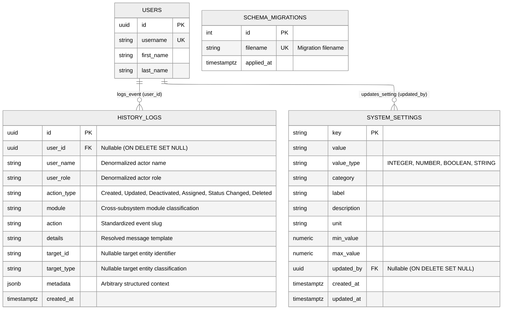

---

## 2. Table Specifications

### `history_logs`
Chronological event ledger recording operational, financial, route, and administrative actions across all 5 main subsystems.

| Column | Data Type | Nullable | Default / Constraints | Description |
| :--- | :--- | :--- | :--- | :--- |
| `id` | `UUID` | No | `PRIMARY KEY DEFAULT gen_random_uuid()` | Unique log identifier |
| `user_id` | `UUID` | Yes | `FK -> users(id) ON DELETE SET NULL` | Performing authenticated user (system events use NULL) |
| `user_name` | `VARCHAR(150)` | No | Non-empty | Snapshot of actor's full name at log time |
| `user_role` | `VARCHAR(100)` | No | Non-empty | Snapshot of actor's active role at log time |
| `action_type` | `VARCHAR(50)` | No | Non-empty | High-level action category: `Created`, `Updated`, `Deactivated`, `Assigned`, `Status Changed`, `Deleted` |
| `module` | `VARCHAR(100)` | No | Non-empty | Domain classification (e.g. `User Management`, `Fleet Management`, `Inventory Management`, `Sales & Delivery`, `SCHEDULE`, `TRIP`) |
| `action` | `VARCHAR(100)` | No | Non-empty | Standard event key (e.g. `TRIP_DISPATCHED`, `PRODUCT_CREATED`) |
| `details` | `TEXT` | No | Non-empty | Resolved descriptive message |
| `target_id` | `VARCHAR(255)` | Yes | `NULL` | ID of the affected entity |
| `target_type` | `VARCHAR(100)` | Yes | `NULL` | Entity type (e.g. `TRIP`, `VEHICLE`, `PRODUCT`, `USER`) |
| `metadata` | `JSONB` | Yes | `DEFAULT '{}'::jsonb` | Structured JSON payload for auxiliary event data |
| `created_at` | `TIMESTAMPTZ` | No | `DEFAULT NOW()` | Event recording timestamp |

### `system_settings`
Stores configurable operational business thresholds and system variables managed by Super Admin and Admin accounts.

| Column | Data Type | Nullable | Default / Constraints | Description |
| :--- | :--- | :--- | :--- | :--- |
| `key` | `VARCHAR(100)` | No | `PRIMARY KEY` | Unique dot-delimited setting key (e.g. `fleet.pm_odometer_threshold_km`) |
| `value` | `TEXT` | No | — | Serialized current setting value |
| `value_type` | `VARCHAR(20)` | No | `CHECK IN ('INTEGER', 'NUMBER', 'BOOLEAN', 'STRING')` | Runtime type coercion rule |
| `category` | `VARCHAR(50)` | No | — | Operational domain category (`FLEET`, `OPERATIONS`, `INVENTORY`, `SCHEDULES`) |
| `label` | `VARCHAR(150)` | No | — | Human-readable display label |
| `description` | `TEXT` | Yes | `NULL` | Detailed explanation of the setting's operational impact |
| `unit` | `VARCHAR(30)` | Yes | `NULL` | Measurement unit (`km`, `PHP`, `%`, `seconds`, `units`, `days`) |
| `min_value` | `NUMERIC` | Yes | `NULL` | Optional lower numeric validation bound |
| `max_value` | `NUMERIC` | Yes | `NULL` | Optional upper numeric validation bound |
| `updated_by` | `UUID` | Yes | `FK -> users(id) ON DELETE SET NULL` | Last administrator who updated this setting |
| `created_at` | `TIMESTAMPTZ` | No | `DEFAULT NOW()` | Record creation timestamp |
| `updated_at` | `TIMESTAMPTZ` | No | `DEFAULT NOW()` | Record update timestamp |

### `schema_migrations`
Internal PostgreSQL migration tracking ledger managed by `database/scripts/migrate.js`.

| Column | Data Type | Nullable | Default / Constraints | Description |
| :--- | :--- | :--- | :--- | :--- |
| `id` | `SERIAL` | No | `PRIMARY KEY` | Sequential migration execution ID |
| `filename` | `VARCHAR(255)` | No | `UNIQUE` | Executed SQL migration filename |
| `applied_at` | `TIMESTAMPTZ` | No | `DEFAULT CURRENT_TIMESTAMP` | Migration execution timestamp |
`````

## File: docs/ERD_mermaid/users_and_rbac_erd.md
`````markdown
# User Management & RBAC Subsystem — Entity Relationship Diagram (ERD)

> **Module**: User Management, Authentication & RBAC Subsystem  
> **Target Database**: PostgreSQL 18.x  
> **Key Architecture Decisions**:
> - **Multi-Role Architecture**: Supported via `user_roles` junction table (`user_id`, `role_id`, `is_primary`), while preserving `users.role_id` as the primary role pointer for backward compatibility.
> - **Stateful Session Lifecycle**: Sessions stored in `sessions` table (`mg_sid` cookie maps to `token_hash`). Enforces 8-hour rolling idle timeout (`expires_at`) and 30-day absolute ceiling.
> - **Credential Security & Autonomy**: Cryptographic temporary passwords generated on creation (`must_change_password = TRUE`). Plaintext passwords never stored.
> - **Administrative Audit Trail**: High-impact administrative actions tracked in `audit_logs` (`user_id`, `target_user_id`, `action`, `description`).

---

## 1. Mermaid Entity-Relationship Diagram

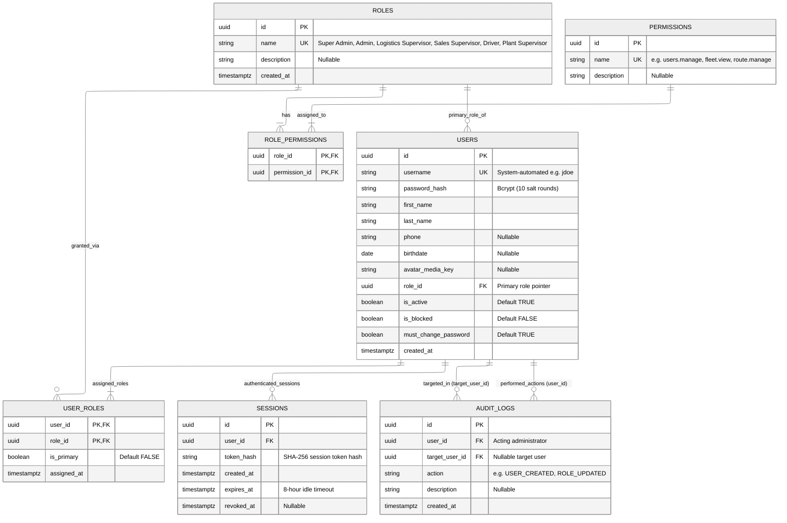

---

## 2. Table Specifications

### `roles`
System-defined and organizational security roles.

| Column | Data Type | Nullable | Default / Constraints | Description |
| :--- | :--- | :--- | :--- | :--- |
| `id` | `UUID` | No | `PRIMARY KEY DEFAULT gen_random_uuid()` | Unique role identifier |
| `name` | `VARCHAR(50)` | No | `UNIQUE` | Role name (e.g. `Super Admin`, `Admin`, `Logistics Supervisor`) |
| `description` | `TEXT` | Yes | `NULL` | Role purpose and responsibility scope |
| `created_at` | `TIMESTAMPTZ` | No | `DEFAULT NOW()` | Record creation timestamp |

---

### `permissions`
Granular feature permissions protecting backend route endpoints.

| Column | Data Type | Nullable | Default / Constraints | Description |
| :--- | :--- | :--- | :--- | :--- |
| `id` | `UUID` | No | `PRIMARY KEY DEFAULT gen_random_uuid()` | Unique permission identifier |
| `name` | `VARCHAR(100)` | No | `UNIQUE` | Permission slug (e.g. `users.manage`, `fleet.view`, `route.manage`) |
| `description` | `TEXT` | Yes | `NULL` | Detailed action authority description |

---

### `role_permissions`
Many-to-many junction mapping permissions to organizational roles.

| Column | Data Type | Nullable | Default / Constraints | Description |
| :--- | :--- | :--- | :--- | :--- |
| `role_id` | `UUID` | No | `FK -> roles(id)` | Parent role |
| `permission_id` | `UUID` | No | `FK -> permissions(id)` | Granted permission |

**Composite Primary Key:** `PRIMARY KEY (role_id, permission_id)`

---

### `users`
Core user account profiles for enterprise authentication.

| Column | Data Type | Nullable | Default / Constraints | Description |
| :--- | :--- | :--- | :--- | :--- |
| `id` | `UUID` | No | `PRIMARY KEY DEFAULT gen_random_uuid()` | Unique user identifier |
| `username` | `VARCHAR(50)` | No | `UNIQUE` | System-automated username (`first_name[0] + last_name`) |
| `password_hash` | `TEXT` | No | Bcrypt hashed string | Secure password hash (10 salt rounds) |
| `first_name` | `VARCHAR(100)` | No | Non-empty | First name |
| `last_name` | `VARCHAR(100)` | No | Non-empty | Last name |
| `phone` | `VARCHAR(20)` | Yes | `NULL` | Mobile contact number |
| `birthdate` | `DATE` | Yes | `NULL` | Birthdate |
| `avatar_media_key` | `VARCHAR(255)` | Yes | `NULL` | Canonical relative storage key for user profile avatar |
| `role_id` | `UUID` | No | `FK -> roles(id)` | Primary role foreign key |
| `is_active` | `BOOLEAN` | No | `DEFAULT TRUE` | Account active state |
| `is_blocked` | `BOOLEAN` | No | `DEFAULT FALSE` | Security block indicator |
| `must_change_password` | `BOOLEAN` | No | `DEFAULT TRUE` | First-login password change gatekeeper |
| `created_at` | `TIMESTAMPTZ` | No | `DEFAULT NOW()` | Record creation timestamp |

---

### `user_roles`
Many-to-many junction enabling employees to hold multiple organizational roles concurrently.

| Column | Data Type | Nullable | Default / Constraints | Description |
| :--- | :--- | :--- | :--- | :--- |
| `user_id` | `UUID` | No | `FK -> users(id) ON DELETE CASCADE` | Assigned user |
| `role_id` | `UUID` | No | `FK -> roles(id) ON DELETE RESTRICT` | Assigned role |
| `is_primary` | `BOOLEAN` | No | `DEFAULT FALSE` | Flags primary organizational role |
| `assigned_at` | `TIMESTAMPTZ` | No | `DEFAULT NOW()` | Assignment timestamp |

**Composite Primary Key & Indexes:**
- `PRIMARY KEY (user_id, role_id)`
- `idx_user_roles_user_id`: Index on `user_roles(user_id)` for session authorization queries.
- `idx_user_roles_role_id`: Index on `user_roles(role_id)` for role membership queries.

---

### `sessions`
Stateful user sessions for secure HTTP cookie authentication.

| Column | Data Type | Nullable | Default / Constraints | Description |
| :--- | :--- | :--- | :--- | :--- |
| `id` | `UUID` | No | `PRIMARY KEY DEFAULT gen_random_uuid()` | Session record identifier |
| `user_id` | `UUID` | No | `FK -> users(id)` | Authenticated user |
| `token_hash` | `VARCHAR(255)` | No | SHA-256 hash | Hash of the client's `mg_sid` cookie |
| `created_at` | `TIMESTAMPTZ` | No | `DEFAULT NOW()` | Login session creation timestamp |
| `expires_at` | `TIMESTAMPTZ` | No | Timestamp | Rolling 8-hour idle expiry |
| `revoked_at` | `TIMESTAMPTZ` | Yes | `NULL` | Explicit logout or password change invalidation timestamp |

---

### `audit_logs`
Tracks administrative lifecycle actions and sensitive security modifications.

| Column | Data Type | Nullable | Default / Constraints | Description |
| :--- | :--- | :--- | :--- | :--- |
| `id` | `UUID` | No | `PRIMARY KEY DEFAULT gen_random_uuid()` | Audit log identifier |
| `user_id` | `UUID` | No | `FK -> users(id)` | Administrator who performed the action |
| `target_user_id` | `UUID` | Yes | `FK -> users(id)` | Target user modified |
| `action` | `VARCHAR(100)` | No | Non-empty | Action slug (e.g. `USER_CREATED`, `USER_DEACTIVATED`, `ROLE_CHANGED`) |
| `description` | `TEXT` | Yes | `NULL` | Human-readable explanation and context |
| `created_at` | `TIMESTAMPTZ` | No | `DEFAULT NOW()` | Audit timestamp |
`````

## File: docs/guides/frontend-integration-guide.md
`````markdown
# Frontend API & Development Setup

> [!NOTE]
> - For the full list of API endpoints, request bodies, and responses, see [**`docs/api-contract.md`**](./api-contract.md).
> - For the complete list of system permissions, see [**`docs/permissions.md`**](./permissions.md).
> - Code shown in this file is just an example/suggestion. You can create your own implementation that fits best for the existing structure.

---

## 1. Authentication & Cross-Platform Support (Cookies & Bearer Token)

The backend supports a robust **Dual Authentication Strategy** designed for 100% compatibility across all operating systems and browsers (iOS Safari, Android Chrome, Samsung Internet, macOS, Windows, Linux, and mobile WebViews).

### Why Dual Authentication?
- **Desktop & Standard Browsers**: The backend sets an `HttpOnly` cookie named `mg_sid`. When `credentials: 'include'` is set, the browser automatically transmits the session cookie.
- **iOS Devices (iPhone & iPad)**: Apple mandates WebKit across all iOS browsers (Safari, Chrome iOS, Firefox iOS). WebKit's **Intelligent Tracking Prevention (ITP)** blocks third-party cross-site cookies by default when the frontend (`madayawgas.vercel.app`) calls the backend (`onrender.com`).
- **Android & Privacy Browsers**: Modern Chromium browsers enforce Third-Party Cookie Deprecation (3PCD) and Private Network Access (PNA) guards.
- **The Solution**: On login, the backend returns both the session cookie **AND** a raw session token (`data.token`). The frontend client stores this token in `localStorage` and attaches `Authorization: Bearer <token>` on all requests alongside `credentials: 'include'`. The backend automatically accepts whichever is available!

```javascript
// Example native fetch with Dual Auth enabled:
const token = localStorage.getItem('mg_token');

const response = await fetch('http://localhost:5000/api/users/me', {
  method: 'GET',
  credentials: 'include', // Sends cookie on supported browsers
  headers: {
    'Content-Type': 'application/json',
    ...(token ? { Authorization: `Bearer ${token}` } : {}), // Guarantees iOS Safari & Android mobile support
  },
});
```

---

## 2. Local Development & Mobile Device Testing (LAN / Wi-Fi)

You can test UI features locally against mock `.json` files, a local backend, or across physical mobile devices on the same Wi-Fi.

### Step 1: Create your `.env.local`
In the root of your frontend project, create a `.env.local` file:

```ini
# Set to 'true' to use local .json mock files
# Set to 'false' to call the real backend server
VITE_USE_MOCK=true

# Real backend API URL (used when VITE_USE_MOCK=false)
# For local desktop testing:
VITE_API_URL=http://localhost:5000/api
# For testing from a mobile phone on the same Wi-Fi:
# VITE_API_URL=http://192.168.1.X:5000/api
```

### Step 2: Testing on a Physical Mobile Phone via Local Wi-Fi
1. Ensure your computer and mobile phone are connected to the same Wi-Fi network.
2. Run your Vite dev server with the `--host` flag:
   ```bash
   npm run dev -- --host
   ```
3. Vite will display a Network URL (e.g., `http://192.168.1.15:5173`).
4. Set `VITE_API_URL=http://192.168.1.15:5000/api` in your `.env.local`.
5. Open the Network URL in your mobile phone's browser (Safari or Chrome).
6. **Zero CORS Issues**: The backend automatically whitelists private LAN IP ranges (`192.168.x.x`, `10.x.x.x`, `172.16-31.x.x`), supports Chromium Private Network Access (PNA), and listens on `0.0.0.0`.

---

### Step 3: Organize your Mock `.json` Files
Put your sample mock responses in a `src/mocks/` folder.

Example structure:
```text
src/
└── mocks/
    ├── me.json          # Mock current user profile & permissions
    ├── users.json       # Mock list of users
    └── roles.json       # Mock list of roles
```

#### Example `src/mocks/me.json`:
```json
{
  "status": "success",
  "data": {
    "user": {
      "id": "1",
      "username": "superadmin",
      "firstName": "Super",
      "lastName": "Admin",
      "role": "Super Admin",
      "permissions": [
        "dashboard.view",
        "fleet.view",
        "fleet.manage",
        "inventory.view",
        "inventory.manage",
        "sales.view",
        "sales.create",
        "sales.update",
        "users.view",
        "users.manage"
      ]
    }
  }
}
```

---

## 3. Recommended API Helper Files (Using Native `fetch`)

Create helper files in `src/api/` that automatically manage credentials, Bearer tokens, JSON formatting, and switching to mock data.

### Helper 1: Base Fetch Client (`src/api/client.js`)
```javascript
// src/api/client.js

export const isMock = import.meta.env.VITE_USE_MOCK === 'true';
export const API_BASE_URL = import.meta.env.VITE_API_URL || 'http://localhost:5000/api';

/**
 * Lightweight native fetch wrapper
 * Automatically attaches Authorization Bearer token (for iOS Safari ITP & mobile compatibility)
 * and credentials: 'include' (for desktop cookie sessions).
 */
export async function apiClient(endpoint, options = {}) {
  const url = `${API_BASE_URL}${endpoint}`;
  const token = typeof window !== 'undefined' ? localStorage.getItem('mg_token') : null;

  const config = {
    method: options.method || 'GET',
    headers: {
      'Content-Type': 'application/json',
      ...(token ? { Authorization: `Bearer ${token}` } : {}),
      ...options.headers,
    },
    credentials: 'include', // Sends and receives the mg_sid session cookie
    ...options,
  };

  // Convert JS object body to JSON string
  if (options.body && typeof options.body === 'object') {
    config.body = JSON.stringify(options.body);
  }

  const response = await fetch(url, config);
  const data = await response.json();

  if (!response.ok) {
    // Automatically clear invalid token on 401 Unauthorized
    if (response.status === 401 && typeof window !== 'undefined') {
      localStorage.removeItem('mg_token');
    }
    throw new Error(data.message || 'An error occurred while fetching data');
  }

  return data;
}
```

---

### Helper 2: Auth API (`src/api/auth.js`)
```javascript
// src/api/auth.js
import { apiClient, isMock } from './client';
import mockMe from '../mocks/me.json';

// Simulated small delay for mock data to feel like a real network call
const delay = (ms = 300) => new Promise((res) => setTimeout(res, ms));

export const authApi = {
  // 1. Log in (saves token to localStorage for mobile cross-browser compatibility)
  async login(username, password) {
    if (isMock) {
      await delay();
      return mockMe.data.user;
    }
    const result = await apiClient('/users/login', {
      method: 'POST',
      body: { username, password },
    });

    if (result.data?.token && typeof window !== 'undefined') {
      localStorage.setItem('mg_token', result.data.token);
    }

    return result.data.user;
  },

  // 2. Get current logged-in user (Check session on app load)
  async getMe() {
    if (isMock) {
      await delay();
      return mockMe.data.user;
    }
    const result = await apiClient('/users/me');
    return result.data.user;
  },

  // 3. Log out (clears token from localStorage)
  async logout() {
    if (isMock) {
      await delay();
      return true;
    }
    try {
      await apiClient('/users/logout', { method: 'POST' });
    } finally {
      if (typeof window !== 'undefined') {
        localStorage.removeItem('mg_token');
      }
    }
    return true;
  },

  // 4. Change password
  async changePassword(currentPassword, newPassword) {
    if (isMock) {
      await delay();
      return true;
    }
    return apiClient('/users/change-password', {
      method: 'POST',
      body: { currentPassword, newPassword },
    });
  },
};
```

---

### Helper 3: Users API (`src/api/users.js`)
```javascript
// src/api/users.js
import { apiClient, isMock } from './client';
import mockUsers from '../mocks/users.json';
import mockRoles from '../mocks/roles.json';

const delay = (ms = 300) => new Promise((res) => setTimeout(res, ms));

export const usersApi = {
  // Get all users (Admin only)
  async getAllUsers() {
    if (isMock) {
      await delay();
      return mockUsers.data.users;
    }
    const result = await apiClient('/users');
    return result.data.users;
  },

  // Get available roles
  async getRoles() {
    if (isMock) {
      await delay();
      return mockRoles.data.roles;
    }
    const result = await apiClient('/users/roles');
    return result.data.roles;
  },

  // Create a new user
  async createUser(userData) {
    if (isMock) {
      await delay();
      return { id: `mock-${Date.now()}`, ...userData };
    }
    const result = await apiClient('/users', {
      method: 'POST',
      body: userData,
    });
    return result.data.user;
  },

  // Deactivate or block user
  async updateUserStatus(userId, { isActive, isBlocked }) {
    if (isMock) {
      await delay();
      return { id: userId, isActive, isBlocked };
    }
    const result = await apiClient(`/users/${userId}/status`, {
      method: 'PATCH',
      body: { isActive, isBlocked },
    });
    return result.data.user;
  },
};
```

---

## 4. How to Check If User is Logged In (On Page Refresh)

When the user opens or refreshes the page, your app should call `authApi.getMe()`:

```javascript
// Example in App.jsx or AuthContext.jsx
import { useEffect, useState } from 'react';
import { authApi } from './api/auth';

export function useAuthInit() {
  const [user, setUser] = useState(null);
  const [loading, setLoading] = useState(true);

  useEffect(() => {
    async function checkSession() {
      try {
        const currentUser = await authApi.getMe();
        setUser(currentUser); // Logged in!
      } catch (err) {
        setUser(null); // Not logged in or session expired
      } finally {
        setLoading(false);
      }
    }

    checkSession();
  }, []);

  return { user, loading, setUser };
}
```

---

## 5. How to Use Permissions (RBAC) in UI Components

The `user` object returned by `getMe()` or `login()` contains a `permissions` array (e.g., `["sales.create", "users.view"]`).

### Step 1: Create a Permission Helper (`src/utils/permissions.js`)
```javascript
// src/utils/permissions.js

// Check if user has a single permission
export function can(user, permission) {
  if (!user || !user.permissions) return false;
  return user.permissions.includes(permission);
}

// Check if user has ALL permissions in a list
export function canAll(user, permissionsList = []) {
  if (!user || !user.permissions) return false;
  return permissionsList.every((p) => user.permissions.includes(p));
}

// Check if user has AT LEAST ONE permission in a list
export function canAny(user, permissionsList = []) {
  if (!user || !user.permissions) return false;
  return permissionsList.some((p) => user.permissions.includes(p));
}
```

---

### Step 2: Use in UI Components

#### Example 1: Hide or Show Buttons
```jsx
import { can } from '../utils/permissions';

function SalesPage({ currentUser }) {
  return (
    <div>
      <h1>Sales</h1>

      {/* Only show button if user has 'sales.create' permission */}
      {can(currentUser, 'sales.create') && (
        <button onClick={openNewSaleModal}>+ New Sale</button>
      )}
    </div>
  );
}
```

#### Example 2: Disable a Button
```jsx
<button 
  disabled={!can(currentUser, 'users.manage')}
  onClick={() => handleDeactivateUser(user.id)}
>
  Deactivate User
</button>
```

#### Example 3: Hide Sidebar Navigation Links
```jsx
<nav>
  <Link to="/dashboard">Dashboard</Link>
  
  {can(currentUser, 'inventory.view') && (
    <Link to="/inventory">Inventory</Link>
  )}

  {can(currentUser, 'fleet.view') && (
    <Link to="/fleet">Fleet</Link>
  )}

  {can(currentUser, 'users.view') && (
    <Link to="/users">User Management</Link>
  )}
</nav>
```

---

## 6. Simple Frontend Folder Structure

Here is the recommended clean folder structure for the frontend team:

```text
src/
├── api/                  # All backend & mock API calls
│   ├── client.js         # Native fetch base client (credentials: 'include')
│   ├── auth.js           # Login, logout, getMe, changePassword
│   ├── users.js          # User management calls
│   ├── fleet.js          # (Future) Fleet calls
│   └── inventory.js      # (Future) Inventory calls
│
├── mocks/                # Mock .json files for offline development
│   ├── me.json
│   ├── users.json
│   └── roles.json
│
├── components/           # Reusable UI components (Buttons, Modals, Navbar)
├── pages/                # Page screens (LoginPage, DashboardPage, UsersPage)
├── utils/                # Helper functions (permissions.js)
├── App.jsx
└── main.jsx
```

---

## 7. Quick Troubleshooting & Tips

1. **"I am getting 401 Unauthorized even after logging in"**:
   - Make sure your request includes `credentials: 'include'`. The `apiClient` helper in `src/api/client.js` includes this automatically.

2. **"How do I switch from mock data to real backend?"**:
   - Open `.env.local` and change `VITE_USE_MOCK=true` to `VITE_USE_MOCK=false`.
   - Restart your frontend dev server (`npm run dev`).

3. **"Where do I see what the backend expects for an endpoint?"**:
   - Check [**`docs/api-contract.md`**](./api-contract.md). It lists the exact parameters, HTTP method, and response format for every single endpoint.

4. **"Where do I see the permission names?"**:
   - Check [**`docs/permissions.md`**](./permissions.md).
`````

## File: docs/subsystem_modules_overview.md
`````markdown
| Module | Responsibility | Major Components |
| :--- | :--- | :--- |
| **User Management** | Manages user authentication, session security, employee profiles, role-based access control (RBAC), and system-wide administrative and operational audit logging. | • Users controller<br>• Auth service<br>• Management service<br>• Profile service<br>• Permission service<br>• Users repository<br>• History controller<br>• History service<br>• History repository |
| **Fleet & Maintenance** | Oversees company vehicle assets, driver assignments, mileage and fuel tracking, defect inspections, incident reporting, and maintenance work order workflows. | • Vehicles controller<br>• Vehicles service<br>• Vehicles repository<br>• Availability controller<br>• Availability service<br>• Availability repository<br>• Maintenance controller<br>• Maintenance service<br>• Maintenance repository<br>• Fuel controller<br>• Fuel service<br>• Fuel repository |
| **Trip & Schedule** | Coordinates delivery route planning, recurring and daily truck dispatch schedules, active trip execution, vehicle stock loading, post-trip stock reconciliation, and field incident monitoring. | • Zones controller<br>• Zones service<br>• Zones repository<br>• Templates controller<br>• Templates service<br>• Templates repository<br>• Schedules controller<br>• Schedules service<br>• Schedules repository<br>• Trips controller<br>• Trips service<br>• Trips repository<br>• Loads repository<br>• Reconciliation repository<br>• Apprehensions controller<br>• Apprehensions service<br>• Apprehensions repository<br>• Alerts controller<br>• Alerts service<br>• Alerts repository |
| **Inventory** | Controls the master LPG product catalog, real-time physical stock levels at the refilling plant across container conditions, and audited bulk stock adjustments. | • Products controller<br>• Products service<br>• Products repository<br>• Inventory controller<br>• Inventory service<br>• Inventory repository |
| **Sales & Delivery** | Handles customer account profiles, field sales order processing, offline-to-online mobile transaction synchronization, billing and payment verification, and loaned container tracking. | • Customer controller<br>• Customer service<br>• Customer repository<br>• Transactions controller<br>• Transactions service<br>• Transactions repository<br>• Invoices controller<br>• Invoices service<br>• Invoices repository<br>• Sync controller<br>• Sync service |
`````

## File: src/features/fleet/availability/availability.controller.js
`````javascript
const availabilityService = require('./availability.service');

/**
 * Availability Controller
 * Handles HTTP requests and formatting for fleet overview, availability metrics, and status endpoints.
 */
class AvailabilityController {
  /**
   * GET /api/fleet/overview
   */
  async getOverview(req, res) {
    const overview = await availabilityService.getOverview();
    return res.status(200).json({
      status: 'success',
      data: overview,
    });
  }

  /**
   * GET /api/fleet/availability
   */
  async getAvailability(req, res) {
    const availability = await availabilityService.getAvailability(req.query);
    return res.status(200).json({
      status: 'success',
      data: availability,
    });
  }

  /**
   * GET /api/fleet/trucks/:id/status
   */
  async getTruckStatus(req, res) {
    try {
      const vehicleStatus = await availabilityService.getTruckStatus(req.params.id);
      return res.status(200).json({
        status: 'success',
        data: {
          vehicle: vehicleStatus,
          truck: vehicleStatus,
        },
      });
    } catch (err) {
      const isNotFound = err.message === 'Vehicle not found';
      return res.status(isNotFound ? 404 : 400).json({
        status: 'fail',
        message: err.message,
      });
    }
  }

  /**
   * PATCH /api/fleet/trucks/:id/status
   */
  async updateTruckStatus(req, res) {
    const { status } = req.body || {};

    try {
      const vehicleStatus = await availabilityService.updateTruckStatus(req.params.id, status);
      return res.status(200).json({
        status: 'success',
        message: 'Vehicle availability status updated',
        data: {
          vehicle: vehicleStatus,
          truck: vehicleStatus,
        },
      });
    } catch (err) {
      const isNotFound = err.message === 'Vehicle not found';
      return res.status(isNotFound ? 404 : 400).json({
        status: 'fail',
        message: err.message,
      });
    }
  }
}

module.exports = new AvailabilityController();
`````

## File: src/features/fleet/vehicles/vehicles.controller.js
`````javascript
const vehiclesService = require('./vehicles.service');
const { parsePaginationQuery, formatPaginatedEnvelope } = require('../../../utils/pagination');

const ALLOWED_VEHICLE_SORT_FIELDS = {
  createdAt: 'v.created_at',
  created_at: 'v.created_at',
  plateNumber: 'v.plate_number',
  plate_number: 'v.plate_number',
  model: 'v.model',
  yearModel: 'v.year_model',
  year_model: 'v.year_model',
  vehicleType: 'v.vehicle_type',
  vehicle_type: 'v.vehicle_type',
  currentOdometer: 'v.current_odometer',
  current_odometer: 'v.current_odometer',
  status: 'v.status',
};

const ALLOWED_DRIVER_SORT_FIELDS = {
  createdAt: 'u.created_at',
  created_at: 'u.created_at',
  firstName: 'u.first_name',
  first_name: 'u.first_name',
  lastName: 'u.last_name',
  last_name: 'u.last_name',
  username: 'u.username',
  phone: 'u.phone',
};

/**
 * Vehicles Controller
 * Handles HTTP requests, parameter extraction, and status response formatting for fleet vehicles.
 */
class VehiclesController {
  /**
   * GET /api/fleet/vehicles
   * Retrieves all vehicles (legacy) or paginated slice with metadata.
   */
  async getAllVehicles(req, res) {
    const { status, search, driverAssigned, vehicleType, type } = req.query || {};
    const pagination = parsePaginationQuery(req.query, {
      defaultLimit: 20,
      maxLimit: 100,
      defaultSort: 'createdAt',
      defaultOrder: 'DESC',
      allowedSortFields: ALLOWED_VEHICLE_SORT_FIELDS,
    });

    if (!pagination.isPaginated) {
      const vehicles = await vehiclesService.getAllVehicles(
        {
          status,
          search,
          driverAssigned,
          vehicleType: vehicleType || type,
        },
        null,
        req.user
      );
      return res.status(200).json({
        status: 'success',
        data: {
          count: vehicles.length,
          vehicles,
          trucks: vehicles,
        },
      });
    }

    const { items, meta } = await vehiclesService.getAllVehicles(
      { status, search, driverAssigned, vehicleType: vehicleType || type },
      pagination,
      req.user
    );

    return res.status(200).json(formatPaginatedEnvelope(items, meta));
  }

  /**
   * GET /api/fleet/my-vehicle
   */
  async getMyAssignedVehicle(req, res) {
    try {
      const vehicle = await vehiclesService.getMyAssignedVehicle(req.user);
      return res.status(200).json({
        status: 'success',
        data: {
          vehicle,
          truck: vehicle,
        },
      });
    } catch (err) {
      return res.status(err.statusCode || 400).json({
        status: 'fail',
        message: err.message,
      });
    }
  }

  /**
   * GET /api/fleet/vehicles/:id
   */
  async getVehicleById(req, res) {
    try {
      const vehicle = await vehiclesService.getVehicleById(req.params.id, req.user);
      return res.status(200).json({
        status: 'success',
        data: {
          vehicle,
          truck: vehicle,
        },
      });
    } catch (err) {
      if (err.statusCode) {
        return res.status(err.statusCode).json({
          status: 'fail',
          message: err.message,
        });
      }
      const isNotFound = err.message === 'Vehicle not found';
      return res.status(isNotFound ? 404 : 400).json({
        status: 'fail',
        message: err.message,
      });
    }
  }

  /**
   * POST /api/fleet/vehicles
   */
  async createVehicle(req, res) {
    const {
      plateNumber,
      model,
      yearModel,
      vehicleType,
      currentOdometer,
      lastPmOdometer,
      status,
      driverId,
    } = req.body || {};

    try {
      const vehicle = await vehiclesService.createVehicle(req.user, {
        plateNumber,
        model,
        yearModel,
        vehicleType,
        currentOdometer,
        lastPmOdometer,
        status,
        driverId,
      });

      return res.status(201).json({
        status: 'success',
        message: 'Vehicle registered successfully',
        data: {
          vehicle,
          truck: vehicle,
        },
      });
    } catch (err) {
      const isConflict = err.message && err.message.includes('already exists');
      return res.status(isConflict ? 409 : 400).json({
        status: 'fail',
        message: err.message,
      });
    }
  }

  /**
   * PUT /api/fleet/vehicles/:id
   */
  async updateVehicle(req, res) {
    const { id } = req.params;
    const {
      plateNumber,
      model,
      yearModel,
      vehicleType,
      currentOdometer,
      lastPmOdometer,
    } = req.body || {};

    try {
      const vehicle = await vehiclesService.updateVehicle(req.user, id, {
        plateNumber,
        model,
        yearModel,
        vehicleType,
        currentOdometer,
        lastPmOdometer,
      });

      return res.status(200).json({
        status: 'success',
        message: 'Vehicle details updated successfully',
        data: {
          vehicle,
          truck: vehicle,
        },
      });
    } catch (err) {
      const isNotFound = err.message === 'Vehicle not found';
      const isConflict = err.message && err.message.includes('already exists');
      return res.status(isNotFound ? 404 : isConflict ? 409 : 400).json({
        status: 'fail',
        message: err.message,
      });
    }
  }

  /**
   * PATCH /api/fleet/vehicles/:id/status
   */
  async updateVehicleStatus(req, res) {
    const { id } = req.params;
    const { status } = req.body || {};

    try {
      const vehicle = await vehiclesService.updateVehicleStatus(req.user, id, status);
      return res.status(200).json({
        status: 'success',
        message: 'Vehicle status updated successfully',
        data: {
          vehicle,
          truck: vehicle,
        },
      });
    } catch (err) {
      const isNotFound = err.message === 'Vehicle not found';
      return res.status(isNotFound ? 404 : 400).json({
        status: 'fail',
        message: err.message,
      });
    }
  }

  /**
   * PATCH /api/fleet/vehicles/:id/deactivate
   */
  async deactivateVehicle(req, res) {
    const { id } = req.params;

    try {
      const vehicle = await vehiclesService.deactivateVehicle(req.user, id);
      return res.status(200).json({
        status: 'success',
        message: 'Vehicle deactivated and driver unassigned successfully',
        data: {
          vehicle,
          truck: vehicle,
        },
      });
    } catch (err) {
      const isNotFound = err.message === 'Vehicle not found';
      return res.status(isNotFound ? 404 : 400).json({
        status: 'fail',
        message: err.message,
      });
    }
  }

  /**
   * PATCH /api/fleet/vehicles/:id/assign
   */
  async assignDriver(req, res) {
    const { id } = req.params;
    const { driverId } = req.body || {};

    try {
      const vehicle = await vehiclesService.assignDriver(req.user, id, driverId);
      return res.status(200).json({
        status: 'success',
        message: 'Driver assigned to vehicle successfully',
        data: {
          vehicle,
          truck: vehicle,
        },
      });
    } catch (err) {
      const isNotFound = err.message === 'Vehicle not found' || err.message === 'Driver not found';
      const isConflict = err.message && err.message.includes('already assigned');
      return res.status(isNotFound ? 404 : isConflict ? 409 : 400).json({
        status: 'fail',
        message: err.message,
      });
    }
  }

  /**
   * PATCH /api/fleet/vehicles/:id/unassign
   */
  async unassignDriver(req, res) {
    const { id } = req.params;

    try {
      const vehicle = await vehiclesService.unassignDriver(req.user, id);
      return res.status(200).json({
        status: 'success',
        message: 'Driver unassigned from vehicle successfully',
        data: {
          vehicle,
          truck: vehicle,
        },
      });
    } catch (err) {
      const isNotFound = err.message === 'Vehicle not found';
      return res.status(isNotFound ? 404 : 400).json({
        status: 'fail',
        message: err.message,
      });
    }
  }

  /**
   * GET /api/fleet/drivers
   */
  async getAllDrivers(req, res) {
    const { availableOnly, search } = req.query || {};
    const pagination = parsePaginationQuery(req.query, {
      defaultLimit: 20,
      maxLimit: 100,
      defaultSort: 'firstName',
      defaultOrder: 'ASC',
      allowedSortFields: ALLOWED_DRIVER_SORT_FIELDS,
    });

    if (!pagination.isPaginated) {
      const drivers = await vehiclesService.getAllDrivers({ availableOnly, search });
      return res.status(200).json({
        status: 'success',
        data: {
          count: drivers.length,
          drivers,
        },
      });
    }

    const { items, meta } = await vehiclesService.getAllDrivers(
      { availableOnly, search },
      pagination
    );

    return res.status(200).json(formatPaginatedEnvelope(items, meta));
  }

  /**
   * GET /api/fleet/drivers/available & GET /api/fleet/available-drivers
   */
  async getAvailableDrivers(req, res) {
    const availableDrivers = await vehiclesService.getAvailableDrivers();
    return res.status(200).json({
      status: 'success',
      data: {
        count: availableDrivers.length,
        drivers: availableDrivers,
        availableDrivers,
      },
    });
  }

  /**
   * POST /api/fleet/vehicles/:id/mileage and PATCH /api/fleet/vehicles/:id/mileage
   */
  async recordMileage(req, res) {
    const { odometer, mileage, currentOdometer } = req.body || {};

    try {
      const result = await vehiclesService.recordMileage(req.user, req.params.id, {
        odometer,
        mileage,
        currentOdometer,
      });

      return res.status(200).json({
        status: 'success',
        message: 'Vehicle mileage recorded successfully',
        data: result,
      });
    } catch (err) {
      if (err.message === 'Vehicle not found') {
        return res.status(404).json({
          status: 'fail',
          message: err.message,
        });
      }
      return res.status(400).json({
        status: 'fail',
        message: err.message,
      });
    }
  }

  /**
   * GET /api/fleet/register-options
   */
  async getRegisterOptions(req, res) {
    const options = await vehiclesService.getRegisterOptions();
    return res.status(200).json({
      status: 'success',
      data: options,
    });
  }
}

module.exports = new VehiclesController();
`````

## File: src/features/history/history.controller.js
`````javascript
const historyService = require('./history.service');
const { parsePaginationQuery, formatPaginatedEnvelope } = require('../../utils/pagination');

const ALLOWED_HISTORY_SORT_FIELDS = {
  createdAt: 'created_at',
  created_at: 'created_at',
  userName: 'user_name',
  user_name: 'user_name',
  userRole: 'user_role',
  user_role: 'user_role',
  actionType: 'action_type',
  action_type: 'action_type',
  module: 'module',
  action: 'action',
};

/**
 * History Controller
 * Handles HTTP requests and responses for system event history logs.
 */
class HistoryController {
  /**
   * Retrieves paginated and filtered history logs.
   * GET /api/history
   */
  async getHistoryLogs(req, res, next) {
    try {
      const {
        module,
        actionType,
        search,
        limit,
        offset,
        startDate,
        endDate,
        page,
        pageSize,
        paginate,
      } = req.query;

      const hasStandardPagination =
        page !== undefined || pageSize !== undefined || paginate === 'true';

      if (hasStandardPagination) {
        const pagination = parsePaginationQuery(req.query, {
          defaultLimit: 20,
          maxLimit: 100,
          defaultSort: 'createdAt',
          defaultOrder: 'DESC',
          allowedSortFields: ALLOWED_HISTORY_SORT_FIELDS,
        });

        const { items, meta } = await historyService.getHistoryLogs(
          {
            module: module ? String(module) : undefined,
            actionType: actionType ? String(actionType) : undefined,
            search: search ? String(search) : undefined,
            startDate: startDate ? String(startDate) : undefined,
            endDate: endDate ? String(endDate) : undefined,
          },
          pagination
        );

        return res.status(200).json(formatPaginatedEnvelope(items, meta));
      }

      const result = await historyService.getHistoryLogs({
        module: module ? String(module) : undefined,
        actionType: actionType ? String(actionType) : undefined,
        search: search ? String(search) : undefined,
        limit: limit !== undefined ? Number(limit) : 100,
        offset: offset !== undefined ? Number(offset) : 0,
        startDate: startDate ? String(startDate) : undefined,
        endDate: endDate ? String(endDate) : undefined,
      });

      return res.status(200).json({
        status: 'success',
        data: result,
      });
    } catch (error) {
      next(error);
    }
  }

  /**
   * Retrieves a single history log by UUID.
   * GET /api/history/:id
   */
  async getHistoryLogById(req, res, next) {
    try {
      const { id } = req.params;
      const log = await historyService.getHistoryLogById(id);

      return res.status(200).json({
        status: 'success',
        data: {
          log,
        },
      });
    } catch (error) {
      if (error.message === 'History log not found') {
        return res.status(404).json({
          status: 'fail',
          message: 'History log not found',
        });
      }
      next(error);
    }
  }
}

module.exports = new HistoryController();
`````

## File: src/features/history/history.repository.js
`````javascript
const { query } = require('../../../database/connection');

/**
 * History Repository
 * Pure PostgreSQL data access layer for system event history logs.
 */
class HistoryRepository {
  /**
   * Inserts a new system event history log.
   */
  async createLog({
    userId = null,
    userName,
    userRole,
    actionType,
    module,
    action,
    details,
    targetId = null,
    targetType = null,
    metadata = {},
    createdAt = null,
  }) {
    const params = [
      userId,
      userName,
      userRole,
      actionType,
      module,
      action,
      details,
      targetId,
      targetType,
      typeof metadata === 'object' ? JSON.stringify(metadata) : metadata,
    ];

    let sql;
    if (createdAt) {
      params.push(createdAt);
      sql = `
        INSERT INTO history_logs (
          user_id, user_name, user_role, action_type, module,
          action, details, target_id, target_type, metadata, created_at
        )
        VALUES ($1, $2, $3, $4, $5, $6, $7, $8, $9, $10, $11)
        RETURNING *;
      `;
    } else {
      sql = `
        INSERT INTO history_logs (
          user_id, user_name, user_role, action_type, module,
          action, details, target_id, target_type, metadata
        )
        VALUES ($1, $2, $3, $4, $5, $6, $7, $8, $9, $10)
        RETURNING *;
      `;
    }

    const res = await query(sql, params);
    return res.rows[0];
  }

  /**
   * Retrieves history logs matching filter and search criteria with pagination.
   */
  async getLogs({
    module = null,
    actionType = null,
    search = null,
    limit = 100,
    offset = 0,
    startDate = null,
    endDate = null,
    sortColumn = 'created_at',
    sortOrder = 'DESC',
  } = {}) {
    const conditions = [];
    const params = [];

    if (module && module !== 'All Modules' && module.trim() !== '') {
      params.push(module.trim());
      conditions.push(`module = $${params.length}`);
    }

    if (actionType && actionType !== 'All' && actionType.trim() !== '') {
      params.push(actionType.trim());
      conditions.push(`action_type ILIKE $${params.length}`);
    }

    if (search && search.trim() !== '') {
      params.push(`%${search.trim()}%`);
      const idx = params.length;
      conditions.push(
        `(user_name ILIKE $${idx} OR details ILIKE $${idx} OR action_type ILIKE $${idx} OR module ILIKE $${idx} OR action ILIKE $${idx})`
      );
    }

    if (startDate) {
      params.push(startDate);
      conditions.push(`created_at >= $${params.length}`);
    }

    if (endDate) {
      params.push(endDate);
      conditions.push(`created_at <= $${params.length}`);
    }

    const whereClause = conditions.length > 0 ? `WHERE ${conditions.join(' AND ')}` : '';

    let limitClause = '';
    if (limit !== null && limit !== undefined && Number(limit) > 0) {
      params.push(Number(limit));
      limitClause += ` LIMIT $${params.length}`;
    }

    if (offset !== null && offset !== undefined && Number(offset) >= 0) {
      params.push(Number(offset));
      limitClause += ` OFFSET $${params.length}`;
    }

    const orderCol = sortColumn || 'created_at';
    const orderDir = sortOrder === 'ASC' ? 'ASC' : 'DESC';

    const sql = `
      SELECT *
      FROM history_logs
      ${whereClause}
      ORDER BY ${orderCol} ${orderDir}, id DESC
      ${limitClause};
    `;

    const res = await query(sql, params);
    return res.rows;
  }

  /**
   * Counts the total number of history logs matching the filter criteria.
   */
  async countLogs({
    module = null,
    actionType = null,
    search = null,
    startDate = null,
    endDate = null,
  } = {}) {
    const conditions = [];
    const params = [];

    if (module && module !== 'All Modules' && module.trim() !== '') {
      params.push(module.trim());
      conditions.push(`module = $${params.length}`);
    }

    if (actionType && actionType !== 'All' && actionType.trim() !== '') {
      params.push(actionType.trim());
      conditions.push(`action_type ILIKE $${params.length}`);
    }

    if (search && search.trim() !== '') {
      params.push(`%${search.trim()}%`);
      const idx = params.length;
      conditions.push(
        `(user_name ILIKE $${idx} OR details ILIKE $${idx} OR action_type ILIKE $${idx} OR module ILIKE $${idx} OR action ILIKE $${idx})`
      );
    }

    if (startDate) {
      params.push(startDate);
      conditions.push(`created_at >= $${params.length}`);
    }

    if (endDate) {
      params.push(endDate);
      conditions.push(`created_at <= $${params.length}`);
    }

    const whereClause = conditions.length > 0 ? `WHERE ${conditions.join(' AND ')}` : '';

    const sql = `
      SELECT COUNT(*)::int AS total
      FROM history_logs
      ${whereClause};
    `;

    const res = await query(sql, params);
    return res.rows[0]?.total || 0;
  }

  /**
   * Retrieves a single history log by its UUID.
   */
  async getLogById(id) {
    const res = await query(
      `SELECT * FROM history_logs WHERE id = $1;`,
      [id]
    );
    return res.rows[0] || null;
  }
}

module.exports = new HistoryRepository();
`````

## File: src/features/history/index.js
`````javascript
const historyRepository = require('./history.repository');
const historyService = require('./history.service');
const historyController = require('./history.controller');
const historyRoutes = require('./history.routes');
const {
  EVENTS,
  EVENT_DEFINITIONS,
  MODULES,
  ACTION_TYPES,
  resolveEvent,
} = require('./history.events');

module.exports = {
  historyRepository,
  historyService,
  historyController,
  historyRoutes,
  EVENTS,
  EVENT_DEFINITIONS,
  MODULES,
  ACTION_TYPES,
  resolveEvent,
};
`````

## File: src/features/inventory/index.js
`````javascript
const inventoryRoutes = require('./inventory.routes');
const inventoryRepository = require('./inventory.repository');
const inventoryService = require('./inventory.service');
const inventoryController = require('./inventory.controller');

const productsRepository = require('./products/products.repository');
const productsService = require('./products/products.service');
const productsController = require('./products/products.controller');

module.exports = {
  inventoryRoutes,
  inventoryRepository,
  inventoryService,
  inventoryController,
  productsRepository,
  productsService,
  productsController,
};
`````

## File: src/features/media/media.controller.js
`````javascript
const mediaService = require('./media.service');

/**
 * Handles media upload requests (multipart/form-data).
 *
 * @param {import('express').Request} req
 * @param {import('express').Response} res
 */
async function uploadMedia(req, res) {
  if (!req.file) {
    return res.status(400).json({
      status: 'fail',
      code: 'FILE_REQUIRED',
      message: 'No file uploaded or file field missing',
    });
  }

  const domain = req.body?.domain;
  if (!domain || typeof domain !== 'string' || domain.trim() === '') {
    return res.status(400).json({
      status: 'fail',
      code: 'DOMAIN_REQUIRED',
      message: 'Media domain is required (e.g. maintenance/receipts, fleet/vehicles)',
    });
  }

  const result = await mediaService.uploadMedia({
    file: req.file,
    domain: domain.trim(),
    req,
  });

  return res.status(201).json({
    status: 'success',
    data: result,
  });
}

/**
 * Resolves a canonical relative storage key into an accessible URL.
 *
 * @param {import('express').Request} req
 * @param {import('express').Response} res
 */
async function resolveMedia(req, res) {
  const storageKey = req.body?.storageKey;

  if (!storageKey || typeof storageKey !== 'string' || storageKey.trim() === '') {
    return res.status(400).json({
      status: 'fail',
      code: 'STORAGE_KEY_REQUIRED',
      message: 'storageKey must be provided as a non-empty string',
    });
  }

  const result = mediaService.resolveMedia(storageKey.trim(), req);

  return res.status(200).json({
    status: 'success',
    data: result,
  });
}

/**
 * Deletes a media asset from storage.
 *
 * @param {import('express').Request} req
 * @param {import('express').Response} res
 */
async function deleteMedia(req, res) {
  const storageKey = req.body?.storageKey || req.query?.storageKey;

  if (!storageKey || typeof storageKey !== 'string' || storageKey.trim() === '') {
    return res.status(400).json({
      status: 'fail',
      code: 'STORAGE_KEY_REQUIRED',
      message: 'storageKey must be provided as a non-empty string in request body or query parameter',
    });
  }

  const result = await mediaService.deleteMedia(storageKey.trim());

  return res.status(200).json({
    status: 'success',
    data: result,
  });
}

module.exports = {
  uploadMedia,
  resolveMedia,
  deleteMedia,
};
`````

## File: src/features/media/media.routes.js
`````javascript
const express = require('express');
const router = express.Router();
const { authenticate } = require('../../middleware/auth.middleware');
const asyncHandler = require('../../utils/asyncHandler');
const { uploadSingleMedia } = require('./media.middleware');
const mediaController = require('./media.controller');

/**
 * @route   POST /api/media/upload
 * @desc    Upload media file into storage and receive canonical storage key
 * @access  Private (Authenticated session required)
 */
router.post(
  '/upload',
  authenticate,
  uploadSingleMedia('file'),
  asyncHandler(mediaController.uploadMedia)
);

/**
 * @route   POST /api/media/resolve
 * @desc    Resolve canonical relative storage key into fully qualified URL
 * @access  Private (Authenticated session required)
 */
router.post(
  '/resolve',
  authenticate,
  asyncHandler(mediaController.resolveMedia)
);

/**
 * @route   DELETE /api/media
 * @desc    Delete media file from storage by relative storage key or URL
 * @access  Private (Authenticated session required)
 */
router.delete(
  '/',
  authenticate,
  asyncHandler(mediaController.deleteMedia)
);

module.exports = router;
`````

## File: src/features/media/media.storage.js
`````javascript
const fs = require('fs');
const path = require('path');
const { createClient } = require('@supabase/supabase-js');
const { getBaseUrl } = require('../../config/env');

let cachedSupabaseClient = null;

/**
 * Checks if the runtime environment is configured for production cloud storage.
 * Evaluates dynamically to support test runtime mode switching.
 */
function isProductionMode() {
  return (
    String(process.env.PRODUCTION).trim().toLowerCase() === 'true' ||
    process.env.NODE_ENV === 'production'
  );
}

/**
 * Resolves the configured Supabase client instance using service role credentials.
 */
function getSupabaseClient() {
  const url = process.env.SUPABASE_URL;
  const key = process.env.SUPABASE_SERVICE_ROLE_KEY;

  if (!url || !key) {
    throw new Error(
      'Supabase Storage configuration error: SUPABASE_URL and SUPABASE_SERVICE_ROLE_KEY must be set in production mode'
    );
  }

  if (!cachedSupabaseClient) {
    cachedSupabaseClient = createClient(url, key, {
      auth: {
        persistSession: false,
        autoRefreshToken: false,
      },
    });
  }

  return cachedSupabaseClient;
}

/**
 * Resolves the configured bucket name (defaults to 'madayawgas-media').
 */
function getMediaBucket() {
  return process.env.SUPABASE_MEDIA_BUCKET || 'madayawgas-media';
}

/**
 * Resolves the root directory path for local media files.
 */
function getLocalMediaPath() {
  return path.resolve(process.env.LOCAL_MEDIA_PATH || './uploads');
}

/**
 * Validates and resolves local target file path, strictly guarding against directory traversal.
 */
function resolveSafeLocalPath(storageKey) {
  const rootDir = getLocalMediaPath();
  const normalizedKey = storageKey.replace(/^(\.\.(\/|\\|$))+/, '');
  const targetPath = path.resolve(rootDir, normalizedKey);

  const rootWithSep = rootDir.endsWith(path.sep) ? rootDir : rootDir + path.sep;
  if (!targetPath.startsWith(rootWithSep) && targetPath !== rootDir) {
    const error = new Error('Invalid storage key: directory traversal attempt detected');
    error.statusCode = 400;
    error.code = 'INVALID_STORAGE_KEY';
    throw error;
  }

  return targetPath;
}

/**
 * Uploads media buffer to the configured storage backend (Supabase Storage in prod, Local Disk in dev).
 *
 * @param {Buffer} buffer - File binary buffer from in-memory stream
 * @param {string} storageKey - Relative canonical storage key
 * @param {string} mimeType - Standard MIME type
 * @returns {Promise<{ storageKey: string }>}
 */
async function uploadToStorage(buffer, storageKey, mimeType) {
  if (!Buffer.isBuffer(buffer)) {
    throw new Error('uploadToStorage expects a valid Buffer instance');
  }

  if (isProductionMode()) {
    const supabase = getSupabaseClient();
    const bucket = getMediaBucket();

    const { data, error } = await supabase.storage
      .from(bucket)
      .upload(storageKey, buffer, {
        contentType: mimeType,
        upsert: true,
      });

    if (error) {
      throw new Error(`Supabase storage upload failed: ${error.message}`);
    }

    return { storageKey };
  }

  // Local filesystem mode
  const targetPath = resolveSafeLocalPath(storageKey);
  await fs.promises.mkdir(path.dirname(targetPath), { recursive: true });
  await fs.promises.writeFile(targetPath, buffer);

  return { storageKey };
}

/**
 * Resolves the canonical relative storage key into a fully qualified access URL.
 *
 * @param {string} storageKey - Canonical relative storage key (e.g. maintenance/receipts/1728...-abc.jpg)
 * @param {import('express').Request} [req] - Optional Express request for local host reflection
 * @returns {string|null}
 */
function resolveMediaUrl(storageKey, req) {
  if (!storageKey || typeof storageKey !== 'string' || storageKey.trim() === '') {
    return null;
  }

  const trimmedKey = storageKey.trim();

  // If already an absolute HTTP/HTTPS URL, return as is
  if (/^https?:\/\//i.test(trimmedKey)) {
    return trimmedKey;
  }

  const cleanKey = trimmedKey.replace(/^(\.\/)?uploads\//i, '').replace(/^\/+/, '');

  if (isProductionMode()) {
    const supabaseUrl = (process.env.SUPABASE_URL || '').replace(/\/+$/, '');
    const bucket = getMediaBucket();
    return `${supabaseUrl}/storage/v1/object/public/${bucket}/${cleanKey}`;
  }

  // Local / Development mode
  let baseUrl;
  if (req && typeof req.get === 'function' && req.get('host')) {
    const protocol = req.protocol || 'http';
    baseUrl = `${protocol}://${req.get('host')}`;
  } else {
    baseUrl = getBaseUrl();
  }

  return `${baseUrl.replace(/\/+$/, '')}/media/${cleanKey}`;
}

/**
 * Safely deletes media from Supabase Storage or local filesystem.
 *
 * @param {string} storageKey - Canonical relative storage key
 * @returns {Promise<boolean>} - True if deletion was attempted/succeeded, false if nonexistent
 */
async function deleteFromStorage(storageKey) {
  if (!storageKey || typeof storageKey !== 'string') {
    return false;
  }

  if (isProductionMode()) {
    const supabase = getSupabaseClient();
    const bucket = getMediaBucket();
    const { error } = await supabase.storage.from(bucket).remove([storageKey]);
    if (error) {
      throw new Error(`Supabase storage deletion failed: ${error.message}`);
    }
    return true;
  }

  // Local filesystem mode
  try {
    const targetPath = resolveSafeLocalPath(storageKey);
    await fs.promises.unlink(targetPath);
    return true;
  } catch (err) {
    if (err.code === 'ENOENT') {
      return false;
    }
    throw err;
  }
}

module.exports = {
  isProductionMode,
  uploadToStorage,
  resolveMediaUrl,
  deleteFromStorage,
  getLocalMediaPath,
  getMediaBucket,
};
`````

## File: src/features/operations/alerts/alerts.notifier.js
`````javascript
const { EventEmitter } = require('events');
const { safeEmitSocketEvent } = require('../../../socket');

/**
 * Emergency Alerts Notifier Adapter
 * Decoupled event dispatcher providing real-time WebSockets integration,
 * local event emission, and standing hooks for external push gateways.
 */
class AlertsNotifier extends EventEmitter {
  constructor() {
    super();
    this.wsBroadcaster = null;
  }

  /**
   * Registers a WebSocket or external push broadcaster callback.
   *
   * @param {Function} broadcasterFn - (alertPayload) => void
   */
  registerWebSocketBroadcaster(broadcasterFn) {
    if (typeof broadcasterFn === 'function') {
      this.wsBroadcaster = broadcasterFn;
    }
  }

  /**
   * Dispatches an emergency alert notification to all registered listeners and WebSocket channels.
   *
   * @param {Object} alertPayload - Standardized alert DTO
   */
  dispatchEmergencyAlert(alertPayload) {
    // 1. Emit local process event
    this.emit('emergency:dispatched', alertPayload);

    // 2. Real-time WebSocket broadcast to room:alerts
    safeEmitSocketEvent('EMERGENCY_ALERT_TRIGGERED', alertPayload, 'room:alerts');

    // 3. Invoke custom broadcaster hook if registered
    if (this.wsBroadcaster && typeof this.wsBroadcaster === 'function') {
      try {
        this.wsBroadcaster(alertPayload);
      } catch (err) {
        console.error('[AlertsNotifier] WebSocket broadcast failed:', err.message);
      }
    }
  }

  /**
   * Dispatches status update notifications (e.g. alert acknowledged or resolved).
   *
   * @param {Object} alertPayload - Standardized alert DTO
   */
  dispatchStatusUpdate(alertPayload) {
    // 1. Emit local process event
    this.emit('emergency:status_updated', alertPayload);

    // 2. Real-time WebSocket broadcast to room:alerts
    safeEmitSocketEvent('EMERGENCY_ALERT_STATUS_UPDATED', alertPayload, 'room:alerts');

    // 3. Invoke custom broadcaster hook if registered
    if (this.wsBroadcaster && typeof this.wsBroadcaster === 'function') {
      try {
        this.wsBroadcaster({ event: 'emergency:status_updated', data: alertPayload });
      } catch (err) {
        console.error('[AlertsNotifier] WebSocket status update broadcast failed:', err.message);
      }
    }
  }
}

module.exports = new AlertsNotifier();
`````

## File: src/features/operations/apprehensions/apprehensions.controller.js
`````javascript
const apprehensionsService = require('./apprehensions.service');
const { parsePaginationQuery, formatPaginatedEnvelope } = require('../../../utils/pagination');

/**
 * Apprehensions Controller
 * HTTP parameter parsing and response envelope formatting for roadside apprehensions.
 */
class ApprehensionsController {
  /**
   * POST /api/operations/apprehensions
   */
  async recordApprehension(req, res) {
    const data = await apprehensionsService.recordApprehension(req.user, req.body || {});
    return res.status(201).json({
      status: 'success',
      message: 'Road apprehension recorded successfully.',
      data,
    });
  }

  /**
   * GET /api/operations/apprehensions/:id
   */
  async getApprehensionById(req, res) {
    const data = await apprehensionsService.getApprehensionById(req.params.id, req.user);
    return res.status(200).json({
      status: 'success',
      data,
    });
  }

  /**
   * PATCH /api/operations/apprehensions/:id/status
   */
  async updateStatus(req, res) {
    const data = await apprehensionsService.updateStatus(req.params.id, req.user, req.body || {});
    return res.status(200).json({
      status: 'success',
      message: 'Apprehension status updated successfully.',
      data,
    });
  }

  /**
   * GET /api/operations/apprehensions
   */
  async getApprehensions(req, res) {
    const { vehicleId, driverId, tripId, agency, status, startDate, endDate, search } = req.query || {};

    const pagination = parsePaginationQuery(req.query, {
      defaultLimit: 20,
      maxLimit: 100,
      defaultSort: 'incidentTime',
      defaultOrder: 'DESC',
    });

    if (!pagination.isPaginated) {
      const apprehensions = await apprehensionsService.getApprehensions(
        req.user,
        { vehicleId, driverId, tripId, agency, status, startDate, endDate, search },
        null
      );
      return res.status(200).json({
        status: 'success',
        data: {
          count: apprehensions.length,
          apprehensions,
        },
      });
    }

    const { items, meta } = await apprehensionsService.getApprehensions(
      req.user,
      { vehicleId, driverId, tripId, agency, status, startDate, endDate, search },
      pagination
    );

    return res.status(200).json(formatPaginatedEnvelope(items, meta));
  }

  /**
   * PATCH /api/operations/apprehensions/:id
   */
  async updateApprehension(req, res) {
    const data = await apprehensionsService.updateApprehension(req.params.id, req.user, req.body || {});
    return res.status(200).json({
      status: 'success',
      message: 'Apprehension details successfully updated',
      data,
    });
  }
}

module.exports = new ApprehensionsController();
`````

## File: src/features/operations/apprehensions/apprehensions.repository.js
`````javascript
const { query } = require('../../../../database/connection');

/**
 * Driver Road Apprehensions Repository
 * Pure SQL data access layer for traffic citations, apprehending agencies, and mandatory ticket image references.
 */
class ApprehensionsRepository {
  /**
   * Inserts a new road apprehension record.
   * @param {Object} data
   * @returns {Promise<Object>} Created row
   */
  async createApprehension({
    vehicleId,
    driverId,
    tripId,
    recordedBy,
    citationTicketNo,
    violationType,
    apprehendingAgency,
    incidentTime,
    location,
    penaltyAmount,
    ticketMediaKey,
    notes,
  }) {
    const sql = `
      INSERT INTO driver_apprehensions (
        vehicle_id,
        driver_id,
        trip_id,
        recorded_by,
        citation_ticket_no,
        violation_type,
        apprehending_agency,
        incident_time,
        location,
        penalty_amount,
        ticket_media_key,
        notes,
        status
      )
      VALUES ($1, $2, $3, $4, $5, $6, $7, COALESCE($8, NOW()), $9, COALESCE($10, 0.00), $11, $12, 'RECORDED')
      RETURNING *;
    `;

    const result = await query(sql, [
      vehicleId,
      driverId,
      tripId || null,
      recordedBy,
      citationTicketNo || null,
      violationType,
      apprehendingAgency,
      incidentTime || null,
      location || null,
      penaltyAmount !== undefined && penaltyAmount !== null ? penaltyAmount : 0.00,
      ticketMediaKey,
      notes || null,
    ]);

    return result.rows[0];
  }

  /**
   * Retrieves single apprehension by UUID with complete joins.
   * @param {string} id - Apprehension UUID
   * @returns {Promise<Object|null>}
   */
  async getApprehensionById(id) {
    const sql = `
      SELECT 
        a.id,
        a.vehicle_id,
        a.driver_id,
        a.trip_id,
        a.recorded_by,
        a.citation_ticket_no,
        a.violation_type,
        a.apprehending_agency,
        a.incident_time,
        a.location,
        a.penalty_amount,
        a.ticket_media_key,
        a.notes,
        a.status,
        a.settled_at,
        a.settled_by,
        a.created_at,
        a.updated_at,
        v.plate_number AS vehicle_plate_number,
        v.model AS vehicle_model,
        v.vehicle_type,
        d.username AS driver_username,
        d.first_name AS driver_first_name,
        d.last_name AS driver_last_name,
        d.phone AS driver_phone,
        rb.username AS recorded_by_username,
        sb.username AS settled_by_username,
        t.trip_number
      FROM driver_apprehensions a
      JOIN vehicles v ON a.vehicle_id = v.id
      JOIN users d ON a.driver_id = d.id
      LEFT JOIN users rb ON a.recorded_by = rb.id
      LEFT JOIN users sb ON a.settled_by = sb.id
      LEFT JOIN trips t ON a.trip_id = t.id
      WHERE a.id = $1;
    `;

    const result = await query(sql, [id]);
    return result.rows[0] || null;
  }

  /**
   * Updates status of an apprehension (e.g. SETTLED, DISPUTED, CANCELLED).
   * @param {string} id
   * @param {Object} data - { status, settledBy, settledAt, notes }
   * @returns {Promise<Object|null>}
   */
  async updateStatus(id, { status, settledBy, settledAt, notes }) {
    const sql = `
      UPDATE driver_apprehensions
      SET 
        status = $2,
        settled_by = $3,
        settled_at = $4,
        notes = COALESCE($5, notes),
        updated_at = NOW()
      WHERE id = $1
      RETURNING *;
    `;

    const result = await query(sql, [
      id,
      status,
      settledBy || null,
      settledAt || null,
      notes || null,
    ]);

    return result.rows[0] || null;
  }

  /**
   * Retrieves paginated apprehensions with filtering.
   * @param {Object} filters - { vehicleId, driverId, tripId, agency, status, startDate, endDate, search }
   * @param {Object|null} pagination - { limit, offset }
   */
  async getApprehensions(filters = {}, pagination = null) {
    const { vehicleId, driverId, tripId, agency, status, startDate, endDate, search } = filters;
    const conditions = [];
    const params = [];
    let paramIndex = 1;

    if (vehicleId) {
      conditions.push(`a.vehicle_id = $${paramIndex++}`);
      params.push(vehicleId);
    }

    if (driverId) {
      conditions.push(`a.driver_id = $${paramIndex++}`);
      params.push(driverId);
    }

    if (tripId) {
      conditions.push(`a.trip_id = $${paramIndex++}`);
      params.push(tripId);
    }

    if (agency) {
      conditions.push(`a.apprehending_agency ILIKE $${paramIndex++}`);
      params.push(`%${agency}%`);
    }

    if (status) {
      conditions.push(`a.status = $${paramIndex++}`);
      params.push(status.toUpperCase());
    }

    if (startDate) {
      conditions.push(`a.incident_time >= $${paramIndex++}`);
      params.push(startDate);
    }

    if (endDate) {
      conditions.push(`a.incident_time <= $${paramIndex++}`);
      params.push(endDate);
    }

    if (search && typeof search === 'string' && search.trim() !== '') {
      conditions.push(
        `(a.citation_ticket_no ILIKE $${paramIndex} OR a.violation_type ILIKE $${paramIndex} OR a.apprehending_agency ILIKE $${paramIndex} OR v.plate_number ILIKE $${paramIndex} OR d.first_name ILIKE $${paramIndex} OR d.last_name ILIKE $${paramIndex})`
      );
      params.push(`%${search.trim()}%`);
      paramIndex++;
    }

    const whereClause = conditions.length > 0 ? `WHERE ${conditions.join(' AND ')}` : '';

    const baseSql = `
      FROM driver_apprehensions a
      JOIN vehicles v ON a.vehicle_id = v.id
      JOIN users d ON a.driver_id = d.id
      LEFT JOIN users rb ON a.recorded_by = rb.id
      LEFT JOIN users sb ON a.settled_by = sb.id
      LEFT JOIN trips t ON a.trip_id = t.id
      ${whereClause}
    `;

    const selectSql = `
      SELECT 
        a.id,
        a.vehicle_id,
        a.driver_id,
        a.trip_id,
        a.recorded_by,
        a.citation_ticket_no,
        a.violation_type,
        a.apprehending_agency,
        a.incident_time,
        a.location,
        a.penalty_amount,
        a.ticket_media_key,
        a.notes,
        a.status,
        a.settled_at,
        a.settled_by,
        a.created_at,
        a.updated_at,
        v.plate_number AS vehicle_plate_number,
        v.model AS vehicle_model,
        v.vehicle_type,
        d.username AS driver_username,
        d.first_name AS driver_first_name,
        d.last_name AS driver_last_name,
        d.phone AS driver_phone,
        rb.username AS recorded_by_username,
        sb.username AS settled_by_username,
        t.trip_number
      ${baseSql}
      ORDER BY a.incident_time DESC
    `;

    if (!pagination || !pagination.isPaginated) {
      const result = await query(selectSql, params);
      return result.rows;
    }

    const limit = pagination.limit || 20;
    const offset = pagination.offset || 0;

    const dataSql = `${selectSql} LIMIT $${params.length + 1} OFFSET $${params.length + 2}`;
    const countSql = `SELECT COUNT(*) AS total ${baseSql}`;

    const [dataResult, countResult] = await Promise.all([
      query(dataSql, [...params, limit, offset]),
      query(countSql, params),
    ]);

    return {
      rows: dataResult.rows,
      total: parseInt(countResult.rows[0].total, 10),
    };
  }

  /**
   * Updates editable details of a road apprehension record.
   * @param {string} id
   * @param {Object} updateData
   * @returns {Promise<Object|null>}
   */
  async updateApprehension(id, updateData = {}) {
    const fields = [];
    const params = [id];
    let idx = 2;

    const columnMap = {
      citationTicketNo: 'citation_ticket_no',
      violationType: 'violation_type',
      apprehendingAgency: 'apprehending_agency',
      incidentTime: 'incident_time',
      location: 'location',
      penaltyAmount: 'penalty_amount',
      ticketMediaKey: 'ticket_media_key',
      notes: 'notes',
    };

    for (const [key, col] of Object.entries(columnMap)) {
      if (updateData[key] !== undefined) {
        fields.push(`${col} = $${idx++}`);
        params.push(updateData[key]);
      }
    }

    if (fields.length === 0) {
      return this.getApprehensionById(id);
    }

    fields.push('updated_at = NOW()');

    const res = await query(
      `UPDATE driver_apprehensions SET ${fields.join(', ')} WHERE id = $1 RETURNING *`,
      params
    );
    return res.rows[0] || null;
  }
}

module.exports = new ApprehensionsRepository();
`````

## File: src/features/operations/apprehensions/apprehensions.routes.js
`````javascript
const express = require('express');
const router = express.Router();
const apprehensionsController = require('./apprehensions.controller');
const { authenticate, requirePermission } = require('../../../middleware/auth.middleware');
const asyncHandler = require('../../../utils/asyncHandler');

// ============================================================
// Driver Road Apprehensions Routes
// Base Path (when mounted): /api/operations/apprehensions
// ============================================================

/**
 * POST /api/operations/apprehensions
 * Records roadside traffic citation with mandatory ticket image proof.
 */
router.post(
  '/',
  authenticate,
  requirePermission('apprehensions.create'),
  asyncHandler(apprehensionsController.recordApprehension.bind(apprehensionsController))
);

/**
 * GET /api/operations/apprehensions/:id
 * Retrieves single apprehension detail by UUID.
 */
router.get(
  '/:id',
  authenticate,
  requirePermission(['apprehensions.view', 'apprehensions.view_own']),
  asyncHandler(apprehensionsController.getApprehensionById.bind(apprehensionsController))
);

/**
 * PATCH /api/operations/apprehensions/:id/status
 * Updates status of an apprehension record (SETTLED, DISPUTED, CANCELLED).
 */
router.patch(
  '/:id/status',
  authenticate,
  requirePermission('apprehensions.manage'),
  asyncHandler(apprehensionsController.updateStatus.bind(apprehensionsController))
);

/**
 * PATCH /api/operations/apprehensions/:id
 * Updates editable citation details of an apprehension record.
 */
router.patch(
  '/:id',
  authenticate,
  requirePermission('apprehensions.manage'),
  asyncHandler(apprehensionsController.updateApprehension.bind(apprehensionsController))
);

/**
 * GET /api/operations/apprehensions
 * Retrieves paginated roadside apprehension history with server-side filtering.
 */
router.get(
  '/',
  authenticate,
  requirePermission(['apprehensions.view', 'apprehensions.view_own']),
  asyncHandler(apprehensionsController.getApprehensions.bind(apprehensionsController))
);

module.exports = router;
`````

## File: src/features/operations/index.js
`````javascript
const operationsRoutes = require('./operations.routes');

const apprehensionsRoutes = require('./apprehensions/apprehensions.routes');
const apprehensionsService = require('./apprehensions/apprehensions.service');
const apprehensionsRepository = require('./apprehensions/apprehensions.repository');

const fuelRoutes = require('./fuel/fuel.routes');
const fuelService = require('./fuel/fuel.service');
const fuelRepository = require('./fuel/fuel.repository');

const alertsRoutes = require('./alerts/alerts.routes');
const alertsService = require('./alerts/alerts.service');
const alertsRepository = require('./alerts/alerts.repository');
const alertsNotifier = require('./alerts/alerts.notifier');

module.exports = {
  operationsRoutes,

  // Apprehensions
  apprehensionsRoutes,
  apprehensionsService,
  apprehensionsRepository,

  // Fuel Tracking
  fuelRoutes,
  fuelService,
  fuelRepository,

  // Emergency Alerts
  alertsRoutes,
  alertsService,
  alertsRepository,
  alertsNotifier,
};
`````

## File: src/features/operations/operations.routes.js
`````javascript
const express = require('express');
const router = express.Router();

const apprehensionsRoutes = require('./apprehensions/apprehensions.routes');
const fuelRoutes = require('./fuel/fuel.routes');
const alertsRoutes = require('./alerts/alerts.routes');

// ============================================================
// Operations Subsystem Master Router
// Base Path: /api/operations
// ============================================================

router.use('/apprehensions', apprehensionsRoutes);
router.use('/fuel', fuelRoutes);
router.use('/alerts', alertsRoutes);

module.exports = router;
`````

## File: src/features/sales/invoices/invoices.controller.js
`````javascript
const invoicesService = require('./invoices.service');
const { formatPaginatedEnvelope } = require('../../../utils/pagination');

/**
 * Invoices Controller
 * Handles HTTP requests, parameter extraction, and status response formatting for sales invoices.
 */
class InvoicesController {
  /**
   * GET /api/sales/invoices
   * Retrieves paginated or complete listing of invoices.
   */
  async getAllInvoices(req, res) {
    try {
      const result = await invoicesService.getAllInvoices(req.user, req.query || {});
      if (result.items && result.meta) {
        return res.status(200).json(formatPaginatedEnvelope(result.items, result.meta));
      }
      return res.status(200).json({
        status: 'success',
        data: {
          count: result.length,
          invoices: result,
        },
      });
    } catch (err) {
      return res.status(err.statusCode || 400).json({
        status: 'fail',
        message: err.message,
      });
    }
  }

  /**
   * GET /api/sales/invoices/:id
   * Retrieves single invoice details by UUID.
   */
  async getInvoiceById(req, res) {
    try {
      const { id } = req.params;
      const invoice = await invoicesService.getInvoiceDetails(req.user, id);
      return res.status(200).json({
        status: 'success',
        data: { invoice },
      });
    } catch (err) {
      const isNotFound = err.message === 'Invoice not found';
      return res.status(err.statusCode || (isNotFound ? 404 : 400)).json({
        status: 'fail',
        message: err.message,
      });
    }
  }

  /**
   * PATCH /api/sales/invoices/:id/verify
   * Verifies payment on an invoice (supervisor action).
   */
  async verifyInvoice(req, res) {
    try {
      const { id } = req.params;
      const updatedInvoice = await invoicesService.verifyInvoice(req.user, id);
      return res.status(200).json({
        status: 'success',
        message: 'Invoice payment successfully verified',
        data: { invoice: updatedInvoice },
      });
    } catch (err) {
      const isNotFound = err.message === 'Invoice not found';
      return res.status(err.statusCode || (isNotFound ? 404 : 400)).json({
        status: 'fail',
        message: err.message,
      });
    }
  }

  /**
   * PATCH /api/sales/invoices/:id/payment
   * Updates payment details on an unverified invoice.
   */
  async recordPayment(req, res) {
    try {
      const { id } = req.params;
      const updatedInvoice = await invoicesService.recordPayment(req.user, id, req.body || {});
      return res.status(200).json({
        status: 'success',
        message: 'Invoice payment details updated',
        data: { invoice: updatedInvoice },
      });
    } catch (err) {
      const isNotFound = err.message === 'Invoice not found';
      return res.status(err.statusCode || (isNotFound ? 404 : 400)).json({
        status: 'fail',
        message: err.message,
      });
    }
  }

  // Backward compatibility alias
  async getInvoiceByTransaction(req, res) {
    try {
      const { transactionId } = req.params;
      const inv = await invoicesService.getInvoiceByTransactionId(transactionId);
      return res.status(200).json({
        status: 'success',
        data: { invoice: inv },
      });
    } catch (err) {
      return res.status(err.statusCode || 400).json({
        status: 'fail',
        message: err.message,
      });
    }
  }
}

module.exports = new InvoicesController();
`````

## File: src/features/sales/invoices/invoices.repository.js
`````javascript
const { query: defaultQuery } = require('../../../../database/connection');

/**
 * Invoices Repository
 * Handles parameterized SQL operations for sales_invoices.
 */
class InvoicesRepository {
  /**
   * Helper to normalize client runner.
   */
  _resolveRunner(clientOrParam, ...rest) {
    if (clientOrParam && typeof clientOrParam.query === 'function') {
      return [clientOrParam.query.bind(clientOrParam), ...rest];
    }
    if (clientOrParam === null || clientOrParam === undefined) {
      return [defaultQuery, ...rest];
    }
    return [defaultQuery, clientOrParam, ...rest];
  }

  /**
   * Retrieves paginated or complete invoices list with optional filters.
   * @param {Object} [client]
   * @param {Object} [filters] - { tripId, paymentMethod, paymentStatus, search, startDate, endDate, recordedBy }
   * @param {Object} [pagination] - { page, limit, offset, sortColumn, sortOrder }
   * @returns {Promise<Array|{rows: Array, total: number}>}
   */
  async findPaginatedInvoices(client, filters = {}, pagination = null) {
    const [dbQuery, actualFilters, actualPagination] = this._resolveRunner(client, filters, pagination);
    const {
      tripId,
      trip_id,
      paymentMethod,
      payment_method,
      paymentStatus,
      payment_status,
      search,
      startDate,
      endDate,
      recordedBy,
      recorded_by,
    } = actualFilters || {};

    const conditions = [];
    const params = [];
    let paramIndex = 1;

    const resolvedTripId = tripId || trip_id;
    if (resolvedTripId) {
      conditions.push(`st.trip_id = $${paramIndex++}`);
      params.push(resolvedTripId);
    }

    const resolvedPaymentMethod = paymentMethod || payment_method;
    if (resolvedPaymentMethod) {
      conditions.push(`si.payment_method = $${paramIndex++}`);
      params.push(resolvedPaymentMethod.toUpperCase().trim());
    }

    const resolvedPaymentStatus = paymentStatus || payment_status;
    if (resolvedPaymentStatus) {
      conditions.push(`si.payment_status = $${paramIndex++}`);
      params.push(resolvedPaymentStatus.toUpperCase().trim());
    }

    const resolvedRecordedBy = recordedBy || recorded_by;
    if (resolvedRecordedBy) {
      conditions.push(`st.recorded_by = $${paramIndex++}`);
      params.push(resolvedRecordedBy);
    }

    if (startDate) {
      conditions.push(`si.transacted_at >= $${paramIndex++}`);
      params.push(startDate);
    }

    if (endDate) {
      conditions.push(`si.transacted_at <= $${paramIndex++}`);
      params.push(endDate);
    }

    if (search && typeof search === 'string' && search.trim() !== '') {
      const searchPlaceholder = `$${paramIndex++}`;
      conditions.push(`(
        si.invoice_number ILIKE ${searchPlaceholder} OR
        si.declaration_number ILIKE ${searchPlaceholder} OR
        si.payment_reference_number ILIKE ${searchPlaceholder} OR
        st.transaction_no ILIKE ${searchPlaceholder} OR
        c.name ILIKE ${searchPlaceholder} OR
        c.business_name ILIKE ${searchPlaceholder} OR
        c.contact_person ILIKE ${searchPlaceholder}
      )`);
      params.push(`%${search.trim()}%`);
    }

    const whereClause = conditions.length > 0 ? `WHERE ${conditions.join(' AND ')}` : '';

    if (!actualPagination) {
      const sql = `
        SELECT 
          si.id,
          si.transaction_id,
          si.invoice_number,
          si.declaration_number,
          si.total_amount,
          si.payment_method,
          si.payment_status,
          si.payment_reference_number,
          si.payment_proof_key,
          si.verified_by,
          vu.username AS verified_by_username,
          CONCAT(vu.first_name, ' ', vu.last_name) AS verified_by_name,
          si.verified_at,
          si.transacted_at,
          si.synced_at,
          si.created_at,
          si.updated_at,
          st.transaction_no,
          st.trip_id,
          st.status AS transaction_status,
          st.recorded_by,
          c.id AS customer_id,
          c.name AS customer_name,
          c.business_name AS customer_business_name,
          c.contact_person AS customer_contact_person
        FROM sales_invoices si
        JOIN sales_transactions st ON st.id = si.transaction_id
        JOIN customers c ON c.id = st.customer_id
        LEFT JOIN users vu ON vu.id = si.verified_by
        ${whereClause}
        ORDER BY si.transacted_at DESC, si.created_at DESC
      `;

      const result = await dbQuery(sql, params);
      return result.rows;
    }

    const { limit, offset, sortColumn = 'si.transacted_at', sortOrder = 'DESC' } = actualPagination;
    const limitPlaceholder = `$${params.length + 1}`;
    const offsetPlaceholder = `$${params.length + 2}`;

    const dataSql = `
      SELECT 
        si.id,
        si.transaction_id,
        si.invoice_number,
        si.declaration_number,
        si.total_amount,
        si.payment_method,
        si.payment_status,
        si.payment_reference_number,
        si.payment_proof_key,
        si.verified_by,
        vu.username AS verified_by_username,
        CONCAT(vu.first_name, ' ', vu.last_name) AS verified_by_name,
        si.verified_at,
        si.transacted_at,
        si.synced_at,
        si.created_at,
        si.updated_at,
        st.transaction_no,
        st.trip_id,
        st.status AS transaction_status,
        st.recorded_by,
        c.id AS customer_id,
        c.name AS customer_name,
        c.business_name AS customer_business_name,
        c.contact_person AS customer_contact_person
      FROM sales_invoices si
      JOIN sales_transactions st ON st.id = si.transaction_id
      JOIN customers c ON c.id = st.customer_id
      LEFT JOIN users vu ON vu.id = si.verified_by
      ${whereClause}
      ORDER BY ${sortColumn} ${sortOrder}, si.id DESC
      LIMIT ${limitPlaceholder} OFFSET ${offsetPlaceholder}
    `;

    const countSql = `
      SELECT COUNT(*) AS count
      FROM sales_invoices si
      JOIN sales_transactions st ON st.id = si.transaction_id
      JOIN customers c ON c.id = st.customer_id
      ${whereClause}
    `;

    const [dataResult, countResult] = await Promise.all([
      dbQuery(dataSql, [...params, limit, offset]),
      dbQuery(countSql, params),
    ]);

    return {
      rows: dataResult.rows,
      total: parseInt(countResult.rows[0]?.count || 0, 10),
    };
  }

  /**
   * Retrieves an invoice by UUID with linked transaction and customer.
   * @param {Object} [client]
   * @param {string} id - Invoice UUID
   * @returns {Promise<Object|null>}
   */
  async getInvoiceById(client, id) {
    const [dbQuery, actualId] = this._resolveRunner(client, id);

    const sql = `
      SELECT 
        si.id,
        si.transaction_id,
        si.invoice_number,
        si.declaration_number,
        si.total_amount,
        si.payment_method,
        si.payment_status,
        si.payment_reference_number,
        si.payment_proof_key,
        si.verified_by,
        vu.username AS verified_by_username,
        CONCAT(vu.first_name, ' ', vu.last_name) AS verified_by_name,
        si.verified_at,
        si.transacted_at,
        si.synced_at,
        si.created_at,
        si.updated_at,
        st.transaction_no,
        st.trip_id,
        st.status AS transaction_status,
        st.recorded_by,
        c.id AS customer_id,
        c.name AS customer_name,
        c.business_name AS customer_business_name,
        c.contact_person AS customer_contact_person,
        c.contact_number AS customer_contact_number,
        c.delivery_address AS customer_delivery_address
      FROM sales_invoices si
      JOIN sales_transactions st ON st.id = si.transaction_id
      JOIN customers c ON c.id = st.customer_id
      LEFT JOIN users vu ON vu.id = si.verified_by
      WHERE si.id = $1
    `;

    const res = await dbQuery(sql, [actualId]);
    return res.rows[0] || null;
  }

  /**
   * Retrieves an invoice by transaction ID.
   * @param {Object} [client]
   * @param {string} transactionId - Transaction UUID
   * @returns {Promise<Object|null>}
   */
  async getInvoiceByTransactionId(client, transactionId) {
    const [dbQuery, actualId] = this._resolveRunner(client, transactionId);

    const sql = `
      SELECT 
        si.id,
        si.transaction_id,
        si.invoice_number,
        si.declaration_number,
        si.total_amount,
        si.payment_method,
        si.payment_status,
        si.payment_reference_number,
        si.payment_proof_key,
        si.verified_by,
        si.verified_at,
        si.transacted_at,
        si.synced_at,
        si.created_at,
        si.updated_at
      FROM sales_invoices si
      WHERE si.transaction_id = $1
    `;

    const res = await dbQuery(sql, [actualId]);
    return res.rows[0] || null;
  }

  /**
   * Retrieves an invoice by unique invoice number.
   * @param {Object} [client]
   * @param {string} invoiceNumber - Invoice number
   * @returns {Promise<Object|null>}
   */
  async getInvoiceByNumber(client, invoiceNumber) {
    const [dbQuery, actualNumber] = this._resolveRunner(client, invoiceNumber);

    const sql = `
      SELECT 
        si.id,
        si.transaction_id,
        si.invoice_number,
        si.declaration_number,
        si.total_amount,
        si.payment_method,
        si.payment_status,
        si.payment_reference_number,
        si.payment_proof_key,
        si.verified_by,
        si.verified_at,
        si.transacted_at,
        si.synced_at,
        si.created_at,
        si.updated_at
      FROM sales_invoices si
      WHERE si.invoice_number = $1
    `;

    const res = await dbQuery(sql, [actualNumber]);
    return res.rows[0] || null;
  }

  /**
   * Verifies an invoice payment.
   * @param {Object} [client]
   * @param {string} id - Invoice UUID
   * @param {string} verifiedBy - User UUID
   * @returns {Promise<Object|null>} Updated invoice row
   */
  async verifyInvoicePayment(client, id, verifiedBy) {
    const [dbQuery, actualId] = this._resolveRunner(client, id);

    const sql = `
      UPDATE sales_invoices
      SET 
        payment_status = 'VERIFIED',
        verified_by = $2,
        verified_at = CURRENT_TIMESTAMP,
        updated_at = CURRENT_TIMESTAMP
      WHERE id = $1
      RETURNING *;
    `;

    const res = await dbQuery(sql, [actualId, verifiedBy]);
    return res.rows[0] || null;
  }

  /**
   * Updates payment details on an unverified invoice (method, reference number, proof key).
   * @param {Object} [client]
   * @param {string} id - Invoice UUID
   * @param {Object} updateData
   * @returns {Promise<Object|null>}
   */
  async updateInvoicePaymentDetails(client, id, updateData = {}) {
    const [dbQuery, actualId] = this._resolveRunner(client, id);

    const fields = [];
    const params = [actualId];
    let idx = 2;

    if (updateData.paymentMethod !== undefined) {
      fields.push(`payment_method = $${idx++}`);
      params.push(updateData.paymentMethod);
    }
    if (updateData.paymentReferenceNumber !== undefined) {
      fields.push(`payment_reference_number = $${idx++}`);
      params.push(updateData.paymentReferenceNumber);
    }
    if (updateData.paymentProofKey !== undefined) {
      fields.push(`payment_proof_key = $${idx++}`);
      params.push(updateData.paymentProofKey);
    }

    if (fields.length === 0) {
      return this.getInvoiceById(client, actualId);
    }

    fields.push('updated_at = CURRENT_TIMESTAMP');

    const sql = `
      UPDATE sales_invoices
      SET ${fields.join(', ')}
      WHERE id = $1
      RETURNING *;
    `;

    const res = await dbQuery(sql, params);
    return res.rows[0] || null;
  }
}

module.exports = new InvoicesRepository();
`````

## File: src/features/sales/invoices/invoices.routes.js
`````javascript
const express = require('express');
const router = express.Router();

const invoicesController = require('./invoices.controller');
const {
  authenticate,
  requirePermission,
} = require('../../../middleware/auth.middleware');
const asyncHandler = require('../../../utils/asyncHandler');

/**
 * PATCH /api/sales/invoices/:id/verify
 * Verifies payment for a sales invoice (supervisor action).
 * Requires both sales.view and sales.update so frontline sales reps cannot self-verify.
 */
router.patch(
  '/:id/verify',
  authenticate,
  requirePermission('sales.view'),
  requirePermission('sales.update'),
  asyncHandler(invoicesController.verifyInvoice.bind(invoicesController))
);

/**
 * PATCH /api/sales/invoices/:id/payment
 * Updates payment method, reference number, or proof key on an unverified invoice.
 */
router.patch(
  '/:id/payment',
  authenticate,
  requirePermission('sales.update'),
  asyncHandler(invoicesController.recordPayment.bind(invoicesController))
);

/**
 * GET /api/sales/invoices
 * List all sales invoices with optional filters and pagination.
 */
router.get(
  '/',
  authenticate,
  requirePermission(['sales.view', 'sales.view_own']),
  asyncHandler(invoicesController.getAllInvoices.bind(invoicesController))
);

/**
 * GET /api/sales/invoices/:id
 * Retrieve single invoice details.
 */
router.get(
  '/:id',
  authenticate,
  requirePermission(['sales.view', 'sales.view_own']),
  asyncHandler(invoicesController.getInvoiceById.bind(invoicesController))
);

module.exports = router;
`````

## File: src/features/sales/sync/sync.controller.js
`````javascript
const syncService = require('./sync.service');

/**
 * Sync Controller
 * Handles HTTP requests, parameter extraction, and status formatting for batch synchronization.
 * Returns HTTP 200 for all valid payload structures, with top-level `status` field reflecting
 * the itemized ingestion outcome:
 *   - "success"        → All transactions committed (failedCount === 0)
 *   - "partial_success"→ Some committed, some quarantined (failedCount > 0 && processedCount/ignoredCount > 0)
 *   - "fail"           → All transactions failed (failedCount > 0 && processedCount + ignoredCount === 0)
 *
 * HTTP 400 / 404 is reserved for batch-level fatal errors (missing tripId, non-array payload, trip not found).
 */
class SyncController {
  async syncBatch(req, res) {
    try {
      const result = await syncService.processBatchSync(req.user, req.body || {});
      return res.status(200).json({
        status: result.syncStatus,
        data: result,
      });
    } catch (err) {
      const statusCode = err.statusCode || (err.message === 'Trip not found' ? 404 : 400);
      return res.status(statusCode).json({
        status: 'fail',
        message: err.message,
      });
    }
  }
}

module.exports = new SyncController();
`````

## File: src/features/sales/transactions/transactions.routes.js
`````javascript
const express = require('express');
const router = express.Router();

const transactionsController = require('./transactions.controller');
const {
  authenticate,
  requirePermission,
} = require('../../../middleware/auth.middleware');
const asyncHandler = require('../../../utils/asyncHandler');

/**
 * PATCH /api/sales/transactions/:id/cancel
 * Voids/cancels a completed sales transaction.
 */
router.patch(
  '/:id/cancel',
  authenticate,
  requirePermission('sales.delete'),
  asyncHandler(transactionsController.cancelTransaction.bind(transactionsController))
);

/**
 * PATCH /api/sales/transactions/:id
 * Updates editable metadata on a sales transaction.
 */
router.patch(
  '/:id',
  authenticate,
  requirePermission('sales.update'),
  asyncHandler(transactionsController.updateTransaction.bind(transactionsController))
);

/**
 * GET /api/sales/transactions
 * List all sales transactions with optional filters and pagination.
 */
router.get(
  '/',
  authenticate,
  requirePermission(['sales.view', 'sales.view_own']),
  asyncHandler(transactionsController.getTransactions.bind(transactionsController))
);

/**
 * GET /api/sales/transactions/:id
 * Retrieve details of a single sales transaction.
 */
router.get(
  '/:id',
  authenticate,
  requirePermission(['sales.view', 'sales.view_own']),
  asyncHandler(transactionsController.getTransactionById.bind(transactionsController))
);

module.exports = router;
`````

## File: src/features/schedules/templates/templates.controller.js
`````javascript
const { z } = require('zod');
const templatesService = require('./templates.service');

// Zod Validation Schemas
const UUIDParamSchema = z.string().uuid({ message: 'Template ID must be a valid UUID' });

const CreateTemplateSchema = z.object({
  truckId: z
    .string({ required_error: 'Vehicle ID is required' })
    .trim()
    .uuid({ message: 'Vehicle ID must be a valid UUID' }),
  zoneId: z
    .string({ required_error: 'Zone ID is required' })
    .trim()
    .uuid({ message: 'Zone ID must be a valid UUID' }),
  dayOfWeek: z.coerce
    .number({ required_error: 'Day of week is required' })
    .int()
    .min(1, { message: 'Day of week must be an integer between 1 (Monday) and 7 (Sunday)' })
    .max(7, { message: 'Day of week must be an integer between 1 (Monday) and 7 (Sunday)' }),
  defaultSalesUserId: z.preprocess(
    (val) => (typeof val === 'string' && val.trim() === '' ? null : val),
    z.string().trim().uuid({ message: 'Sales User ID must be a valid UUID' }).nullable().optional()
  ),
  isActive: z.boolean().optional().default(true),
});

const UpdateTemplateSchema = z.object({
  truckId: z.string().trim().uuid({ message: 'Vehicle ID must be a valid UUID' }).optional(),
  zoneId: z.string().trim().uuid({ message: 'Zone ID must be a valid UUID' }).optional(),
  dayOfWeek: z.coerce
    .number()
    .int()
    .min(1, { message: 'Day of week must be between 1 and 7' })
    .max(7, { message: 'Day of week must be between 1 and 7' })
    .optional(),
  defaultSalesUserId: z.preprocess(
    (val) => (typeof val === 'string' && val.trim() === '' ? null : val),
    z.string().trim().uuid({ message: 'Sales User ID must be a valid UUID' }).nullable().optional()
  ),
  isActive: z.boolean().optional(),
});

/**
 * Schedule Templates Controller
 * Handles HTTP requests and JSON response formatting for schedule templates.
 */
class TemplatesController {
  /**
   * GET /api/schedules/templates
   * List all weekly schedule templates.
   */
  async getAllTemplates(req, res) {
    const { truckId, dayOfWeek, zoneId, isActive } = req.query || {};
    const templates = await templatesService.getAllTemplates({
      truckId,
      dayOfWeek,
      zoneId,
      isActive,
    });

    return res.status(200).json({
      status: 'success',
      data: {
        count: templates.length,
        templates,
      },
    });
  }

  /**
   * GET /api/schedules/templates/:id
   * Retrieve single schedule template by UUID.
   */
  async getTemplateById(req, res) {
    try {
      const parsedId = UUIDParamSchema.safeParse(req.params.id);
      if (!parsedId.success) {
        return res.status(400).json({
          status: 'fail',
          message: parsedId.error.issues[0]?.message || 'Invalid Template ID',
        });
      }

      const template = await templatesService.getTemplateById(parsedId.data);
      return res.status(200).json({
        status: 'success',
        data: { template },
      });
    } catch (err) {
      return res.status(err.statusCode || 400).json({
        status: 'fail',
        message: err.message,
      });
    }
  }

  /**
   * POST /api/schedules/templates
   * Create a new weekly route template.
   */
  async createTemplate(req, res) {
    try {
      const parsed = CreateTemplateSchema.safeParse(req.body || {});
      if (!parsed.success) {
        return res.status(400).json({
          status: 'fail',
          message: parsed.error.issues[0]?.message || 'Invalid template data',
        });
      }

      const template = await templatesService.createTemplate(req.user, parsed.data);
      return res.status(201).json({
        status: 'success',
        data: { template },
      });
    } catch (err) {
      return res.status(err.statusCode || 400).json({
        status: 'fail',
        message: err.message,
      });
    }
  }

  /**
   * PATCH /api/schedules/templates/:id
   * Update a schedule template.
   */
  async updateTemplate(req, res) {
    try {
      const parsedId = UUIDParamSchema.safeParse(req.params.id);
      if (!parsedId.success) {
        return res.status(400).json({
          status: 'fail',
          message: parsedId.error.issues[0]?.message || 'Invalid Template ID',
        });
      }

      const parsed = UpdateTemplateSchema.safeParse(req.body || {});
      if (!parsed.success) {
        return res.status(400).json({
          status: 'fail',
          message: parsed.error.issues[0]?.message || 'Invalid template data',
        });
      }

      const template = await templatesService.updateTemplate(
        parsedId.data,
        req.user,
        parsed.data
      );
      return res.status(200).json({
        status: 'success',
        data: { template },
      });
    } catch (err) {
      return res.status(err.statusCode || 400).json({
        status: 'fail',
        message: err.message,
      });
    }
  }

  /**
   * DELETE /api/schedules/templates/:id
   * Delete a schedule template.
   */
  async deleteTemplate(req, res) {
    try {
      const parsedId = UUIDParamSchema.safeParse(req.params.id);
      if (!parsedId.success) {
        return res.status(400).json({
          status: 'fail',
          message: parsedId.error.issues[0]?.message || 'Invalid Template ID',
        });
      }

      await templatesService.deleteTemplate(parsedId.data);
      return res.status(200).json({
        status: 'success',
        message: 'Schedule template deleted successfully',
      });
    } catch (err) {
      return res.status(err.statusCode || 400).json({
        status: 'fail',
        message: err.message,
      });
    }
  }
}

module.exports = new TemplatesController();
`````

## File: src/features/schedules/templates/templates.service.js
`````javascript
const templatesRepository = require('./templates.repository');
const zonesRepository = require('../zones/zones.repository');
const vehiclesRepository = require('../../fleet/vehicles/vehicles.repository');
const { query } = require('../../../../database/connection');

/**
 * Schedule Templates Service
 * Business logic and constraints for recurring weekly master route templates.
 */
class TemplatesService {
  /**
   * Helper to verify a user is an active Sales Person.
   * @param {string} userId
   */
  async verifySalesUser(userId) {
    if (!userId) return null;

    const UUID_REGEX = /^[0-9a-f]{8}-[0-9a-f]{4}-[1-5][0-9a-f]{3}-[89ab][0-9a-f]{3}-[0-9a-f]{12}$/i;
    if (typeof userId !== 'string' || !UUID_REGEX.test(userId.trim())) {
      const err = new Error('Sales User ID must be a valid UUID');
      err.statusCode = 400;
      throw err;
    }

    const sql = `
      SELECT 
        u.id, 
        u.username, 
        u.first_name, 
        u.last_name, 
        u.is_active, 
        u.is_blocked,
        r.name AS role_name,
        EXISTS (
          SELECT 1 FROM user_roles ur
          JOIN roles r2 ON ur.role_id = r2.id
          WHERE ur.user_id = u.id AND LOWER(r2.name) = 'sales person'
        ) OR LOWER(r.name) = 'sales person' AS is_sales_person
      FROM users u
      JOIN roles r ON u.role_id = r.id
      WHERE u.id = $1
    `;

    const res = await query(sql, [userId]);
    const user = res.rows[0];

    if (!user) {
      const err = new Error('Sales user not found');
      err.statusCode = 404;
      throw err;
    }

    if (!user.is_active || user.is_blocked) {
      const err = new Error('Sales user account is deactivated or blocked');
      err.statusCode = 400;
      throw err;
    }

    if (!user.is_sales_person) {
      const err = new Error(`User '${user.username}' does not hold the Sales Person role`);
      err.statusCode = 400;
      throw err;
    }

    return user;
  }

  /**
   * Retrieves all weekly templates with optional filtering.
   * @param {Object} filters
   */
  async getAllTemplates(filters = {}) {
    return templatesRepository.getAllTemplates(filters);
  }

  /**
   * Retrieves a single template by UUID.
   * @param {string} id
   */
  async getTemplateById(id) {
    if (!id || typeof id !== 'string') {
      const err = new Error('Template ID is required');
      err.statusCode = 400;
      throw err;
    }

    const template = await templatesRepository.getTemplateById(id);
    if (!template) {
      const err = new Error('Schedule template not found');
      err.statusCode = 404;
      throw err;
    }

    return template;
  }

  /**
   * Creates a new schedule template.
   * @param {Object} actorUser
   * @param {Object} data - { truckId, zoneId, dayOfWeek, defaultSalesUserId, isActive }
   */
  async createTemplate(actorUser, data = {}) {
    const { truckId, zoneId, dayOfWeek, defaultSalesUserId, isActive } = data;

    if (!truckId || typeof truckId !== 'string') {
      const err = new Error('Vehicle ID is required');
      err.statusCode = 400;
      throw err;
    }

    const vehicle = await vehiclesRepository.getVehicleById(truckId.trim());
    if (!vehicle) {
      const err = new Error('Vehicle not found');
      err.statusCode = 404;
      throw err;
    }

    if (!zoneId || typeof zoneId !== 'string') {
      const err = new Error('Zone ID is required');
      err.statusCode = 400;
      throw err;
    }

    const zone = await zonesRepository.getZoneById(zoneId.trim());
    if (!zone) {
      const err = new Error('Service zone not found');
      err.statusCode = 404;
      throw err;
    }

    if (!zone.is_active) {
      const err = new Error(`Service zone '${zone.name}' is inactive and cannot be scheduled`);
      err.statusCode = 400;
      throw err;
    }

    const parsedDay = parseInt(dayOfWeek, 10);
    if (isNaN(parsedDay) || parsedDay < 1 || parsedDay > 7) {
      const err = new Error('Day of week must be an integer between 1 (Monday) and 7 (Sunday)');
      err.statusCode = 400;
      throw err;
    }

    if (defaultSalesUserId) {
      const verifiedSales = await this.verifySalesUser(defaultSalesUserId.trim());
      const existingSalesTemplates = await templatesRepository.getAllTemplates({
        dayOfWeek: parsedDay,
        isActive: true,
      });
      const conflict = existingSalesTemplates.find(
        (t) => t.default_sales_user_id === verifiedSales.id
      );
      if (conflict) {
        const err = new Error(
          `Sales Person '${verifiedSales.username}' is already the default sales rep for vehicle '${conflict.truck_plate_number}' on day ${parsedDay}`
        );
        err.statusCode = 409;
        throw err;
      }
    }

    // Check unique constraint for truck and day of week
    const existing = await templatesRepository.findByTruckAndDay(vehicle.id, parsedDay);
    if (existing) {
      const err = new Error(
        `A schedule template for vehicle '${vehicle.plate_number}' on day ${parsedDay} already exists`
      );
      err.statusCode = 409;
      throw err;
    }

    return templatesRepository.createTemplate({
      truckId: vehicle.id,
      zoneId: zone.id,
      dayOfWeek: parsedDay,
      defaultSalesUserId: defaultSalesUserId ? defaultSalesUserId.trim() : null,
      isActive: isActive !== undefined ? Boolean(isActive) : true,
    });
  }

  /**
   * Updates an existing schedule template.
   * @param {string} id
   * @param {Object} actorUser
   * @param {Object} data
   */
  async updateTemplate(id, actorUser, data = {}) {
    const current = await this.getTemplateById(id);
    const updatePayload = {};

    let targetTruckId = current.truck_id;
    let targetDay = current.day_of_week;

    if (data.truckId !== undefined) {
      const vehicle = await vehiclesRepository.getVehicleById(data.truckId.trim());
      if (!vehicle) {
        const err = new Error('Vehicle not found');
        err.statusCode = 404;
        throw err;
      }
      targetTruckId = vehicle.id;
      updatePayload.truckId = vehicle.id;
    }

    if (data.zoneId !== undefined) {
      const zone = await zonesRepository.getZoneById(data.zoneId.trim());
      if (!zone) {
        const err = new Error('Service zone not found');
        err.statusCode = 404;
        throw err;
      }
      if (!zone.is_active) {
        const err = new Error(`Service zone '${zone.name}' is inactive`);
        err.statusCode = 400;
        throw err;
      }
      updatePayload.zoneId = zone.id;
    }

    if (data.dayOfWeek !== undefined) {
      const parsedDay = parseInt(data.dayOfWeek, 10);
      if (isNaN(parsedDay) || parsedDay < 1 || parsedDay > 7) {
        const err = new Error('Day of week must be between 1 and 7');
        err.statusCode = 400;
        throw err;
      }
      targetDay = parsedDay;
      updatePayload.dayOfWeek = parsedDay;
    }

    if (data.defaultSalesUserId !== undefined) {
      if (data.defaultSalesUserId === null || data.defaultSalesUserId === '') {
        updatePayload.defaultSalesUserId = null;
      } else {
        await this.verifySalesUser(data.defaultSalesUserId.trim());
        updatePayload.defaultSalesUserId = data.defaultSalesUserId.trim();
      }
    }

    if (data.isActive !== undefined) {
      updatePayload.isActive = Boolean(data.isActive);
    }

    if (data.truckId !== undefined || data.dayOfWeek !== undefined) {
      const existing = await templatesRepository.findByTruckAndDay(targetTruckId, targetDay);
      if (existing && existing.id !== id) {
        const err = new Error(
          `A schedule template for this vehicle on day ${targetDay} already exists`
        );
        err.statusCode = 409;
        throw err;
      }
    }

    const targetSalesId = updatePayload.defaultSalesUserId !== undefined
      ? updatePayload.defaultSalesUserId
      : current.default_sales_user_id;
    const targetIsActive = updatePayload.isActive !== undefined ? updatePayload.isActive : current.is_active;

    if (targetSalesId && targetIsActive) {
      const existingSalesTemplates = await templatesRepository.getAllTemplates({
        dayOfWeek: targetDay,
        isActive: true,
      });
      const conflict = existingSalesTemplates.find(
        (t) => t.default_sales_user_id === targetSalesId && t.id !== id
      );
      if (conflict) {
        const err = new Error(
          `Sales Person is already the default sales rep for vehicle '${conflict.truck_plate_number}' on day ${targetDay}`
        );
        err.statusCode = 409;
        throw err;
      }
    }

    return templatesRepository.updateTemplate(id, updatePayload);
  }

  /**
   * Deletes a schedule template.
   * @param {string} id
   */
  async deleteTemplate(id) {
    await this.getTemplateById(id);
    return templatesRepository.deleteTemplate(id);
  }
}

module.exports = new TemplatesService();
`````

## File: src/features/schedules/schedules.controller.js
`````javascript
const { z } = require('zod');
const schedulesService = require('./schedules.service');
const { parsePaginationQuery, formatPaginatedEnvelope } = require('../../utils/pagination');

const ALLOWED_SCHEDULE_SORT_FIELDS = {
  scheduledDate: 'ts.scheduled_date',
  scheduled_date: 'ts.scheduled_date',
  date: 'ts.scheduled_date',
  createdAt: 'ts.created_at',
  created_at: 'ts.created_at',
  status: 'ts.status',
};

// Zod Validation Schemas
const UUIDParamSchema = z.string().uuid({ message: 'Schedule ID must be a valid UUID' });

const CreateScheduleSchema = z.object({
  scheduledDate: z
    .string({ required_error: 'Scheduled date is required' })
    .regex(/^\d{4}-\d{2}-\d{2}$/, { message: 'Scheduled date must follow YYYY-MM-DD format' }),
  truckId: z
    .string({ required_error: 'Vehicle ID is required' })
    .trim()
    .uuid({ message: 'Vehicle ID must be a valid UUID' }),
  salesUserId: z
    .string({ required_error: 'Sales user ID is required' })
    .trim()
    .uuid({ message: 'Sales User ID must be a valid UUID' }),
  zoneId: z
    .string({ required_error: 'Zone ID is required' })
    .trim()
    .uuid({ message: 'Zone ID must be a valid UUID' }),
  notes: z.string().trim().optional().nullable(),
});

const UpdateScheduleSchema = z.object({
  scheduledDate: z
    .string()
    .regex(/^\d{4}-\d{2}-\d{2}$/, { message: 'Scheduled date must follow YYYY-MM-DD format' })
    .optional(),
  truckId: z.string().trim().uuid({ message: 'Vehicle ID must be a valid UUID' }).optional(),
  salesUserId: z.string().trim().uuid({ message: 'Sales User ID must be a valid UUID' }).optional(),
  zoneId: z.string().trim().uuid({ message: 'Zone ID must be a valid UUID' }).optional(),
  notes: z.string().trim().optional().nullable(),
});

const GenerateSchedulesSchema = z.object({
  startDate: z
    .string({ required_error: 'Start date is required' })
    .regex(/^\d{4}-\d{2}-\d{2}$/, { message: 'Start date must follow YYYY-MM-DD format' }),
  endDate: z
    .string({ required_error: 'End date is required' })
    .regex(/^\d{4}-\d{2}-\d{2}$/, { message: 'End date must follow YYYY-MM-DD format' }),
  overwriteExisting: z.boolean().optional().default(false),
});

const CancelScheduleSchema = z.object({
  reason: z.string().trim().optional().nullable(),
});

/**
 * Truck Schedules Controller
 * Handles HTTP requests and envelope formatting for operational truck schedules.
 */
class SchedulesController {
  /**
   * GET /api/schedules/sales-persons
   * Retrieve active, unblocked users holding the Sales Person role.
   * Accessible to route managers without requiring administrative users.view.
   */
  async getActiveSalesPersons(req, res) {
    try {
      const salesPersons = await schedulesService.getActiveSalesPersons(req.query || {});
      return res.status(200).json({
        status: 'success',
        data: {
          count: salesPersons.length,
          salesPersons,
        },
      });
    } catch (err) {
      return res.status(err.statusCode || 400).json({
        status: 'fail',
        message: err.message,
      });
    }
  }

  /**
   * GET /api/schedules
   * List operational schedules with filtering and pagination.
   */
  async getAllSchedules(req, res) {
    const { startDate, endDate, date, truckId, salesUserId, zoneId, status, search } = req.query || {};
    const pagination = parsePaginationQuery(req.query, {
      defaultLimit: 20,
      maxLimit: 100,
      defaultSort: 'scheduledDate',
      defaultOrder: 'DESC',
      allowedSortFields: ALLOWED_SCHEDULE_SORT_FIELDS,
    });

    if (!pagination.isPaginated) {
      const schedules = await schedulesService.getAllSchedules(req.user, {
        startDate,
        endDate,
        date,
        truckId,
        salesUserId,
        zoneId,
        status,
        search,
      });

      return res.status(200).json({
        status: 'success',
        data: {
          count: schedules.length,
          schedules,
        },
      });
    }

    const { items, meta } = await schedulesService.getAllSchedules(
      req.user,
      { startDate, endDate, date, truckId, salesUserId, zoneId, status, search },
      pagination
    );

    return res.status(200).json(formatPaginatedEnvelope(items, meta));
  }

  /**
   * GET /api/schedules/:id
   * Retrieve single operational schedule.
   */
  async getScheduleById(req, res) {
    try {
      const parsedId = UUIDParamSchema.safeParse(req.params.id);
      if (!parsedId.success) {
        return res.status(400).json({
          status: 'fail',
          message: parsedId.error.issues[0]?.message || 'Invalid Schedule ID',
        });
      }

      const schedule = await schedulesService.getScheduleById(parsedId.data, req.user);
      return res.status(200).json({
        status: 'success',
        data: { schedule },
      });
    } catch (err) {
      return res.status(err.statusCode || 400).json({
        status: 'fail',
        message: err.message,
      });
    }
  }

  /**
   * POST /api/schedules
   * Create an ad-hoc operational truck schedule.
   */
  async createSchedule(req, res) {
    try {
      const parsed = CreateScheduleSchema.safeParse(req.body || {});
      if (!parsed.success) {
        return res.status(400).json({
          status: 'fail',
          message: parsed.error.issues[0]?.message || 'Invalid schedule data',
        });
      }

      const schedule = await schedulesService.createSchedule(req.user, parsed.data);
      return res.status(201).json({
        status: 'success',
        data: { schedule },
      });
    } catch (err) {
      return res.status(err.statusCode || 400).json({
        status: 'fail',
        message: err.message,
      });
    }
  }

  /**
   * POST /api/schedules/generate
   * Batch generate schedules from recurring templates across a date range.
   */
  async generateWeeklySchedules(req, res) {
    try {
      const parsed = GenerateSchedulesSchema.safeParse(req.body || {});
      if (!parsed.success) {
        return res.status(400).json({
          status: 'fail',
          message: parsed.error.issues[0]?.message || 'Invalid generate payload',
        });
      }

      const result = await schedulesService.generateWeeklySchedules(req.user, parsed.data);
      return res.status(201).json({
        status: 'success',
        data: result,
      });
    } catch (err) {
      return res.status(err.statusCode || 400).json({
        status: 'fail',
        message: err.message,
      });
    }
  }

  /**
   * PATCH /api/schedules/:id
   * Update operational schedule details.
   */
  async updateSchedule(req, res) {
    try {
      const parsedId = UUIDParamSchema.safeParse(req.params.id);
      if (!parsedId.success) {
        return res.status(400).json({
          status: 'fail',
          message: parsedId.error.issues[0]?.message || 'Invalid Schedule ID',
        });
      }

      const parsed = UpdateScheduleSchema.safeParse(req.body || {});
      if (!parsed.success) {
        return res.status(400).json({
          status: 'fail',
          message: parsed.error.issues[0]?.message || 'Invalid update data',
        });
      }

      const schedule = await schedulesService.updateSchedule(
        parsedId.data,
        req.user,
        parsed.data
      );
      return res.status(200).json({
        status: 'success',
        data: { schedule },
      });
    } catch (err) {
      return res.status(err.statusCode || 400).json({
        status: 'fail',
        message: err.message,
      });
    }
  }

  /**
   * PATCH /api/schedules/:id/cancel
   * Cancel an operational schedule.
   */
  async cancelSchedule(req, res) {
    try {
      const parsedId = UUIDParamSchema.safeParse(req.params.id);
      if (!parsedId.success) {
        return res.status(400).json({
          status: 'fail',
          message: parsedId.error.issues[0]?.message || 'Invalid Schedule ID',
        });
      }

      const parsed = CancelScheduleSchema.safeParse(req.body || {});
      if (!parsed.success) {
        return res.status(400).json({
          status: 'fail',
          message: parsed.error.issues[0]?.message || 'Invalid cancel data',
        });
      }

      const schedule = await schedulesService.cancelSchedule(
        parsedId.data,
        req.user,
        parsed.data
      );
      return res.status(200).json({
        status: 'success',
        data: { schedule },
      });
    } catch (err) {
      return res.status(err.statusCode || 400).json({
        status: 'fail',
        message: err.message,
      });
    }
  }
}

module.exports = new SchedulesController();
`````

## File: src/features/schedules/schedules.routes.js
`````javascript
const express = require('express');
const router = express.Router();

const zonesController = require('./zones/zones.controller');
const templatesController = require('./templates/templates.controller');
const schedulesController = require('./schedules.controller');
const { authenticate, requirePermission } = require('../../middleware/auth.middleware');
const asyncHandler = require('../../utils/asyncHandler');

// ============================================================
// 1. Service Zones Endpoints (/zones)
// ============================================================

router.get(
  '/zones',
  authenticate,
  requirePermission(['route.view', 'route.view_own']),
  asyncHandler(zonesController.getAllZones.bind(zonesController))
);

router.get(
  '/zones/:id',
  authenticate,
  requirePermission(['route.view', 'route.view_own']),
  asyncHandler(zonesController.getZoneById.bind(zonesController))
);

router.post(
  '/zones',
  authenticate,
  requirePermission('route.manage'),
  asyncHandler(zonesController.createZone.bind(zonesController))
);

router.patch(
  '/zones/:id',
  authenticate,
  requirePermission('route.manage'),
  asyncHandler(zonesController.updateZone.bind(zonesController))
);


// ============================================================
// 2. Weekly Master Route Templates Endpoints (/templates)
// ============================================================

router.get(
  '/templates',
  authenticate,
  requirePermission('route.view'),
  asyncHandler(templatesController.getAllTemplates.bind(templatesController))
);

router.get(
  '/templates/:id',
  authenticate,
  requirePermission('route.view'),
  asyncHandler(templatesController.getTemplateById.bind(templatesController))
);

router.post(
  '/templates',
  authenticate,
  requirePermission('route.manage'),
  asyncHandler(templatesController.createTemplate.bind(templatesController))
);

router.patch(
  '/templates/:id',
  authenticate,
  requirePermission('route.manage'),
  asyncHandler(templatesController.updateTemplate.bind(templatesController))
);

router.delete(
  '/templates/:id',
  authenticate,
  requirePermission('route.manage'),
  asyncHandler(templatesController.deleteTemplate.bind(templatesController))
);


// ============================================================
// 3. Batch Schedule Generation Endpoint (/generate)
// ============================================================

router.post(
  '/generate',
  authenticate,
  requirePermission('route.manage'),
  asyncHandler(schedulesController.generateWeeklySchedules.bind(schedulesController))
);


// ============================================================
// 4. Sales Persons Directory (Accessible to Route, Sales & User Managers)
// ============================================================

router.get(
  '/sales-persons',
  authenticate,
  requirePermission(['route.view', 'route.manage', 'sales.view', 'users.view']),
  asyncHandler(schedulesController.getActiveSalesPersons.bind(schedulesController))
);


// ============================================================
// 5. Action Endpoints on Specific Schedules (Before generic :id)
// ============================================================

router.patch(
  '/:id/cancel',
  authenticate,
  requirePermission('route.manage'),
  asyncHandler(schedulesController.cancelSchedule.bind(schedulesController))
);


// ============================================================
// 6. Operational Truck Schedules Collection & Parameterized Endpoints
// ============================================================

router.get(
  '/',
  authenticate,
  requirePermission(['route.view', 'route.view_own']),
  asyncHandler(schedulesController.getAllSchedules.bind(schedulesController))
);

router.post(
  '/',
  authenticate,
  requirePermission('route.manage'),
  asyncHandler(schedulesController.createSchedule.bind(schedulesController))
);

router.get(
  '/:id',
  authenticate,
  requirePermission(['route.view', 'route.view_own']),
  asyncHandler(schedulesController.getScheduleById.bind(schedulesController))
);

router.patch(
  '/:id',
  authenticate,
  requirePermission('route.manage'),
  asyncHandler(schedulesController.updateSchedule.bind(schedulesController))
);

module.exports = router;
`````

## File: src/features/settings/settings.controller.js
`````javascript
const settingsService = require('./settings.service');

/**
 * HTTP Controller for Admin-only Business System Settings.
 */
class SettingsController {
  /**
   * GET /api/settings/effective
   * Returns active operational settings & system constants for any authenticated user.
   */
  async getEffectiveConfig(req, res) {
    const config = await settingsService.getEffectiveConfig();

    return res.status(200).json({
      status: 'success',
      data: config,
    });
  }

  /**
   * GET /api/settings
   */
  async listSettings(req, res) {
    const { category } = req.query || {};
    const settings = await settingsService.listSettings({ category });

    return res.status(200).json({
      status: 'success',
      data: { settings },
    });
  }

  /**
   * GET /api/settings/:key
   */
  async getSettingByKey(req, res) {
    const setting = await settingsService.getSettingByKey(req.params.key);

    return res.status(200).json({
      status: 'success',
      data: { setting },
    });
  }

  /**
   * PATCH /api/settings/:key
   */
  async updateSetting(req, res) {
    const { value } = req.body || {};
    const setting = await settingsService.updateSetting(req.params.key, value, req.user);

    return res.status(200).json({
      status: 'success',
      message: `System setting '${setting.key}' updated successfully.`,
      data: { setting },
    });
  }
}

module.exports = new SettingsController();
`````

## File: src/features/settings/settings.routes.js
`````javascript
const express = require('express');
const router = express.Router();

const settingsController = require('./settings.controller');
const { authenticate, requirePermission } = require('../../middleware/auth.middleware');
const asyncHandler = require('../../utils/asyncHandler');

router.use(authenticate);

// Authenticated effective operational config (non-secret thresholds & bounds for all roles)
router.get(
  '/effective',
  asyncHandler(settingsController.getEffectiveConfig.bind(settingsController))
);

// Admin-only Business System Settings endpoints
router.get(
  '/',
  requirePermission('settings.view'),
  asyncHandler(settingsController.listSettings.bind(settingsController))
);

router.get(
  '/:key',
  requirePermission('settings.view'),
  asyncHandler(settingsController.getSettingByKey.bind(settingsController))
);

router.patch(
  '/:key',
  requirePermission('settings.manage'),
  asyncHandler(settingsController.updateSetting.bind(settingsController))
);

module.exports = router;
`````

## File: src/features/settings/settings.service.js
`````javascript
const settingsRepository = require('./settings.repository');
const { historyService, EVENTS } = require('../history');
const { safeEmitSocketEvent } = require('../../socket');
const systemConfig = require('../../config/system.config');

const CACHE_TTL_MS = systemConfig.system.settingsCacheTtlMs;

/**
 * Parses a raw stored string value according to its declared value_type.
 * @param {string} rawValue
 * @param {string} valueType
 * @returns {number|boolean|string}
 */
function parseTypedValue(rawValue, valueType) {
  if (valueType === 'INTEGER') {
    return parseInt(rawValue, 10);
  }
  if (valueType === 'NUMBER') {
    return Number(rawValue);
  }
  if (valueType === 'BOOLEAN') {
    return String(rawValue).toLowerCase() === 'true';
  }
  return String(rawValue);
}

/**
 * Formats a database row from system_settings into a clean API DTO.
 * @param {Object} row
 * @returns {Object}
 */
function formatSettingDto(row) {
  const updatedByName = [row.updated_by_first_name, row.updated_by_last_name]
    .filter(Boolean)
    .join(' ')
    .trim();

  return {
    key: row.key,
    value: parseTypedValue(row.value, row.value_type),
    rawValue: row.value,
    valueType: row.value_type,
    category: row.category,
    label: row.label,
    description: row.description || null,
    unit: row.unit || null,
    minValue: row.min_value !== null && row.min_value !== undefined ? Number(row.min_value) : null,
    maxValue: row.max_value !== null && row.max_value !== undefined ? Number(row.max_value) : null,
    updatedBy: row.updated_by
      ? {
          id: row.updated_by,
          username: row.updated_by_username || null,
          fullName: updatedByName || row.updated_by_username || null,
        }
      : null,
    createdAt: row.created_at,
    updatedAt: row.updated_at,
  };
}

/**
 * Validates and normalizes an incoming setting value against its schema rules.
 * @param {Object} existingRow
 * @param {*} rawInput
 * @returns {string} Canonical string representation for persistence
 */
function validateAndNormalizeValue(existingRow, rawInput) {
  if (rawInput === undefined || rawInput === null || rawInput === '') {
    const err = new Error('Setting value is required');
    err.statusCode = 400;
    throw err;
  }

  const { value_type: valueType, min_value: minVal, max_value: maxVal, key } = existingRow;

  if (valueType === 'INTEGER' || valueType === 'NUMBER') {
    if (typeof rawInput === 'boolean' || (typeof rawInput === 'string' && rawInput.trim() === '')) {
      const err = new Error(`Setting '${key}' requires a valid ${valueType.toLowerCase()} value`);
      err.statusCode = 400;
      throw err;
    }

    const num = Number(rawInput);
    if (!Number.isFinite(num)) {
      const err = new Error(`Setting '${key}' requires a valid ${valueType.toLowerCase()} value`);
      err.statusCode = 400;
      throw err;
    }

    if (valueType === 'INTEGER' && !Number.isInteger(num)) {
      const err = new Error(`Setting '${key}' must be a whole integer`);
      err.statusCode = 400;
      throw err;
    }

    if (minVal !== null && minVal !== undefined && num < Number(minVal)) {
      const err = new Error(`Setting '${key}' must be at least ${Number(minVal)}`);
      err.statusCode = 400;
      throw err;
    }

    if (maxVal !== null && maxVal !== undefined && num > Number(maxVal)) {
      const err = new Error(`Setting '${key}' cannot exceed ${Number(maxVal)}`);
      err.statusCode = 400;
      throw err;
    }

    return String(num);
  }

  if (valueType === 'BOOLEAN') {
    if (typeof rawInput === 'boolean') {
      return String(rawInput);
    }
    const lower = String(rawInput).trim().toLowerCase();
    if (lower !== 'true' && lower !== 'false') {
      const err = new Error(`Setting '${key}' must be a boolean (true or false)`);
      err.statusCode = 400;
      throw err;
    }
    return lower;
  }

  return String(rawInput).trim();
}

/**
 * Business System Settings Service with write-through in-memory caching.
 */
class SettingsService {
  constructor() {
    this._cache = new Map();
    this._cacheLoadedAt = 0;
    this._allLoaded = false;
  }

  /**
   * Clears the in-memory settings cache (primarily for test isolation).
   */
  clearCache() {
    this._cache.clear();
    this._cacheLoadedAt = 0;
    this._allLoaded = false;
  }

  /**
   * Ensures the in-memory cache is populated and fresh.
   */
  async _ensureCache() {
    const now = Date.now();
    if (this._allLoaded && now - this._cacheLoadedAt < CACHE_TTL_MS) {
      return;
    }

    try {
      const rows = await settingsRepository.findAll();
      this._cache.clear();
      for (const row of rows) {
        this._cache.set(row.key, row);
      }
      this._cacheLoadedAt = Date.now();
      this._allLoaded = true;
    } catch {
      // Allow graceful fallback to caller defaults if DB is temporarily unavailable
    }
  }

  /**
   * Internal typed accessor for integer business settings.
   * @param {string} key
   * @param {number} fallback
   * @returns {Promise<number>}
   */
  async getInteger(key, fallback) {
    await this._ensureCache();
    const row = this._cache.get(key);
    if (!row) return fallback;
    const parsed = parseInt(row.value, 10);
    return Number.isInteger(parsed) ? parsed : fallback;
  }

  /**
   * Internal typed accessor for numeric (integer or decimal) business settings.
   * @param {string} key
   * @param {number} fallback
   * @returns {Promise<number>}
   */
  async getNumber(key, fallback) {
    await this._ensureCache();
    const row = this._cache.get(key);
    if (!row) return fallback;
    const parsed = Number(row.value);
    return Number.isFinite(parsed) ? parsed : fallback;
  }

  /**
   * Internal typed accessor for boolean business settings.
   * @param {string} key
   * @param {boolean} fallback
   * @returns {Promise<boolean>}
   */
  async getBoolean(key, fallback) {
    await this._ensureCache();
    const row = this._cache.get(key);
    if (!row) return fallback;
    return String(row.value).toLowerCase() === 'true';
  }

  /**
   * Internal typed accessor for string business settings.
   * @param {string} key
   * @param {string} fallback
   * @returns {Promise<string>}
   */
  async getString(key, fallback) {
    await this._ensureCache();
    const row = this._cache.get(key);
    if (!row) return fallback;
    return String(row.value);
  }

  /**
   * Returns effective operational settings (DB values merged over central config defaults)
   * alongside non-UI system-wide constants for authenticated clients.
   * @returns {Promise<{ settings: Object, system: Object }>}
   */
  async getEffectiveConfig() {
    await this._ensureCache();
    const effectiveSettings = { ...systemConfig.businessDefaults };

    for (const [key, row] of this._cache.entries()) {
      effectiveSettings[key] = parseTypedValue(row.value, row.value_type);
    }

    return {
      settings: effectiveSettings,
      system: {
        fleet: { ...systemConfig.system.fleet },
        maxUploadFileSizeBytes: systemConfig.system.maxUploadFileSizeBytes,
      },
    };
  }

  /**
   * Lists all system settings, optionally filtered by category.
   * @param {Object} [filters]
   * @returns {Promise<Array<Object>>}
   */
  async listSettings(filters = {}) {
    const rows = await settingsRepository.findAll(filters);
    return rows.map(formatSettingDto);
  }

  /**
   * Retrieves a single setting by key.
   * @param {string} key
   * @returns {Promise<Object>}
   */
  async getSettingByKey(key) {
    if (!key || typeof key !== 'string' || key.trim().length === 0) {
      const err = new Error('Setting key is required');
      err.statusCode = 400;
      throw err;
    }

    const row = await settingsRepository.findByKey(key.trim());
    if (!row) {
      const err = new Error(`System setting '${key.trim()}' not found`);
      err.statusCode = 404;
      throw err;
    }

    return formatSettingDto(row);
  }

  /**
   * Validates and updates a business system setting, refreshing the cache and logging history.
   * @param {string} key
   * @param {*} rawValue
   * @param {Object} actorUser
   * @returns {Promise<Object>}
   */
  async updateSetting(key, rawValue, actorUser) {
    if (!key || typeof key !== 'string' || key.trim().length === 0) {
      const err = new Error('Setting key is required');
      err.statusCode = 400;
      throw err;
    }

    const cleanKey = key.trim();
    const existing = await settingsRepository.findByKey(cleanKey);
    if (!existing) {
      const err = new Error(`System setting '${cleanKey}' not found`);
      err.statusCode = 404;
      throw err;
    }

    const normalizedValue = validateAndNormalizeValue(existing, rawValue);
    const oldValue = existing.value;

    const updated = await settingsRepository.updateByKey(cleanKey, {
      value: normalizedValue,
      updatedBy: actorUser?.id || null,
    });

    // Write-through cache update
    if (updated) {
      this._cache.set(cleanKey, updated);
      this._cacheLoadedAt = Date.now();
    }

    const dto = formatSettingDto(updated);

    safeEmitSocketEvent('settings:updated', {
      key: cleanKey,
      value: dto.value,
      category: dto.category,
    });

    await historyService.log(EVENTS.SYSTEM_SETTING_UPDATED, {
      actorUser,
      payload: {
        key: cleanKey,
        oldValue,
        newValue: normalizedValue,
      },
      metadata: {
        settingKey: cleanKey,
        category: existing.category,
        oldValue,
        newValue: normalizedValue,
      },
    });

    return dto;
  }
}

module.exports = new SettingsService();
`````

## File: src/features/trips/reconciliation/reconciliation.repository.js
`````javascript
const { query } = require('../../../../database/connection');

/**
 * Trip Stock Reconciliation Repository
 * Data access layer for post-trip inventory settlement and variance accounting.
 */
class ReconciliationRepository {
  /**
   * Retrieves reconciliation record for a trip by trip UUID.
   * @param {string} tripId
   */
  async getByTripId(tripId) {
    const sql = `
      SELECT 
        tsr.id,
        tsr.trip_id,
        tsr.verified_by,
        tsr.total_loaded_full,
        tsr.total_sold_full,
        tsr.total_returned_full,
        tsr.total_returned_empty_good,
        tsr.total_returned_defective,
        tsr.net_customer_debt_created,
        tsr.status,
        tsr.supervisor_notes,
        tsr.reconciled_at,
        tsr.created_at,
        tsr.updated_at,
        u.username AS verified_by_username,
        u.first_name AS verified_by_first_name,
        u.last_name AS verified_by_last_name
      FROM trip_stock_reconciliations tsr
      LEFT JOIN users u ON tsr.verified_by = u.id
      WHERE tsr.trip_id = $1
    `;

    const res = await query(sql, [tripId]);
    return res.rows[0] || null;
  }

  /**
   * Retrieves reconciliation records for multiple trips in batch.
   * @param {string[]} tripIds
   */
  async getByTripIds(tripIds) {
    if (!Array.isArray(tripIds) || tripIds.length === 0) return {};
    const sql = `
      SELECT 
        tsr.id,
        tsr.trip_id,
        tsr.verified_by,
        tsr.total_loaded_full,
        tsr.total_sold_full,
        tsr.total_returned_full,
        tsr.total_returned_empty_good,
        tsr.total_returned_defective,
        tsr.net_customer_debt_created,
        tsr.status,
        tsr.supervisor_notes,
        tsr.reconciled_at,
        tsr.created_at,
        tsr.updated_at,
        u.username AS verified_by_username,
        u.first_name AS verified_by_first_name,
        u.last_name AS verified_by_last_name
      FROM trip_stock_reconciliations tsr
      LEFT JOIN users u ON tsr.verified_by = u.id
      WHERE tsr.trip_id = ANY($1::uuid[])
    `;

    const res = await query(sql, [tripIds]);
    const map = {};
    for (const row of res.rows) {
      map[row.trip_id] = row;
    }
    return map;
  }

  /**
   * Upserts reconciliation record for a trip.
   * @param {Object} data
   * @param {Object} [client]
   */
  async upsertReconciliation(
    {
      tripId,
      verifiedBy = null,
      totalLoadedFull = 0,
      totalSoldFull = 0,
      totalReturnedFull = 0,
      totalReturnedEmptyGood = 0,
      totalReturnedDefective = 0,
      netCustomerDebtCreated = 0,
      status = 'AWAITING_SYNC',
      supervisorNotes = null,
      reconciledAt = null,
    },
    client = null
  ) {
    const sql = `
      INSERT INTO trip_stock_reconciliations (
        trip_id,
        verified_by,
        total_loaded_full,
        total_sold_full,
        total_returned_full,
        total_returned_empty_good,
        total_returned_defective,
        net_customer_debt_created,
        status,
        supervisor_notes,
        reconciled_at
      )
      VALUES ($1, $2, $3, $4, $5, $6, $7, $8, $9, $10, $11)
      ON CONFLICT (trip_id) DO UPDATE SET
        verified_by = COALESCE(EXCLUDED.verified_by, trip_stock_reconciliations.verified_by),
        total_loaded_full = EXCLUDED.total_loaded_full,
        total_sold_full = EXCLUDED.total_sold_full,
        total_returned_full = EXCLUDED.total_returned_full,
        total_returned_empty_good = EXCLUDED.total_returned_empty_good,
        total_returned_defective = EXCLUDED.total_returned_defective,
        net_customer_debt_created = EXCLUDED.net_customer_debt_created,
        status = EXCLUDED.status,
        supervisor_notes = COALESCE(EXCLUDED.supervisor_notes, trip_stock_reconciliations.supervisor_notes),
        reconciled_at = COALESCE(EXCLUDED.reconciled_at, trip_stock_reconciliations.reconciled_at)
      RETURNING *
    `;

    const runner = client || { query };
    const res = await runner.query(sql, [
      tripId,
      verifiedBy,
      totalLoadedFull,
      totalSoldFull,
      totalReturnedFull,
      totalReturnedEmptyGood,
      totalReturnedDefective,
      netCustomerDebtCreated,
      status,
      supervisorNotes,
      reconciledAt,
    ]);

    return res.rows[0];
  }
}

module.exports = new ReconciliationRepository();
`````

## File: src/middleware/error.middleware.js
`````javascript
const { isProduction } = require('../config/env');

/**
 * Centralized Global Error Handler Middleware
 */
const errorHandler = (err, req, res, next) => {
  const statusCode = err.statusCode || err.status || 500;
  const message = err.message || 'Internal Server Error';

  res.status(statusCode).json({
    status: statusCode >= 500 ? 'error' : 'fail',
    message,
    ...(err.code && { code: err.code }),
    ...(!isProduction && { stack: err.stack }),
  });
};

module.exports = errorHandler;
`````

## File: src/test/pagination.test.js
`````javascript
const { test, before, after, beforeEach } = require('node:test');
const assert = require('node:assert/strict');
const bcrypt = require('bcrypt');
const app = require('../app');
const { query, pool } = require('../../database/connection');

let server;
let baseUrl;
const PREFIX = 'test_pagi_';
const TRUCK_PREFIX = 'TEST-PAGI-';
const PROD_PREFIX = 'TEST-PAGI-PROD-';
const CUST_PREFIX = 'TEST-PAGI-CUST-';

before(async () => {
  await new Promise((resolve) => {
    server = app.listen(0, () => {
      const port = server.address().port;
      baseUrl = `http://localhost:${port}`;
      resolve();
    });
  });
});

after(async () => {
  if (server) {
    server.close();
  }
  await pool.end();
});

function parseCookieHeader(res) {
  const setCookie = res.headers.get('set-cookie');
  if (!setCookie) return null;
  const match = setCookie.match(/mg_sid=([^;]+)/);
  return match ? match[1] : null;
}

test('Standardized Server-Side Pagination Integration Tests', async (t) => {
  let adminCookie;
  let adminUserId;

  async function cleanup() {
    await query(`DELETE FROM history_logs WHERE user_name LIKE '${PREFIX}%' OR details LIKE '%${PREFIX}%' OR details LIKE '%${TRUCK_PREFIX}%' OR details LIKE '%${PROD_PREFIX}%' OR details LIKE '%${CUST_PREFIX}%'`);
    await query(`DELETE FROM customers WHERE name LIKE '${CUST_PREFIX}%'`);
    await query(`DELETE FROM products WHERE name LIKE '${PROD_PREFIX}%'`);
    await query(`DELETE FROM vehicles WHERE plate_number LIKE '${TRUCK_PREFIX}%'`);
    await query(`DELETE FROM audit_logs WHERE user_id IN (SELECT id FROM users WHERE username LIKE '${PREFIX}%') OR target_user_id IN (SELECT id FROM users WHERE username LIKE '${PREFIX}%')`);
    await query(`DELETE FROM sessions WHERE user_id IN (SELECT id FROM users WHERE username LIKE '${PREFIX}%')`);
    await query(`DELETE FROM user_roles WHERE user_id IN (SELECT id FROM users WHERE username LIKE '${PREFIX}%')`);
    await query(`DELETE FROM users WHERE username LIKE '${PREFIX}%'`);
  }

  beforeEach(async () => {
    await cleanup();

    // 1. Roles
    const superAdminRole = (await query(`SELECT id FROM roles WHERE name = 'Super Admin'`)).rows[0].id;
    const driverRole = (await query(`SELECT id FROM roles WHERE name = 'Driver'`)).rows[0].id;

    const passwordHash = await bcrypt.hash('PagiPass123!', 10);

    // 2. Create Super Admin user
    const adminRes = await query(
      `INSERT INTO users (username, password_hash, first_name, last_name, phone, role_id, is_active, is_blocked, must_change_password)
       VALUES ($1, $2, 'Pagination', 'Administrator', '+639170001111', $3, TRUE, FALSE, FALSE)
       RETURNING id`,
      [`${PREFIX}admin`, passwordHash, superAdminRole]
    );
    adminUserId = adminRes.rows[0].id;

    // 3. Login as Super Admin
    const loginRes = await fetch(`${baseUrl}/api/users/login`, {
      method: 'POST',
      headers: { 'Content-Type': 'application/json' },
      body: JSON.stringify({ username: `${PREFIX}admin`, password: 'PagiPass123!' }),
    });
    adminCookie = parseCookieHeader(loginRes);

    // 4. Seed Users for Pagination tests (5 regular users)
    for (let i = 1; i <= 5; i++) {
      await query(
        `INSERT INTO users (username, password_hash, first_name, last_name, phone, role_id, is_active, is_blocked, must_change_password)
         VALUES ($1, $2, $3, $4, $5, $6, TRUE, FALSE, FALSE)`,
        [`${PREFIX}user${i}`, passwordHash, `TestFirst${i}`, `TestLast${i}`, `+63917000222${i}`, superAdminRole]
      );
    }

    // 5. Seed Drivers for Pagination tests (3 drivers)
    for (let i = 1; i <= 3; i++) {
      await query(
        `INSERT INTO users (username, password_hash, first_name, last_name, phone, role_id, is_active, is_blocked, must_change_password)
         VALUES ($1, $2, $3, $4, $5, $6, TRUE, FALSE, FALSE)`,
        [`${PREFIX}driver${i}`, passwordHash, `DriverFirst${i}`, `DriverLast${i}`, `+63917000333${i}`, driverRole]
      );
    }

    // 6. Seed Trucks (5 trucks)
    for (let i = 1; i <= 5; i++) {
      await query(
        `INSERT INTO vehicles (plate_number, model, year_model, current_odometer, last_pm_odometer, status)
         VALUES ($1, $2, $3, $4, $5, 'ACTIVE')`,
        [`${TRUCK_PREFIX}TRK0${i}`, `Model-${i}`, 2020 + i, i * 1000, i * 1000]
      );
    }

    // 7. Seed Products (3 Household LPG + 2 Commercial LPG)
    for (let i = 1; i <= 3; i++) {
      await query(
        `INSERT INTO products (name, category, container_type, net_weight_kg, is_active)
         VALUES ($1, 'Household LPG', 'CYLINDER', 11.0, TRUE)`,
        [`${PROD_PREFIX}Household-${i}`]
      );
    }
    for (let i = 1; i <= 2; i++) {
      await query(
        `INSERT INTO products (name, category, container_type, net_weight_kg, is_active)
         VALUES ($1, 'Commercial LPG', 'CYLINDER', 22.0, TRUE)`,
        [`${PROD_PREFIX}Commercial-${i}`]
      );
    }

    // 8. Seed Customers (3 Retail + 2 Commercial)
    for (let i = 1; i <= 3; i++) {
      await query(
        `INSERT INTO customers (name, address, contact_number, customer_type, is_active)
         VALUES ($1, 'Matina, Davao City', $2, 'RETAIL', TRUE)`,
        [`${CUST_PREFIX}Retail-${i}`, `+63917111444${i}`]
      );
    }
    for (let i = 1; i <= 2; i++) {
      await query(
        `INSERT INTO customers (name, address, contact_number, customer_type, is_active)
         VALUES ($1, 'Bajada, Davao City', $2, 'COMMERCIAL', TRUE)`,
        [`${CUST_PREFIX}Commercial-${i}`, `+63917111555${i}`]
      );
    }

    // 9. Seed History logs
    for (let i = 1; i <= 4; i++) {
      await query(
        `INSERT INTO history_logs (user_id, user_name, user_role, action_type, module, action, details)
         VALUES ($1, 'Pagination Admin', 'Super Admin', 'Created', 'User Management', 'USER_CREATED', $2)`,
        [adminUserId, `${PREFIX} Seeded historical event ${i}`]
      );
    }
  });

  // ============================================================
  // Subtest 1: User Management Pagination (GET /api/users)
  // ============================================================
  await t.test('1. User Management - Opt-in Envelope, Sorting, Malicious Sort Guard & Legacy Fallback', async () => {
    // A. Opt-in pagination with page=1&limit=2
    const page1Res = await fetch(`${baseUrl}/api/users?page=1&limit=2&search=${PREFIX}user`, {
      headers: { Cookie: `mg_sid=${adminCookie}` },
    });
    assert.equal(page1Res.status, 200);
    const page1Json = await page1Res.json();
    assert.equal(page1Json.status, 'success');
    assert.ok(Array.isArray(page1Json.data));
    assert.equal(page1Json.data.length, 2);
    assert.equal(page1Json.meta.page, 1);
    assert.equal(page1Json.meta.limit, 2);
    assert.equal(page1Json.meta.totalItems, 5);
    assert.equal(page1Json.meta.totalPages, 3);
    assert.equal(page1Json.meta.hasNextPage, true);
    assert.equal(page1Json.meta.hasPrevPage, false);

    // B. Page 2 returns next items
    const page2Res = await fetch(`${baseUrl}/api/users?page=2&limit=2&search=${PREFIX}user`, {
      headers: { Cookie: `mg_sid=${adminCookie}` },
    });
    const page2Json = await page2Res.json();
    assert.equal(page2Json.meta.page, 2);
    assert.equal(page2Json.meta.hasPrevPage, true);
    // Ensure slice items are distinct from page 1
    assert.notEqual(page1Json.data[0].id, page2Json.data[0].id);

    // C. Sorting by username ASC vs DESC
    const sortAscRes = await fetch(`${baseUrl}/api/users?page=1&limit=5&sortBy=username&sortOrder=ASC&search=${PREFIX}user`, {
      headers: { Cookie: `mg_sid=${adminCookie}` },
    });
    const sortAscJson = await sortAscRes.json();
    assert.equal(sortAscJson.data[0].username, `${PREFIX}user1`);

    const sortDescRes = await fetch(`${baseUrl}/api/users?page=1&limit=5&sortBy=username&sortOrder=DESC&search=${PREFIX}user`, {
      headers: { Cookie: `mg_sid=${adminCookie}` },
    });
    const sortDescJson = await sortDescRes.json();
    assert.equal(sortDescJson.data[0].username, `${PREFIX}user5`);

    // D. SQL injection prevention: invalid sort column falls back safely
    const injectionRes = await fetch(`${baseUrl}/api/users?page=1&limit=2&sortBy=non_existent;DROP+TABLE+users;`, {
      headers: { Cookie: `mg_sid=${adminCookie}` },
    });
    assert.equal(injectionRes.status, 200);
    const injectionJson = await injectionRes.json();
    assert.equal(injectionJson.status, 'success');
    assert.equal(injectionJson.data.length, 2);

    // E. Legacy fallback when no pagination parameters are supplied
    const legacyRes = await fetch(`${baseUrl}/api/users`, {
      headers: { Cookie: `mg_sid=${adminCookie}` },
    });
    assert.equal(legacyRes.status, 200);
    const legacyJson = await legacyRes.json();
    assert.equal(legacyJson.status, 'success');
    assert.ok(Array.isArray(legacyJson.data.users));
    assert.equal(legacyJson.meta, undefined);
  });

  // ============================================================
  // Subtest 2: Fleet Trucks Pagination (GET /api/fleet/vehicles)
  // ============================================================
  await t.test('2. Fleet Trucks - Page Boundary Handling, Limit Clamping & Legacy Fallback', async () => {
    // A. Opt-in pagination
    const res1 = await fetch(`${baseUrl}/api/fleet/vehicles?page=1&limit=2&search=${TRUCK_PREFIX}`, {
      headers: { Cookie: `mg_sid=${adminCookie}` },
    });
    assert.equal(res1.status, 200);
    const json1 = await res1.json();
    assert.equal(json1.status, 'success');
    assert.ok(Array.isArray(json1.data));
    assert.equal(json1.data.length, 2);
    assert.equal(json1.meta.page, 1);
    assert.equal(json1.meta.limit, 2);
    assert.equal(json1.meta.totalItems, 5);
    assert.equal(json1.meta.totalPages, 3);
    assert.equal(json1.meta.hasNextPage, true);
    assert.equal(json1.meta.hasPrevPage, false);

    // B. Last page (page 3)
    const res3 = await fetch(`${baseUrl}/api/fleet/vehicles?page=3&limit=2&search=${TRUCK_PREFIX}`, {
      headers: { Cookie: `mg_sid=${adminCookie}` },
    });
    const json3 = await res3.json();
    assert.equal(json3.meta.page, 3);
    assert.equal(json3.data.length, 1);
    assert.equal(json3.meta.hasNextPage, false);
    assert.equal(json3.meta.hasPrevPage, true);

    // C. Beyond last page (page 999) -> empty array, no error
    const resOutOfBounds = await fetch(`${baseUrl}/api/fleet/vehicles?page=999&limit=2&search=${TRUCK_PREFIX}`, {
      headers: { Cookie: `mg_sid=${adminCookie}` },
    });
    const jsonOutOfBounds = await resOutOfBounds.json();
    assert.equal(jsonOutOfBounds.status, 'success');
    assert.equal(jsonOutOfBounds.data.length, 0);
    assert.equal(jsonOutOfBounds.meta.hasNextPage, false);
    assert.equal(jsonOutOfBounds.meta.hasPrevPage, true);

    // D. Limit clamping: limit=500 is clamped to 100
    const resClamped = await fetch(`${baseUrl}/api/fleet/vehicles?page=1&limit=500`, {
      headers: { Cookie: `mg_sid=${adminCookie}` },
    });
    const jsonClamped = await resClamped.json();
    assert.equal(jsonClamped.meta.limit, 100);

    // E. Negative page clamped to 1
    const resNegPage = await fetch(`${baseUrl}/api/fleet/vehicles?page=-5&limit=2`, {
      headers: { Cookie: `mg_sid=${adminCookie}` },
    });
    const jsonNegPage = await resNegPage.json();
    assert.equal(jsonNegPage.meta.page, 1);

    // F. Legacy fallback
    const legacyTrucks = await fetch(`${baseUrl}/api/fleet/vehicles`, {
      headers: { Cookie: `mg_sid=${adminCookie}` },
    });
    const legacyTrucksJson = await legacyTrucks.json();
    assert.equal(legacyTrucksJson.status, 'success');
    assert.ok(Array.isArray(legacyTrucksJson.data.trucks));
    assert.equal(typeof legacyTrucksJson.data.count, 'number');
    assert.equal(legacyTrucksJson.meta, undefined);
  });

  // ============================================================
  // Subtest 3: Fleet Drivers Pagination (GET /api/fleet/drivers)
  // ============================================================
  await t.test('3. Fleet Drivers - Opt-in Envelope & Legacy Fallback', async () => {
    // A. Opt-in pagination
    const optRes = await fetch(`${baseUrl}/api/fleet/drivers?page=1&limit=2&search=${PREFIX}driver`, {
      headers: { Cookie: `mg_sid=${adminCookie}` },
    });
    assert.equal(optRes.status, 200);
    const optJson = await optRes.json();
    assert.equal(optJson.status, 'success');
    assert.ok(Array.isArray(optJson.data));
    assert.equal(optJson.data.length, 2);
    assert.equal(optJson.meta.totalItems, 3);
    assert.equal(optJson.meta.totalPages, 2);
    assert.equal(optJson.meta.hasNextPage, true);

    // B. Legacy fallback
    const legacyRes = await fetch(`${baseUrl}/api/fleet/drivers`, {
      headers: { Cookie: `mg_sid=${adminCookie}` },
    });
    assert.equal(legacyRes.status, 200);
    const legacyJson = await legacyRes.json();
    assert.equal(legacyJson.status, 'success');
    assert.ok(Array.isArray(legacyJson.data.drivers));
    assert.equal(typeof legacyJson.data.count, 'number');
    assert.equal(legacyJson.meta, undefined);
  });

  // ============================================================
  // Subtest 4: Inventory Products Pagination (GET /api/inventory/products)
  // ============================================================
  await t.test('4. Inventory Products - Filter & Search Synchronization and Legacy Fallback', async () => {
    // A. Opt-in pagination on all products
    const optRes = await fetch(`${baseUrl}/api/inventory/products?page=1&limit=2&search=${PROD_PREFIX}`, {
      headers: { Cookie: `mg_sid=${adminCookie}` },
    });
    assert.equal(optRes.status, 200);
    const optJson = await optRes.json();
    assert.equal(optJson.status, 'success');
    assert.equal(optJson.data.length, 2);
    assert.equal(optJson.meta.totalItems, 5);
    assert.equal(optJson.meta.totalPages, 3);

    // B. Synchronized category filter (Household LPG: 3 items)
    const catRes = await fetch(`${baseUrl}/api/inventory/products?category=Household%20LPG&page=1&limit=2&search=${PROD_PREFIX}`, {
      headers: { Cookie: `mg_sid=${adminCookie}` },
    });
    const catJson = await catRes.json();
    assert.equal(catJson.data.length, 2);
    assert.equal(catJson.meta.totalItems, 3);
    assert.equal(catJson.meta.totalPages, 2);
    assert.equal(catJson.meta.hasNextPage, true);
    assert.ok(catJson.data.every((item) => item.category === 'Household LPG'));

    // C. Synchronized search filter (search=Commercial: 2 items)
    const searchRes = await fetch(`${baseUrl}/api/inventory/products?search=${PROD_PREFIX}Commercial&page=1&limit=10`, {
      headers: { Cookie: `mg_sid=${adminCookie}` },
    });
    const searchJson = await searchRes.json();
    assert.equal(searchJson.data.length, 2);
    assert.equal(searchJson.meta.totalItems, 2);
    assert.equal(searchJson.meta.totalPages, 1);
    assert.equal(searchJson.meta.hasNextPage, false);

    // D. Legacy fallback
    const legacyRes = await fetch(`${baseUrl}/api/inventory/products`, {
      headers: { Cookie: `mg_sid=${adminCookie}` },
    });
    assert.equal(legacyRes.status, 200);
    const legacyJson = await legacyRes.json();
    assert.equal(legacyJson.status, 'success');
    assert.ok(Array.isArray(legacyJson.data.products));
    assert.equal(typeof legacyJson.data.count, 'number');
    assert.equal(legacyJson.meta, undefined);
  });

  // ============================================================
  // Subtest 5: Sales Customers Pagination (GET /api/sales/customers)
  // ============================================================
  await t.test('5. Sales Customers - Filter Synchronization and Legacy Fallback', async () => {
    // A. Opt-in pagination
    const optRes = await fetch(`${baseUrl}/api/sales/customers?page=1&limit=2&search=${CUST_PREFIX}`, {
      headers: { Cookie: `mg_sid=${adminCookie}` },
    });
    assert.equal(optRes.status, 200);
    const optJson = await optRes.json();
    assert.equal(optJson.status, 'success');
    assert.equal(optJson.data.length, 2);
    assert.equal(optJson.meta.totalItems, 5);
    assert.equal(optJson.meta.totalPages, 3);

    // B. Synchronized customerType filter (COMMERCIAL: 2 items)
    const commRes = await fetch(`${baseUrl}/api/sales/customers?customerType=COMMERCIAL&page=1&limit=10&search=${CUST_PREFIX}`, {
      headers: { Cookie: `mg_sid=${adminCookie}` },
    });
    const commJson = await commRes.json();
    assert.equal(commJson.data.length, 2);
    assert.equal(commJson.meta.totalItems, 2);
    assert.equal(commJson.meta.totalPages, 1);
    assert.ok(commJson.data.every((c) => c.customerType === 'COMMERCIAL'));

    // C. Legacy fallback
    const legacyRes = await fetch(`${baseUrl}/api/sales/customers`, {
      headers: { Cookie: `mg_sid=${adminCookie}` },
    });
    assert.equal(legacyRes.status, 200);
    const legacyJson = await legacyRes.json();
    assert.equal(legacyJson.status, 'success');
    assert.ok(Array.isArray(legacyJson.data.customers));
    assert.equal(typeof legacyJson.data.count, 'number');
    assert.equal(legacyJson.meta, undefined);
  });

  // ============================================================
  // Subtest 6: History Logs Pagination (GET /api/history)
  // ============================================================
  await t.test('6. History Logs - Opt-in via page or pageSize, and Legacy Limit Preservation', async () => {
    // A. Opt-in via page parameter
    const optRes = await fetch(`${baseUrl}/api/history?page=1&limit=2&search=${PREFIX}`, {
      headers: { Cookie: `mg_sid=${adminCookie}` },
    });
    assert.equal(optRes.status, 200);
    const optJson = await optRes.json();
    assert.equal(optJson.status, 'success');
    assert.ok(Array.isArray(optJson.data));
    assert.equal(optJson.data.length, 2);
    assert.equal(optJson.meta.page, 1);
    assert.equal(optJson.meta.limit, 2);
    assert.equal(optJson.meta.totalItems, 4);
    assert.equal(optJson.meta.totalPages, 2);
    assert.equal(optJson.meta.hasNextPage, true);

    // B. Opt-in via pageSize parameter
    const sizeRes = await fetch(`${baseUrl}/api/history?pageSize=3&search=${PREFIX}`, {
      headers: { Cookie: `mg_sid=${adminCookie}` },
    });
    const sizeJson = await sizeRes.json();
    assert.equal(sizeJson.status, 'success');
    assert.equal(sizeJson.data.length, 3);
    assert.equal(sizeJson.meta.limit, 3);

    // C. Legacy preservation: limit without page returns { logs, count, total }
    const legacyLimitRes = await fetch(`${baseUrl}/api/history?limit=2&search=${PREFIX}`, {
      headers: { Cookie: `mg_sid=${adminCookie}` },
    });
    assert.equal(legacyLimitRes.status, 200);
    const legacyLimitJson = await legacyLimitRes.json();
    assert.equal(legacyLimitJson.status, 'success');
    assert.ok(Array.isArray(legacyLimitJson.data.logs));
    assert.equal(legacyLimitJson.data.count, 2);
    assert.equal(legacyLimitJson.data.total, 4);
    assert.equal(legacyLimitJson.meta, undefined);
  });
});
`````

## File: src/test/profile.avatar.test.js
`````javascript
const { test, before, after, beforeEach } = require('node:test');
const assert = require('node:assert/strict');
const fs = require('fs');
const path = require('path');
const bcrypt = require('bcrypt');
const app = require('../app');
const { query, pool } = require('../../database/connection');
const { mediaStorage } = require('../features/media');

const TEST_UPLOAD_DIR = path.resolve('./uploads-test-avatar');
const originalProduction = process.env.PRODUCTION;
const originalNodeEnv = process.env.NODE_ENV;
const originalLocalMediaPath = process.env.LOCAL_MEDIA_PATH;

let server;
let baseUrl;

before(async () => {
  process.env.PRODUCTION = 'false';
  process.env.NODE_ENV = 'test';
  process.env.LOCAL_MEDIA_PATH = TEST_UPLOAD_DIR;

  await new Promise((resolve) => {
    server = app.listen(0, () => {
      const port = server.address().port;
      baseUrl = `http://localhost:${port}`;
      resolve();
    });
  });
});

after(async () => {
  if (server) {
    server.close();
  }
  try {
    if (fs.existsSync(TEST_UPLOAD_DIR)) {
      fs.rmSync(TEST_UPLOAD_DIR, { recursive: true, force: true });
    }
  } catch {
    // Ignore cleanup errors
  }
  if (originalProduction !== undefined) process.env.PRODUCTION = originalProduction;
  else delete process.env.PRODUCTION;
  if (originalNodeEnv !== undefined) process.env.NODE_ENV = originalNodeEnv;
  else delete process.env.NODE_ENV;
  if (originalLocalMediaPath !== undefined) process.env.LOCAL_MEDIA_PATH = originalLocalMediaPath;
  else delete process.env.LOCAL_MEDIA_PATH;
  await pool.end();
});

function parseCookieHeader(res) {
  const setCookie = res.headers.get('set-cookie');
  if (!setCookie) return null;
  const match = setCookie.match(/mg_sid=([^;]+)/);
  return match ? match[1] : null;
}

test('User Profile Avatar Upload & Storage Lifecycle Tests', async (t) => {
  let superAdminId;
  let superAdminCookie;
  let regularUserId;
  let regularUserCookie;
  let secondUserId;
  let secondUserCookie;

  beforeEach(async () => {
    // Clean test_avatar records
    await query(`DELETE FROM history_logs WHERE user_id IN (SELECT id FROM users WHERE username LIKE 'test_avatar_%')`);
    await query(`DELETE FROM audit_logs WHERE user_id IN (SELECT id FROM users WHERE username LIKE 'test_avatar_%') OR target_user_id IN (SELECT id FROM users WHERE username LIKE 'test_avatar_%')`);
    await query(`DELETE FROM sessions WHERE user_id IN (SELECT id FROM users WHERE username LIKE 'test_avatar_%')`);
    await query(`DELETE FROM users WHERE username LIKE 'test_avatar_%'`);

    const superAdminRoleRes = await query(`SELECT id FROM roles WHERE name = 'Super Admin'`);
    const superAdminRoleId = superAdminRoleRes.rows[0].id;

    const salesRoleRes = await query(`SELECT id FROM roles WHERE name = 'Sales Person'`);
    const salesPersonRoleId = salesRoleRes.rows[0].id;

    const passwordHash = await bcrypt.hash('TestPass123!', 10);

    // 1. Create Super Admin
    const adminRes = await query(
      `INSERT INTO users (username, password_hash, first_name, last_name, phone, role_id, is_active, is_blocked, must_change_password)
       VALUES ($1, $2, $3, $4, $5, $6, TRUE, FALSE, FALSE)
       RETURNING id`,
      ['test_avatar_admin', passwordHash, 'Admin', 'User', '+639170001111', superAdminRoleId]
    );
    superAdminId = adminRes.rows[0].id;

    // 2. Create Regular User 1
    const regRes = await query(
      `INSERT INTO users (username, password_hash, first_name, last_name, phone, role_id, is_active, is_blocked, must_change_password)
       VALUES ($1, $2, $3, $4, $5, $6, TRUE, FALSE, FALSE)
       RETURNING id`,
      ['test_avatar_regular1', passwordHash, 'Regular', 'One', '+639170002222', salesPersonRoleId]
    );
    regularUserId = regRes.rows[0].id;

    // 3. Create Regular User 2
    const reg2Res = await query(
      `INSERT INTO users (username, password_hash, first_name, last_name, phone, role_id, is_active, is_blocked, must_change_password)
       VALUES ($1, $2, $3, $4, $5, $6, TRUE, FALSE, FALSE)
       RETURNING id`,
      ['test_avatar_regular2', passwordHash, 'Regular', 'Two', '+639170003333', salesPersonRoleId]
    );
    secondUserId = reg2Res.rows[0].id;

    // Log in all 3 users
    const adminLogin = await fetch(`${baseUrl}/api/users/login`, {
      method: 'POST',
      headers: { 'Content-Type': 'application/json' },
      body: JSON.stringify({ username: 'test_avatar_admin', password: 'TestPass123!' }),
    });
    superAdminCookie = parseCookieHeader(adminLogin);

    const regLogin = await fetch(`${baseUrl}/api/users/login`, {
      method: 'POST',
      headers: { 'Content-Type': 'application/json' },
      body: JSON.stringify({ username: 'test_avatar_regular1', password: 'TestPass123!' }),
    });
    regularUserCookie = parseCookieHeader(regLogin);

    const reg2Login = await fetch(`${baseUrl}/api/users/login`, {
      method: 'POST',
      headers: { 'Content-Type': 'application/json' },
      body: JSON.stringify({ username: 'test_avatar_regular2', password: 'TestPass123!' }),
    });
    secondUserCookie = parseCookieHeader(reg2Login);
  });

  await t.test('1. Upload Avatar (Self) - Returns 200 and saves file to storage', async () => {
    const avatarBuffer = Buffer.from('TEST_AVATAR_INITIAL_PHOTO_BYTES_123');
    const form = new FormData();
    form.append('avatar', new Blob([avatarBuffer], { type: 'image/jpeg' }), 'avatar1.jpg');

    const res = await fetch(`${baseUrl}/api/users/me/avatar`, {
      method: 'POST',
      headers: { Cookie: `mg_sid=${regularUserCookie}` },
      body: form,
    });

    assert.equal(res.status, 200);
    const body = await res.json();
    assert.equal(body.status, 'success');
    assert.ok(body.data.avatarMediaKey.startsWith('users/avatars/'));
    assert.ok(body.data.avatarUrl.includes('/media/users/avatars/'));
    assert.equal(body.data.user.avatarMediaKey, body.data.avatarMediaKey);

    // Verify DB
    const dbRes = await query('SELECT avatar_media_key FROM users WHERE id = $1', [regularUserId]);
    assert.equal(dbRes.rows[0].avatar_media_key, body.data.avatarMediaKey);

    // Verify local storage file exists
    const localDir = mediaStorage.getLocalMediaPath();
    const filePath = path.join(localDir, body.data.avatarMediaKey);
    assert.ok(fs.existsSync(filePath), `Expected avatar file ${filePath} to exist on disk`);
  });

  await t.test('2. Old Photo Deletion on Replacement - Purges previous asset from disk to save space', async () => {
    // Step 1: Upload initial avatar A
    const bufferA = Buffer.from('TEST_AVATAR_PHOTO_A_UNIQUE_111');
    const formA = new FormData();
    formA.append('avatar', new Blob([bufferA], { type: 'image/jpeg' }), 'photoA.jpg');

    const resA = await fetch(`${baseUrl}/api/users/me/avatar`, {
      method: 'POST',
      headers: { Cookie: `mg_sid=${regularUserCookie}` },
      body: formA,
    });
    const bodyA = await resA.json();
    const keyA = bodyA.data.avatarMediaKey;
    const localDir = mediaStorage.getLocalMediaPath();
    const pathA = path.join(localDir, keyA);
    assert.ok(fs.existsSync(pathA), 'File A must exist after initial upload');

    // Step 2: Upload new avatar B
    const bufferB = Buffer.from('TEST_AVATAR_PHOTO_B_UNIQUE_222');
    const formB = new FormData();
    formB.append('avatar', new Blob([bufferB], { type: 'image/png' }), 'photoB.png');

    const resB = await fetch(`${baseUrl}/api/users/me/avatar`, {
      method: 'POST',
      headers: { Cookie: `mg_sid=${regularUserCookie}` },
      body: formB,
    });
    assert.equal(resB.status, 200);
    const bodyB = await resB.json();
    const keyB = bodyB.data.avatarMediaKey;
    const pathB = path.join(localDir, keyB);

    assert.notEqual(keyA, keyB, 'Keys must be different for distinct content');
    assert.ok(fs.existsSync(pathB), 'File B must exist on disk');

    // Invariant: Old photo A must have been physically deleted
    assert.equal(fs.existsSync(pathA), false, 'Old avatar file A must be purged from disk after update');
  });

  await t.test('3. Remove Avatar (DELETE /me/avatar) - Purges file and sets column to NULL', async () => {
    // Upload avatar
    const buffer = Buffer.from('TEST_AVATAR_TO_BE_REMOVED_333');
    const form = new FormData();
    form.append('avatar', new Blob([buffer], { type: 'image/jpeg' }), 'temp.jpg');

    const uploadRes = await fetch(`${baseUrl}/api/users/me/avatar`, {
      method: 'POST',
      headers: { Cookie: `mg_sid=${regularUserCookie}` },
      body: form,
    });
    const uploadBody = await uploadRes.json();
    const key = uploadBody.data.avatarMediaKey;
    const localDir = mediaStorage.getLocalMediaPath();
    const filePath = path.join(localDir, key);
    assert.ok(fs.existsSync(filePath));

    // Call DELETE /me/avatar
    const deleteRes = await fetch(`${baseUrl}/api/users/me/avatar`, {
      method: 'DELETE',
      headers: { Cookie: `mg_sid=${regularUserCookie}` },
    });
    assert.equal(deleteRes.status, 200);
    const deleteBody = await deleteRes.json();
    assert.equal(deleteBody.status, 'success');
    assert.equal(deleteBody.data.user.avatarMediaKey, null);
    assert.equal(deleteBody.data.user.avatarUrl, null);

    // Verify DB column is NULL
    const dbRes = await query('SELECT avatar_media_key FROM users WHERE id = $1', [regularUserId]);
    assert.equal(dbRes.rows[0].avatar_media_key, null);

    // Verify physical file was unlinked
    assert.equal(fs.existsSync(filePath), false, 'Avatar file must be purged from disk upon deletion');
  });

  await t.test('4. Validation Rejections - Rejects non-images (PDF, text), missing files, and oversized files', async () => {
    // Missing file
    const emptyForm = new FormData();
    emptyForm.append('domain', 'users/avatars');
    const missingRes = await fetch(`${baseUrl}/api/users/me/avatar`, {
      method: 'POST',
      headers: { Cookie: `mg_sid=${regularUserCookie}` },
      body: emptyForm,
    });
    assert.equal(missingRes.status, 400);
    const missingBody = await missingRes.json();
    assert.equal(missingBody.code, 'FILE_REQUIRED');

    // Unsupported MIME: application/pdf
    const pdfForm = new FormData();
    pdfForm.append('avatar', new Blob([Buffer.from('%PDF-1.4 test')], { type: 'application/pdf' }), 'doc.pdf');
    const pdfRes = await fetch(`${baseUrl}/api/users/me/avatar`, {
      method: 'POST',
      headers: { Cookie: `mg_sid=${regularUserCookie}` },
      body: pdfForm,
    });
    assert.equal(pdfRes.status, 400);
    const pdfBody = await pdfRes.json();
    assert.equal(pdfBody.code, 'UNSUPPORTED_MEDIA_TYPE');

    // Unsupported MIME: text/plain
    const txtForm = new FormData();
    txtForm.append('avatar', new Blob([Buffer.from('hello')], { type: 'text/plain' }), 'note.txt');
    const txtRes = await fetch(`${baseUrl}/api/users/me/avatar`, {
      method: 'POST',
      headers: { Cookie: `mg_sid=${regularUserCookie}` },
      body: txtForm,
    });
    assert.equal(txtRes.status, 400);
    const txtBody = await txtRes.json();
    assert.equal(txtBody.code, 'UNSUPPORTED_MEDIA_TYPE');

    // Oversized file (> 5 MB)
    const hugeBuffer = Buffer.alloc(5 * 1024 * 1024 + 1024);
    const hugeForm = new FormData();
    hugeForm.append('avatar', new Blob([hugeBuffer], { type: 'image/jpeg' }), 'huge.jpg');
    const hugeRes = await fetch(`${baseUrl}/api/users/me/avatar`, {
      method: 'POST',
      headers: { Cookie: `mg_sid=${regularUserCookie}` },
      body: hugeForm,
    });
    assert.equal(hugeRes.status, 413);
    const hugeBody = await hugeRes.json();
    assert.equal(hugeBody.code, 'FILE_TOO_LARGE');
  });

  await t.test('5. Admin Avatar Management & RBAC Scoping', async () => {
    // Non-admin attempting to upload avatar for another user -> 403 Forbidden
    const formForOther = new FormData();
    formForOther.append('avatar', new Blob([Buffer.from('FORBIDDEN_ATTEMPT')], { type: 'image/jpeg' }), 'other.jpg');
    const forbiddenRes = await fetch(`${baseUrl}/api/users/${secondUserId}/avatar`, {
      method: 'POST',
      headers: { Cookie: `mg_sid=${regularUserCookie}` },
      body: formForOther,
    });
    assert.equal(forbiddenRes.status, 403);

    // Non-admin attempting to delete avatar for another user -> 403 Forbidden
    const forbiddenDelRes = await fetch(`${baseUrl}/api/users/${secondUserId}/avatar`, {
      method: 'DELETE',
      headers: { Cookie: `mg_sid=${regularUserCookie}` },
    });
    assert.equal(forbiddenDelRes.status, 403);

    // Super Admin successfully uploads avatar for target user
    const adminUploadForm = new FormData();
    adminUploadForm.append('avatar', new Blob([Buffer.from('ADMIN_UPLOADED_FOR_TARGET')], { type: 'image/jpeg' }), 'admin_set.jpg');
    const adminUploadRes = await fetch(`${baseUrl}/api/users/${secondUserId}/avatar`, {
      method: 'POST',
      headers: { Cookie: `mg_sid=${superAdminCookie}` },
      body: adminUploadForm,
    });
    assert.equal(adminUploadRes.status, 200);
    const adminUploadBody = await adminUploadRes.json();
    assert.equal(adminUploadBody.data.user.id, secondUserId);
    assert.ok(adminUploadBody.data.user.avatarMediaKey);

    // Super Admin successfully deletes avatar for target user
    const adminDelRes = await fetch(`${baseUrl}/api/users/${secondUserId}/avatar`, {
      method: 'DELETE',
      headers: { Cookie: `mg_sid=${superAdminCookie}` },
    });
    assert.equal(adminDelRes.status, 200);
    const adminDelBody = await adminDelRes.json();
    assert.equal(adminDelBody.data.user.avatarMediaKey, null);
  });

  await t.test('6. Deduplication Safety - Does NOT delete physical file if shared by another user', async () => {
    const identicalBuffer = Buffer.from('SHARED_IDENTICAL_AVATAR_IMAGE_BYTES');

    // User 1 uploads image
    const form1 = new FormData();
    form1.append('avatar', new Blob([identicalBuffer], { type: 'image/jpeg' }), 'shared1.jpg');
    const res1 = await fetch(`${baseUrl}/api/users/me/avatar`, {
      method: 'POST',
      headers: { Cookie: `mg_sid=${regularUserCookie}` },
      body: form1,
    });
    const body1 = await res1.json();
    const key1 = body1.data.avatarMediaKey;

    // User 2 uploads exact same image
    const form2 = new FormData();
    form2.append('avatar', new Blob([identicalBuffer], { type: 'image/jpeg' }), 'shared2.jpg');
    const res2 = await fetch(`${baseUrl}/api/users/me/avatar`, {
      method: 'POST',
      headers: { Cookie: `mg_sid=${secondUserCookie}` },
      body: form2,
    });
    const body2 = await res2.json();
    const key2 = body2.data.avatarMediaKey;

    // Content-addressed keys must match
    assert.equal(key1, key2);

    const localDir = mediaStorage.getLocalMediaPath();
    const sharedPath = path.join(localDir, key1);
    assert.ok(fs.existsSync(sharedPath));

    // User 1 deletes their avatar
    const del1 = await fetch(`${baseUrl}/api/users/me/avatar`, {
      method: 'DELETE',
      headers: { Cookie: `mg_sid=${regularUserCookie}` },
    });
    assert.equal(del1.status, 200);

    // Invariant: User 1 has no avatar, User 2 still has the avatar, and the file is NOT deleted!
    const dbUser1 = await query('SELECT avatar_media_key FROM users WHERE id = $1', [regularUserId]);
    const dbUser2 = await query('SELECT avatar_media_key FROM users WHERE id = $1', [secondUserId]);
    assert.equal(dbUser1.rows[0].avatar_media_key, null);
    assert.equal(dbUser2.rows[0].avatar_media_key, key1);
    assert.ok(fs.existsSync(sharedPath), 'Shared avatar file must not be deleted while User 2 still references it');
  });

  await t.test('7. Profile JSON Update & Endpoint Propagation (/me, /:id, /)', async () => {
    // Upload avatar for regular user
    const buffer = Buffer.from('TEST_AVATAR_FOR_PROPAGATION');
    const form = new FormData();
    form.append('avatar', new Blob([buffer], { type: 'image/jpeg' }), 'prop.jpg');
    const uploadRes = await fetch(`${baseUrl}/api/users/me/avatar`, {
      method: 'POST',
      headers: { Cookie: `mg_sid=${regularUserCookie}` },
      body: form,
    });
    const uploadBody = await uploadRes.json();
    const key = uploadBody.data.avatarMediaKey;

    // 1) Verify GET /api/users/me returns avatarUrl and avatarMediaKey
    const meRes = await fetch(`${baseUrl}/api/users/me`, {
      headers: { Cookie: `mg_sid=${regularUserCookie}` },
    });
    assert.equal(meRes.status, 200);
    const meBody = await meRes.json();
    assert.equal(meBody.data.user.avatarMediaKey, key);
    assert.ok(meBody.data.user.avatarUrl.includes(key));

    // 2) Verify GET /api/users/:id returns avatarUrl and avatarMediaKey
    const userRes = await fetch(`${baseUrl}/api/users/${regularUserId}`, {
      headers: { Cookie: `mg_sid=${superAdminCookie}` },
    });
    assert.equal(userRes.status, 200);
    const userBody = await userRes.json();
    assert.equal(userBody.data.user.avatarMediaKey, key);
    assert.ok(userBody.data.user.avatarUrl.includes(key));

    // 3) Verify GET /api/users returns avatarUrl and avatarMediaKey in list
    const listRes = await fetch(`${baseUrl}/api/users?search=test_avatar_regular1`, {
      headers: { Cookie: `mg_sid=${superAdminCookie}` },
    });
    assert.equal(listRes.status, 200);
    const listBody = await listRes.json();
    const foundUser = listBody.data.users.find((u) => u.id === regularUserId);
    assert.ok(foundUser);
    assert.equal(foundUser.avatarMediaKey, key);
    assert.ok(foundUser.avatarUrl.includes(key));

    // 4) Verify PATCH /api/users/me with avatarMediaKey: null clears avatar
    const patchRes = await fetch(`${baseUrl}/api/users/me`, {
      method: 'PATCH',
      headers: {
        'Content-Type': 'application/json',
        Cookie: `mg_sid=${regularUserCookie}`,
      },
      body: JSON.stringify({ avatarMediaKey: null }),
    });
    assert.equal(patchRes.status, 200);
    const patchBody = await patchRes.json();
    assert.equal(patchBody.data.user.avatarMediaKey, null);
    assert.equal(patchBody.data.user.avatarUrl, null);
  });
});
`````

## File: src/test/profile.test.js
`````javascript
const { test, before, after, beforeEach } = require('node:test');
const assert = require('node:assert/strict');
const bcrypt = require('bcrypt');
const app = require('../app');
const { query, pool } = require('../../database/connection');

let server;
let baseUrl;

before(async () => {
  await new Promise((resolve) => {
    server = app.listen(0, () => {
      const port = server.address().port;
      baseUrl = `http://localhost:${port}`;
      resolve();
    });
  });
});

after(async () => {
  if (server) {
    server.close();
  }
  await pool.end();
});

function parseCookieHeader(res) {
  const setCookie = res.headers.get('set-cookie');
  if (!setCookie) return null;
  const match = setCookie.match(/mg_sid=([^;]+)/);
  return match ? match[1] : null;
}

test('User Profile Operations Tests', async (t) => {
  let testUserId;
  let testRoleId;
  let salesPersonRoleId;
  let fleetManagerRoleId;

  beforeEach(async () => {
    // Clean test_prof sessions & users
    await query(`DELETE FROM history_logs WHERE user_id IN (SELECT id FROM users WHERE username LIKE 'test_prof_%')`);
    await query(`DELETE FROM audit_logs WHERE user_id IN (SELECT id FROM users WHERE username LIKE 'test_prof_%') OR target_user_id IN (SELECT id FROM users WHERE username LIKE 'test_prof_%')`);
    await query(`DELETE FROM sessions WHERE user_id IN (SELECT id FROM users WHERE username LIKE 'test_prof_%')`);
    await query(`DELETE FROM users WHERE username LIKE 'test_prof_%'`);

    const roleRes = await query(`SELECT id FROM roles WHERE name = 'Super Admin'`);
    testRoleId = roleRes.rows[0].id;

    const salesRoleRes = await query(`SELECT id FROM roles WHERE name = 'Sales Person'`);
    salesPersonRoleId = salesRoleRes.rows[0].id;

    const fleetRoleRes = await query(`SELECT id FROM roles WHERE name = 'Logistics Supervisor'`);
    fleetManagerRoleId = fleetRoleRes.rows[0].id;

    const passwordHash = await bcrypt.hash('TestPass123!', 10);
    const userRes = await query(
      `INSERT INTO users (username, password_hash, first_name, last_name, phone, role_id, is_active, is_blocked, must_change_password)
       VALUES ($1, $2, $3, $4, $5, $6, TRUE, FALSE, FALSE)
       RETURNING id`,
      ['test_prof_superadmin', passwordHash, 'Test', 'Admin', '+639170000001', testRoleId]
    );
    testUserId = userRes.rows[0].id;
  });

  await t.test('1. View & Update Own Profile (/api/users/me)', async () => {
    // Create regular user
    const userPasswordHash = await bcrypt.hash('UserPass123!', 10);
    const userRes = await query(
      `INSERT INTO users (username, password_hash, first_name, last_name, phone, role_id, is_active, is_blocked, must_change_password)
       VALUES ($1, $2, $3, $4, $5, $6, TRUE, FALSE, FALSE)
       RETURNING id`,
      ['test_prof_regularuser', userPasswordHash, 'Regular', 'User', '+639170000004', salesPersonRoleId]
    );
    const regularUserId = userRes.rows[0].id;

    // Login as regular user
    const loginRes = await fetch(`${baseUrl}/api/users/login`, {
      method: 'POST',
      headers: { 'Content-Type': 'application/json' },
      body: JSON.stringify({ username: 'test_prof_regularuser', password: 'UserPass123!' }),
    });
    const userCookie = parseCookieHeader(loginRes);

    // 1) View own profile via /me
    const meRes = await fetch(`${baseUrl}/api/users/me`, {
      headers: { Cookie: `mg_sid=${userCookie}` },
    });
    assert.equal(meRes.status, 200);
    const meData = await meRes.json();
    assert.equal(meData.data.user.username, 'test_prof_regularuser');
    assert.equal(meData.data.user.phone, '+639170000004');
    assert.equal(meData.data.user.role, 'Sales Person');

    // 2) Update own profile personal info via /me
    const updateRes = await fetch(`${baseUrl}/api/users/me`, {
      method: 'PATCH',
      headers: { 'Content-Type': 'application/json', Cookie: `mg_sid=${userCookie}` },
      body: JSON.stringify({
        firstName: 'UpdatedFirst',
        lastName: 'UpdatedLast',
        phone: '+639179998888',
        birthdate: '1995-12-01',
      }),
    });
    assert.equal(updateRes.status, 200);
    const updateData = await updateRes.json();
    assert.equal(updateData.data.user.firstName, 'UpdatedFirst');
    assert.equal(updateData.data.user.lastName, 'UpdatedLast');
    assert.equal(updateData.data.user.phone, '+639179998888');
  });

  await t.test('2. Role Modification & Profile Access Controls', async () => {
    // Admin login
    const adminLogin = await fetch(`${baseUrl}/api/users/login`, {
      method: 'POST',
      headers: { 'Content-Type': 'application/json' },
      body: JSON.stringify({ username: 'test_prof_superadmin', password: 'TestPass123!' }),
    });
    const adminCookie = parseCookieHeader(adminLogin);

    // Create regular user
    const userPasswordHash = await bcrypt.hash('UserPass123!', 10);
    const userRes = await query(
      `INSERT INTO users (username, password_hash, first_name, last_name, phone, role_id, is_active, is_blocked, must_change_password)
       VALUES ($1, $2, $3, $4, $5, $6, TRUE, FALSE, FALSE)
       RETURNING id`,
      ['test_prof_targetuser', userPasswordHash, 'Target', 'User', '+639170000004', salesPersonRoleId]
    );
    const targetUserId = userRes.rows[0].id;

    // Login as regular user
    const userLogin = await fetch(`${baseUrl}/api/users/login`, {
      method: 'POST',
      headers: { 'Content-Type': 'application/json' },
      body: JSON.stringify({ username: 'test_prof_targetuser', password: 'UserPass123!' }),
    });
    const userCookie = parseCookieHeader(userLogin);

    // Regular user cannot change their own role (403 Forbidden)
    const illegalRoleUpdate = await fetch(`${baseUrl}/api/users/${targetUserId}`, {
      method: 'PATCH',
      headers: { 'Content-Type': 'application/json', Cookie: `mg_sid=${userCookie}` },
      body: JSON.stringify({ roleId: testRoleId }),
    });
    assert.equal(illegalRoleUpdate.status, 403);

    // Regular user cannot update other users profile (403 Forbidden)
    const illegalOtherUpdate = await fetch(`${baseUrl}/api/users/${testUserId}`, {
      method: 'PATCH',
      headers: { 'Content-Type': 'application/json', Cookie: `mg_sid=${userCookie}` },
      body: JSON.stringify({ firstName: 'Hacked' }),
    });
    assert.equal(illegalOtherUpdate.status, 403);

    // Admin updates target user's role
    const adminRoleUpdate = await fetch(`${baseUrl}/api/users/${targetUserId}`, {
      method: 'PATCH',
      headers: { 'Content-Type': 'application/json', Cookie: `mg_sid=${adminCookie}` },
      body: JSON.stringify({ roleId: fleetManagerRoleId }),
    });
    assert.equal(adminRoleUpdate.status, 200);
    const updatedUser = await adminRoleUpdate.json();
    assert.equal(updatedUser.data.user.role, 'Logistics Supervisor');

    // Target user's active session is invalidated due to role change
    const checkInvalidSession = await fetch(`${baseUrl}/api/users/me`, {
      headers: { Cookie: `mg_sid=${userCookie}` },
    });
    assert.equal(checkInvalidSession.status, 401);
  });
});
`````

## File: src/test/sales.analytics.test.js
`````javascript
const { test, before, after } = require('node:test');
const assert = require('node:assert/strict');
const app = require('../app');
const { pool } = require('../../database/connection');
const bcrypt = require('bcrypt');
const { query } = require('../../database/connection');

let server;
let baseUrl;

before(async () => {
  await new Promise((resolve) => {
    server = app.listen(0, () => {
      const port = server.address().port;
      baseUrl = `http://localhost:${port}`;
      resolve();
    });
  });
});

after(async () => {
  if (server) {
    server.close();
  }
  await pool.end();
});

test('Sales & Delivery Analytics & Trip Performance API Suite', async (t) => {
  let supervisorCookie;
  let driverCookie;

  await t.test('Setup test users and login cookies', async () => {
    const passwordHash = await bcrypt.hash('AnalyticsPass123!', 10);
    const ssRole = (await query(`SELECT id FROM roles WHERE name = 'Sales Supervisor'`)).rows[0].id;
    const driverRole = (await query(`SELECT id FROM roles WHERE name = 'Driver'`)).rows[0].id;

    await query(`DELETE FROM sessions WHERE user_id IN (SELECT id FROM users WHERE username IN ('test_analytics_ss', 'test_analytics_driver'))`);
    await query(`DELETE FROM users WHERE username IN ('test_analytics_ss', 'test_analytics_driver')`);

    await query(
      `INSERT INTO users (username, password_hash, first_name, last_name, phone, role_id, is_active, is_blocked, must_change_password)
       VALUES ($1, $2, $3, $4, $5, $6, TRUE, FALSE, FALSE)`,
      ['test_analytics_ss', passwordHash, 'Analytics', 'Supervisor', '+639178000001', ssRole]
    );

    await query(
      `INSERT INTO users (username, password_hash, first_name, last_name, phone, role_id, is_active, is_blocked, must_change_password)
       VALUES ($1, $2, $3, $4, $5, $6, TRUE, FALSE, FALSE)`,
      ['test_analytics_driver', passwordHash, 'Analytics', 'Driver', '+639178000002', driverRole]
    );

    const ssLogin = await fetch(`${baseUrl}/api/users/login`, {
      method: 'POST',
      headers: { 'Content-Type': 'application/json' },
      body: JSON.stringify({ username: 'test_analytics_ss', password: 'AnalyticsPass123!' }),
    });
    assert.equal(ssLogin.status, 200);
    supervisorCookie = ssLogin.headers.get('set-cookie');

    const driverLogin = await fetch(`${baseUrl}/api/users/login`, {
      method: 'POST',
      headers: { 'Content-Type': 'application/json' },
      body: JSON.stringify({ username: 'test_analytics_driver', password: 'AnalyticsPass123!' }),
    });
    assert.equal(driverLogin.status, 200);
    driverCookie = driverLogin.headers.get('set-cookie');
  });

  await t.test('GET /api/sales/overview returns authoritative analytics and backward-compatible trend series', async () => {
    const res = await fetch(`${baseUrl}/api/sales/overview`, {
      headers: { Cookie: supervisorCookie },
    });
    assert.equal(res.status, 200);
    const body = await res.json();
    assert.equal(body.status, 'success');
    assert.ok(body.data.summary);
    assert.ok(typeof body.data.summary.totalGrossSales === 'number');
    assert.ok(body.data.summary.completedTransactions >= 0);
    assert.ok(Array.isArray(body.data.productBreakdown));
    assert.ok(body.data.paymentBreakdown);
    assert.ok(Array.isArray(body.data.weekly));
    assert.ok(Array.isArray(body.data.monthly));
    assert.ok(Array.isArray(body.data.annually));
  });

  await t.test('GET /api/sales/trip-performance returns trips with sales attribution', async () => {
    const res = await fetch(`${baseUrl}/api/sales/trip-performance`, {
      headers: { Cookie: supervisorCookie },
    });
    assert.equal(res.status, 200);
    const body = await res.json();
    assert.equal(body.status, 'success');
    const trips = body.data.trips || body.data.items || [];
    assert.ok(Array.isArray(trips));
    assert.ok(trips.length > 0);
    const firstTrip = trips[0];
    assert.ok(firstTrip.trip_number);
    assert.ok(firstTrip.truck_plate_number);
    assert.ok(typeof firstTrip.total_transactions === 'number');
    assert.ok(typeof firstTrip.total_sales_amount === 'number' || typeof firstTrip.total_sales_amount === 'string');
  });

  await t.test('RBAC - Users without sales.view (Driver) cannot access sales analytics', async () => {
    const res = await fetch(`${baseUrl}/api/sales/overview`, {
      headers: { Cookie: driverCookie },
    });
    assert.equal(res.status, 403);
  });
});
`````

## File: src/test/settings.test.js
`````javascript
const test = require('node:test');
const assert = require('node:assert/strict');
const http = require('node:http');
const bcrypt = require('bcrypt');
const app = require('../app');
const { pool, query } = require('../../database/connection');
const { settingsService } = require('../features/settings');

const PREFIX = 'test_settings_';

function makeRequest(options, body = null) {
  return new Promise((resolve, reject) => {
    const req = http.request(options, (res) => {
      let data = '';
      res.on('data', (chunk) => {
        data += chunk;
      });
      res.on('end', () => {
        let parsed = null;
        try {
          parsed = data ? JSON.parse(data) : null;
        } catch {
          parsed = data;
        }
        resolve({
          statusCode: res.statusCode,
          headers: res.headers,
          body: parsed,
        });
      });
    });

    req.on('error', reject);

    if (body !== null && body !== undefined) {
      req.write(typeof body === 'string' ? body : JSON.stringify(body));
    }
    req.end();
  });
}

function parseCookie(setCookieHeaders) {
  if (!setCookieHeaders) return '';
  const cookies = Array.isArray(setCookieHeaders) ? setCookieHeaders : [setCookieHeaders];
  for (const c of cookies) {
    if (c.startsWith('mg_sid=')) {
      return c.split(';')[0];
    }
  }
  return '';
}

test('Business System Settings Subsystem Tests', async (t) => {
  let server;
  let port;
  let adminCookie;
  let superAdminCookie;
  let supervisorCookie;
  let driverCookie;
  let testVehicleId;

  const originalSettings = new Map();

  async function createTestUser(usernameSuffix, roleName) {
    const username = `${PREFIX}${usernameSuffix}`;
    const hash = await bcrypt.hash('Password123!', 10);
    const roleRes = await query(`SELECT id FROM roles WHERE name = $1`, [roleName]);
    assert.ok(roleRes.rows[0], `Role ${roleName} must exist`);
    const roleId = roleRes.rows[0].id;

    const userRes = await query(
      `INSERT INTO users (username, password_hash, first_name, last_name, role_id, is_active, must_change_password)
       VALUES ($1, $2, 'Test', $3, $4, TRUE, FALSE)
       RETURNING id`,
      [username, hash, roleName, roleId]
    );
    const userId = userRes.rows[0].id;

    await query(
      `INSERT INTO user_roles (user_id, role_id, is_primary)
       VALUES ($1, $2, TRUE)
       ON CONFLICT DO NOTHING`,
      [userId, roleId]
    );

    const loginRes = await makeRequest(
      {
        hostname: '127.0.0.1',
        port,
        path: '/api/users/login',
        method: 'POST',
        headers: { 'Content-Type': 'application/json' },
      },
      { username, password: 'Password123!' }
    );

    assert.equal(loginRes.statusCode, 200, `Login failed for ${username}`);
    return { userId, cookie: parseCookie(loginRes.headers['set-cookie']) };
  }

  async function cleanupTestData() {
    await query(`DELETE FROM work_orders WHERE description ILIKE '${PREFIX}%'`);
    await query(`DELETE FROM vehicles WHERE plate_number ILIKE '${PREFIX}%'`);
    await query(
      `DELETE FROM history_logs WHERE user_name ILIKE '${PREFIX}%' OR user_id IN (SELECT id FROM users WHERE username ILIKE '${PREFIX}%')`
    );
    await query(
      `DELETE FROM sessions WHERE user_id IN (SELECT id FROM users WHERE username ILIKE '${PREFIX}%')`
    );
    await query(
      `DELETE FROM audit_logs WHERE user_id IN (SELECT id FROM users WHERE username ILIKE '${PREFIX}%') OR target_user_id IN (SELECT id FROM users WHERE username ILIKE '${PREFIX}%')`
    );
    await query(`DELETE FROM users WHERE username ILIKE '${PREFIX}%'`);
  }

  t.before(async () => {
    await cleanupTestData();

    const rowsRes = await query(`SELECT key, value FROM system_settings`);
    for (const row of rowsRes.rows) {
      originalSettings.set(row.key, row.value);
    }

    await new Promise((resolve) => {
      server = http.createServer(app);
      server.listen(0, () => {
        port = server.address().port;
        resolve();
      });
    });

    const admin = await createTestUser('admin', 'Admin');
    adminCookie = admin.cookie;

    const superAdmin = await createTestUser('superadmin', 'Super Admin');
    superAdminCookie = superAdmin.cookie;

    const supervisor = await createTestUser('supervisor', 'Logistics Supervisor');
    supervisorCookie = supervisor.cookie;

    const driver = await createTestUser('driver', 'Driver');
    driverCookie = driver.cookie;

    const vehRes = await query(
      `INSERT INTO vehicles (plate_number, model, year_model, vehicle_type, current_odometer, last_pm_odometer, status)
       VALUES ($1, 'Test Hino', 2024, 'DELIVERY_TRUCK', 13500, 10000, 'ACTIVE')
       RETURNING id`,
      [`${PREFIX}TRUCK1`]
    );
    testVehicleId = vehRes.rows[0].id;
  });

  t.after(async () => {
    // Restore all original settings
    for (const [key, val] of originalSettings.entries()) {
      await query(`UPDATE system_settings SET value = $1 WHERE key = $2`, [val, key]);
    }
    settingsService.clearCache();
    await cleanupTestData();
    await new Promise((resolve) => server.close(resolve));
    await pool.end();
  });

  await t.test('GET /api/settings returns all 6 business settings for Admin and Super Admin', async () => {
    for (const cookie of [adminCookie, superAdminCookie]) {
      const res = await makeRequest({
        hostname: '127.0.0.1',
        port,
        path: '/api/settings',
        method: 'GET',
        headers: { Cookie: cookie },
      });

      assert.equal(res.statusCode, 200);
      assert.equal(res.body.status, 'success');
      assert.ok(Array.isArray(res.body.data.settings));
      const keys = res.body.data.settings.map((s) => s.key);
      assert.ok(keys.includes('fleet.pm_odometer_threshold_km'));
      assert.ok(keys.includes('fleet.work_order_approval_threshold'));
      assert.ok(keys.includes('operations.fuel_efficiency_variance_percent'));
      assert.ok(keys.includes('operations.sos_dedup_window_seconds'));
      assert.ok(keys.includes('inventory.canisters_per_crate'));
      assert.ok(keys.includes('schedules.max_generation_days'));
    }
  });

  await t.test('GET /api/settings?category=FLEET filters by category', async () => {
    const res = await makeRequest({
      hostname: '127.0.0.1',
      port,
      path: '/api/settings?category=FLEET',
      method: 'GET',
      headers: { Cookie: adminCookie },
    });

    assert.equal(res.statusCode, 200);
    assert.ok(res.body.data.settings.length >= 2);
    assert.ok(res.body.data.settings.every((s) => s.category === 'FLEET'));
  });

  await t.test('RBAC denies non-admin roles (Supervisor, Driver) and unauthenticated requests', async () => {
    const unauth = await makeRequest({
      hostname: '127.0.0.1',
      port,
      path: '/api/settings',
      method: 'GET',
    });
    assert.equal(unauth.statusCode, 401);

    for (const cookie of [supervisorCookie, driverCookie]) {
      const getRes = await makeRequest({
        hostname: '127.0.0.1',
        port,
        path: '/api/settings',
        method: 'GET',
        headers: { Cookie: cookie },
      });
      assert.equal(getRes.statusCode, 403);

      const patchRes = await makeRequest(
        {
          hostname: '127.0.0.1',
          port,
          path: '/api/settings/fleet.pm_odometer_threshold_km',
          method: 'PATCH',
          headers: { 'Content-Type': 'application/json', Cookie: cookie },
        },
        { value: 4000 }
      );
      assert.equal(patchRes.statusCode, 403);
    }
  });

  await t.test('PATCH /api/settings/:key validates type and min/max bounds', async () => {
    // Decimal rejected for INTEGER setting
    const nonInt = await makeRequest(
      {
        hostname: '127.0.0.1',
        port,
        path: '/api/settings/fleet.pm_odometer_threshold_km',
        method: 'PATCH',
        headers: { 'Content-Type': 'application/json', Cookie: adminCookie },
      },
      { value: 3500.5 }
    );
    assert.equal(nonInt.statusCode, 400);

    // Below min_value (500)
    const belowMin = await makeRequest(
      {
        hostname: '127.0.0.1',
        port,
        path: '/api/settings/fleet.pm_odometer_threshold_km',
        method: 'PATCH',
        headers: { 'Content-Type': 'application/json', Cookie: adminCookie },
      },
      { value: 100 }
    );
    assert.equal(belowMin.statusCode, 400);

    // Above max_value (50000)
    const aboveMax = await makeRequest(
      {
        hostname: '127.0.0.1',
        port,
        path: '/api/settings/fleet.pm_odometer_threshold_km',
        method: 'PATCH',
        headers: { 'Content-Type': 'application/json', Cookie: adminCookie },
      },
      { value: 99999 }
    );
    assert.equal(aboveMax.statusCode, 400);

    // Non-existent key
    const notFound = await makeRequest(
      {
        hostname: '127.0.0.1',
        port,
        path: '/api/settings/does.not.exist',
        method: 'PATCH',
        headers: { 'Content-Type': 'application/json', Cookie: adminCookie },
      },
      { value: 10 }
    );
    assert.equal(notFound.statusCode, 404);
  });

  await t.test('Updating fleet.pm_odometer_threshold_km dynamically updates PM due status and logs history', async () => {
    const key = 'fleet.pm_odometer_threshold_km';
    const orig = originalSettings.get(key) || '5000';

    try {
      // Vehicle has distance_since_pm = 13500 - 10000 = 3500 km.
      // Lower threshold to 3000 km -> vehicle should become PM due!
      const patchRes = await makeRequest(
        {
          hostname: '127.0.0.1',
          port,
          path: `/api/settings/${key}`,
          method: 'PATCH',
          headers: { 'Content-Type': 'application/json', Cookie: adminCookie },
        },
        { value: 3000 }
      );
      assert.equal(patchRes.statusCode, 200);
      assert.equal(patchRes.body.data.setting.value, 3000);

      // Verify vehicle endpoint reflects dynamic PM due flag
      const vehRes = await makeRequest({
        hostname: '127.0.0.1',
        port,
        path: `/api/fleet/vehicles/${testVehicleId}`,
        method: 'GET',
        headers: { Cookie: adminCookie },
      });
      assert.equal(vehRes.statusCode, 200);
      const vehicleData = vehRes.body.data.vehicle || vehRes.body.data;
      assert.equal(vehicleData.isPmDue, true);

      // Verify history log recorded
      const histRes = await query(
        `SELECT action, module, details FROM history_logs WHERE action = 'SYSTEM_SETTING_UPDATED' AND details LIKE '%fleet.pm_odometer_threshold_km%' ORDER BY created_at DESC LIMIT 1`
      );
      assert.equal(histRes.rows.length, 1);
      assert.equal(histRes.rows[0].module, 'System Settings');
    } finally {
      await makeRequest(
        {
          hostname: '127.0.0.1',
          port,
          path: `/api/settings/${key}`,
          method: 'PATCH',
          headers: { 'Content-Type': 'application/json', Cookie: adminCookie },
        },
        { value: Number(orig) }
      );
    }
  });

  await t.test('Updating fleet.work_order_approval_threshold dynamically controls work order auto-approval', async () => {
    const key = 'fleet.work_order_approval_threshold';
    const orig = originalSettings.get(key) || '5000';

    try {
      // Raise approval threshold to 10000
      const patchRes = await makeRequest(
        {
          hostname: '127.0.0.1',
          port,
          path: `/api/settings/${key}`,
          method: 'PATCH',
          headers: { 'Content-Type': 'application/json', Cookie: adminCookie },
        },
        { value: 10000 }
      );
      assert.equal(patchRes.statusCode, 200);

      const mtRes = await query(`SELECT id FROM maintenance_types LIMIT 1`);
      const maintenanceTypeId = mtRes.rows[0].id;

      // Create work order with estimatedCost 7000 (< 10000) -> should auto-approve (APPROVED)
      const woRes = await makeRequest(
        {
          hostname: '127.0.0.1',
          port,
          path: '/api/fleet/maintenance/work-orders',
          method: 'POST',
          headers: { 'Content-Type': 'application/json', Cookie: adminCookie },
        },
        {
          vehicleId: testVehicleId,
          maintenanceTypeId,
          description: `${PREFIX}Brake check under dynamic threshold`,
          estimatedCost: 7000,
        }
      );
      assert.equal(woRes.statusCode, 201);
      const woData = woRes.body.data.workOrder || woRes.body.data;
      assert.equal(woData.status, 'APPROVED');
    } finally {
      await makeRequest(
        {
          hostname: '127.0.0.1',
          port,
          path: `/api/settings/${key}`,
          method: 'PATCH',
          headers: { 'Content-Type': 'application/json', Cookie: adminCookie },
        },
        { value: Number(orig) }
      );
    }
  });

  await t.test('GET /api/settings/effective is accessible to non-admin authenticated roles and reflects live config', async () => {
    const unauthRes = await makeRequest({
      hostname: '127.0.0.1',
      port,
      path: '/api/settings/effective',
      method: 'GET',
    });
    assert.equal(unauthRes.statusCode, 401);

    // Clear cache and update a single setting on cold cache to ensure full hydration still works
    settingsService.clearCache();
    const key = 'fleet.pm_odometer_threshold_km';
    const orig = originalSettings.get(key) || '5000';

    try {
      const patchRes = await makeRequest(
        {
          hostname: '127.0.0.1',
          port,
          path: `/api/settings/${key}`,
          method: 'PATCH',
          headers: { 'Content-Type': 'application/json', Cookie: adminCookie },
        },
        { value: 2500 }
      );
      assert.equal(patchRes.statusCode, 200);

      const driverRes = await makeRequest({
        hostname: '127.0.0.1',
        port,
        path: '/api/settings/effective',
        method: 'GET',
        headers: { Cookie: driverCookie },
      });
      assert.equal(driverRes.statusCode, 200);
      assert.equal(driverRes.body.data.settings['fleet.pm_odometer_threshold_km'], 2500);
      assert.equal(typeof driverRes.body.data.settings['inventory.canisters_per_crate'], 'number');
      assert.equal(driverRes.body.data.system.fleet.maxOdometerKm, 999999);
    } finally {
      await makeRequest(
        {
          hostname: '127.0.0.1',
          port,
          path: `/api/settings/${key}`,
          method: 'PATCH',
          headers: { 'Content-Type': 'application/json', Cookie: adminCookie },
        },
        { value: Number(orig) }
      );
    }
  });
});
`````

## File: src/utils/pagination.js
`````javascript
/**
 * Centralized Pagination Utilities
 * Provides request query parsing, boundary sanitization, offset calculation,
 * and standardized metadata formatting for server-side pagination.
 */
const systemConfig = require('../config/system.config');

/**
 * Parses and sanitizes pagination query parameters from Express `req.query`.
 * Enforces safe defaults and strict field whitelisting to prevent SQL injection.
 *
 * @param {Object} query - Express request query object (req.query)
 * @param {Object} [options]
 * @param {number} [options.defaultLimit=20] - Fallback items per page
 * @param {number} [options.maxLimit=100] - Ceiling for items per page
 * @param {string} [options.defaultSort='created_at'] - Default sort field
 * @param {string} [options.defaultOrder='DESC'] - Default sort direction (ASC or DESC)
 * @param {Object} [options.allowedSortFields={}] - Mapping of exposed field names to safe SQL column identifiers
 * @returns {Object} Sanitized pagination options
 */
function parsePaginationQuery(query = {}, options = {}) {
  const {
    defaultLimit = systemConfig.system.pagination.defaultLimit,
    maxLimit = systemConfig.system.pagination.maxLimit,
    defaultSort = 'created_at',
    defaultOrder = 'DESC',
    allowedSortFields = {},
  } = options;

  const hasPagination =
    query.page !== undefined ||
    query.limit !== undefined ||
    query.pageSize !== undefined ||
    query.paginate === 'true';

  // Parse page (minimum 1)
  const parsedPage = parseInt(query.page, 10);
  const page = !isNaN(parsedPage) && parsedPage >= 1 ? parsedPage : 1;

  // Parse limit / pageSize (between 1 and maxLimit, fallback to defaultLimit)
  const rawLimit = query.limit !== undefined ? query.limit : query.pageSize;
  const parsedLimit = parseInt(rawLimit, 10);
  let limit = defaultLimit;
  if (!isNaN(parsedLimit) && parsedLimit >= 1) {
    limit = Math.min(maxLimit, parsedLimit);
  }

  // Parse sort direction
  const rawOrder = String(query.sortOrder || defaultOrder).toUpperCase();
  const sortOrder = rawOrder === 'ASC' ? 'ASC' : 'DESC';

  // Parse sort field against strict whitelist
  const rawSortBy = query.sortBy;
  let sortColumn = allowedSortFields[defaultSort] || defaultSort;
  let sortBy = defaultSort;
  if (rawSortBy && allowedSortFields[rawSortBy]) {
    sortColumn = allowedSortFields[rawSortBy];
    sortBy = rawSortBy;
  }

  return {
    isPaginated: hasPagination,
    page,
    limit,
    sortBy,
    sortColumn,
    sortOrder,
  };
}

/**
 * Calculates SQL OFFSET from 1-indexed page and limit.
 *
 * @param {number} page
 * @param {number} limit
 * @returns {number}
 */
function calculateOffset(page, limit) {
  const safePage = Math.max(1, parseInt(page, 10) || 1);
  const safeLimit = Math.max(1, parseInt(limit, 10) || 20);
  return (safePage - 1) * safeLimit;
}

/**
 * Assembles the standardized pagination metadata object.
 *
 * @param {number|string} totalItems - Total matching records from COUNT(*)
 * @param {number} page - Current 1-indexed page number
 * @param {number} limit - Requested items per page
 * @returns {Object} meta
 */
function buildPaginationMeta(totalItems, page, limit) {
  const total = Math.max(0, parseInt(totalItems, 10) || 0);
  const safePage = Math.max(1, parseInt(page, 10) || 1);
  const safeLimit = Math.max(1, parseInt(limit, 10) || 20);
  const totalPages = total === 0 ? 0 : Math.ceil(total / safeLimit);
  const hasNextPage = safePage < totalPages;
  const hasPrevPage = safePage > 1;

  return {
    page: safePage,
    limit: safeLimit,
    totalItems: total,
    totalPages,
    hasNextPage,
    hasPrevPage,
  };
}

/**
 * Assembles the standardized paginated API response envelope.
 *
 * @param {Array} data - Array of page slice items
 * @param {Object} meta - Standard pagination metadata
 * @returns {Object} Standardized envelope
 */
function formatPaginatedEnvelope(data, meta) {
  return {
    status: 'success',
    data,
    meta,
  };
}

module.exports = {
  parsePaginationQuery,
  calculateOffset,
  buildPaginationMeta,
  formatPaginatedEnvelope,
};
`````

## File: .gitignore
`````
node_modules/
.env
.env.local
.env.development.local
.env.test.local
.env.production.local
npm-debug.log*
yarn-debug.log*
yarn-error.log*
logs/
*.log
.DS_Store
dist/
coverage/
*.db

graphify-out/
uploads/
`````

## File: .test
`````
testing 2 because of bugs
`````

## File: database/migrations/002_fleet_and_maintenance.sql
`````sql
-- ============================================================
-- FLEET SUBSYSTEM: TRUCKS MIGRATION
-- ============================================================

-- ============================================================
-- 1. ENUMS
-- ============================================================

DO $$ BEGIN
    IF NOT EXISTS (SELECT 1 FROM pg_type WHERE typname = 'truck_status') THEN
        CREATE TYPE truck_status AS ENUM (
            'ACTIVE',
            'INACTIVE',
            'UNDER_MAINTENANCE',
            'RETIRED'
        );
    END IF;
END $$;


-- ============================================================
-- 2. TRUCKS (FLEET VEHICLES)
-- ============================================================

CREATE TABLE "trucks" (
    "id" UUID DEFAULT gen_random_uuid(),
    "driver_id" UUID,
    "plate_number" VARCHAR(20) NOT NULL,
    "model" VARCHAR(100) NOT NULL,
    "year_model" INT NOT NULL,
    "current_odometer" INT NOT NULL DEFAULT 0,
    "last_pm_odometer" INT NOT NULL DEFAULT 0,
    "status" truck_status NOT NULL DEFAULT 'ACTIVE',
    "created_at" TIMESTAMPTZ NOT NULL DEFAULT NOW(),
    "updated_at" TIMESTAMPTZ NOT NULL DEFAULT NOW(),

    PRIMARY KEY ("id"),
    CONSTRAINT "UQ_trucks_driver_id" UNIQUE ("driver_id"),
    CONSTRAINT "UQ_trucks_plate_number" UNIQUE ("plate_number"),
    CONSTRAINT "CHK_trucks_current_odometer" CHECK ("current_odometer" >= 0),
    CONSTRAINT "CHK_trucks_last_pm_odometer" CHECK ("last_pm_odometer" >= 0),

    CONSTRAINT "FK_trucks_driver_id"
        FOREIGN KEY ("driver_id")
        REFERENCES "users"("id")
        ON DELETE SET NULL
);

-- Trigger function to automatically update updated_at timestamp on trucks
CREATE OR REPLACE FUNCTION update_trucks_updated_at_column()
RETURNS TRIGGER AS $$
BEGIN
    NEW.updated_at = NOW();
    RETURN NEW;
END;
$$ LANGUAGE plpgsql;

DROP TRIGGER IF EXISTS trigger_update_trucks_updated_at ON "trucks";
CREATE TRIGGER trigger_update_trucks_updated_at
    BEFORE UPDATE ON "trucks"
    FOR EACH ROW
    EXECUTE FUNCTION update_trucks_updated_at_column();


-- ============================================================
-- 3. PERFORMANCE INDEXES
-- ============================================================

CREATE INDEX "IX_trucks_driver_id" ON "trucks" ("driver_id");
`````

## File: database/seeds/003_inventory_products_seed.sql
`````sql
-- ============================================================
-- INVENTORY PRODUCTS SEED
-- Seed product catalog: Butane Canisters (Main Product),
-- 11kg LPG Cylinders, and 22kg LPG Cylinders
-- ============================================================

INSERT INTO products (name, category, container_type, net_weight_kg, unit_price, is_active)
VALUES
    (
        'Butane Canister 250g',
        'Canister',
        'CANISTER',
        0.250,
        95.00,
        TRUE
    ),
    (
        'Butane Canister 170g',
        'Canister',
        'CANISTER',
        0.170,
        75.00,
        TRUE
    ),
    (
        '11kg LPG Cylinder',
        'LPG Cylinder',
        'CYLINDER',
        11.000,
        980.00,
        TRUE
    ),
    (
        '22kg LPG Cylinder',
        'LPG Cylinder',
        'CYLINDER',
        22.000,
        1950.00,
        TRUE
    ),
    (
        '50kg LPG Cylinder',
        'LPG Cylinder',
        'CYLINDER',
        50.000,
        3950.00,
        TRUE
    )
ON CONFLICT (name) DO UPDATE SET
    category = EXCLUDED.category,
    container_type = EXCLUDED.container_type,
    net_weight_kg = EXCLUDED.net_weight_kg,
    unit_price = EXCLUDED.unit_price,
    is_active = EXCLUDED.is_active;
`````

## File: database/seeds/008_sales_and_delivery_seed.sql
`````sql
-- ============================================================
-- SALES & DELIVERY SUBSYSTEM SEED
-- Seed 008: Baseline Customer Profiles Spanning Commercial,
-- Retailer, and Household Accounts Across Davao Service Zones
-- ============================================================

-- ============================================================
-- 1. BASELINE ROUTE CUSTOMERS WITH FULL FIELD PROFILES
-- ============================================================

INSERT INTO customers (
    customer_type,
    business_name,
    contact_person,
    contact_number,
    alternate_contact_number,
    tin,
    delivery_address,
    zone_id,
    is_active,
    created_by
)
SELECT
    val.customer_type,
    val.business_name,
    val.contact_person,
    val.contact_number,
    val.alternate_contact_number,
    val.tin,
    val.delivery_address,
    z.id,
    TRUE,
    u.id
FROM (
    VALUES
        (
            'COMMERCIAL',
            'Toril Seafoods & Grill',
            'Ramon Magsaysay Jr.',
            '+639178881001',
            '+63822910001',
            '123-456-789-000',
            'Toril Public Market Road, Toril, Davao City',
            'TORIL'
        ),
        (
            'RETAILER',
            'Bankerohan Variety & General Store',
            'Elena Santos',
            '+639185552002',
            NULL,
            '234-567-890-000',
            'Stall 42, Bankerohan Public Market, Davao City',
            'BANKEROHAN'
        ),
        (
            'HOUSEHOLD',
            NULL,
            'Corazon Aquino',
            '+639193333003',
            NULL,
            NULL,
            'Block 12 Lot 4, Ladislawa Village, Buhangin, Davao City',
            'BUHANGIN'
        ),
        (
            'COMMERCIAL',
            'Matina Town Square Bistro',
            'Gabriel Concepcion',
            '+639207774004',
            '+63822974004',
            '345-678-901-000',
            'Matina Town Square, MacArthur Highway, Matina, Davao City',
            'MATINA'
        ),
        (
            'RETAILER',
            'Calinan Agri & Household Trading',
            'Felipe Buencamino',
            '+639221115005',
            NULL,
            '456-789-012-000',
            'National Highway, Calinan Poblacion, Davao City',
            'CALINAN'
        ),
        (
            'HOUSEHOLD',
            NULL,
            'Lourdes Dela Cruz',
            '+639174446006',
            NULL,
            NULL,
            'Phase 2, Ciudad Verde Subdivision, Panacan, Davao City',
            'PANACAN'
        )
) AS val(
    customer_type,
    business_name,
    contact_person,
    contact_number,
    alternate_contact_number,
    tin,
    delivery_address,
    zone_code
)
JOIN service_zones z ON z.code = val.zone_code
LEFT JOIN users u ON u.username = 'sales_user'
WHERE NOT EXISTS (
    SELECT 1 FROM customers c 
    WHERE c.contact_person = val.contact_person 
       OR (val.business_name IS NOT NULL AND c.business_name = val.business_name)
);

-- ============================================================
-- 2. BASELINE DELIVERY SALES TRANSACTIONS & INVOICES
-- ============================================================

DO $$
DECLARE
    v_sales_user_id UUID;
    v_trip_1 UUID;
    v_trip_2 UUID;
    v_trip_3 UUID;
    v_cust_1 UUID;
    v_cust_2 UUID;
    v_cust_3 UUID;
    v_cust_4 UUID;
    v_prod_butane250 UUID;
    v_prod_lpg11kg UUID;
    v_prod_lpg50kg UUID;
    v_tx_id UUID;
BEGIN
    SELECT id INTO v_sales_user_id FROM users WHERE username = 'sales_user' LIMIT 1;
    IF v_sales_user_id IS NULL THEN
        SELECT id INTO v_sales_user_id FROM users LIMIT 1;
    END IF;

    SELECT id INTO v_trip_1 FROM trips WHERE trip_number = 'TRIP-20261007-001' LIMIT 1;
    SELECT id INTO v_trip_2 FROM trips WHERE trip_number = 'TRIP-20261009-002' LIMIT 1;
    SELECT id INTO v_trip_3 FROM trips WHERE trip_number = 'TRIP-20261010-003' LIMIT 1;

    SELECT id INTO v_cust_1 FROM customers WHERE contact_person LIKE '%Ramon%' OR business_name LIKE '%Toril Seafoods%' LIMIT 1;
    SELECT id INTO v_cust_2 FROM customers WHERE contact_person LIKE '%Elena%' OR business_name LIKE '%Bankerohan%' LIMIT 1;
    SELECT id INTO v_cust_3 FROM customers WHERE contact_person LIKE '%Gabriel%' OR business_name LIKE '%Matina Town%' LIMIT 1;
    SELECT id INTO v_cust_4 FROM customers WHERE contact_person LIKE '%Felipe%' OR business_name LIKE '%Calinan%' LIMIT 1;

    -- Fallback customer IDs if specific names not found
    IF v_cust_1 IS NULL THEN SELECT id INTO v_cust_1 FROM customers ORDER BY created_at ASC LIMIT 1; END IF;
    IF v_cust_2 IS NULL THEN SELECT id INTO v_cust_2 FROM customers ORDER BY created_at DESC LIMIT 1; END IF;
    IF v_cust_3 IS NULL THEN v_cust_3 := v_cust_1; END IF;
    IF v_cust_4 IS NULL THEN v_cust_4 := v_cust_2; END IF;

    SELECT id INTO v_prod_butane250 FROM products WHERE name LIKE 'Butane Canister 250g' LIMIT 1;
    SELECT id INTO v_prod_lpg11kg FROM products WHERE name LIKE '11kg LPG Cylinder' LIMIT 1;
    SELECT id INTO v_prod_lpg50kg FROM products WHERE name LIKE '50kg LPG Cylinder' LIMIT 1;

    -- Transaction 1 on Trip 1: Commercial Seafood Resto (CASH)
    IF v_trip_1 IS NOT NULL AND v_cust_1 IS NOT NULL AND v_prod_lpg50kg IS NOT NULL AND NOT EXISTS (SELECT 1 FROM sales_transactions WHERE transaction_no = 'ORD-20261015-001') THEN
        INSERT INTO sales_transactions (id, transaction_no, trip_id, customer_id, recorded_by, status, transacted_at, synced_at)
        VALUES (gen_random_uuid(), 'ORD-20261015-001', v_trip_1, v_cust_1, v_sales_user_id, 'COMPLETED', '2026-10-15 02:30:00+00', NOW())
        RETURNING id INTO v_tx_id;

        INSERT INTO sales_transaction_items (id, transaction_id, product_id, quantity_sold, empties_returned, empties_defective, unit_price_at_sale, subtotal_amount)
        VALUES (gen_random_uuid(), v_tx_id, v_prod_lpg50kg, 4, 3, 0, 3950.00, 15800.00);

        INSERT INTO sales_invoices (id, transaction_id, invoice_number, declaration_number, total_amount, payment_method, payment_status, transacted_at, synced_at)
        VALUES (gen_random_uuid(), v_tx_id, 'INV-20261015-001', 'CD-20261015-001', 15800.00, 'CASH', 'VERIFIED', '2026-10-15 02:30:00+00', NOW());

        INSERT INTO canister_ledger (id, customer_id, product_id, trip_id, transaction_id, quantity_loaned, quantity_returned, net_balance_change, transacted_at, synced_at)
        VALUES (gen_random_uuid(), v_cust_1, v_prod_lpg50kg, v_trip_1, v_tx_id, 4, 3, 1, '2026-10-15 02:30:00+00', NOW());
    END IF;

    -- Transaction 2 on Trip 1: Retailer Store (GCASH)
    IF v_trip_1 IS NOT NULL AND v_cust_2 IS NOT NULL AND v_prod_butane250 IS NOT NULL AND NOT EXISTS (SELECT 1 FROM sales_transactions WHERE transaction_no = 'ORD-20261015-002') THEN
        INSERT INTO sales_transactions (id, transaction_no, trip_id, customer_id, recorded_by, status, transacted_at, synced_at)
        VALUES (gen_random_uuid(), 'ORD-20261015-002', v_trip_1, v_cust_2, v_sales_user_id, 'COMPLETED', '2026-10-15 04:15:00+00', NOW())
        RETURNING id INTO v_tx_id;

        INSERT INTO sales_transaction_items (id, transaction_id, product_id, quantity_sold, empties_returned, empties_defective, unit_price_at_sale, subtotal_amount)
        VALUES (gen_random_uuid(), v_tx_id, v_prod_butane250, 48, 48, 0, 95.00, 4560.00);

        INSERT INTO sales_invoices (id, transaction_id, invoice_number, declaration_number, total_amount, payment_method, payment_status, payment_reference_number, payment_proof_key, transacted_at, synced_at)
        VALUES (gen_random_uuid(), v_tx_id, 'INV-20261015-002', 'CD-20261015-002', 4560.00, 'GCASH', 'VERIFIED', 'GCASH-REF-992100', 'seed/mock1.jpg', '2026-10-15 04:15:00+00', NOW());

        INSERT INTO canister_ledger (id, customer_id, product_id, trip_id, transaction_id, quantity_loaned, quantity_returned, net_balance_change, transacted_at, synced_at)
        VALUES (gen_random_uuid(), v_cust_2, v_prod_butane250, v_trip_1, v_tx_id, 48, 48, 0, '2026-10-15 04:15:00+00', NOW());
    END IF;

    -- Transaction 3 on Trip 2: Bistro Account (CASH)
    IF v_trip_2 IS NOT NULL AND v_cust_3 IS NOT NULL AND v_prod_lpg11kg IS NOT NULL AND NOT EXISTS (SELECT 1 FROM sales_transactions WHERE transaction_no = 'ORD-20261017-001') THEN
        INSERT INTO sales_transactions (id, transaction_no, trip_id, customer_id, recorded_by, status, transacted_at, synced_at)
        VALUES (gen_random_uuid(), 'ORD-20261017-001', v_trip_2, v_cust_3, v_sales_user_id, 'COMPLETED', '2026-10-17 01:45:00+00', NOW())
        RETURNING id INTO v_tx_id;

        INSERT INTO sales_transaction_items (id, transaction_id, product_id, quantity_sold, empties_returned, empties_defective, unit_price_at_sale, subtotal_amount)
        VALUES (gen_random_uuid(), v_tx_id, v_prod_lpg11kg, 8, 8, 0, 980.00, 7840.00);

        INSERT INTO sales_invoices (id, transaction_id, invoice_number, declaration_number, total_amount, payment_method, payment_status, transacted_at, synced_at)
        VALUES (gen_random_uuid(), v_tx_id, 'INV-20261017-001', 'CD-20261017-001', 7840.00, 'CASH', 'VERIFIED', '2026-10-17 01:45:00+00', NOW());

        INSERT INTO canister_ledger (id, customer_id, product_id, trip_id, transaction_id, quantity_loaned, quantity_returned, net_balance_change, transacted_at, synced_at)
        VALUES (gen_random_uuid(), v_cust_3, v_prod_lpg11kg, v_trip_2, v_tx_id, 8, 8, 0, '2026-10-17 01:45:00+00', NOW());
    END IF;

    -- Transaction 4 on Trip 2: Multi-Item (CASH)
    IF v_trip_2 IS NOT NULL AND v_cust_4 IS NOT NULL AND v_prod_butane250 IS NOT NULL AND v_prod_lpg11kg IS NOT NULL AND NOT EXISTS (SELECT 1 FROM sales_transactions WHERE transaction_no = 'ORD-20261017-002') THEN
        INSERT INTO sales_transactions (id, transaction_no, trip_id, customer_id, recorded_by, status, transacted_at, synced_at)
        VALUES (gen_random_uuid(), 'ORD-20261017-002', v_trip_2, v_cust_4, v_sales_user_id, 'COMPLETED', '2026-10-17 05:20:00+00', NOW())
        RETURNING id INTO v_tx_id;

        INSERT INTO sales_transaction_items (id, transaction_id, product_id, quantity_sold, empties_returned, empties_defective, unit_price_at_sale, subtotal_amount)
        VALUES 
            (gen_random_uuid(), v_tx_id, v_prod_butane250, 24, 20, 0, 95.00, 2280.00),
            (gen_random_uuid(), v_tx_id, v_prod_lpg11kg, 5, 5, 0, 980.00, 4900.00);

        INSERT INTO sales_invoices (id, transaction_id, invoice_number, declaration_number, total_amount, payment_method, payment_status, transacted_at, synced_at)
        VALUES (gen_random_uuid(), v_tx_id, 'INV-20261017-002', 'CD-20261017-002', 7180.00, 'CASH', 'VERIFIED', '2026-10-17 05:20:00+00', NOW());

        INSERT INTO canister_ledger (id, customer_id, product_id, trip_id, transaction_id, quantity_loaned, quantity_returned, net_balance_change, transacted_at, synced_at)
        VALUES 
            (gen_random_uuid(), v_cust_4, v_prod_butane250, v_trip_2, v_tx_id, 24, 20, 4, '2026-10-17 05:20:00+00', NOW()),
            (gen_random_uuid(), v_cust_4, v_prod_lpg11kg, v_trip_2, v_tx_id, 5, 5, 0, '2026-10-17 05:20:00+00', NOW());
    END IF;

    -- Transaction 5 on Trip 3: Calinan Bulk Order (GCASH - Unverified)
    IF v_trip_3 IS NOT NULL AND v_cust_1 IS NOT NULL AND v_prod_lpg50kg IS NOT NULL AND NOT EXISTS (SELECT 1 FROM sales_transactions WHERE transaction_no = 'ORD-20261018-001') THEN
        INSERT INTO sales_transactions (id, transaction_no, trip_id, customer_id, recorded_by, status, transacted_at, synced_at)
        VALUES (gen_random_uuid(), 'ORD-20261018-001', v_trip_3, v_cust_1, v_sales_user_id, 'COMPLETED', '2026-10-18 03:00:00+00', NOW())
        RETURNING id INTO v_tx_id;

        INSERT INTO sales_transaction_items (id, transaction_id, product_id, quantity_sold, empties_returned, empties_defective, unit_price_at_sale, subtotal_amount)
        VALUES (gen_random_uuid(), v_tx_id, v_prod_lpg50kg, 6, 6, 0, 3950.00, 23700.00);

        INSERT INTO sales_invoices (id, transaction_id, invoice_number, declaration_number, total_amount, payment_method, payment_status, payment_reference_number, payment_proof_key, transacted_at, synced_at)
        VALUES (gen_random_uuid(), v_tx_id, 'INV-20261018-001', 'CD-20261018-001', 23700.00, 'GCASH', 'PAID_UNVERIFIED', 'GCASH-REF-884129', 'seed/mock2.jpg', '2026-10-18 03:00:00+00', NOW());

        INSERT INTO canister_ledger (id, customer_id, product_id, trip_id, transaction_id, quantity_loaned, quantity_returned, net_balance_change, transacted_at, synced_at)
        VALUES (gen_random_uuid(), v_cust_1, v_prod_lpg50kg, v_trip_3, v_tx_id, 6, 6, 0, '2026-10-18 03:00:00+00', NOW());
    END IF;
END $$;

-- Ensure baseline GCash invoices have deterministic proof keys if already seeded
UPDATE sales_invoices SET payment_proof_key = 'seed/mock1.jpg' WHERE invoice_number = 'INV-20261015-002' AND payment_proof_key IS NULL;
UPDATE sales_invoices SET payment_proof_key = 'seed/mock2.jpg' WHERE invoice_number = 'INV-20261018-001' AND payment_proof_key IS NULL;

-- ============================================================
-- 3. ADDITIONAL DAVAO CUSTOMERS FOR ANNUAL DISTRIBUTION COVERAGE
-- ============================================================

INSERT INTO customers (
    customer_type,
    business_name,
    contact_person,
    contact_number,
    alternate_contact_number,
    tin,
    delivery_address,
    zone_id,
    is_active,
    created_by
)
SELECT
    val.customer_type,
    val.business_name,
    val.contact_person,
    val.contact_number,
    val.alternate_contact_number,
    val.tin,
    val.delivery_address,
    z.id,
    TRUE,
    u.id
FROM (
    VALUES
        (
            'WHOLESALE',
            'Davao South LPG Depot & Supply',
            'Arturo Villanueva',
            '+639175557001',
            '+63822917001',
            '567-890-123-000',
            'McArthur Highway, Crossing Bayabas, Toril, Davao City',
            'TORIL'
        ),
        (
            'COMMERCIAL',
            'Buhangin Roast & Lechon House',
            'Marisol Bautista',
            '+639186667002',
            NULL,
            '678-901-234-000',
            'Km. 6, Buhangin Road, Davao City',
            'BUHANGIN'
        ),
        (
            'RETAILER',
            'Panacan Port Mart & Gas',
            'Danilo Navarro',
            '+639197777003',
            NULL,
            '789-012-345-000',
            'Km. 13, Panacan National Highway, Davao City',
            'PANACAN'
        ),
        (
            'COMMERCIAL',
            'Bankerohan Noodle & Eatery Hub',
            'Teresita Mendoza',
            '+639208887004',
            '+63822217004',
            '890-123-456-000',
            'Datu Bago St., Bankerohan, Davao City',
            'BANKEROHAN'
        ),
        (
            'WHOLESALE',
            'Matina Crossing Catering & Commissary',
            'Roberto Alvarez',
            '+639219997005',
            NULL,
            '901-234-567-000',
            'Quimpo Blvd., Matina Crossing, Davao City',
            'MATINA'
        ),
        (
            'HOUSEHOLD',
            NULL,
            'Natividad Soriano',
            '+639223337006',
            NULL,
            NULL,
            'Purok 5, Calinan Proper, Davao City',
            'CALINAN'
        )
) AS val(
    customer_type,
    business_name,
    contact_person,
    contact_number,
    alternate_contact_number,
    tin,
    delivery_address,
    zone_code
)
JOIN service_zones z ON z.code = val.zone_code
LEFT JOIN users u ON u.username = 'sales_user'
WHERE NOT EXISTS (
    SELECT 1 FROM customers c
    WHERE c.contact_person = val.contact_person
       OR (val.business_name IS NOT NULL AND c.business_name = val.business_name)
);

-- ============================================================
-- 4. ANNUAL (12-MONTH) HISTORICAL TRIPS, SALES, INVOICES & CANISTERS
-- Deterministic, idempotent generator spanning CURRENT_DATE - 360 days
-- to CURRENT_DATE - 1 day. GCash proofs cycle through the 10 static
-- seed images in uploads/seed/ (seed/mock1.jpg .. seed/mock10.jpeg).
-- ============================================================

DO $$
DECLARE
    v_sales_user_id UUID;
    v_supervisor_id UUID;
    v_dispatcher_id UUID;

    v_truck_ids UUID[];
    v_driver_ids UUID[];
    v_zone_ids UUID[];
    v_customer_ids UUID[];

    v_prod_b250 UUID;
    v_prod_b170 UUID;
    v_prod_11kg UUID;
    v_prod_22kg UUID;
    v_prod_50kg UUID;

    v_proof_keys TEXT[] := ARRAY[
        'seed/mock1.jpg',
        'seed/mock2.jpg',
        'seed/mock3.jpg',
        'seed/mock4.jpg',
        'seed/mock5.jpg',
        'seed/mock6.jpg',
        'seed/mock7.jpg',
        'seed/mock8.jpg',
        'seed/mock9.jpg',
        'seed/mock10.jpg'
    ];

    v_day_offset INT;
    v_total_days CONSTANT INT := 680;
    v_trips_today INT;
    v_trip_sub INT;
    v_trip_idx INT := 0;
    v_days_ago INT;
    v_trip_date DATE;
    v_dep_time TIMESTAMPTZ;
    v_ret_time TIMESTAMPTZ;
    v_trip_num VARCHAR(50);
    v_trip_id UUID;
    v_truck_id UUID;
    v_driver_id UUID;
    v_zone_id UUID;
    v_disp_load_id UUID;
    v_ret_load_id UUID;

    v_tx_per_trip INT;
    v_tx_sub INT;
    v_tx_global_idx INT := 0;
    v_gcash_idx INT := 0;
    v_tx_no VARCHAR(50);
    v_inv_no VARCHAR(50);
    v_decl_no VARCHAR(50);
    v_tx_id UUID;
    v_cust_id UUID;
    v_tx_time TIMESTAMPTZ;
    v_is_cancelled BOOLEAN;
    v_pay_method VARCHAR(20);
    v_pay_status VARCHAR(20);
    v_pay_ref VARCHAR(100);
    v_proof_key VARCHAR(255);

    v_year_num INT;
    v_month_num INT;
    v_hash INT;
    v_season_mult NUMERIC;
    v_sku_pick INT;
    v_has_second_item BOOLEAN;

    v_q_b250 INT;
    v_q_b170 INT;
    v_q_11kg INT;
    v_q_22kg INT;
    v_q_50kg INT;

    v_ret_qty INT;
    v_def_qty INT;
    v_unit_price NUMERIC(10, 2);
    v_subtotal NUMERIC(12, 2);
    v_tx_total NUMERIC(12, 2);

    v_trip_sold_b250 INT;
    v_trip_sold_b170 INT;
    v_trip_sold_11kg INT;
    v_trip_sold_22kg INT;
    v_trip_sold_50kg INT;
    v_trip_ret_good INT;
    v_trip_ret_def INT;
    v_trip_debt INT;
    v_trip_loaded_total INT;
    v_trip_sold_total INT;
BEGIN
    SELECT id INTO v_sales_user_id FROM users WHERE username = 'sales_user' LIMIT 1;
    IF v_sales_user_id IS NULL THEN
        SELECT id INTO v_sales_user_id FROM users LIMIT 1;
    END IF;

    SELECT id INTO v_supervisor_id FROM users WHERE username = 'sales_supervisor' LIMIT 1;
    IF v_supervisor_id IS NULL THEN
        v_supervisor_id := v_sales_user_id;
    END IF;

    SELECT id INTO v_dispatcher_id FROM users WHERE username = 'logistics_supervisor' LIMIT 1;
    IF v_dispatcher_id IS NULL THEN
        v_dispatcher_id := v_supervisor_id;
    END IF;

    -- Collect active delivery trucks with assigned drivers
    SELECT ARRAY_AGG(v.id ORDER BY v.plate_number),
           ARRAY_AGG(v.driver_id ORDER BY v.plate_number)
    INTO v_truck_ids, v_driver_ids
    FROM vehicles v
    WHERE v.plate_number IN ('ABC-1001', 'ABC-1002', 'ABC-1004')
      AND v.driver_id IS NOT NULL;

    IF v_truck_ids IS NULL OR ARRAY_LENGTH(v_truck_ids, 1) = 0 THEN
        RETURN;
    END IF;

    SELECT ARRAY_AGG(id ORDER BY code) INTO v_zone_ids FROM service_zones WHERE is_active = TRUE;
    SELECT ARRAY_AGG(id ORDER BY created_at, id) INTO v_customer_ids FROM customers WHERE is_active = TRUE;

    SELECT id INTO v_prod_b250 FROM products WHERE name = 'Butane Canister 250g' LIMIT 1;
    SELECT id INTO v_prod_b170 FROM products WHERE name = 'Butane Canister 170g' LIMIT 1;
    SELECT id INTO v_prod_11kg FROM products WHERE name = '11kg LPG Cylinder' LIMIT 1;
    SELECT id INTO v_prod_22kg FROM products WHERE name = '22kg LPG Cylinder' LIMIT 1;
    SELECT id INTO v_prod_50kg FROM products WHERE name = '50kg LPG Cylinder' LIMIT 1;

    IF v_zone_ids IS NULL OR v_customer_ids IS NULL OR v_prod_11kg IS NULL THEN
        RETURN;
    END IF;

    FOR v_day_offset IN 0..(v_total_days - 1) LOOP
        v_days_ago := v_total_days - v_day_offset;
        v_trip_date := CURRENT_DATE - v_days_ago;

        -- Skip Sundays (DOW = 0)
        IF EXTRACT(DOW FROM v_trip_date)::INT = 0 THEN
            CONTINUE;
        END IF;

        v_year_num := EXTRACT(YEAR FROM v_trip_date)::INT;
        v_month_num := EXTRACT(MONTH FROM v_trip_date)::INT;
        v_hash := (v_day_offset * 37 + v_month_num * 13 + EXTRACT(DAY FROM v_trip_date)::INT * 7) % 10;

        -- Organic daily trip distribution: 0 trips (~20%), 1 trip (~50%), 2 trips (~30%)
        IF v_hash <= 1 THEN
            v_trips_today := 0;
        ELSIF v_hash <= 6 THEN
            v_trips_today := 1;
        ELSE
            v_trips_today := 2;
        END IF;

        FOR v_trip_sub IN 1..v_trips_today LOOP
            v_trip_idx := v_trip_idx + 1;
            v_dep_time := v_trip_date + TIME '06:30:00' + (((v_trip_idx + v_trip_sub) % 4) * INTERVAL '25 minutes');
            v_ret_time := v_trip_date + TIME '16:15:00' + (((v_trip_idx * 3 + v_trip_sub) % 5) * INTERVAL '20 minutes');
            v_trip_num := 'TRIP-HIST-' || LPAD(v_trip_idx::TEXT, 4, '0');
            v_tx_per_trip := 2 + ((v_trip_idx * 7 + v_day_offset * 3) % 5);

            -- Skip if this historical trip already exists (idempotent re-seed)
            IF EXISTS (SELECT 1 FROM trips WHERE trip_number = v_trip_num) THEN
                v_tx_global_idx := v_tx_global_idx + v_tx_per_trip;
                CONTINUE;
            END IF;

            v_truck_id := v_truck_ids[1 + ((v_trip_idx + v_trip_sub - 1) % ARRAY_LENGTH(v_truck_ids, 1))];
            v_driver_id := v_driver_ids[1 + ((v_trip_idx + v_trip_sub - 1) % ARRAY_LENGTH(v_driver_ids, 1))];
            v_zone_id := v_zone_ids[1 + ((v_trip_idx * 3 + v_day_offset) % ARRAY_LENGTH(v_zone_ids, 1))];

            INSERT INTO trips (
                truck_id,
                driver_id,
                sales_user_id,
                zone_id,
                dispatched_by,
                trip_number,
                status,
                departure_time,
                return_time,
                notes
            ) VALUES (
                v_truck_id,
                v_driver_id,
                v_sales_user_id,
                v_zone_id,
                v_dispatcher_id,
                v_trip_num,
                'COMPLETED'::trip_status,
                v_dep_time,
                v_ret_time,
                'Historical route deployment #' || v_trip_idx
            )
            RETURNING id INTO v_trip_id;

            -- Seasonal demand factor + year-over-year growth (2026 ~15% higher than 2025)
            v_season_mult := (CASE
                WHEN v_month_num = 12 THEN 1.35
                WHEN v_month_num IN (3, 4, 5) THEN 1.20
                WHEN v_month_num IN (1, 10, 11) THEN 1.10
                WHEN v_month_num IN (7, 8) THEN 0.88
                ELSE 1.00
            END) * (CASE WHEN v_year_num >= 2026 THEN 1.15 ELSE 1.00 END);

            v_trip_sold_b250 := 0;
            v_trip_sold_b170 := 0;
            v_trip_sold_11kg := 0;
            v_trip_sold_22kg := 0;
            v_trip_sold_50kg := 0;
            v_trip_ret_good := 0;
            v_trip_ret_def := 0;
            v_trip_debt := 0;

            FOR v_tx_sub IN 1..v_tx_per_trip LOOP
                v_tx_global_idx := v_tx_global_idx + 1;
                v_tx_no := 'ORD-HIST-' || LPAD(v_tx_global_idx::TEXT, 5, '0');
                v_inv_no := 'INV-HIST-' || LPAD(v_tx_global_idx::TEXT, 5, '0');
                v_decl_no := 'CD-HIST-' || LPAD(v_tx_global_idx::TEXT, 5, '0');

                v_cust_id := v_customer_ids[1 + ((v_tx_global_idx * 5 + v_trip_idx) % ARRAY_LENGTH(v_customer_ids, 1))];
                v_tx_time := v_dep_time + ((v_tx_sub * 65 + (v_tx_global_idx % 35)) * INTERVAL '1 minute');

                -- ~5% cancelled transactions for realistic KPI reporting
                v_is_cancelled := (v_tx_global_idx % 20 = 0);

                INSERT INTO sales_transactions (
                    id,
                    transaction_no,
                    trip_id,
                    customer_id,
                    recorded_by,
                    status,
                    cancellation_reason,
                    cancelled_by,
                    cancelled_at,
                    transacted_at,
                    synced_at
                ) VALUES (
                    gen_random_uuid(),
                    v_tx_no,
                    v_trip_id,
                    v_cust_id,
                    v_sales_user_id,
                    CASE WHEN v_is_cancelled THEN 'CANCELLED' ELSE 'COMPLETED' END,
                    CASE WHEN v_is_cancelled THEN 'Customer rescheduled delivery to next route cycle' ELSE NULL END,
                    CASE WHEN v_is_cancelled THEN v_supervisor_id ELSE NULL END,
                    CASE WHEN v_is_cancelled THEN v_tx_time + INTERVAL '30 minutes' ELSE NULL END,
                    v_tx_time,
                    v_ret_time
                )
                RETURNING id INTO v_tx_id;

                v_tx_total := 0;
                v_sku_pick := (v_tx_global_idx * 3 + v_trip_idx) % 5;
                v_has_second_item := (v_tx_global_idx % 3 = 0);

                -- Primary line item
                IF v_sku_pick = 0 AND v_prod_b250 IS NOT NULL THEN
                    v_q_b250 := GREATEST(12, ROUND((24 + (v_tx_global_idx % 4) * 12) * v_season_mult)::INT);
                    v_unit_price := 95.00;
                    v_subtotal := v_q_b250 * v_unit_price;
                    v_ret_qty := CASE WHEN (v_tx_global_idx % 7 = 0) THEN GREATEST(0, v_q_b250 - 6) ELSE v_q_b250 END;
                    v_def_qty := CASE WHEN (v_tx_global_idx % 15 = 0) THEN 1 ELSE 0 END;

                    INSERT INTO sales_transaction_items (id, transaction_id, product_id, quantity_sold, empties_returned, empties_defective, unit_price_at_sale, subtotal_amount)
                    VALUES (gen_random_uuid(), v_tx_id, v_prod_b250, v_q_b250, v_ret_qty, v_def_qty, v_unit_price, v_subtotal);
                    v_tx_total := v_tx_total + v_subtotal;

                    IF NOT v_is_cancelled THEN
                        INSERT INTO canister_ledger (id, customer_id, product_id, trip_id, transaction_id, quantity_loaned, quantity_returned, net_balance_change, transacted_at, synced_at)
                        VALUES (gen_random_uuid(), v_cust_id, v_prod_b250, v_trip_id, v_tx_id, v_q_b250, v_ret_qty, v_q_b250 - v_ret_qty, v_tx_time, v_ret_time);
                        v_trip_sold_b250 := v_trip_sold_b250 + v_q_b250;
                        v_trip_ret_good := v_trip_ret_good + v_ret_qty;
                        v_trip_ret_def := v_trip_ret_def + v_def_qty;
                        v_trip_debt := v_trip_debt + (v_q_b250 - v_ret_qty);
                    END IF;
                ELSIF v_sku_pick = 1 AND v_prod_b170 IS NOT NULL THEN
                    v_q_b170 := GREATEST(12, ROUND((24 + (v_tx_global_idx % 5) * 12) * v_season_mult)::INT);
                    v_unit_price := 75.00;
                    v_subtotal := v_q_b170 * v_unit_price;
                    v_ret_qty := CASE WHEN (v_tx_global_idx % 8 = 0) THEN GREATEST(0, v_q_b170 - 4) ELSE v_q_b170 END;
                    v_def_qty := 0;

                    INSERT INTO sales_transaction_items (id, transaction_id, product_id, quantity_sold, empties_returned, empties_defective, unit_price_at_sale, subtotal_amount)
                    VALUES (gen_random_uuid(), v_tx_id, v_prod_b170, v_q_b170, v_ret_qty, v_def_qty, v_unit_price, v_subtotal);
                    v_tx_total := v_tx_total + v_subtotal;

                    IF NOT v_is_cancelled THEN
                        INSERT INTO canister_ledger (id, customer_id, product_id, trip_id, transaction_id, quantity_loaned, quantity_returned, net_balance_change, transacted_at, synced_at)
                        VALUES (gen_random_uuid(), v_cust_id, v_prod_b170, v_trip_id, v_tx_id, v_q_b170, v_ret_qty, v_q_b170 - v_ret_qty, v_tx_time, v_ret_time);
                        v_trip_sold_b170 := v_trip_sold_b170 + v_q_b170;
                        v_trip_ret_good := v_trip_ret_good + v_ret_qty;
                        v_trip_debt := v_trip_debt + (v_q_b170 - v_ret_qty);
                    END IF;
                ELSIF v_sku_pick = 2 THEN
                    v_q_11kg := GREATEST(2, ROUND((3 + (v_tx_global_idx % 7)) * v_season_mult)::INT);
                    v_unit_price := 980.00;
                    v_subtotal := v_q_11kg * v_unit_price;
                    v_ret_qty := CASE WHEN (v_tx_global_idx % 6 = 0) THEN GREATEST(0, v_q_11kg - 1) ELSE v_q_11kg END;
                    v_def_qty := CASE WHEN (v_tx_global_idx % 25 = 0) THEN 1 ELSE 0 END;

                    INSERT INTO sales_transaction_items (id, transaction_id, product_id, quantity_sold, empties_returned, empties_defective, unit_price_at_sale, subtotal_amount)
                    VALUES (gen_random_uuid(), v_tx_id, v_prod_11kg, v_q_11kg, v_ret_qty, v_def_qty, v_unit_price, v_subtotal);
                    v_tx_total := v_tx_total + v_subtotal;

                    IF NOT v_is_cancelled THEN
                        INSERT INTO canister_ledger (id, customer_id, product_id, trip_id, transaction_id, quantity_loaned, quantity_returned, net_balance_change, transacted_at, synced_at)
                        VALUES (gen_random_uuid(), v_cust_id, v_prod_11kg, v_trip_id, v_tx_id, v_q_11kg, v_ret_qty, v_q_11kg - v_ret_qty, v_tx_time, v_ret_time);
                        v_trip_sold_11kg := v_trip_sold_11kg + v_q_11kg;
                        v_trip_ret_good := v_trip_ret_good + v_ret_qty;
                        v_trip_ret_def := v_trip_ret_def + v_def_qty;
                        v_trip_debt := v_trip_debt + (v_q_11kg - v_ret_qty);
                    END IF;
                ELSIF v_sku_pick = 3 AND v_prod_22kg IS NOT NULL THEN
                    v_q_22kg := GREATEST(1, ROUND((2 + (v_tx_global_idx % 4)) * v_season_mult)::INT);
                    v_unit_price := 1950.00;
                    v_subtotal := v_q_22kg * v_unit_price;
                    v_ret_qty := v_q_22kg;
                    v_def_qty := 0;

                    INSERT INTO sales_transaction_items (id, transaction_id, product_id, quantity_sold, empties_returned, empties_defective, unit_price_at_sale, subtotal_amount)
                    VALUES (gen_random_uuid(), v_tx_id, v_prod_22kg, v_q_22kg, v_ret_qty, v_def_qty, v_unit_price, v_subtotal);
                    v_tx_total := v_tx_total + v_subtotal;

                    IF NOT v_is_cancelled THEN
                        INSERT INTO canister_ledger (id, customer_id, product_id, trip_id, transaction_id, quantity_loaned, quantity_returned, net_balance_change, transacted_at, synced_at)
                        VALUES (gen_random_uuid(), v_cust_id, v_prod_22kg, v_trip_id, v_tx_id, v_q_22kg, v_ret_qty, 0, v_tx_time, v_ret_time);
                        v_trip_sold_22kg := v_trip_sold_22kg + v_q_22kg;
                        v_trip_ret_good := v_trip_ret_good + v_ret_qty;
                    END IF;
                ELSE
                    v_q_50kg := GREATEST(1, ROUND((2 + (v_tx_global_idx % 4)) * v_season_mult)::INT);
                    v_unit_price := 3950.00;
                    v_subtotal := v_q_50kg * v_unit_price;
                    v_ret_qty := CASE WHEN (v_tx_global_idx % 9 = 0) THEN GREATEST(0, v_q_50kg - 1) ELSE v_q_50kg END;
                    v_def_qty := 0;

                    INSERT INTO sales_transaction_items (id, transaction_id, product_id, quantity_sold, empties_returned, empties_defective, unit_price_at_sale, subtotal_amount)
                    VALUES (gen_random_uuid(), v_tx_id, COALESCE(v_prod_50kg, v_prod_11kg), v_q_50kg, v_ret_qty, v_def_qty, v_unit_price, v_subtotal);
                    v_tx_total := v_tx_total + v_subtotal;

                    IF NOT v_is_cancelled THEN
                        INSERT INTO canister_ledger (id, customer_id, product_id, trip_id, transaction_id, quantity_loaned, quantity_returned, net_balance_change, transacted_at, synced_at)
                        VALUES (gen_random_uuid(), v_cust_id, COALESCE(v_prod_50kg, v_prod_11kg), v_trip_id, v_tx_id, v_q_50kg, v_ret_qty, v_q_50kg - v_ret_qty, v_tx_time, v_ret_time);
                        v_trip_sold_50kg := v_trip_sold_50kg + v_q_50kg;
                        v_trip_ret_good := v_trip_ret_good + v_ret_qty;
                        v_trip_debt := v_trip_debt + (v_q_50kg - v_ret_qty);
                    END IF;
                END IF;

                -- Secondary line item on every 3rd transaction for multi-SKU orders
                IF v_has_second_item AND v_sku_pick != 2 THEN
                    v_q_11kg := 2 + (v_tx_global_idx % 5);
                    v_unit_price := 980.00;
                    v_subtotal := v_q_11kg * v_unit_price;

                    INSERT INTO sales_transaction_items (id, transaction_id, product_id, quantity_sold, empties_returned, empties_defective, unit_price_at_sale, subtotal_amount)
                    VALUES (gen_random_uuid(), v_tx_id, v_prod_11kg, v_q_11kg, v_q_11kg, 0, v_unit_price, v_subtotal);
                    v_tx_total := v_tx_total + v_subtotal;

                    IF NOT v_is_cancelled THEN
                        INSERT INTO canister_ledger (id, customer_id, product_id, trip_id, transaction_id, quantity_loaned, quantity_returned, net_balance_change, transacted_at, synced_at)
                        VALUES (gen_random_uuid(), v_cust_id, v_prod_11kg, v_trip_id, v_tx_id, v_q_11kg, v_q_11kg, 0, v_tx_time, v_ret_time);
                        v_trip_sold_11kg := v_trip_sold_11kg + v_q_11kg;
                        v_trip_ret_good := v_trip_ret_good + v_q_11kg;
                    END IF;
                END IF;

                -- Payment method (~40% GCASH, ~60% CASH)
                IF (v_tx_global_idx % 5 IN (2, 4)) THEN
                    v_pay_method := 'GCASH';
                    v_pay_status := CASE WHEN v_days_ago <= 14 AND (v_gcash_idx % 2 = 0) THEN 'PAID_UNVERIFIED' ELSE 'VERIFIED' END;
                    v_pay_ref := 'GCASH-HIST-' || TO_CHAR(v_trip_date, 'YYYYMMDD') || '-' || LPAD(v_tx_global_idx::TEXT, 5, '0');
                    v_proof_key := v_proof_keys[1 + (v_gcash_idx % ARRAY_LENGTH(v_proof_keys, 1))];
                    v_gcash_idx := v_gcash_idx + 1;
                ELSE
                    v_pay_method := 'CASH';
                    v_pay_status := 'VERIFIED';
                    v_pay_ref := NULL;
                    v_proof_key := NULL;
                END IF;

                INSERT INTO sales_invoices (
                    id,
                    transaction_id,
                    invoice_number,
                    declaration_number,
                    total_amount,
                    payment_method,
                    payment_status,
                    payment_reference_number,
                    payment_proof_key,
                    verified_by,
                    verified_at,
                    transacted_at,
                    synced_at
                ) VALUES (
                    gen_random_uuid(),
                    v_tx_id,
                    v_inv_no,
                    v_decl_no,
                    v_tx_total,
                    v_pay_method,
                    v_pay_status,
                    v_pay_ref,
                    v_proof_key,
                    CASE WHEN v_pay_status = 'VERIFIED' THEN v_supervisor_id ELSE NULL END,
                    CASE WHEN v_pay_status = 'VERIFIED' THEN v_ret_time + INTERVAL '30 minutes' ELSE NULL END,
                    v_tx_time,
                    v_ret_time
                );
            END LOOP;

            -- Create matching DISPATCH_LOAD slip for the historical trip
            INSERT INTO trip_loads (trip_id, transfer_type, slip_number, recorded_by, recorded_at, remarks)
            VALUES (
                v_trip_id,
                'DISPATCH_LOAD'::transfer_type,
                'SLIP-HIST-D-' || LPAD(v_trip_idx::TEXT, 4, '0'),
                v_dispatcher_id,
                v_dep_time,
                'Historical dispatch load for ' || v_trip_num
            )
            RETURNING id INTO v_disp_load_id;

            v_trip_loaded_total := 0;
            IF v_prod_b250 IS NOT NULL AND v_trip_sold_b250 > 0 THEN
                INSERT INTO trip_load_items (load_id, product_id, condition, quantity_units)
                VALUES (v_disp_load_id, v_prod_b250, 'FILLED'::stock_condition, v_trip_sold_b250 + 12);
                v_trip_loaded_total := v_trip_loaded_total + v_trip_sold_b250 + 12;
            END IF;
            IF v_prod_b170 IS NOT NULL AND v_trip_sold_b170 > 0 THEN
                INSERT INTO trip_load_items (load_id, product_id, condition, quantity_units)
                VALUES (v_disp_load_id, v_prod_b170, 'FILLED'::stock_condition, v_trip_sold_b170 + 12);
                v_trip_loaded_total := v_trip_loaded_total + v_trip_sold_b170 + 12;
            END IF;
            IF v_trip_sold_11kg > 0 THEN
                INSERT INTO trip_load_items (load_id, product_id, condition, quantity_units)
                VALUES (v_disp_load_id, v_prod_11kg, 'FILLED'::stock_condition, v_trip_sold_11kg + 4);
                v_trip_loaded_total := v_trip_loaded_total + v_trip_sold_11kg + 4;
            END IF;
            IF v_prod_22kg IS NOT NULL AND v_trip_sold_22kg > 0 THEN
                INSERT INTO trip_load_items (load_id, product_id, condition, quantity_units)
                VALUES (v_disp_load_id, v_prod_22kg, 'FILLED'::stock_condition, v_trip_sold_22kg + 2);
                v_trip_loaded_total := v_trip_loaded_total + v_trip_sold_22kg + 2;
            END IF;
            IF v_prod_50kg IS NOT NULL AND v_trip_sold_50kg > 0 THEN
                INSERT INTO trip_load_items (load_id, product_id, condition, quantity_units)
                VALUES (v_disp_load_id, v_prod_50kg, 'FILLED'::stock_condition, v_trip_sold_50kg + 1);
                v_trip_loaded_total := v_trip_loaded_total + v_trip_sold_50kg + 1;
            END IF;

            v_trip_sold_total := v_trip_sold_b250 + v_trip_sold_b170 + v_trip_sold_11kg + v_trip_sold_22kg + v_trip_sold_50kg;

            -- Create matching RETURN_UNLOAD slip
            INSERT INTO trip_loads (trip_id, transfer_type, slip_number, recorded_by, recorded_at, remarks)
            VALUES (
                v_trip_id,
                'RETURN_UNLOAD'::transfer_type,
                'SLIP-HIST-R-' || LPAD(v_trip_idx::TEXT, 4, '0'),
                v_dispatcher_id,
                v_ret_time,
                'Historical return unload for ' || v_trip_num
            )
            RETURNING id INTO v_ret_load_id;

            IF (v_trip_loaded_total - v_trip_sold_total) > 0 THEN
                INSERT INTO trip_load_items (load_id, product_id, condition, quantity_units)
                VALUES (v_ret_load_id, v_prod_11kg, 'FILLED'::stock_condition, v_trip_loaded_total - v_trip_sold_total);
            END IF;
            IF v_trip_ret_good > 0 THEN
                INSERT INTO trip_load_items (load_id, product_id, condition, quantity_units)
                VALUES (v_ret_load_id, v_prod_11kg, 'EMPTY_GOOD'::stock_condition, v_trip_ret_good);
            END IF;
            IF v_trip_ret_def > 0 THEN
                INSERT INTO trip_load_items (load_id, product_id, condition, quantity_units)
                VALUES (v_ret_load_id, v_prod_11kg, 'DEFECTIVE'::stock_condition, v_trip_ret_def);
            END IF;

            -- Create post-trip reconciliation record
            INSERT INTO trip_stock_reconciliations (
                trip_id,
                verified_by,
                total_loaded_full,
                total_sold_full,
                total_returned_full,
                total_returned_empty_good,
                total_returned_defective,
                net_customer_debt_created,
                status,
                supervisor_notes,
                reconciled_at
            ) VALUES (
                v_trip_id,
                v_supervisor_id,
                v_trip_loaded_total,
                v_trip_sold_total,
                GREATEST(0, v_trip_loaded_total - v_trip_sold_total),
                v_trip_ret_good,
                v_trip_ret_def,
                v_trip_debt,
                'SETTLED'::reconciliation_status,
                'Historical trip reconciled and settled',
                v_ret_time + INTERVAL '45 minutes'
            );
        END LOOP;
    END LOOP;
END $$;
`````

## File: docs/api-contracts/_archive/fleet-and-maintenance.api.md
`````markdown
# MadayawGas API Contract: Fleet & Maintenance Endpoints

This document specifies the HTTP endpoints, payload structures, headers, authentication mechanics, RBAC permissions, and response schemas for fleet vehicle management, availability monitoring, and soft-bounded driver assignments in the MadayawGas Backend API.

---

## General Information

- **Base URL Path**: `/api/fleet`
- **Request / Response Format**: `application/json`
- **Authentication**: Server-side session via HTTP-Only cookie (`mg_sid`).
- **Authorization**: Role-Based Access Control (RBAC).

---

## Permissions Summary

| Permission | Description | Allowed Roles (Default) |
| :--- | :--- | :--- |
| `fleet.view` | View fleet overview, availability, truck records, and vehicle status | Super Admin, Admin, Fleet Manager |
| `fleet.manage` | Register vehicles, update vehicle details, set status, deactivate, and assign drivers | Super Admin, Admin, Fleet Manager |

---

## Domain Concepts: Soft-Bounded Default Drivers & Fleet Availability

- **Soft-Bounded Default Driver**: A driver is soft-bounded to a truck as its default assigned operator (as drivers know their designated trucks best). The system does not require assigning a new truck for every trip. Drivers can still be reassigned or transferred by fleet management when necessary.
- **Operational Availability**: All vehicles in `ACTIVE` status are available for fleet operations, whether they currently have their dedicated default driver assigned or are awaiting driver assignment.
- **Maintenance Preservation**: Transitioning a vehicle to `UNDER_MAINTENANCE` retains the soft-bounded default driver so the driver resumes operation once repairs are completed.
- **Decommission / Deactivation Release**: Setting a vehicle to `INACTIVE` or `RETIRED` automatically releases the driver back to the unassigned driver pool.

---

## Endpoints

### 1. View Fleet Overview

Retrieves aggregate summary counts and operational metrics for the entire fleet.

- **HTTP Method**: `GET`
- **URL**: `/api/fleet/overview`
- **Authentication**: Required (`mg_sid` cookie)
- **Permission Required**: `fleet.view`

#### Response: `200 OK` (Success)

```json
{
  "status": "success",
  "data": {
    "metrics": {
      "totalVehicles": 5,
      "availableVehicles": 3,
      "assignedVehicles": 2,
      "unassignedVehicles": 1,
      "underMaintenanceVehicles": 1,
      "inactiveVehicles": 1
    },
    "summary": {
      "operationalTotal": 3,
      "operationalRatePercent": 60.0
    }
  }
}
```

---

### 2. View Fleet Availability

Retrieves list and counts of operational vehicles (`status = 'ACTIVE'`) ready for dispatch, including their soft-bounded default driver details.

- **HTTP Method**: `GET`
- **URL**: `/api/fleet/availability`
- **Authentication**: Required (`mg_sid` cookie)
- **Permission Required**: `fleet.view`

#### Query Parameters

| Parameter | Type | Required | Description |
| :--- | :--- | :--- | :--- |
| `driverAssigned` | Boolean | No | Filter by driver assignment status (`true` / `false`) |

#### Response: `200 OK` (Success)

```json
{
  "status": "success",
  "data": {
    "availableCount": 2,
    "vehicles": [
      {
        "id": "11111111-2222-3333-4444-555555555555",
        "plateNumber": "ABC-1001",
        "model": "Isuzu Elf N-Series",
        "yearModel": 2022,
        "currentOdometer": 45000,
        "lastPmOdometer": 40000,
        "status": "ACTIVE",
        "operationalStatus": "ACTIVE",
        "isAvailable": true,
        "driverId": "22222222-3333-4444-5555-666666666666",
        "driver": {
          "id": "22222222-3333-4444-5555-666666666666",
          "firstName": "Juan",
          "lastName": "Sales",
          "phone": "+639170000004",
          "username": "sales_user"
        },
        "createdAt": "2026-08-20T10:00:00.000Z",
        "updatedAt": "2026-08-20T10:00:00.000Z"
      },
      {
        "id": "33333333-4444-5555-6666-777777777777",
        "plateNumber": "ABC-1002",
        "model": "Fuso Canter FE71",
        "yearModel": 2021,
        "currentOdometer": 62500,
        "lastPmOdometer": 60000,
        "status": "ACTIVE",
        "operationalStatus": "ACTIVE",
        "isAvailable": true,
        "driverId": null,
        "driver": null,
        "createdAt": "2026-08-20T10:00:00.000Z",
        "updatedAt": "2026-08-20T10:00:00.000Z"
      }
    ]
  }
}
```

---

### 3. List All Vehicles

Retrieves a list of fleet vehicles with optional search and filtering.

- **HTTP Method**: `GET`
- **URL**: `/api/fleet/trucks` (or `/api/fleet`)
- **Authentication**: Required (`mg_sid` cookie)
- **Permission Required**: `fleet.view`

#### Query Parameters

| Parameter | Type | Required | Description |
| :--- | :--- | :--- | :--- |
| `status` | String | No | Filter by status (`ACTIVE`, `INACTIVE`, `UNDER_MAINTENANCE`, `RETIRED`) |
| `search` | String | No | Search query for plate number or model |
| `driverAssigned` | Boolean | No | Filter vehicles by assignment status (`true` / `false`) |

#### Response: `200 OK` (Success)

```json
{
  "status": "success",
  "data": {
    "count": 1,
    "trucks": [
      {
        "id": "11111111-2222-3333-4444-555555555555",
        "plateNumber": "ABC-1001",
        "model": "Isuzu Elf N-Series",
        "yearModel": 2022,
        "currentOdometer": 45000,
        "lastPmOdometer": 40000,
        "status": "ACTIVE",
        "operationalStatus": "ACTIVE",
        "isAvailable": true,
        "driverId": "22222222-3333-4444-5555-666666666666",
        "createdAt": "2026-08-20T10:00:00.000Z",
        "updatedAt": "2026-08-20T10:00:00.000Z",
        "driver": {
          "id": "22222222-3333-4444-5555-666666666666",
          "firstName": "Juan",
          "lastName": "Sales",
          "phone": "+639170000004",
          "username": "sales_user"
        }
      }
    ]
  }
}
```

---

### 4. Get Vehicle by ID

Retrieves detailed information for a specific vehicle.

- **HTTP Method**: `GET`
- **URL**: `/api/fleet/trucks/:id`
- **Authentication**: Required (`mg_sid` cookie)
- **Permission Required**: `fleet.view`

#### Path Parameters

| Parameter | Type | Required | Description |
| :--- | :--- | :--- | :--- |
| `id` | UUID | Yes | Unique identifier of the truck |

#### Response: `200 OK` (Success)

```json
{
  "status": "success",
  "data": {
    "truck": {
      "id": "11111111-2222-3333-4444-555555555555",
      "plateNumber": "ABC-1001",
      "model": "Isuzu Elf N-Series",
      "yearModel": 2022,
      "currentOdometer": 45000,
      "lastPmOdometer": 40000,
      "status": "ACTIVE",
      "operationalStatus": "ACTIVE",
      "isAvailable": true,
      "driverId": "22222222-3333-4444-5555-666666666666",
      "createdAt": "2026-08-20T10:00:00.000Z",
      "updatedAt": "2026-08-20T10:00:00.000Z",
      "driver": {
        "id": "22222222-3333-4444-5555-666666666666",
        "firstName": "Juan",
        "lastName": "Sales",
        "phone": "+639170000004",
        "username": "sales_user"
      }
    }
  }
}
```

---

### 5. Register Vehicle

Registers a new vehicle in the fleet with an optional initial soft-bounded default driver.

- **HTTP Method**: `POST`
- **URL**: `/api/fleet/trucks` (or `/api/fleet`)
- **Authentication**: Required (`mg_sid` cookie)
- **Permission Required**: `fleet.manage`

#### Request Body

```json
{
  "plateNumber": "NGX-2045",
  "model": "Isuzu Forward FVR",
  "yearModel": 2023,
  "currentOdometer": 15000,
  "lastPmOdometer": 10000,
  "status": "ACTIVE",
  "driverId": null
}
```

| Field | Type | Required | Description |
| :--- | :--- | :--- | :--- |
| `plateNumber` | String | Yes | Vehicle license plate number (must be unique) |
| `model` | String | Yes | Make and model description |
| `yearModel` | Integer | Yes | Manufacturing model year (1900 to current year + 1) |
| `currentOdometer` | Integer | No | Current odometer reading in km (default: `0`, >= 0) |
| `lastPmOdometer` | Integer | No | Last preventive maintenance odometer reading (default: `0`, >= 0) |
| `status` | String | No | Initial status (`ACTIVE`, `INACTIVE`, `UNDER_MAINTENANCE`, `RETIRED`, default: `ACTIVE`) |
| `driverId` | UUID | No | Optional UUID of an active, unassigned driver |

#### Response: `201 Created` (Success)

```json
{
  "status": "success",
  "data": {
    "truck": {
      "id": "33333333-4444-5555-6666-777777777777",
      "plateNumber": "NGX-2045",
      "model": "Isuzu Forward FVR",
      "yearModel": 2023,
      "currentOdometer": 15000,
      "lastPmOdometer": 10000,
      "status": "ACTIVE",
      "operationalStatus": "ACTIVE",
      "isAvailable": true,
      "driverId": null,
      "driver": null,
      "createdAt": "2026-08-27T21:40:00.000Z",
      "updatedAt": "2026-08-27T21:40:00.000Z"
    }
  }
}
```

---

### 6. Update Vehicle Information

Updates vehicle specifications and odometer readings.

- **HTTP Method**: `PATCH`
- **URL**: `/api/fleet/trucks/:id`
- **Authentication**: Required (`mg_sid` cookie)
- **Permission Required**: `fleet.manage`

#### Request Body

```json
{
  "plateNumber": "NGX-2045",
  "model": "Isuzu Forward FVR 34P",
  "yearModel": 2023,
  "currentOdometer": 18500,
  "lastPmOdometer": 15000
}
```

#### Response: `200 OK` (Success)

```json
{
  "status": "success",
  "data": {
    "truck": {
      "id": "33333333-4444-5555-6666-777777777777",
      "plateNumber": "NGX-2045",
      "model": "Isuzu Forward FVR 34P",
      "yearModel": 2023,
      "currentOdometer": 18500,
      "lastPmOdometer": 15000,
      "status": "ACTIVE",
      "operationalStatus": "ACTIVE",
      "isAvailable": true,
      "driverId": null,
      "driver": null,
      "createdAt": "2026-08-27T21:40:00.000Z",
      "updatedAt": "2026-08-27T22:15:00.000Z"
    }
  }
}
```

---

### 7. View Vehicle Status

Retrieves the current operational and availability status of a vehicle.

- **HTTP Method**: `GET`
- **URL**: `/api/fleet/trucks/:id/status`
- **Authentication**: Required (`mg_sid` cookie)
- **Permission Required**: `fleet.view`

#### Response: `200 OK` (Success)

```json
{
  "status": "success",
  "data": {
    "truck": {
      "id": "33333333-4444-5555-6666-777777777777",
      "plateNumber": "NGX-2045",
      "model": "Isuzu Forward FVR 34P",
      "status": "ACTIVE",
      "operationalStatus": "ACTIVE",
      "isAvailable": true,
      "driver": null
    }
  }
}
```

---

### 8. Set Vehicle Availability Status

Updates the operational condition of a vehicle (`ACTIVE`, `INACTIVE`, `UNDER_MAINTENANCE`, `RETIRED`).
- **Maintenance**: Setting `UNDER_MAINTENANCE` preserves the soft-bounded driver assignment.
- **Decommission**: Setting `INACTIVE` or `RETIRED` releases the driver assignment.

- **HTTP Method**: `PATCH`
- **URL**: `/api/fleet/trucks/:id/status`
- **Authentication**: Required (`mg_sid` cookie)
- **Permission Required**: `fleet.manage`

#### Request Body

```json
{
  "status": "UNDER_MAINTENANCE"
}
```

#### Response: `200 OK` (Success)

```json
{
  "status": "success",
  "message": "Vehicle availability status updated",
  "data": {
    "truck": {
      "id": "33333333-4444-5555-6666-777777777777",
      "plateNumber": "NGX-2045",
      "model": "Isuzu Forward FVR 34P",
      "status": "UNDER_MAINTENANCE",
      "operationalStatus": "UNDER_MAINTENANCE",
      "isAvailable": false,
      "driver": {
        "id": "22222222-3333-4444-5555-666666666666",
        "firstName": "Juan",
        "lastName": "Sales",
        "phone": "+639170000004",
        "username": "sales_user"
      }
    }
  }
}
```

---

### 9. Deactivate Vehicle

> [!CAUTION]
> **Dangerous Operation**: Deactivating a vehicle immediately marks it as `INACTIVE`, unassigns any assigned driver, and excludes it from the available dispatch fleet. Requires password confirmation.

Deactivates a vehicle asset (`status = 'INACTIVE'`) and releases its driver assignment.

- **HTTP Method**: `PATCH`
- **URL**: `/api/fleet/trucks/:id/deactivate`
- **Authentication**: Required (`mg_sid` cookie)
- **Permission Required**: `fleet.manage`
- **Dangerous Operation Guard**: Requires password confirmation (`confirmPassword` in body or `x-confirm-password` header)

#### Request Body

```json
{
  "confirmPassword": "YourCurrentPassword123!"
}
```

| Field | Type | Required | Description |
| :--- | :--- | :--- | :--- |
| `confirmPassword` | String | Yes | Acting manager/admin's current account password |

#### Response: `200 OK` (Success)

```json
{
  "status": "success",
  "message": "Vehicle successfully deactivated",
  "data": {
    "truck": {
      "id": "33333333-4444-5555-6666-777777777777",
      "plateNumber": "NGX-2045",
      "model": "Isuzu Forward FVR 34P",
      "yearModel": 2023,
      "currentOdometer": 18500,
      "lastPmOdometer": 15000,
      "status": "INACTIVE",
      "operationalStatus": "INACTIVE",
      "isAvailable": false,
      "driverId": null,
      "driver": null,
      "createdAt": "2026-08-27T21:40:00.000Z",
      "updatedAt": "2026-08-27T22:30:00.000Z"
    }
  }
}
```

---

### 10. Assign Driver to Vehicle

Assigns an active eligible driver to a vehicle as their soft-bounded default driver.

> [!IMPORTANT]
> **Strict Unassign-First Invariant**:
> 1. If the driver is already assigned to another vehicle, the request is rejected with `409 Conflict`. The driver must be unassigned from their current vehicle first.
> 2. If the vehicle already has an assigned driver, the request is rejected with `409 Conflict`. The current driver must be unassigned first before assigning a new driver.

- **HTTP Method**: `PATCH` / `POST`
- **URL**: `/api/fleet/trucks/:id/assign`
- **Authentication**: Required (`mg_sid` cookie)
- **Permission Required**: `fleet.manage`

#### Request Body

```json
{
  "driverId": "22222222-3333-4444-5555-666666666666"
}
```

#### Response: `200 OK` (Success)

```json
{
  "status": "success",
  "message": "Driver successfully assigned",
  "data": {
    "truck": {
      "id": "33333333-4444-5555-6666-777777777777",
      "plateNumber": "NGX-2045",
      "model": "Isuzu Forward FVR 34P",
      "yearModel": 2023,
      "currentOdometer": 18500,
      "lastPmOdometer": 15000,
      "status": "ACTIVE",
      "operationalStatus": "ACTIVE",
      "isAvailable": true,
      "driverId": "22222222-3333-4444-5555-666666666666",
      "createdAt": "2026-08-27T21:40:00.000Z",
      "updatedAt": "2026-08-27T22:45:00.000Z",
      "driver": {
        "id": "22222222-3333-4444-5555-666666666666",
        "firstName": "Juan",
        "lastName": "Sales",
        "phone": "+639170000004",
        "username": "sales_user"
      }
    }
  }
}
```

#### Response: `409 Conflict` (Driver Already Assigned)

```json
{
  "status": "fail",
  "message": "Driver 'Juan Sales' is already assigned to vehicle 'NGX-2045'. The driver must be unassigned from vehicle 'NGX-2045' first before being assigned to another vehicle."
}
```

---

### 11. Unassign Driver from Vehicle

Unassigns the driver currently attached to a vehicle, immediately transitioning the driver's status back to `AVAILABLE`.

- **HTTP Method**: `PATCH` / `POST`
- **URL**: `/api/fleet/trucks/:id/unassign`
- **Authentication**: Required (`mg_sid` cookie)
- **Permission Required**: `fleet.manage`

#### Response: `200 OK` (Success)

```json
{
  "status": "success",
  "message": "Driver successfully unassigned",
  "data": {
    "truck": {
      "id": "33333333-4444-5555-6666-777777777777",
      "plateNumber": "NGX-2045",
      "model": "Isuzu Forward FVR 34P",
      "yearModel": 2023,
      "currentOdometer": 18500,
      "lastPmOdometer": 15000,
      "status": "ACTIVE",
      "operationalStatus": "ACTIVE",
      "isAvailable": true,
      "driverId": null,
      "driver": null,
      "createdAt": "2026-08-27T21:40:00.000Z",
      "updatedAt": "2026-08-27T22:50:00.000Z"
    }
  }
}
```

---

### 12. Driver Directory (List All Drivers)

Lists all eligible driver accounts with their live assignment status (`AVAILABLE` vs `ASSIGNED`) and attached truck details.

- **HTTP Method**: `GET`
- **URL**: `/api/fleet/drivers`
- **Authentication**: Required (`mg_sid` cookie)
- **Permission Required**: `fleet.view`

#### Query Parameters

| Parameter | Type | Required | Description |
| :--- | :--- | :--- | :--- |
| `search` | String | No | Search keyword matching first name, last name, or username |
| `availableOnly` | Boolean | No | Filter to only unassigned drivers (`true` / `false`) |

#### Response: `200 OK` (Success)

```json
{
  "status": "success",
  "data": {
    "count": 2,
    "drivers": [
      {
        "id": "22222222-3333-4444-5555-666666666666",
        "username": "sales_user",
        "firstName": "Juan",
        "lastName": "Sales",
        "phone": "+639170000004",
        "role": "Driver",
        "isAssigned": true,
        "status": "ASSIGNED",
        "assignedTruck": {
          "id": "33333333-4444-5555-6666-777777777777",
          "plateNumber": "NGX-2045",
          "model": "Isuzu Forward FVR 34P"
        }
      },
      {
        "id": "44444444-5555-6666-7777-888888888888",
        "username": "driver_two",
        "firstName": "Pedro",
        "lastName": "Santos",
        "phone": "+639170000009",
        "role": "Driver",
        "isAssigned": false,
        "status": "AVAILABLE",
        "assignedTruck": null
      }
    ]
  }
}
```

---

### 13. List Available Drivers

Dedicated endpoint returning only active, eligible, unassigned drivers ready for vehicle assignment.

- **HTTP Method**: `GET`
- **URL**: `/api/fleet/drivers/available` (alias: `/api/fleet/available-drivers`)
- **Authentication**: Required (`mg_sid` cookie)
- **Permission Required**: `fleet.view`

#### Response: `200 OK` (Success)

```json
{
  "status": "success",
  "data": {
    "count": 1,
    "drivers": [
      {
        "id": "44444444-5555-6666-7777-888888888888",
        "username": "driver_two",
        "firstName": "Pedro",
        "lastName": "Santos",
        "phone": "+639170000009",
        "role": "Driver",
        "isAssigned": false,
        "status": "AVAILABLE",
        "assignedTruck": null
      }
    ]
  }
}
```

---

### 14. Fleet Register Page Options

Retrieves configuration metadata and eligible unassigned drivers to populate vehicle registration forms.

- **HTTP Method**: `GET`
- **URL**: `/api/fleet/register-options`
- **Authentication**: Required (`mg_sid` cookie)
- **Permission Required**: `fleet.manage`

#### Response: `200 OK` (Success)

```json
{
  "status": "success",
  "data": {
    "availableDrivers": [
      {
        "id": "44444444-5555-6666-7777-888888888888",
        "username": "driver_two",
        "firstName": "Pedro",
        "lastName": "Santos",
        "phone": "+639170000009",
        "role": "Driver",
        "isAssigned": false,
        "status": "AVAILABLE",
        "assignedTruck": null
      }
    ],
    "statusOptions": [
      "ACTIVE",
      "INACTIVE",
      "UNDER_MAINTENANCE",
      "RETIRED"
    ]
  }
}
```

---

### 12. Record Vehicle Mileage

Records a new vehicle mileage reading (odometer), calculates the distance traveled since the previous reading, and monitors usage against the last preventive maintenance service.

- **HTTP Method**: `POST` / `PATCH`
- **URL**: `/api/fleet/trucks/:id/mileage`
- **Authentication**: Required (`mg_sid` cookie)
- **Permission Required**: `fleet.manage`

#### Path Parameters

| Parameter | Type | Required | Description |
| :--- | :--- | :--- | :--- |
| `id` | UUID | Yes | Unique identifier of the truck |

#### Request Body

```json
{
  "odometer": 48500
}
```

| Field | Type | Required | Description |
| :--- | :--- | :--- | :--- |
| `odometer` | Integer | Yes | New current odometer reading in km (must be >= current recorded odometer) |

#### Response: `200 OK` (Success)

```json
{
  "status": "success",
  "message": "Vehicle mileage recorded successfully",
  "data": {
    "truck": {
      "id": "33333333-4444-5555-6666-777777777777",
      "plateNumber": "NGX-2045",
      "model": "Isuzu Forward FVR 34P",
      "yearModel": 2023,
      "currentOdometer": 48500,
      "lastPmOdometer": 40000,
      "status": "ACTIVE",
      "operationalStatus": "ACTIVE",
      "isAvailable": true,
      "driverId": "22222222-3333-4444-5555-666666666666",
      "createdAt": "2026-08-27T21:40:00.000Z",
      "updatedAt": "2026-08-27T23:00:00.000Z",
      "driver": {
        "id": "22222222-3333-4444-5555-666666666666",
        "firstName": "Juan",
        "lastName": "Sales",
        "phone": "+639170000004",
        "username": "sales_user"
      }
    },
    "mileageSummary": {
      "previousOdometer": 45000,
      "currentOdometer": 48500,
      "distanceRecorded": 3500,
      "lastPmOdometer": 40000,
      "distanceSinceLastPm": 8500
    }
  }
}
```

#### Response: `400 Bad Request` (Lower Odometer / Rollback Attempt)

```json
{
  "status": "fail",
  "message": "New odometer reading (42000 km) cannot be less than current recorded odometer (45000 km)"
}
```

---

## Maintenance & Preventive Maintenance (PM) Endpoints

### 11. Record Single-Point Return Odometer Reading

Records single-point odometer reading upon plant check-in/return during post-dispatch operations. Automatically updates the truck's registered odometer, tracks distance driven this trip, evaluates the 5,000-km preventive maintenance threshold, and emits a centralized history log.

- **HTTP Method**: `POST`
- **URL**: `/api/fleet/maintenance/odometer`
- **Authentication**: Required (`mg_sid` cookie)
- **Permission Required**: `fleet.manage`

#### Request Body

| Field | Type | Required | Description |
| :--- | :--- | :--- | :--- |
| `truckId` | UUID | Yes | Target truck UUID |
| `odometerReading` | Integer | Yes | Non-negative integer reading in km (must be >= `truck.current_odometer`) |
| `source` | String | No | Source of reading (default: `'POST_DISPATCH_RETURN'`) |
| `notes` | String | No | Optional supervisor notes or remarks |

```json
{
  "truckId": "3c82ae11-4c79-4a0d-85a2-c1ad6052a748",
  "odometerReading": 45500,
  "source": "POST_DISPATCH_RETURN",
  "notes": "End of shift return check-in"
}
```

#### Response: `201 Created` (Success)

```json
{
  "status": "success",
  "message": "Odometer reading recorded successfully.",
  "data": {
    "logId": "5ca9dc91-d5eb-4e9a-8450-9c1680541392",
    "truckId": "3c82ae11-4c79-4a0d-85a2-c1ad6052a748",
    "plateNumber": "ABC-1001",
    "currentOdometer": 45500,
    "previousOdometer": 45200,
    "distanceDrivenThisTrip": 300,
    "lastPmOdometer": 40000,
    "distanceSinceLastPm": 5500,
    "isPmDue": true,
    "remainingKmBeforePm": 0,
    "loggedAt": "2026-09-18T05:30:00.000Z"
  }
}
```

#### Response: `400 Bad Request` (Monotonic Violation)

```json
{
  "status": "fail",
  "message": "New odometer reading (44000 km) cannot be less than the current odometer reading (45200 km)."
}
```

---

### 12. View Truck Odometer Log History

Retrieves paginated history of odometer logs recorded for a specific truck.

- **HTTP Method**: `GET`
- **URL**: `/api/fleet/maintenance/odometer/truck/:truckId`
- **Authentication**: Required (`mg_sid` cookie)
- **Permission Required**: `fleet.view`

#### Query Parameters

| Parameter | Type | Required | Description |
| :--- | :--- | :--- | :--- |
| `page` | Integer | No | Page number (default: 1) |
| `limit` | Integer | No | Items per page (default: 50, max: 100) |

#### Response: `200 OK` (Success)

```json
{
  "status": "success",
  "data": {
    "truckId": "3c82ae11-4c79-4a0d-85a2-c1ad6052a748",
    "plateNumber": "ABC-1001",
    "model": "Isuzu Elf N-Series",
    "currentOdometer": 45500,
    "lastPmOdometer": 40000,
    "count": 1,
    "total": 1,
    "page": 1,
    "limit": 50,
    "logs": [
      {
        "id": "5ca9dc91-d5eb-4e9a-8450-9c1680541392",
        "truckId": "3c82ae11-4c79-4a0d-85a2-c1ad6052a748",
        "odometerReading": 45500,
        "loggedBy": "11111111-2222-3333-4444-555555555555",
        "loggedByName": "Logistics Supervisor",
        "source": "POST_DISPATCH_RETURN",
        "notes": "End of shift return check-in",
        "loggedAt": "2026-09-18T05:30:00.000Z"
      }
    ]
  }
}
```

---

### 13. View Fleet PM Status Overview

Retrieves a summary of all fleet trucks with computed 5,000-km preventive maintenance indicators, distance driven since last PM service, and remaining kilometers.

- **HTTP Method**: `GET`
- **URL**: `/api/fleet/maintenance/pm-overview`
- **Authentication**: Required (`mg_sid` cookie)
- **Permission Required**: `fleet.view`

#### Query Parameters

| Parameter | Type | Required | Description |
| :--- | :--- | :--- | :--- |
| `status` | String | No | Filter by truck status (`ACTIVE`, `UNDER_MAINTENANCE`, etc.) |
| `search` | String | No | Search by plate number or truck model |
| `isPmDue` | Boolean | No | Filter by PM due status (`true` / `false`) |

#### Response: `200 OK` (Success)

```json
{
  "status": "success",
  "data": {
    "count": 5,
    "summary": {
      "totalVehicles": 5,
      "operationalVehicles": 3,
      "pmDueTotal": 2,
      "operationalPmDue": 1
    },
    "trucks": [
      {
        "id": "3c82ae11-4c79-4a0d-85a2-c1ad6052a748",
        "plateNumber": "ABC-1001",
        "model": "Isuzu Elf N-Series",
        "yearModel": 2022,
        "status": "ACTIVE",
        "driverId": "22222222-3333-4444-5555-666666666666",
        "driverName": "Juan Driver",
        "currentOdometer": 45500,
        "lastPmOdometer": 40000,
        "distanceSinceLastPm": 5500,
        "isPmDue": true,
        "remainingKmBeforePm": 0,
        "createdAt": "2026-08-27T21:40:00.000Z",
        "updatedAt": "2026-09-18T05:30:00.000Z"
      }
    ]
  }
}
```

---

## Safety Inspections (Issue-Reporting Only — No Checklists)

Safety inspections allow supervisors or authorized personnel to log physical vehicle inspections without cumbersome checklist schemas.
- If an inspection fails (`result === 'FAILED'`), the vehicle asset is immediately and automatically grounded (`status -> 'UNDER_MAINTENANCE'`) in an atomic transaction regardless of the `allowDispatch` flag, while retaining the assigned driver.
- For minor or advisory findings (`result === 'NEEDS_ATTENTION'`), the supervisor explicitly controls whether the vehicle should be grounded via the `allowDispatch` toggle (`allowDispatch: false` grounds the vehicle to `'UNDER_MAINTENANCE'`; `allowDispatch: true` allows the vehicle to remain in its current operational status e.g. `'ACTIVE'`).
- Passing inspections (`result === 'PASSED'`) leave vehicle operational status unchanged.

### 5. Record Safety Inspection

Records a vehicle safety inspection, optionally applies supervisor dispatch gating for advisory defects, and automatically grounds the vehicle if failed.

- **HTTP Method**: `POST`
- **URL**: `/api/fleet/maintenance/inspections`
- **Authentication**: Required (`mg_sid` cookie)
- **Permission Required**: `fleet.manage`

#### Request Body

```json
{
  "truckId": "3c82ae11-4c79-4a0d-85a2-c1ad6052a748",
  "result": "NEEDS_ATTENTION",
  "findings": "Minor oil weeping observed around valve cover gasket; safe for short local runs.",
  "allowDispatch": true,
  "issueDetected": true,
  "inspectionDate": "2026-09-18T08:00:00.000Z"
}
```

| Field | Type | Required | Description |
| :--- | :--- | :--- | :--- |
| `truckId` | UUID | Yes | Target truck UUID |
| `result` | String | Yes | Inspection outcome: `'PASSED'`, `'NEEDS_ATTENTION'`, or `'FAILED'` |
| `findings` | String | Yes | Non-empty text report describing inspection observations and findings |
| `allowDispatch` | Boolean | No | Supervisor dispatch decision toggle (defaults to `true`). For `'NEEDS_ATTENTION'`, `false` grounds the vehicle to `'UNDER_MAINTENANCE'`; `true` allows it to remain `'ACTIVE'`. For `'FAILED'`, vehicle is ALWAYS grounded regardless of this flag. |
| `issueDetected` | Boolean | No | Indicates whether defects were found (defaults to `true` on `'FAILED'` or `'NEEDS_ATTENTION'`, `false` on `'PASSED'`) |
| `inspectionDate` | ISO 8601 | No | Optional timestamp of inspection (defaults to `NOW()`) |

#### Response: `201 Created` (Success)

```json
{
  "status": "success",
  "message": "Vehicle inspection recorded successfully.",
  "data": {
    "inspection": {
      "id": "7b82fe10-6a55-4bc9-9302-d922a9452011",
      "truckId": "3c82ae11-4c79-4a0d-85a2-c1ad6052a748",
      "plateNumber": "ABC-1001",
      "inspectorId": "11111111-2222-3333-4444-555555555555",
      "inspectorName": "Logistics Supervisor",
      "result": "FAILED",
      "findings": "Brake line leaking fluid near rear axle; pedal spongey.",
      "issueDetected": true,
      "inspectionDate": "2026-09-18T08:00:00.000Z"
    },
    "truck": {
      "id": "3c82ae11-4c79-4a0d-85a2-c1ad6052a748",
      "plateNumber": "ABC-1001",
      "previousStatus": "ACTIVE",
      "currentStatus": "UNDER_MAINTENANCE",
      "isGrounded": true
    }
  }
}
```

---

### 6. View Truck Inspections History

Retrieves paginated safety inspection records for a specific vehicle asset.

- **HTTP Method**: `GET`
- **URL**: `/api/fleet/maintenance/inspections/truck/:truckId`
- **Authentication**: Required (`mg_sid` cookie)
- **Permission Required**: `fleet.view`

#### Response: `200 OK` (Success)

```json
{
  "status": "success",
  "data": {
    "truckId": "3c82ae11-4c79-4a0d-85a2-c1ad6052a748",
    "plateNumber": "ABC-1001",
    "count": 1,
    "total": 1,
    "page": 1,
    "limit": 50,
    "inspections": [
      {
        "id": "7b82fe10-6a55-4bc9-9302-d922a9452011",
        "truckId": "3c82ae11-4c79-4a0d-85a2-c1ad6052a748",
        "plateNumber": "ABC-1001",
        "truckModel": "Isuzu Elf N-Series",
        "inspectorId": "11111111-2222-3333-4444-555555555555",
        "inspectorName": "Logistics Supervisor",
        "inspectorUsername": "logistics_supervisor",
        "result": "FAILED",
        "findings": "Brake line leaking fluid near rear axle; pedal spongey.",
        "issueDetected": true,
        "inspectionDate": "2026-09-18T08:00:00.000Z"
      }
    ]
  }
}
```

---

### 7. Get Inspection Record by ID

Retrieves a single safety inspection record by its UUID.

- **HTTP Method**: `GET`
- **URL**: `/api/fleet/maintenance/inspections/:id`
- **Authentication**: Required (`mg_sid` cookie)
- **Permission Required**: `fleet.view`

#### Response: `200 OK` (Success)

```json
{
  "status": "success",
  "data": {
    "inspection": {
      "id": "7b82fe10-6a55-4bc9-9302-d922a9452011",
      "truckId": "3c82ae11-4c79-4a0d-85a2-c1ad6052a748",
      "plateNumber": "ABC-1001",
      "truckModel": "Isuzu Elf N-Series",
      "truckStatus": "UNDER_MAINTENANCE",
      "inspectorId": "11111111-2222-3333-4444-555555555555",
      "inspectorName": "Logistics Supervisor",
      "inspectorUsername": "logistics_supervisor",
      "result": "FAILED",
      "findings": "Brake line leaking fluid near rear axle; pedal spongey.",
      "issueDetected": true,
      "inspectionDate": "2026-09-18T08:00:00.000Z"
    }
  }
}
```

---

## Mid-Route Incident & Breakdown Reporting

Records unexpected roadside failures, accidents, tire punctures, and mechanical breakdowns. Critical incidents (`severity === 'CRITICAL'`) automatically ground the vehicle (`status -> 'UNDER_MAINTENANCE'`) while retaining the assigned driver.

### 8. Get Incident Types Catalog

Retrieves reference list of registered incident classification categories.

- **HTTP Method**: `GET`
- **URL**: `/api/fleet/maintenance/incidents/types`
- **Authentication**: Required (`mg_sid` cookie)
- **Permission Required**: `fleet.view`

#### Response: `200 OK` (Success)

```json
{
  "status": "success",
  "data": {
    "count": 4,
    "types": [
      { "id": 1, "typeName": "MECHANICAL_DEFECT", "createdAt": "2026-09-18T00:00:00.000Z" },
      { "id": 2, "typeName": "ROAD_ACCIDENT", "createdAt": "2026-09-18T00:00:00.000Z" },
      { "id": 3, "typeName": "TIRE_FAILURE", "createdAt": "2026-09-18T00:00:00.000Z" },
      { "id": 4, "typeName": "LEAK_ISSUE", "createdAt": "2026-09-18T00:00:00.000Z" }
    ]
  }
}
```

---

### 9. Report Incident / Breakdown

Records a mid-route breakdown or roadside incident. If severity is `'CRITICAL'`, the truck is automatically grounded to `'UNDER_MAINTENANCE'`.

- **HTTP Method**: `POST`
- **URL**: `/api/fleet/maintenance/incidents`
- **Authentication**: Required (`mg_sid` cookie)
- **Permission Required**: `fleet.manage`

#### Response: `201 Created` (Success)

```json
{
  "status": "success",
  "message": "Incident reported successfully.",
  "data": {
    "incident": {
      "id": "8c93ef21-7b66-4cd0-a413-e033b0563122",
      "truckId": "3c82ae11-4c79-4a0d-85a2-c1ad6052a748",
      "plateNumber": "ABC-1001",
      "reporterId": "11111111-2222-3333-4444-555555555555",
      "reporterName": "Logistics Supervisor",
      "incidentTypeId": 1,
      "incidentTypeName": "MECHANICAL_DEFECT",
      "severity": "CRITICAL",
      "incidentLocation": "Km 14 Panacan Highway, Davao City",
      "description": "Engine overheating with thick white smoke; truck stalled roadside.",
      "reportDate": "2026-09-18T08:15:00.000Z"
    },
    "truck": {
      "id": "3c82ae11-4c79-4a0d-85a2-c1ad6052a748",
      "plateNumber": "ABC-1001",
      "previousStatus": "ACTIVE",
      "currentStatus": "UNDER_MAINTENANCE",
      "isGrounded": true
    }
  }
}
```

---

### 10. List Fleet Incidents

Retrieves fleet-wide incident reports with filtering and pagination.

- **HTTP Method**: `GET`
- **URL**: `/api/fleet/maintenance/incidents`
- **Authentication**: Required (`mg_sid` cookie)
- **Permission Required**: `fleet.view`

#### Response: `200 OK` (Success)

```json
{
  "status": "success",
  "data": {
    "count": 1,
    "total": 1,
    "page": 1,
    "limit": 50,
    "incidents": [
      {
        "id": "8c93ef21-7b66-4cd0-a413-e033b0563122",
        "truckId": "3c82ae11-4c79-4a0d-85a2-c1ad6052a748",
        "plateNumber": "ABC-1001",
        "truckModel": "Isuzu Elf N-Series",
        "truckStatus": "UNDER_MAINTENANCE",
        "reporterId": "11111111-2222-3333-4444-555555555555",
        "reporterName": "Logistics Supervisor",
        "reporterUsername": "logistics_supervisor",
        "incidentTypeId": 1,
        "incidentTypeName": "MECHANICAL_DEFECT",
        "severity": "CRITICAL",
        "incidentLocation": "Km 14 Panacan Highway, Davao City",
        "description": "Engine overheating with thick white smoke; truck stalled roadside.",
        "reportDate": "2026-09-18T08:15:00.000Z"
      }
    ]
  }
}
```

---

### 11. View Truck Incident History

Retrieves incident reports for a specific vehicle asset.

- **HTTP Method**: `GET`
- **URL**: `/api/fleet/maintenance/incidents/truck/:truckId`
- **Authentication**: Required (`mg_sid` cookie)
- **Permission Required**: `fleet.view`

#### Response: `200 OK` (Success)

```json
{
  "status": "success",
  "data": {
    "truckId": "3c82ae11-4c79-4a0d-85a2-c1ad6052a748",
    "plateNumber": "ABC-1001",
    "count": 1,
    "total": 1,
    "page": 1,
    "limit": 50,
    "incidents": [
      {
        "id": "8c93ef21-7b66-4cd0-a413-e033b0563122",
        "truckId": "3c82ae11-4c79-4a0d-85a2-c1ad6052a748",
        "plateNumber": "ABC-1001",
        "truckModel": "Isuzu Elf N-Series",
        "truckStatus": "UNDER_MAINTENANCE",
        "reporterId": "11111111-2222-3333-4444-555555555555",
        "reporterName": "Logistics Supervisor",
        "reporterUsername": "logistics_supervisor",
        "incidentTypeId": 1,
        "incidentTypeName": "MECHANICAL_DEFECT",
        "severity": "CRITICAL",
        "incidentLocation": "Km 14 Panacan Highway, Davao City",
        "description": "Engine overheating with thick white smoke; truck stalled roadside.",
        "reportDate": "2026-09-18T08:15:00.000Z"
      }
    ]
  }
}
```

---

### 12. Get Incident Report by ID

Retrieves a single incident report by its UUID.

- **HTTP Method**: `GET`
- **URL**: `/api/fleet/maintenance/incidents/:id`
- **Authentication**: Required (`mg_sid` cookie)
- **Permission Required**: `fleet.view`

#### Response: `200 OK` (Success)

```json
{
  "status": "success",
  "data": {
    "incident": {
      "id": "8c93ef21-7b66-4cd0-a413-e033b0563122",
      "truckId": "3c82ae11-4c79-4a0d-85a2-c1ad6052a748",
      "plateNumber": "ABC-1001",
      "truckModel": "Isuzu Elf N-Series",
      "truckStatus": "UNDER_MAINTENANCE",
      "reporterId": "11111111-2222-3333-4444-555555555555",
      "reporterName": "Logistics Supervisor",
      "reporterUsername": "logistics_supervisor",
      "incidentTypeId": 1,
      "incidentTypeName": "MECHANICAL_DEFECT",
      "severity": "CRITICAL",
      "incidentLocation": "Km 14 Panacan Highway, Davao City",
      "description": "Engine overheating with thick white smoke; truck stalled roadside.",
      "reportDate": "2026-09-18T08:15:00.000Z"
    }
  }
}
```

---

### 13. List Maintenance Types

Retrieves the catalog of maintenance service types (e.g. `PREVENTIVE`, `CORRECTIVE`, `EMERGENCY`).

- **HTTP Method**: `GET`
- **URL**: `/api/fleet/maintenance/work-orders/types`
- **Authentication**: Required (`mg_sid` cookie)
- **Permission Required**: `fleet.view`

#### Response: `200 OK` (Success)

```json
{
  "status": "success",
  "data": {
    "count": 3,
    "types": [
      {
        "id": 1,
        "typeName": "PREVENTIVE",
        "description": "Routine scheduled service (5,000-km intervals, oil, filters, tune-up)"
      },
      {
        "id": 2,
        "typeName": "CORRECTIVE",
        "description": "Unscheduled repairs discovered during daily inspection or operations"
      },
      {
        "id": 3,
        "typeName": "EMERGENCY",
        "description": "Critical road breakdowns requiring roadside towing or urgent repairs"
      }
    ]
  }
}
```

---

### 14. Create Maintenance Work Order

Creates a new work order for vehicle maintenance. If `estimatedCost >= 5000.00` or `requiresApproval: true`, the work order is automatically placed in `'PENDING'` status and creates an entry in `approval_requests`. Otherwise, it initiates in `'APPROVED'`. The vehicle is automatically grounded to `'UNDER_MAINTENANCE'`.

- **HTTP Method**: `POST`
- **URL**: `/api/fleet/maintenance/work-orders`
- **Authentication**: Required (`mg_sid` cookie)
- **Permission Required**: `fleet.manage`

#### Request Body

```json
{
  "truckId": "3c82ae11-4c79-4a0d-85a2-c1ad6052a748",
  "maintenanceTypeId": 1,
  "inspectionId": null,
  "incidentReportId": null,
  "shopName": "Bunawan Heavy Repair Center",
  "estimatedCost": 7500.00,
  "description": "5,000-km preventive maintenance overhaul and brake pad replacement",
  "scheduledDate": "2026-09-20T08:00:00.000Z"
}
```

| Field | Type | Required | Description |
| :--- | :--- | :--- | :--- |
| `truckId` | UUID | Yes | Target truck UUID |
| `maintenanceTypeId` | Integer | Yes | Foreign key to `maintenance_types.id` |
| `inspectionId` | UUID | No | Optional reference to triggered `safety_inspections.id` |
| `incidentReportId` | UUID | No | Optional reference to triggered `incident_reports.id` |
| `shopName` | String | No | Repair shop or service center name |
| `estimatedCost` | Number | No | Estimated cost in PHP (if >= 5000.00, triggers approval gate) |
| `description` | String | Yes | Scope of work or diagnosis |
| `scheduledDate` | ISO 8601 | No | Scheduled date for service execution |

#### Response: `201 Created` (Success)

```json
{
  "status": "success",
  "message": "Work order created successfully.",
  "data": {
    "workOrder": {
      "id": "e4a5d89b-90f1-43cb-b091-66778899aabb",
      "truckId": "3c82ae11-4c79-4a0d-85a2-c1ad6052a748",
      "plateNumber": "ABC-1001",
      "truckModel": "Isuzu Elf N-Series",
      "maintenanceTypeId": 1,
      "maintenanceTypeName": "PREVENTIVE",
      "inspectionId": null,
      "incidentReportId": null,
      "shopName": "Bunawan Heavy Repair Center",
      "estimatedCost": 7500.00,
      "description": "5,000-km preventive maintenance overhaul and brake pad replacement",
      "status": "PENDING",
      "scheduledDate": "2026-09-20T08:00:00.000Z",
      "createdAt": "2026-09-18T09:00:00.000Z"
    },
    "requiresApproval": true,
    "approvalRequest": {
      "id": "f5b6e90c-01a2-54dc-c102-778899aabbcc",
      "status": "PENDING",
      "estimatedCost": 7500.00
    },
    "truck": {
      "id": "3c82ae11-4c79-4a0d-85a2-c1ad6052a748",
      "plateNumber": "ABC-1001",
      "status": "UNDER_MAINTENANCE",
      "isGrounded": true
    }
  }
}
```

---

### 15. List Fleet Work Orders

Retrieves paginated work orders with filtering across vehicle, status, maintenance type, and date range.

- **HTTP Method**: `GET`
- **URL**: `/api/fleet/maintenance/work-orders`
- **Authentication**: Required (`mg_sid` cookie)
- **Permission Required**: `fleet.view`

#### Response: `200 OK` (Success)

```json
{
  "status": "success",
  "data": {
    "count": 1,
    "total": 1,
    "page": 1,
    "limit": 50,
    "workOrders": [
      {
        "id": "e4a5d89b-90f1-43cb-b091-66778899aabb",
        "truckId": "3c82ae11-4c79-4a0d-85a2-c1ad6052a748",
        "plateNumber": "ABC-1001",
        "truckModel": "Isuzu Elf N-Series",
        "truckStatus": "UNDER_MAINTENANCE",
        "maintenanceTypeId": 1,
        "maintenanceTypeName": "PREVENTIVE",
        "inspectionId": null,
        "incidentReportId": null,
        "shopName": "Bunawan Heavy Repair Center",
        "estimatedCost": 7500.00,
        "description": "5,000-km preventive maintenance overhaul and brake pad replacement",
        "status": "PENDING",
        "scheduledDate": "2026-09-20T08:00:00.000Z",
        "approvalStatus": "PENDING",
        "createdAt": "2026-09-18T09:00:00.000Z"
      }
    ]
  }
}
```

---

### 16. Get Work Order Details by ID

Retrieves single work order details including linked approval requests, inspections, and incidents.

- **HTTP Method**: `GET`
- **URL**: `/api/fleet/maintenance/work-orders/:id`
- **Authentication**: Required (`mg_sid` cookie)
- **Permission Required**: `fleet.view`

#### Response: `200 OK` (Success)

```json
{
  "status": "success",
  "data": {
    "workOrder": {
      "id": "e4a5d89b-90f1-43cb-b091-66778899aabb",
      "truckId": "3c82ae11-4c79-4a0d-85a2-c1ad6052a748",
      "plateNumber": "ABC-1001",
      "truckModel": "Isuzu Elf N-Series",
      "truckStatus": "UNDER_MAINTENANCE",
      "maintenanceTypeId": 1,
      "maintenanceTypeName": "PREVENTIVE",
      "inspectionId": null,
      "incidentReportId": null,
      "shopName": "Bunawan Heavy Repair Center",
      "estimatedCost": 7500.00,
      "description": "5,000-km preventive maintenance overhaul and brake pad replacement",
      "status": "PENDING",
      "scheduledDate": "2026-09-20T08:00:00.000Z",
      "approvalStatus": "PENDING",
      "createdAt": "2026-09-18T09:00:00.000Z",
      "approvalRequest": {
        "id": "f5b6e90c-01a2-54dc-c102-778899aabbcc",
        "status": "PENDING",
        "estimatedCost": 7500.00,
        "decidedBy": null,
        "decisionDate": null,
        "remarks": null
      }
    }
  }
}
```

---

### 17. Update Work Order Status

Updates operational progress of a work order through allowed state transitions. Direct completion to `COMPLETED` via this endpoint is strictly prohibited and returns `400 Bad Request`.

- **HTTP Method**: `PATCH`
- **URL**: `/api/fleet/maintenance/work-orders/:id/status`
- **Authentication**: Required (`mg_sid` cookie)
- **Permission Required**: `fleet.manage`

#### Request Body

```json
{
  "status": "IN_PROGRESS"
}
```

#### Response: `200 OK` (Success)

```json
{
  "status": "success",
  "message": "Work order status updated to IN_PROGRESS.",
  "data": {
    "workOrder": {
      "id": "e4a5d89b-90f1-43cb-b091-66778899aabb",
      "previousStatus": "APPROVED",
      "currentStatus": "IN_PROGRESS",
      "truckId": "3c82ae11-4c79-4a0d-85a2-c1ad6052a748",
      "plateNumber": "ABC-1001",
      "updatedAt": "2026-09-18T10:00:00.000Z"
    }
  }
}
```

#### Response: `400 Bad Request` (Attempting Manual Completion)

```json
{
  "status": "fail",
  "message": "Work order can only be completed by finalizing the maintenance log via /api/fleet/maintenance/work-orders/:id/finalize"
}
```

---

### 18. Executive Cost Approval Decision

Approves or rejects a high-cost repair work order exceeding the ₱5,000.00 threshold. Restricted to executive administrators (`Super Admin` or `Admin`).

- **HTTP Method**: `POST`
- **URL**: `/api/fleet/maintenance/work-orders/:id/approve`
- **Authentication**: Required (`mg_sid` cookie)
- **Permission / Role Required**: `users.manage` or role `Super Admin` / `Admin` (Supervisors receive `403 Forbidden`)

#### Request Body

```json
{
  "isApproved": true,
  "remarks": "Approved. Schedule repair with Bunawan Heavy Repair Center immediately."
}
```

#### Response: `200 OK` (Success)

```json
{
  "status": "success",
  "message": "Work order cost approval request decided successfully.",
  "data": {
    "workOrder": {
      "id": "e4a5d89b-90f1-43cb-b091-66778899aabb",
      "truckId": "3c82ae11-4c79-4a0d-85a2-c1ad6052a748",
      "plateNumber": "ABC-1001",
      "status": "APPROVED",
      "updatedAt": "2026-09-18T09:30:00.000Z"
    },
    "approvalRequest": {
      "id": "f5b6e90c-01a2-54dc-c102-778899aabbcc",
      "status": "APPROVED",
      "decidedBy": "00000000-0000-0000-0000-000000000001",
      "decisionDate": "2026-09-18T09:30:00.000Z",
      "remarks": "Approved. Schedule repair with Bunawan Heavy Repair Center immediately."
    }
  }
}
```

---

### 19. Finalize Maintenance Log & Release Vehicle

Completes the repair lifecycle by logging official parts/labor costs, receipt number, downtime, and odometer reading. Updates the work order status to `'COMPLETED'`, resets the 5,000-km PM baseline if the work order was `PREVENTIVE`, and restores the vehicle operational condition to `'ACTIVE'` while preserving driver assignment.

- **HTTP Method**: `POST`
- **URL**: `/api/fleet/maintenance/work-orders/:id/finalize`
- **Authentication**: Required (`mg_sid` cookie)
- **Permission Required**: `fleet.manage`

#### Request Body

```json
{
  "officialReceiptNumber": "OR-2026-88991",
  "severity": "MEDIUM",
  "dateStarted": "2026-09-18T08:00:00.000Z",
  "dateResolved": "2026-09-19T17:00:00.000Z",
  "partsCost": 4500.00,
  "laborCost": 2200.50,
  "downtimeDays": 1,
  "odometerAtService": 46200
}
```

#### Response: `201 Created` (Success)

```json
{
  "status": "success",
  "message": "Maintenance log finalized and vehicle operational status restored.",
  "data": {
    "maintenanceLog": {
      "id": "c3b2a109-8765-4321-fedc-ba9876543210",
      "workOrderId": "e4a5d89b-90f1-43cb-b091-66778899aabb",
      "maintenanceTypeId": 1,
      "maintenanceTypeName": "PREVENTIVE",
      "severity": "MEDIUM",
      "dateStarted": "2026-09-18T08:00:00.000Z",
      "dateResolved": "2026-09-19T17:00:00.000Z",
      "partsCost": 4500.00,
      "laborCost": 2200.50,
      "totalCost": 6700.50,
      "downtimeDays": 1,
      "odometerAtService": 46200,
      "officialReceiptNumber": "OR-2026-88991",
      "createdAt": "2026-09-19T17:05:00.000Z"
    },
    "workOrder": {
      "id": "e4a5d89b-90f1-43cb-b091-66778899aabb",
      "status": "COMPLETED",
      "shopName": "Bunawan Heavy Repair Center",
      "description": "5,000-km preventive maintenance overhaul and brake pad replacement"
    },
    "truck": {
      "id": "3c82ae11-4c79-4a0d-85a2-c1ad6052a748",
      "plateNumber": "ABC-1001",
      "status": "ACTIVE",
      "currentOdometer": 46200,
      "lastPmOdometer": 46200,
      "isPmReset": true
    }
  }
}
```

#### Response: `409 Conflict` (Duplicate Receipt Number)

```json
{
  "status": "fail",
  "message": "Official receipt number 'OR-2026-88991' has already been registered in maintenance logs"
}
```

---

### 20. Query Historical Maintenance Logs

Retrieves paginated historical maintenance logs with search across receipt numbers, plate numbers, and repair shops.

- **HTTP Method**: `GET`
- **URL**: `/api/fleet/maintenance/logs`
- **Authentication**: Required (`mg_sid` cookie)
- **Permission Required**: `fleet.view`

#### Response: `200 OK` (Success)

```json
{
  "status": "success",
  "data": {
    "count": 1,
    "total": 1,
    "page": 1,
    "limit": 50,
    "logs": [
      {
        "id": "c3b2a109-8765-4321-fedc-ba9876543210",
        "workOrderId": "e4a5d89b-90f1-43cb-b091-66778899aabb",
        "truckId": "3c82ae11-4c79-4a0d-85a2-c1ad6052a748",
        "plateNumber": "ABC-1001",
        "maintenanceTypeId": 1,
        "maintenanceTypeName": "PREVENTIVE",
        "severity": "MEDIUM",
        "dateStarted": "2026-09-18T08:00:00.000Z",
        "dateResolved": "2026-09-19T17:00:00.000Z",
        "partsCost": 4500.00,
        "laborCost": 2200.50,
        "totalCost": 6700.50,
        "downtimeDays": 1,
        "odometerAtService": 46200,
        "officialReceiptNumber": "OR-2026-88991",
        "createdAt": "2026-09-19T17:05:00.000Z",
        "truck": {
          "id": "3c82ae11-4c79-4a0d-85a2-c1ad6052a748",
          "plateNumber": "ABC-1001",
          "model": "Isuzu Elf N-Series",
          "status": "ACTIVE"
        },
        "workOrder": {
          "shopName": "Bunawan Heavy Repair Center",
          "description": "5,000-km preventive maintenance overhaul and brake pad replacement"
        }
      }
    ]
  }
}
```

---

## Maintenance Fleet Analytics

### 21. Get Recurring Issues Fleet Analytics

Identifies vehicle reliability trends and problem areas across the fleet by aggregating repeated incident reports grouped by truck asset and incident classification.

- **HTTP Method**: `GET`
- **URL**: `/api/fleet/maintenance/analytics/recurring-issues`
- **Authentication**: Required (`mg_sid` cookie)
- **Permission Required**: `fleet.view`

#### Query Parameters

| Parameter | Type | Required | Description |
| :--- | :--- | :--- | :--- |
| `truckId` | UUID | No | Optional vehicle asset UUID filter |
| `days` | Integer | No | Analysis lookback window in days (default: `90`, min: `1`) |
| `minOccurrences` | Integer | No | Minimum occurrence threshold to flag as recurring (default: `2`, min: `1`) |

#### Response: `200 OK` (Success)

```json
{
  "status": "success",
  "data": {
    "filter": {
      "days": 90,
      "minOccurrences": 2,
      "truckId": null
    },
    "count": 2,
    "recurringIssues": [
      {
        "truckId": "3c82ae11-4c79-4a0d-85a2-c1ad6052a748",
        "plateNumber": "ABC-1001",
        "truckModel": "Isuzu Elf N-Series",
        "incidentTypeId": 1,
        "incidentTypeName": "ENGINE_OVERHEAT",
        "occurrenceCount": 3,
        "latestSeverity": "HIGH",
        "latestIncidentDate": "2026-09-18T14:30:00.000Z",
        "descriptions": [
          "Coolant reservoir cracked and boiling over.",
          "Radiator cap valve failure.",
          "Auxiliary radiator fan intermittent failure."
        ]
      },
      {
        "truckId": "8f3b2a19-5432-4e01-9cde-9876543210ab",
        "plateNumber": "MNO-9012",
        "truckModel": "Hino 300 Series",
        "incidentTypeId": 3,
        "incidentTypeName": "ELECTRICAL_FAILURE",
        "occurrenceCount": 2,
        "latestSeverity": "MEDIUM",
        "latestIncidentDate": "2026-09-15T09:15:00.000Z",
        "descriptions": [
          "Alternator warning lamp blinking under load.",
          "Dead battery after overnight staging."
        ]
      }
    ]
  }
}
```

#### Response: `404 Not Found` (Truck Filter Not Found)

```json
{
  "status": "fail",
  "message": "Vehicle not found"
}
```
`````

## File: docs/api-contracts/sales/customer.api.md
`````markdown
# MadayawGas API Contract: Sales Customer Profile CRUD

This document specifies the HTTP endpoints, payload structures, headers, authentication mechanics, RBAC permissions, and response schemas for Customer Profile management in the MadayawGas Backend API (Sales & Delivery subsystem).

---

## General Information

- **Base URL Path**: `/api/sales`
- **Request / Response Format**: `application/json`
- **Authentication**: Server-side session via HTTP-Only cookie (`mg_sid`).
- **Authorization**: Role-Based Access Control (RBAC).

---

## Permissions Summary

| Permission | Description | Allowed Roles (Default) |
| :--- | :--- | :--- |
| `sales.view` / `sales.view_own` | View customer overview, list, search, and individual customer profiles | Super Admin, Admin, Fleet Manager, Sales Person |
| `sales.create` | Register new customer records | Super Admin, Admin, Sales Person |
| `sales.update` | Update customer profiles and soft-deactivate customers | Super Admin, Admin, Sales Person |

---

## Customer Data Model & Database Schema

### `customers` Table Schema

| Column | Type | Nullable | Constraints & Defaults | Description |
| :--- | :--- | :--- | :--- | :--- |
| `id` | `UUID` | No | `PRIMARY KEY DEFAULT gen_random_uuid()` | Unique customer identifier |
| `name` | `VARCHAR(255)` | No | Non-empty | Full name / Business name of customer |
| `address` | `TEXT` | No | Non-empty | Delivery / Physical address |
| `contact_number` | `VARCHAR(50)` | No | Non-empty | Phone or mobile contact number |
| `customer_type` | `customer_type_enum` | No | `'RETAIL'` \| `'COMMERCIAL'` \| `'WHOLESALE'` | Customer segment category |
| `is_active` | `BOOLEAN` | No | `DEFAULT true` | Active customer status indicator |
| `created_at` | `TIMESTAMPTZ` | No | `DEFAULT CURRENT_TIMESTAMP` | Record creation timestamp |
| `updated_at` | `TIMESTAMPTZ` | No | `DEFAULT CURRENT_TIMESTAMP` | Record last updated timestamp (via trigger) |

### Customer Segments (`customer_type_enum`)

1. **`RETAIL`**: Household and end-user retail consumers.
2. **`COMMERCIAL`**: Restaurants, bakeries, hotels, eateries, and commercial establishments.
3. **`WHOLESALE`**: LPG dealers, sub-dealers, and bulk distributors.

---

## Endpoints

### 1. Register Customer

Registers a new customer record into the sales system.

- **HTTP Method**: `POST`
- **URL**: `/api/sales/customers`
- **Authentication**: Required (`mg_sid` cookie)
- **Permission Required**: `sales.create`

#### Request Headers

```http
Content-Type: application/json
```

#### Request Body

```json
{
  "name": "Davao Central Bakery",
  "address": "Corner San Pedro St, Davao City",
  "contactNumber": "+63822245678",
  "customerType": "COMMERCIAL",
  "isActive": true
}
```

| Field | Type | Required | Description |
| :--- | :--- | :--- | :--- |
| `name` | String | Yes | Full customer or business name (1-255 chars) |
| `address` | String | Yes | Complete delivery/location address (non-empty) |
| `contactNumber` | String | Yes | Philippine Mobile or Landline number in any standard format (e.g. `+639171234567`, `0917-123-4567`, `(+63) 917 123 4567`, `(082) 224-5678`, `(02) 8123-4567`). Automatically standardized to `+63...` format in database and response. |
| `customerType` | String | Yes | Customer category (`RETAIL`, `COMMERCIAL`, `WHOLESALE`) |
| `isActive` | Boolean | No | Active status flag (defaults to `true`) |

#### Response: `201 Created` (Success)

```json
{
  "status": "success",
  "data": {
    "customer": {
      "id": "7b8f9e6a-5432-41a9-83bc-9d0e12345678",
      "name": "Davao Central Bakery",
      "address": "Corner San Pedro St, Davao City",
      "contactNumber": "+63822245678",
      "customerType": "COMMERCIAL",
      "isActive": true,
      "createdAt": "2026-08-28T14:40:00.000Z",
      "updatedAt": "2026-08-28T14:40:00.000Z"
    }
  }
}
```

#### Error Responses

- **`400 Bad Request`**: Missing required fields or invalid customer type.
  ```json
  {
    "status": "fail",
    "message": "Customer name is required"
  }
  ```
- **`401 Unauthorized`**: Missing or invalid session cookie (`mg_sid`).
- **`403 Forbidden`**: Insufficient permissions (requires `sales.create`).

---

### 2. View Customer Overview (List & Search)

Retrieves a list of customers with optional filtering by status, active flag, customer type, text search, deterministic sorting, and server-side pagination.

- **HTTP Method**: `GET`
- **URL**: `/api/sales/customers`
- **Authentication**: Required (`mg_sid` cookie)
- **Permission Required**: `sales.view` OR `sales.view_own`

#### Query Parameters

| Parameter | Type | Required | Default | Description |
| :--- | :--- | :--- | :--- | :--- |
| `page` | Integer | No | `1` | Page number (triggers standardized pagination envelope). Minimum `1`. |
| `limit` / `pageSize` | Integer | No | `20` | Items per page (clamped between `1` and `100`). Triggers standardized envelope. |
| `isActive` | Boolean / String | No | None | Filter by active flag (`true` / `false`) |
| `status` | String | No | None | Filter by status string (`ACTIVE` / `INACTIVE`) |
| `customerType` | String | No | None | Filter by customer type (`RETAIL` / `COMMERCIAL` / `WHOLESALE`) |
| `search` | String | No | None | Case-insensitive substring search in `name`, `address`, or `contact_number` |
| `sortBy` | String | No | `createdAt` | Sort field: `name`, `customerType`, `contactNumber`, `address`, `isActive`, `createdAt`, `updatedAt`. |
| `sortOrder` | String | No | `DESC` | Sort direction: `ASC` or `DESC`. |

#### Response: `200 OK` (Standardized Paginated Format)
*Returned when `page`, `limit`, or `pageSize` query parameters are provided.*

```json
{
  "status": "success",
  "data": [
    {
      "id": "7b8f9e6a-5432-41a9-83bc-9d0e12345678",
      "name": "Davao Central Bakery",
      "address": "Corner San Pedro St, Davao City",
      "contactNumber": "+63822245678",
      "customerType": "COMMERCIAL",
      "isActive": true,
      "createdAt": "2026-08-28T14:40:00.000Z",
      "updatedAt": "2026-08-28T14:40:00.000Z"
    },
    {
      "id": "c1a2b3c4-d5e6-7f80-1234-56789abcdef0",
      "name": "Juan Dela Cruz",
      "address": "123 Mabini St., Poblacion, Davao City",
      "contactNumber": "+639171234567",
      "customerType": "RETAIL",
      "isActive": true,
      "createdAt": "2026-08-28T14:00:00.000Z",
      "updatedAt": "2026-08-28T14:00:00.000Z"
    }
  ],
  "meta": {
    "page": 1,
    "limit": 20,
    "totalItems": 3,
    "totalPages": 1,
    "hasNextPage": false,
    "hasPrevPage": false
  }
}
```

#### Response: `200 OK` (Legacy Unpaginated Format)
*Preserved for backward compatibility when pagination query parameters are omitted.*

```json
{
  "status": "success",
  "data": {
    "count": 3,
    "customers": [
      {
        "id": "7b8f9e6a-5432-41a9-83bc-9d0e12345678",
        "name": "Davao Central Bakery",
        "address": "Corner San Pedro St, Davao City",
        "contactNumber": "+63822245678",
        "customerType": "COMMERCIAL",
        "isActive": true,
        "createdAt": "2026-08-28T14:40:00.000Z",
        "updatedAt": "2026-08-28T14:40:00.000Z"
      },
      {
        "id": "c1a2b3c4-d5e6-7f80-1234-56789abcdef0",
        "name": "Juan Dela Cruz",
        "address": "123 Mabini St., Poblacion, Davao City",
        "contactNumber": "+639171234567",
        "customerType": "RETAIL",
        "isActive": true,
        "createdAt": "2026-08-28T14:00:00.000Z",
        "updatedAt": "2026-08-28T14:00:00.000Z"
      }
    ]
  }
}
```

---

### 3. View Single Customer Profile

Retrieves detailed profile information for a specific customer by UUID.

- **HTTP Method**: `GET`
- **URL**: `/api/sales/customers/:id`
- **Authentication**: Required (`mg_sid` cookie)
- **Permission Required**: `sales.view` OR `sales.view_own`

#### URL Parameters

| Parameter | Type | Required | Description |
| :--- | :--- | :--- | :--- |
| `id` | UUID | Yes | Unique identifier of the customer |

#### Response: `200 OK` (Success)

```json
{
  "status": "success",
  "data": {
    "customer": {
      "id": "7b8f9e6a-5432-41a9-83bc-9d0e12345678",
      "name": "Davao Central Bakery",
      "address": "Corner San Pedro St, Davao City",
      "contactNumber": "+63822245678",
      "customerType": "COMMERCIAL",
      "isActive": true,
      "createdAt": "2026-08-28T14:40:00.000Z",
      "updatedAt": "2026-08-28T14:40:00.000Z"
    }
  }
}
```

#### Error Responses

- **`404 Not Found`**: Customer with specified UUID does not exist.
  ```json
  {
    "status": "fail",
    "message": "Customer not found"
  }
  ```

---

### 4. Update Customer Profile

Updates one or more attributes of an existing customer record.

- **HTTP Method**: `PATCH`
- **URL**: `/api/sales/customers/:id`
- **Authentication**: Required (`mg_sid` cookie)
- **Permission Required**: `sales.update`

#### Request Headers

```http
Content-Type: application/json
```

#### Request Body (Partial updates supported)

```json
{
  "name": "Davao Central Bakery & Cafe",
  "address": "Corner San Pedro St and Bolton St, Davao City",
  "contactNumber": "+63822249999",
  "customerType": "COMMERCIAL"
}
```

| Field | Type | Required | Description |
| :--- | :--- | :--- | :--- |
| `name` | String | No | Updated customer/business name (non-empty, max 255 chars) |
| `address` | String | No | Updated address (non-empty) |
| `contactNumber` | String | No | Updated phone number in any supported mobile/landline format. Automatically standardized to `+63...`. |
| `customerType` | String | No | Updated customer type (`RETAIL`, `COMMERCIAL`, `WHOLESALE`) |
| `isActive` | Boolean | No | Updated active status |

#### Response: `200 OK` (Success)

```json
{
  "status": "success",
  "data": {
    "customer": {
      "id": "7b8f9e6a-5432-41a9-83bc-9d0e12345678",
      "name": "Davao Central Bakery & Cafe",
      "address": "Corner San Pedro St and Bolton St, Davao City",
      "contactNumber": "+63822249999",
      "customerType": "COMMERCIAL",
      "isActive": true,
      "createdAt": "2026-08-28T14:40:00.000Z",
      "updatedAt": "2026-08-28T14:45:00.000Z"
    }
  }
}
```

#### Error Responses

- **`400 Bad Request`**: Validation error on supplied values.
- **`404 Not Found`**: Customer ID not found.

---

### 5. Deactivate Customer

> [!CAUTION]
> **Dangerous Operation**: Soft-deactivating a customer profile marks it as inactive (`isActive = false`) and prevents new orders or deliveries from being dispatched. Requires password confirmation.

Soft-deactivates a customer profile (`is_active = false`) so they are not treated as active in the system.

- **HTTP Method**: `PATCH`
- **URL**: `/api/sales/customers/:id/deactivate`
- **Authentication**: Required (`mg_sid` cookie)
- **Permission Required**: `sales.update`
- **Dangerous Operation Guard**: Requires password confirmation (`confirmPassword` in body or `x-confirm-password` header)

#### URL Parameters

| Parameter | Type | Required | Description |
| :--- | :--- | :--- | :--- |
| `id` | UUID | Yes | Unique identifier of the customer |

#### Request Body

```json
{
  "confirmPassword": "YourCurrentPassword123!"
}
```

| Field | Type | Required | Description |
| :--- | :--- | :--- | :--- |
| `confirmPassword` | String | Yes | Acting representative/admin's current account password |

#### Response: `200 OK` (Success)

```json
{
  "status": "success",
  "message": "Customer successfully deactivated",
  "data": {
    "customer": {
      "id": "7b8f9e6a-5432-41a9-83bc-9d0e12345678",
      "name": "Davao Central Bakery & Cafe",
      "address": "Corner San Pedro St and Bolton St, Davao City",
      "contactNumber": "+63822249999",
      "customerType": "COMMERCIAL",
      "isActive": false,
      "createdAt": "2026-08-28T14:40:00.000Z",
      "updatedAt": "2026-08-28T14:50:00.000Z"
    }
  }
}
```

#### Error Responses

- **`404 Not Found`**: Customer ID not found.
  ```json
  {
    "status": "fail",
    "message": "Customer not found"
  }
  ```


---

### 6. Activate Customer

Reactivates a previously deactivated customer profile (`is_active = true`).

- **Method**: `PATCH`
- **URL**: `/api/sales/customers/:id/activate`
- **Permission Required**: `sales.update`
- **Response (`200 OK`)**: `{ status: 'success', message: 'Customer successfully activated', data: { customer } }`
`````

## File: docs/api-contracts/schedules/schedules.api.md
`````markdown
# MadayawGas API Contract: Schedule Subsystem

This document specifies the HTTP endpoints, payload structures, headers, authentication mechanics, RBAC permissions, and response schemas for Service Zones, Weekly Schedule Templates, and Operational Daily Truck Schedules in the MadayawGas Backend API.

---

## General Information

- **Base URL Path**: `/api/schedules`
- **Request / Response Format**: `application/json`
- **Authentication**: Server-side session via HTTP-Only cookie (`mg_sid`).
- **Authorization**: Role-Based Access Control (RBAC).

---

## Permissions Summary

| Permission | Description | Allowed Roles (Default) |
| :--- | :--- | :--- |
| `route.view` | View all delivery routes, weekly master templates, and daily operational schedules | Super Admin, Admin, Logistics Supervisor |
| `route.view_own` | View operational route schedules specifically assigned to the authenticated user | Sales Person |
| `route.manage` | Create/update service zones, configure templates, generate schedules, and cancel runs | Super Admin, Admin, Logistics Supervisor |
| `sales.view` / `users.view` | Cross-domain access to active sales representatives directory (`GET /sales-persons`) | Sales Supervisor, Admin, Super Admin |

---

## Data Models & Database Schemas

### 1. `service_zones` Table
| Column | Type | Nullable | Constraints & Defaults | Description |
| :--- | :--- | :--- | :--- | :--- |
| `id` | `UUID` | No | `PRIMARY KEY DEFAULT gen_random_uuid()` | Unique zone identifier |
| `code` | `VARCHAR(50)` | No | `UNIQUE` | Human-readable route code (e.g. `TORIL`) |
| `name` | `VARCHAR(100)` | No | `UNIQUE` | Distinct zone name |
| `description` | `TEXT` | Yes | Nullable | Operational zone description |
| `is_active` | `BOOLEAN` | No | `DEFAULT TRUE` | Active routing status flag |
| `created_at` | `TIMESTAMPTZ` | No | `DEFAULT CURRENT_TIMESTAMP` | Record creation timestamp |
| `updated_at` | `TIMESTAMPTZ` | No | `DEFAULT CURRENT_TIMESTAMP` | Last updated timestamp |

### 2. `schedule_templates` Table
| Column | Type | Nullable | Constraints & Defaults | Description |
| :--- | :--- | :--- | :--- | :--- |
| `id` | `UUID` | No | `PRIMARY KEY DEFAULT gen_random_uuid()` | Unique template identifier |
| `truck_id` | `UUID` | No | `REFERENCES vehicles(id) ON DELETE CASCADE` | Assigned delivery truck |
| `zone_id` | `UUID` | No | `REFERENCES service_zones(id)` | Target service zone |
| `day_of_week` | `INT` | No | `CHECK (day_of_week BETWEEN 1 AND 7)` | Day of week (1=Mon, ..., 7=Sun) |
| `default_sales_user_id` | `UUID` | Yes | `REFERENCES users(id) ON DELETE SET NULL` | Default Sales Person |
| `is_active` | `BOOLEAN` | No | `DEFAULT TRUE` | Active template status |
| `created_at` | `TIMESTAMPTZ` | No | `DEFAULT CURRENT_TIMESTAMP` | Record creation timestamp |
| `updated_at` | `TIMESTAMPTZ` | No | `DEFAULT CURRENT_TIMESTAMP` | Last updated timestamp |
| *Constraint* | - | - | `UNIQUE(truck_id, day_of_week)` | At most 1 template per truck/day |

### 3. `truck_schedules` Table
| Column | Type | Nullable | Constraints & Defaults | Description |
| :--- | :--- | :--- | :--- | :--- |
| `id` | `UUID` | No | `PRIMARY KEY DEFAULT gen_random_uuid()` | Unique operational schedule ID |
| `scheduled_date` | `DATE` | No | Date format `YYYY-MM-DD` | Calendar date of deployment |
| `truck_id` | `UUID` | No | `REFERENCES vehicles(id)` | Deployed delivery vehicle |
| `sales_user_id` | `UUID` | No | `REFERENCES users(id)` | Assigned Sales Person |
| `zone_id` | `UUID` | No | `REFERENCES service_zones(id)` | Target service zone |
| `created_by` | `UUID` | Yes | `REFERENCES users(id) ON DELETE SET NULL` | User who created/generated record |
| `status` | `schedule_status` | No | `'SCHEDULED'` \| `'DISPATCHED'` \| `'CANCELLED'` | Operational status |
| `notes` | `TEXT` | Yes | Nullable | Operational dispatch instructions |
| `created_at` | `TIMESTAMPTZ` | No | `DEFAULT CURRENT_TIMESTAMP` | Record creation timestamp |
| `updated_at` | `TIMESTAMPTZ` | No | `DEFAULT CURRENT_TIMESTAMP` | Last updated timestamp |
| *Constraint* | - | - | `UNIQUE(truck_id, scheduled_date)` | Unique schedule per truck per date |

---

## Endpoints

### 1. Service Zones

#### `GET /api/schedules/zones`
List all delivery service zones.
- **Permission**: `route.view` or `route.view_own`
- **Query Parameters**: `isActive` (optional boolean), `search` (optional string)

#### `POST /api/schedules/zones`
Register a new delivery service zone.
- **Permission**: `route.manage`
- **Request Body**:
```json
{
  "code": "TORIL",
  "name": "Toril District",
  "description": "Toril Commercial and Residential Route",
  "isActive": true
}
```

#### `PATCH /api/schedules/zones/:id`
Update an existing service zone.
- **Permission**: `route.manage`

#### `GET /api/schedules/zones/:id`
Retrieve a single service zone by UUID.
- **Permission**: `route.view` or `route.view_own`

---

### 2. Weekly Master Route Templates

#### `GET /api/schedules/templates`
List all weekly route templates.
- **Permission**: `route.view`
- **Query Parameters**: `truckId`, `dayOfWeek` (1-7), `zoneId`, `isActive`

#### `POST /api/schedules/templates`
Create a recurring weekly master template.
- **Permission**: `route.manage`
- **Request Body**:
```json
{
  "truckId": "4a123456-7890-4abc-def1-234567890abc",
  "zoneId": "7b8f9e6a-5432-41a9-83bc-9d0e12345678",
  "dayOfWeek": 1,
  "defaultSalesUserId": "3c987654-3210-4cba-fed0-987654321cba",
  "isActive": true
}
```

#### `PATCH /api/schedules/templates/:id`
Update a weekly route template.
- **Permission**: `route.manage`

#### `GET /api/schedules/templates/:id`
Retrieve a single weekly route template by UUID.
- **Permission**: `route.view`

#### `DELETE /api/schedules/templates/:id`
Delete a weekly route template.
- **Permission**: `route.manage`

---

### 3. Operational Daily Truck Schedules

#### `GET /api/schedules`
List date-stamped operational truck schedules with filtering and pagination.
- **Permission**: `route.view` (all) or `route.view_own` (filtered to own assignments)
- **Query Parameters**:
  - `startDate`, `endDate`, `date` (`YYYY-MM-DD`)
  - `truckId`, `salesUserId`, `zoneId`, `status` (`SCHEDULED`, `DISPATCHED`, `CANCELLED`)
  - `page`, `limit` (standard pagination envelope)

#### `POST /api/schedules`
Create an ad-hoc single-day operational schedule.
- **Permission**: `route.manage`
- **Request Body**:
```json
{
  "scheduledDate": "2026-10-06",
  "truckId": "4a123456-7890-4abc-def1-234567890abc",
  "salesUserId": "3c987654-3210-4cba-fed0-987654321cba",
  "zoneId": "7b8f9e6a-5432-41a9-83bc-9d0e12345678",
  "notes": "Emergency morning relief route"
}
```

#### `POST /api/schedules/generate`
Batch generate daily schedules from active weekly templates across a date range.
- Automatically skips grounded trucks (`UNDER_MAINTENANCE`, `INACTIVE`, `RETIRED`).
- Honors existing schedules and prevents duplicate booking on the same calendar date.
- **Permission**: `route.manage`
- **Request Body**:
```json
{
  "startDate": "2026-10-05",
  "endDate": "2026-10-11"
}
```
- **Response**: `201 Created`
```json
{
  "status": "success",
  "data": {
    "dateRange": { "startDate": "2026-10-05", "endDate": "2026-10-11" },
    "generatedCount": 12,
    "skippedCount": 2,
    "skippedDetails": [
      {
        "date": "2026-10-05",
        "truckId": "...",
        "plateNumber": "ABC-1003",
        "reason": "Vehicle is UNDER_MAINTENANCE"
      }
    ],
    "generatedSchedules": [ ... ]
  }
}
```

#### `PATCH /api/schedules/:id`
Modify scheduled operational parameters (sales rep, zone, date, notes) prior to dispatch.
- **Permission**: `route.manage`

#### `PATCH /api/schedules/:id/cancel`
Cancel a scheduled run.
- **Permission**: `route.manage`
- **Request Body**:
```json
{
  "reason": "Vehicle breakdown or typhoon warning"
}
```

---

### 4. Sales Representatives Directory

#### `GET /api/schedules/sales-persons`
Retrieve active, unblocked users holding the Sales Person role eligible for route assignments.
- **Permission**: `route.view`, `route.manage`, `sales.view`, or `users.view`
- **Authentication**: Required (`mg_sid` cookie)
- **Response**: `200 OK`
```json
{
  "status": "success",
  "data": {
    "count": 2,
    "salesPersons": [
      {
        "id": "3c987654-3210-4cba-fed0-987654321cba",
        "username": "sales_user",
        "firstName": "Juan",
        "lastName": "Sales",
        "fullName": "Juan Sales",
        "phone": "+639170000004",
        "roleName": "Sales Person"
      }
    ]
  }
}
```
`````

## File: docs/guides/backend-developer-guide.md
`````markdown
# MadayawGas Backend: Developer Guide & Architecture Conventions

Welcome to the MadayawGas backend! This guide explains the project structure, architectural patterns, coding conventions, authentication flow, and testing practices.

---

## 1. Architectural Overview

This project is built with **Node.js**, **Express**, and **PostgreSQL**. It follows two standard architectural patterns:

1. **Feature-Based Folder Structure** (also known as *Package by Feature* or *Vertical Slice*): Code is grouped by business domain (e.g. `users`, `fleet`, `sales`) rather than generic technical folders.
2. **3-Layer Architecture** (Inside each feature):
   - **Route Layer (`*.routes.js`)**: Handles HTTP requests, input parsing, middleware, and responses.
   - **Service Layer (`*.service.js`)**: Handles business logic, domain rules, data transformation, and security checks.
   - **Repository Layer (`*.repository.js`)**: Handles raw database communication using SQL queries.

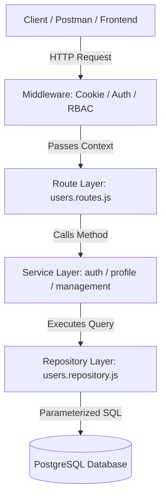

---

## 2. Directory Structure

```text
madayawgas-backend/
├── database/
│   ├── connection.js             # PostgreSQL pg.Pool client & query helper
│   ├── migrations/               # Versioned DDL SQL scripts (001_initial-setup.sql)
│   └── seeds/                    # Seed data (user_management_seed.sql)
├── docs/                         # API contract & developer documentation
├── src/
│   ├── config/                   # Environment variables & constants
│   ├── features/                 # Domain features (Package by Feature)
│   │   └── users/
│   │       ├── auth.service.js       # Login, logout, session lifecycle, password change
│   │       ├── profile.service.js    # User profile viewing & personal updates
│   │       ├── management.service.js # User creation, credential reset, deactivation/blocking, roles
│   │       ├── permission.service.js # RBAC permission evaluation helpers (can, isScopedToOwn)
│   │       ├── users.repository.js   # Parameterized SQL database queries
│   │       ├── users.routes.js       # Express HTTP route handlers
│   │       └── users.service.js      # Facade combining domain services
│   ├── middleware/
│   │   ├── auth.middleware.js        # authenticate & requirePermission route guards
│   │   ├── cookie.middleware.js      # Zero-dependency HTTP-Only cookie parser
│   │   └── error.middleware.js       # Centralized global error handler
│   ├── utils/
│   │   └── asyncHandler.js           # Wraps async route handlers to catch uncaught errors
│   ├── app.js                    # Express app configuration & middleware pipeline
│   ├── server.js                 # Server entry point (starts HTTP server on port 3000)
│   └── test/                     # Modular domain test suites (node:test)
│       ├── auth.test.js
│       ├── permission.test.js
│       ├── profile.test.js
│       └── management.test.js
```

---

## 3. Layer Responsibilities & Strict Rules

### Layer 1: Route Layer (`*.routes.js`)
* **Purpose**: Maps HTTP endpoints to service methods.
* **Rules**:
  * Always wrap async route handlers with `asyncHandler(...)` to avoid unhandled promise rejections.
  * Use `authenticate` to protect endpoints that require login.
  * Use `requirePermission('domain.action')` to enforce RBAC.
  * **DO NOT** write SQL queries or business logic here. Delegate directly to the service layer.
  * Define static routes (e.g. `/me`, `/roles`, `/login`) **before** dynamic parameter routes (e.g. `/:id`).

```javascript
// Example: src/features/users/users.routes.js
router.get(
  '/',
  authenticate,
  requirePermission('users.view'),
  asyncHandler(async (req, res) => {
    const users = await managementService.getAllUsers();
    return res.status(200).json({
      status: 'success',
      data: { users },
    });
  })
);
```

### Layer 2: Service Layer (`*.service.js`)
* **Purpose**: Encapsulates business rules, validations, and security workflows.
* **Rules**:
  * **Never import or use Express `req` or `res` objects** in services.
  * Services should receive plain JavaScript values or plain objects and return plain objects.
  * Throw descriptive errors on validation failures (e.g. `throw new Error('Invalid credentials')`).

```javascript
// Example: src/features/users/management.service.js
async function createUser(actorUser, { firstName, lastName, phone, birthdate, roleId }) {
  const baseUsername = generateBaseUsername(firstName, lastName);
  const existingUsernames = await usersRepository.findUsernamesLike(`${baseUsername}%`);
  const finalUsername = resolveUniqueUsername(baseUsername, existingUsernames);

  const temporaryPassword = generateTemporaryPassword();
  const passwordHash = await bcrypt.hash(temporaryPassword, 10);

  const createdUser = await usersRepository.createUser({
    username: finalUsername,
    passwordHash,
    firstName,
    lastName,
    phone,
    birthdate,
    roleId,
    mustChangePassword: true,
  });

  return { user: createdUser, temporaryPassword };
}

```

### Layer 3: Repository Layer (`*.repository.js`)
* **Purpose**: Pure data access layer (CRUD) with PostgreSQL.
* **Rules**:
  * **Always use Parameterized Queries** (`$1`, `$2`, `$3`) to prevent **SQL Injection**. Never concatenate raw user input into SQL strings.
  * Return plain row objects (e.g. `result.rows[0]` or `result.rows`).

```javascript
// Example: src/features/users/users.repository.js
async function findUserByUsername(username) {
  const result = await query(
    `SELECT u.*, r.name AS role_name
     FROM users u
     JOIN roles r ON u.role_id = r.id
     WHERE u.username = $1`,
    [username]
  );
  return result.rows[0] || null;
}
```

---

## 4. Authentication & Stateful Sessions

The backend uses **Stateful Server-Side Sessions** stored in PostgreSQL with **HTTP-Only Cookies** (`mg_sid`), rather than stateless JWTs.

### Why Stateful Sessions?
Stateful sessions allow immediate server-side revocation: when an admin deactivates a user, blocks an account, changes a user's role, or resets credentials, the backend invalidates all active sessions in PostgreSQL (`revoked_at = NOW()`), immediately logging that user out.

### Session Lifecycle Rules:
1. **8-Hour Idle Timeout**: If a user is inactive for 8 hours, the session expires. Every valid authenticated request refreshes this idle timeout.
2. **30-Day Absolute Lifetime**: Regardless of activity, a session hard-expires 30 days after creation.
3. **Token Hashing**: Session tokens are 32-byte cryptographic random strings (`crypto.randomBytes(32)`). The raw token is sent to the client in the `mg_sid` cookie, and only its **SHA-256 hash** is stored in the database.

---

## 5. Role-Based Access Control (RBAC)

### Permission Naming Convention
Permissions follow the format: `domain.action` or `domain.action_scope`
* Global actions: `users.view`, `users.manage`, `sales.create`, `fleet.manage`
* Scoped actions: `sales.view_own`, `delivery.view_own`, `route.view_own`

### How to Check Permissions:
1. **At the Route Level (Middleware Guard)**:
   ```javascript
   router.post('/', authenticate, requirePermission('sales.create'), handler);
   ```
2. **At the Service Level (Conditional / Scoped Logic)**:
   ```javascript
   const permissionService = require('./permission.service');

   // Check if user has global permission vs own-only permission
   if (permissionService.isScopedToOwn(user, 'sales')) {
     // Apply query filter: WHERE created_by = user.id
   }
   ```

---

## 6. Standard API Response Format (JSend)

All API responses follow the **JSend specification**:

### Success Response (`200 OK`, `201 Created`)
```json
{
  "status": "success",
  "data": {
    "user": { "id": "...", "username": "sales_user" }
  }
}
```

### Client Error Response (`400 Bad Request`, `401 Unauthorized`, `403 Forbidden`, `404 Not Found`)
```json
{
  "status": "fail",
  "message": "Invalid credentials"
}
```

### Server Error Response (`500 Internal Server Error`)
```json
{
  "status": "error",
  "message": "Internal server error"
}
```

---

## 7. How to Add a New Feature (Step-by-Step)

When adding a new domain feature (e.g. `fleet` or `sales`):

1. **Create the Feature Folder**:
   `src/features/<feature-name>/`
2. **Create the Repository (`*.repository.js`)**:
   Write database queries with parameterized SQL (`$1`, `$2`).
3. **Create the Service (`*.service.js`)**:
   Implement business rules, validations, and permission checks.
4. **Create the Routes (`*.routes.js`)**:
   Define Express endpoints, attach `authenticate` and `requirePermission` middleware, and wrap handlers with `asyncHandler`.
5. **Mount Routes in `src/app.js`**:
   `app.use('/api/<feature-name>', featureRoutes);`
6. **Write Integration Tests in `src/test/<feature-name>.test.js`**:
   Test success paths, unauthorized requests (`401`), permission denials (`403`), and error validation.

---

## 8. Database Migrations & Seeds

* **Run Migrations**:
  ```bash
  npm run db:migrate
  ```
* **Run Setup (Database Creation & Initial Setup)**:
  ```bash
  npm run db:setup
  ```
* **Run Reset (Drop, Recreate, Migrate & Seed Fresh Database)**:
  ```bash
  npm run db:reset
  ```
* **Run Seeds**:
  ```bash
  npm run db:seed
  ```
* **Default Seed Accounts**:
  * `superadmin` / `Superadmin123!` (Super Admin)
  * `admin_user` / `AdminPass123!` (Admin)
  * `logistics_supervisor` / `LogisticsPass123!` (Logistics Supervisor)
  * `driver_user` / `DriverPass123!` (Driver)
  * `sales_supervisor` / `SalesSupPass123!` (Sales Supervisor)
  * `sales_user` / `SalesPass123!` (Sales Person)
  * `plant_supervisor` / `PlantPass123!` (Plant Supervisor)
  * `samantha_supervisor` / `SamanthaPass123!` (Sales Supervisor + Logistics Supervisor)

---

## 9. Testing Guidelines

The project uses the **Node.js Native Test Runner** (`node:test` and `node:assert/strict`).

### Running Tests:
```bash
npm test
```

### Test Isolation Rule:
Node.js runs test files concurrently. To prevent test suites from deleting or conflicting with each other's database records during parallel runs, each test file uses its own distinct username prefix:
* `src/test/auth.test.js` ➔ `test_auth_*`
* `src/test/permission.test.js` ➔ `test_perm_*`
* `src/test/profile.test.js` ➔ `test_prof_*`
* `src/test/management.test.js` ➔ `test_mgmt_*`

When creating a new test file, use a unique prefix (e.g. `test_sales_*`, `test_fleet_*`) in your `beforeEach` cleanup and test records.

---

## 10. Standardized Server-Side Pagination Pattern

The backend enforces a unified, opt-in server-side pagination architecture across all large-dataset listing endpoints (`/api/users`, `/api/fleet/trucks`, `/api/fleet/drivers`, `/api/inventory/products`, `/api/sales/customers`, `/api/history`).

### 1. Opt-in vs Legacy Fallback (100% Backward Compatibility)
* **Paginated Mode**: Activated when a request supplies `page`, `limit`, or `pageSize` query parameters. Slices at the database level and wraps results in the standardized pagination envelope.
* **Legacy Mode**: When pagination parameters are omitted, endpoints return their original unpaginated collection format (e.g. `{ data: { users: [...] } }` or `{ data: { count, products: [...] } }`), guaranteeing zero breakage for existing clients and automated tests.

### 2. Standardized Response Envelope
```json
{
  "status": "success",
  "data": [ /* page slice items */ ],
  "meta": {
    "page": 1,
    "limit": 20,
    "totalItems": 156,
    "totalPages": 8,
    "hasNextPage": true,
    "hasPrevPage": false
  }
}
```

### 3. Layer Responsibilities
* **Controller Layer**:
  * Calls `parsePaginationQuery(req.query, options)` from `src/utils/pagination.js`.
  * Enforces safe bounds (default page `1`, default limit `20`, maximum limit `100`).
  * Validates sort field against a strict internal dictionary whitelist (preventing SQL injection).
  * Returns `formatPaginatedEnvelope(items, meta)` if paginated, or legacy envelope if omitted.
* **Service Layer**:
  * Receives sanitized `pagination` object `{ page, limit, sortColumn, sortOrder }`.
  * Computes database offset via `calculateOffset(page, limit)` (`(page - 1) * limit`).
  * Calls repository with offset and limits.
  * Formats DTOs and constructs `meta` using `buildPaginationMeta(total, page, limit)`.
* **Repository Layer**:
  * Constructs unified `whereClause` applied identically to both slice and count queries.
  * Parameterizes `LIMIT` and `OFFSET` in SQL (`$N`, `$N+1`).
  * Enforces deterministic ordering (`ORDER BY ${sortColumn} ${sortOrder}, id DESC`).
  * Executes data slice and count queries concurrently via `Promise.all([dataQuery, countQuery])`.

---

## 11. Summary Checklist for Developers

- [ ] Is my code inside `src/features/<feature>/`?
- [ ] Are SQL queries placed **only** in `*.repository.js` using parameterized `$1`, `$2` placeholders?
- [ ] Is business logic placed in `*.service.js` free from Express `req` and `res` objects?
- [ ] Are async route handlers wrapped in `asyncHandler`?
- [ ] Are protected routes secured with `authenticate` and `requirePermission`?
- [ ] Do listing endpoints support opt-in standardized pagination (`parsePaginationQuery`)?
- [ ] Do all test files pass cleanly with `npm test`?
`````

## File: docs/database_table_documentation.md
`````markdown
### User Management

Table Name: roles
- Purpose: Stores the system security roles used for access control across the web portal and mobile application.
- Structure:
- Notes: Pre-populated with seven canonical roles (Super Admin, Admin, Plant Supervisor, Logistics Supervisor, Sales Supervisor, Sales Person, and Driver). The Super Admin role is protected and cannot be deleted.

Table Name: permissions
- Purpose: Stores the granular feature permissions that protect backend API routes and operational actions.
- Structure:
- Notes: Permissions are defined by system seed and migration scripts using a standardized module-action naming convention (e.g., `users.manage`, `fleet.view`).

Table Name: role_permissions
- Purpose: Maps permissions to roles in a many-to-many relationship.
- Structure:
- Notes: Uses a composite primary key of `role_id` and `permission_id` to prevent duplicate permission assignments on the same role.

Table Name: users
- Purpose: Stores employee account profiles, login credentials, and account status flags.
- Structure:
- Notes: Usernames are automatically generated from the employee's first initial and last name, and temporary passwords are encrypted using bcrypt with `must_change_password` enabled by default on account creation.

Table Name: user_roles
- Purpose: Links users to one or more organizational roles, allowing an employee to hold multiple roles simultaneously.
- Structure:
- Notes: Tracks a primary role indicator (`is_primary`) that stays synchronized with the `role_id` field on the `users` table for backward compatibility.

Table Name: sessions
- Purpose: Tracks active and historical login sessions for cookie and bearer token authentication.
- Structure:
- Notes: Stores only the SHA-256 hash of the session token (`mg_sid`). Sessions expire after 8 hours of inactivity or 30 days from creation, and are immediately revoked when credentials or roles change.

Table Name: audit_logs
- Purpose: Records sensitive user administration actions such as account creation, role changes, credential resets, and account deactivation.
- Structure:
- Notes: Captures both the acting administrator (`user_id`) and the affected employee account (`target_user_id`).

### System Logic (Cross-Cutting Infrastructure)

Table Name: history_logs
- Purpose: Maintains a chronological audit log of operational and administrative events across all system modules.
- Structure:
- Notes: Stores denormalized snapshots of the user's full name and active role at the time of the action so historical logs remain accurate even if the user's profile changes later.

Table Name: system_settings
- Purpose: Stores configurable operational business thresholds and system variables managed by Super Admin and Admin accounts.
- Structure:
- Notes: Keyed by dot-delimited setting identifiers (e.g., `fleet.pm_odometer_threshold_km`, `fleet.work_order_approval_threshold`) with runtime type coercion and optional min/max validation bounds.

### Fleet & Maintenance

Table Name: vehicles
- Purpose: Stores master records for all company fleet vehicles, including delivery trucks, pickups, vans, and motorcycles.
- Structure:
- Notes: Supports a one-to-one driver assignment (`driver_id`) and tracks `current_odometer` and `last_pm_odometer` for dynamic preventive maintenance evaluation against `system_settings`.

Table Name: maintenance_types
- Purpose: Stores standard categories for vehicle maintenance services.
- Structure:
- Notes: Lookup table containing fixed service classifications (`PREVENTIVE`, `CORRECTIVE`, `ACCIDENT_REPAIR`, and `EMERGENCY`).

Table Name: incident_types
- Purpose: Stores standard classifications for vehicle incidents and road defects.
- Structure:
- Notes: Lookup table categorizing operational issues such as mechanical defects, road accidents, tire failures, and leak issues.

Table Name: vehicle_odometer_logs
- Purpose: Records historical mileage readings captured during trip returns, inspections, or manual updates.
- Structure:
- Notes: Updating a vehicle's odometer through this log advances the `current_odometer` reading on the parent `vehicles` record.

Table Name: vehicle_inspections
- Purpose: Records defect and symptom inspection reports filed when an issue is observed on a vehicle.
- Structure:
- Notes: Routine pass-only checklists are not stored. Includes an `allow_dispatch` flag so supervisors can decide whether a vehicle with minor findings remains cleared for dispatch.

Table Name: incident_reports
- Purpose: Documents vehicle accidents, breakdowns, or mechanical incidents reported by drivers or supervisors.
- Structure:
- Notes: Can be linked to a work order when the reported incident requires repair or maintenance service.

Table Name: work_orders
- Purpose: Tracks vehicle repair and maintenance jobs from initial request and cost estimation through completion.
- Structure:
- Notes: Can be initiated directly, from a vehicle inspection, or from an incident report, and transitions through defined lifecycle statuses (`PENDING`, `APPROVED`, `SCHEDULED`, `IN_PROGRESS`, `COMPLETED`, `CANCELLED`).

Table Name: approval_requests
- Purpose: Tracks budget approval requests and management decisions for maintenance work orders.
- Structure:
- Notes: Supports multiple sequential approval rounds if a request is rejected and resubmitted, while enforcing at most one pending request per work order at any time.

Table Name: maintenance_logs
- Purpose: Stores the final service record, actual costs, and vehicle downtime once a work order is marked as completed.
- Structure:
- Notes: Has a one-to-one relationship with a completed work order and automatically computes `total_cost` from `parts_cost` and `labor_cost`.

Table Name: work_order_receipts
- Purpose: Stores file links for uploaded repair receipts and invoices attached to a work order.
- Structure:
- Notes: Serves strictly as supporting visual documentation and is decoupled from the cost calculations in `maintenance_logs`.

Table Name: vehicle_fuel_logs
- Purpose: Records vehicle refueling transactions, fuel volume, cost per liter, and receipt images.
- Structure:
- Notes: Can be linked to an active trip and optionally records an odometer reading that updates the vehicle's mileage if higher than the current value.

### Trip & Schedule

Table Name: service_zones
- Purpose: Defines geographical delivery zones and route jurisdictions serviced by the company.
- Structure:
- Notes: Referenced by customer profiles, schedule templates, daily truck schedules, and trips to organize deliveries by area.

Table Name: schedule_templates
- Purpose: Stores recurring weekly dispatch templates that assign a truck, service zone, and default sales person to a specific day of the week.
- Structure:
- Notes: Enforces a unique constraint per truck and day of the week (`1` for Monday through `7` for Sunday) to prevent conflicting recurring assignments.

Table Name: truck_schedules
- Purpose: Stores date-specific daily route schedules generated from weekly templates or created manually by a supervisor.
- Structure:
- Notes: Partial unique indexes prevent assigning the same truck or sales person to multiple active schedules on the same calendar date.

Table Name: trips
- Purpose: Tracks the execution of delivery runs from plant departure to yard return and final stock completion.
- Structure:
- Notes: Captures a fixed snapshot of the assigned driver and sales person at dispatch time. Supports both scheduled runs and unscheduled ad-hoc trips (`schedule_id` is nullable), and locks the truck from new dispatches until the trip is reconciled.

Table Name: trip_loads
- Purpose: Records transfer manifests for stock loaded onto a truck before dispatch or unloaded upon return to the plant.
- Structure:
- Notes: Multiple load slips can be created for a single trip to support morning loads, midday reloads, and post-trip return unloads. Also exposed through the `trip_stock_transfers` compatibility view.

Table Name: trip_load_items
- Purpose: Stores the individual product quantities and stock conditions for each transfer manifest in `trip_loads`.
- Structure:
- Notes: Quantities are stored as integer unit counts categorized by condition (`FILLED`, `EMPTY_GOOD`, or `DEFECTIVE`). Also exposed through the `trip_stock_transfer_items` compatibility view.

Table Name: trip_stock_reconciliations
- Purpose: Records the post-trip inventory reconciliation comparing loaded stock, field sales, customer cylinder loans, and physically returned units.
- Structure:
- Notes: Calculates full and empty unit discrepancies and stores a per-product breakdown in a JSONB column (`reconciliation_data`).

Table Name: driver_apprehensions
- Purpose: Records roadside traffic citations and regulatory violations involving company vehicles and drivers.
- Structure:
- Notes: Requires a photo key of the physical citation ticket (`ticket_media_key`) and tracks the resolution status (`RECORDED`, `SETTLED`, `DISPUTED`, `CANCELLED`).

Table Name: emergency_alerts
- Purpose: Stores emergency SOS alerts triggered by drivers from the mobile app during field operations.
- Structure:
- Notes: Captures optional GPS coordinates (`latitude` and `longitude`) and tracks supervisor response through acknowledgment and resolution timestamps.

### Inventory

Table Name: products
- Purpose: Stores the master catalog of LPG cylinders, canisters, and related products offered by the company.
- Structure:
- Notes: Classifies items by container type (`CYLINDER` or `CANISTER`) and net weight in kilograms, using soft deactivation (`is_active`) to preserve historical references.

Table Name: plant_inventory
- Purpose: Tracks real-time physical unit counts of each product at the refilling plant across filled, empty good, and defective conditions.
- Structure:
- Notes: Enforces a one-to-one relationship with `products` and prevents negative stock balances on all condition buckets.

Table Name: plant_stock_adjustments
- Purpose: Logs all manual and operational stock adjustments made to the plant inventory, such as supplier purchases, defect quarantines, and physical count corrections.
- Structure:
- Notes: Serves as an append-only audit ledger recording the quantity delta, source and target stock conditions, and the supervisor who authorized the adjustment.

### Sales & Delivery

Table Name: customers
- Purpose: Stores customer master profiles, contact details, and delivery addresses for retail, commercial, wholesale, and household accounts.
- Structure:
- Notes: Uses database triggers to keep legacy `name` and `address` fields synchronized with `business_name`, `contact_person`, and `delivery_address`.

Table Name: sales_transactions
- Purpose: Records customer sales orders processed by sales personnel during delivery trips.
- Structure:
- Notes: Supports offline-first mobile synchronization by storing both the mobile transaction time (`transacted_at`) and the server ingestion time (`synced_at`).

Table Name: sales_transaction_items
- Purpose: Stores the individual product line items, quantities sold, and empty containers returned for each sales transaction.
- Structure:
- Notes: Captures a frozen snapshot of the unit price (`unit_price_at_sale`) and subtotal at the time of sale so future catalog price changes do not alter historical orders.

Table Name: sales_invoices
- Purpose: Stores billing invoices, cylinder declaration numbers, and payment verification and flagging details for sales transactions.
- Structure:
- Notes: Has a one-to-one relationship with `sales_transactions` and tracks cash or GCash payments, including reference numbers, payment proof images, and supervisor verification or flagging (`FLAGGED` status with `flag_reason`, `flag_notes`, `flagged_by`, `flagged_at`).

Table Name: canister_ledger
- Purpose: Tracks loaned and returned cylinders or canisters per customer and product when a sale involves an unequal container exchange.
- Structure:
- Notes: Operates as an append-only ledger where `net_balance_change` equals `quantity_loaned` minus `quantity_returned`, feeding into customer receivable balances and trip stock reconciliation.
`````

## File: src/config/cookie.js
`````javascript
const { isProduction } = require('./env');
const systemConfig = require('./system.config');

/**
 * Centralized Cookie Configuration
 * Enforces cross-origin cookie security standards (SameSite=None; Secure; HttpOnly)
 * across controllers and authentication middleware.
 */

const COOKIE_NAME = 'mg_sid';

/**
 * Determines whether cookie Secure flag and SameSite=None should be applied.
 * In production or behind an HTTPS reverse proxy, Secure=true and SameSite=None are enforced.
 * If explicitly disabled via COOKIE_SECURE=false for local unencrypted HTTP mobile testing,
 * Secure is set to false and SameSite to 'lax' to prevent mobile browsers from discarding the cookie.
 */
function resolveCookieSecurity(req) {
  if (process.env.COOKIE_SECURE === 'false') {
    return false;
  }
  // Default to secure=true for cross-origin production (Render/Vercel) and test suite
  return true;
}

const getCookieOptions = (req) => {
  const isSecure = resolveCookieSecurity(req);
  return {
    httpOnly: true,
    secure: isSecure,
    sameSite: isSecure ? 'none' : 'lax',
    path: '/',
    maxAge: systemConfig.system.auth.absoluteLifetimeMs,
  };
};

const getClearCookieOptions = (req) => {
  const isSecure = resolveCookieSecurity(req);
  return {
    httpOnly: true,
    secure: isSecure,
    sameSite: isSecure ? 'none' : 'lax',
    path: '/',
  };
};

module.exports = {
  COOKIE_NAME,
  getCookieOptions,
  getClearCookieOptions,
};
`````

## File: src/config/env.js
`````javascript
require('dotenv').config();

/**
 * Single source of truth for runtime environment flags.
 * Primary toggle: `PRODUCTION=true` (boolean toggle in .env).
 * Also falls back to `NODE_ENV=production` for hosting platform defaults (e.g., Render/Vercel).
 */
const isProduction =
  String(process.env.PRODUCTION).trim().toLowerCase() === 'true' ||
  process.env.NODE_ENV === 'production';

/**
 * Detects if the current process is executing a test suite.
 */
const isTest =
  process.env.NODE_ENV === 'test' ||
  process.env.npm_lifecycle_event === 'test' ||
  (Array.isArray(process.execArgv) && process.execArgv.some((arg) => arg.includes('--test'))) ||
  (Array.isArray(process.argv) &&
    process.argv.some((arg) => arg.includes('.test.js') || arg.includes('node:test')));

/**
 * Sanitize PostgreSQL connection URL:
 * - Automatically cleans outer brackets from copy-pasted Supabase template passwords (e.g. `:[YOUR-PASSWORD]@`)
 * - Gracefully URL-encodes special characters in passwords
 */
function sanitizeDatabaseUrl(rawUrl) {
  if (!rawUrl || typeof rawUrl !== 'string') return rawUrl;

  const url = rawUrl.trim();
  const schemeEnd = url.indexOf('://');
  if (schemeEnd === -1) return url;

  const firstColonAfterScheme = url.indexOf(':', schemeEnd + 3);
  const lastAtIndex = url.lastIndexOf('@');

  if (firstColonAfterScheme !== -1 && lastAtIndex !== -1 && firstColonAfterScheme < lastAtIndex) {
    const prefix = url.slice(0, firstColonAfterScheme + 1);
    let pass = url.slice(firstColonAfterScheme + 1, lastAtIndex);
    const suffix = url.slice(lastAtIndex);

    // Strip outer brackets from Supabase template copy-paste `[YOUR-PASSWORD]`
    if (pass.startsWith('[') && pass.endsWith(']')) {
      pass = pass.slice(1, -1);
    }

    try {
      pass = decodeURIComponent(pass);
    } catch {
      // In case of non-encoded percent characters
    }

    return prefix + encodeURIComponent(pass) + suffix;
  }

  return url;
}

/**
 * Resolves the active database connection string based on environment:
 * - In test mode (`isTest`): uses `DATABASE_URL_TEST` (local) to avoid mutating production Supabase data.
 * - In production (`PRODUCTION=true`): uses `DATABASE_URL` (Supabase).
 * - In development (`PRODUCTION=false`): uses `DATABASE_URL_TEST` (local) with fallback to `DATABASE_URL`.
 */
function getDatabaseUrl() {
  // Test safety: test runs prioritize local test database unless explicitly overridden
  if (isTest && process.env.DATABASE_URL_TEST && process.env.TEST_USE_PROD !== 'true') {
    return sanitizeDatabaseUrl(process.env.DATABASE_URL_TEST);
  }

  if (isProduction) {
    const url = process.env.DATABASE_URL;
    if (!url) {
      throw new Error(
        'Production database configuration error: DATABASE_URL is not set in .env'
      );
    }
    return sanitizeDatabaseUrl(url);
  }

  // Local / Development mode
  const url = process.env.DATABASE_URL_TEST || process.env.DATABASE_URL;
  if (!url) {
    throw new Error(
      'Database configuration error: Neither DATABASE_URL_TEST nor DATABASE_URL is set in .env'
    );
  }
  return sanitizeDatabaseUrl(url);
}

/**
 * Determines if SSL encryption is required for the connection.
 * Supabase hosts and remote cloud PostgreSQL providers require SSL.
 */
function shouldEnableSsl(connectionUrl, isProd) {
  if (process.env.DATABASE_SSL === 'true') return true;
  if (process.env.DATABASE_SSL === 'false') return false;

  if (!connectionUrl) return false;

  // Supabase hosts always require SSL
  if (connectionUrl.includes('supabase.co') || connectionUrl.includes('pooler.supabase.com')) {
    return true;
  }

  // Explicit query param
  if (connectionUrl.includes('sslmode=require') || connectionUrl.includes('ssl=true')) {
    return true;
  }

  // In production, enable SSL unless connecting to local host
  if (isProd) {
    try {
      const parsed = new URL(connectionUrl);
      if (
        parsed.hostname === 'localhost' ||
        parsed.hostname === '127.0.0.1' ||
        parsed.hostname === '::1'
      ) {
        return false;
      }
    } catch {
      // Default to SSL if URL parsing fails in production
    }
    return true;
  }

  return false;
}

/**
 * Resolves the public base URL for the server.
 * Supports:
 * - Explicit `BASE_URL` or `PUBLIC_URL` (user/platform configured)
 * - Render cloud platform (`RENDER_EXTERNAL_URL` or `RENDER_EXTERNAL_HOSTNAME`)
 * - Common cloud environments (e.g., `RAILWAY_STATIC_URL`)
 * - Local development fallback (`http://localhost:${port}`)
 */
function getBaseUrl(port = process.env.PORT || 5000) {
  if (process.env.BASE_URL) {
    return process.env.BASE_URL.replace(/\/+$/, '');
  }
  if (process.env.RENDER_EXTERNAL_URL) {
    return process.env.RENDER_EXTERNAL_URL.replace(/\/+$/, '');
  }
  if (process.env.RENDER_EXTERNAL_HOSTNAME) {
    return `https://${process.env.RENDER_EXTERNAL_HOSTNAME}`;
  }
  if (process.env.RAILWAY_STATIC_URL) {
    return `https://${process.env.RAILWAY_STATIC_URL}`;
  }
  if (process.env.PUBLIC_URL) {
    return process.env.PUBLIC_URL.replace(/\/+$/, '');
  }
  return `http://localhost:${port}`;
}

/**
 * Returns the name of the environment variable used to resolve the active database URL.
 */
function getDatabaseUrlSource() {
  if (isTest && process.env.DATABASE_URL_TEST && process.env.TEST_USE_PROD !== 'true') {
    return 'DATABASE_URL_TEST';
  }

  if (isProduction) {
    return 'DATABASE_URL';
  }

  return process.env.DATABASE_URL_TEST ? 'DATABASE_URL_TEST' : 'DATABASE_URL';
}

/**
 * Safely masks the password portion of a database connection string.
 */
function maskDatabaseUrl(rawUrl) {
  if (!rawUrl || typeof rawUrl !== 'string') return 'N/A';
  try {
    const parsed = new URL(rawUrl);
    if (parsed.password) {
      parsed.password = '****';
    }
    return parsed.toString();
  } catch {
    return rawUrl.replace(/:\/\/(.*?):(.*?)@/, '://$1:****@');
  }
}

module.exports = {
  isProduction,
  isTest,
  sanitizeDatabaseUrl,
  getDatabaseUrl,
  getDatabaseUrlSource,
  maskDatabaseUrl,
  shouldEnableSsl,
  getBaseUrl,
};
`````

## File: src/features/fleet/vehicles/vehicles.repository.js
`````javascript
const { query } = require('../../../../database/connection');

/**
 * Vehicles Repository
 * Handles all database interactions for fleet vehicles and driver relationships.
 */
class VehiclesRepository {
  /**
   * Retrieves all vehicles with optional filtering and joined driver details.
   * @param {Object} filters - { status, search, driverAssigned, vehicleType }
   * @param {Object|null} pagination - Optional { sortColumn, sortOrder, limit, offset }
   */
  async getAllVehicles(filters = {}, pagination = null) {
    const { status, search, driverAssigned, vehicleType, type, driverId } = filters;
    const conditions = [];
    const params = [];
    let paramIndex = 1;

    if (status) {
      conditions.push(`v.status = $${paramIndex++}`);
      params.push(status.toUpperCase());
    }

    const selectedType = vehicleType || type;
    if (selectedType && typeof selectedType === 'string' && selectedType.trim() !== '') {
      conditions.push(`v.vehicle_type = $${paramIndex++}`);
      params.push(selectedType.trim().toUpperCase());
    }

    if (search && typeof search === 'string' && search.trim() !== '') {
      conditions.push(`(v.plate_number ILIKE $${paramIndex} OR v.model ILIKE $${paramIndex})`);
      params.push(`%${search.trim()}%`);
      paramIndex++;
    }

    if (driverId) {
      conditions.push(`v.driver_id = $${paramIndex++}`);
      params.push(driverId);
    }

    if (driverAssigned !== undefined) {
      if (driverAssigned === true || driverAssigned === 'true') {
        conditions.push(`v.driver_id IS NOT NULL`);
      } else if (driverAssigned === false || driverAssigned === 'false') {
        conditions.push(`v.driver_id IS NULL`);
      }
    }

    const whereClause = conditions.length > 0 ? `WHERE ${conditions.join(' AND ')}` : '';

    if (!pagination) {
      const sql = `
        SELECT 
          v.id,
          v.plate_number,
          v.model,
          v.year_model,
          v.vehicle_type,
          v.current_odometer,
          v.last_pm_odometer,
          v.status,
          v.driver_id,
          v.created_at,
          v.updated_at,
          u.first_name AS driver_first_name,
          u.last_name AS driver_last_name,
          u.phone AS driver_phone,
          u.username AS driver_username
        FROM vehicles v
        LEFT JOIN users u ON v.driver_id = u.id
        ${whereClause}
        ORDER BY v.created_at DESC, v.id DESC
      `;

      const result = await query(sql, params);
      return result.rows;
    }

    const sortColumn = pagination.sortColumn || 'v.created_at';
    const sortOrder = pagination.sortOrder === 'ASC' ? 'ASC' : 'DESC';
    const limit = pagination.limit || 20;
    const offset = pagination.offset || 0;

    const dataParams = [...params, limit, offset];
    const limitPlaceholder = `$${params.length + 1}`;
    const offsetPlaceholder = `$${params.length + 2}`;

    const dataSql = `
      SELECT 
        v.id,
        v.plate_number,
        v.model,
        v.year_model,
        v.vehicle_type,
        v.current_odometer,
        v.last_pm_odometer,
        v.status,
        v.driver_id,
        v.created_at,
        v.updated_at,
        u.first_name AS driver_first_name,
        u.last_name AS driver_last_name,
        u.phone AS driver_phone,
        u.username AS driver_username
      FROM vehicles v
      LEFT JOIN users u ON v.driver_id = u.id
      ${whereClause}
      ORDER BY ${sortColumn} ${sortOrder}, v.id DESC
      LIMIT ${limitPlaceholder} OFFSET ${offsetPlaceholder}
    `;

    const countSql = `
      SELECT COUNT(*) AS count
      FROM vehicles v
      ${whereClause}
    `;

    const [dataRes, countRes] = await Promise.all([
      query(dataSql, dataParams),
      query(countSql, params),
    ]);

    return {
      rows: dataRes.rows,
      total: parseInt(countRes.rows[0]?.count || 0, 10),
    };
  }

  /**
   * Retrieves a single vehicle by ID with joined driver details.
   * @param {string} id - Vehicle UUID
   */
  async getVehicleById(id) {
    const sql = `
      SELECT 
        v.id,
        v.plate_number,
        v.model,
        v.year_model,
        v.vehicle_type,
        v.current_odometer,
        v.last_pm_odometer,
        v.status,
        v.driver_id,
        v.created_at,
        v.updated_at,
        u.first_name AS driver_first_name,
        u.last_name AS driver_last_name,
        u.phone AS driver_phone,
        u.username AS driver_username
      FROM vehicles v
      LEFT JOIN users u ON v.driver_id = u.id
      WHERE v.id = $1
    `;

    const result = await query(sql, [id]);
    return result.rows[0] || null;
  }

  /**
   * Finds a vehicle by plate number (case-insensitive).
   * @param {string} plateNumber
   */
  async findVehicleByPlateNumber(plateNumber) {
    const sql = `
      SELECT *
      FROM vehicles
      WHERE UPPER(plate_number) = UPPER($1)
    `;

    const result = await query(sql, [plateNumber]);
    return result.rows[0] || null;
  }

  /**
   * Finds a vehicle by driver ID.
   * @param {string} driverId - User UUID
   */
  async findVehicleByDriverId(driverId) {
    const sql = `
      SELECT *
      FROM vehicles
      WHERE driver_id = $1
    `;

    const result = await query(sql, [driverId]);
    return result.rows[0] || null;
  }

  /**
   * Creates a new vehicle record.
   * @param {Object} vehicleData
   */
  async createVehicle({
    plateNumber,
    model,
    yearModel,
    vehicleType = 'DELIVERY_TRUCK',
    currentOdometer = 0,
    lastPmOdometer = 0,
    status = 'ACTIVE',
    driverId = null,
  }) {
    const sql = `
      INSERT INTO vehicles (
        plate_number,
        model,
        year_model,
        vehicle_type,
        current_odometer,
        last_pm_odometer,
        status,
        driver_id
      )
      VALUES ($1, $2, $3, $4, $5, $6, $7, $8)
      RETURNING *
    `;

    const result = await query(sql, [
      plateNumber,
      model,
      yearModel,
      vehicleType,
      currentOdometer,
      lastPmOdometer,
      status,
      driverId,
    ]);

    return result.rows[0];
  }

  /**
   * Updates an existing vehicle record.
   * @param {string} id - Vehicle UUID
   * @param {Object} updateData
   */
  async updateVehicle(id, updateData) {
    const fields = [];
    const params = [];
    let paramIndex = 1;

    if (updateData.plateNumber !== undefined) {
      fields.push(`plate_number = $${paramIndex++}`);
      params.push(updateData.plateNumber);
    }

    if (updateData.model !== undefined) {
      fields.push(`model = $${paramIndex++}`);
      params.push(updateData.model);
    }

    if (updateData.yearModel !== undefined) {
      fields.push(`year_model = $${paramIndex++}`);
      params.push(updateData.yearModel);
    }

    if (updateData.vehicleType !== undefined) {
      fields.push(`vehicle_type = $${paramIndex++}`);
      params.push(updateData.vehicleType);
    }

    if (updateData.currentOdometer !== undefined) {
      fields.push(`current_odometer = $${paramIndex++}`);
      params.push(updateData.currentOdometer);
    }

    if (updateData.lastPmOdometer !== undefined) {
      fields.push(`last_pm_odometer = $${paramIndex++}`);
      params.push(updateData.lastPmOdometer);
    }

    if (fields.length === 0) {
      return this.getVehicleById(id);
    }

    params.push(id);
    const sql = `
      UPDATE vehicles
      SET ${fields.join(', ')}
      WHERE id = $${paramIndex}
      RETURNING *
    `;

    const result = await query(sql, params);
    return result.rows[0] || null;
  }

  /**
   * Deactivates a vehicle and clears its driver assignment.
   * @param {string} id - Vehicle UUID
   */
  async deactivateVehicle(id) {
    const sql = `
      UPDATE vehicles
      SET status = 'INACTIVE', driver_id = NULL
      WHERE id = $1
      RETURNING *
    `;

    const result = await query(sql, [id]);
    return result.rows[0] || null;
  }

  /**
   * Assigns or unassigns a driver to/from a vehicle.
   * @param {string} vehicleId - Vehicle UUID
   * @param {string|null} driverId - Driver UUID or null to unassign
   */
  async assignDriver(vehicleId, driverId) {
    const sql = `
      UPDATE vehicles
      SET driver_id = $1
      WHERE id = $2
      RETURNING *
    `;

    const result = await query(sql, [driverId, vehicleId]);
    return result.rows[0] || null;
  }

  /**
   * Unassigns the driver from a vehicle by setting driver_id to NULL.
   * @param {string} vehicleId - Vehicle UUID
   */
  async unassignDriver(vehicleId) {
    const sql = `
      UPDATE vehicles
      SET driver_id = NULL
      WHERE id = $1
      RETURNING *
    `;

    const result = await query(sql, [vehicleId]);
    return result.rows[0] || null;
  }

  /**
   * Finds an active user by ID and retrieves role information to verify driver eligibility.
   * @param {string} userId - User UUID
   */
  async findDriverUserById(userId) {
    const sql = `
      SELECT 
        u.id, 
        u.username, 
        u.first_name, 
        u.last_name, 
        u.phone, 
        u.is_active, 
        u.is_blocked,
        r.name AS role_name,
        EXISTS (
          SELECT 1 FROM user_roles ur
          JOIN roles r2 ON ur.role_id = r2.id
          WHERE ur.user_id = u.id AND LOWER(r2.name) = 'driver'
        ) OR LOWER(r.name) = 'driver' AS is_driver
      FROM users u
      JOIN roles r ON u.role_id = r.id
      WHERE u.id = $1
    `;

    const result = await query(sql, [userId]);
    return result.rows[0] || null;
  }

  /**
   * Updates only the current odometer of a vehicle.
   * @param {string} id - Vehicle UUID
   * @param {number} odometer - New odometer reading
   */
  async updateVehicleOdometer(id, odometer) {
    const sql = `
      UPDATE vehicles
      SET current_odometer = $1
      WHERE id = $2
      RETURNING *
    `;

    const result = await query(sql, [odometer, id]);
    return result.rows[0] || null;
  }

  /**
   * Retrieves users holding the 'Driver' role with their live vehicle assignment information.
   * @param {Object} filters - { availableOnly, search }
   * @param {Object|null} pagination - Optional { sortColumn, sortOrder, limit, offset }
   */
  async getAllDrivers(filters = {}, pagination = null) {
    const { availableOnly, search } = filters;
    const conditions = [
      'u.is_active = TRUE',
      'u.is_blocked = FALSE',
      "(LOWER(r.name) = 'driver' OR EXISTS (SELECT 1 FROM user_roles ur JOIN roles r2 ON ur.role_id = r2.id WHERE ur.user_id = u.id AND LOWER(r2.name) = 'driver'))",
    ];
    const params = [];
    let paramIndex = 1;

    if (availableOnly) {
      conditions.push('v.id IS NULL');
    }

    if (search && typeof search === 'string' && search.trim() !== '') {
      conditions.push(`(u.first_name ILIKE $${paramIndex} OR u.last_name ILIKE $${paramIndex} OR u.username ILIKE $${paramIndex})`);
      params.push(`%${search.trim()}%`);
      paramIndex++;
    }

    const whereClause = `WHERE ${conditions.join(' AND ')}`;

    if (!pagination) {
      const sql = `
        SELECT 
          u.id,
          u.username,
          u.first_name,
          u.last_name,
          u.phone,
          r.name AS role_name,
          v.id AS assigned_vehicle_id,
          v.plate_number AS assigned_vehicle_plate,
          v.model AS assigned_vehicle_model,
          v.vehicle_type AS assigned_vehicle_type
        FROM users u
        JOIN roles r ON u.role_id = r.id
        LEFT JOIN vehicles v ON u.id = v.driver_id
        ${whereClause}
        ORDER BY u.first_name ASC, u.last_name ASC, u.id DESC
      `;

      const result = await query(sql, params);
      return result.rows;
    }

    const sortColumn = pagination.sortColumn || 'u.first_name';
    const sortOrder = pagination.sortOrder === 'DESC' ? 'DESC' : 'ASC';
    const limit = pagination.limit || 20;
    const offset = pagination.offset || 0;

    const dataParams = [...params, limit, offset];
    const limitPlaceholder = `$${params.length + 1}`;
    const offsetPlaceholder = `$${params.length + 2}`;

    const dataSql = `
      SELECT 
        u.id,
        u.username,
        u.first_name,
        u.last_name,
        u.phone,
        r.name AS role_name,
        v.id AS assigned_vehicle_id,
        v.plate_number AS assigned_vehicle_plate,
        v.model AS assigned_vehicle_model,
        v.vehicle_type AS assigned_vehicle_type
      FROM users u
      JOIN roles r ON u.role_id = r.id
      LEFT JOIN vehicles v ON u.id = v.driver_id
      ${whereClause}
      ORDER BY ${sortColumn} ${sortOrder}, u.id DESC
      LIMIT ${limitPlaceholder} OFFSET ${offsetPlaceholder}
    `;

    const countSql = `
      SELECT COUNT(*) AS count
      FROM users u
      JOIN roles r ON u.role_id = r.id
      LEFT JOIN vehicles v ON u.id = v.driver_id
      ${whereClause}
    `;

    const [dataRes, countRes] = await Promise.all([
      query(dataSql, dataParams),
      query(countSql, params),
    ]);

    return {
      rows: dataRes.rows,
      total: parseInt(countRes.rows[0]?.count || 0, 10),
    };
  }

  /**
   * Retrieves active, unblocked users who are NOT currently assigned to any vehicle.
   */
  async getAvailableDrivers() {
    return this.getAllDrivers({ availableOnly: true });
  }
}

module.exports = new VehiclesRepository();
`````

## File: src/features/fleet/index.js
`````javascript
const fleetRoutes = require('./fleet.routes');
const vehiclesRepository = require('./vehicles/vehicles.repository');
const vehiclesService = require('./vehicles/vehicles.service');
const vehiclesController = require('./vehicles/vehicles.controller');
const availabilityRepository = require('./availability/availability.repository');
const availabilityService = require('./availability/availability.service');
const availabilityController = require('./availability/availability.controller');
const {
  maintenanceRepository,
  maintenanceService,
  maintenanceController,
  maintenanceRoutes,
} = require('./maintenance');

module.exports = {
  fleetRoutes,
  vehiclesRepository,
  vehiclesService,
  vehiclesController,
  // Backward compatibility aliases
  trucksRepository: vehiclesRepository,
  trucksService: vehiclesService,
  trucksController: vehiclesController,
  availabilityRepository,
  availabilityService,
  availabilityController,
  maintenanceRepository,
  maintenanceService,
  maintenanceController,
  maintenanceRoutes,
};
`````

## File: src/features/history/history.service.js
`````javascript
const historyRepository = require('./history.repository');
const { resolveEvent } = require('./history.events');
const { calculateOffset, buildPaginationMeta } = require('../../utils/pagination');

const MONTH_NAMES = [
  'Jan', 'Feb', 'Mar', 'Apr', 'May', 'Jun',
  'Jul', 'Aug', 'Sep', 'Oct', 'Nov', 'Dec'
];

/**
 * Formats a database row into standard history log DTO matching frontend expectations.
 */
function formatLogItem(row) {
  if (!row) return null;

  const dateObj = new Date(row.created_at);
  const month = MONTH_NAMES[dateObj.getMonth()] || 'Jan';
  const day = dateObj.getDate();
  const year = dateObj.getFullYear();
  const dateStr = `${month} ${day}, ${year}`;

  let hours = dateObj.getHours();
  const minutes = String(dateObj.getMinutes()).padStart(2, '0');
  const ampm = hours >= 12 ? 'PM' : 'AM';
  hours = hours % 12;
  hours = hours ? hours : 12;
  const formattedHours = String(hours).padStart(2, '0');
  const timeStr = `${formattedHours}:${minutes} ${ampm}`;

  let parsedMetadata = {};
  if (row.metadata) {
    if (typeof row.metadata === 'object') {
      parsedMetadata = row.metadata;
    } else if (typeof row.metadata === 'string') {
      try {
        parsedMetadata = JSON.parse(row.metadata);
      } catch {
        parsedMetadata = {};
      }
    }
  }

  return {
    id: row.id,
    date: dateStr,
    time: timeStr,
    userName: row.user_name,
    userRole: row.user_role,
    actionType: row.action_type,
    module: row.module,
    details: row.details,
    action: row.action,
    targetId: row.target_id || null,
    targetType: row.target_type || null,
    metadata: parsedMetadata,
    createdAt: row.created_at,
  };
}

/**
 * History Service
 * Business logic and operational logging coordinator for system events.
 */
class HistoryService {
  /**
   * Primary logging API using the Centralized Event Registry & Template Resolver.
   * @param {string} eventKey - Identifier from EVENTS (e.g. EVENTS.PRODUCT_CREATED)
   * @param {Object} options - { actorUser, targetId, payload, metadata, userId, userName, userRole, createdAt }
   */
  async log(eventKey, {
    actorUser = null,
    targetId = null,
    payload = {},
    metadata = {},
    userId = null,
    userName = null,
    userRole = null,
    createdAt = null,
    actionType = null,
    module = null,
    details = null,
    targetType = null,
  } = {}) {
    const resolved = resolveEvent(eventKey, payload, {
      actionType,
      module,
      details,
      targetType,
    });

    return this.logEvent({
      actorUser,
      userId,
      userName,
      userRole,
      actionType: resolved.actionType,
      module: resolved.module,
      action: resolved.action,
      details: resolved.details,
      targetId,
      targetType: resolved.targetType,
      metadata,
      createdAt,
    });
  }

  /**
   * Records a system event into the history log table.
   * Can accept either an actorUser session object or explicit user details.
   */
  async logEvent({
    actorUser = null,
    userId = null,
    userName = null,
    userRole = null,
    actionType = 'Updated',
    module = 'System',
    action = 'EVENT_LOGGED',
    details = '',
    targetId = null,
    targetType = null,
    metadata = {},
    createdAt = null,
  } = {}) {
    try {
      const resolvedUserId = actorUser?.id || userId || null;
      let resolvedUserName = 'System';
      if (actorUser) {
        const first = actorUser.firstName || actorUser.first_name || '';
        const last = actorUser.lastName || actorUser.last_name || '';
        const full = `${first} ${last}`.trim();
        resolvedUserName = full || actorUser.username || 'System Admin';
      } else if (userName) {
        resolvedUserName = userName;
      }

      const resolvedUserRole =
        actorUser?.role ||
        actorUser?.role_name ||
        userRole ||
        'System Admin';

      const row = await historyRepository.createLog({
        userId: resolvedUserId,
        userName: resolvedUserName,
        userRole: resolvedUserRole,
        actionType,
        module,
        action,
        details,
        targetId: targetId !== null && targetId !== undefined ? String(targetId) : null,
        targetType,
        metadata,
        createdAt,
      });

      return formatLogItem(row);
    } catch (err) {
      console.error('[HistoryService] Failed to record logEvent:', err.message);
      return null;
    }
  }

  /**
   * Retrieves list of history logs with optional module, action type, search, and pagination.
   *
   * @param {Object} [filters={}]
   * @param {Object} [pagination=null]
   * @returns {Promise<Object>}
   */
  async getHistoryLogs({
    module = null,
    actionType = null,
    search = null,
    limit = 100,
    offset = 0,
    startDate = null,
    endDate = null,
  } = {}, pagination = null) {
    if (!pagination) {
      const [rows, total] = await Promise.all([
        historyRepository.getLogs({
          module,
          actionType,
          search,
          limit,
          offset,
          startDate,
          endDate,
        }),
        historyRepository.countLogs({
          module,
          actionType,
          search,
          startDate,
          endDate,
        }),
      ]);

      const formattedLogs = rows.map(formatLogItem);

      return {
        logs: formattedLogs,
        count: formattedLogs.length,
        total,
      };
    }

    const calcOffset = calculateOffset(pagination.page, pagination.limit);
    const [rows, total] = await Promise.all([
      historyRepository.getLogs({
        module,
        actionType,
        search,
        limit: pagination.limit,
        offset: calcOffset,
        startDate,
        endDate,
        sortColumn: pagination.sortColumn,
        sortOrder: pagination.sortOrder,
      }),
      historyRepository.countLogs({
        module,
        actionType,
        search,
        startDate,
        endDate,
      }),
    ]);

    const items = rows.map(formatLogItem);
    const meta = buildPaginationMeta(total, pagination.page, pagination.limit);

    return {
      items,
      meta,
    };
  }

  /**
   * Retrieves a single history log record by ID.
   */
  async getHistoryLogById(id) {
    if (!id || typeof id !== 'string') {
      throw new Error('History log ID is required');
    }

    const row = await historyRepository.getLogById(id);
    if (!row) {
      throw new Error('History log not found');
    }

    return formatLogItem(row);
  }
}

module.exports = new HistoryService();
`````

## File: src/features/inventory/inventory.controller.js
`````javascript
const { z } = require('zod');
const inventoryService = require('./inventory.service');
const { parsePaginationQuery, formatPaginatedEnvelope } = require('../../utils/pagination');

// Zod Validation Schemas
const RestockSupplierSchema = z.object({
  productId: z.string().uuid({ message: 'productId must be a valid UUID' }),
  condition: z.enum(['FILLED', 'EMPTY_GOOD']).optional().default('FILLED'),
  quantityUnits: z.number().int().positive({ message: 'quantityUnits must be a positive integer' }),
  supplierInvoiceNumber: z.string().trim().optional().nullable(),
  reason: z.string().trim().optional(),
});

const QuarantineDefectsSchema = z.object({
  productId: z.string().uuid({ message: 'productId must be a valid UUID' }),
  sourceCondition: z.enum(['FILLED', 'EMPTY_GOOD']).optional().default('FILLED'),
  quantityUnits: z.number().int().positive({ message: 'quantityUnits must be a positive integer' }),
  reason: z.string().trim().min(3, { message: 'reason must be at least 3 characters' }),
});

const TransferItemSchema = z.object({
  productId: z.string().uuid({ message: 'productId must be a valid UUID' }),
  condition: z.enum(['FILLED', 'EMPTY_GOOD', 'DEFECTIVE']).optional().default('FILLED'),
  quantityUnits: z.number().int().positive({ message: 'quantityUnits must be a positive integer' }),
});

const DispatchLoadSchema = z.object({
  items: z.array(TransferItemSchema).nonempty({ message: 'items must be a non-empty array' }),
  remarks: z.string().trim().optional().nullable(),
});

const ReturnUnloadSchema = z.object({
  items: z.array(TransferItemSchema).nonempty({ message: 'items must be a non-empty array' }),
  remarks: z.string().trim().optional().nullable(),
});

const SalesEntrySchema = z.object({
  productId: z.string().uuid({ message: 'productId must be a valid UUID' }),
  soldFull: z.number().int().min(0).default(0),
  netCustomerDebtCreated: z.number().int().default(0),
});

const ReconcileTripSchema = z.object({
  verifiedByUserId: z.string().uuid().optional().nullable(),
  supervisorNotes: z.string().trim().optional().nullable(),
  syncCompleted: z.boolean().optional().default(true),
  salesData: z.array(SalesEntrySchema).optional().default([]),
});

/**
 * Inventory Controller
 * Handles HTTP requests, parameter extraction, and status response formatting
 * for Bunawan plant bulk stock, supplier restocks, defect quarantine,
 * vehicle dispatch loads, return unloads, cabin active stock, and reconciliation.
 */
class InventoryController {
  /**
   * GET /api/inventory/plant
   * Retrieve Bunawan plant bulk inventory balances across all products.
   */
  async getPlantInventory(req, res) {
    try {
      const inventory = await inventoryService.getPlantInventory();
      return res.status(200).json({
        status: 'success',
        data: {
          count: inventory.length,
          inventory,
        },
      });
    } catch (err) {
      return res.status(err.statusCode || 500).json({
        status: 'fail',
        message: err.message,
      });
    }
  }

  /**
   * POST /api/inventory/plant/restock
   * Supplier procurement stock-in directly into plant inventory.
   */
  async restockFromSupplier(req, res) {
    try {
      const parsedBody = RestockSupplierSchema.safeParse(req.body);
      if (!parsedBody.success) {
        return res.status(400).json({
          status: 'fail',
          message: parsedBody.error.issues[0]?.message || 'Validation error',
          errors: parsedBody.error.issues,
        });
      }

      const result = await inventoryService.restockFromSupplier(req.user, parsedBody.data);
      return res.status(201).json({
        status: 'success',
        message: 'Supplier restock recorded successfully',
        data: result,
      });
    } catch (err) {
      return res.status(err.statusCode || 400).json({
        status: 'fail',
        message: err.message,
      });
    }
  }

  /**
   * POST /api/inventory/plant/quarantine-defects
   * Quarantines yard leakers and damaged cylinders into DEFECTIVE bucket.
   */
  async quarantineDefects(req, res) {
    try {
      const parsedBody = QuarantineDefectsSchema.safeParse(req.body);
      if (!parsedBody.success) {
        return res.status(400).json({
          status: 'fail',
          message: parsedBody.error.issues[0]?.message || 'Validation error',
          errors: parsedBody.error.issues,
        });
      }

      const result = await inventoryService.quarantineDefects(req.user, parsedBody.data);
      return res.status(200).json({
        status: 'success',
        message: 'Defective units quarantined successfully',
        data: result,
      });
    } catch (err) {
      return res.status(err.statusCode || 400).json({
        status: 'fail',
        message: err.message,
      });
    }
  }

  /**
   * POST /api/inventory/plant/adjust
   * Comprehensive plant stock adjustment (Physical Count Audit, Quantity Correction, Scrap Write-Off).
   */
  async adjustPlantStock(req, res) {
    try {
      const result = await inventoryService.adjustPlantStockDirectly(req.user, req.body || {});
      return res.status(200).json({
        status: 'success',
        message: 'Plant stock adjusted successfully',
        data: result,
      });
    } catch (err) {
      return res.status(err.statusCode || 400).json({
        status: 'fail',
        message: err.message,
      });
    }
  }

  /**
   * GET /api/inventory/plant/adjustments
   * Audit log of plant inventory adjustments.
   */
  async getPlantAdjustments(req, res) {
    try {
      const { productId, adjustmentType, targetCondition } = req.query || {};
      const pagination = parsePaginationQuery(req.query, {
        defaultLimit: 20,
        maxLimit: 100,
        defaultSort: 'recordedAt',
        defaultOrder: 'DESC',
      });

      if (!pagination.isPaginated) {
        const adjustments = await inventoryService.getPlantAdjustments({
          productId,
          adjustmentType,
          targetCondition,
        });
        return res.status(200).json({
          status: 'success',
          data: {
            count: adjustments.length,
            adjustments,
          },
        });
      }

      const { items, meta } = await inventoryService.getPlantAdjustments(
        { productId, adjustmentType, targetCondition },
        pagination
      );
      return res.status(200).json(formatPaginatedEnvelope(items, meta));
    } catch (err) {
      return res.status(err.statusCode || 500).json({
        status: 'fail',
        message: err.message,
      });
    }
  }

  /**
   * GET /api/inventory/plant/suggested-split
   * Auto-calculates equal vehicle loading split with supervisor override baseline.
   */
  async getSuggestedEqualSplit(req, res) {
    try {
      const { productId, activeTripCount } = req.query || {};
      if (!productId) {
        return res.status(400).json({
          status: 'fail',
          message: 'productId query parameter is required',
        });
      }

      const result = await inventoryService.getSuggestedEqualSplit(productId, activeTripCount);
      return res.status(200).json({
        status: 'success',
        data: result,
      });
    } catch (err) {
      return res.status(err.statusCode || 400).json({
        status: 'fail',
        message: err.message,
      });
    }
  }

  /**
   * POST /api/inventory/trips/:tripId/dispatch-load
   * Initial dispatch load or midday reload transfer slip.
   * Decrements plant filled stock and attaches manifest to vehicle.
   */
  async createDispatchLoad(req, res) {
    try {
      const parsedBody = DispatchLoadSchema.safeParse(req.body);
      if (!parsedBody.success) {
        return res.status(400).json({
          status: 'fail',
          message: parsedBody.error.issues[0]?.message || 'Validation error',
          errors: parsedBody.error.issues,
        });
      }

      const load = await inventoryService.createDispatchLoad(req.user, {
        tripId: req.params.tripId,
        items: parsedBody.data.items,
        remarks: parsedBody.data.remarks,
      });

      return res.status(201).json({
        status: 'success',
        message: 'Dispatch load manifest recorded and plant stock allocated',
        data: { load },
      });
    } catch (err) {
      return res.status(err.statusCode || 400).json({
        status: 'fail',
        message: err.message,
      });
    }
  }

  /**
   * POST /api/inventory/trips/:tripId/return-unload
   * Post-dispatch physical return unload transfer slip.
   * Increments plant stock buckets (filled, empty good, defective).
   */
  async recordReturnUnload(req, res) {
    try {
      const parsedBody = ReturnUnloadSchema.safeParse(req.body);
      if (!parsedBody.success) {
        return res.status(400).json({
          status: 'fail',
          message: parsedBody.error.issues[0]?.message || 'Validation error',
          errors: parsedBody.error.issues,
        });
      }

      const unload = await inventoryService.recordReturnUnload(req.user, {
        tripId: req.params.tripId,
        items: parsedBody.data.items,
        remarks: parsedBody.data.remarks,
      });

      return res.status(201).json({
        status: 'success',
        message: 'Return unload manifest recorded and plant stock updated',
        data: { unload },
      });
    } catch (err) {
      return res.status(err.statusCode || 400).json({
        status: 'fail',
        message: err.message,
      });
    }
  }

  /**
   * GET /api/inventory/trips/:tripId/transfers
   * Retrieves all multi-load transfer slips for a trip.
   */
  async getTripTransfers(req, res) {
    try {
      const transfers = await inventoryService.getTripTransfers(req.params.tripId, req.user);
      return res.status(200).json({
        status: 'success',
        data: {
          count: transfers.length,
          transfers,
        },
      });
    } catch (err) {
      return res.status(err.statusCode || 400).json({
        status: 'fail',
        message: err.message,
      });
    }
  }

  /**
   * GET /api/inventory/trips/:tripId/stock
   * Cabin mobile app visibility: Returns active vehicle loaded stock,
   * returned stock, and current on-board unit balance per product.
   */
  async getVehicleActiveStock(req, res) {
    try {
      const stock = await inventoryService.getVehicleActiveStock(req.params.tripId, req.user);
      return res.status(200).json({
        status: 'success',
        data: stock,
      });
    } catch (err) {
      return res.status(err.statusCode || 400).json({
        status: 'fail',
        message: err.message,
      });
    }
  }

  /**
   * POST /api/inventory/trips/:tripId/reconcile
   * Triggers post-trip reconciliation math per product and overall settlement.
   */
  async reconcileTrip(req, res) {
    try {
      const parsedBody = ReconcileTripSchema.safeParse(req.body);
      if (!parsedBody.success) {
        return res.status(400).json({
          status: 'fail',
          message: parsedBody.error.issues[0]?.message || 'Validation error',
          errors: parsedBody.error.issues,
        });
      }

      const result = await inventoryService.reconcileTrip(req.user, {
        tripId: req.params.tripId,
        ...parsedBody.data,
      });

      return res.status(200).json({
        status: 'success',
        message: `Trip stock reconciliation completed with status '${result.status}'`,
        data: { reconciliation: result },
      });
    } catch (err) {
      return res.status(err.statusCode || 400).json({
        status: 'fail',
        message: err.message,
      });
    }
  }

  /**
   * GET /api/inventory/trips/:tripId/reconciliation
   * Retrieve trip stock reconciliation record with per-product variance.
   */
  async getTripReconciliation(req, res) {
    try {
      const reconciliation = await inventoryService.getTripReconciliation(
        req.params.tripId,
        req.user
      );
      return res.status(200).json({
        status: 'success',
        data: { reconciliation },
      });
    } catch (err) {
      return res.status(err.statusCode || 400).json({
        status: 'fail',
        message: err.message,
      });
    }
  }

  /**
   * GET /api/inventory/transfers
   * Global cross-fleet paginated transfer slips & plant restocks ledger.
   */
  async getGlobalTransfers(req, res) {
    try {
      const {
        transferType,
        sourceType,
        productId,
        tripId,
        truckId,
        startDate,
        endDate,
        search,
      } = req.query || {};

      const pagination = parsePaginationQuery(req.query, {
        defaultLimit: 20,
        maxLimit: 100,
        defaultSort: 'recordedAt',
        defaultOrder: 'DESC',
      });

      const filters = {
        transferType,
        sourceType,
        productId,
        tripId,
        truckId,
        startDate,
        endDate,
        search,
      };

      if (!pagination.isPaginated) {
        const transfers = await inventoryService.getGlobalTransfers(filters);
        return res.status(200).json({
          status: 'success',
          data: {
            count: transfers.length,
            transfers,
          },
        });
      }

      const { items, meta } = await inventoryService.getGlobalTransfers(filters, pagination);
      return res.status(200).json(formatPaginatedEnvelope(items, meta));
    } catch (err) {
      return res.status(err.statusCode || 500).json({
        status: 'fail',
        message: err.message,
      });
    }
  }
}

module.exports = new InventoryController();
`````

## File: src/features/media/media.middleware.js
`````javascript
const multer = require('multer');
const systemConfig = require('../../config/system.config');

const ALLOWED_MIME_TYPES = new Set([
  'image/jpeg',
  'image/png',
  'image/webp',
  'application/pdf',
]);

const ALLOWED_AVATAR_MIME_TYPES = new Set([
  'image/jpeg',
  'image/png',
  'image/webp',
]);

const MAX_FILE_SIZE_BYTES = systemConfig.system.maxUploadFileSizeBytes;

const storage = multer.memoryStorage();

const fileFilter = (req, file, cb) => {
  if (!ALLOWED_MIME_TYPES.has(file.mimetype)) {
    const error = new Error(
      `Unsupported media type '${file.mimetype}'. Allowed types: image/jpeg, image/png, image/webp, application/pdf`
    );
    error.statusCode = 400;
    error.code = 'UNSUPPORTED_MEDIA_TYPE';
    return cb(error, false);
  }
  cb(null, true);
};

const upload = multer({
  storage,
  limits: {
    fileSize: MAX_FILE_SIZE_BYTES,
  },
  fileFilter,
});

/**
 * Middleware factory for single file uploads with standardized error envelopes.
 *
 * @param {string} [fieldName='file'] - Form-data field name
 * @returns {import('express').RequestHandler}
 */
function uploadSingleMedia(fieldName = 'file') {
  const single = upload.single(fieldName);

  return (req, res, next) => {
    single(req, res, (err) => {
      if (err) {
        if (err.code === 'LIMIT_FILE_SIZE') {
          return res.status(413).json({
            status: 'fail',
            code: 'FILE_TOO_LARGE',
            message: 'File size exceeds maximum allowed limit of 5 MB',
          });
        }

        if (err.code === 'UNSUPPORTED_MEDIA_TYPE' || err.statusCode === 400) {
          return res.status(400).json({
            status: 'fail',
            code: err.code || 'UNSUPPORTED_MEDIA_TYPE',
            message: err.message,
          });
        }

        return res.status(400).json({
          status: 'fail',
          code: err.code || 'UPLOAD_ERROR',
          message: err.message || 'File upload error',
        });
      }

      next();
    });
  };
}

/**
 * Middleware factory for single avatar image uploads with standardized error envelopes.
 * Restricts allowed MIME types strictly to images (JPEG, PNG, WebP) and rejects PDFs.
 * Accepts form-data field under `avatar` or `file`.
 *
 * @param {string} [fieldName='avatar']
 * @returns {import('express').RequestHandler}
 */
function uploadAvatarMedia(fieldName = 'avatar') {
  const uploadFields = multer({
    storage,
    limits: {
      fileSize: MAX_FILE_SIZE_BYTES,
    },
    fileFilter: (req, file, cb) => {
      if (!ALLOWED_AVATAR_MIME_TYPES.has(file.mimetype)) {
        const error = new Error(
          `Unsupported avatar media type '${file.mimetype}'. Allowed types: image/jpeg, image/png, image/webp`
        );
        error.statusCode = 400;
        error.code = 'UNSUPPORTED_MEDIA_TYPE';
        return cb(error, false);
      }
      cb(null, true);
    },
  }).fields([
    { name: fieldName, maxCount: 1 },
    { name: 'avatar', maxCount: 1 },
    { name: 'file', maxCount: 1 },
  ]);

  return (req, res, next) => {
    uploadFields(req, res, (err) => {
      if (err) {
        if (err.code === 'LIMIT_FILE_SIZE') {
          return res.status(413).json({
            status: 'fail',
            code: 'FILE_TOO_LARGE',
            message: 'File size exceeds maximum allowed limit of 5 MB',
          });
        }

        if (err.code === 'UNSUPPORTED_MEDIA_TYPE' || err.statusCode === 400) {
          return res.status(400).json({
            status: 'fail',
            code: err.code || 'UNSUPPORTED_MEDIA_TYPE',
            message: err.message,
          });
        }

        return res.status(400).json({
          status: 'fail',
          code: err.code || 'UPLOAD_ERROR',
          message: err.message || 'File upload error',
        });
      }

      if (!req.file && req.files) {
        const matched = req.files[fieldName]?.[0] || req.files['avatar']?.[0] || req.files['file']?.[0];
        if (matched) {
          req.file = matched;
        }
      }

      next();
    });
  };
}

module.exports = {
  ALLOWED_MIME_TYPES,
  ALLOWED_AVATAR_MIME_TYPES,
  MAX_FILE_SIZE_BYTES,
  uploadSingleMedia,
  uploadAvatarMedia,
};
`````

## File: src/features/operations/fuel/fuel.repository.js
`````javascript
const { query, pool } = require('../../../../database/connection');

/**
 * Vehicle Fuel Logs Repository
 * Pure SQL data access layer for fuel volume intake, direct expenditures, and fleet telemetry.
 */
class FuelRepository {
  /**
   * Inserts a new vehicle fuel intake record.
   * Supports optional external transaction client.
   *
   * @param {Object} data
   * @param {Object|null} client - Optional pg transaction client
   * @returns {Promise<Object>} Created row
   */
  async createFuelLog(
    {
      vehicleId,
      driverId,
      tripId,
      recordedBy,
      litersPumped,
      totalCost,
      pricePerLiter,
      fuelStation,
      fuelType,
      odometerReading,
      receiptMediaKey,
      fueledAt,
      notes,
    },
    client = null
  ) {
    const db = client || { query };
    const sql = `
      INSERT INTO vehicle_fuel_logs (
        vehicle_id,
        driver_id,
        trip_id,
        recorded_by,
        liters_pumped,
        total_cost,
        price_per_liter,
        fuel_station,
        fuel_type,
        odometer_reading,
        receipt_media_key,
        fueled_at,
        notes
      )
      VALUES ($1, $2, $3, $4, $5, $6, $7, $8, COALESCE($9, 'DIESEL'), $10, $11, COALESCE($12, NOW()), $13)
      RETURNING *;
    `;

    const result = await db.query(sql, [
      vehicleId,
      driverId || null,
      tripId || null,
      recordedBy,
      litersPumped,
      totalCost,
      pricePerLiter,
      fuelStation || null,
      fuelType || 'DIESEL',
      odometerReading !== undefined && odometerReading !== null ? odometerReading : null,
      receiptMediaKey || null,
      fueledAt || null,
      notes || null,
    ]);

    return result.rows[0];
  }

  /**
   * Retrieves single fuel log by UUID with joins.
   * @param {string} id - Fuel Log UUID
   * @returns {Promise<Object|null>}
   */
  async getFuelLogById(id) {
    const sql = `
      SELECT 
        f.id,
        f.vehicle_id,
        f.driver_id,
        f.trip_id,
        f.recorded_by,
        f.liters_pumped,
        f.total_cost,
        f.price_per_liter,
        f.fuel_station,
        f.fuel_type,
        f.odometer_reading,
        f.receipt_media_key,
        f.fueled_at,
        f.notes,
        f.created_at,
        f.updated_at,
        v.plate_number AS vehicle_plate_number,
        v.model AS vehicle_model,
        v.vehicle_type,
        d.username AS driver_username,
        d.first_name AS driver_first_name,
        d.last_name AS driver_last_name,
        d.phone AS driver_phone,
        rb.username AS recorded_by_username,
        t.trip_number
      FROM vehicle_fuel_logs f
      JOIN vehicles v ON f.vehicle_id = v.id
      LEFT JOIN users d ON f.driver_id = d.id
      LEFT JOIN users rb ON f.recorded_by = rb.id
      LEFT JOIN trips t ON f.trip_id = t.id
      WHERE f.id = $1;
    `;

    const result = await query(sql, [id]);
    return result.rows[0] || null;
  }

  /**
   * Builds SQL WHERE condition and params array for fuel filtering.
   */
  _buildWhereClause(filters = {}) {
    const { vehicleId, driverId, tripId, fuelType, startDate, endDate, search } = filters;
    const conditions = [];
    const params = [];
    let paramIndex = 1;

    if (vehicleId) {
      conditions.push(`f.vehicle_id = $${paramIndex++}`);
      params.push(vehicleId);
    }

    if (driverId) {
      conditions.push(`f.driver_id = $${paramIndex++}`);
      params.push(driverId);
    }

    if (tripId) {
      conditions.push(`f.trip_id = $${paramIndex++}`);
      params.push(tripId);
    }

    if (fuelType) {
      conditions.push(`f.fuel_type = $${paramIndex++}`);
      params.push(fuelType.toUpperCase());
    }

    if (startDate) {
      conditions.push(`f.fueled_at >= $${paramIndex++}`);
      params.push(startDate);
    }

    if (endDate) {
      conditions.push(`f.fueled_at <= $${paramIndex++}`);
      params.push(endDate);
    }

    if (search && typeof search === 'string' && search.trim() !== '') {
      conditions.push(
        `(f.fuel_station ILIKE $${paramIndex} OR v.plate_number ILIKE $${paramIndex} OR d.first_name ILIKE $${paramIndex} OR d.last_name ILIKE $${paramIndex})`
      );
      params.push(`%${search.trim()}%`);
      paramIndex++;
    }

    const whereClause = conditions.length > 0 ? `WHERE ${conditions.join(' AND ')}` : '';
    return { whereClause, params };
  }

  /**
   * Computes aggregate summary metrics (total liters, total cost, average price/L) for filtered records.
   * @param {Object} filters
   * @returns {Promise<Object>}
   */
  async getFuelSummary(filters = {}) {
    const { whereClause, params } = this._buildWhereClause(filters);

    const sql = `
      SELECT 
        COALESCE(SUM(f.liters_pumped), 0) AS total_liters,
        COALESCE(SUM(f.total_cost), 0) AS total_cost,
        COUNT(f.id) AS total_entries
      FROM vehicle_fuel_logs f
      JOIN vehicles v ON f.vehicle_id = v.id
      LEFT JOIN users d ON f.driver_id = d.id
      ${whereClause}
    `;

    const result = await query(sql, params);
    const row = result.rows[0];

    const totalLiters = Number(row.total_liters || 0);
    const totalCost = Number(row.total_cost || 0);
    const totalEntries = parseInt(row.total_entries || 0, 10);
    const averagePricePerLiter = totalLiters > 0 ? Number((totalCost / totalLiters).toFixed(2)) : 0.00;

    return {
      totalLiters: Number(totalLiters.toFixed(2)),
      totalCost: Number(totalCost.toFixed(2)),
      averagePricePerLiter,
      totalEntries,
    };
  }

  /**
   * Retrieves paginated fuel logs with filtering.
   * @param {Object} filters
   * @param {Object|null} pagination
   */
  async getFuelLogs(filters = {}, pagination = null) {
    const { whereClause, params } = this._buildWhereClause(filters);

    const baseSql = `
      FROM vehicle_fuel_logs f
      JOIN vehicles v ON f.vehicle_id = v.id
      LEFT JOIN users d ON f.driver_id = d.id
      LEFT JOIN users rb ON f.recorded_by = rb.id
      LEFT JOIN trips t ON f.trip_id = t.id
      ${whereClause}
    `;

    const selectSql = `
      SELECT 
        f.id,
        f.vehicle_id,
        f.driver_id,
        f.trip_id,
        f.recorded_by,
        f.liters_pumped,
        f.total_cost,
        f.price_per_liter,
        f.fuel_station,
        f.fuel_type,
        f.odometer_reading,
        f.receipt_media_key,
        f.fueled_at,
        f.notes,
        f.created_at,
        f.updated_at,
        v.plate_number AS vehicle_plate_number,
        v.model AS vehicle_model,
        v.vehicle_type,
        d.username AS driver_username,
        d.first_name AS driver_first_name,
        d.last_name AS driver_last_name,
        d.phone AS driver_phone,
        rb.username AS recorded_by_username,
        t.trip_number
      ${baseSql}
      ORDER BY f.fueled_at DESC
    `;

    if (!pagination || !pagination.isPaginated) {
      const result = await query(selectSql, params);
      return result.rows;
    }

    const limit = pagination.limit || 20;
    const offset = pagination.offset || 0;

    const dataSql = `${selectSql} LIMIT $${params.length + 1} OFFSET $${params.length + 2}`;
    const countSql = `SELECT COUNT(*) AS total ${baseSql}`;

    const [dataResult, countResult] = await Promise.all([
      query(dataSql, [...params, limit, offset]),
      query(countSql, params),
    ]);

    return {
      rows: dataResult.rows,
      total: parseInt(countResult.rows[0].total, 10),
    };
  }

  /**
   * Retrieves fleet-wide fuel analysis, vehicle metrics, and distance telemetry for a time window.
   *
   * @param {Object} options
   * @param {string|null} options.startDate - ISO string
   * @param {string|null} options.endDate - ISO string
   * @param {string|null} options.fuelType - Optional fuel type filter
   * @param {string|null} options.vehicleType - Optional vehicle classification filter
   * @param {string|null} options.vehicleId - Optional single vehicle scoping filter
   * @returns {Promise<Object>} { vehicles: Array, fuelTypesBreakdown: Array }
   */
  async getFleetFuelAnalysis({ startDate = null, endDate = null, fuelType = null, vehicleType = null, vehicleId = null } = {}) {
    const params = [];
    let paramIndex = 1;

    let startParam = null;
    let endParam = null;
    let fuelTypeParam = null;
    let vehicleTypeParam = null;
    let vehicleIdParam = null;

    if (startDate) {
      params.push(startDate);
      startParam = `$${paramIndex++}`;
    }
    if (endDate) {
      params.push(endDate);
      endParam = `$${paramIndex++}`;
    }
    if (fuelType) {
      params.push(fuelType.toUpperCase());
      fuelTypeParam = `$${paramIndex++}`;
    }
    if (vehicleType) {
      params.push(vehicleType.toUpperCase());
      vehicleTypeParam = `$${paramIndex++}`;
    }
    if (vehicleId) {
      params.push(vehicleId);
      vehicleIdParam = `$${paramIndex++}`;
    }

    const fuelWhereConditions = [];
    if (startParam) fuelWhereConditions.push(`f.fueled_at >= ${startParam}`);
    if (endParam) fuelWhereConditions.push(`f.fueled_at <= ${endParam}`);
    if (fuelTypeParam) fuelWhereConditions.push(`f.fuel_type = ${fuelTypeParam}`);
    if (vehicleIdParam) fuelWhereConditions.push(`f.vehicle_id = ${vehicleIdParam}`);

    const fuelWhereClause = fuelWhereConditions.length > 0 ? `WHERE ${fuelWhereConditions.join(' AND ')}` : '';

    const vehicleWhereConditions = ["v.status != 'RETIRED'"];
    if (vehicleTypeParam) vehicleWhereConditions.push(`v.vehicle_type = ${vehicleTypeParam}`);
    if (vehicleIdParam) vehicleWhereConditions.push(`v.id = ${vehicleIdParam}`);
    const vehicleWhereClause = `WHERE ${vehicleWhereConditions.join(' AND ')}`;

    const sql = `
      WITH odo_union AS (
        SELECT vehicle_id, odometer_reading, logged_at
        FROM vehicle_odometer_logs
        WHERE odometer_reading IS NOT NULL
        UNION ALL
        SELECT vehicle_id, odometer_reading, fueled_at AS logged_at
        FROM vehicle_fuel_logs
        WHERE odometer_reading IS NOT NULL
      ),
      fuel_stats AS (
        SELECT 
          f.vehicle_id,
          COALESCE(SUM(f.liters_pumped), 0) AS total_liters,
          COALESCE(SUM(f.total_cost), 0) AS total_cost,
          COUNT(f.id) AS total_entries,
          MAX(f.fueled_at) AS last_fueled_at
        FROM vehicle_fuel_logs f
        ${fuelWhereClause}
        GROUP BY f.vehicle_id
      )
      SELECT 
        v.id AS vehicle_id,
        v.plate_number,
        v.model,
        v.year_model,
        v.vehicle_type,
        v.status AS vehicle_status,
        v.current_odometer,
        v.last_pm_odometer,
        d.id AS driver_id,
        d.username AS driver_username,
        d.first_name AS driver_first_name,
        d.last_name AS driver_last_name,
        d.phone AS driver_phone,
        COALESCE(fs.total_liters, 0) AS total_liters,
        COALESCE(fs.total_cost, 0) AS total_cost,
        COALESCE(fs.total_entries, 0) AS total_entries,
        fs.last_fueled_at,
        ${
          startParam
            ? `COALESCE(
                 (SELECT u.odometer_reading FROM odo_union u WHERE u.vehicle_id = v.id AND u.logged_at <= ${startParam} ORDER BY u.logged_at DESC, u.odometer_reading DESC LIMIT 1),
                 (SELECT u.odometer_reading FROM odo_union u WHERE u.vehicle_id = v.id AND u.logged_at >= ${startParam} AND (${endParam ? `u.logged_at <= ${endParam}` : 'TRUE'}) ORDER BY u.logged_at ASC, u.odometer_reading ASC LIMIT 1)
               )`
            : `(SELECT u.odometer_reading FROM odo_union u WHERE u.vehicle_id = v.id ORDER BY u.logged_at ASC, u.odometer_reading ASC LIMIT 1)`
        } AS start_odometer,
        ${
          endParam
            ? `COALESCE(
                 (SELECT u.odometer_reading FROM odo_union u WHERE u.vehicle_id = v.id AND u.logged_at <= ${endParam} ORDER BY u.logged_at DESC, u.odometer_reading DESC LIMIT 1),
                 v.current_odometer
               )`
            : `COALESCE(
                 (SELECT u.odometer_reading FROM odo_union u WHERE u.vehicle_id = v.id ORDER BY u.logged_at DESC, u.odometer_reading DESC LIMIT 1),
                 v.current_odometer
               )`
        } AS end_odometer
      FROM vehicles v
      LEFT JOIN users d ON v.driver_id = d.id
      LEFT JOIN fuel_stats fs ON v.id = fs.vehicle_id
      ${vehicleWhereClause}
      ORDER BY total_liters DESC, v.plate_number ASC;
    `;

    // Query fuel types breakdown
    const fuelTypesSql = `
      SELECT 
        f.fuel_type,
        COALESCE(SUM(f.liters_pumped), 0) AS liters,
        COALESCE(SUM(f.total_cost), 0) AS total_cost,
        COUNT(f.id) AS entries_count
      FROM vehicle_fuel_logs f
      JOIN vehicles v ON f.vehicle_id = v.id
      ${fuelWhereClause}
      GROUP BY f.fuel_type
      ORDER BY liters DESC;
    `;

    const [vehiclesResult, fuelTypesResult] = await Promise.all([
      query(sql, params),
      query(fuelTypesSql, params),
    ]);

    return {
      vehicles: vehiclesResult.rows,
      fuelTypesBreakdown: fuelTypesResult.rows,
    };
  }

  /**
   * Retrieves single vehicle fuel telemetry, period metrics, station breakdown, and fill-up logs.
   *
   * @param {string} vehicleId
   * @param {Object} options
   * @param {string|null} options.startDate
   * @param {string|null} options.endDate
   * @param {string|null} options.fuelType
   * @returns {Promise<Object|null>}
   */
  async getVehicleFuelAnalysis(vehicleId, { startDate = null, endDate = null, fuelType = null } = {}) {
    // 1. Get fleet-wide entry for this vehicle
    const { vehicles, fuelTypesBreakdown } = await this.getFleetFuelAnalysis({
      startDate,
      endDate,
      fuelType,
      vehicleId,
    });

    if (!vehicles || vehicles.length === 0) {
      return null;
    }

    const vehicleRow = vehicles[0];

    // 2. Query fuel stations breakdown for this vehicle
    const params = [vehicleId];
    let paramIndex = 2;
    const stationConditions = ['f.vehicle_id = $1'];

    if (startDate) {
      stationConditions.push(`f.fueled_at >= $${paramIndex++}`);
      params.push(startDate);
    }
    if (endDate) {
      stationConditions.push(`f.fueled_at <= $${paramIndex++}`);
      params.push(endDate);
    }
    if (fuelType) {
      stationConditions.push(`f.fuel_type = $${paramIndex++}`);
      params.push(fuelType.toUpperCase());
    }

    const stationWhere = `WHERE ${stationConditions.join(' AND ')}`;

    const stationSql = `
      SELECT 
        COALESCE(f.fuel_station, 'Unspecified Station') AS station,
        COALESCE(SUM(f.liters_pumped), 0) AS liters,
        COALESCE(SUM(f.total_cost), 0) AS total_cost,
        COUNT(f.id) AS entries_count
      FROM vehicle_fuel_logs f
      ${stationWhere}
      GROUP BY COALESCE(f.fuel_station, 'Unspecified Station')
      ORDER BY liters DESC;
    `;

    // 3. Query chronological fill-up entries in the period
    const logsSql = `
      SELECT 
        f.id,
        f.vehicle_id,
        f.driver_id,
        f.trip_id,
        f.liters_pumped,
        f.total_cost,
        f.price_per_liter,
        f.fuel_station,
        f.fuel_type,
        f.odometer_reading,
        f.receipt_media_key,
        f.fueled_at,
        f.notes,
        d.username AS driver_username,
        d.first_name AS driver_first_name,
        d.last_name AS driver_last_name,
        d.phone AS driver_phone,
        t.trip_number
      FROM vehicle_fuel_logs f
      LEFT JOIN users d ON f.driver_id = d.id
      LEFT JOIN trips t ON f.trip_id = t.id
      ${stationWhere}
      ORDER BY f.fueled_at ASC, f.created_at ASC;
    `;

    const [stationsResult, logsResult] = await Promise.all([
      query(stationSql, params),
      query(logsSql, params),
    ]);

    return {
      vehicle: vehicleRow,
      fuelTypesBreakdown,
      fuelStationsBreakdown: stationsResult.rows,
      fillUpLogs: logsResult.rows,
    };
  }

  /**
   * Retrieves overall fleet average km/L across all vehicles for benchmarking.
   *
   * @param {Object} options
   * @param {string|null} options.startDate
   * @param {string|null} options.endDate
   * @returns {Promise<{ averageKmPerLiter: number|null, totalDistanceKm: number, totalLiters: number }>}
   */
  async getFleetEfficiencyBaseline({ startDate = null, endDate = null } = {}) {
    const { vehicles } = await this.getFleetFuelAnalysis({ startDate, endDate });

    let totalLiters = 0;
    let totalDistanceKm = 0;

    for (const v of vehicles) {
      const liters = Number(v.total_liters || 0);
      const startOdo = v.start_odometer !== null ? Number(v.start_odometer) : null;
      const endOdo = v.end_odometer !== null ? Number(v.end_odometer) : null;
      const distance = startOdo !== null && endOdo !== null && endOdo >= startOdo ? endOdo - startOdo : 0;

      totalLiters += liters;
      totalDistanceKm += distance;
    }

    const averageKmPerLiter = totalLiters > 0 && totalDistanceKm > 0
      ? Number((totalDistanceKm / totalLiters).toFixed(2))
      : null;

    return {
      averageKmPerLiter,
      totalDistanceKm,
      totalLiters: Number(totalLiters.toFixed(2)),
    };
  }

  /**
   * Updates an existing fuel log record.
   * @param {string} id
   * @param {Object} updateData
   * @param {Object|null} client
   * @returns {Promise<Object|null>}
   */
  async updateFuelLog(id, updateData = {}, client = null) {
    const db = client || { query };
    const fields = [];
    const params = [id];
    let idx = 2;

    const columnMap = {
      litersPumped: 'liters_pumped',
      totalCost: 'total_cost',
      pricePerLiter: 'price_per_liter',
      fuelStation: 'fuel_station',
      fuelType: 'fuel_type',
      odometerReading: 'odometer_reading',
      receiptMediaKey: 'receipt_media_key',
      fueledAt: 'fueled_at',
      notes: 'notes',
    };

    for (const [key, col] of Object.entries(columnMap)) {
      if (updateData[key] !== undefined) {
        fields.push(`${col} = $${idx++}`);
        params.push(updateData[key]);
      }
    }

    if (fields.length === 0) {
      return this.getFuelLogById(id);
    }

    fields.push('updated_at = NOW()');

    const sql = `
      UPDATE vehicle_fuel_logs
      SET ${fields.join(', ')}
      WHERE id = $1
      RETURNING *
    `;

    const res = await db.query(sql, params);
    return res.rows[0] || null;
  }

  /**
   * Deletes a fuel log record by UUID.
   * @param {string} id
   * @param {Object|null} client
   * @returns {Promise<Object|null>}
   */
  async deleteFuelLog(id, client = null) {
    const db = client || { query };
    const res = await db.query(
      `DELETE FROM vehicle_fuel_logs WHERE id = $1 RETURNING *`,
      [id]
    );
    return res.rows[0] || null;
  }
}

module.exports = new FuelRepository();
`````

## File: src/features/operations/fuel/fuel.routes.js
`````javascript
const express = require('express');
const router = express.Router();
const fuelController = require('./fuel.controller');
const { authenticate, requirePermission } = require('../../../middleware/auth.middleware');
const asyncHandler = require('../../../utils/asyncHandler');

// ============================================================
// Vehicle Fuel Tracking Routes
// Base Path (when mounted): /api/operations/fuel
// ============================================================

/**
 * POST /api/operations/fuel
 * Records fuel volume intake, cost, and optional monotonic odometer reading.
 */
router.post(
  '/',
  authenticate,
  requirePermission('fuel.create'),
  asyncHandler(fuelController.recordFuelEntry.bind(fuelController))
);

/**
 * GET /api/operations/fuel/summary
 * Retrieves summary consumption statistics (total liters, cost, average price/L).
 * (Declared before parameterized :id to prevent route collision)
 */
router.get(
  '/summary',
  authenticate,
  requirePermission(['fuel.view', 'fuel.view_own']),
  asyncHandler(fuelController.getFuelSummary.bind(fuelController))
);

/**
 * GET /api/operations/fuel/analysis
 * Fleet-wide fuel analytics, total fuel used, cost, distance, km/L, and vehicle breakdowns.
 * (Declared before parameterized :id to prevent route collision)
 */
router.get(
  '/analysis',
  authenticate,
  requirePermission(['fuel.view', 'fuel.view_own', 'fleet.view', 'fleet.view_own']),
  asyncHandler(fuelController.getFleetFuelAnalysis.bind(fuelController))
);

/**
 * GET /api/operations/fuel/analysis/:vehicleId
 * Detailed single-vehicle fuel consumption, km/L efficiency, station breakdowns, and fill-up logs.
 * (Declared before parameterized :id to prevent route collision)
 */
router.get(
  '/analysis/:vehicleId',
  authenticate,
  requirePermission(['fuel.view', 'fuel.view_own', 'fleet.view', 'fleet.view_own']),
  asyncHandler(fuelController.getSingleVehicleFuelAnalysis.bind(fuelController))
);

/**
 * GET /api/operations/fuel/:id

 * Retrieves single fuel entry details.
 */
router.get(
  '/:id',
  authenticate,
  requirePermission(['fuel.view', 'fuel.view_own']),
  asyncHandler(fuelController.getFuelLogById.bind(fuelController))
);

/**
 * PATCH /api/operations/fuel/:id
 * Updates an existing fuel log entry.
 */
router.patch(
  '/:id',
  authenticate,
  requirePermission('fuel.manage'),
  asyncHandler(fuelController.updateFuelLog.bind(fuelController))
);

/**
 * DELETE /api/operations/fuel/:id
 * Deletes a fuel log entry.
 */
router.delete(
  '/:id',
  authenticate,
  requirePermission('fuel.manage'),
  asyncHandler(fuelController.deleteFuelLog.bind(fuelController))
);

/**
 * GET /api/operations/fuel
 * Retrieves paginated fuel logs with vehicle filtering.
 */
router.get(
  '/',
  authenticate,
  requirePermission(['fuel.view', 'fuel.view_own']),
  asyncHandler(fuelController.getFuelLogs.bind(fuelController))
);

module.exports = router;
`````

## File: src/test/fuel.analysis.test.js
`````javascript
const { test, before, after, beforeEach } = require('node:test');
const assert = require('node:assert/strict');
const bcrypt = require('bcrypt');
const app = require('../app');
const { query, pool } = require('../../database/connection');

let server;
let baseUrl;

before(async () => {
  await new Promise((resolve) => {
    server = app.listen(0, () => {
      const port = server.address().port;
      baseUrl = `http://localhost:${port}`;
      resolve();
    });
  });
});

after(async () => {
  if (server) {
    server.close();
  }
  await pool.end();
});

function parseCookieHeader(res) {
  const setCookie = res.headers.get('set-cookie');
  if (!setCookie) return null;
  const match = setCookie.match(/mg_sid=([^;]+)/);
  return match ? match[1] : null;
}

test('Fuel Analysis Subsystem Integration Tests', async (t) => {
  let adminCookie;
  let driver1Cookie;
  let driver2Cookie;

  let adminUser;
  let driver1User;
  let driver2User;

  let vehicle1;
  let vehicle2;
  let vehicleStationary;
  let testStartDate;
  let testEndDate;

  beforeEach(async () => {
    // 1. Clean test records in reverse dependency order
    await query(`
      DELETE FROM vehicle_fuel_logs
      WHERE recorded_by IN (SELECT id FROM users WHERE username LIKE 'test_fa_%')
         OR driver_id IN (SELECT id FROM users WHERE username LIKE 'test_fa_%')
         OR vehicle_id IN (SELECT id FROM vehicles WHERE plate_number LIKE 'TEST-FA-%')
    `);

    await query(`
      DELETE FROM vehicle_odometer_logs
      WHERE vehicle_id IN (SELECT id FROM vehicles WHERE plate_number LIKE 'TEST-FA-%')
    `);

    await query(`
      DELETE FROM vehicles
      WHERE plate_number LIKE 'TEST-FA-%'
    `);

    await query(`
      DELETE FROM sessions
      WHERE user_id IN (SELECT id FROM users WHERE username LIKE 'test_fa_%')
    `);

    await query(`
      DELETE FROM user_roles
      WHERE user_id IN (SELECT id FROM users WHERE username LIKE 'test_fa_%')
    `);

    await query(`
      DELETE FROM users
      WHERE username LIKE 'test_fa_%'
    `);

    // 2. Fetch required roles
    const rolesRes = await query(`
      SELECT id, name FROM roles WHERE name IN ('Admin', 'Driver')
    `);
    const adminRoleId = rolesRes.rows.find(r => r.name === 'Admin')?.id;
    const driverRoleId = rolesRes.rows.find(r => r.name === 'Driver')?.id;

    // 3. Create test users
    const passwordHash = await bcrypt.hash('TestPass123!', 10);

    const createAdminRes = await query(`
      INSERT INTO users (username, password_hash, first_name, last_name, role_id, is_active, must_change_password)
      VALUES ('test_fa_admin', $1, 'Admin', 'Officer', $2, true, false)
      RETURNING id, username
    `, [passwordHash, adminRoleId]);
    adminUser = createAdminRes.rows[0];
    await query('INSERT INTO user_roles (user_id, role_id) VALUES ($1, $2)', [adminUser.id, adminRoleId]);

    const createDriver1Res = await query(`
      INSERT INTO users (username, password_hash, first_name, last_name, phone, role_id, is_active, must_change_password)
      VALUES ('test_fa_driver1', $1, 'Juan', 'DriverOne', '+639171112233', $2, true, false)
      RETURNING id, username, first_name, last_name
    `, [passwordHash, driverRoleId]);
    driver1User = createDriver1Res.rows[0];
    await query('INSERT INTO user_roles (user_id, role_id) VALUES ($1, $2)', [driver1User.id, driverRoleId]);

    const createDriver2Res = await query(`
      INSERT INTO users (username, password_hash, first_name, last_name, phone, role_id, is_active, must_change_password)
      VALUES ('test_fa_driver2', $1, 'Pedro', 'DriverTwo', '+639174445566', $2, true, false)
      RETURNING id, username, first_name, last_name
    `, [passwordHash, driverRoleId]);
    driver2User = createDriver2Res.rows[0];
    await query('INSERT INTO user_roles (user_id, role_id) VALUES ($1, $2)', [driver2User.id, driverRoleId]);


    // 4. Create test vehicles
    // Vehicle 1 assigned to Driver 1 (Start Odometer: 10,000 km)
    const veh1Res = await query(`
      INSERT INTO vehicles (plate_number, model, year_model, vehicle_type, current_odometer, last_pm_odometer, status, driver_id)
      VALUES ('TEST-FA-001', 'Isuzu Elf 6-Wheeler', 2022, 'DELIVERY_TRUCK', 10800, 10000, 'ACTIVE', $1)
      RETURNING id, plate_number, model, current_odometer
    `, [driver1User.id]);
    vehicle1 = veh1Res.rows[0];

    // Vehicle 2 assigned to Driver 2 (Start Odometer: 20,000 km)
    const veh2Res = await query(`
      INSERT INTO vehicles (plate_number, model, year_model, vehicle_type, current_odometer, last_pm_odometer, status, driver_id)
      VALUES ('TEST-FA-002', 'Hino 300 Series', 2021, 'DELIVERY_TRUCK', 20600, 20000, 'ACTIVE', $1)
      RETURNING id, plate_number, model, current_odometer
    `, [driver2User.id]);
    vehicle2 = veh2Res.rows[0];

    // Vehicle 3: Stationary / No Fuel Asset (Odometer: 5,000 km)
    const veh3Res = await query(`
      INSERT INTO vehicles (plate_number, model, year_model, vehicle_type, current_odometer, last_pm_odometer, status)
      VALUES ('TEST-FA-003', 'Mitsubishi L300', 2023, 'SERVICE_PICKUP', 5000, 5000, 'ACTIVE')
      RETURNING id, plate_number, model, current_odometer
    `);
    vehicleStationary = veh3Res.rows[0];

    // 5. Establish baseline odometer logs for vehicles
    const now = new Date();
    const y = now.getFullYear();
    const m = String(now.getMonth() + 1).padStart(2, '0');
    testStartDate = `${y}-${m}-02`;
    testEndDate = `${y}-${m}-12`;
    const day1 = new Date(now.getFullYear(), now.getMonth(), 1, 8, 0, 0);
    const day5 = new Date(now.getFullYear(), now.getMonth(), 5, 10, 0, 0);
    const day10 = new Date(now.getFullYear(), now.getMonth(), 10, 14, 0, 0);

    // Initial baseline odometer logs
    await query(`
      INSERT INTO vehicle_odometer_logs (vehicle_id, odometer_reading, logged_by, source, logged_at)
      VALUES ($1, 10000, $2, 'POST_DISPATCH_RETURN', $3),
             ($4, 20000, $2, 'POST_DISPATCH_RETURN', $3)
    `, [vehicle1.id, adminUser.id, day1, vehicle2.id]);

    // 6. Fuel entries for Vehicle 1:
    // Entry 1 (Day 5): 50 Liters, 3,000 PHP, Odo: 10,400 km
    await query(`
      INSERT INTO vehicle_fuel_logs (
        vehicle_id, driver_id, recorded_by, liters_pumped, total_cost, price_per_liter,
        fuel_station, fuel_type, odometer_reading, fueled_at
      ) VALUES ($1, $2, $2, 50.00, 3000.00, 60.00, 'Petron Bajada', 'DIESEL', 10400, $3)
    `, [vehicle1.id, driver1User.id, day5]);
    await query(`
      INSERT INTO vehicle_odometer_logs (vehicle_id, odometer_reading, logged_by, source, logged_at)
      VALUES ($1, 10400, $2, 'FUEL_ENTRY', $3)
    `, [vehicle1.id, driver1User.id, day5]);

    // Entry 2 (Day 10): 50 Liters, 3,000 PHP, Odo: 10,800 km
    await query(`
      INSERT INTO vehicle_fuel_logs (
        vehicle_id, driver_id, recorded_by, liters_pumped, total_cost, price_per_liter,
        fuel_station, fuel_type, odometer_reading, fueled_at
      ) VALUES ($1, $2, $2, 50.00, 3000.00, 60.00, 'Shell Matina', 'DIESEL', 10800, $3)
    `, [vehicle1.id, driver1User.id, day10]);
    await query(`
      INSERT INTO vehicle_odometer_logs (vehicle_id, odometer_reading, logged_by, source, logged_at)
      VALUES ($1, 10800, $2, 'FUEL_ENTRY', $3)
    `, [vehicle1.id, driver1User.id, day10]);

    // 7. Fuel entries for Vehicle 2:
    // Entry 1 (Day 5): 60 Liters, 3,600 PHP, Odo: 20,300 km
    await query(`
      INSERT INTO vehicle_fuel_logs (
        vehicle_id, driver_id, recorded_by, liters_pumped, total_cost, price_per_liter,
        fuel_station, fuel_type, odometer_reading, fueled_at
      ) VALUES ($1, $2, $2, 60.00, 3600.00, 60.00, 'Caltex Ecoland', 'DIESEL', 20300, $3)
    `, [vehicle2.id, driver2User.id, day5]);
    await query(`
      INSERT INTO vehicle_odometer_logs (vehicle_id, odometer_reading, logged_by, source, logged_at)
      VALUES ($1, 20300, $2, 'FUEL_ENTRY', $3)
    `, [vehicle2.id, driver2User.id, day5]);

    // Entry 2 (Day 10): 60 Liters, 3,600 PHP, Odo: 20,600 km
    await query(`
      INSERT INTO vehicle_fuel_logs (
        vehicle_id, driver_id, recorded_by, liters_pumped, total_cost, price_per_liter,
        fuel_station, fuel_type, odometer_reading, fueled_at
      ) VALUES ($1, $2, $2, 60.00, 3600.00, 60.00, 'Caltex Ecoland', 'DIESEL', 20600, $3)
    `, [vehicle2.id, driver2User.id, day10]);
    await query(`
      INSERT INTO vehicle_odometer_logs (vehicle_id, odometer_reading, logged_by, source, logged_at)
      VALUES ($1, 20600, $2, 'FUEL_ENTRY', $3)
    `, [vehicle2.id, driver2User.id, day10]);

    // 8. Log in sessions
    const adminLoginRes = await fetch(`${baseUrl}/api/users/login`, {
      method: 'POST',
      headers: { 'Content-Type': 'application/json' },
      body: JSON.stringify({ username: 'test_fa_admin', password: 'TestPass123!' }),
    });
    adminCookie = parseCookieHeader(adminLoginRes);

    const driver1LoginRes = await fetch(`${baseUrl}/api/users/login`, {
      method: 'POST',
      headers: { 'Content-Type': 'application/json' },
      body: JSON.stringify({ username: 'test_fa_driver1', password: 'TestPass123!' }),
    });
    driver1Cookie = parseCookieHeader(driver1LoginRes);

    const driver2LoginRes = await fetch(`${baseUrl}/api/users/login`, {
      method: 'POST',
      headers: { 'Content-Type': 'application/json' },
      body: JSON.stringify({ username: 'test_fa_driver2', password: 'TestPass123!' }),
    });
    driver2Cookie = parseCookieHeader(driver2LoginRes);
  });

  // ============================================================
  // 1. Fleet-Wide Fuel Analysis Endpoint Tests
  // ============================================================
  await t.test('1. Fleet-Wide Fuel Analysis (Aggregates, Totals, km/L, Cost/km & Vehicle Rankings)', async () => {
    // Query exact time window of test fixtures (Day 2 to Day 12) for complete test isolation
    const res = await fetch(`${baseUrl}/api/operations/fuel/analysis?startDate=${testStartDate}&endDate=${testEndDate}`, {
      headers: { Cookie: `mg_sid=${adminCookie}` },
    });
    assert.equal(res.status, 200);

    const body = await res.json();
    assert.equal(body.status, 'success');
    assert.ok(body.data);

    const { period, fleetTotals, fuelTypesBreakdown, topEfficientVehicles, leastEfficientVehicles, vehicles } = body.data;

    // Period checks
    assert.equal(period.preset, 'custom');
    assert.ok(period.startDate);
    assert.ok(period.endDate);


    // Fleet Totals math (at least the 220L / 1,400km from test fixtures; may include seeded fleet logs):
    assert.ok(fleetTotals.totalFuelUsedLiters >= 220.00);
    assert.ok(fleetTotals.totalFuelCost >= 13200.00);
    assert.ok(fleetTotals.averagePricePerLiter > 0);
    assert.ok(fleetTotals.totalDistanceTraveledKm >= 1400);
    assert.ok(fleetTotals.averageKmPerLiter > 0);
    assert.ok(fleetTotals.averageCostPerKm > 0);
    assert.ok(fleetTotals.totalFuelEntries >= 4);
    assert.ok(fleetTotals.activeVehiclesCount >= 2);
    assert.ok(fleetTotals.totalFleetVehiclesCount >= 3);


    // Vehicle 1 metrics check
    const v1 = vehicles.find(v => v.vehicleId === vehicle1.id);
    assert.ok(v1);
    assert.equal(v1.fuelUsedLiters, 100.00);
    assert.equal(v1.fuelCost, 6000.00);
    assert.equal(v1.averagePricePerLiter, 60.00);
    assert.equal(v1.startOdometer, 10000);
    assert.equal(v1.endOdometer, 10800);
    assert.equal(v1.distanceTraveledKm, 800);
    assert.equal(v1.kmPerLiter, 8.00); // 800 km / 100 L = 8.00 km/L
    assert.equal(v1.costPerKm, 7.50);  // 6000 PHP / 800 km = 7.50 PHP/km
    assert.ok(['ABOVE_AVERAGE', 'AVERAGE'].includes(v1.efficiencyRating));

    // Vehicle 2 metrics check
    const v2 = vehicles.find(v => v.vehicleId === vehicle2.id);
    assert.ok(v2);
    assert.equal(v2.fuelUsedLiters, 120.00);
    assert.equal(v2.fuelCost, 7200.00);
    assert.equal(v2.distanceTraveledKm, 600);
    assert.equal(v2.kmPerLiter, 5.00); // 600 km / 120 L = 5.00 km/L
    assert.equal(v2.costPerKm, 12.00); // 7200 PHP / 600 km = 12.00 PHP/km
    assert.equal(v2.efficiencyRating, 'BELOW_AVERAGE');

    // Highlight rankings (test vehicle1 > test vehicle2)
    assert.ok(topEfficientVehicles.length > 0);
    assert.ok(leastEfficientVehicles.length > 0);
    assert.ok(v1.kmPerLiter > v2.kmPerLiter);

    // Fuel types breakdown
    assert.ok(fuelTypesBreakdown.length > 0);
    assert.equal(fuelTypesBreakdown[0].fuelType, 'DIESEL');
    assert.ok(fuelTypesBreakdown[0].liters >= 220.00);
  });

  // ============================================================
  // 2. Single Vehicle Fuel Analysis Endpoint Tests
  // ============================================================
  await t.test('2. Single Vehicle Fuel Analysis (Details, Station Breakdown, Chronological Fill-up Deltas)', async () => {
    const res = await fetch(`${baseUrl}/api/operations/fuel/analysis/${vehicle1.id}?period=this_month`, {
      headers: { Cookie: `mg_sid=${adminCookie}` },
    });
    assert.equal(res.status, 200);

    const body = await res.json();
    assert.equal(body.status, 'success');
    assert.ok(body.data);

    const { vehicle, metrics, fuelStationsBreakdown, fillUpLogs } = body.data;

    // Vehicle profile
    assert.equal(vehicle.id, vehicle1.id);
    assert.equal(vehicle.plateNumber, 'TEST-FA-001');
    assert.equal(vehicle.driver.fullName, 'Juan DriverOne');

    // Metrics
    assert.equal(metrics.fuelUsedLiters, 100.00);
    assert.equal(metrics.totalFuelCost, 6000.00);
    assert.equal(metrics.averagePricePerLiter, 60.00);
    assert.equal(metrics.startOdometer, 10000);
    assert.equal(metrics.endOdometer, 10800);
    assert.equal(metrics.distanceTraveledKm, 800);
    assert.equal(metrics.kmPerLiter, 8.00);
    assert.equal(metrics.costPerKm, 7.50);
    assert.equal(metrics.totalFuelEntries, 2);
    assert.ok(['ABOVE_AVERAGE', 'AVERAGE'].includes(metrics.efficiencyRating));

    // Station breakdown
    assert.equal(fuelStationsBreakdown.length, 2);
    const petron = fuelStationsBreakdown.find(s => s.station === 'Petron Bajada');
    assert.ok(petron);
    assert.equal(petron.liters, 50.00);
    assert.equal(petron.totalCost, 3000.00);

    // Chronological Fill-up Logs (Returned in reverse chronological order: latest first)
    assert.equal(fillUpLogs.length, 2);

    // Latest fill-up (Day 10)
    const latestLog = fillUpLogs[0];
    assert.equal(latestLog.fuelStation, 'Shell Matina');
    assert.equal(latestLog.odometerReading, 10800);
    assert.equal(latestLog.previousOdometerReading, 10400);
    assert.equal(latestLog.distanceSinceLastFuelKm, 400); // 10,800 - 10,400
    assert.equal(latestLog.kmPerLiter, 8.00); // 400 km / 50 L = 8.00 km/L
    assert.equal(latestLog.costPerKm, 7.50); // 3000 PHP / 400 km = 7.50 PHP/km

    // Earlier fill-up (Day 5)
    const earlierLog = fillUpLogs[1];
    assert.equal(earlierLog.fuelStation, 'Petron Bajada');
    assert.equal(earlierLog.odometerReading, 10400);
    assert.equal(earlierLog.previousOdometerReading, 10000);
    assert.equal(earlierLog.distanceSinceLastFuelKm, 400); // 10,400 - 10,000
    assert.equal(earlierLog.kmPerLiter, 8.00);
  });

  // ============================================================
  // 3. Zero / Insufficient Data Handling
  // ============================================================
  await t.test('3. Graceful Zero / Insufficient Telemetry Handling (No crashes on zero fuel or distance)', async () => {
    // Vehicle 3 has no fuel logs and no odometer change
    const res = await fetch(`${baseUrl}/api/operations/fuel/analysis/${vehicleStationary.id}?period=this_month`, {
      headers: { Cookie: `mg_sid=${adminCookie}` },
    });
    assert.equal(res.status, 200);

    const body = await res.json();
    assert.equal(body.status, 'success');

    const { metrics, fillUpLogs } = body.data;
    assert.equal(metrics.fuelUsedLiters, 0);
    assert.equal(metrics.totalFuelCost, 0);
    assert.equal(metrics.averagePricePerLiter, 0);
    assert.equal(metrics.distanceTraveledKm, 0);
    assert.equal(metrics.kmPerLiter, null); // Graceful null without division by zero
    assert.equal(metrics.costPerKm, null);
    assert.equal(metrics.totalFuelEntries, 0);
    assert.equal(fillUpLogs.length, 0);
  });

  // ============================================================
  // 4. Date Range Filtering & Time Window Boundary Tests
  // ============================================================
  await t.test('4. Date Range Filtering (Custom startDate & endDate exclude out-of-range logs)', async () => {
    // Add an old fuel entry from 6 months ago (April 2026)
    const oldDate = new Date('2026-04-15T10:00:00.000Z');
    await query(`
      INSERT INTO vehicle_fuel_logs (
        vehicle_id, driver_id, recorded_by, liters_pumped, total_cost, price_per_liter,
        fuel_station, fuel_type, odometer_reading, fueled_at
      ) VALUES ($1, $2, $2, 80.00, 4800.00, 60.00, 'Old Station', 'DIESEL', 8500, $3)
    `, [vehicle1.id, driver1User.id, oldDate]);

    // Query specifically for April 2026
    const res = await fetch(
      `${baseUrl}/api/operations/fuel/analysis/${vehicle1.id}?startDate=2026-04-01&endDate=2026-04-30`,
      { headers: { Cookie: `mg_sid=${adminCookie}` } }
    );
    assert.equal(res.status, 200);

    const body = await res.json();
    assert.equal(body.data.metrics.fuelUsedLiters, 80.00);
    assert.equal(body.data.metrics.totalFuelCost, 4800.00);
    assert.equal(body.data.fillUpLogs.length, 1);
    assert.equal(body.data.fillUpLogs[0].fuelStation, 'Old Station');

    // Reject startDate > endDate
    const invalidDateRes = await fetch(
      `${baseUrl}/api/operations/fuel/analysis?startDate=2026-10-31&endDate=2026-10-01`,
      { headers: { Cookie: `mg_sid=${adminCookie}` } }
    );
    assert.equal(invalidDateRes.status, 400);
  });

  // ============================================================
  // 5. Driver RBAC Scoping & Route Guards
  // ============================================================
  await t.test('5. Driver RBAC Scoping (Authorized for own vehicle, 403 Forbidden for other vehicle)', async () => {
    // 5.1 Driver 1 can view own assigned vehicle fuel analysis
    const ownRes = await fetch(`${baseUrl}/api/operations/fuel/analysis/${vehicle1.id}`, {
      headers: { Cookie: `mg_sid=${driver1Cookie}` },
    });
    assert.equal(ownRes.status, 200);
    const ownBody = await ownRes.json();
    assert.equal(ownBody.data.vehicle.id, vehicle1.id);

    // 5.2 Driver 1 receives 403 Forbidden when requesting Driver 2's vehicle
    const otherRes = await fetch(`${baseUrl}/api/operations/fuel/analysis/${vehicle2.id}`, {
      headers: { Cookie: `mg_sid=${driver1Cookie}` },
    });
    assert.equal(otherRes.status, 403);
    const otherBody = await otherRes.json();
    assert.equal(otherBody.code, 'FORBIDDEN');

    // 5.3 Driver 1 querying fleet endpoint automatically scopes to their assigned vehicle only
    const driverFleetRes = await fetch(`${baseUrl}/api/operations/fuel/analysis?period=this_month`, {
      headers: { Cookie: `mg_sid=${driver1Cookie}` },
    });
    assert.equal(driverFleetRes.status, 200);
    const driverFleetBody = await driverFleetRes.json();
    assert.equal(driverFleetBody.data.vehicles.length, 1);
    assert.equal(driverFleetBody.data.vehicles[0].vehicleId, vehicle1.id);
  });

  // ============================================================
  // 6. Fleet Module Route Aliases
  // ============================================================
  await t.test('6. Fleet Module Route Aliases (/api/fleet/fuel-analysis & /api/fleet/vehicles/:id/fuel-analysis)', async () => {
    // Fleet-wide alias
    const fleetAliasRes = await fetch(`${baseUrl}/api/fleet/fuel-analysis?startDate=${testStartDate}&endDate=${testEndDate}`, {
      headers: { Cookie: `mg_sid=${adminCookie}` },
    });
    assert.equal(fleetAliasRes.status, 200);
    const fleetAliasBody = await fleetAliasRes.json();
    assert.ok(fleetAliasBody.data.fleetTotals.totalFuelUsedLiters >= 220.00);


    // Single vehicle alias
    const vehicleAliasRes = await fetch(`${baseUrl}/api/fleet/vehicles/${vehicle1.id}/fuel-analysis?period=this_month`, {
      headers: { Cookie: `mg_sid=${adminCookie}` },
    });
    assert.equal(vehicleAliasRes.status, 200);
    const vehicleAliasBody = await vehicleAliasRes.json();
    assert.equal(vehicleAliasBody.data.metrics.kmPerLiter, 8.00);
    assert.equal(vehicleAliasBody.data.metrics.costPerKm, 7.50);
  });
});
`````

## File: package.json
`````json
{
  "name": "madayawgas-backend",
  "version": "1.0.0",
  "description": "MadayawGas Backend API",
  "main": "src/server.js",
  "engines": {
    "node": "22.19.0"
  },
  "scripts": {
    "preinstall": "node scripts/check-node.js",
    "start": "npm run db:migrate && node src/server.js",
    "dev": "nodemon src/server.js",
    "test": "node --test src/test/*.test.js",
    "db:setup": "node database/scripts/setup.js",
    "db:reset": "node database/scripts/reset.js",
    "db:migrate": "node database/scripts/migrate.js",
    "db:seed": "node database/scripts/seed.js",
    "db:export": "node database/scripts/export-schema.js",
    "media:seed-upload": "node scripts/upload-seed-media.js",
    "prepare": "husky"
  },
  "keywords": [
    "express",
    "postgresql",
    "inventory",
    "madayawgas"
  ],
  "author": "",
  "license": "ISC",
  "dependencies": {
    "@supabase/supabase-js": "^2.117.3",
    "bcrypt": "^6.0.0",
    "cors": "^2.8.6",
    "dotenv": "^17.4.2",
    "express": "^5.2.1",
    "multer": "^2.4.0",
    "pg": "^8.22.0",
    "socket.io": "^4.8.4",
    "zod": "^4.4.3"
  },
  "devDependencies": {
    "husky": "^9.1.7",
    "nodemon": "^3.1.14",
    "socket.io-client": "^4.8.4"
  }
}
`````

## File: database/seeds/005_history_logs_seed.sql
`````sql
-- ============================================================
-- SYSTEM EVENT HISTORY LOGS SEED
-- Seed 005: Populates bootstrap audit history logs reflecting
-- operational setup across User Management, Fleet Management,
-- Fleet Maintenance, Inventory Products, and Sales Customers.
-- ============================================================

-- ============================================================
-- 1. USER MANAGEMENT SEED EVENTS
-- Super Admin creating system administrator, supervisors, sales reps, and drivers
-- ============================================================

INSERT INTO history_logs (user_id, user_name, user_role, action_type, module, action, details, target_id, target_type, created_at)
SELECT
    sa.id,
    sa.first_name || ' ' || sa.last_name,
    'Super Admin',
    'Created',
    'User Management',
    'USER_CREATED',
    'Created new user account for ''' || target.first_name || ' ' || target.last_name || ''' (' || r.name || ')',
    target.id::text,
    'user',
    NOW() - (offset_val.days || ' days')::interval
FROM users sa
CROSS JOIN (
    VALUES
        ('admin_user',           30),
        ('logistics_supervisor', 29),
        ('sales_supervisor',     29),
        ('plant_supervisor',     28),
        ('sales_user',           28),
        ('samantha_supervisor',  27),
        ('driver_user',          26),
        ('driver_user2',         25),
        ('driver_user3',         25)
) AS offset_val(username, days)
JOIN users target ON target.username = offset_val.username
JOIN roles r ON target.role_id = r.id
WHERE sa.username = 'superadmin'
  AND NOT EXISTS (
      SELECT 1 FROM history_logs hl
      WHERE hl.action = 'USER_CREATED' AND hl.target_id = target.id::text
  );

-- Multi-Role Assignment for Samantha Doe
INSERT INTO history_logs (user_id, user_name, user_role, action_type, module, action, details, target_id, target_type, created_at)
SELECT
    sa.id,
    sa.first_name || ' ' || sa.last_name,
    'Super Admin',
    'Updated',
    'User Management',
    'USER_ROLE_UPDATED',
    'Updated role for user ''samantha_supervisor'' to ''Sales Supervisor + Logistics Supervisor''',
    target.id::text,
    'user',
    NOW() - INTERVAL '26 days'
FROM users sa
CROSS JOIN users target
WHERE sa.username = 'superadmin'
  AND target.username = 'samantha_supervisor'
  AND NOT EXISTS (
      SELECT 1 FROM history_logs hl
      WHERE hl.action = 'USER_ROLE_UPDATED' AND hl.target_id = target.id::text
  );


-- ============================================================
-- 2. INVENTORY MANAGEMENT SEED EVENTS
-- Admin creating standard product catalog items
-- ============================================================

INSERT INTO history_logs (user_id, user_name, user_role, action_type, module, action, details, target_id, target_type, created_at)
SELECT
    adm.id,
    adm.first_name || ' ' || adm.last_name,
    'Admin',
    'Created',
    'Inventory Management',
    'PRODUCT_CREATED',
    'Created new inventory product ''' || p.name || ''' (' || p.category || ')',
    p.id::text,
    'product',
    NOW() - (po.days || ' days')::interval + (po.mins || ' minutes')::interval
FROM users adm
CROSS JOIN (
    VALUES
        ('Butane Canister 250g', 25, 0),
        ('Butane Canister 170g', 25, 5),
        ('11kg LPG Cylinder',    25, 10),
        ('22kg LPG Cylinder',    25, 15),
        ('50kg LPG Cylinder',    25, 20)
) AS po(prod_name, days, mins)
JOIN products p ON p.name = po.prod_name
WHERE adm.username = 'admin_user'
  AND NOT EXISTS (
      SELECT 1 FROM history_logs hl
      WHERE hl.action = 'PRODUCT_CREATED' AND hl.target_id = p.id::text
  );


-- ============================================================
-- 3. FLEET MANAGEMENT SEED EVENTS
-- Logistics Supervisor registering vehicles, assigning drivers, and updating statuses
-- ============================================================

-- Vehicle Registrations (ABC-1001 through ABC-1005)
INSERT INTO history_logs (user_id, user_name, user_role, action_type, module, action, details, target_id, target_type, created_at)
SELECT
    fm.id,
    fm.first_name || ' ' || fm.last_name,
    'Logistics Supervisor',
    'Created',
    'Fleet Management',
    'TRUCK_CREATED',
    'Registered new fleet truck ''' || v.plate_number || ''' (' || v.model || ')',
    v.id::text,
    'truck',
    NOW() - (vo.days || ' days')::interval + (vo.hours || ' hours')::interval
FROM users fm
CROSS JOIN (
    VALUES
        ('ABC-1001', 22, 0),
        ('ABC-1002', 22, 1),
        ('ABC-1003', 22, 2),
        ('ABC-1004', 21, 0),
        ('ABC-1005', 21, 1)
) AS vo(plate, days, hours)
JOIN vehicles v ON v.plate_number = vo.plate
WHERE fm.username = 'logistics_supervisor'
  AND NOT EXISTS (
      SELECT 1 FROM history_logs hl
      WHERE hl.action = 'TRUCK_CREATED' AND hl.target_id = v.id::text
  );

-- Driver Assignments (ABC-1001 -> Danilo, ABC-1002 -> Roberto, ABC-1004 -> Eduardo)
INSERT INTO history_logs (user_id, user_name, user_role, action_type, module, action, details, target_id, target_type, created_at)
SELECT
    fm.id,
    fm.first_name || ' ' || fm.last_name,
    'Logistics Supervisor',
    'Assigned',
    'Fleet Management',
    'TRUCK_DRIVER_ASSIGNED',
    'Assigned driver ''' || d.first_name || ' ' || d.last_name || ''' to truck ''' || v.plate_number || '''',
    v.id::text,
    'truck',
    NOW() - (da.days || ' days')::interval
FROM users fm
CROSS JOIN (
    VALUES
        ('ABC-1001', 20),
        ('ABC-1002', 20),
        ('ABC-1004', 19)
) AS da(plate, days)
JOIN vehicles v ON v.plate_number = da.plate
JOIN users d ON v.driver_id = d.id
WHERE fm.username = 'logistics_supervisor'
  AND NOT EXISTS (
      SELECT 1 FROM history_logs hl
      WHERE hl.action = 'TRUCK_DRIVER_ASSIGNED'
        AND hl.target_id = v.id::text
        AND hl.details LIKE '%' || d.first_name || '%'
  );

-- Operational Condition Status Updates (ABC-1003 under maintenance, ABC-1005 inactive)
INSERT INTO history_logs (user_id, user_name, user_role, action_type, module, action, details, target_id, target_type, created_at)
SELECT
    fm.id,
    fm.first_name || ' ' || fm.last_name,
    'Logistics Supervisor',
    'Updated',
    'Fleet Management',
    'TRUCK_STATUS_UPDATED',
    'Changed status for truck ''' || v.plate_number || ''' to ''' || su.new_status || '''',
    v.id::text,
    'truck',
    NOW() - (su.days || ' days')::interval
FROM users fm
CROSS JOIN (
    VALUES
        ('ABC-1003', 'UNDER_MAINTENANCE', 5),
        ('ABC-1005', 'INACTIVE',          18)
) AS su(plate, new_status, days)
JOIN vehicles v ON v.plate_number = su.plate
WHERE fm.username = 'logistics_supervisor'
  AND NOT EXISTS (
      SELECT 1 FROM history_logs hl
      WHERE hl.action = 'TRUCK_STATUS_UPDATED'
        AND hl.target_id = v.id::text
        AND hl.details LIKE '%' || su.new_status || '%'
  );


-- ============================================================
-- 4. FLEET MAINTENANCE LIFECYCLE AUDIT TRAIL
-- Inspections, Incidents, Work Orders, Approvals, Finalized Logs, Receipts & Odometers
-- ============================================================

-- Return Odometer Reading for ABC-1001 (45,200 km)
INSERT INTO history_logs (user_id, user_name, user_role, action_type, module, action, details, target_id, target_type, created_at)
SELECT
    fm.id,
    fm.first_name || ' ' || fm.last_name,
    'Logistics Supervisor',
    'Updated',
    'Fleet Management',
    'MAINTENANCE_ODOMETER_LOGGED',
    'Recorded odometer reading for vehicle ' || v.plate_number || ': ' || vol.odometer_reading || ' km',
    v.id::text,
    'VEHICLE',
    vol.logged_at
FROM vehicle_odometer_logs vol
JOIN vehicles v ON vol.vehicle_id = v.id
JOIN users fm ON vol.logged_by = fm.id
WHERE v.plate_number = 'ABC-1001'
  AND vol.odometer_reading = 45200
  AND NOT EXISTS (
      SELECT 1 FROM history_logs hl
      WHERE hl.action = 'MAINTENANCE_ODOMETER_LOGGED' AND hl.target_id = v.id::text
  );

-- Vehicle Inspection on ABC-1003 (Brake pads worn)
INSERT INTO history_logs (user_id, user_name, user_role, action_type, module, action, details, target_id, target_type, created_at)
SELECT
    u.id,
    u.first_name || ' ' || u.last_name,
    'Logistics Supervisor',
    'Created',
    'Fleet Management',
    'MAINTENANCE_INSPECTION_RECORDED',
    'Recorded vehicle inspection for ' || v.plate_number || ' with result: ' || vi.result,
    vi.id::text,
    'INSPECTION',
    vi.inspection_date
FROM vehicle_inspections vi
JOIN vehicles v ON vi.vehicle_id = v.id
JOIN users u ON vi.inspector_id = u.id
WHERE v.plate_number = 'ABC-1003'
  AND NOT EXISTS (
      SELECT 1 FROM history_logs hl
      WHERE hl.action = 'MAINTENANCE_INSPECTION_RECORDED' AND hl.target_id = vi.id::text
  );

-- Incident Report on ABC-1003 (Reduced brake pedal efficiency on highway)
INSERT INTO history_logs (user_id, user_name, user_role, action_type, module, action, details, target_id, target_type, created_at)
SELECT
    u.id,
    u.first_name || ' ' || u.last_name,
    'Sales Person',
    'Created',
    'Fleet Management',
    'MAINTENANCE_INCIDENT_REPORTED',
    'Reported ' || ir.severity || ' incident for vehicle ' || v.plate_number || ': ' || ir.description,
    ir.id::text,
    'INCIDENT',
    ir.report_date
FROM incident_reports ir
JOIN vehicles v ON ir.vehicle_id = v.id
JOIN users u ON ir.reporter_id = u.id
WHERE v.plate_number = 'ABC-1003'
  AND NOT EXISTS (
      SELECT 1 FROM history_logs hl
      WHERE hl.action = 'MAINTENANCE_INCIDENT_REPORTED' AND hl.target_id = ir.id::text
  );

-- Work Orders (WO#1 Routine PM on ABC-1002, WO#2 Corrective Brake Repair on ABC-1003)
INSERT INTO history_logs (user_id, user_name, user_role, action_type, module, action, details, target_id, target_type, created_at)
SELECT
    u.id,
    u.first_name || ' ' || u.last_name,
    'Logistics Supervisor',
    'Created',
    'Fleet Management',
    'MAINTENANCE_WORK_ORDER_CREATED',
    'Created work order #' || wo.id || ' for vehicle ' || v.plate_number,
    wo.id::text,
    'WORK_ORDER',
    wo.request_date
FROM work_orders wo
JOIN vehicles v ON wo.vehicle_id = v.id
JOIN users u ON wo.creator_id = u.id
WHERE NOT EXISTS (
    SELECT 1 FROM history_logs hl
    WHERE hl.action = 'MAINTENANCE_WORK_ORDER_CREATED' AND hl.target_id = wo.id::text
);

-- Cost Approval Requested & Decided for WO#2 (₱18,500 brake repair)
INSERT INTO history_logs (user_id, user_name, user_role, action_type, module, action, details, target_id, target_type, created_at)
SELECT
    fm.id,
    fm.first_name || ' ' || fm.last_name,
    'Logistics Supervisor',
    'Created',
    'Fleet Management',
    'MAINTENANCE_APPROVAL_REQUESTED',
    'Submitted cost approval request (₱' || TO_CHAR(ar.amount_requested, 'FM999,990.00') || ') for work order #' || wo.id,
    ar.id::text,
    'APPROVAL_REQUEST',
    ar.requested_date
FROM approval_requests ar
JOIN work_orders wo ON ar.work_order_id = wo.id
CROSS JOIN (SELECT id, first_name, last_name FROM users WHERE username = 'logistics_supervisor') fm
WHERE NOT EXISTS (
    SELECT 1 FROM history_logs hl
    WHERE hl.action = 'MAINTENANCE_APPROVAL_REQUESTED' AND hl.target_id = ar.id::text
);

INSERT INTO history_logs (user_id, user_name, user_role, action_type, module, action, details, target_id, target_type, created_at)
SELECT
    decider.id,
    decider.first_name || ' ' || decider.last_name,
    'Admin',
    'Updated',
    'Fleet Management',
    'MAINTENANCE_APPROVAL_DECIDED',
    'Work order #' || wo.id || ' approval decision: APPROVED',
    wo.id::text,
    'WORK_ORDER',
    ar.decided_date
FROM approval_requests ar
JOIN work_orders wo ON ar.work_order_id = wo.id
JOIN users decider ON ar.decider_id = decider.id
WHERE ar.is_approved = TRUE
  AND NOT EXISTS (
      SELECT 1 FROM history_logs hl
      WHERE hl.action = 'MAINTENANCE_APPROVAL_DECIDED' AND hl.target_id = wo.id::text
  );

-- Finalized Maintenance Log for WO#1 (Routine 60,000 km PM)
INSERT INTO history_logs (user_id, user_name, user_role, action_type, module, action, details, target_id, target_type, created_at)
SELECT
    fm.id,
    fm.first_name || ' ' || fm.last_name,
    'Logistics Supervisor',
    'Created',
    'Fleet Management',
    'MAINTENANCE_LOG_FINALIZED',
    'Finalized maintenance log for work order #' || wo.id,
    ml.id::text,
    'MAINTENANCE_LOG',
    ml.date_resolved
FROM maintenance_logs ml
JOIN work_orders wo ON ml.work_order_id = wo.id
CROSS JOIN (SELECT id, first_name, last_name FROM users WHERE username = 'logistics_supervisor') fm
WHERE NOT EXISTS (
    SELECT 1 FROM history_logs hl
    WHERE hl.action = 'MAINTENANCE_LOG_FINALIZED' AND hl.target_id = ml.id::text
);

-- Receipt Attached to WO#1
INSERT INTO history_logs (user_id, user_name, user_role, action_type, module, action, details, target_id, target_type, created_at)
SELECT
    u.id,
    u.first_name || ' ' || u.last_name,
    'Logistics Supervisor',
    'Created',
    'Fleet Management',
    'MAINTENANCE_RECEIPT_ADDED',
    'Attached receipt image to work order #' || wo.id,
    wor.id::text,
    'RECEIPT',
    ml.date_resolved + INTERVAL '1 hour'
FROM work_order_receipts wor
JOIN work_orders wo ON wor.work_order_id = wo.id
JOIN users u ON wor.uploaded_by = u.id
LEFT JOIN maintenance_logs ml ON ml.work_order_id = wo.id
WHERE NOT EXISTS (
    SELECT 1 FROM history_logs hl
    WHERE hl.action = 'MAINTENANCE_RECEIPT_ADDED' AND hl.target_id = wor.id::text
);


-- ============================================================
-- 5. SALES & DELIVERY SEED EVENTS
-- Sales Person registering customer profiles across Davao City
-- ============================================================

INSERT INTO history_logs (user_id, user_name, user_role, action_type, module, action, details, target_id, target_type, created_at)
SELECT
    sp.id,
    sp.first_name || ' ' || sp.last_name,
    'Sales Person',
    'Created',
    'Sales & Delivery',
    'CUSTOMER_CREATED',
    'Registered new customer profile ''' || c.name || ''' (' || c.customer_type || ')',
    c.id::text,
    'customer',
    NOW() - (co.days || ' days')::interval
FROM users sp
CROSS JOIN (
    VALUES
        ('Juan Dela Cruz',                         15),
        ('Madayaw Grill & Restaurant',             14),
        ('Davao Gas Central Trading',              12),
        ('Aling Nena General Store',               11),
        ('Davao Chong Hua High School Canteen',    10),
        ('Southern Mindanao Poultry & Agro Farms', 9),
        ('Matina Heights Bakery & Pastries',       8),
        ('Kusina Dabawenyo Seafood & BBQ',         7)
) AS co(cust_name, days)
JOIN customers c ON c.name = co.cust_name
WHERE sp.username = 'sales_user'
  AND NOT EXISTS (
      SELECT 1 FROM history_logs hl
      WHERE hl.action = 'CUSTOMER_CREATED' AND hl.target_id = c.id::text
  );
`````

## File: database/seeds/007_plant_inventory_seed.sql
`````sql
-- ============================================================
-- PLANT INVENTORY, MOVEMENTS & ROUTE TRANSFERS SEED
-- Seed 007: Standardize product catalog (170g Butane & 50kg Cylinder),
-- initialize Bunawan yard bulk inventory balances, log supplier restocks,
-- yard defect quarantines, physical count adjustments, and historical
-- operational delivery route transfer slips and reconciliations.
-- ============================================================

-- ============================================================
-- 1. Standardize Product Catalog Scope
-- ============================================================
INSERT INTO products (name, category, container_type, net_weight_kg, is_active)
VALUES
    (
        'Butane Canister 170g',
        'Canister',
        'CANISTER',
        0.170,
        TRUE
    ),
    (
        '50kg LPG Cylinder',
        'LPG Cylinder',
        'CYLINDER',
        50.000,
        TRUE
    )
ON CONFLICT (name) DO UPDATE SET
    category = EXCLUDED.category,
    container_type = EXCLUDED.container_type,
    net_weight_kg = EXCLUDED.net_weight_kg,
    is_active = EXCLUDED.is_active;


-- ============================================================
-- 2. Populate Initial Plant Bulk Inventory Balances
-- Balances reflect Bunawan yard physical stock
-- ============================================================
INSERT INTO plant_inventory (product_id, quantity_filled, quantity_empty_good, quantity_defective, last_counted_at)
SELECT 
    p.id,
    CASE 
        WHEN p.name = 'Butane Canister 170g' THEN 2400  -- 100 crates
        WHEN p.name = 'Butane Canister 250g' THEN 2400  -- 100 crates
        WHEN p.name = '11kg LPG Cylinder'    THEN 350
        WHEN p.name = '22kg LPG Cylinder'    THEN 100
        WHEN p.name = '50kg LPG Cylinder'    THEN 80
        ELSE 100
    END AS quantity_filled,
    CASE 
        WHEN p.name LIKE 'Butane Canister%' THEN 480    -- 20 crates
        WHEN p.name = '11kg LPG Cylinder'    THEN 120
        WHEN p.name = '22kg LPG Cylinder'    THEN 30
        WHEN p.name = '50kg LPG Cylinder'    THEN 25
        ELSE 20
    END AS quantity_empty_good,
    CASE 
        WHEN p.name LIKE 'Butane Canister%' THEN 24     -- 1 crate
        WHEN p.name = '11kg LPG Cylinder'    THEN 15
        WHEN p.name = '22kg LPG Cylinder'    THEN 5
        WHEN p.name = '50kg LPG Cylinder'    THEN 5
        ELSE 5
    END AS quantity_defective,
    NOW()
FROM products p
WHERE p.is_active = TRUE
  AND p.name NOT LIKE 'TEST-%'
  AND p.name NOT LIKE 'test_%'
ON CONFLICT (product_id) DO UPDATE SET
    quantity_filled = EXCLUDED.quantity_filled,
    quantity_empty_good = EXCLUDED.quantity_empty_good,
    quantity_defective = EXCLUDED.quantity_defective,
    last_counted_at = NOW(),
    updated_at = NOW();


-- ============================================================
-- 3. Seed Initial Plant Stock Adjustments (Initial Supplier Purchase Audit)
-- ============================================================
INSERT INTO plant_stock_adjustments (
    product_id,
    recorded_by,
    adjustment_type,
    target_condition,
    delta_quantity,
    supplier_invoice_number,
    reason,
    recorded_at
)
SELECT 
    p.id,
    u.id,
    'SUPPLIER_PURCHASE'::plant_adjustment_type,
    'FILLED'::stock_condition,
    CASE 
        WHEN p.name = 'Butane Canister 170g' THEN 2400
        WHEN p.name = '11kg LPG Cylinder'    THEN 350
        WHEN p.name = '50kg LPG Cylinder'    THEN 80
        ELSE 100
    END,
    'INV-SUP-2026-001',
    'Initial supplier bulk delivery stock-in at Bunawan refilling plant',
    NOW() - INTERVAL '7 days'
FROM products p
CROSS JOIN (
    SELECT id FROM users WHERE username = 'plant_supervisor' LIMIT 1
) u
WHERE p.name IN ('Butane Canister 170g', '11kg LPG Cylinder', '50kg LPG Cylinder')
  AND NOT EXISTS (
    SELECT 1 FROM plant_stock_adjustments 
    WHERE supplier_invoice_number = 'INV-SUP-2026-001' AND product_id = p.id
);


-- ============================================================
-- 3.1. Additional Realistic Plant Stock Adjustments
-- Varied types: Supplier Restocks, Defect Quarantines & Physical Counts
-- ============================================================

-- A. Supplier Restock from Petron Davao Terminal
INSERT INTO plant_stock_adjustments (
    product_id,
    recorded_by,
    adjustment_type,
    target_condition,
    delta_quantity,
    supplier_invoice_number,
    reason,
    recorded_at
)
SELECT
    p.id,
    u.id,
    'SUPPLIER_PURCHASE'::plant_adjustment_type,
    'FILLED'::stock_condition,
    200,
    'INV-PET-2026-088',
    'Bulk refilling depot restock: 200 filled 11kg cylinders received via Petron bulk transport',
    NOW() - INTERVAL '5 days'
FROM products p
CROSS JOIN (SELECT id FROM users WHERE username = 'plant_supervisor' LIMIT 1) u
WHERE p.name = '11kg LPG Cylinder'
  AND NOT EXISTS (
    SELECT 1 FROM plant_stock_adjustments WHERE supplier_invoice_number = 'INV-PET-2026-088'
  );

-- B. Defect Quarantine on 170g Butane Canisters (Yard Sniff Test Leakage)
INSERT INTO plant_stock_adjustments (
    product_id,
    recorded_by,
    adjustment_type,
    target_condition,
    source_condition,
    delta_quantity,
    supplier_invoice_number,
    reason,
    recorded_at
)
SELECT
    p.id,
    u.id,
    'DEFECT_ADJUSTMENT'::plant_adjustment_type,
    'DEFECTIVE'::stock_condition,
    'FILLED'::stock_condition,
    8,
    'ADJ-DEF-20261007-01',
    'Yard safety check: 8 units quarantined due to pinhole valve leaks and collar micro-crimping',
    NOW() - INTERVAL '4 days' - INTERVAL '2 hours'
FROM products p
CROSS JOIN (SELECT id FROM users WHERE username = 'plant_supervisor' LIMIT 1) u
WHERE p.name = 'Butane Canister 170g'
  AND NOT EXISTS (
    SELECT 1 FROM plant_stock_adjustments WHERE supplier_invoice_number = 'ADJ-DEF-20261007-01'
  );

-- C. Physical Count Reconciliation on 22kg LPG Cylinders (Overflow Bay Surplus)
INSERT INTO plant_stock_adjustments (
    product_id,
    recorded_by,
    adjustment_type,
    target_condition,
    delta_quantity,
    supplier_invoice_number,
    reason,
    recorded_at
)
SELECT
    p.id,
    u.id,
    'PHYSICAL_COUNT'::plant_adjustment_type,
    'FILLED'::stock_condition,
    2,
    'ADJ-CNT-20261008-01',
    'Physical audit reconciliation: 2 filled 22kg cylinders located in overflow bay 3B after sorting',
    NOW() - INTERVAL '3 days' - INTERVAL '4 hours'
FROM products p
CROSS JOIN (SELECT id FROM users WHERE username = 'plant_supervisor' LIMIT 1) u
WHERE p.name = '22kg LPG Cylinder'
  AND NOT EXISTS (
    SELECT 1 FROM plant_stock_adjustments WHERE supplier_invoice_number = 'ADJ-CNT-20261008-01'
  );

-- D. Supplier Procurement Shipment from Pryce Gases (50 crates 250g Butane)
INSERT INTO plant_stock_adjustments (
    product_id,
    recorded_by,
    adjustment_type,
    target_condition,
    delta_quantity,
    supplier_invoice_number,
    reason,
    recorded_at
)
SELECT
    p.id,
    u.id,
    'SUPPLIER_PURCHASE'::plant_adjustment_type,
    'FILLED'::stock_condition,
    1200,
    'INV-PRY-2026-312',
    'Procurement shipment: 50 crates (1,200 units) factory-filled 250g butane canisters received from Pryce Gases',
    NOW() - INTERVAL '3 days'
FROM products p
CROSS JOIN (SELECT id FROM users WHERE username = 'plant_supervisor' LIMIT 1) u
WHERE p.name = 'Butane Canister 250g'
  AND NOT EXISTS (
    SELECT 1 FROM plant_stock_adjustments WHERE supplier_invoice_number = 'INV-PRY-2026-312'
  );

-- E. Defect Quarantine on 11kg Empty Cylinders (Dented bodies & corroded footrings)
INSERT INTO plant_stock_adjustments (
    product_id,
    recorded_by,
    adjustment_type,
    target_condition,
    source_condition,
    delta_quantity,
    supplier_invoice_number,
    reason,
    recorded_at
)
SELECT
    p.id,
    u.id,
    'DEFECT_ADJUSTMENT'::plant_adjustment_type,
    'DEFECTIVE'::stock_condition,
    'EMPTY_GOOD'::stock_condition,
    4,
    'ADJ-DEF-20261009-02',
    'Post-trip inspection: 4 returned empty cylinders quarantined due to corroded footrings and expired hydrostatic retest date',
    NOW() - INTERVAL '2 days' - INTERVAL '1 hour'
FROM products p
CROSS JOIN (SELECT id FROM users WHERE username = 'plant_supervisor' LIMIT 1) u
WHERE p.name = '11kg LPG Cylinder'
  AND NOT EXISTS (
    SELECT 1 FROM plant_stock_adjustments WHERE supplier_invoice_number = 'ADJ-DEF-20261009-02'
  );

-- F. Physical Count Shrinkage Adjustment (Crushed empty canister shells discarded)
INSERT INTO plant_stock_adjustments (
    product_id,
    recorded_by,
    adjustment_type,
    target_condition,
    delta_quantity,
    supplier_invoice_number,
    reason,
    recorded_at
)
SELECT
    p.id,
    u.id,
    'PHYSICAL_COUNT'::plant_adjustment_type,
    'EMPTY_GOOD'::stock_condition,
    -4,
    'ADJ-CNT-20261010-02',
    'Physical crate recount: 4 crushed empty canister shells discarded during crate reorganization',
    NOW() - INTERVAL '1 day' - INTERVAL '3 hours'
FROM products p
CROSS JOIN (SELECT id FROM users WHERE username = 'plant_supervisor' LIMIT 1) u
WHERE p.name = 'Butane Canister 250g'
  AND NOT EXISTS (
    SELECT 1 FROM plant_stock_adjustments WHERE supplier_invoice_number = 'ADJ-CNT-20261010-02'
  );


-- ============================================================
-- 4. Grant Plant Supervisor permissions
-- ============================================================
INSERT INTO role_permissions (role_id, permission_id)
SELECT r.id, p.id
FROM roles r
JOIN permissions p ON p.name IN (
    'inventory.view',
    'inventory.plant.manage'
)
WHERE r.name = 'Plant Supervisor'
ON CONFLICT DO NOTHING;


-- ============================================================
-- 5. Operational Delivery Routes, Trips & Multi-Load Transfers
-- ============================================================

-- 5.1. Operational Truck Schedules
INSERT INTO truck_schedules (scheduled_date, truck_id, sales_user_id, zone_id, created_by, status, notes)
SELECT
    d.sched_date,
    v.id,
    s.id,
    z.id,
    a.id,
    'DISPATCHED'::schedule_status,
    d.notes
FROM (
    VALUES
        (CURRENT_DATE - INTERVAL '4 days', 'ABC-1001', 'TORIL', 'Toril commercial & residential deployment'),
        (CURRENT_DATE - INTERVAL '2 days', 'ABC-1002', 'BANKEROHAN', 'Bankerohan market hub route'),
        (CURRENT_DATE - INTERVAL '1 day',  'ABC-1001', 'BUHANGIN', 'Buhangin commercial corridor route'),
        (CURRENT_DATE,                     'ABC-1002', 'MATINA', 'Matina commercial crossing deployment')
) AS d(sched_date, plate, zone_code, notes)
JOIN vehicles v ON v.plate_number = d.plate
JOIN service_zones z ON z.code = d.zone_code
CROSS JOIN (SELECT id FROM users WHERE username = 'sales_user' LIMIT 1) s
CROSS JOIN (SELECT id FROM users WHERE username = 'logistics_supervisor' LIMIT 1) a
WHERE NOT EXISTS (
    SELECT 1 FROM truck_schedules ts
    WHERE (ts.truck_id = v.id OR ts.sales_user_id = s.id)
      AND ts.scheduled_date = d.sched_date::date
      AND ts.status != 'CANCELLED'
)
ON CONFLICT (truck_id, scheduled_date) WHERE status != 'CANCELLED' DO NOTHING;


-- 5.2. Operational Trips (Trips 1, 2, 3 Completed, Trip 4 In Progress)
INSERT INTO trips (
    schedule_id,
    truck_id,
    driver_id,
    sales_user_id,
    zone_id,
    dispatched_by,
    trip_number,
    status,
    departure_time,
    return_time,
    notes
)
SELECT
    ts.id,
    v.id,
    dr.id,
    su.id,
    z.id,
    dp.id,
    td.trip_num,
    td.trip_stat::trip_status,
    td.dep_time,
    td.ret_time,
    td.trip_notes
FROM (
    VALUES
        (
            'ABC-1001',
            CURRENT_DATE - INTERVAL '4 days',
            'TORIL',
            'TRIP-20261007-001',
            'COMPLETED',
            CURRENT_DATE - INTERVAL '4 days' + TIME '07:00:00',
            CURRENT_DATE - INTERVAL '4 days' + TIME '16:00:00',
            'Toril route completed and verified'
        ),
        (
            'ABC-1002',
            CURRENT_DATE - INTERVAL '2 days',
            'BANKEROHAN',
            'TRIP-20261009-002',
            'COMPLETED',
            CURRENT_DATE - INTERVAL '2 days' + TIME '06:30:00',
            CURRENT_DATE - INTERVAL '2 days' + TIME '17:00:00',
            'Bankerohan commercial run with midday reload completed'
        ),
        (
            'ABC-1001',
            CURRENT_DATE - INTERVAL '1 day',
            'BUHANGIN',
            'TRIP-20261010-003',
            'COMPLETED',
            CURRENT_DATE - INTERVAL '1 day' + TIME '07:15:00',
            CURRENT_DATE - INTERVAL '1 day' + TIME '15:45:00',
            'Buhangin corridor route completed'
        ),
        (
            'ABC-1002',
            CURRENT_DATE,
            'MATINA',
            'TRIP-20261011-004',
            'IN_PROGRESS',
            NOW() - INTERVAL '2 hours',
            NULL,
            'Matina crossing active route deployment'
        )
) AS td(plate, sched_date, zone_code, trip_num, trip_stat, dep_time, ret_time, trip_notes)
JOIN vehicles v ON v.plate_number = td.plate
JOIN service_zones z ON z.code = td.zone_code
LEFT JOIN truck_schedules ts ON ts.truck_id = v.id AND ts.scheduled_date = td.sched_date
JOIN users dr ON v.driver_id = dr.id
CROSS JOIN (SELECT id FROM users WHERE username = 'sales_user' LIMIT 1) su
CROSS JOIN (SELECT id FROM users WHERE username = 'logistics_supervisor' LIMIT 1) dp
WHERE NOT EXISTS (
    SELECT 1 FROM trips WHERE trip_number = td.trip_num
);


-- 5.3. Multi-Load Transfer Slips (Dispatch Loads & Return Unloads)
INSERT INTO trip_loads (trip_id, transfer_type, slip_number, recorded_by, recorded_at, remarks)
SELECT
    t.id,
    ld.trans_type::transfer_type,
    ld.slip_num,
    u.id,
    ld.rec_at,
    ld.remarks
FROM (
    VALUES
        (
            'TRIP-20261007-001',
            'DISPATCH_LOAD',
            'LOAD-20261007-001',
            CURRENT_DATE - INTERVAL '4 days' + TIME '06:45:00',
            'Morning primary dispatch load for Toril district route'
        ),
        (
            'TRIP-20261007-001',
            'RETURN_UNLOAD',
            'UNLOAD-20261007-001',
            CURRENT_DATE - INTERVAL '4 days' + TIME '16:15:00',
            'Post-route evening return count and empty cylinder surrender'
        ),
        (
            'TRIP-20261009-002',
            'DISPATCH_LOAD',
            'LOAD-20261009-001',
            CURRENT_DATE - INTERVAL '2 days' + TIME '06:15:00',
            'Morning heavy commercial dispatch load for Bankerohan food market hub'
        ),
        (
            'TRIP-20261009-002',
            'DISPATCH_LOAD',
            'LOAD-20261009-002',
            CURRENT_DATE - INTERVAL '2 days' + TIME '12:30:00',
            'Midday route replenishment reload requested by sales rep Juan for eatery demand surge'
        ),
        (
            'TRIP-20261009-002',
            'RETURN_UNLOAD',
            'UNLOAD-20261009-001',
            CURRENT_DATE - INTERVAL '2 days' + TIME '17:15:00',
            'Bankerohan evening yard return unload and empty turnover'
        ),
        (
            'TRIP-20261010-003',
            'DISPATCH_LOAD',
            'LOAD-20261010-001',
            CURRENT_DATE - INTERVAL '1 day' + TIME '07:00:00',
            'Morning dispatch load for Buhangin commercial corridor and subdivisions'
        ),
        (
            'TRIP-20261010-003',
            'RETURN_UNLOAD',
            'UNLOAD-20261010-001',
            CURRENT_DATE - INTERVAL '1 day' + TIME '16:00:00',
            'Buhangin route physical return unload verified by plant staff'
        ),
        (
            'TRIP-20261011-004',
            'DISPATCH_LOAD',
            'LOAD-20261011-001',
            NOW() - INTERVAL '2 hours 15 mins',
            'Morning route dispatch load for Matina crossing - currently en route'
        )
) AS ld(trip_num, trans_type, slip_num, rec_at, remarks)
JOIN trips t ON t.trip_number = ld.trip_num
CROSS JOIN (SELECT id FROM users WHERE username = 'plant_supervisor' LIMIT 1) u
WHERE NOT EXISTS (
    SELECT 1 FROM trip_loads WHERE slip_number = ld.slip_num
);


-- 5.4. Trip Load Line Items
INSERT INTO trip_load_items (load_id, product_id, condition, quantity_units)
SELECT
    tl.id,
    p.id,
    it.item_cond::stock_condition,
    it.qty
FROM (
    VALUES
        -- LOAD-20261007-001 (Trip 1 Morning Load)
        ('LOAD-20261007-001', '11kg LPG Cylinder',    'FILLED', 40),
        ('LOAD-20261007-001', '22kg LPG Cylinder',    'FILLED', 10),
        ('LOAD-20261007-001', 'Butane Canister 250g', 'FILLED', 120),

        -- UNLOAD-20261007-001 (Trip 1 Return Unload)
        ('UNLOAD-20261007-001', '11kg LPG Cylinder',    'EMPTY_GOOD', 37),
        ('UNLOAD-20261007-001', '11kg LPG Cylinder',    'FILLED',     2),
        ('UNLOAD-20261007-001', '11kg LPG Cylinder',    'DEFECTIVE',  1),
        ('UNLOAD-20261007-001', '22kg LPG Cylinder',    'EMPTY_GOOD', 10),
        ('UNLOAD-20261007-001', 'Butane Canister 250g', 'EMPTY_GOOD', 110),
        ('UNLOAD-20261007-001', 'Butane Canister 250g', 'FILLED',     5),
        ('UNLOAD-20261007-001', 'Butane Canister 250g', 'DEFECTIVE',  5),

        -- LOAD-20261009-001 (Trip 2 Morning Load)
        ('LOAD-20261009-001', '11kg LPG Cylinder',    'FILLED', 60),
        ('LOAD-20261009-001', '50kg LPG Cylinder',    'FILLED', 15),
        ('LOAD-20261009-001', 'Butane Canister 170g', 'FILLED', 72),

        -- LOAD-20261009-002 (Trip 2 Midday Reload)
        ('LOAD-20261009-002', '11kg LPG Cylinder',    'FILLED', 20),
        ('LOAD-20261009-002', 'Butane Canister 170g', 'FILLED', 48),

        -- UNLOAD-20261009-001 (Trip 2 Return Unload)
        ('UNLOAD-20261009-001', '11kg LPG Cylinder',    'EMPTY_GOOD', 76),
        ('UNLOAD-20261009-001', '11kg LPG Cylinder',    'FILLED',     4),
        ('UNLOAD-20261009-001', '50kg LPG Cylinder',    'EMPTY_GOOD', 15),
        ('UNLOAD-20261009-001', 'Butane Canister 170g', 'EMPTY_GOOD', 118),
        ('UNLOAD-20261009-001', 'Butane Canister 170g', 'DEFECTIVE',  2),

        -- LOAD-20261010-001 (Trip 3 Morning Load)
        ('LOAD-20261010-001', '11kg LPG Cylinder',    'FILLED', 35),
        ('LOAD-20261010-001', '22kg LPG Cylinder',    'FILLED', 8),
        ('LOAD-20261010-001', 'Butane Canister 250g', 'FILLED', 96),

        -- UNLOAD-20261010-001 (Trip 3 Return Unload)
        ('UNLOAD-20261010-001', '11kg LPG Cylinder',    'EMPTY_GOOD', 34),
        ('UNLOAD-20261010-001', '11kg LPG Cylinder',    'FILLED',     1),
        ('UNLOAD-20261010-001', '22kg LPG Cylinder',    'EMPTY_GOOD', 8),
        ('UNLOAD-20261010-001', 'Butane Canister 250g', 'EMPTY_GOOD', 94),
        ('UNLOAD-20261010-001', 'Butane Canister 250g', 'DEFECTIVE',  2),

        -- LOAD-20261011-001 (Trip 4 Active Dispatch Load)
        ('LOAD-20261011-001', '11kg LPG Cylinder',    'FILLED', 50),
        ('LOAD-20261011-001', '50kg LPG Cylinder',    'FILLED', 12),
        ('LOAD-20261011-001', 'Butane Canister 170g', 'FILLED', 120)
) AS it(slip_num, prod_name, item_cond, qty)
JOIN trip_loads tl ON tl.slip_number = it.slip_num
JOIN products p ON p.name = it.prod_name
WHERE NOT EXISTS (
    SELECT 1 FROM trip_load_items tli
    WHERE tli.load_id = tl.id AND tli.product_id = p.id AND tli.condition = it.item_cond::stock_condition
);


-- 5.5. Settled Post-Trip Stock Reconciliations
INSERT INTO trip_stock_reconciliations (
    trip_id,
    verified_by,
    total_loaded_full,
    total_sold_full,
    total_returned_full,
    total_returned_empty_good,
    total_returned_defective,
    net_customer_debt_created,
    status,
    full_discrepancy,
    empty_discrepancy,
    reconciliation_data,
    supervisor_notes,
    reconciled_at
)
SELECT
    t.id,
    u.id,
    rd.loaded_full,
    rd.sold_full,
    rd.ret_full,
    rd.ret_empty,
    rd.ret_defective,
    0,
    'SETTLED'::reconciliation_status,
    0,
    0,
    rd.recon_json::jsonb,
    rd.notes,
    rd.recon_time
FROM (
    VALUES
        (
            'TRIP-20261007-001',
            170,
            157,
            7,
            157,
            6,
            '[
                {"productName": "11kg LPG Cylinder", "loadedFull": 40, "soldFull": 37, "returnedFull": 2, "returnedEmptyGood": 37, "returnedDefective": 1, "netCustomerDebtCreated": 0, "fullDiscrepancy": 0, "emptyDiscrepancy": 0, "isSettled": true},
                {"productName": "22kg LPG Cylinder", "loadedFull": 10, "soldFull": 10, "returnedFull": 0, "returnedEmptyGood": 10, "returnedDefective": 0, "netCustomerDebtCreated": 0, "fullDiscrepancy": 0, "emptyDiscrepancy": 0, "isSettled": true},
                {"productName": "Butane Canister 250g", "loadedFull": 120, "soldFull": 110, "returnedFull": 5, "returnedEmptyGood": 110, "returnedDefective": 5, "netCustomerDebtCreated": 0, "fullDiscrepancy": 0, "emptyDiscrepancy": 0, "isSettled": true}
            ]',
            'Toril route inventory balanced and reconciled',
            CURRENT_DATE - INTERVAL '4 days' + TIME '16:30:00'
        ),
        (
            'TRIP-20261009-002',
            215,
            209,
            4,
            209,
            2,
            '[
                {"productName": "11kg LPG Cylinder", "loadedFull": 80, "soldFull": 76, "returnedFull": 4, "returnedEmptyGood": 76, "returnedDefective": 0, "netCustomerDebtCreated": 0, "fullDiscrepancy": 0, "emptyDiscrepancy": 0, "isSettled": true},
                {"productName": "50kg LPG Cylinder", "loadedFull": 15, "soldFull": 15, "returnedFull": 0, "returnedEmptyGood": 15, "returnedDefective": 0, "netCustomerDebtCreated": 0, "fullDiscrepancy": 0, "emptyDiscrepancy": 0, "isSettled": true},
                {"productName": "Butane Canister 170g", "loadedFull": 120, "soldFull": 118, "returnedFull": 0, "returnedEmptyGood": 118, "returnedDefective": 2, "netCustomerDebtCreated": 0, "fullDiscrepancy": 0, "emptyDiscrepancy": 0, "isSettled": true}
            ]',
            'Bankerohan double-load route verified and settled',
            CURRENT_DATE - INTERVAL '2 days' + TIME '17:30:00'
        ),
        (
            'TRIP-20261010-003',
            139,
            136,
            1,
            136,
            2,
            '[
                {"productName": "11kg LPG Cylinder", "loadedFull": 35, "soldFull": 34, "returnedFull": 1, "returnedEmptyGood": 34, "returnedDefective": 0, "netCustomerDebtCreated": 0, "fullDiscrepancy": 0, "emptyDiscrepancy": 0, "isSettled": true},
                {"productName": "22kg LPG Cylinder", "loadedFull": 8, "soldFull": 8, "returnedFull": 0, "returnedEmptyGood": 8, "returnedDefective": 0, "netCustomerDebtCreated": 0, "fullDiscrepancy": 0, "emptyDiscrepancy": 0, "isSettled": true},
                {"productName": "Butane Canister 250g", "loadedFull": 96, "soldFull": 94, "returnedFull": 0, "returnedEmptyGood": 94, "returnedDefective": 2, "netCustomerDebtCreated": 0, "fullDiscrepancy": 0, "emptyDiscrepancy": 0, "isSettled": true}
            ]',
            'Buhangin corridor evening count balanced',
            CURRENT_DATE - INTERVAL '1 day' + TIME '16:15:00'
        )
) AS rd(trip_num, loaded_full, sold_full, ret_full, ret_empty, ret_defective, recon_json, notes, recon_time)
JOIN trips t ON t.trip_number = rd.trip_num
CROSS JOIN (SELECT id FROM users WHERE username = 'plant_supervisor' LIMIT 1) u
WHERE NOT EXISTS (
    SELECT 1 FROM trip_stock_reconciliations tsr WHERE tsr.trip_id = t.id
);


-- ============================================================
-- 6. OPERATIONAL SYSTEM EVENT HISTORY LOGS
-- Complete audit trail for Plant Bulk Restocks, Defect Quarantines,
-- Operational Schedules, Trip Dispatches, Multi-Loads, and Reconciliations
-- ============================================================

-- 6.1. Plant Stock Adjustments (Supplier Purchases / Restocks)
INSERT INTO history_logs (user_id, user_name, user_role, action_type, module, action, details, target_id, target_type, created_at)
SELECT
    u.id,
    u.first_name || ' ' || u.last_name,
    'Plant Supervisor',
    'Created',
    'Inventory Management',
    'INVENTORY_SUPPLIER_RESTOCKED',
    'Recorded supplier restock of ' || psa.delta_quantity || ' unit(s) of ''' || p.name || ''' (' || psa.target_condition || ') under invoice #' || psa.supplier_invoice_number,
    psa.id::text,
    'plant_inventory',
    psa.recorded_at
FROM plant_stock_adjustments psa
JOIN products p ON psa.product_id = p.id
JOIN users u ON psa.recorded_by = u.id
WHERE psa.adjustment_type = 'SUPPLIER_PURCHASE'
  AND NOT EXISTS (
      SELECT 1 FROM history_logs hl
      WHERE hl.action = 'INVENTORY_SUPPLIER_RESTOCKED' AND hl.target_id = psa.id::text
  );

-- 6.2. Plant Defect Quarantines
INSERT INTO history_logs (user_id, user_name, user_role, action_type, module, action, details, target_id, target_type, created_at)
SELECT
    u.id,
    u.first_name || ' ' || u.last_name,
    'Plant Supervisor',
    'Updated',
    'Inventory Management',
    'INVENTORY_DEFECT_QUARANTINED',
    'Quarantined ' || psa.delta_quantity || ' defective unit(s) of ''' || p.name || ''' (' || COALESCE(psa.source_condition::text, 'FILLED') || ' -> DEFECTIVE): ' || psa.reason,
    psa.id::text,
    'plant_inventory',
    psa.recorded_at
FROM plant_stock_adjustments psa
JOIN products p ON psa.product_id = p.id
JOIN users u ON psa.recorded_by = u.id
WHERE psa.adjustment_type = 'DEFECT_ADJUSTMENT'
  AND NOT EXISTS (
      SELECT 1 FROM history_logs hl
      WHERE hl.action = 'INVENTORY_DEFECT_QUARANTINED' AND hl.target_id = psa.id::text
  );

-- 6.3. Operational Schedules Generated
INSERT INTO history_logs (user_id, user_name, user_role, action_type, module, action, details, target_id, target_type, created_at)
SELECT
    admin.id,
    admin.first_name || ' ' || admin.last_name,
    'Logistics Supervisor',
    'Created',
    'SCHEDULE',
    'SCHEDULE_CREATED',
    'Scheduled route for vehicle ''' || v.plate_number || ''' on ' || ts.scheduled_date::text,
    ts.id::text,
    'schedule',
    ts.created_at
FROM truck_schedules ts
JOIN vehicles v ON ts.truck_id = v.id
JOIN users admin ON ts.created_by = admin.id
WHERE ts.notes IN (
    'Toril commercial & residential deployment',
    'Bankerohan market hub route',
    'Buhangin commercial corridor route',
    'Matina commercial crossing deployment'
)
  AND NOT EXISTS (
      SELECT 1 FROM history_logs hl
      WHERE hl.action = 'SCHEDULE_CREATED' AND hl.target_id = ts.id::text
  );

-- 6.4. Operational Trip Dispatches
INSERT INTO history_logs (user_id, user_name, user_role, action_type, module, action, details, target_id, target_type, created_at)
SELECT
    dp.id,
    dp.first_name || ' ' || dp.last_name,
    'Logistics Supervisor',
    'Created',
    'TRIP',
    'TRIP_DISPATCHED',
    'Dispatched trip #' || t.trip_number || ' for vehicle ''' || v.plate_number || '''',
    t.id::text,
    'trip',
    t.departure_time
FROM trips t
JOIN vehicles v ON t.truck_id = v.id
JOIN users dp ON t.dispatched_by = dp.id
WHERE t.trip_number IN ('TRIP-20261007-001', 'TRIP-20261009-002', 'TRIP-20261010-003', 'TRIP-20261011-004')
  AND NOT EXISTS (
      SELECT 1 FROM history_logs hl
      WHERE hl.action = 'TRIP_DISPATCHED' AND hl.target_id = t.id::text
  );

-- 6.5. Dispatch Load Transfer Slips
INSERT INTO history_logs (user_id, user_name, user_role, action_type, module, action, details, target_id, target_type, created_at)
SELECT
    u.id,
    u.first_name || ' ' || u.last_name,
    'Plant Supervisor',
    'Created',
    'Inventory Management',
    'INVENTORY_TRIP_LOADED',
    'Dispatched load transfer slip #' || tl.slip_number || ' with ' || (SELECT COALESCE(SUM(quantity_units), 0) FROM trip_load_items WHERE load_id = tl.id) || ' unit(s) for trip #' || t.trip_number,
    tl.id::text,
    'trip_load',
    tl.recorded_at
FROM trip_loads tl
JOIN trips t ON tl.trip_id = t.id
JOIN users u ON tl.recorded_by = u.id
WHERE tl.transfer_type = 'DISPATCH_LOAD'
  AND NOT EXISTS (
      SELECT 1 FROM history_logs hl
      WHERE hl.action = 'INVENTORY_TRIP_LOADED' AND hl.target_id = tl.id::text
  );

-- 6.6. Return Unload Transfer Slips
INSERT INTO history_logs (user_id, user_name, user_role, action_type, module, action, details, target_id, target_type, created_at)
SELECT
    u.id,
    u.first_name || ' ' || u.last_name,
    'Plant Supervisor',
    'Created',
    'Inventory Management',
    'INVENTORY_TRIP_UNLOADED',
    'Recorded return unload transfer slip #' || tl.slip_number || ' with ' || (SELECT COALESCE(SUM(quantity_units), 0) FROM trip_load_items WHERE load_id = tl.id) || ' unit(s) for trip #' || t.trip_number,
    tl.id::text,
    'trip_load',
    tl.recorded_at
FROM trip_loads tl
JOIN trips t ON tl.trip_id = t.id
JOIN users u ON tl.recorded_by = u.id
WHERE tl.transfer_type = 'RETURN_UNLOAD'
  AND NOT EXISTS (
      SELECT 1 FROM history_logs hl
      WHERE hl.action = 'INVENTORY_TRIP_UNLOADED' AND hl.target_id = tl.id::text
  );

-- 6.7. Completed Trips
INSERT INTO history_logs (user_id, user_name, user_role, action_type, module, action, details, target_id, target_type, created_at)
SELECT
    dp.id,
    dp.first_name || ' ' || dp.last_name,
    'Logistics Supervisor',
    'Updated',
    'TRIP',
    'TRIP_COMPLETED',
    'Completed trip #' || t.trip_number || ' with return odometer reading of ' || v.current_odometer || ' km',
    t.id::text,
    'trip',
    t.return_time
FROM trips t
JOIN vehicles v ON t.truck_id = v.id
JOIN users dp ON t.dispatched_by = dp.id
WHERE t.status = 'COMPLETED'
  AND t.return_time IS NOT NULL
  AND NOT EXISTS (
      SELECT 1 FROM history_logs hl
      WHERE hl.action = 'TRIP_COMPLETED' AND hl.target_id = t.id::text
  );

-- 6.8. Settled Post-Trip Stock Reconciliations
INSERT INTO history_logs (user_id, user_name, user_role, action_type, module, action, details, target_id, target_type, created_at)
SELECT
    u.id,
    u.first_name || ' ' || u.last_name,
    'Plant Supervisor',
    'Updated',
    'Inventory Management',
    'INVENTORY_RECONCILIATION_SETTLED',
    'Settled stock reconciliation for trip #' || t.trip_number || ' with zero variance',
    tsr.id::text,
    'trip_reconciliation',
    tsr.reconciled_at
FROM trip_stock_reconciliations tsr
JOIN trips t ON tsr.trip_id = t.id
JOIN users u ON tsr.verified_by = u.id
WHERE tsr.status = 'SETTLED'
  AND NOT EXISTS (
      SELECT 1 FROM history_logs hl
      WHERE hl.action = 'INVENTORY_RECONCILIATION_SETTLED' AND hl.target_id = tsr.id::text
  );
`````

## File: database/snapshots/schema.sql
`````sql
--
-- PostgreSQL database dump
--

SET statement_timeout = 0;
SET lock_timeout = 0;
SET idle_in_transaction_session_timeout = 0;
SET transaction_timeout = 0;
SET client_encoding = 'UTF8';
SET standard_conforming_strings = on;
SELECT pg_catalog.set_config('search_path', '', false);
SET check_function_bodies = false;
SET xmloption = content;
SET client_min_messages = warning;
SET row_security = off;

--
-- Name: pgcrypto; Type: EXTENSION; Schema: -; Owner: -
--

CREATE EXTENSION IF NOT EXISTS pgcrypto WITH SCHEMA public;

--
-- Name: container_type_enum; Type: TYPE; Schema: public; Owner: -
--

CREATE TYPE public.container_type_enum AS ENUM (
    'CYLINDER',
    'CANISTER'
);

--
-- Name: customer_type_enum; Type: TYPE; Schema: public; Owner: -
--

CREATE TYPE public.customer_type_enum AS ENUM (
    'RETAIL',
    'COMMERCIAL',
    'WHOLESALE'
);

--
-- Name: inventory_transfer_type; Type: TYPE; Schema: public; Owner: -
--

CREATE TYPE public.inventory_transfer_type AS ENUM (
    'DISPATCH_LOAD',
    'RETURN_UNLOAD',
    'SUPPLIER_PURCHASE',
    'DEFECT_ADJUSTMENT'
);

--
-- Name: plant_adjustment_type; Type: TYPE; Schema: public; Owner: -
--

CREATE TYPE public.plant_adjustment_type AS ENUM (
    'SUPPLIER_PURCHASE',
    'DEFECT_ADJUSTMENT',
    'PHYSICAL_COUNT'
);

--
-- Name: reconciliation_status; Type: TYPE; Schema: public; Owner: -
--

CREATE TYPE public.reconciliation_status AS ENUM (
    'AWAITING_SYNC',
    'SETTLED',
    'FLAGGED_VARIANCE'
);

--
-- Name: schedule_status; Type: TYPE; Schema: public; Owner: -
--

CREATE TYPE public.schedule_status AS ENUM (
    'SCHEDULED',
    'DISPATCHED',
    'CANCELLED'
);

--
-- Name: stock_condition; Type: TYPE; Schema: public; Owner: -
--

CREATE TYPE public.stock_condition AS ENUM (
    'FILLED',
    'EMPTY_GOOD',
    'DEFECTIVE'
);

--
-- Name: transfer_type; Type: TYPE; Schema: public; Owner: -
--

CREATE TYPE public.transfer_type AS ENUM (
    'DISPATCH_LOAD',
    'RETURN_UNLOAD'
);

--
-- Name: trip_status; Type: TYPE; Schema: public; Owner: -
--

CREATE TYPE public.trip_status AS ENUM (
    'PENDING',
    'IN_PROGRESS',
    'COMPLETED',
    'CANCELLED'
);

--
-- Name: truck_status; Type: TYPE; Schema: public; Owner: -
--

CREATE TYPE public.truck_status AS ENUM (
    'ACTIVE',
    'INACTIVE',
    'UNDER_MAINTENANCE',
    'RETIRED'
);

--
-- Name: sync_customer_profile_columns(); Type: FUNCTION; Schema: public; Owner: -
--

CREATE FUNCTION public.sync_customer_profile_columns() RETURNS trigger
    LANGUAGE plpgsql
    AS $$
BEGIN
    -- Sync address and delivery_address
    IF NEW.delivery_address IS NULL AND NEW.address IS NOT NULL THEN
        NEW.delivery_address = NEW.address;
    ELSIF NEW.address IS NULL AND NEW.delivery_address IS NOT NULL THEN
        NEW.address = NEW.delivery_address;
    END IF;

    -- Sync name, business_name, contact_person
    IF NEW.name IS NULL THEN
        NEW.name = COALESCE(NEW.business_name, NEW.contact_person, 'Customer');
    END IF;
    IF NEW.contact_person IS NULL THEN
        NEW.contact_person = NEW.name;
    END IF;

    RETURN NEW;
END;
$$;

--
-- Name: update_customers_updated_at_column(); Type: FUNCTION; Schema: public; Owner: -
--

CREATE FUNCTION public.update_customers_updated_at_column() RETURNS trigger
    LANGUAGE plpgsql
    AS $$
BEGIN
    NEW.updated_at = NOW();
    RETURN NEW;
END;
$$;

--
-- Name: update_products_updated_at_column(); Type: FUNCTION; Schema: public; Owner: -
--

CREATE FUNCTION public.update_products_updated_at_column() RETURNS trigger
    LANGUAGE plpgsql
    AS $$
BEGIN
    NEW.updated_at = NOW();
    RETURN NEW;
END;
$$;

--
-- Name: update_timestamp_column(); Type: FUNCTION; Schema: public; Owner: -
--

CREATE FUNCTION public.update_timestamp_column() RETURNS trigger
    LANGUAGE plpgsql
    AS $$
BEGIN
    NEW.updated_at = CURRENT_TIMESTAMP;
    RETURN NEW;
END;
$$;

--
-- Name: update_trucks_updated_at_column(); Type: FUNCTION; Schema: public; Owner: -
--

CREATE FUNCTION public.update_trucks_updated_at_column() RETURNS trigger
    LANGUAGE plpgsql
    AS $$
BEGIN
    NEW.updated_at = NOW();
    RETURN NEW;
END;
$$;

--
-- Name: update_vehicles_updated_at_column(); Type: FUNCTION; Schema: public; Owner: -
--

CREATE FUNCTION public.update_vehicles_updated_at_column() RETURNS trigger
    LANGUAGE plpgsql
    AS $$
BEGIN
    NEW.updated_at = NOW();
    RETURN NEW;
END;
$$;

--
-- Name: update_work_orders_updated_at_column(); Type: FUNCTION; Schema: public; Owner: -
--

CREATE FUNCTION public.update_work_orders_updated_at_column() RETURNS trigger
    LANGUAGE plpgsql
    AS $$
BEGIN
    NEW.updated_at = CURRENT_TIMESTAMP;
    RETURN NEW;
END;
$$;

SET default_tablespace = '';

SET default_table_access_method = heap;

--
-- Name: approval_requests; Type: TABLE; Schema: public; Owner: -
--

CREATE TABLE public.approval_requests (
    id uuid DEFAULT gen_random_uuid() NOT NULL,
    work_order_id uuid NOT NULL,
    decider_id uuid,
    requested_date timestamp with time zone DEFAULT CURRENT_TIMESTAMP NOT NULL,
    decided_date timestamp with time zone,
    amount_requested numeric(12,2) NOT NULL,
    is_approved boolean,
    remarks text,
    created_at timestamp with time zone DEFAULT CURRENT_TIMESTAMP NOT NULL,
    CONSTRAINT "CHK_approval_requests_amount_requested" CHECK ((amount_requested >= (0)::numeric))
);

--
-- Name: audit_logs; Type: TABLE; Schema: public; Owner: -
--

CREATE TABLE public.audit_logs (
    id uuid DEFAULT gen_random_uuid() NOT NULL,
    user_id uuid NOT NULL,
    target_user_id uuid,
    action character varying(100) NOT NULL,
    description text,
    created_at timestamp with time zone DEFAULT now() NOT NULL
);

--
-- Name: canister_ledger; Type: TABLE; Schema: public; Owner: -
--

CREATE TABLE public.canister_ledger (
    id uuid DEFAULT gen_random_uuid() NOT NULL,
    customer_id uuid NOT NULL,
    product_id uuid NOT NULL,
    trip_id uuid NOT NULL,
    transaction_id uuid NOT NULL,
    quantity_loaned integer DEFAULT 0 NOT NULL,
    quantity_returned integer DEFAULT 0 NOT NULL,
    net_balance_change integer NOT NULL,
    transacted_at timestamp with time zone NOT NULL,
    synced_at timestamp with time zone DEFAULT CURRENT_TIMESTAMP NOT NULL,
    created_at timestamp with time zone DEFAULT CURRENT_TIMESTAMP NOT NULL,
    CONSTRAINT "CHK_canister_ledger_net_balance" CHECK ((net_balance_change = (quantity_loaned - quantity_returned))),
    CONSTRAINT canister_ledger_quantity_loaned_check CHECK ((quantity_loaned >= 0)),
    CONSTRAINT canister_ledger_quantity_returned_check CHECK ((quantity_returned >= 0))
);

--
-- Name: customers; Type: TABLE; Schema: public; Owner: -
--

CREATE TABLE public.customers (
    id uuid DEFAULT gen_random_uuid() NOT NULL,
    name character varying(255) NOT NULL,
    address text NOT NULL,
    contact_number character varying(50) NOT NULL,
    customer_type character varying(30) NOT NULL,
    is_active boolean DEFAULT true NOT NULL,
    created_at timestamp with time zone DEFAULT now() NOT NULL,
    updated_at timestamp with time zone DEFAULT now() NOT NULL,
    business_name character varying(150),
    contact_person character varying(100),
    alternate_contact_number character varying(30),
    tin character varying(30),
    delivery_address text,
    zone_id uuid,
    created_by uuid,
    CONSTRAINT "CHK_customers_customer_type" CHECK (((customer_type)::text = ANY ((ARRAY['COMMERCIAL'::character varying, 'RETAIL'::character varying, 'RETAILER'::character varying, 'WHOLESALE'::character varying, 'HOUSEHOLD'::character varying])::text[])))
);

--
-- Name: history_logs; Type: TABLE; Schema: public; Owner: -
--

CREATE TABLE public.history_logs (
    id uuid DEFAULT gen_random_uuid() NOT NULL,
    user_id uuid,
    user_name character varying(150) NOT NULL,
    user_role character varying(100) NOT NULL,
    action_type character varying(50) NOT NULL,
    module character varying(100) NOT NULL,
    action character varying(100) NOT NULL,
    details text NOT NULL,
    target_id character varying(255),
    target_type character varying(100),
    metadata jsonb DEFAULT '{}'::jsonb,
    created_at timestamp with time zone DEFAULT now() NOT NULL
);

--
-- Name: incident_reports; Type: TABLE; Schema: public; Owner: -
--

CREATE TABLE public.incident_reports (
    id uuid DEFAULT gen_random_uuid() NOT NULL,
    vehicle_id uuid CONSTRAINT incident_reports_truck_id_not_null NOT NULL,
    reporter_id uuid,
    incident_type_id integer NOT NULL,
    severity character varying(20) NOT NULL,
    incident_location character varying(255),
    description text NOT NULL,
    report_date timestamp with time zone DEFAULT CURRENT_TIMESTAMP NOT NULL,
    CONSTRAINT "CHK_incident_reports_severity" CHECK (((severity)::text = ANY ((ARRAY['LOW'::character varying, 'MEDIUM'::character varying, 'HIGH'::character varying, 'CRITICAL'::character varying])::text[])))
);

--
-- Name: incident_types; Type: TABLE; Schema: public; Owner: -
--

CREATE TABLE public.incident_types (
    id integer NOT NULL,
    type_name character varying(50) NOT NULL,
    created_at timestamp with time zone DEFAULT now() NOT NULL
);

--
-- Name: incident_types_id_seq; Type: SEQUENCE; Schema: public; Owner: -
--

CREATE SEQUENCE public.incident_types_id_seq
    AS integer
    START WITH 1
    INCREMENT BY 1
    NO MINVALUE
    NO MAXVALUE
    CACHE 1;

--
-- Name: incident_types_id_seq; Type: SEQUENCE OWNED BY; Schema: public; Owner: -
--

ALTER SEQUENCE public.incident_types_id_seq OWNED BY public.incident_types.id;

--
-- Name: maintenance_logs; Type: TABLE; Schema: public; Owner: -
--

CREATE TABLE public.maintenance_logs (
    id uuid DEFAULT gen_random_uuid() NOT NULL,
    work_order_id uuid NOT NULL,
    maintenance_type_id integer NOT NULL,
    severity character varying(20) NOT NULL,
    date_started timestamp with time zone NOT NULL,
    date_resolved timestamp with time zone NOT NULL,
    parts_cost numeric(12,2) DEFAULT 0.00 NOT NULL,
    labor_cost numeric(12,2) DEFAULT 0.00 NOT NULL,
    downtime_days integer DEFAULT 0 NOT NULL,
    odometer_at_service integer NOT NULL,
    created_at timestamp with time zone DEFAULT CURRENT_TIMESTAMP NOT NULL,
    total_cost numeric(12,2) GENERATED ALWAYS AS ((parts_cost + labor_cost)) STORED,
    CONSTRAINT "CHK_maintenance_logs_downtime_days" CHECK ((downtime_days >= 0)),
    CONSTRAINT "CHK_maintenance_logs_labor_cost" CHECK ((labor_cost >= (0)::numeric)),
    CONSTRAINT "CHK_maintenance_logs_odometer_at_service" CHECK ((odometer_at_service >= 0)),
    CONSTRAINT "CHK_maintenance_logs_parts_cost" CHECK ((parts_cost >= (0)::numeric)),
    CONSTRAINT "CHK_maintenance_logs_severity" CHECK (((severity)::text = ANY ((ARRAY['LOW'::character varying, 'MEDIUM'::character varying, 'HIGH'::character varying, 'CRITICAL'::character varying])::text[])))
);

--
-- Name: maintenance_types; Type: TABLE; Schema: public; Owner: -
--

CREATE TABLE public.maintenance_types (
    id integer NOT NULL,
    type_name character varying(50) NOT NULL,
    created_at timestamp with time zone DEFAULT now() NOT NULL
);

--
-- Name: maintenance_types_id_seq; Type: SEQUENCE; Schema: public; Owner: -
--

CREATE SEQUENCE public.maintenance_types_id_seq
    AS integer
    START WITH 1
    INCREMENT BY 1
    NO MINVALUE
    NO MAXVALUE
    CACHE 1;

--
-- Name: maintenance_types_id_seq; Type: SEQUENCE OWNED BY; Schema: public; Owner: -
--

ALTER SEQUENCE public.maintenance_types_id_seq OWNED BY public.maintenance_types.id;

--
-- Name: permissions; Type: TABLE; Schema: public; Owner: -
--

CREATE TABLE public.permissions (
    id uuid DEFAULT gen_random_uuid() NOT NULL,
    name character varying(100) NOT NULL,
    description text
);

--
-- Name: plant_inventory; Type: TABLE; Schema: public; Owner: -
--

CREATE TABLE public.plant_inventory (
    id uuid DEFAULT gen_random_uuid() NOT NULL,
    product_id uuid NOT NULL,
    quantity_filled integer DEFAULT 0 NOT NULL,
    quantity_empty_good integer DEFAULT 0 NOT NULL,
    quantity_defective integer DEFAULT 0 NOT NULL,
    last_counted_at timestamp with time zone DEFAULT CURRENT_TIMESTAMP NOT NULL,
    created_at timestamp with time zone DEFAULT CURRENT_TIMESTAMP NOT NULL,
    updated_at timestamp with time zone DEFAULT CURRENT_TIMESTAMP NOT NULL,
    CONSTRAINT plant_inventory_quantity_defective_check CHECK ((quantity_defective >= 0)),
    CONSTRAINT plant_inventory_quantity_empty_good_check CHECK ((quantity_empty_good >= 0)),
    CONSTRAINT plant_inventory_quantity_filled_check CHECK ((quantity_filled >= 0))
);

--
-- Name: plant_stock_adjustments; Type: TABLE; Schema: public; Owner: -
--

CREATE TABLE public.plant_stock_adjustments (
    id uuid DEFAULT gen_random_uuid() NOT NULL,
    product_id uuid NOT NULL,
    recorded_by uuid,
    adjustment_type public.plant_adjustment_type NOT NULL,
    target_condition public.stock_condition NOT NULL,
    delta_quantity integer NOT NULL,
    source_condition public.stock_condition,
    supplier_invoice_number character varying(100),
    reason text NOT NULL,
    recorded_at timestamp with time zone DEFAULT CURRENT_TIMESTAMP NOT NULL,
    created_at timestamp with time zone DEFAULT CURRENT_TIMESTAMP NOT NULL
);

--
-- Name: products; Type: TABLE; Schema: public; Owner: -
--

CREATE TABLE public.products (
    id uuid DEFAULT gen_random_uuid() NOT NULL,
    name character varying(255) NOT NULL,
    category character varying(100) NOT NULL,
    container_type public.container_type_enum NOT NULL,
    net_weight_kg numeric(6,3) NOT NULL,
    is_active boolean DEFAULT true NOT NULL,
    created_at timestamp with time zone DEFAULT now() NOT NULL,
    updated_at timestamp with time zone DEFAULT now() NOT NULL,
    CONSTRAINT "CHK_products_net_weight_kg" CHECK ((net_weight_kg > (0)::numeric))
);

--
-- Name: role_permissions; Type: TABLE; Schema: public; Owner: -
--

CREATE TABLE public.role_permissions (
    role_id uuid NOT NULL,
    permission_id uuid NOT NULL
);

--
-- Name: roles; Type: TABLE; Schema: public; Owner: -
--

CREATE TABLE public.roles (
    id uuid DEFAULT gen_random_uuid() NOT NULL,
    name character varying(50) NOT NULL,
    description text,
    created_at timestamp with time zone DEFAULT now() NOT NULL
);

--
-- Name: sales_invoices; Type: TABLE; Schema: public; Owner: -
--

CREATE TABLE public.sales_invoices (
    id uuid DEFAULT gen_random_uuid() NOT NULL,
    transaction_id uuid NOT NULL,
    invoice_number character varying(50) NOT NULL,
    declaration_number character varying(50) NOT NULL,
    total_amount numeric(12,2) NOT NULL,
    payment_method character varying(20) NOT NULL,
    payment_status character varying(20) DEFAULT 'PAID_UNVERIFIED'::character varying NOT NULL,
    payment_reference_number character varying(100),
    payment_proof_key character varying(255),
    verified_by uuid,
    verified_at timestamp with time zone,
    transacted_at timestamp with time zone NOT NULL,
    synced_at timestamp with time zone DEFAULT CURRENT_TIMESTAMP NOT NULL,
    created_at timestamp with time zone DEFAULT CURRENT_TIMESTAMP NOT NULL,
    updated_at timestamp with time zone DEFAULT CURRENT_TIMESTAMP NOT NULL,
    CONSTRAINT sales_invoices_payment_method_check CHECK (((payment_method)::text = ANY ((ARRAY['CASH'::character varying, 'GCASH'::character varying])::text[]))),
    CONSTRAINT sales_invoices_payment_status_check CHECK (((payment_status)::text = ANY ((ARRAY['PAID_UNVERIFIED'::character varying, 'VERIFIED'::character varying])::text[]))),
    CONSTRAINT sales_invoices_total_amount_check CHECK ((total_amount >= (0)::numeric))
);

--
-- Name: sales_transaction_items; Type: TABLE; Schema: public; Owner: -
--

CREATE TABLE public.sales_transaction_items (
    id uuid DEFAULT gen_random_uuid() NOT NULL,
    transaction_id uuid NOT NULL,
    product_id uuid NOT NULL,
    quantity_sold integer NOT NULL,
    empties_returned integer DEFAULT 0 NOT NULL,
    empties_defective integer DEFAULT 0 NOT NULL,
    unit_price_at_sale numeric(10,2) NOT NULL,
    subtotal_amount numeric(12,2) NOT NULL,
    created_at timestamp with time zone DEFAULT CURRENT_TIMESTAMP NOT NULL,
    CONSTRAINT sales_transaction_items_empties_defective_check CHECK ((empties_defective >= 0)),
    CONSTRAINT sales_transaction_items_empties_returned_check CHECK ((empties_returned >= 0)),
    CONSTRAINT sales_transaction_items_quantity_sold_check CHECK ((quantity_sold >= 0)),
    CONSTRAINT sales_transaction_items_subtotal_amount_check CHECK ((subtotal_amount >= (0)::numeric)),
    CONSTRAINT sales_transaction_items_unit_price_at_sale_check CHECK ((unit_price_at_sale >= (0)::numeric))
);

--
-- Name: sales_transactions; Type: TABLE; Schema: public; Owner: -
--

CREATE TABLE public.sales_transactions (
    id uuid DEFAULT gen_random_uuid() NOT NULL,
    transaction_no character varying(50) NOT NULL,
    trip_id uuid NOT NULL,
    customer_id uuid NOT NULL,
    recorded_by uuid NOT NULL,
    status character varying(20) DEFAULT 'COMPLETED'::character varying NOT NULL,
    cancellation_reason text,
    cancelled_by uuid,
    cancelled_at timestamp with time zone,
    transacted_at timestamp with time zone NOT NULL,
    synced_at timestamp with time zone DEFAULT CURRENT_TIMESTAMP NOT NULL,
    created_at timestamp with time zone DEFAULT CURRENT_TIMESTAMP NOT NULL,
    updated_at timestamp with time zone DEFAULT CURRENT_TIMESTAMP NOT NULL,
    CONSTRAINT sales_transactions_status_check CHECK (((status)::text = ANY ((ARRAY['COMPLETED'::character varying, 'CANCELLED'::character varying])::text[])))
);

--
-- Name: schedule_templates; Type: TABLE; Schema: public; Owner: -
--

CREATE TABLE public.schedule_templates (
    id uuid DEFAULT gen_random_uuid() NOT NULL,
    truck_id uuid NOT NULL,
    zone_id uuid NOT NULL,
    day_of_week integer NOT NULL,
    default_sales_user_id uuid,
    is_active boolean DEFAULT true NOT NULL,
    created_at timestamp with time zone DEFAULT CURRENT_TIMESTAMP NOT NULL,
    updated_at timestamp with time zone DEFAULT CURRENT_TIMESTAMP NOT NULL,
    CONSTRAINT schedule_templates_day_of_week_check CHECK (((day_of_week >= 1) AND (day_of_week <= 7)))
);

--
-- Name: schema_migrations; Type: TABLE; Schema: public; Owner: -
--

CREATE TABLE public.schema_migrations (
    id integer NOT NULL,
    filename text NOT NULL,
    applied_at timestamp with time zone DEFAULT now() NOT NULL
);

--
-- Name: schema_migrations_id_seq; Type: SEQUENCE; Schema: public; Owner: -
--

CREATE SEQUENCE public.schema_migrations_id_seq
    AS integer
    START WITH 1
    INCREMENT BY 1
    NO MINVALUE
    NO MAXVALUE
    CACHE 1;

--
-- Name: schema_migrations_id_seq; Type: SEQUENCE OWNED BY; Schema: public; Owner: -
--

ALTER SEQUENCE public.schema_migrations_id_seq OWNED BY public.schema_migrations.id;

--
-- Name: service_zones; Type: TABLE; Schema: public; Owner: -
--

CREATE TABLE public.service_zones (
    id uuid DEFAULT gen_random_uuid() NOT NULL,
    code character varying(50) NOT NULL,
    name character varying(100) NOT NULL,
    description text,
    is_active boolean DEFAULT true NOT NULL,
    created_at timestamp with time zone DEFAULT CURRENT_TIMESTAMP NOT NULL,
    updated_at timestamp with time zone DEFAULT CURRENT_TIMESTAMP NOT NULL
);

--
-- Name: sessions; Type: TABLE; Schema: public; Owner: -
--

CREATE TABLE public.sessions (
    id uuid DEFAULT gen_random_uuid() NOT NULL,
    user_id uuid NOT NULL,
    token_hash character varying(255) NOT NULL,
    created_at timestamp with time zone DEFAULT now() NOT NULL,
    expires_at timestamp with time zone NOT NULL,
    revoked_at timestamp with time zone
);

--
-- Name: trip_load_items; Type: TABLE; Schema: public; Owner: -
--

CREATE TABLE public.trip_load_items (
    id uuid DEFAULT gen_random_uuid() NOT NULL,
    load_id uuid NOT NULL,
    product_id uuid NOT NULL,
    condition public.stock_condition NOT NULL,
    quantity_units integer NOT NULL,
    CONSTRAINT trip_load_items_quantity_units_check CHECK ((quantity_units >= 0))
);

--
-- Name: trip_loads; Type: TABLE; Schema: public; Owner: -
--

CREATE TABLE public.trip_loads (
    id uuid DEFAULT gen_random_uuid() NOT NULL,
    trip_id uuid NOT NULL,
    transfer_type public.transfer_type NOT NULL,
    slip_number character varying(50) NOT NULL,
    recorded_by uuid,
    recorded_at timestamp with time zone DEFAULT CURRENT_TIMESTAMP NOT NULL,
    remarks text
);

--
-- Name: trip_stock_reconciliations; Type: TABLE; Schema: public; Owner: -
--

CREATE TABLE public.trip_stock_reconciliations (
    id uuid DEFAULT gen_random_uuid() NOT NULL,
    trip_id uuid NOT NULL,
    verified_by uuid,
    total_loaded_full integer DEFAULT 0 NOT NULL,
    total_sold_full integer DEFAULT 0 NOT NULL,
    total_returned_full integer DEFAULT 0 NOT NULL,
    total_returned_empty_good integer DEFAULT 0 NOT NULL,
    total_returned_defective integer DEFAULT 0 NOT NULL,
    net_customer_debt_created integer DEFAULT 0 NOT NULL,
    status public.reconciliation_status DEFAULT 'AWAITING_SYNC'::public.reconciliation_status NOT NULL,
    supervisor_notes text,
    reconciled_at timestamp with time zone,
    created_at timestamp with time zone DEFAULT CURRENT_TIMESTAMP NOT NULL,
    updated_at timestamp with time zone DEFAULT CURRENT_TIMESTAMP NOT NULL,
    full_discrepancy integer DEFAULT 0 NOT NULL,
    empty_discrepancy integer DEFAULT 0 NOT NULL,
    reconciliation_data jsonb DEFAULT '[]'::jsonb NOT NULL,
    CONSTRAINT trip_stock_reconciliations_total_loaded_full_check CHECK ((total_loaded_full >= 0)),
    CONSTRAINT trip_stock_reconciliations_total_returned_defective_check CHECK ((total_returned_defective >= 0)),
    CONSTRAINT trip_stock_reconciliations_total_returned_empty_good_check CHECK ((total_returned_empty_good >= 0)),
    CONSTRAINT trip_stock_reconciliations_total_returned_full_check CHECK ((total_returned_full >= 0)),
    CONSTRAINT trip_stock_reconciliations_total_sold_full_check CHECK ((total_sold_full >= 0))
);

--
-- Name: trip_stock_transfer_items; Type: VIEW; Schema: public; Owner: -
--

CREATE VIEW public.trip_stock_transfer_items AS
 SELECT id,
    load_id,
    load_id AS transfer_id,
    product_id,
    condition,
    quantity_units
   FROM public.trip_load_items;

--
-- Name: trip_stock_transfers; Type: VIEW; Schema: public; Owner: -
--

CREATE VIEW public.trip_stock_transfers AS
 SELECT id,
    trip_id,
    transfer_type,
    slip_number,
    recorded_by,
    recorded_at,
    remarks
   FROM public.trip_loads;

--
-- Name: trips; Type: TABLE; Schema: public; Owner: -
--

CREATE TABLE public.trips (
    id uuid DEFAULT gen_random_uuid() NOT NULL,
    schedule_id uuid,
    truck_id uuid NOT NULL,
    driver_id uuid NOT NULL,
    sales_user_id uuid NOT NULL,
    zone_id uuid NOT NULL,
    dispatched_by uuid,
    return_odometer_log_id uuid,
    trip_number character varying(50) NOT NULL,
    status public.trip_status DEFAULT 'IN_PROGRESS'::public.trip_status NOT NULL,
    departure_time timestamp with time zone DEFAULT CURRENT_TIMESTAMP NOT NULL,
    return_time timestamp with time zone,
    notes text,
    created_at timestamp with time zone DEFAULT CURRENT_TIMESTAMP NOT NULL,
    updated_at timestamp with time zone DEFAULT CURRENT_TIMESTAMP NOT NULL
);

--
-- Name: truck_schedules; Type: TABLE; Schema: public; Owner: -
--

CREATE TABLE public.truck_schedules (
    id uuid DEFAULT gen_random_uuid() NOT NULL,
    scheduled_date date NOT NULL,
    truck_id uuid NOT NULL,
    sales_user_id uuid NOT NULL,
    zone_id uuid NOT NULL,
    created_by uuid,
    status public.schedule_status DEFAULT 'SCHEDULED'::public.schedule_status NOT NULL,
    notes text,
    created_at timestamp with time zone DEFAULT CURRENT_TIMESTAMP NOT NULL,
    updated_at timestamp with time zone DEFAULT CURRENT_TIMESTAMP NOT NULL
);

--
-- Name: user_roles; Type: TABLE; Schema: public; Owner: -
--

CREATE TABLE public.user_roles (
    user_id uuid NOT NULL,
    role_id uuid NOT NULL,
    is_primary boolean DEFAULT false NOT NULL,
    assigned_at timestamp with time zone DEFAULT now() NOT NULL
);

--
-- Name: users; Type: TABLE; Schema: public; Owner: -
--

CREATE TABLE public.users (
    id uuid DEFAULT gen_random_uuid() NOT NULL,
    username character varying(50) NOT NULL,
    password_hash text NOT NULL,
    first_name character varying(100) NOT NULL,
    last_name character varying(100) NOT NULL,
    phone character varying(20),
    birthdate date,
    role_id uuid NOT NULL,
    is_active boolean DEFAULT true NOT NULL,
    is_blocked boolean DEFAULT false NOT NULL,
    must_change_password boolean DEFAULT true NOT NULL,
    created_at timestamp with time zone DEFAULT now() NOT NULL
);

--
-- Name: vehicle_inspections; Type: TABLE; Schema: public; Owner: -
--

CREATE TABLE public.vehicle_inspections (
    id uuid DEFAULT gen_random_uuid() NOT NULL,
    vehicle_id uuid CONSTRAINT vehicle_inspections_truck_id_not_null NOT NULL,
    inspector_id uuid,
    result character varying(20) NOT NULL,
    findings text NOT NULL,
    issue_detected boolean DEFAULT true NOT NULL,
    inspection_date timestamp with time zone DEFAULT CURRENT_TIMESTAMP NOT NULL,
    allow_dispatch boolean DEFAULT true NOT NULL,
    CONSTRAINT "CHK_vehicle_inspections_result" CHECK (((result)::text = ANY ((ARRAY['PASSED'::character varying, 'NEEDS_ATTENTION'::character varying, 'FAILED'::character varying])::text[])))
);

--
-- Name: vehicle_odometer_logs; Type: TABLE; Schema: public; Owner: -
--

CREATE TABLE public.vehicle_odometer_logs (
    id uuid DEFAULT gen_random_uuid() NOT NULL,
    vehicle_id uuid CONSTRAINT vehicle_odometer_logs_truck_id_not_null NOT NULL,
    odometer_reading integer NOT NULL,
    logged_by uuid,
    source character varying(30) DEFAULT 'POST_DISPATCH_RETURN'::character varying NOT NULL,
    notes text,
    logged_at timestamp with time zone DEFAULT CURRENT_TIMESTAMP NOT NULL,
    CONSTRAINT "CHK_odometer_logs_reading" CHECK ((odometer_reading >= 0))
);

--
-- Name: vehicles; Type: TABLE; Schema: public; Owner: -
--

CREATE TABLE public.vehicles (
    id uuid DEFAULT gen_random_uuid() CONSTRAINT trucks_id_not_null NOT NULL,
    driver_id uuid,
    plate_number character varying(20) CONSTRAINT trucks_plate_number_not_null NOT NULL,
    model character varying(100) CONSTRAINT trucks_model_not_null NOT NULL,
    year_model integer CONSTRAINT trucks_year_model_not_null NOT NULL,
    current_odometer integer DEFAULT 0 CONSTRAINT trucks_current_odometer_not_null NOT NULL,
    last_pm_odometer integer DEFAULT 0 CONSTRAINT trucks_last_pm_odometer_not_null NOT NULL,
    status public.truck_status DEFAULT 'ACTIVE'::public.truck_status CONSTRAINT trucks_status_not_null NOT NULL,
    created_at timestamp with time zone DEFAULT now() CONSTRAINT trucks_created_at_not_null NOT NULL,
    updated_at timestamp with time zone DEFAULT now() CONSTRAINT trucks_updated_at_not_null NOT NULL,
    vehicle_type character varying(30) DEFAULT 'DELIVERY_TRUCK'::character varying NOT NULL,
    pm_due_flag boolean GENERATED ALWAYS AS (((current_odometer - last_pm_odometer) >= 5000)) STORED,
    CONSTRAINT "CHK_trucks_current_odometer" CHECK ((current_odometer >= 0)),
    CONSTRAINT "CHK_trucks_last_pm_odometer" CHECK ((last_pm_odometer >= 0)),
    CONSTRAINT "CHK_vehicles_vehicle_type" CHECK (((vehicle_type)::text = ANY ((ARRAY['DELIVERY_TRUCK'::character varying, 'SERVICE_PICKUP'::character varying, 'MOTORCYCLE'::character varying, 'UTILITY_VAN'::character varying])::text[])))
);

--
-- Name: work_order_receipts; Type: TABLE; Schema: public; Owner: -
--

CREATE TABLE public.work_order_receipts (
    id uuid DEFAULT gen_random_uuid() NOT NULL,
    work_order_id uuid NOT NULL,
    uploaded_by uuid,
    file_url text NOT NULL,
    created_at timestamp with time zone DEFAULT CURRENT_TIMESTAMP NOT NULL
);

--
-- Name: work_orders; Type: TABLE; Schema: public; Owner: -
--

CREATE TABLE public.work_orders (
    id uuid DEFAULT gen_random_uuid() NOT NULL,
    vehicle_id uuid CONSTRAINT work_orders_truck_id_not_null NOT NULL,
    creator_id uuid,
    maintenance_type_id integer NOT NULL,
    status character varying(20) DEFAULT 'PENDING'::character varying NOT NULL,
    inspection_id uuid,
    incident_report_id uuid,
    request_date timestamp with time zone DEFAULT CURRENT_TIMESTAMP NOT NULL,
    scheduled_date timestamp with time zone,
    shop_name character varying(150),
    estimated_cost numeric(12,2) DEFAULT 0.00 NOT NULL,
    description text NOT NULL,
    created_at timestamp with time zone DEFAULT CURRENT_TIMESTAMP NOT NULL,
    updated_at timestamp with time zone DEFAULT CURRENT_TIMESTAMP NOT NULL,
    CONSTRAINT "CHK_work_orders_estimated_cost" CHECK ((estimated_cost >= (0)::numeric)),
    CONSTRAINT "CHK_work_orders_status" CHECK (((status)::text = ANY ((ARRAY['PENDING'::character varying, 'APPROVED'::character varying, 'SCHEDULED'::character varying, 'IN_PROGRESS'::character varying, 'COMPLETED'::character varying, 'CANCELLED'::character varying])::text[])))
);

--
-- Name: incident_types id; Type: DEFAULT; Schema: public; Owner: -
--

ALTER TABLE ONLY public.incident_types ALTER COLUMN id SET DEFAULT nextval('public.incident_types_id_seq'::regclass);

--
-- Name: maintenance_types id; Type: DEFAULT; Schema: public; Owner: -
--

ALTER TABLE ONLY public.maintenance_types ALTER COLUMN id SET DEFAULT nextval('public.maintenance_types_id_seq'::regclass);

--
-- Name: schema_migrations id; Type: DEFAULT; Schema: public; Owner: -
--

ALTER TABLE ONLY public.schema_migrations ALTER COLUMN id SET DEFAULT nextval('public.schema_migrations_id_seq'::regclass);

--
-- Name: maintenance_logs UQ_maintenance_logs_work_order_id; Type: CONSTRAINT; Schema: public; Owner: -
--

ALTER TABLE ONLY public.maintenance_logs
    ADD CONSTRAINT "UQ_maintenance_logs_work_order_id" UNIQUE (work_order_id);

--
-- Name: permissions UQ_permissions_name; Type: CONSTRAINT; Schema: public; Owner: -
--

ALTER TABLE ONLY public.permissions
    ADD CONSTRAINT "UQ_permissions_name" UNIQUE (name);

--
-- Name: products UQ_products_name; Type: CONSTRAINT; Schema: public; Owner: -
--

ALTER TABLE ONLY public.products
    ADD CONSTRAINT "UQ_products_name" UNIQUE (name);

--
-- Name: roles UQ_roles_name; Type: CONSTRAINT; Schema: public; Owner: -
--

ALTER TABLE ONLY public.roles
    ADD CONSTRAINT "UQ_roles_name" UNIQUE (name);

--
-- Name: schedule_templates UQ_schedule_templates_truck_day; Type: CONSTRAINT; Schema: public; Owner: -
--

ALTER TABLE ONLY public.schedule_templates
    ADD CONSTRAINT "UQ_schedule_templates_truck_day" UNIQUE (truck_id, day_of_week);

--
-- Name: vehicles UQ_trucks_driver_id; Type: CONSTRAINT; Schema: public; Owner: -
--

ALTER TABLE ONLY public.vehicles
    ADD CONSTRAINT "UQ_trucks_driver_id" UNIQUE (driver_id);

--
-- Name: vehicles UQ_trucks_plate_number; Type: CONSTRAINT; Schema: public; Owner: -
--

ALTER TABLE ONLY public.vehicles
    ADD CONSTRAINT "UQ_trucks_plate_number" UNIQUE (plate_number);

--
-- Name: users UQ_users_username; Type: CONSTRAINT; Schema: public; Owner: -
--

ALTER TABLE ONLY public.users
    ADD CONSTRAINT "UQ_users_username" UNIQUE (username);

--
-- Name: approval_requests approval_requests_pkey; Type: CONSTRAINT; Schema: public; Owner: -
--

ALTER TABLE ONLY public.approval_requests
    ADD CONSTRAINT approval_requests_pkey PRIMARY KEY (id);

--
-- Name: audit_logs audit_logs_pkey; Type: CONSTRAINT; Schema: public; Owner: -
--

ALTER TABLE ONLY public.audit_logs
    ADD CONSTRAINT audit_logs_pkey PRIMARY KEY (id);

--
-- Name: canister_ledger canister_ledger_pkey; Type: CONSTRAINT; Schema: public; Owner: -
--

ALTER TABLE ONLY public.canister_ledger
    ADD CONSTRAINT canister_ledger_pkey PRIMARY KEY (id);

--
-- Name: customers customers_pkey; Type: CONSTRAINT; Schema: public; Owner: -
--

ALTER TABLE ONLY public.customers
    ADD CONSTRAINT customers_pkey PRIMARY KEY (id);

--
-- Name: history_logs history_logs_pkey; Type: CONSTRAINT; Schema: public; Owner: -
--

ALTER TABLE ONLY public.history_logs
    ADD CONSTRAINT history_logs_pkey PRIMARY KEY (id);

--
-- Name: incident_reports incident_reports_pkey; Type: CONSTRAINT; Schema: public; Owner: -
--

ALTER TABLE ONLY public.incident_reports
    ADD CONSTRAINT incident_reports_pkey PRIMARY KEY (id);

--
-- Name: incident_types incident_types_pkey; Type: CONSTRAINT; Schema: public; Owner: -
--

ALTER TABLE ONLY public.incident_types
    ADD CONSTRAINT incident_types_pkey PRIMARY KEY (id);

--
-- Name: incident_types incident_types_type_name_key; Type: CONSTRAINT; Schema: public; Owner: -
--

ALTER TABLE ONLY public.incident_types
    ADD CONSTRAINT incident_types_type_name_key UNIQUE (type_name);

--
-- Name: maintenance_logs maintenance_logs_pkey; Type: CONSTRAINT; Schema: public; Owner: -
--

ALTER TABLE ONLY public.maintenance_logs
    ADD CONSTRAINT maintenance_logs_pkey PRIMARY KEY (id);

--
-- Name: maintenance_types maintenance_types_pkey; Type: CONSTRAINT; Schema: public; Owner: -
--

ALTER TABLE ONLY public.maintenance_types
    ADD CONSTRAINT maintenance_types_pkey PRIMARY KEY (id);

--
-- Name: maintenance_types maintenance_types_type_name_key; Type: CONSTRAINT; Schema: public; Owner: -
--

ALTER TABLE ONLY public.maintenance_types
    ADD CONSTRAINT maintenance_types_type_name_key UNIQUE (type_name);

--
-- Name: permissions permissions_pkey; Type: CONSTRAINT; Schema: public; Owner: -
--

ALTER TABLE ONLY public.permissions
    ADD CONSTRAINT permissions_pkey PRIMARY KEY (id);

--
-- Name: plant_inventory plant_inventory_pkey; Type: CONSTRAINT; Schema: public; Owner: -
--

ALTER TABLE ONLY public.plant_inventory
    ADD CONSTRAINT plant_inventory_pkey PRIMARY KEY (id);

--
-- Name: plant_inventory plant_inventory_product_id_key; Type: CONSTRAINT; Schema: public; Owner: -
--

ALTER TABLE ONLY public.plant_inventory
    ADD CONSTRAINT plant_inventory_product_id_key UNIQUE (product_id);

--
-- Name: plant_stock_adjustments plant_stock_adjustments_pkey; Type: CONSTRAINT; Schema: public; Owner: -
--

ALTER TABLE ONLY public.plant_stock_adjustments
    ADD CONSTRAINT plant_stock_adjustments_pkey PRIMARY KEY (id);

--
-- Name: products products_pkey; Type: CONSTRAINT; Schema: public; Owner: -
--

ALTER TABLE ONLY public.products
    ADD CONSTRAINT products_pkey PRIMARY KEY (id);

--
-- Name: role_permissions role_permissions_pkey; Type: CONSTRAINT; Schema: public; Owner: -
--

ALTER TABLE ONLY public.role_permissions
    ADD CONSTRAINT role_permissions_pkey PRIMARY KEY (role_id, permission_id);

--
-- Name: roles roles_pkey; Type: CONSTRAINT; Schema: public; Owner: -
--

ALTER TABLE ONLY public.roles
    ADD CONSTRAINT roles_pkey PRIMARY KEY (id);

--
-- Name: sales_invoices sales_invoices_invoice_number_key; Type: CONSTRAINT; Schema: public; Owner: -
--

ALTER TABLE ONLY public.sales_invoices
    ADD CONSTRAINT sales_invoices_invoice_number_key UNIQUE (invoice_number);

--
-- Name: sales_invoices sales_invoices_pkey; Type: CONSTRAINT; Schema: public; Owner: -
--

ALTER TABLE ONLY public.sales_invoices
    ADD CONSTRAINT sales_invoices_pkey PRIMARY KEY (id);

--
-- Name: sales_invoices sales_invoices_transaction_id_key; Type: CONSTRAINT; Schema: public; Owner: -
--

ALTER TABLE ONLY public.sales_invoices
    ADD CONSTRAINT sales_invoices_transaction_id_key UNIQUE (transaction_id);

--
-- Name: sales_transaction_items sales_transaction_items_pkey; Type: CONSTRAINT; Schema: public; Owner: -
--

ALTER TABLE ONLY public.sales_transaction_items
    ADD CONSTRAINT sales_transaction_items_pkey PRIMARY KEY (id);

--
-- Name: sales_transactions sales_transactions_pkey; Type: CONSTRAINT; Schema: public; Owner: -
--

ALTER TABLE ONLY public.sales_transactions
    ADD CONSTRAINT sales_transactions_pkey PRIMARY KEY (id);

--
-- Name: sales_transactions sales_transactions_transaction_no_key; Type: CONSTRAINT; Schema: public; Owner: -
--

ALTER TABLE ONLY public.sales_transactions
    ADD CONSTRAINT sales_transactions_transaction_no_key UNIQUE (transaction_no);

--
-- Name: schedule_templates schedule_templates_pkey; Type: CONSTRAINT; Schema: public; Owner: -
--

ALTER TABLE ONLY public.schedule_templates
    ADD CONSTRAINT schedule_templates_pkey PRIMARY KEY (id);

--
-- Name: schema_migrations schema_migrations_filename_key; Type: CONSTRAINT; Schema: public; Owner: -
--

ALTER TABLE ONLY public.schema_migrations
    ADD CONSTRAINT schema_migrations_filename_key UNIQUE (filename);

--
-- Name: schema_migrations schema_migrations_pkey; Type: CONSTRAINT; Schema: public; Owner: -
--

ALTER TABLE ONLY public.schema_migrations
    ADD CONSTRAINT schema_migrations_pkey PRIMARY KEY (id);

--
-- Name: service_zones service_zones_code_key; Type: CONSTRAINT; Schema: public; Owner: -
--

ALTER TABLE ONLY public.service_zones
    ADD CONSTRAINT service_zones_code_key UNIQUE (code);

--
-- Name: service_zones service_zones_name_key; Type: CONSTRAINT; Schema: public; Owner: -
--

ALTER TABLE ONLY public.service_zones
    ADD CONSTRAINT service_zones_name_key UNIQUE (name);

--
-- Name: service_zones service_zones_pkey; Type: CONSTRAINT; Schema: public; Owner: -
--

ALTER TABLE ONLY public.service_zones
    ADD CONSTRAINT service_zones_pkey PRIMARY KEY (id);

--
-- Name: sessions sessions_pkey; Type: CONSTRAINT; Schema: public; Owner: -
--

ALTER TABLE ONLY public.sessions
    ADD CONSTRAINT sessions_pkey PRIMARY KEY (id);

--
-- Name: trip_load_items trip_load_items_pkey; Type: CONSTRAINT; Schema: public; Owner: -
--

ALTER TABLE ONLY public.trip_load_items
    ADD CONSTRAINT trip_load_items_pkey PRIMARY KEY (id);

--
-- Name: trip_loads trip_loads_pkey; Type: CONSTRAINT; Schema: public; Owner: -
--

ALTER TABLE ONLY public.trip_loads
    ADD CONSTRAINT trip_loads_pkey PRIMARY KEY (id);

--
-- Name: trip_loads trip_loads_slip_number_key; Type: CONSTRAINT; Schema: public; Owner: -
--

ALTER TABLE ONLY public.trip_loads
    ADD CONSTRAINT trip_loads_slip_number_key UNIQUE (slip_number);

--
-- Name: trip_stock_reconciliations trip_stock_reconciliations_pkey; Type: CONSTRAINT; Schema: public; Owner: -
--

ALTER TABLE ONLY public.trip_stock_reconciliations
    ADD CONSTRAINT trip_stock_reconciliations_pkey PRIMARY KEY (id);

--
-- Name: trip_stock_reconciliations trip_stock_reconciliations_trip_id_key; Type: CONSTRAINT; Schema: public; Owner: -
--

ALTER TABLE ONLY public.trip_stock_reconciliations
    ADD CONSTRAINT trip_stock_reconciliations_trip_id_key UNIQUE (trip_id);

--
-- Name: trips trips_pkey; Type: CONSTRAINT; Schema: public; Owner: -
--

ALTER TABLE ONLY public.trips
    ADD CONSTRAINT trips_pkey PRIMARY KEY (id);

--
-- Name: trips trips_return_odometer_log_id_key; Type: CONSTRAINT; Schema: public; Owner: -
--

ALTER TABLE ONLY public.trips
    ADD CONSTRAINT trips_return_odometer_log_id_key UNIQUE (return_odometer_log_id);

--
-- Name: trips trips_trip_number_key; Type: CONSTRAINT; Schema: public; Owner: -
--

ALTER TABLE ONLY public.trips
    ADD CONSTRAINT trips_trip_number_key UNIQUE (trip_number);

--
-- Name: truck_schedules truck_schedules_pkey; Type: CONSTRAINT; Schema: public; Owner: -
--

ALTER TABLE ONLY public.truck_schedules
    ADD CONSTRAINT truck_schedules_pkey PRIMARY KEY (id);

--
-- Name: vehicles trucks_pkey; Type: CONSTRAINT; Schema: public; Owner: -
--

ALTER TABLE ONLY public.vehicles
    ADD CONSTRAINT trucks_pkey PRIMARY KEY (id);

--
-- Name: user_roles user_roles_pkey; Type: CONSTRAINT; Schema: public; Owner: -
--

ALTER TABLE ONLY public.user_roles
    ADD CONSTRAINT user_roles_pkey PRIMARY KEY (user_id, role_id);

--
-- Name: users users_pkey; Type: CONSTRAINT; Schema: public; Owner: -
--

ALTER TABLE ONLY public.users
    ADD CONSTRAINT users_pkey PRIMARY KEY (id);

--
-- Name: vehicle_inspections vehicle_inspections_pkey; Type: CONSTRAINT; Schema: public; Owner: -
--

ALTER TABLE ONLY public.vehicle_inspections
    ADD CONSTRAINT vehicle_inspections_pkey PRIMARY KEY (id);

--
-- Name: vehicle_odometer_logs vehicle_odometer_logs_pkey; Type: CONSTRAINT; Schema: public; Owner: -
--

ALTER TABLE ONLY public.vehicle_odometer_logs
    ADD CONSTRAINT vehicle_odometer_logs_pkey PRIMARY KEY (id);

--
-- Name: work_order_receipts work_order_receipts_pkey; Type: CONSTRAINT; Schema: public; Owner: -
--

ALTER TABLE ONLY public.work_order_receipts
    ADD CONSTRAINT work_order_receipts_pkey PRIMARY KEY (id);

--
-- Name: work_orders work_orders_pkey; Type: CONSTRAINT; Schema: public; Owner: -
--

ALTER TABLE ONLY public.work_orders
    ADD CONSTRAINT work_orders_pkey PRIMARY KEY (id);

--
-- Name: IX_approval_requests_is_approved; Type: INDEX; Schema: public; Owner: -
--

CREATE INDEX "IX_approval_requests_is_approved" ON public.approval_requests USING btree (is_approved);

--
-- Name: IX_approval_requests_work_order_id; Type: INDEX; Schema: public; Owner: -
--

CREATE INDEX "IX_approval_requests_work_order_id" ON public.approval_requests USING btree (work_order_id);

--
-- Name: IX_incident_reports_report_date; Type: INDEX; Schema: public; Owner: -
--

CREATE INDEX "IX_incident_reports_report_date" ON public.incident_reports USING btree (report_date);

--
-- Name: IX_incident_reports_severity; Type: INDEX; Schema: public; Owner: -
--

CREATE INDEX "IX_incident_reports_severity" ON public.incident_reports USING btree (severity);

--
-- Name: IX_incident_reports_vehicle_id; Type: INDEX; Schema: public; Owner: -
--

CREATE INDEX "IX_incident_reports_vehicle_id" ON public.incident_reports USING btree (vehicle_id);

--
-- Name: IX_maintenance_logs_work_order_id; Type: INDEX; Schema: public; Owner: -
--

CREATE INDEX "IX_maintenance_logs_work_order_id" ON public.maintenance_logs USING btree (work_order_id);

--
-- Name: IX_plant_inventory_product_id; Type: INDEX; Schema: public; Owner: -
--

CREATE INDEX "IX_plant_inventory_product_id" ON public.plant_inventory USING btree (product_id);

--
-- Name: IX_plant_stock_adjustments_adjustment_type; Type: INDEX; Schema: public; Owner: -
--

CREATE INDEX "IX_plant_stock_adjustments_adjustment_type" ON public.plant_stock_adjustments USING btree (adjustment_type);

--
-- Name: IX_plant_stock_adjustments_product_id; Type: INDEX; Schema: public; Owner: -
--

CREATE INDEX "IX_plant_stock_adjustments_product_id" ON public.plant_stock_adjustments USING btree (product_id);

--
-- Name: IX_plant_stock_adjustments_recorded_at; Type: INDEX; Schema: public; Owner: -
--

CREATE INDEX "IX_plant_stock_adjustments_recorded_at" ON public.plant_stock_adjustments USING btree (recorded_at);

--
-- Name: IX_plant_stock_adjustments_recorded_by; Type: INDEX; Schema: public; Owner: -
--

CREATE INDEX "IX_plant_stock_adjustments_recorded_by" ON public.plant_stock_adjustments USING btree (recorded_by);

--
-- Name: IX_schedule_templates_day_of_week; Type: INDEX; Schema: public; Owner: -
--

CREATE INDEX "IX_schedule_templates_day_of_week" ON public.schedule_templates USING btree (day_of_week);

--
-- Name: IX_schedule_templates_is_active; Type: INDEX; Schema: public; Owner: -
--

CREATE INDEX "IX_schedule_templates_is_active" ON public.schedule_templates USING btree (is_active);

--
-- Name: IX_schedule_templates_truck_id; Type: INDEX; Schema: public; Owner: -
--

CREATE INDEX "IX_schedule_templates_truck_id" ON public.schedule_templates USING btree (truck_id);

--
-- Name: IX_schedule_templates_zone_id; Type: INDEX; Schema: public; Owner: -
--

CREATE INDEX "IX_schedule_templates_zone_id" ON public.schedule_templates USING btree (zone_id);

--
-- Name: IX_service_zones_code; Type: INDEX; Schema: public; Owner: -
--

CREATE INDEX "IX_service_zones_code" ON public.service_zones USING btree (code);

--
-- Name: IX_service_zones_is_active; Type: INDEX; Schema: public; Owner: -
--

CREATE INDEX "IX_service_zones_is_active" ON public.service_zones USING btree (is_active);

--
-- Name: IX_trip_load_items_condition; Type: INDEX; Schema: public; Owner: -
--

CREATE INDEX "IX_trip_load_items_condition" ON public.trip_load_items USING btree (condition);

--
-- Name: IX_trip_load_items_load_id; Type: INDEX; Schema: public; Owner: -
--

CREATE INDEX "IX_trip_load_items_load_id" ON public.trip_load_items USING btree (load_id);

--
-- Name: IX_trip_load_items_product_id; Type: INDEX; Schema: public; Owner: -
--

CREATE INDEX "IX_trip_load_items_product_id" ON public.trip_load_items USING btree (product_id);

--
-- Name: IX_trip_loads_slip_number; Type: INDEX; Schema: public; Owner: -
--

CREATE INDEX "IX_trip_loads_slip_number" ON public.trip_loads USING btree (slip_number);

--
-- Name: IX_trip_loads_transfer_type; Type: INDEX; Schema: public; Owner: -
--

CREATE INDEX "IX_trip_loads_transfer_type" ON public.trip_loads USING btree (transfer_type);

--
-- Name: IX_trip_loads_trip_id; Type: INDEX; Schema: public; Owner: -
--

CREATE INDEX "IX_trip_loads_trip_id" ON public.trip_loads USING btree (trip_id);

--
-- Name: IX_trip_stock_reconciliations_status; Type: INDEX; Schema: public; Owner: -
--

CREATE INDEX "IX_trip_stock_reconciliations_status" ON public.trip_stock_reconciliations USING btree (status);

--
-- Name: IX_trip_stock_reconciliations_trip_id; Type: INDEX; Schema: public; Owner: -
--

CREATE INDEX "IX_trip_stock_reconciliations_trip_id" ON public.trip_stock_reconciliations USING btree (trip_id);

--
-- Name: IX_trips_departure_time; Type: INDEX; Schema: public; Owner: -
--

CREATE INDEX "IX_trips_departure_time" ON public.trips USING btree (departure_time);

--
-- Name: IX_trips_driver_id; Type: INDEX; Schema: public; Owner: -
--

CREATE INDEX "IX_trips_driver_id" ON public.trips USING btree (driver_id);

--
-- Name: IX_trips_overdue_checkin; Type: INDEX; Schema: public; Owner: -
--

CREATE INDEX "IX_trips_overdue_checkin" ON public.trips USING btree (departure_time) WHERE (status = ANY (ARRAY['PENDING'::public.trip_status, 'IN_PROGRESS'::public.trip_status]));

--
-- Name: IX_trips_sales_user_id; Type: INDEX; Schema: public; Owner: -
--

CREATE INDEX "IX_trips_sales_user_id" ON public.trips USING btree (sales_user_id);

--
-- Name: IX_trips_status; Type: INDEX; Schema: public; Owner: -
--

CREATE INDEX "IX_trips_status" ON public.trips USING btree (status);

--
-- Name: IX_trips_truck_id; Type: INDEX; Schema: public; Owner: -
--

CREATE INDEX "IX_trips_truck_id" ON public.trips USING btree (truck_id);

--
-- Name: IX_trips_zone_id; Type: INDEX; Schema: public; Owner: -
--

CREATE INDEX "IX_trips_zone_id" ON public.trips USING btree (zone_id);

--
-- Name: IX_truck_schedules_sales_user_id; Type: INDEX; Schema: public; Owner: -
--

CREATE INDEX "IX_truck_schedules_sales_user_id" ON public.truck_schedules USING btree (sales_user_id);

--
-- Name: IX_truck_schedules_scheduled_date; Type: INDEX; Schema: public; Owner: -
--

CREATE INDEX "IX_truck_schedules_scheduled_date" ON public.truck_schedules USING btree (scheduled_date);

--
-- Name: IX_truck_schedules_status; Type: INDEX; Schema: public; Owner: -
--

CREATE INDEX "IX_truck_schedules_status" ON public.truck_schedules USING btree (status);

--
-- Name: IX_truck_schedules_truck_id; Type: INDEX; Schema: public; Owner: -
--

CREATE INDEX "IX_truck_schedules_truck_id" ON public.truck_schedules USING btree (truck_id);

--
-- Name: IX_truck_schedules_zone_id; Type: INDEX; Schema: public; Owner: -
--

CREATE INDEX "IX_truck_schedules_zone_id" ON public.truck_schedules USING btree (zone_id);

--
-- Name: IX_vehicle_inspections_inspection_date; Type: INDEX; Schema: public; Owner: -
--

CREATE INDEX "IX_vehicle_inspections_inspection_date" ON public.vehicle_inspections USING btree (inspection_date);

--
-- Name: IX_vehicle_inspections_result; Type: INDEX; Schema: public; Owner: -
--

CREATE INDEX "IX_vehicle_inspections_result" ON public.vehicle_inspections USING btree (result);

--
-- Name: IX_vehicle_inspections_vehicle_id; Type: INDEX; Schema: public; Owner: -
--

CREATE INDEX "IX_vehicle_inspections_vehicle_id" ON public.vehicle_inspections USING btree (vehicle_id);

--
-- Name: IX_vehicle_odometer_logs_logged_at; Type: INDEX; Schema: public; Owner: -
--

CREATE INDEX "IX_vehicle_odometer_logs_logged_at" ON public.vehicle_odometer_logs USING btree (logged_at);

--
-- Name: IX_vehicle_odometer_logs_vehicle_id; Type: INDEX; Schema: public; Owner: -
--

CREATE INDEX "IX_vehicle_odometer_logs_vehicle_id" ON public.vehicle_odometer_logs USING btree (vehicle_id);

--
-- Name: IX_vehicles_driver_id; Type: INDEX; Schema: public; Owner: -
--

CREATE INDEX "IX_vehicles_driver_id" ON public.vehicles USING btree (driver_id);

--
-- Name: IX_work_orders_maintenance_type_id; Type: INDEX; Schema: public; Owner: -
--

CREATE INDEX "IX_work_orders_maintenance_type_id" ON public.work_orders USING btree (maintenance_type_id);

--
-- Name: IX_work_orders_status; Type: INDEX; Schema: public; Owner: -
--

CREATE INDEX "IX_work_orders_status" ON public.work_orders USING btree (status);

--
-- Name: IX_work_orders_vehicle_id; Type: INDEX; Schema: public; Owner: -
--

CREATE INDEX "IX_work_orders_vehicle_id" ON public.work_orders USING btree (vehicle_id);

--
-- Name: UQ_approval_requests_pending; Type: INDEX; Schema: public; Owner: -
--

CREATE UNIQUE INDEX "UQ_approval_requests_pending" ON public.approval_requests USING btree (work_order_id) WHERE (is_approved IS NULL);

--
-- Name: UQ_schedule_templates_active_sales_day; Type: INDEX; Schema: public; Owner: -
--

CREATE UNIQUE INDEX "UQ_schedule_templates_active_sales_day" ON public.schedule_templates USING btree (default_sales_user_id, day_of_week) WHERE ((is_active = true) AND (default_sales_user_id IS NOT NULL));

--
-- Name: UQ_trips_active_driver; Type: INDEX; Schema: public; Owner: -
--

CREATE UNIQUE INDEX "UQ_trips_active_driver" ON public.trips USING btree (driver_id) WHERE (status = ANY (ARRAY['PENDING'::public.trip_status, 'IN_PROGRESS'::public.trip_status]));

--
-- Name: UQ_trips_active_sales_user; Type: INDEX; Schema: public; Owner: -
--

CREATE UNIQUE INDEX "UQ_trips_active_sales_user" ON public.trips USING btree (sales_user_id) WHERE (status = ANY (ARRAY['PENDING'::public.trip_status, 'IN_PROGRESS'::public.trip_status]));

--
-- Name: UQ_trips_active_truck; Type: INDEX; Schema: public; Owner: -
--

CREATE UNIQUE INDEX "UQ_trips_active_truck" ON public.trips USING btree (truck_id) WHERE (status = ANY (ARRAY['PENDING'::public.trip_status, 'IN_PROGRESS'::public.trip_status]));

--
-- Name: UQ_trips_schedule_id; Type: INDEX; Schema: public; Owner: -
--

CREATE UNIQUE INDEX "UQ_trips_schedule_id" ON public.trips USING btree (schedule_id) WHERE (schedule_id IS NOT NULL);

--
-- Name: UQ_truck_schedules_active_sales_date; Type: INDEX; Schema: public; Owner: -
--

CREATE UNIQUE INDEX "UQ_truck_schedules_active_sales_date" ON public.truck_schedules USING btree (sales_user_id, scheduled_date) WHERE (status <> 'CANCELLED'::public.schedule_status);

--
-- Name: UQ_truck_schedules_active_truck_date; Type: INDEX; Schema: public; Owner: -
--

CREATE UNIQUE INDEX "UQ_truck_schedules_active_truck_date" ON public.truck_schedules USING btree (truck_id, scheduled_date) WHERE (status <> 'CANCELLED'::public.schedule_status);

--
-- Name: idx_canister_ledger_customer_product; Type: INDEX; Schema: public; Owner: -
--

CREATE INDEX idx_canister_ledger_customer_product ON public.canister_ledger USING btree (customer_id, product_id);

--
-- Name: idx_canister_ledger_transacted_at; Type: INDEX; Schema: public; Owner: -
--

CREATE INDEX idx_canister_ledger_transacted_at ON public.canister_ledger USING btree (transacted_at);

--
-- Name: idx_canister_ledger_transaction_id; Type: INDEX; Schema: public; Owner: -
--

CREATE INDEX idx_canister_ledger_transaction_id ON public.canister_ledger USING btree (transaction_id);

--
-- Name: idx_canister_ledger_trip_id; Type: INDEX; Schema: public; Owner: -
--

CREATE INDEX idx_canister_ledger_trip_id ON public.canister_ledger USING btree (trip_id);

--
-- Name: idx_customers_business_name; Type: INDEX; Schema: public; Owner: -
--

CREATE INDEX idx_customers_business_name ON public.customers USING btree (business_name);

--
-- Name: idx_customers_contact_person; Type: INDEX; Schema: public; Owner: -
--

CREATE INDEX idx_customers_contact_person ON public.customers USING btree (contact_person);

--
-- Name: idx_customers_customer_type; Type: INDEX; Schema: public; Owner: -
--

CREATE INDEX idx_customers_customer_type ON public.customers USING btree (customer_type);

--
-- Name: idx_customers_is_active; Type: INDEX; Schema: public; Owner: -
--

CREATE INDEX idx_customers_is_active ON public.customers USING btree (is_active);

--
-- Name: idx_customers_name; Type: INDEX; Schema: public; Owner: -
--

CREATE INDEX idx_customers_name ON public.customers USING btree (name);

--
-- Name: idx_customers_zone_id; Type: INDEX; Schema: public; Owner: -
--

CREATE INDEX idx_customers_zone_id ON public.customers USING btree (zone_id);

--
-- Name: idx_history_logs_action_type; Type: INDEX; Schema: public; Owner: -
--

CREATE INDEX idx_history_logs_action_type ON public.history_logs USING btree (action_type);

--
-- Name: idx_history_logs_created_at; Type: INDEX; Schema: public; Owner: -
--

CREATE INDEX idx_history_logs_created_at ON public.history_logs USING btree (created_at DESC);

--
-- Name: idx_history_logs_module; Type: INDEX; Schema: public; Owner: -
--

CREATE INDEX idx_history_logs_module ON public.history_logs USING btree (module);

--
-- Name: idx_history_logs_user_id; Type: INDEX; Schema: public; Owner: -
--

CREATE INDEX idx_history_logs_user_id ON public.history_logs USING btree (user_id);

--
-- Name: idx_sales_invoices_declaration_number; Type: INDEX; Schema: public; Owner: -
--

CREATE INDEX idx_sales_invoices_declaration_number ON public.sales_invoices USING btree (declaration_number);

--
-- Name: idx_sales_invoices_invoice_number; Type: INDEX; Schema: public; Owner: -
--

CREATE INDEX idx_sales_invoices_invoice_number ON public.sales_invoices USING btree (invoice_number);

--
-- Name: idx_sales_invoices_payment_method; Type: INDEX; Schema: public; Owner: -
--

CREATE INDEX idx_sales_invoices_payment_method ON public.sales_invoices USING btree (payment_method);

--
-- Name: idx_sales_invoices_payment_status; Type: INDEX; Schema: public; Owner: -
--

CREATE INDEX idx_sales_invoices_payment_status ON public.sales_invoices USING btree (payment_status);

--
-- Name: idx_sales_invoices_transaction_id; Type: INDEX; Schema: public; Owner: -
--

CREATE INDEX idx_sales_invoices_transaction_id ON public.sales_invoices USING btree (transaction_id);

--
-- Name: idx_sales_transaction_items_product_id; Type: INDEX; Schema: public; Owner: -
--

CREATE INDEX idx_sales_transaction_items_product_id ON public.sales_transaction_items USING btree (product_id);

--
-- Name: idx_sales_transaction_items_transaction_id; Type: INDEX; Schema: public; Owner: -
--

CREATE INDEX idx_sales_transaction_items_transaction_id ON public.sales_transaction_items USING btree (transaction_id);

--
-- Name: idx_sales_transactions_customer_id; Type: INDEX; Schema: public; Owner: -
--

CREATE INDEX idx_sales_transactions_customer_id ON public.sales_transactions USING btree (customer_id);

--
-- Name: idx_sales_transactions_recorded_by; Type: INDEX; Schema: public; Owner: -
--

CREATE INDEX idx_sales_transactions_recorded_by ON public.sales_transactions USING btree (recorded_by);

--
-- Name: idx_sales_transactions_status; Type: INDEX; Schema: public; Owner: -
--

CREATE INDEX idx_sales_transactions_status ON public.sales_transactions USING btree (status);

--
-- Name: idx_sales_transactions_synced_at; Type: INDEX; Schema: public; Owner: -
--

CREATE INDEX idx_sales_transactions_synced_at ON public.sales_transactions USING btree (synced_at);

--
-- Name: idx_sales_transactions_transacted_at; Type: INDEX; Schema: public; Owner: -
--

CREATE INDEX idx_sales_transactions_transacted_at ON public.sales_transactions USING btree (transacted_at);

--
-- Name: idx_sales_transactions_trip_id; Type: INDEX; Schema: public; Owner: -
--

CREATE INDEX idx_sales_transactions_trip_id ON public.sales_transactions USING btree (trip_id);

--
-- Name: idx_user_roles_role_id; Type: INDEX; Schema: public; Owner: -
--

CREATE INDEX idx_user_roles_role_id ON public.user_roles USING btree (role_id);

--
-- Name: idx_user_roles_user_id; Type: INDEX; Schema: public; Owner: -
--

CREATE INDEX idx_user_roles_user_id ON public.user_roles USING btree (user_id);

--
-- Name: idx_work_order_receipts_wo_id; Type: INDEX; Schema: public; Owner: -
--

CREATE INDEX idx_work_order_receipts_wo_id ON public.work_order_receipts USING btree (work_order_id);

--
-- Name: customers trigger_sync_customer_profile; Type: TRIGGER; Schema: public; Owner: -
--

CREATE TRIGGER trigger_sync_customer_profile BEFORE INSERT OR UPDATE ON public.customers FOR EACH ROW EXECUTE FUNCTION public.sync_customer_profile_columns();

--
-- Name: customers trigger_update_customers_updated_at; Type: TRIGGER; Schema: public; Owner: -
--

CREATE TRIGGER trigger_update_customers_updated_at BEFORE UPDATE ON public.customers FOR EACH ROW EXECUTE FUNCTION public.update_customers_updated_at_column();

--
-- Name: plant_inventory trigger_update_plant_inventory_updated_at; Type: TRIGGER; Schema: public; Owner: -
--

CREATE TRIGGER trigger_update_plant_inventory_updated_at BEFORE UPDATE ON public.plant_inventory FOR EACH ROW EXECUTE FUNCTION public.update_timestamp_column();

--
-- Name: products trigger_update_products_updated_at; Type: TRIGGER; Schema: public; Owner: -
--

CREATE TRIGGER trigger_update_products_updated_at BEFORE UPDATE ON public.products FOR EACH ROW EXECUTE FUNCTION public.update_products_updated_at_column();

--
-- Name: sales_invoices trigger_update_sales_invoices_updated_at; Type: TRIGGER; Schema: public; Owner: -
--

CREATE TRIGGER trigger_update_sales_invoices_updated_at BEFORE UPDATE ON public.sales_invoices FOR EACH ROW EXECUTE FUNCTION public.update_timestamp_column();

--
-- Name: sales_transactions trigger_update_sales_transactions_updated_at; Type: TRIGGER; Schema: public; Owner: -
--

CREATE TRIGGER trigger_update_sales_transactions_updated_at BEFORE UPDATE ON public.sales_transactions FOR EACH ROW EXECUTE FUNCTION public.update_timestamp_column();

--
-- Name: schedule_templates trigger_update_schedule_templates_updated_at; Type: TRIGGER; Schema: public; Owner: -
--

CREATE TRIGGER trigger_update_schedule_templates_updated_at BEFORE UPDATE ON public.schedule_templates FOR EACH ROW EXECUTE FUNCTION public.update_timestamp_column();

--
-- Name: service_zones trigger_update_service_zones_updated_at; Type: TRIGGER; Schema: public; Owner: -
--

CREATE TRIGGER trigger_update_service_zones_updated_at BEFORE UPDATE ON public.service_zones FOR EACH ROW EXECUTE FUNCTION public.update_timestamp_column();

--
-- Name: trip_stock_reconciliations trigger_update_trip_stock_reconciliations_updated_at; Type: TRIGGER; Schema: public; Owner: -
--

CREATE TRIGGER trigger_update_trip_stock_reconciliations_updated_at BEFORE UPDATE ON public.trip_stock_reconciliations FOR EACH ROW EXECUTE FUNCTION public.update_timestamp_column();

--
-- Name: trips trigger_update_trips_updated_at; Type: TRIGGER; Schema: public; Owner: -
--

CREATE TRIGGER trigger_update_trips_updated_at BEFORE UPDATE ON public.trips FOR EACH ROW EXECUTE FUNCTION public.update_timestamp_column();

--
-- Name: truck_schedules trigger_update_truck_schedules_updated_at; Type: TRIGGER; Schema: public; Owner: -
--

CREATE TRIGGER trigger_update_truck_schedules_updated_at BEFORE UPDATE ON public.truck_schedules FOR EACH ROW EXECUTE FUNCTION public.update_timestamp_column();

--
-- Name: vehicles trigger_update_vehicles_updated_at; Type: TRIGGER; Schema: public; Owner: -
--

CREATE TRIGGER trigger_update_vehicles_updated_at BEFORE UPDATE ON public.vehicles FOR EACH ROW EXECUTE FUNCTION public.update_vehicles_updated_at_column();

--
-- Name: work_orders trigger_update_work_orders_updated_at; Type: TRIGGER; Schema: public; Owner: -
--

CREATE TRIGGER trigger_update_work_orders_updated_at BEFORE UPDATE ON public.work_orders FOR EACH ROW EXECUTE FUNCTION public.update_work_orders_updated_at_column();

--
-- Name: audit_logs FK_audit_logs_target_user_id; Type: FK CONSTRAINT; Schema: public; Owner: -
--

ALTER TABLE ONLY public.audit_logs
    ADD CONSTRAINT "FK_audit_logs_target_user_id" FOREIGN KEY (target_user_id) REFERENCES public.users(id);

--
-- Name: audit_logs FK_audit_logs_user_id; Type: FK CONSTRAINT; Schema: public; Owner: -
--

ALTER TABLE ONLY public.audit_logs
    ADD CONSTRAINT "FK_audit_logs_user_id" FOREIGN KEY (user_id) REFERENCES public.users(id);

--
-- Name: history_logs FK_history_logs_user_id; Type: FK CONSTRAINT; Schema: public; Owner: -
--

ALTER TABLE ONLY public.history_logs
    ADD CONSTRAINT "FK_history_logs_user_id" FOREIGN KEY (user_id) REFERENCES public.users(id) ON DELETE SET NULL;

--
-- Name: role_permissions FK_role_permissions_permission_id; Type: FK CONSTRAINT; Schema: public; Owner: -
--

ALTER TABLE ONLY public.role_permissions
    ADD CONSTRAINT "FK_role_permissions_permission_id" FOREIGN KEY (permission_id) REFERENCES public.permissions(id);

--
-- Name: role_permissions FK_role_permissions_role_id; Type: FK CONSTRAINT; Schema: public; Owner: -
--

ALTER TABLE ONLY public.role_permissions
    ADD CONSTRAINT "FK_role_permissions_role_id" FOREIGN KEY (role_id) REFERENCES public.roles(id);

--
-- Name: sessions FK_sessions_user_id; Type: FK CONSTRAINT; Schema: public; Owner: -
--

ALTER TABLE ONLY public.sessions
    ADD CONSTRAINT "FK_sessions_user_id" FOREIGN KEY (user_id) REFERENCES public.users(id);

--
-- Name: vehicles FK_trucks_driver_id; Type: FK CONSTRAINT; Schema: public; Owner: -
--

ALTER TABLE ONLY public.vehicles
    ADD CONSTRAINT "FK_trucks_driver_id" FOREIGN KEY (driver_id) REFERENCES public.users(id) ON DELETE SET NULL;

--
-- Name: user_roles FK_user_roles_role_id; Type: FK CONSTRAINT; Schema: public; Owner: -
--

ALTER TABLE ONLY public.user_roles
    ADD CONSTRAINT "FK_user_roles_role_id" FOREIGN KEY (role_id) REFERENCES public.roles(id) ON DELETE RESTRICT;

--
-- Name: user_roles FK_user_roles_user_id; Type: FK CONSTRAINT; Schema: public; Owner: -
--

ALTER TABLE ONLY public.user_roles
    ADD CONSTRAINT "FK_user_roles_user_id" FOREIGN KEY (user_id) REFERENCES public.users(id) ON DELETE CASCADE;

--
-- Name: users FK_users_role_id; Type: FK CONSTRAINT; Schema: public; Owner: -
--

ALTER TABLE ONLY public.users
    ADD CONSTRAINT "FK_users_role_id" FOREIGN KEY (role_id) REFERENCES public.roles(id);

--
-- Name: approval_requests approval_requests_decider_id_fkey; Type: FK CONSTRAINT; Schema: public; Owner: -
--

ALTER TABLE ONLY public.approval_requests
    ADD CONSTRAINT approval_requests_decider_id_fkey FOREIGN KEY (decider_id) REFERENCES public.users(id) ON DELETE SET NULL;

--
-- Name: approval_requests approval_requests_work_order_id_fkey; Type: FK CONSTRAINT; Schema: public; Owner: -
--

ALTER TABLE ONLY public.approval_requests
    ADD CONSTRAINT approval_requests_work_order_id_fkey FOREIGN KEY (work_order_id) REFERENCES public.work_orders(id) ON DELETE CASCADE;

--
-- Name: canister_ledger canister_ledger_customer_id_fkey; Type: FK CONSTRAINT; Schema: public; Owner: -
--

ALTER TABLE ONLY public.canister_ledger
    ADD CONSTRAINT canister_ledger_customer_id_fkey FOREIGN KEY (customer_id) REFERENCES public.customers(id) ON DELETE RESTRICT;

--
-- Name: canister_ledger canister_ledger_product_id_fkey; Type: FK CONSTRAINT; Schema: public; Owner: -
--

ALTER TABLE ONLY public.canister_ledger
    ADD CONSTRAINT canister_ledger_product_id_fkey FOREIGN KEY (product_id) REFERENCES public.products(id) ON DELETE RESTRICT;

--
-- Name: canister_ledger canister_ledger_transaction_id_fkey; Type: FK CONSTRAINT; Schema: public; Owner: -
--

ALTER TABLE ONLY public.canister_ledger
    ADD CONSTRAINT canister_ledger_transaction_id_fkey FOREIGN KEY (transaction_id) REFERENCES public.sales_transactions(id) ON DELETE CASCADE;

--
-- Name: canister_ledger canister_ledger_trip_id_fkey; Type: FK CONSTRAINT; Schema: public; Owner: -
--

ALTER TABLE ONLY public.canister_ledger
    ADD CONSTRAINT canister_ledger_trip_id_fkey FOREIGN KEY (trip_id) REFERENCES public.trips(id) ON DELETE RESTRICT;

--
-- Name: customers customers_created_by_fkey; Type: FK CONSTRAINT; Schema: public; Owner: -
--

ALTER TABLE ONLY public.customers
    ADD CONSTRAINT customers_created_by_fkey FOREIGN KEY (created_by) REFERENCES public.users(id) ON DELETE SET NULL;

--
-- Name: customers customers_zone_id_fkey; Type: FK CONSTRAINT; Schema: public; Owner: -
--

ALTER TABLE ONLY public.customers
    ADD CONSTRAINT customers_zone_id_fkey FOREIGN KEY (zone_id) REFERENCES public.service_zones(id) ON DELETE RESTRICT;

--
-- Name: incident_reports incident_reports_incident_type_id_fkey; Type: FK CONSTRAINT; Schema: public; Owner: -
--

ALTER TABLE ONLY public.incident_reports
    ADD CONSTRAINT incident_reports_incident_type_id_fkey FOREIGN KEY (incident_type_id) REFERENCES public.incident_types(id) ON DELETE RESTRICT;

--
-- Name: incident_reports incident_reports_reporter_id_fkey; Type: FK CONSTRAINT; Schema: public; Owner: -
--

ALTER TABLE ONLY public.incident_reports
    ADD CONSTRAINT incident_reports_reporter_id_fkey FOREIGN KEY (reporter_id) REFERENCES public.users(id) ON DELETE SET NULL;

--
-- Name: incident_reports incident_reports_truck_id_fkey; Type: FK CONSTRAINT; Schema: public; Owner: -
--

ALTER TABLE ONLY public.incident_reports
    ADD CONSTRAINT incident_reports_truck_id_fkey FOREIGN KEY (vehicle_id) REFERENCES public.vehicles(id) ON DELETE CASCADE;

--
-- Name: maintenance_logs maintenance_logs_maintenance_type_id_fkey; Type: FK CONSTRAINT; Schema: public; Owner: -
--

ALTER TABLE ONLY public.maintenance_logs
    ADD CONSTRAINT maintenance_logs_maintenance_type_id_fkey FOREIGN KEY (maintenance_type_id) REFERENCES public.maintenance_types(id) ON DELETE RESTRICT;

--
-- Name: maintenance_logs maintenance_logs_work_order_id_fkey; Type: FK CONSTRAINT; Schema: public; Owner: -
--

ALTER TABLE ONLY public.maintenance_logs
    ADD CONSTRAINT maintenance_logs_work_order_id_fkey FOREIGN KEY (work_order_id) REFERENCES public.work_orders(id) ON DELETE CASCADE;

--
-- Name: plant_inventory plant_inventory_product_id_fkey; Type: FK CONSTRAINT; Schema: public; Owner: -
--

ALTER TABLE ONLY public.plant_inventory
    ADD CONSTRAINT plant_inventory_product_id_fkey FOREIGN KEY (product_id) REFERENCES public.products(id) ON DELETE CASCADE;

--
-- Name: plant_stock_adjustments plant_stock_adjustments_product_id_fkey; Type: FK CONSTRAINT; Schema: public; Owner: -
--

ALTER TABLE ONLY public.plant_stock_adjustments
    ADD CONSTRAINT plant_stock_adjustments_product_id_fkey FOREIGN KEY (product_id) REFERENCES public.products(id) ON DELETE CASCADE;

--
-- Name: plant_stock_adjustments plant_stock_adjustments_recorded_by_fkey; Type: FK CONSTRAINT; Schema: public; Owner: -
--

ALTER TABLE ONLY public.plant_stock_adjustments
    ADD CONSTRAINT plant_stock_adjustments_recorded_by_fkey FOREIGN KEY (recorded_by) REFERENCES public.users(id) ON DELETE SET NULL;

--
-- Name: sales_invoices sales_invoices_transaction_id_fkey; Type: FK CONSTRAINT; Schema: public; Owner: -
--

ALTER TABLE ONLY public.sales_invoices
    ADD CONSTRAINT sales_invoices_transaction_id_fkey FOREIGN KEY (transaction_id) REFERENCES public.sales_transactions(id) ON DELETE CASCADE;

--
-- Name: sales_invoices sales_invoices_verified_by_fkey; Type: FK CONSTRAINT; Schema: public; Owner: -
--

ALTER TABLE ONLY public.sales_invoices
    ADD CONSTRAINT sales_invoices_verified_by_fkey FOREIGN KEY (verified_by) REFERENCES public.users(id) ON DELETE SET NULL;

--
-- Name: sales_transaction_items sales_transaction_items_product_id_fkey; Type: FK CONSTRAINT; Schema: public; Owner: -
--

ALTER TABLE ONLY public.sales_transaction_items
    ADD CONSTRAINT sales_transaction_items_product_id_fkey FOREIGN KEY (product_id) REFERENCES public.products(id) ON DELETE RESTRICT;

--
-- Name: sales_transaction_items sales_transaction_items_transaction_id_fkey; Type: FK CONSTRAINT; Schema: public; Owner: -
--

ALTER TABLE ONLY public.sales_transaction_items
    ADD CONSTRAINT sales_transaction_items_transaction_id_fkey FOREIGN KEY (transaction_id) REFERENCES public.sales_transactions(id) ON DELETE CASCADE;

--
-- Name: sales_transactions sales_transactions_cancelled_by_fkey; Type: FK CONSTRAINT; Schema: public; Owner: -
--

ALTER TABLE ONLY public.sales_transactions
    ADD CONSTRAINT sales_transactions_cancelled_by_fkey FOREIGN KEY (cancelled_by) REFERENCES public.users(id) ON DELETE SET NULL;

--
-- Name: sales_transactions sales_transactions_customer_id_fkey; Type: FK CONSTRAINT; Schema: public; Owner: -
--

ALTER TABLE ONLY public.sales_transactions
    ADD CONSTRAINT sales_transactions_customer_id_fkey FOREIGN KEY (customer_id) REFERENCES public.customers(id) ON DELETE RESTRICT;

--
-- Name: sales_transactions sales_transactions_recorded_by_fkey; Type: FK CONSTRAINT; Schema: public; Owner: -
--

ALTER TABLE ONLY public.sales_transactions
    ADD CONSTRAINT sales_transactions_recorded_by_fkey FOREIGN KEY (recorded_by) REFERENCES public.users(id) ON DELETE RESTRICT;

--
-- Name: sales_transactions sales_transactions_trip_id_fkey; Type: FK CONSTRAINT; Schema: public; Owner: -
--

ALTER TABLE ONLY public.sales_transactions
    ADD CONSTRAINT sales_transactions_trip_id_fkey FOREIGN KEY (trip_id) REFERENCES public.trips(id) ON DELETE RESTRICT;

--
-- Name: schedule_templates schedule_templates_default_sales_user_id_fkey; Type: FK CONSTRAINT; Schema: public; Owner: -
--

ALTER TABLE ONLY public.schedule_templates
    ADD CONSTRAINT schedule_templates_default_sales_user_id_fkey FOREIGN KEY (default_sales_user_id) REFERENCES public.users(id) ON DELETE SET NULL;

--
-- Name: schedule_templates schedule_templates_truck_id_fkey; Type: FK CONSTRAINT; Schema: public; Owner: -
--

ALTER TABLE ONLY public.schedule_templates
    ADD CONSTRAINT schedule_templates_truck_id_fkey FOREIGN KEY (truck_id) REFERENCES public.vehicles(id) ON DELETE CASCADE;

--
-- Name: schedule_templates schedule_templates_zone_id_fkey; Type: FK CONSTRAINT; Schema: public; Owner: -
--

ALTER TABLE ONLY public.schedule_templates
    ADD CONSTRAINT schedule_templates_zone_id_fkey FOREIGN KEY (zone_id) REFERENCES public.service_zones(id) ON DELETE RESTRICT;

--
-- Name: trip_load_items trip_load_items_load_id_fkey; Type: FK CONSTRAINT; Schema: public; Owner: -
--

ALTER TABLE ONLY public.trip_load_items
    ADD CONSTRAINT trip_load_items_load_id_fkey FOREIGN KEY (load_id) REFERENCES public.trip_loads(id) ON DELETE CASCADE;

--
-- Name: trip_load_items trip_load_items_product_id_fkey; Type: FK CONSTRAINT; Schema: public; Owner: -
--

ALTER TABLE ONLY public.trip_load_items
    ADD CONSTRAINT trip_load_items_product_id_fkey FOREIGN KEY (product_id) REFERENCES public.products(id) ON DELETE RESTRICT;

--
-- Name: trip_loads trip_loads_recorded_by_fkey; Type: FK CONSTRAINT; Schema: public; Owner: -
--

ALTER TABLE ONLY public.trip_loads
    ADD CONSTRAINT trip_loads_recorded_by_fkey FOREIGN KEY (recorded_by) REFERENCES public.users(id) ON DELETE SET NULL;

--
-- Name: trip_loads trip_loads_trip_id_fkey; Type: FK CONSTRAINT; Schema: public; Owner: -
--

ALTER TABLE ONLY public.trip_loads
    ADD CONSTRAINT trip_loads_trip_id_fkey FOREIGN KEY (trip_id) REFERENCES public.trips(id) ON DELETE CASCADE;

--
-- Name: trip_stock_reconciliations trip_stock_reconciliations_trip_id_fkey; Type: FK CONSTRAINT; Schema: public; Owner: -
--

ALTER TABLE ONLY public.trip_stock_reconciliations
    ADD CONSTRAINT trip_stock_reconciliations_trip_id_fkey FOREIGN KEY (trip_id) REFERENCES public.trips(id) ON DELETE CASCADE;

--
-- Name: trip_stock_reconciliations trip_stock_reconciliations_verified_by_fkey; Type: FK CONSTRAINT; Schema: public; Owner: -
--

ALTER TABLE ONLY public.trip_stock_reconciliations
    ADD CONSTRAINT trip_stock_reconciliations_verified_by_fkey FOREIGN KEY (verified_by) REFERENCES public.users(id) ON DELETE SET NULL;

--
-- Name: trips trips_dispatched_by_fkey; Type: FK CONSTRAINT; Schema: public; Owner: -
--

ALTER TABLE ONLY public.trips
    ADD CONSTRAINT trips_dispatched_by_fkey FOREIGN KEY (dispatched_by) REFERENCES public.users(id) ON DELETE SET NULL;

--
-- Name: trips trips_driver_id_fkey; Type: FK CONSTRAINT; Schema: public; Owner: -
--

ALTER TABLE ONLY public.trips
    ADD CONSTRAINT trips_driver_id_fkey FOREIGN KEY (driver_id) REFERENCES public.users(id) ON DELETE RESTRICT;

--
-- Name: trips trips_return_odometer_log_id_fkey; Type: FK CONSTRAINT; Schema: public; Owner: -
--

ALTER TABLE ONLY public.trips
    ADD CONSTRAINT trips_return_odometer_log_id_fkey FOREIGN KEY (return_odometer_log_id) REFERENCES public.vehicle_odometer_logs(id) ON DELETE SET NULL;

--
-- Name: trips trips_sales_user_id_fkey; Type: FK CONSTRAINT; Schema: public; Owner: -
--

ALTER TABLE ONLY public.trips
    ADD CONSTRAINT trips_sales_user_id_fkey FOREIGN KEY (sales_user_id) REFERENCES public.users(id) ON DELETE RESTRICT;

--
-- Name: trips trips_schedule_id_fkey; Type: FK CONSTRAINT; Schema: public; Owner: -
--

ALTER TABLE ONLY public.trips
    ADD CONSTRAINT trips_schedule_id_fkey FOREIGN KEY (schedule_id) REFERENCES public.truck_schedules(id) ON DELETE SET NULL;

--
-- Name: trips trips_truck_id_fkey; Type: FK CONSTRAINT; Schema: public; Owner: -
--

ALTER TABLE ONLY public.trips
    ADD CONSTRAINT trips_truck_id_fkey FOREIGN KEY (truck_id) REFERENCES public.vehicles(id) ON DELETE RESTRICT;

--
-- Name: trips trips_zone_id_fkey; Type: FK CONSTRAINT; Schema: public; Owner: -
--

ALTER TABLE ONLY public.trips
    ADD CONSTRAINT trips_zone_id_fkey FOREIGN KEY (zone_id) REFERENCES public.service_zones(id) ON DELETE RESTRICT;

--
-- Name: truck_schedules truck_schedules_created_by_fkey; Type: FK CONSTRAINT; Schema: public; Owner: -
--

ALTER TABLE ONLY public.truck_schedules
    ADD CONSTRAINT truck_schedules_created_by_fkey FOREIGN KEY (created_by) REFERENCES public.users(id) ON DELETE SET NULL;

--
-- Name: truck_schedules truck_schedules_sales_user_id_fkey; Type: FK CONSTRAINT; Schema: public; Owner: -
--

ALTER TABLE ONLY public.truck_schedules
    ADD CONSTRAINT truck_schedules_sales_user_id_fkey FOREIGN KEY (sales_user_id) REFERENCES public.users(id) ON DELETE RESTRICT;

--
-- Name: truck_schedules truck_schedules_truck_id_fkey; Type: FK CONSTRAINT; Schema: public; Owner: -
--

ALTER TABLE ONLY public.truck_schedules
    ADD CONSTRAINT truck_schedules_truck_id_fkey FOREIGN KEY (truck_id) REFERENCES public.vehicles(id) ON DELETE RESTRICT;

--
-- Name: truck_schedules truck_schedules_zone_id_fkey; Type: FK CONSTRAINT; Schema: public; Owner: -
--

ALTER TABLE ONLY public.truck_schedules
    ADD CONSTRAINT truck_schedules_zone_id_fkey FOREIGN KEY (zone_id) REFERENCES public.service_zones(id) ON DELETE RESTRICT;

--
-- Name: vehicle_inspections vehicle_inspections_inspector_id_fkey; Type: FK CONSTRAINT; Schema: public; Owner: -
--

ALTER TABLE ONLY public.vehicle_inspections
    ADD CONSTRAINT vehicle_inspections_inspector_id_fkey FOREIGN KEY (inspector_id) REFERENCES public.users(id) ON DELETE SET NULL;

--
-- Name: vehicle_inspections vehicle_inspections_truck_id_fkey; Type: FK CONSTRAINT; Schema: public; Owner: -
--

ALTER TABLE ONLY public.vehicle_inspections
    ADD CONSTRAINT vehicle_inspections_truck_id_fkey FOREIGN KEY (vehicle_id) REFERENCES public.vehicles(id) ON DELETE CASCADE;

--
-- Name: vehicle_odometer_logs vehicle_odometer_logs_logged_by_fkey; Type: FK CONSTRAINT; Schema: public; Owner: -
--

ALTER TABLE ONLY public.vehicle_odometer_logs
    ADD CONSTRAINT vehicle_odometer_logs_logged_by_fkey FOREIGN KEY (logged_by) REFERENCES public.users(id) ON DELETE SET NULL;

--
-- Name: vehicle_odometer_logs vehicle_odometer_logs_truck_id_fkey; Type: FK CONSTRAINT; Schema: public; Owner: -
--

ALTER TABLE ONLY public.vehicle_odometer_logs
    ADD CONSTRAINT vehicle_odometer_logs_truck_id_fkey FOREIGN KEY (vehicle_id) REFERENCES public.vehicles(id) ON DELETE CASCADE;

--
-- Name: work_order_receipts work_order_receipts_uploaded_by_fkey; Type: FK CONSTRAINT; Schema: public; Owner: -
--

ALTER TABLE ONLY public.work_order_receipts
    ADD CONSTRAINT work_order_receipts_uploaded_by_fkey FOREIGN KEY (uploaded_by) REFERENCES public.users(id) ON DELETE SET NULL;

--
-- Name: work_order_receipts work_order_receipts_work_order_id_fkey; Type: FK CONSTRAINT; Schema: public; Owner: -
--

ALTER TABLE ONLY public.work_order_receipts
    ADD CONSTRAINT work_order_receipts_work_order_id_fkey FOREIGN KEY (work_order_id) REFERENCES public.work_orders(id) ON DELETE CASCADE;

--
-- Name: work_orders work_orders_creator_id_fkey; Type: FK CONSTRAINT; Schema: public; Owner: -
--

ALTER TABLE ONLY public.work_orders
    ADD CONSTRAINT work_orders_creator_id_fkey FOREIGN KEY (creator_id) REFERENCES public.users(id) ON DELETE SET NULL;

--
-- Name: work_orders work_orders_incident_report_id_fkey; Type: FK CONSTRAINT; Schema: public; Owner: -
--

ALTER TABLE ONLY public.work_orders
    ADD CONSTRAINT work_orders_incident_report_id_fkey FOREIGN KEY (incident_report_id) REFERENCES public.incident_reports(id) ON DELETE SET NULL;

--
-- Name: work_orders work_orders_inspection_id_fkey; Type: FK CONSTRAINT; Schema: public; Owner: -
--

ALTER TABLE ONLY public.work_orders
    ADD CONSTRAINT work_orders_inspection_id_fkey FOREIGN KEY (inspection_id) REFERENCES public.vehicle_inspections(id) ON DELETE SET NULL;

--
-- Name: work_orders work_orders_maintenance_type_id_fkey; Type: FK CONSTRAINT; Schema: public; Owner: -
--

ALTER TABLE ONLY public.work_orders
    ADD CONSTRAINT work_orders_maintenance_type_id_fkey FOREIGN KEY (maintenance_type_id) REFERENCES public.maintenance_types(id) ON DELETE RESTRICT;

--
-- Name: work_orders work_orders_truck_id_fkey; Type: FK CONSTRAINT; Schema: public; Owner: -
--

ALTER TABLE ONLY public.work_orders
    ADD CONSTRAINT work_orders_truck_id_fkey FOREIGN KEY (vehicle_id) REFERENCES public.vehicles(id) ON DELETE CASCADE;

--
-- PostgreSQL database dump complete
--
`````

## File: docs/api-contracts/fleet/drivers.api.md
`````markdown
# MadayawGas API Contract: Fleet Drivers & Assignments

This document specifies the HTTP endpoints, payload structures, headers, authentication mechanics, RBAC permissions, and response schemas for soft-bounded driver assignments, unassignments, and driver directories in the MadayawGas Backend API.

---

## General Information

- **Base URL Path**: `/api/fleet`
- **Request / Response Format**: `application/json`
- **Authentication**: Server-side session via HTTP-Only cookie (`mg_sid`).
- **Authorization**: Role-Based Access Control (RBAC).

---

## Permissions Summary

| Permission | Description | Allowed Roles (Default) |
| :--- | :--- | :--- |
| `fleet.view` / `fleet.manage` / `route.view` / `route.manage` | View driver directory and available driver lists | Super Admin, Admin, Fleet Manager, Logistics Supervisor |
| `fleet.manage` | Assign and unassign drivers to/from vehicles | Super Admin, Admin, Fleet Manager |

---

## Domain Concepts: Soft-Bounded Default Drivers

- **Soft-Bounded Default Driver**: A driver is soft-bounded to a truck as its designated default operator. The system does not require reassigning a truck for every single trip.
- **Strict Unassign-First Invariant**:
  1. If a driver is already assigned to a vehicle, they cannot be assigned to another vehicle until unassigned (`409 Conflict`).
  2. If a vehicle already has an assigned driver, a new driver cannot be assigned until the existing driver is unassigned (`409 Conflict`).
- **Status Synchronization**: When assigned, the driver's operational status transitions to `ASSIGNED`. When unassigned or when the vehicle is deactivated, the driver's status reverts to `AVAILABLE`.

---

## Endpoints

### 1. Assign Driver to Vehicle

Assigns an active eligible driver to a vehicle as their soft-bounded default driver.

- **HTTP Method**: `PATCH` / `POST`
- **URL**: `/api/fleet/vehicles/:id/assign` (or `/api/fleet/vehicles/:id/assign-driver`)
- **Authentication**: Required (`mg_sid` cookie)
- **Permission Required**: `fleet.manage`

#### Request Body

```json
{
  "driverId": "22222222-3333-4444-5555-666666666666"
}
```

| Field | Type | Required | Description |
| :--- | :--- | :--- | :--- |
| `driverId` | UUID | Yes | UUID of the eligible, unassigned driver to bind |

#### Response: `200 OK` (Success)

```json
{
  "status": "success",
  "message": "Driver successfully assigned",
  "data": {
    "vehicle": {
      "id": "33333333-4444-5555-6666-777777777777",
      "plateNumber": "NGX-2045",
      "model": "Isuzu Forward FVR 34P",
      "yearModel": 2023,
      "vehicleType": "DELIVERY_TRUCK",
      "currentOdometer": 18500,
      "lastPmOdometer": 15000,
      "pmDueFlag": false,
      "isPmDue": false,
      "status": "ACTIVE",
      "operationalStatus": "ACTIVE",
      "isAvailable": true,
      "driverId": "22222222-3333-4444-5555-666666666666",
      "createdAt": "2026-08-27T21:40:00.000Z",
      "updatedAt": "2026-08-27T22:45:00.000Z",
      "driver": {
        "id": "22222222-3333-4444-5555-666666666666",
        "firstName": "Juan",
        "lastName": "Sales",
        "phone": "+639170000004",
        "username": "sales_user"
      }
    },
    "truck": {
      "id": "33333333-4444-5555-6666-777777777777",
      "plateNumber": "NGX-2045",
      "model": "Isuzu Forward FVR 34P",
      "yearModel": 2023,
      "vehicleType": "DELIVERY_TRUCK",
      "currentOdometer": 18500,
      "lastPmOdometer": 15000,
      "pmDueFlag": false,
      "isPmDue": false,
      "status": "ACTIVE",
      "operationalStatus": "ACTIVE",
      "isAvailable": true,
      "driverId": "22222222-3333-4444-5555-666666666666",
      "createdAt": "2026-08-27T21:40:00.000Z",
      "updatedAt": "2026-08-27T22:45:00.000Z",
      "driver": {
        "id": "22222222-3333-4444-5555-666666666666",
        "firstName": "Juan",
        "lastName": "Sales",
        "phone": "+639170000004",
        "username": "sales_user"
      }
    }
  }
}
```

#### Response: `409 Conflict` (Driver Already Assigned)

```json
{
  "status": "fail",
  "message": "Driver 'Juan Sales' is already assigned to vehicle 'NGX-2045'. The driver must be unassigned from vehicle 'NGX-2045' first before being assigned to another vehicle."
}
```

---

### 2. Unassign Driver from Vehicle

Unassigns the driver currently attached to a vehicle, immediately transitioning the driver's status back to `AVAILABLE`.

- **HTTP Method**: `PATCH` / `POST`
- **URL**: `/api/fleet/vehicles/:id/unassign` (or `/api/fleet/vehicles/:id/unassign-driver`)
- **Authentication**: Required (`mg_sid` cookie)
- **Permission Required**: `fleet.manage`

#### Response: `200 OK` (Success)

```json
{
  "status": "success",
  "message": "Driver successfully unassigned",
  "data": {
    "vehicle": {
      "id": "33333333-4444-5555-6666-777777777777",
      "plateNumber": "NGX-2045",
      "model": "Isuzu Forward FVR 34P",
      "yearModel": 2023,
      "vehicleType": "DELIVERY_TRUCK",
      "currentOdometer": 18500,
      "lastPmOdometer": 15000,
      "pmDueFlag": false,
      "isPmDue": false,
      "status": "ACTIVE",
      "operationalStatus": "ACTIVE",
      "isAvailable": true,
      "driverId": null,
      "driver": null,
      "createdAt": "2026-08-27T21:40:00.000Z",
      "updatedAt": "2026-08-27T22:50:00.000Z"
    },
    "truck": {
      "id": "33333333-4444-5555-6666-777777777777",
      "plateNumber": "NGX-2045",
      "model": "Isuzu Forward FVR 34P",
      "yearModel": 2023,
      "vehicleType": "DELIVERY_TRUCK",
      "currentOdometer": 18500,
      "lastPmOdometer": 15000,
      "pmDueFlag": false,
      "isPmDue": false,
      "status": "ACTIVE",
      "operationalStatus": "ACTIVE",
      "isAvailable": true,
      "driverId": null,
      "driver": null,
      "createdAt": "2026-08-27T21:40:00.000Z",
      "updatedAt": "2026-08-27T22:50:00.000Z"
    }
  }
}
```

---

### 3. Driver Directory (List All Drivers)

Lists all eligible driver accounts with their live assignment status (`AVAILABLE` vs `ASSIGNED`), attached truck details, deterministic sorting, and server-side pagination.

- **HTTP Method**: `GET`
- **URL**: `/api/fleet/drivers`
- **Authentication**: Required (`mg_sid` cookie)
- **Permission Required**: `fleet.view`, `fleet.manage`, `route.view`, or `route.manage`

#### Query Parameters

| Parameter | Type | Required | Default | Description |
| :--- | :--- | :--- | :--- | :--- |
| `page` | Integer | No | `1` | Page number (triggers standardized pagination envelope). Minimum `1`. |
| `limit` / `pageSize` | Integer | No | `20` | Items per page (clamped between `1` and `100`). Triggers standardized envelope. |
| `search` | String | No | None | Search keyword matching first name, last name, or username |
| `availableOnly` | Boolean | No | None | Filter to only unassigned drivers (`true` / `false`) |
| `sortBy` | String | No | `createdAt` | Sort field: `createdAt`, `username`, `firstName`, `lastName`, `phone`. |
| `sortOrder` | String | No | `DESC` | Sort direction: `ASC` or `DESC`. |

#### Response: `200 OK` (Standardized Paginated Format)
*Returned when `page`, `limit`, or `pageSize` query parameters are provided.*

```json
{
  "status": "success",
  "data": [
    {
      "id": "22222222-3333-4444-5555-666666666666",
      "username": "sales_user",
      "firstName": "Juan",
      "lastName": "Sales",
      "phone": "+639170000004",
      "role": "Driver",
      "isAssigned": true,
      "status": "ASSIGNED",
      "assignedTruck": {
        "id": "33333333-4444-5555-6666-777777777777",
        "plateNumber": "NGX-2045",
        "model": "Isuzu Forward FVR 34P"
      }
    },
    {
      "id": "44444444-5555-6666-7777-888888888888",
      "username": "driver_two",
      "firstName": "Pedro",
      "lastName": "Santos",
      "phone": "+639170000009",
      "role": "Driver",
      "isAssigned": false,
      "status": "AVAILABLE",
      "assignedTruck": null
    }
  ],
  "meta": {
    "page": 1,
    "limit": 20,
    "totalItems": 2,
    "totalPages": 1,
    "hasNextPage": false,
    "hasPrevPage": false
  }
}
```

#### Response: `200 OK` (Legacy Unpaginated Format)
*Preserved for backward compatibility when pagination query parameters are omitted.*

```json
{
  "status": "success",
  "data": {
    "count": 2,
    "drivers": [
      {
        "id": "22222222-3333-4444-5555-666666666666",
        "username": "sales_user",
        "firstName": "Juan",
        "lastName": "Sales",
        "phone": "+639170000004",
        "role": "Driver",
        "isAssigned": true,
        "status": "ASSIGNED",
        "assignedTruck": {
          "id": "33333333-4444-5555-6666-777777777777",
          "plateNumber": "NGX-2045",
          "model": "Isuzu Forward FVR 34P"
        }
      },
      {
        "id": "44444444-5555-6666-7777-888888888888",
        "username": "driver_two",
        "firstName": "Pedro",
        "lastName": "Santos",
        "phone": "+639170000009",
        "role": "Driver",
        "isAssigned": false,
        "status": "AVAILABLE",
        "assignedTruck": null
      }
    ]
  }
}
```

---

### 4. List Available Drivers

Dedicated endpoint returning only active, eligible, unassigned drivers ready for vehicle assignment.

- **HTTP Method**: `GET`
- **URL**: `/api/fleet/drivers/available` (alias: `/api/fleet/available-drivers`)
- **Authentication**: Required (`mg_sid` cookie)
- **Permission Required**: `fleet.view`, `fleet.manage`, `route.view`, or `route.manage`

#### Response: `200 OK` (Success)

```json
{
  "status": "success",
  "data": {
    "count": 1,
    "drivers": [
      {
        "id": "44444444-5555-6666-7777-888888888888",
        "username": "driver_two",
        "firstName": "Pedro",
        "lastName": "Santos",
        "phone": "+639170000009",
        "role": "Driver",
        "isAssigned": false,
        "status": "AVAILABLE",
        "assignedTruck": null
      }
    ]
  }
}
```
`````

## File: docs/api-contracts/inventory/plant-inventory-and-reconciliation.api.md
`````markdown
# API Contract: Plant Inventory & Route Reconciliation Engine

> **Subsystem**: Inventory Management  
> **Base Path**: `/api/inventory`  
> **Primary Roles**: Plant Supervisor (`plant_supervisor`), Super Admin, Admin, Logistics Supervisor, Sales Person (Cabin View)  
> **Authentication**: Stateful session cookie (`mg_sid`), `HttpOnly`, `SameSite=Lax`.

---

## 1. Overview & Operational Principles

1. **Discrete Unit Storage**: All inventory in `plant_inventory`, transfer items, and reconciliations are stored strictly as discrete integer unit counts (`quantity_units INT`). Crate values ($1\text{ crate} = 24\text{ canisters}$) are computed on demand for presentation.
2. **Catalog Scope**: Butane Canister 170g, Butane Canister 250g, 11kg LPG Cylinder, 22kg LPG Cylinder, 50kg LPG Cylinder.
3. **Atomic Multi-Load Dispatch**: Dispatch loads atomically verify and deduct `quantity_filled` from plant bulk stock. Trucks support multiple midday reload events per trip (`DISPATCH_LOAD`).
4. **Physical Return Unload**: Returns replenish plant stock across three distinct condition buckets: `FILLED` (unsold), `EMPTY_GOOD` (customer returns), and `DEFECTIVE` (mid-route leaks/damage).
5. **Reconciliation Engine**: Reconciles loaded units against mobile sales, returns, defective allowances, and customer debts per SKU. Discrepancies equal to 0 transition to `SETTLED`; non-zero discrepancies transition to `FLAGGED_VARIANCE`. If offline sales batches are pending ingestion, status is `AWAITING_SYNC`.

---

## 2. Endpoints Matrix

| Method | Endpoint | Guard / Permissions | Description |
| :--- | :--- | :--- | :--- |
| `GET` | `/api/inventory/plant` | `inventory.view` | Master Bunawan yard stock overview across all active products |
| `POST` | `/api/inventory/plant/restock` | `inventory.plant.manage` | Supplier bulk shipment stock-in (increments plant stock) |
| `POST` | `/api/inventory/plant/quarantine-defects` | `inventory.plant.manage` | Quarantines yard leakers/defective stock into defective bucket |
| `GET` | `/api/inventory/plant/adjustments` | `inventory.view` | Historical plant stock adjustments audit log |
| `GET` | `/api/inventory/plant/suggested-split` | `inventory.view`, `route.view`, `route.manage`, `inventory.vehicle.manage` | Equal truck loading split suggestion helper |
| `GET` | `/api/inventory/transfers` | `inventory.view` | Global cross-fleet paginated ledger of all transfer slips & plant restocks |
| `POST` | `/api/inventory/trips/:tripId/dispatch-load` | `inventory.vehicle.manage`, `route.manage` | Staging/dispatch load or midday reload (deducts plant stock) |
| `POST` | `/api/inventory/trips/:tripId/return-unload` | `inventory.vehicle.manage`, `inventory.plant.manage`, `route.manage` | Post-dispatch physical return unload manifest |
| `GET` | `/api/inventory/trips/:tripId/transfers` | `inventory.view`, `route.view`, `route.manage`, `inventory.vehicle.manage` | Retrieves all multi-load and return transfer slips for a trip |
| `GET` | `/api/inventory/trips/:tripId/stock` | `inventory.view`, `inventory.view_own`, `route.view`, `route.view_own`, `inventory.vehicle.manage` | Cabin visibility: Current on-board unit balance per product |
| `POST` | `/api/inventory/trips/:tripId/reconcile` | `inventory.vehicle.manage`, `route.manage` | Evaluates post-trip reconciliation math per SKU & settles trip |
| `GET` | `/api/inventory/trips/:tripId/reconciliation` | `inventory.view`, `route.view`, `route.manage`, `inventory.vehicle.manage` | Retrieves trip reconciliation report and per-SKU variance breakdown |

---

## 3. Endpoint Specifications

### 3.1 Master Plant Bulk Inventory Overview
- **`GET /api/inventory/plant`**
- **Response `200 OK`**:
```json
{
  "status": "success",
  "data": {
    "count": 3,
    "inventory": [
      {
        "productId": "8f517e0c-1213-46eb-a128-48b3b875374b",
        "productName": "Butane Canister 170g",
        "category": "Canister",
        "containerType": "CANISTER",
        "netWeightKg": 0.17,
        "quantityFilled": 2400,
        "cratesFilled": 100,
        "quantityEmptyGood": 480,
        "cratesEmptyGood": 20,
        "quantityDefective": 24,
        "cratesDefective": 1,
        "lastCountedAt": "2026-10-01T06:00:00.000Z",
        "updatedAt": "2026-10-01T06:00:00.000Z"
      }
    ]
  }
}
```

### 3.2 Supplier Bulk Restock
- **`POST /api/inventory/plant/restock`**
- **Request Body**:
```json
{
  "productId": "8f517e0c-1213-46eb-a128-48b3b875374b",
  "condition": "FILLED",
  "quantityUnits": 2400,
  "supplierInvoiceNumber": "INV-SUP-2026-100",
  "reason": "Direct factory delivery from manufacturer"
}
```
- **Response `201 Created`**:
```json
{
  "status": "success",
  "message": "Supplier restock of 2400 units recorded successfully",
  "data": {
    "stock": { ... },
    "adjustment": { ... }
  }
}
```

### 3.3 Quarantine Yard Defects
- **`POST /api/inventory/plant/quarantine-defects`**
- **Request Body**:
```json
{
  "productId": "8f517e0c-1213-46eb-a128-48b3b875374b",
  "sourceCondition": "FILLED",
  "quantityUnits": 20,
  "reason": "Damaged valves identified during quality inspection"
}
```
- **Response `200 OK`**:
```json
{
  "status": "success",
  "message": "Quarantined 20 units to defective inventory",
  "data": {
    "stock": { ... },
    "adjustment": { ... }
  }
}
```

### 3.4 Suggested Equal Loading Split Helper
- **`GET /api/inventory/plant/suggested-split?productId=:id&activeTripCount=4`**
- **Response `200 OK`**:
```json
{
  "status": "success",
  "data": {
    "productId": "8f517e0c-1213-46eb-a128-48b3b875374b",
    "productName": "Butane Canister 170g",
    "totalAvailableFilledUnits": 2400,
    "activeTripCount": 4,
    "suggestedUnitsPerTruck": 600,
    "suggestedCratesPerTruck": 25,
    "remainingUnits": 0
  }
}
```

### 3.5 Dispatch Load & Midday Reload
- **`POST /api/inventory/trips/:tripId/dispatch-load`**
- **Request Body**:
```json
{
  "remarks": "Morning dispatch load manifest",
  "items": [
    { "productId": "8f517e0c-1213-46eb-a128-48b3b875374b", "quantityUnits": 120 },
    { "productId": "e77d7037-9ec4-4996-80f6-83e0ac424c33", "quantityUnits": 40 }
  ]
}
```
- **Response `201 Created`**:
```json
{
  "status": "success",
  "message": "Dispatch load manifest recorded and plant stock deducted",
  "data": {
    "load": {
      "id": "uuid",
      "trip_id": "uuid",
      "transfer_type": "DISPATCH_LOAD",
      "slip_number": "LOAD-20261001-A1B2C3",
      "items": [ ... ]
    }
  }
}
```

### 3.6 Post-Dispatch Physical Return Unload
- **`POST /api/inventory/trips/:tripId/return-unload`**
- **Request Body**:
```json
{
  "remarks": "Evening return physical count",
  "items": [
    { "productId": "8f517e0c-1213-46eb-a128-48b3b875374b", "condition": "FILLED", "quantityUnits": 20 },
    { "productId": "8f517e0c-1213-46eb-a128-48b3b875374b", "condition": "EMPTY_GOOD", "quantityUnits": 95 },
    { "productId": "8f517e0c-1213-46eb-a128-48b3b875374b", "condition": "DEFECTIVE", "quantityUnits": 5 }
  ]
}
```
- **Response `201 Created`**:
```json
{
  "status": "success",
  "message": "Return unload manifest recorded and plant stock updated",
  "data": {
    "unload": {
      "id": "uuid",
      "trip_id": "uuid",
      "transfer_type": "RETURN_UNLOAD",
      "slip_number": "UNLOAD-20261001-D4E5F6",
      "items": [ ... ]
    }
  }
}
```

### 3.7 Cabin Vehicle Active Stock Visibility
- **`GET /api/inventory/trips/:tripId/stock`**
- Scoped to assigned sales personnel or supervisors with `inventory.view`.
- **Response `200 OK`**:
```json
{
  "status": "success",
  "data": {
    "tripId": "uuid",
    "tripNumber": "TRIP-20261001-001",
    "truckPlateNumber": "ABC-1234",
    "status": "IN_PROGRESS",
    "items": [
      {
        "productId": "8f517e0c-1213-46eb-a128-48b3b875374b",
        "productName": "Butane Canister 170g",
        "category": "Canister",
        "containerType": "CANISTER",
        "netWeightKg": 0.17,
        "loadedFull": 120,
        "returnedFull": 20,
        "returnedEmptyGood": 95,
        "returnedDefective": 5,
        "currentOnBoardFull": 100,
        "cratesOnBoardFull": 4
      }
    ]
  }
}
```

### 3.8 Post-Trip Multi-SKU Reconciliation Engine
- **`POST /api/inventory/trips/:tripId/reconcile`**
- Reconciles math per product:
  $$\text{fullDiscrepancy} = \text{totalLoadedFull} - \text{totalSoldFull} - \text{totalReturnedFull} - \text{totalReturnedDefective}$$
  $$\text{emptyDiscrepancy} = \text{totalSoldFull} - (\text{totalReturnedEmptyGood} + \text{netCustomerDebtCreated})$$
- **Request Body**:
```json
{
  "syncCompleted": true,
  "supervisorNotes": "Evening count verified against physical yard return",
  "salesData": [
    {
      "productId": "8f517e0c-1213-46eb-a128-48b3b875374b",
      "soldFull": 95,
      "netCustomerDebtCreated": 0
    }
  ]
}
```
- **Response `200 OK`**:
```json
{
  "status": "success",
  "message": "Trip stock reconciliation completed with status 'SETTLED'",
  "data": {
    "reconciliation": {
      "id": "uuid",
      "tripId": "uuid",
      "status": "SETTLED",
      "isSettled": true,
      "fullDiscrepancy": 0,
      "emptyDiscrepancy": 0,
      "totalLoadedFull": 120,
      "totalSoldFull": 95,
      "totalReturnedFull": 20,
      "totalReturnedEmptyGood": 95,
      "totalReturnedDefective": 5,
      "netCustomerDebtCreated": 0,
      "reconciliationData": [
        {
          "productId": "8f517e0c-1213-46eb-a128-48b3b875374b",
          "productName": "Butane Canister 170g",
          "loadedFull": 120,
          "soldFull": 95,
          "returnedFull": 20,
          "returnedEmptyGood": 95,
          "returnedDefective": 5,
          "netCustomerDebtCreated": 0,
          "fullDiscrepancy": 0,
          "emptyDiscrepancy": 0,
          "isSettled": true
        }
      ],
      "supervisorNotes": "Evening count verified against physical yard return",
      "reconciledAt": "2026-10-01T10:00:00.000Z"
    }
  }
}
```

### 3.9 Global Cross-Fleet Inventory Transfers Ledger
- **`GET /api/inventory/transfers`**
- Global cross-fleet feed combining truck multi-load slips (`DISPATCH_LOAD`, `RETURN_UNLOAD`) and plant bulk stock adjustments (`SUPPLIER_PURCHASE`, `DEFECT_ADJUSTMENT`, `PHYSICAL_COUNT`).
- **Permissions**: `inventory.view`
- **Query Parameters**:
  - `page` (`integer`, optional, default: 1): 1-indexed page number
  - `limit` (`integer`, optional, default: 20, max: 100): Page slice size
  - `transferType` (`string`, optional): Filter by `'DISPATCH_LOAD'`, `'RETURN_UNLOAD'`, `'SUPPLIER_PURCHASE'`, `'DEFECT_ADJUSTMENT'`, `'PHYSICAL_COUNT'`
  - `sourceType` (`string`, optional): Filter by `'TRIP_LOAD'` or `'PLANT_ADJUSTMENT'`
  - `productId` (`UUID`, optional): Filter movements containing specific product UUID
  - `tripId` (`UUID`, optional): Filter movements scoped to specific delivery trip UUID
  - `truckId` (`UUID`, optional): Filter movements scoped to specific vehicle UUID
  - `startDate` (`string` / ISO date, optional): Filter movements on or after timestamp
  - `endDate` (`string` / ISO date, optional): Filter movements on or before timestamp
  - `search` (`string`, optional): Case-insensitive search on slip number, trip number, truck plate number, supplier invoice number, or remarks
- **Response `200 OK` (Standard Paginated Envelope)**:
```json
{
  "status": "success",
  "data": [
    {
      "id": "8c593b16-52c7-4ee4-90a8-b648109bf426",
      "sourceType": "TRIP_LOAD",
      "transferType": "DISPATCH_LOAD",
      "slipNumber": "LOAD-20261001-A1B2C3",
      "recordedAt": "2026-10-01T08:00:00.000Z",
      "recordedBy": {
        "id": "2b145a33-22f3-4cc0-96f8-4fbd109ee592",
        "username": "plant_supervisor",
        "firstName": "Plant",
        "lastName": "Supervisor"
      },
      "remarks": "Morning dispatch load manifest",
      "trip": {
        "id": "e21350a4-348b-4b2a-8b17-74fbd38a5b28",
        "tripNumber": "TRIP-20261001-001",
        "truckId": "f7842e61-6d7b-403d-82d1-9d7a2245b73a",
        "plateNumber": "ABC-1234"
      },
      "supplierInvoiceNumber": null,
      "items": [
        {
          "id": "a9104bc1-5374-4b55-a226-c2f810aa7013",
          "productId": "8f517e0c-1213-46eb-a128-48b3b875374b",
          "productName": "Butane Canister 170g",
          "productCategory": "Canister",
          "containerType": "CANISTER",
          "netWeightKg": 0.17,
          "condition": "FILLED",
          "quantityUnits": 120,
          "crates": 5
        }
      ]
    },
    {
      "id": "6d1234ea-78bc-4521-b3f9-8fa90123cb45",
      "sourceType": "PLANT_ADJUSTMENT",
      "transferType": "SUPPLIER_PURCHASE",
      "slipNumber": "INV-SUP-2026-100",
      "recordedAt": "2026-10-01T06:00:00.000Z",
      "recordedBy": {
        "id": "2b145a33-22f3-4cc0-96f8-4fbd109ee592",
        "username": "plant_supervisor",
        "firstName": "Plant",
        "lastName": "Supervisor"
      },
      "remarks": "Direct factory delivery from manufacturer",
      "trip": null,
      "supplierInvoiceNumber": "INV-SUP-2026-100",
      "items": [
        {
          "id": "6d1234ea-78bc-4521-b3f9-8fa90123cb45",
          "productId": "8f517e0c-1213-46eb-a128-48b3b875374b",
          "productName": "Butane Canister 170g",
          "productCategory": "Canister",
          "containerType": "CANISTER",
          "netWeightKg": 0.17,
          "condition": "FILLED",
          "quantityUnits": 2400,
          "crates": 100
        }
      ]
    }
  ],
  "meta": {
    "page": 1,
    "limit": 20,
    "totalItems": 45,
    "totalPages": 3,
    "hasNextPage": true,
    "hasPrevPage": false
  }
}
```

### 3.10 Manual Plant Stock Adjustment
- **`POST /api/inventory/plant/adjust`**
- Records a physical count or manual plant stock adjustment (`PHYSICAL_COUNT`, `SUPPLIER_PURCHASE`, `DEFECT_ADJUSTMENT`) across product condition buckets (`FILLED`, `EMPTY_GOOD`, `DEFECTIVE`).
- **Permissions**: `inventory.plant.manage`
- **Response (`201 Created`)**: `{ status: 'success', data: { adjustment, inventory } }`
`````

## File: docs/api-contracts/inventory/products.api.md
`````markdown
# MadayawGas API Contract: Inventory Item/Product CRUD (Item Profile)

This document specifies the HTTP endpoints, payload structures, headers, authentication mechanics, RBAC permissions, and response schemas for Item Profile and Product management in the MadayawGas Backend API.

---

## General Information

- **Base URL Path**: `/api/inventory`
- **Request / Response Format**: `application/json`
- **Authentication**: Server-side session via HTTP-Only cookie (`mg_sid`).
- **Authorization**: Role-Based Access Control (RBAC).

---

## Permissions Summary

| Permission | Description | Allowed Roles (Default) |
| :--- | :--- | :--- |
| `inventory.view` / `sales.view` / `sales.view_own` / `sales.create` | View product catalog listings and item profiles | Super Admin, Admin, Fleet Manager, Sales Supervisor, Sales Person |
| `inventory.manage` | Register new products, update item profiles, and deactivate products | Super Admin, Admin |

---

## Product Catalog & Data Model

### Company Standard Products
MadayawGas distributes three standard product lines:
1. **Butane Canister 250g** (*Main Product*): Container type `CANISTER`, Net weight `0.250` kg, Category `Canister`.
2. **11kg LPG Cylinder**: Container type `CYLINDER`, Net weight `11.000` kg, Category `LPG Cylinder`.
3. **22kg LPG Cylinder**: Container type `CYLINDER`, Net weight `22.000` kg, Category `LPG Cylinder`.

### `products` Table Schema

| Column | Type | Nullable | Constraints & Defaults | Description |
| :--- | :--- | :--- | :--- | :--- |
| `id` | `UUID` | No | `PRIMARY KEY DEFAULT gen_random_uuid()` | Unique product identifier (automatically generated) |
| `name` | `VARCHAR(255)` | No | `UNIQUE`, Non-empty | Unique product item name |
| `category` | `VARCHAR(100)` | No | Non-empty | Product classification / category |
| `container_type` | `container_type_enum` | No | `'CYLINDER'` \| `'CANISTER'` | Container type category |
| `net_weight_kg` | `NUMERIC(6, 3)` | No | `CHECK (net_weight_kg > 0)` | Net gas capacity in kilograms |
| `unit_price` | `NUMERIC(10, 2)` | No | `DEFAULT 0.00, CHECK (unit_price >= 0)` | Standard catalog unit selling price (PHP) |
| `is_active` | `BOOLEAN` | No | `DEFAULT true` | Active operational status indicator |
| `created_at` | `TIMESTAMPTZ` | No | `DEFAULT CURRENT_TIMESTAMP` | Record creation timestamp |
| `updated_at` | `TIMESTAMPTZ` | No | `DEFAULT CURRENT_TIMESTAMP` | Record last updated timestamp |

---

## Endpoints

### 1. Register Item / Product

Registers a new product item into the inventory system.

- **HTTP Method**: `POST`
- **URL**: `/api/inventory/products`
- **Authentication**: Required (`mg_sid` cookie)
- **Permission Required**: `inventory.manage`

#### Request Headers

```http
Content-Type: application/json
```

#### Request Body

```json
{
  "name": "Butane Canister 250g",
  "category": "Canister",
  "containerType": "CANISTER",
  "netWeightKg": 0.250,
  "unitPrice": 95.00,
  "isActive": true
}
```

| Field | Type | Required | Description |
| :--- | :--- | :--- | :--- |
| `name` | String | Yes | Unique name of the product item (1-255 characters) |
| `category` | String | Yes | Product category (1-100 characters) |
| `containerType` | String | Yes | Container type (`CYLINDER` or `CANISTER`) |
| `netWeightKg` | Number | Yes | Positive numeric weight in kg (`> 0`, max `999.999`) |
| `unitPrice` | Number | Yes | Non-negative catalog unit price (`>= 0.00`, max `99999999.99`) |
| `isActive` | Boolean | No | Optional initial status (defaults to `true`) |

#### Response: `201 Created` (Success)

```json
{
  "status": "success",
  "data": {
    "product": {
      "id": "e9b21f37-142c-4f76-96f3-a3d8b02e7b91",
      "name": "Butane Canister 250g",
      "category": "Canister",
      "containerType": "CANISTER",
      "netWeightKg": 0.25,
      "unitPrice": 95,
      "isActive": true,
      "createdAt": "2026-08-28T12:20:00.000Z",
      "updatedAt": "2026-08-28T12:20:00.000Z"
    }
  }
}
```

#### Error Responses

- **`400 Bad Request`**: Missing required fields, invalid container type, or invalid net weight.
  ```json
  {
    "status": "fail",
    "message": "Net weight (kg) must be a positive number greater than 0"
  }
  ```
- **`401 Unauthorized`**: Missing or invalid session cookie (`mg_sid`).
- **`403 Forbidden`**: Insufficient permissions (requires `inventory.manage`).
- **`409 Conflict`**: Product with the specified name already exists.
  ```json
  {
    "status": "fail",
    "message": "Product with name 'Butane Canister 250g' already exists"
  }
  ```

---

### 2. View Item Profiles (List & Search)

Retrieves a list of product items with optional filtering by status, container type, category, search term, deterministic sorting, and server-side pagination.

- **HTTP Method**: `GET`
- **URL**: `/api/inventory/products`
- **Authentication**: Required (`mg_sid` cookie)
- **Permission Required**: `inventory.view`, `sales.view`, `sales.view_own`, or `sales.create`

#### Query Parameters

| Parameter | Type | Required | Default | Description |
| :--- | :--- | :--- | :--- | :--- |
| `page` | Integer | No | `1` | Page number (triggers standardized pagination envelope). Minimum `1`. |
| `limit` / `pageSize` | Integer | No | `20` | Items per page (clamped between `1` and `100`). Triggers standardized envelope. |
| `isActive` | Boolean / String | No | None | Filter by active flag (`true` / `false`) |
| `status` | String | No | None | Filter by status string (`ACTIVE` / `INACTIVE`) |
| `containerType` | String | No | None | Filter by container type (`CYLINDER` / `CANISTER`) |
| `category` | String | No | None | Filter by category (case-insensitive substring match) |
| `search` | String | No | None | Search across product `name` or `category` |
| `sortBy` | String | No | `createdAt` | Sort field: `name`, `category`, `containerType`, `netWeightKg`, `isActive`, `createdAt`, `updatedAt`. |
| `sortOrder` | String | No | `DESC` | Sort direction: `ASC` or `DESC`. |

#### Response: `200 OK` (Standardized Paginated Format)
*Returned when `page`, `limit`, or `pageSize` query parameters are provided.*

```json
{
  "status": "success",
  "data": [
    {
      "id": "e9b21f37-142c-4f76-96f3-a3d8b02e7b91",
      "name": "Butane Canister 250g",
      "category": "Canister",
      "containerType": "CANISTER",
      "netWeightKg": 0.25,
      "isActive": true,
      "createdAt": "2026-08-28T12:20:00.000Z",
      "updatedAt": "2026-08-28T12:20:00.000Z"
    },
    {
      "id": "27d6365b-bfb0-4ca7-b286-63d1bcfa2520",
      "name": "11kg LPG Cylinder",
      "category": "LPG Cylinder",
      "containerType": "CYLINDER",
      "netWeightKg": 11,
      "isActive": true,
      "createdAt": "2026-08-28T12:20:00.000Z",
      "updatedAt": "2026-08-28T12:20:00.000Z"
    }
  ],
  "meta": {
    "page": 1,
    "limit": 20,
    "totalItems": 3,
    "totalPages": 1,
    "hasNextPage": false,
    "hasPrevPage": false
  }
}
```

#### Response: `200 OK` (Legacy Unpaginated Format)
*Preserved for backward compatibility when pagination query parameters are omitted.*

```json
{
  "status": "success",
  "data": {
    "count": 3,
    "products": [
      {
        "id": "e9b21f37-142c-4f76-96f3-a3d8b02e7b91",
        "name": "Butane Canister 250g",
        "category": "Canister",
        "containerType": "CANISTER",
        "netWeightKg": 0.25,
        "isActive": true,
        "createdAt": "2026-08-28T12:20:00.000Z",
        "updatedAt": "2026-08-28T12:20:00.000Z"
      },
      {
        "id": "27d6365b-bfb0-4ca7-b286-63d1bcfa2520",
        "name": "11kg LPG Cylinder",
        "category": "LPG Cylinder",
        "containerType": "CYLINDER",
        "netWeightKg": 11,
        "isActive": true,
        "createdAt": "2026-08-28T12:20:00.000Z",
        "updatedAt": "2026-08-28T12:20:00.000Z"
      },
      {
        "id": "84fc2e10-c4a1-4328-98e3-509f6e6f1f44",
        "name": "22kg LPG Cylinder",
        "category": "LPG Cylinder",
        "containerType": "CYLINDER",
        "netWeightKg": 22,
        "isActive": true,
        "createdAt": "2026-08-28T12:20:00.000Z",
        "updatedAt": "2026-08-28T12:20:00.000Z"
      }
    ]
  }
}
```

---

### 3. View Single Item Profile

Retrieves the complete profile information of a single product item by UUID.

- **HTTP Method**: `GET`
- **URL**: `/api/inventory/products/:id`
- **Authentication**: Required (`mg_sid` cookie)
- **Permission Required**: `inventory.view`, `sales.view`, `sales.view_own`, or `sales.create`

#### URL Parameters

| Parameter | Type | Required | Description |
| :--- | :--- | :--- | :--- |
| `id` | UUID | Yes | Unique identifier of the product |

#### Response: `200 OK` (Success)

```json
{
  "status": "success",
  "data": {
    "product": {
      "id": "e9b21f37-142c-4f76-96f3-a3d8b02e7b91",
      "name": "Butane Canister 250g",
      "category": "Canister",
      "containerType": "CANISTER",
      "netWeightKg": 0.25,
      "isActive": true,
      "createdAt": "2026-08-28T12:20:00.000Z",
      "updatedAt": "2026-08-28T12:20:00.000Z"
    }
  }
}
```

#### Error Responses

- **`404 Not Found`**: Product with specified UUID does not exist.
  ```json
  {
    "status": "fail",
    "message": "Product not found"
  }
  ```

---

### 4. Update Item Profile

Updates one or more attributes of an existing product item.

- **HTTP Method**: `PATCH` / `PUT`
- **URL**: `/api/inventory/products/:id`
- **Authentication**: Required (`mg_sid` cookie)
- **Permission Required**: `inventory.manage`

#### Request Headers

```http
Content-Type: application/json
```

#### Request Body (Partial updates supported)

```json
{
  "name": "11kg Standard Blue LPG Cylinder",
  "category": "LPG Cylinder",
  "containerType": "CYLINDER",
  "netWeightKg": 11.000,
  "unitPrice": 995.00
}
```

| Field | Type | Required | Description |
| :--- | :--- | :--- | :--- |
| `name` | String | No | Updated unique product name (non-empty, max 255 chars) |
| `category` | String | No | Updated category (non-empty, max 100 chars) |
| `containerType` | String | No | Updated container type (`CYLINDER` or `CANISTER`) |
| `netWeightKg` | Number | No | Updated net weight (> 0, max 999.999) |
| `unitPrice` | Number | No | Updated unit selling price (>= 0.00, max 99999999.99) |
| `isActive` | Boolean | No | Set `true` to re-activate (deactivation must use `/deactivate` with password confirmation) |

#### Response: `200 OK` (Success)

```json
{
  "status": "success",
  "data": {
    "product": {
      "id": "27d6365b-bfb0-4ca7-b286-63d1bcfa2520",
      "name": "11kg Standard Blue LPG Cylinder",
      "category": "LPG Cylinder",
      "containerType": "CYLINDER",
      "netWeightKg": 11,
      "unitPrice": 995,
      "isActive": true,
      "createdAt": "2026-08-28T12:20:00.000Z",
      "updatedAt": "2026-08-28T12:25:00.000Z"
    }
  }
}
```

#### Error Responses

- **`400 Bad Request`**: Validation error on supplied values.
- **`404 Not Found`**: Product ID not found.
- **`409 Conflict`**: New product name is already in use by another item.

---

### 4b. Activate Item

Re-activates a previously deactivated product item.

- **HTTP Method**: `PATCH`
- **URL**: `/api/inventory/products/:id/activate`
- **Authentication**: Required (`mg_sid` cookie)
- **Permission Required**: `inventory.manage`

---

### 5. Deactivate Item

> [!CAUTION]
> **Dangerous Operation**: Soft-deactivating an inventory product item marks it as inactive (`isActive = false`) and excludes it from active inventory listings. Requires password confirmation.

Deactivates a product item so it is no longer treated as active (`is_active = false`).

- **HTTP Method**: `PATCH`
- **URL**: `/api/inventory/products/:id/deactivate`
- **Authentication**: Required (`mg_sid` cookie)
- **Permission Required**: `inventory.manage`
- **Dangerous Operation Guard**: Requires password confirmation (`confirmPassword` in body or `x-confirm-password` header)

#### URL Parameters

| Parameter | Type | Required | Description |
| :--- | :--- | :--- | :--- |
| `id` | UUID | Yes | Unique identifier of the product |

#### Request Body

```json
{
  "confirmPassword": "YourCurrentPassword123!"
}
```

| Field | Type | Required | Description |
| :--- | :--- | :--- | :--- |
| `confirmPassword` | String | Yes | Acting manager/admin's current account password |

#### Response: `200 OK` (Success)

```json
{
  "status": "success",
  "message": "Product successfully deactivated",
  "data": {
    "product": {
      "id": "84fc2e10-c4a1-4328-98e3-509f6e6f1f44",
      "name": "22kg LPG Cylinder",
      "category": "LPG Cylinder",
      "containerType": "CYLINDER",
      "netWeightKg": 22,
      "isActive": false,
      "createdAt": "2026-08-28T12:20:00.000Z",
      "updatedAt": "2026-08-28T12:30:00.000Z"
    }
  }
}
```

#### Error Responses

- **`404 Not Found`**: Product ID not found.
  ```json
  {
    "status": "fail",
    "message": "Product not found"
  }
  ```
`````

## File: docs/QA/_seed_credentials.md
`````markdown
# MadayawGas Seed Credentials & Test Accounts

This document lists the pre-configured seed user accounts for testing authentication, roles, and authorization in the MadayawGas backend.

> [!NOTE]
> All seed accounts have `must_change_password = FALSE` so you can immediately log in without being forced to change their password during testing. Newly created users (via `POST /api/users`) will have `mustChangePassword = true` and will use their auto-generated temporary password on first login.

---

## Seed Accounts Summary

| Username | Password | Role(s) | Phone | Permissions Overview |
| :--- | :--- | :--- | :--- | :--- |
| **`superadmin`** | `Superadmin123!` | **Super Admin** | `+639170000001` | **Full access**: Can manage all users, fleet, routes, sales, inventory, and deliveries. Cannot be blocked or deactivated. |
| **`admin_user`** | `AdminPass123!` | **Admin** | `+639170000002` | **Administrator access**: Can manage users, fleet, inventory, roles, and view system history reports. |
| **`logistics_supervisor`** | `LogisticsPass123!` | **Logistics Supervisor** | `+639170000003` | **Fleet & logistics oversight**: `fleet.*`, `route.*`, `delivery.view`, `delivery.update`. Cannot manage user accounts (`403 Forbidden`). |
| **`driver_user`** | `DriverPass123!` | **Driver** | `+639170000005` | **Vehicle driver**: Assigned to truck `ABC-1001`. Has no login portal permissions. |
| **`driver_user2`** | `DriverPass123!` | **Driver** | `+639170000009` | **Vehicle driver**: Assigned to truck `ABC-1002`. Has no login portal permissions. |
| **`driver_user3`** | `DriverPass123!` | **Driver** | `+639170000010` | **Vehicle driver**: Assigned to pickup `ABC-1004`. Has no login portal permissions. |
| **`sales_supervisor`** | `SalesSupPass123!` | **Sales Supervisor** | `+639170000006` | **Sales & inventory oversight**: `inventory.*`, `sales.view`, `sales.update`, `sales.delete`, `delivery.*`, `history.view`. |
| **`sales_user`** | `SalesPass123!` | **Sales Person** | `+639170000004` | **Sales representative**: `sales.view_own`, `sales.create`, `sales.update`, `delivery.view_own`, `delivery.update_own`. |
| **`plant_supervisor`** | `PlantPass123!` | **Plant Supervisor** | `+639170000007` | **Plant Operations**: Oversees Bunawan refilling yard bulk stock (`inventory.view`, `inventory.manage`). Routes, fleet, sales, and user admin are strictly blocked. |
| **`samantha_supervisor`** | `SamanthaPass123!` | **Sales Supervisor** *(Primary)* + **Logistics Supervisor** *(Multi-role)* | `+639170000008` | **Multi-role Employee**: Unions permissions across Sales Supervisor and Logistics Supervisor (`fleet.*`, `route.*`, `inventory.*`, `sales.view/update/delete`, `delivery.*`, `history.view`). |

---

## Detailed Role & Permission Breakdown

### 1. Super Admin (`superadmin`)
* **Password**: `Superadmin123!`
* **Phone**: `+639170000001`
* **Role**: `Super Admin`
* **Permissions**: All system permissions.

---

### 2. Administrator (`admin_user`)
* **Password**: `AdminPass123!`
* **Phone**: `+639170000002`
* **Role**: `Admin`
* **Permissions**: Full administration permissions (user management, roles, fleet, inventory, sales, history).

---

### 3. Logistics Supervisor (`logistics_supervisor`)
* **Password**: `LogisticsPass123!`
* **Phone**: `+639170000003`
* **Role**: `Logistics Supervisor`
* **Permissions**: `fleet.view`, `fleet.manage`, `route.view`, `route.manage`, `delivery.view`, `delivery.update`.

---

### 4. Sales Supervisor (`sales_supervisor`)
* **Password**: `SalesSupPass123!`
* **Phone**: `+639170000006`
* **Role**: `Sales Supervisor`
* **Permissions**: `inventory.view`, `inventory.manage`, `sales.view`, `sales.update`, `sales.delete`, `delivery.view`, `delivery.update`, `history.view`.

---

### 5. Sales Person (`sales_user`)
* **Password**: `SalesPass123!`
* **Phone**: `+639170000004`
* **Role**: `Sales Person`
* **Permissions**: `route.view_own`, `sales.view_own`, `sales.create`, `sales.update`, `delivery.view_own`, `delivery.update_own`.

---

### 6. Driver Accounts
MadayawGas operations utilize dedicated registered drivers assigned to fleet vehicles:
* **`driver_user`** (Danilo Driver): Assigned to Delivery Truck `ABC-1001` (Password: `DriverPass123!`, Phone: `+639170000005`, Role: `Driver`)
* **`driver_user2`** (Roberto Driver): Assigned to Delivery Truck `ABC-1002` (Password: `DriverPass123!`, Phone: `+639170000009`, Role: `Driver`)
* **`driver_user3`** (Eduardo Driver): Assigned to Service Pickup `ABC-1004` (Password: `DriverPass123!`, Phone: `+63917000010`, Role: `Driver`)
* **Permissions**: None (`[]`). Drivers do not log in via the web portal but represent operational crew on routes and fleet assignments.

---

### 7. Plant Supervisor (`plant_supervisor`)
* **Password**: `PlantPass123!`
* **Phone**: `+639170000007`
* **Role**: `Plant Supervisor`
* **Permissions**: `['inventory.view', 'inventory.manage']`. Manages Bunawan plant bulk inventory, supplier purchases, defect quarantines, and cylinder transfer manifests. Routes and history logs are strictly blocked (`403 Forbidden`).

---

### 8. Multi-Role Supervisor (`samantha_supervisor`)
* **Password**: `SamanthaPass123!`
* **Phone**: `+639170000008`
* **Roles**: `Sales Supervisor` (Primary) + `Logistics Supervisor`
* **Permissions**: Seamless union of permissions across both roles:
  * `fleet.view`, `fleet.manage`
  * `route.view`, `route.manage`
  * `inventory.view`, `inventory.manage`
  * `sales.view`, `sales.update`, `sales.delete`
  * `delivery.view`, `delivery.update`
  * `history.view`

---

## How to Reset / Re-seed the Database

To apply the migrations and reload these seed accounts at any time:

```bash
# 1. Run migrations
npm run db:migrate

# 2. Run seed script
npm run db:seed
```
`````

## File: docs/database_table_structures.md
`````markdown
### User Management

Table Name: roles

| Column | Data Type | Constraints |
| :--- | :--- | :--- |
| `id` | `UUID` | `PK, NOT NULL, DEFAULT gen_random_uuid()` |
| `name` | `VARCHAR(50)` | `UK, NOT NULL` |
| `description` | `TEXT` | `NULL` |
| `created_at` | `TIMESTAMPTZ` | `NOT NULL, DEFAULT NOW()` |

Table Name: permissions

| Column | Data Type | Constraints |
| :--- | :--- | :--- |
| `id` | `UUID` | `PK, NOT NULL, DEFAULT gen_random_uuid()` |
| `name` | `VARCHAR(100)` | `UK, NOT NULL` |
| `description` | `TEXT` | `NULL` |

Table Name: role_permissions

| Column | Data Type | Constraints |
| :--- | :--- | :--- |
| `role_id` | `UUID` | `PK, FK -> roles(id), NOT NULL` |
| `permission_id` | `UUID` | `PK, FK -> permissions(id), NOT NULL` |

Table Name: users

| Column | Data Type | Constraints |
| :--- | :--- | :--- |
| `id` | `UUID` | `PK, NOT NULL, DEFAULT gen_random_uuid()` |
| `username` | `VARCHAR(50)` | `UK, NOT NULL` |
| `password_hash` | `TEXT` | `NOT NULL` |
| `first_name` | `VARCHAR(100)` | `NOT NULL` |
| `last_name` | `VARCHAR(100)` | `NOT NULL` |
| `phone` | `VARCHAR(20)` | `NULL` |
| `birthdate` | `DATE` | `NULL` |
| `avatar_media_key` | `VARCHAR(255)` | `NULL` |
| `role_id` | `UUID` | `FK -> roles(id), NOT NULL` |
| `is_active` | `BOOLEAN` | `NOT NULL, DEFAULT TRUE` |
| `is_blocked` | `BOOLEAN` | `NOT NULL, DEFAULT FALSE` |
| `must_change_password` | `BOOLEAN` | `NOT NULL, DEFAULT TRUE` |
| `created_at` | `TIMESTAMPTZ` | `NOT NULL, DEFAULT NOW()` |

Table Name: user_roles

| Column | Data Type | Constraints |
| :--- | :--- | :--- |
| `user_id` | `UUID` | `PK, FK -> users(id) ON DELETE CASCADE, NOT NULL` |
| `role_id` | `UUID` | `PK, FK -> roles(id) ON DELETE RESTRICT, NOT NULL` |
| `is_primary` | `BOOLEAN` | `NOT NULL, DEFAULT FALSE` |
| `assigned_at` | `TIMESTAMPTZ` | `NOT NULL, DEFAULT NOW()` |

Table Name: sessions

| Column | Data Type | Constraints |
| :--- | :--- | :--- |
| `id` | `UUID` | `PK, NOT NULL, DEFAULT gen_random_uuid()` |
| `user_id` | `UUID` | `FK -> users(id), NOT NULL` |
| `token_hash` | `VARCHAR(255)` | `NOT NULL` |
| `created_at` | `TIMESTAMPTZ` | `NOT NULL, DEFAULT NOW()` |
| `expires_at` | `TIMESTAMPTZ` | `NOT NULL` |
| `revoked_at` | `TIMESTAMPTZ` | `NULL` |

Table Name: audit_logs

| Column | Data Type | Constraints |
| :--- | :--- | :--- |
| `id` | `UUID` | `PK, NOT NULL, DEFAULT gen_random_uuid()` |
| `user_id` | `UUID` | `FK -> users(id), NOT NULL` |
| `target_user_id` | `UUID` | `FK -> users(id), NULL` |
| `action` | `VARCHAR(100)` | `NOT NULL` |
| `description` | `TEXT` | `NULL` |
| `created_at` | `TIMESTAMPTZ` | `NOT NULL, DEFAULT NOW()` |

### System Logic (Cross-Cutting Infrastructure)

Table Name: history_logs

| Column | Data Type | Constraints |
| :--- | :--- | :--- |
| `id` | `UUID` | `PK, NOT NULL, DEFAULT gen_random_uuid()` |
| `user_id` | `UUID` | `FK -> users(id) ON DELETE SET NULL, NULL` |
| `user_name` | `VARCHAR(150)` | `NOT NULL` |
| `user_role` | `VARCHAR(100)` | `NOT NULL` |
| `action_type` | `VARCHAR(50)` | `NOT NULL` |
| `module` | `VARCHAR(100)` | `NOT NULL` |
| `action` | `VARCHAR(100)` | `NOT NULL` |
| `details` | `TEXT` | `NOT NULL` |
| `target_id` | `VARCHAR(255)` | `NULL` |
| `target_type` | `VARCHAR(100)` | `NULL` |
| `metadata` | `JSONB` | `NULL, DEFAULT '{}'::jsonb` |
| `created_at` | `TIMESTAMPTZ` | `NOT NULL, DEFAULT NOW()` |

Table Name: system_settings

| Column | Data Type | Constraints |
| :--- | :--- | :--- |
| `key` | `VARCHAR(100)` | `PK, NOT NULL` |
| `value` | `TEXT` | `NOT NULL` |
| `value_type` | `VARCHAR(20)` | `NOT NULL, CHECK IN ('INTEGER', 'NUMBER', 'BOOLEAN', 'STRING')` |
| `category` | `VARCHAR(50)` | `NOT NULL` |
| `label` | `VARCHAR(150)` | `NOT NULL` |
| `description` | `TEXT` | `NULL` |
| `unit` | `VARCHAR(30)` | `NULL` |
| `min_value` | `NUMERIC` | `NULL` |
| `max_value` | `NUMERIC` | `NULL` |
| `updated_by` | `UUID` | `FK -> users(id) ON DELETE SET NULL, NULL` |
| `created_at` | `TIMESTAMPTZ` | `NOT NULL, DEFAULT NOW()` |
| `updated_at` | `TIMESTAMPTZ` | `NOT NULL, DEFAULT NOW()` |

### Fleet & Maintenance

Table Name: vehicles

| Column | Data Type | Constraints |
| :--- | :--- | :--- |
| `id` | `UUID` | `PK, NOT NULL, DEFAULT gen_random_uuid()` |
| `driver_id` | `UUID` | `UK, FK -> users(id) ON DELETE SET NULL, NULL` |
| `vehicle_type` | `VARCHAR(30)` | `NOT NULL, DEFAULT 'DELIVERY_TRUCK', CHECK IN ('DELIVERY_TRUCK', 'SERVICE_PICKUP', 'MOTORCYCLE', 'UTILITY_VAN')` |
| `plate_number` | `VARCHAR(20)` | `UK, NOT NULL` |
| `model` | `VARCHAR(100)` | `NOT NULL` |
| `year_model` | `INT` | `NOT NULL` |
| `current_odometer` | `INT` | `NOT NULL, DEFAULT 0, CHECK (>= 0)` |
| `last_pm_odometer` | `INT` | `NOT NULL, DEFAULT 0, CHECK (>= 0)` |
| `status` | `truck_status` | `NOT NULL, DEFAULT 'ACTIVE'` |
| `created_at` | `TIMESTAMPTZ` | `NOT NULL, DEFAULT NOW()` |
| `updated_at` | `TIMESTAMPTZ` | `NOT NULL, DEFAULT NOW()` |

Table Name: maintenance_types

| Column | Data Type | Constraints |
| :--- | :--- | :--- |
| `id` | `SERIAL` | `PK, NOT NULL` |
| `type_name` | `VARCHAR(50)` | `UK, NOT NULL` |
| `created_at` | `TIMESTAMPTZ` | `NOT NULL, DEFAULT NOW()` |

Table Name: incident_types

| Column | Data Type | Constraints |
| :--- | :--- | :--- |
| `id` | `SERIAL` | `PK, NOT NULL` |
| `type_name` | `VARCHAR(50)` | `UK, NOT NULL` |
| `created_at` | `TIMESTAMPTZ` | `NOT NULL, DEFAULT NOW()` |

Table Name: vehicle_odometer_logs

| Column | Data Type | Constraints |
| :--- | :--- | :--- |
| `id` | `UUID` | `PK, NOT NULL, DEFAULT gen_random_uuid()` |
| `vehicle_id` | `UUID` | `FK -> vehicles(id) ON DELETE CASCADE, NOT NULL` |
| `odometer_reading` | `INT` | `NOT NULL, CHECK (>= 0)` |
| `logged_by` | `UUID` | `FK -> users(id) ON DELETE SET NULL, NULL` |
| `source` | `VARCHAR(30)` | `NOT NULL, DEFAULT 'POST_DISPATCH_RETURN'` |
| `notes` | `TEXT` | `NULL` |
| `logged_at` | `TIMESTAMPTZ` | `NOT NULL, DEFAULT CURRENT_TIMESTAMP` |

Table Name: vehicle_inspections

| Column | Data Type | Constraints |
| :--- | :--- | :--- |
| `id` | `UUID` | `PK, NOT NULL, DEFAULT gen_random_uuid()` |
| `vehicle_id` | `UUID` | `FK -> vehicles(id) ON DELETE CASCADE, NOT NULL` |
| `inspector_id` | `UUID` | `FK -> users(id) ON DELETE SET NULL, NULL` |
| `result` | `VARCHAR(20)` | `NOT NULL, CHECK IN ('PASSED', 'NEEDS_ATTENTION', 'FAILED')` |
| `findings` | `TEXT` | `NOT NULL` |
| `issue_detected` | `BOOLEAN` | `NOT NULL, DEFAULT TRUE` |
| `allow_dispatch` | `BOOLEAN` | `NOT NULL, DEFAULT TRUE` |
| `inspection_date` | `TIMESTAMPTZ` | `NOT NULL, DEFAULT CURRENT_TIMESTAMP` |

Table Name: incident_reports

| Column | Data Type | Constraints |
| :--- | :--- | :--- |
| `id` | `UUID` | `PK, NOT NULL, DEFAULT gen_random_uuid()` |
| `vehicle_id` | `UUID` | `FK -> vehicles(id) ON DELETE CASCADE, NOT NULL` |
| `reporter_id` | `UUID` | `FK -> users(id) ON DELETE SET NULL, NULL` |
| `incident_type_id` | `INT` | `FK -> incident_types(id) ON DELETE RESTRICT, NOT NULL` |
| `severity` | `VARCHAR(20)` | `NOT NULL, CHECK IN ('LOW', 'MEDIUM', 'HIGH', 'CRITICAL')` |
| `incident_location` | `VARCHAR(255)` | `NULL` |
| `description` | `TEXT` | `NOT NULL` |
| `report_date` | `TIMESTAMPTZ` | `NOT NULL, DEFAULT CURRENT_TIMESTAMP` |

Table Name: work_orders

| Column | Data Type | Constraints |
| :--- | :--- | :--- |
| `id` | `UUID` | `PK, NOT NULL, DEFAULT gen_random_uuid()` |
| `vehicle_id` | `UUID` | `FK -> vehicles(id) ON DELETE CASCADE, NOT NULL` |
| `creator_id` | `UUID` | `FK -> users(id) ON DELETE SET NULL, NULL` |
| `maintenance_type_id` | `INT` | `FK -> maintenance_types(id) ON DELETE RESTRICT, NOT NULL` |
| `status` | `VARCHAR(20)` | `NOT NULL, DEFAULT 'PENDING', CHECK IN ('PENDING', 'APPROVED', 'SCHEDULED', 'IN_PROGRESS', 'COMPLETED', 'CANCELLED')` |
| `inspection_id` | `UUID` | `FK -> vehicle_inspections(id) ON DELETE SET NULL, NULL` |
| `incident_report_id` | `UUID` | `FK -> incident_reports(id) ON DELETE SET NULL, NULL` |
| `request_date` | `TIMESTAMPTZ` | `NOT NULL, DEFAULT CURRENT_TIMESTAMP` |
| `scheduled_date` | `TIMESTAMPTZ` | `NULL` |
| `shop_name` | `VARCHAR(150)` | `NULL` |
| `estimated_cost` | `NUMERIC(12, 2)` | `NOT NULL, DEFAULT 0.00, CHECK (>= 0)` |
| `description` | `TEXT` | `NOT NULL` |
| `created_at` | `TIMESTAMPTZ` | `NOT NULL, DEFAULT CURRENT_TIMESTAMP` |
| `updated_at` | `TIMESTAMPTZ` | `NOT NULL, DEFAULT CURRENT_TIMESTAMP` |

Table Name: approval_requests

| Column | Data Type | Constraints |
| :--- | :--- | :--- |
| `id` | `UUID` | `PK, NOT NULL, DEFAULT gen_random_uuid()` |
| `work_order_id` | `UUID` | `FK -> work_orders(id) ON DELETE CASCADE, Partial UK (WHERE is_approved IS NULL), NOT NULL` |
| `decider_id` | `UUID` | `FK -> users(id) ON DELETE SET NULL, NULL` |
| `requested_date` | `TIMESTAMPTZ` | `NOT NULL, DEFAULT CURRENT_TIMESTAMP` |
| `decided_date` | `TIMESTAMPTZ` | `NULL` |
| `amount_requested` | `NUMERIC(12, 2)` | `NOT NULL, CHECK (>= 0)` |
| `is_approved` | `BOOLEAN` | `NULL` |
| `remarks` | `TEXT` | `NULL` |
| `created_at` | `TIMESTAMPTZ` | `NOT NULL, DEFAULT CURRENT_TIMESTAMP` |

Table Name: maintenance_logs

| Column | Data Type | Constraints |
| :--- | :--- | :--- |
| `id` | `UUID` | `PK, NOT NULL, DEFAULT gen_random_uuid()` |
| `work_order_id` | `UUID` | `UK, FK -> work_orders(id) ON DELETE CASCADE, NOT NULL` |
| `maintenance_type_id` | `INT` | `FK -> maintenance_types(id) ON DELETE RESTRICT, NOT NULL` |
| `severity` | `VARCHAR(20)` | `NOT NULL, CHECK IN ('LOW', 'MEDIUM', 'HIGH', 'CRITICAL')` |
| `date_started` | `TIMESTAMPTZ` | `NOT NULL` |
| `date_resolved` | `TIMESTAMPTZ` | `NOT NULL` |
| `parts_cost` | `NUMERIC(12, 2)` | `NOT NULL, DEFAULT 0.00, CHECK (>= 0)` |
| `labor_cost` | `NUMERIC(12, 2)` | `NOT NULL, DEFAULT 0.00, CHECK (>= 0)` |
| `total_cost` | `NUMERIC(12, 2)` | `NOT NULL, GENERATED ALWAYS AS (parts_cost + labor_cost) STORED` |
| `downtime_days` | `INT` | `NOT NULL, DEFAULT 0, CHECK (>= 0)` |
| `odometer_at_service` | `INT` | `NOT NULL, CHECK (>= 0)` |
| `created_at` | `TIMESTAMPTZ` | `NOT NULL, DEFAULT CURRENT_TIMESTAMP` |

Table Name: work_order_receipts

| Column | Data Type | Constraints |
| :--- | :--- | :--- |
| `id` | `UUID` | `PK, NOT NULL, DEFAULT gen_random_uuid()` |
| `work_order_id` | `UUID` | `FK -> work_orders(id) ON DELETE CASCADE, NOT NULL` |
| `uploaded_by` | `UUID` | `FK -> users(id) ON DELETE SET NULL, NULL` |
| `file_url` | `TEXT` | `NOT NULL` |
| `created_at` | `TIMESTAMPTZ` | `NOT NULL, DEFAULT CURRENT_TIMESTAMP` |

Table Name: vehicle_fuel_logs

| Column | Data Type | Constraints |
| :--- | :--- | :--- |
| `id` | `UUID` | `PK, NOT NULL, DEFAULT gen_random_uuid()` |
| `vehicle_id` | `UUID` | `FK -> vehicles(id) ON DELETE RESTRICT, NOT NULL` |
| `driver_id` | `UUID` | `FK -> users(id) ON DELETE SET NULL, NULL` |
| `trip_id` | `UUID` | `FK -> trips(id) ON DELETE SET NULL, NULL` |
| `recorded_by` | `UUID` | `FK -> users(id) ON DELETE RESTRICT, NOT NULL` |
| `liters_pumped` | `NUMERIC(8, 2)` | `NOT NULL, CHECK (> 0)` |
| `total_cost` | `NUMERIC(10, 2)` | `NOT NULL, CHECK (>= 0)` |
| `price_per_liter` | `NUMERIC(8, 2)` | `NOT NULL, CHECK (>= 0)` |
| `fuel_station` | `VARCHAR(150)` | `NULL` |
| `fuel_type` | `VARCHAR(50)` | `NOT NULL, DEFAULT 'DIESEL', CHECK IN ('DIESEL', 'GASOLINE', 'AUTO_LPG', 'OTHER')` |
| `odometer_reading` | `INT` | `NULL, CHECK (odometer_reading IS NULL OR odometer_reading >= 0)` |
| `receipt_media_key` | `VARCHAR(255)` | `NULL` |
| `fueled_at` | `TIMESTAMPTZ` | `NOT NULL, DEFAULT CURRENT_TIMESTAMP` |
| `notes` | `TEXT` | `NULL` |
| `created_at` | `TIMESTAMPTZ` | `NOT NULL, DEFAULT CURRENT_TIMESTAMP` |
| `updated_at` | `TIMESTAMPTZ` | `NOT NULL, DEFAULT CURRENT_TIMESTAMP` |

### Trip & Schedule

Table Name: service_zones

| Column | Data Type | Constraints |
| :--- | :--- | :--- |
| `id` | `UUID` | `PK, NOT NULL, DEFAULT gen_random_uuid()` |
| `code` | `VARCHAR(50)` | `UK, NOT NULL` |
| `name` | `VARCHAR(100)` | `UK, NOT NULL` |
| `description` | `TEXT` | `NULL` |
| `is_active` | `BOOLEAN` | `NOT NULL, DEFAULT TRUE` |
| `created_at` | `TIMESTAMPTZ` | `NOT NULL, DEFAULT CURRENT_TIMESTAMP` |
| `updated_at` | `TIMESTAMPTZ` | `NOT NULL, DEFAULT CURRENT_TIMESTAMP` |

Table Name: schedule_templates

| Column | Data Type | Constraints |
| :--- | :--- | :--- |
| `id` | `UUID` | `PK, NOT NULL, DEFAULT gen_random_uuid()` |
| `truck_id` | `UUID` | `FK -> vehicles(id) ON DELETE CASCADE, Composite UK (truck_id, day_of_week), NOT NULL` |
| `zone_id` | `UUID` | `FK -> service_zones(id) ON DELETE RESTRICT, NOT NULL` |
| `day_of_week` | `INT` | `Composite UK (truck_id, day_of_week), NOT NULL, CHECK (BETWEEN 1 AND 7)` |
| `default_sales_user_id` | `UUID` | `FK -> users(id) ON DELETE SET NULL, Partial UK (default_sales_user_id, day_of_week WHERE is_active = TRUE), NULL` |
| `is_active` | `BOOLEAN` | `NOT NULL, DEFAULT TRUE` |
| `created_at` | `TIMESTAMPTZ` | `NOT NULL, DEFAULT CURRENT_TIMESTAMP` |
| `updated_at` | `TIMESTAMPTZ` | `NOT NULL, DEFAULT CURRENT_TIMESTAMP` |

Table Name: truck_schedules

| Column | Data Type | Constraints |
| :--- | :--- | :--- |
| `id` | `UUID` | `PK, NOT NULL, DEFAULT gen_random_uuid()` |
| `scheduled_date` | `DATE` | `NOT NULL` |
| `truck_id` | `UUID` | `FK -> vehicles(id) ON DELETE RESTRICT, Partial UK (truck_id, scheduled_date WHERE status <> 'CANCELLED'), NOT NULL` |
| `sales_user_id` | `UUID` | `FK -> users(id) ON DELETE RESTRICT, Partial UK (sales_user_id, scheduled_date WHERE status <> 'CANCELLED'), NOT NULL` |
| `zone_id` | `UUID` | `FK -> service_zones(id) ON DELETE RESTRICT, NOT NULL` |
| `created_by` | `UUID` | `FK -> users(id) ON DELETE SET NULL, NULL` |
| `status` | `schedule_status` | `NOT NULL, DEFAULT 'SCHEDULED'` |
| `notes` | `TEXT` | `NULL` |
| `created_at` | `TIMESTAMPTZ` | `NOT NULL, DEFAULT CURRENT_TIMESTAMP` |
| `updated_at` | `TIMESTAMPTZ` | `NOT NULL, DEFAULT CURRENT_TIMESTAMP` |

Table Name: trips

| Column | Data Type | Constraints |
| :--- | :--- | :--- |
| `id` | `UUID` | `PK, NOT NULL, DEFAULT gen_random_uuid()` |
| `schedule_id` | `UUID` | `FK -> truck_schedules(id) ON DELETE SET NULL, Partial UK (WHERE schedule_id IS NOT NULL), NULL` |
| `truck_id` | `UUID` | `FK -> vehicles(id) ON DELETE RESTRICT, Partial UK (WHERE status IN ('PENDING', 'IN_PROGRESS', 'RETURNED')), NOT NULL` |
| `driver_id` | `UUID` | `FK -> users(id) ON DELETE RESTRICT, Partial UK (WHERE status IN ('PENDING', 'IN_PROGRESS')), NOT NULL` |
| `sales_user_id` | `UUID` | `FK -> users(id) ON DELETE RESTRICT, Partial UK (WHERE status IN ('PENDING', 'IN_PROGRESS')), NOT NULL` |
| `zone_id` | `UUID` | `FK -> service_zones(id) ON DELETE RESTRICT, NOT NULL` |
| `dispatched_by` | `UUID` | `FK -> users(id) ON DELETE SET NULL, NULL` |
| `ended_by` | `UUID` | `FK -> users(id) ON DELETE SET NULL, NULL` |
| `return_odometer_log_id` | `UUID` | `UK, FK -> vehicle_odometer_logs(id) ON DELETE SET NULL, NULL` |
| `trip_number` | `VARCHAR(50)` | `UK, NOT NULL` |
| `status` | `trip_status` | `NOT NULL, DEFAULT 'IN_PROGRESS'` |
| `departure_time` | `TIMESTAMPTZ` | `NOT NULL, DEFAULT CURRENT_TIMESTAMP` |
| `return_time` | `TIMESTAMPTZ` | `NULL` |
| `notes` | `TEXT` | `NULL` |
| `created_at` | `TIMESTAMPTZ` | `NOT NULL, DEFAULT CURRENT_TIMESTAMP` |
| `updated_at` | `TIMESTAMPTZ` | `NOT NULL, DEFAULT CURRENT_TIMESTAMP` |

Table Name: trip_loads

| Column | Data Type | Constraints |
| :--- | :--- | :--- |
| `id` | `UUID` | `PK, NOT NULL, DEFAULT gen_random_uuid()` |
| `trip_id` | `UUID` | `FK -> trips(id) ON DELETE CASCADE, NOT NULL` |
| `transfer_type` | `transfer_type` | `NOT NULL` |
| `slip_number` | `VARCHAR(50)` | `UK, NOT NULL` |
| `recorded_by` | `UUID` | `FK -> users(id) ON DELETE SET NULL, NULL` |
| `recorded_at` | `TIMESTAMPTZ` | `NOT NULL, DEFAULT CURRENT_TIMESTAMP` |
| `remarks` | `TEXT` | `NULL` |

Table Name: trip_load_items

| Column | Data Type | Constraints |
| :--- | :--- | :--- |
| `id` | `UUID` | `PK, NOT NULL, DEFAULT gen_random_uuid()` |
| `load_id` | `UUID` | `FK -> trip_loads(id) ON DELETE CASCADE, NOT NULL` |
| `product_id` | `UUID` | `FK -> products(id) ON DELETE RESTRICT, NOT NULL` |
| `condition` | `stock_condition` | `NOT NULL` |
| `quantity_units` | `INT` | `NOT NULL, CHECK (>= 0)` |

Table Name: trip_stock_reconciliations

| Column | Data Type | Constraints |
| :--- | :--- | :--- |
| `id` | `UUID` | `PK, NOT NULL, DEFAULT gen_random_uuid()` |
| `trip_id` | `UUID` | `UK, FK -> trips(id) ON DELETE CASCADE, NOT NULL` |
| `verified_by` | `UUID` | `FK -> users(id) ON DELETE SET NULL, NULL` |
| `total_loaded_full` | `INT` | `NOT NULL, DEFAULT 0, CHECK (>= 0)` |
| `total_sold_full` | `INT` | `NOT NULL, DEFAULT 0, CHECK (>= 0)` |
| `total_returned_full` | `INT` | `NOT NULL, DEFAULT 0, CHECK (>= 0)` |
| `total_returned_empty_good` | `INT` | `NOT NULL, DEFAULT 0, CHECK (>= 0)` |
| `total_returned_defective` | `INT` | `NOT NULL, DEFAULT 0, CHECK (>= 0)` |
| `net_customer_debt_created` | `INT` | `NOT NULL, DEFAULT 0` |
| `full_discrepancy` | `INT` | `NOT NULL, DEFAULT 0` |
| `empty_discrepancy` | `INT` | `NOT NULL, DEFAULT 0` |
| `reconciliation_data` | `JSONB` | `NOT NULL, DEFAULT '[]'::jsonb` |
| `status` | `reconciliation_status` | `NOT NULL, DEFAULT 'AWAITING_SYNC'` |
| `supervisor_notes` | `TEXT` | `NULL` |
| `reconciled_at` | `TIMESTAMPTZ` | `NULL` |
| `created_at` | `TIMESTAMPTZ` | `NOT NULL, DEFAULT CURRENT_TIMESTAMP` |
| `updated_at` | `TIMESTAMPTZ` | `NOT NULL, DEFAULT CURRENT_TIMESTAMP` |

Table Name: driver_apprehensions

| Column | Data Type | Constraints |
| :--- | :--- | :--- |
| `id` | `UUID` | `PK, NOT NULL, DEFAULT gen_random_uuid()` |
| `vehicle_id` | `UUID` | `FK -> vehicles(id) ON DELETE RESTRICT, NOT NULL` |
| `driver_id` | `UUID` | `FK -> users(id) ON DELETE RESTRICT, NOT NULL` |
| `trip_id` | `UUID` | `FK -> trips(id) ON DELETE SET NULL, NULL` |
| `recorded_by` | `UUID` | `FK -> users(id) ON DELETE RESTRICT, NOT NULL` |
| `citation_ticket_no` | `VARCHAR(100)` | `NULL` |
| `violation_type` | `VARCHAR(100)` | `NOT NULL` |
| `apprehending_agency` | `VARCHAR(100)` | `NOT NULL` |
| `incident_time` | `TIMESTAMPTZ` | `NOT NULL, DEFAULT CURRENT_TIMESTAMP` |
| `location` | `VARCHAR(255)` | `NULL` |
| `penalty_amount` | `NUMERIC(10, 2)` | `NOT NULL, DEFAULT 0.00, CHECK (>= 0)` |
| `ticket_media_key` | `VARCHAR(255)` | `NOT NULL` |
| `notes` | `TEXT` | `NULL` |
| `status` | `VARCHAR(20)` | `NOT NULL, DEFAULT 'RECORDED', CHECK IN ('RECORDED', 'SETTLED', 'DISPUTED', 'CANCELLED')` |
| `settled_at` | `TIMESTAMPTZ` | `NULL` |
| `settled_by` | `UUID` | `FK -> users(id) ON DELETE SET NULL, NULL` |
| `created_at` | `TIMESTAMPTZ` | `NOT NULL, DEFAULT CURRENT_TIMESTAMP` |
| `updated_at` | `TIMESTAMPTZ` | `NOT NULL, DEFAULT CURRENT_TIMESTAMP` |

Table Name: emergency_alerts

| Column | Data Type | Constraints |
| :--- | :--- | :--- |
| `id` | `UUID` | `PK, NOT NULL, DEFAULT gen_random_uuid()` |
| `driver_id` | `UUID` | `FK -> users(id) ON DELETE CASCADE, NOT NULL` |
| `vehicle_id` | `UUID` | `FK -> vehicles(id) ON DELETE SET NULL, NULL` |
| `trip_id` | `UUID` | `FK -> trips(id) ON DELETE SET NULL, NULL` |
| `latitude` | `NUMERIC(10, 7)` | `NULL, CHECK (latitude IS NULL OR (latitude >= -90.0 AND latitude <= 90.0))` |
| `longitude` | `NUMERIC(10, 7)` | `NULL, CHECK (longitude IS NULL OR (longitude >= -180.0 AND longitude <= 180.0))` |
| `emergency_type` | `VARCHAR(50)` | `NOT NULL, DEFAULT 'GENERAL', CHECK IN ('GENERAL', 'ACCIDENT', 'VEHICLE_BREAKDOWN', 'MEDICAL', 'SECURITY', 'OTHER')` |
| `description` | `TEXT` | `NULL` |
| `status` | `VARCHAR(20)` | `NOT NULL, DEFAULT 'ACTIVE', CHECK IN ('ACTIVE', 'ACKNOWLEDGED', 'RESOLVED', 'FALSE_ALARM')` |
| `acknowledged_by` | `UUID` | `FK -> users(id) ON DELETE SET NULL, NULL` |
| `acknowledged_at` | `TIMESTAMPTZ` | `NULL` |
| `resolved_by` | `UUID` | `FK -> users(id) ON DELETE SET NULL, NULL` |
| `resolved_at` | `TIMESTAMPTZ` | `NULL` |
| `resolution_notes` | `TEXT` | `NULL` |
| `created_at` | `TIMESTAMPTZ` | `NOT NULL, DEFAULT CURRENT_TIMESTAMP` |
| `updated_at` | `TIMESTAMPTZ` | `NOT NULL, DEFAULT CURRENT_TIMESTAMP` |

### Inventory

Table Name: products

| Column | Data Type | Constraints |
| :--- | :--- | :--- |
| `id` | `UUID` | `PK, NOT NULL, DEFAULT gen_random_uuid()` |
| `name` | `VARCHAR(255)` | `UK, NOT NULL` |
| `category` | `VARCHAR(100)` | `NOT NULL` |
| `container_type` | `container_type_enum` | `NOT NULL` |
| `net_weight_kg` | `NUMERIC(6, 3)` | `NOT NULL, CHECK (> 0)` |
| `unit_price` | `NUMERIC(10, 2)` | `NOT NULL, DEFAULT 0.00, CHECK (>= 0)` |
| `is_active` | `BOOLEAN` | `NOT NULL, DEFAULT TRUE` |
| `created_at` | `TIMESTAMPTZ` | `NOT NULL, DEFAULT NOW()` |
| `updated_at` | `TIMESTAMPTZ` | `NOT NULL, DEFAULT NOW()` |

Table Name: plant_inventory

| Column | Data Type | Constraints |
| :--- | :--- | :--- |
| `id` | `UUID` | `PK, NOT NULL, DEFAULT gen_random_uuid()` |
| `product_id` | `UUID` | `UK, FK -> products(id) ON DELETE CASCADE, NOT NULL` |
| `quantity_filled` | `INT` | `NOT NULL, DEFAULT 0, CHECK (>= 0)` |
| `quantity_empty_good` | `INT` | `NOT NULL, DEFAULT 0, CHECK (>= 0)` |
| `quantity_defective` | `INT` | `NOT NULL, DEFAULT 0, CHECK (>= 0)` |
| `last_counted_at` | `TIMESTAMPTZ` | `NOT NULL, DEFAULT CURRENT_TIMESTAMP` |
| `created_at` | `TIMESTAMPTZ` | `NOT NULL, DEFAULT CURRENT_TIMESTAMP` |
| `updated_at` | `TIMESTAMPTZ` | `NOT NULL, DEFAULT CURRENT_TIMESTAMP` |

Table Name: plant_stock_adjustments

| Column | Data Type | Constraints |
| :--- | :--- | :--- |
| `id` | `UUID` | `PK, NOT NULL, DEFAULT gen_random_uuid()` |
| `product_id` | `UUID` | `FK -> products(id) ON DELETE CASCADE, NOT NULL` |
| `recorded_by` | `UUID` | `FK -> users(id) ON DELETE SET NULL, NULL` |
| `adjustment_type` | `plant_adjustment_type` | `NOT NULL` |
| `target_condition` | `stock_condition` | `NOT NULL` |
| `delta_quantity` | `INT` | `NOT NULL` |
| `source_condition` | `stock_condition` | `NULL` |
| `supplier_invoice_number` | `VARCHAR(100)` | `NULL` |
| `reason` | `TEXT` | `NOT NULL` |
| `recorded_at` | `TIMESTAMPTZ` | `NOT NULL, DEFAULT CURRENT_TIMESTAMP` |
| `created_at` | `TIMESTAMPTZ` | `NOT NULL, DEFAULT CURRENT_TIMESTAMP` |

### Sales & Delivery

Table Name: customers

| Column | Data Type | Constraints |
| :--- | :--- | :--- |
| `id` | `UUID` | `PK, NOT NULL, DEFAULT gen_random_uuid()` |
| `name` | `VARCHAR(255)` | `NOT NULL` |
| `business_name` | `VARCHAR(150)` | `NULL` |
| `contact_person` | `VARCHAR(100)` | `NOT NULL` |
| `contact_number` | `VARCHAR(50)` | `NOT NULL` |
| `alternate_contact_number` | `VARCHAR(30)` | `NULL` |
| `tin` | `VARCHAR(30)` | `NULL` |
| `address` | `TEXT` | `NOT NULL` |
| `delivery_address` | `TEXT` | `NOT NULL` |
| `customer_type` | `VARCHAR(30)` | `NOT NULL, CHECK IN ('COMMERCIAL', 'RETAIL', 'RETAILER', 'WHOLESALE', 'HOUSEHOLD')` |
| `zone_id` | `UUID` | `FK -> service_zones(id) ON DELETE SET NULL, NULL` |
| `is_active` | `BOOLEAN` | `NOT NULL, DEFAULT TRUE` |
| `created_by` | `UUID` | `FK -> users(id) ON DELETE SET NULL, NULL` |
| `created_at` | `TIMESTAMPTZ` | `NOT NULL, DEFAULT NOW()` |
| `updated_at` | `TIMESTAMPTZ` | `NOT NULL, DEFAULT NOW()` |

Table Name: sales_transactions

| Column | Data Type | Constraints |
| :--- | :--- | :--- |
| `id` | `UUID` | `PK, NOT NULL, DEFAULT gen_random_uuid()` |
| `transaction_no` | `VARCHAR(50)` | `UK, NOT NULL` |
| `trip_id` | `UUID` | `FK -> trips(id) ON DELETE RESTRICT, NOT NULL` |
| `customer_id` | `UUID` | `FK -> customers(id) ON DELETE RESTRICT, NOT NULL` |
| `recorded_by` | `UUID` | `FK -> users(id) ON DELETE RESTRICT, NOT NULL` |
| `status` | `VARCHAR(20)` | `NOT NULL, DEFAULT 'COMPLETED', CHECK IN ('COMPLETED', 'CANCELLED')` |
| `cancellation_reason` | `TEXT` | `NULL` |
| `cancelled_by` | `UUID` | `FK -> users(id) ON DELETE SET NULL, NULL` |
| `cancelled_at` | `TIMESTAMPTZ` | `NULL` |
| `transacted_at` | `TIMESTAMPTZ` | `NOT NULL` |
| `synced_at` | `TIMESTAMPTZ` | `NOT NULL, DEFAULT NOW()` |
| `created_at` | `TIMESTAMPTZ` | `NOT NULL, DEFAULT NOW()` |
| `updated_at` | `TIMESTAMPTZ` | `NOT NULL, DEFAULT NOW()` |

Table Name: sales_transaction_items

| Column | Data Type | Constraints |
| :--- | :--- | :--- |
| `id` | `UUID` | `PK, NOT NULL, DEFAULT gen_random_uuid()` |
| `transaction_id` | `UUID` | `FK -> sales_transactions(id) ON DELETE CASCADE, NOT NULL` |
| `product_id` | `UUID` | `FK -> products(id) ON DELETE RESTRICT, NOT NULL` |
| `quantity_sold` | `INT` | `NOT NULL, CHECK (>= 0)` |
| `empties_returned` | `INT` | `NOT NULL, DEFAULT 0, CHECK (>= 0)` |
| `empties_defective` | `INT` | `NOT NULL, DEFAULT 0, CHECK (>= 0)` |
| `unit_price_at_sale` | `NUMERIC(10, 2)` | `NOT NULL, CHECK (>= 0)` |
| `subtotal_amount` | `NUMERIC(12, 2)` | `NOT NULL, CHECK (>= 0)` |
| `created_at` | `TIMESTAMPTZ` | `NOT NULL, DEFAULT NOW()` |

Table Name: sales_invoices

| Column | Data Type | Constraints |
| :--- | :--- | :--- |
| `id` | `UUID` | `PK, NOT NULL, DEFAULT gen_random_uuid()` |
| `transaction_id` | `UUID` | `UK, FK -> sales_transactions(id) ON DELETE CASCADE, NOT NULL` |
| `invoice_number` | `VARCHAR(50)` | `UK, NOT NULL` |
| `declaration_number` | `VARCHAR(50)` | `NOT NULL` |
| `total_amount` | `NUMERIC(12, 2)` | `NOT NULL, CHECK (>= 0)` |
| `payment_method` | `VARCHAR(20)` | `NOT NULL, CHECK IN ('CASH', 'GCASH')` |
| `payment_status` | `VARCHAR(20)` | `NOT NULL, DEFAULT 'PAID_UNVERIFIED', CHECK IN ('PAID_UNVERIFIED', 'FLAGGED', 'VERIFIED')` |
| `payment_reference_number` | `VARCHAR(100)` | `NULL` |
| `payment_proof_key` | `VARCHAR(255)` | `NULL` |
| `verified_by` | `UUID` | `FK -> users(id) ON DELETE SET NULL, NULL` |
| `verified_at` | `TIMESTAMPTZ` | `NULL` |
| `flag_reason` | `VARCHAR(100)` | `NULL` |
| `flag_notes` | `TEXT` | `NULL` |
| `flagged_by` | `UUID` | `FK -> users(id) ON DELETE SET NULL, NULL` |
| `flagged_at` | `TIMESTAMPTZ` | `NULL` |
| `transacted_at` | `TIMESTAMPTZ` | `NOT NULL` |
| `synced_at` | `TIMESTAMPTZ` | `NOT NULL, DEFAULT NOW()` |
| `created_at` | `TIMESTAMPTZ` | `NOT NULL, DEFAULT NOW()` |
| `updated_at` | `TIMESTAMPTZ` | `NOT NULL, DEFAULT NOW()` |

Table Name: canister_ledger

| Column | Data Type | Constraints |
| :--- | :--- | :--- |
| `id` | `UUID` | `PK, NOT NULL, DEFAULT gen_random_uuid()` |
| `customer_id` | `UUID` | `FK -> customers(id) ON DELETE RESTRICT, NOT NULL` |
| `product_id` | `UUID` | `FK -> products(id) ON DELETE RESTRICT, NOT NULL` |
| `trip_id` | `UUID` | `FK -> trips(id) ON DELETE RESTRICT, NOT NULL` |
| `transaction_id` | `UUID` | `FK -> sales_transactions(id) ON DELETE CASCADE, NOT NULL` |
| `quantity_loaned` | `INT` | `NOT NULL, DEFAULT 0, CHECK (>= 0)` |
| `quantity_returned` | `INT` | `NOT NULL, DEFAULT 0, CHECK (>= 0)` |
| `net_balance_change` | `INT` | `NOT NULL, CHECK (net_balance_change = quantity_loaned - quantity_returned)` |
| `transacted_at` | `TIMESTAMPTZ` | `NOT NULL` |
| `synced_at` | `TIMESTAMPTZ` | `NOT NULL, DEFAULT NOW()` |
| `created_at` | `TIMESTAMPTZ` | `NOT NULL, DEFAULT NOW()` |
`````

## File: docs/erd-documentation.csv
`````
Subsystem,Table Name,Table Purpose,Ordinal Position,Column Name,Data Type,Key Classification,Foreign Key Target,Is Nullable,Default Value,Generated Expression,Constraints,Table Implementation Notes
"User Management",users,"Central user identity store containing credentials, full name, phone number, birthdate, status flags, and primary role assignment for system authentication and authorization.",1,id,UUID,PRIMARY KEY,,NO,gen_random_uuid(),,CHECK (id IS NOT NULL); CHECK (role_id IS NOT NULL),"1. users.id is the primary key (UUID, auto-generated via gen_random_uuid()).
2. users.role_id is a foreign key referencing roles.id with ON DELETE RESTRICT, representing the user's primary or legacy organizational role.
3. users.username is automatically generated by the backend username engine and enforced with a UNIQUE constraint.
4. users.must_change_password enforces mandatory password replacement upon initial account setup or administrative credential reset.
5. Multi-role assignments are supported through the junction table user_roles.
6. Maintains an automated updated_at timestamp managed via database trigger."
"User Management",users,"Central user identity store containing credentials, full name, phone number, birthdate, status flags, and primary role assignment for system authentication and authorization.",2,username,VARCHAR(50),COLUMN,,NO,,,UNIQUE; CHECK (username IS NOT NULL),"1. users.id is the primary key (UUID, auto-generated via gen_random_uuid()).
2. users.role_id is a foreign key referencing roles.id with ON DELETE RESTRICT, representing the user's primary or legacy organizational role.
3. users.username is automatically generated by the backend username engine and enforced with a UNIQUE constraint.
4. users.must_change_password enforces mandatory password replacement upon initial account setup or administrative credential reset.
5. Multi-role assignments are supported through the junction table user_roles.
6. Maintains an automated updated_at timestamp managed via database trigger."
"User Management",users,"Central user identity store containing credentials, full name, phone number, birthdate, status flags, and primary role assignment for system authentication and authorization.",3,password_hash,TEXT,COLUMN,,NO,,,CHECK (password_hash IS NOT NULL),"1. users.id is the primary key (UUID, auto-generated via gen_random_uuid()).
2. users.role_id is a foreign key referencing roles.id with ON DELETE RESTRICT, representing the user's primary or legacy organizational role.
3. users.username is automatically generated by the backend username engine and enforced with a UNIQUE constraint.
4. users.must_change_password enforces mandatory password replacement upon initial account setup or administrative credential reset.
5. Multi-role assignments are supported through the junction table user_roles.
6. Maintains an automated updated_at timestamp managed via database trigger."
"User Management",users,"Central user identity store containing credentials, full name, phone number, birthdate, status flags, and primary role assignment for system authentication and authorization.",4,first_name,VARCHAR(100),COLUMN,,NO,,,CHECK (first_name IS NOT NULL),"1. users.id is the primary key (UUID, auto-generated via gen_random_uuid()).
2. users.role_id is a foreign key referencing roles.id with ON DELETE RESTRICT, representing the user's primary or legacy organizational role.
3. users.username is automatically generated by the backend username engine and enforced with a UNIQUE constraint.
4. users.must_change_password enforces mandatory password replacement upon initial account setup or administrative credential reset.
5. Multi-role assignments are supported through the junction table user_roles.
6. Maintains an automated updated_at timestamp managed via database trigger."
"User Management",users,"Central user identity store containing credentials, full name, phone number, birthdate, status flags, and primary role assignment for system authentication and authorization.",5,last_name,VARCHAR(100),COLUMN,,NO,,,CHECK (last_name IS NOT NULL),"1. users.id is the primary key (UUID, auto-generated via gen_random_uuid()).
2. users.role_id is a foreign key referencing roles.id with ON DELETE RESTRICT, representing the user's primary or legacy organizational role.
3. users.username is automatically generated by the backend username engine and enforced with a UNIQUE constraint.
4. users.must_change_password enforces mandatory password replacement upon initial account setup or administrative credential reset.
5. Multi-role assignments are supported through the junction table user_roles.
6. Maintains an automated updated_at timestamp managed via database trigger."
"User Management",users,"Central user identity store containing credentials, full name, phone number, birthdate, status flags, and primary role assignment for system authentication and authorization.",6,phone,VARCHAR(20),COLUMN,,YES,,,,"1. users.id is the primary key (UUID, auto-generated via gen_random_uuid()).
2. users.role_id is a foreign key referencing roles.id with ON DELETE RESTRICT, representing the user's primary or legacy organizational role.
3. users.username is automatically generated by the backend username engine and enforced with a UNIQUE constraint.
4. users.must_change_password enforces mandatory password replacement upon initial account setup or administrative credential reset.
5. Multi-role assignments are supported through the junction table user_roles.
6. Maintains an automated updated_at timestamp managed via database trigger."
"User Management",users,"Central user identity store containing credentials, full name, phone number, birthdate, status flags, and primary role assignment for system authentication and authorization.",7,birthdate,DATE,COLUMN,,YES,,,,"1. users.id is the primary key (UUID, auto-generated via gen_random_uuid()).
2. users.role_id is a foreign key referencing roles.id with ON DELETE RESTRICT, representing the user's primary or legacy organizational role.
3. users.username is automatically generated by the backend username engine and enforced with a UNIQUE constraint.
4. users.must_change_password enforces mandatory password replacement upon initial account setup or administrative credential reset.
5. Multi-role assignments are supported through the junction table user_roles.
6. Maintains an automated updated_at timestamp managed via database trigger."
"User Management",users,"Central user identity store containing credentials, full name, phone number, birthdate, status flags, and primary role assignment for system authentication and authorization.",8,role_id,UUID,FOREIGN KEY,roles(id) [NO ACTION],NO,,,CHECK (role_id IS NOT NULL),"1. users.id is the primary key (UUID, auto-generated via gen_random_uuid()).
2. users.role_id is a foreign key referencing roles.id with ON DELETE RESTRICT, representing the user's primary or legacy organizational role.
3. users.username is automatically generated by the backend username engine and enforced with a UNIQUE constraint.
4. users.must_change_password enforces mandatory password replacement upon initial account setup or administrative credential reset.
5. Multi-role assignments are supported through the junction table user_roles.
6. Maintains an automated updated_at timestamp managed via database trigger."
"User Management",users,"Central user identity store containing credentials, full name, phone number, birthdate, status flags, and primary role assignment for system authentication and authorization.",9,is_active,BOOLEAN,COLUMN,,NO,true,,CHECK (is_active IS NOT NULL),"1. users.id is the primary key (UUID, auto-generated via gen_random_uuid()).
2. users.role_id is a foreign key referencing roles.id with ON DELETE RESTRICT, representing the user's primary or legacy organizational role.
3. users.username is automatically generated by the backend username engine and enforced with a UNIQUE constraint.
4. users.must_change_password enforces mandatory password replacement upon initial account setup or administrative credential reset.
5. Multi-role assignments are supported through the junction table user_roles.
6. Maintains an automated updated_at timestamp managed via database trigger."
"User Management",users,"Central user identity store containing credentials, full name, phone number, birthdate, status flags, and primary role assignment for system authentication and authorization.",10,is_blocked,BOOLEAN,COLUMN,,NO,false,,CHECK (is_blocked IS NOT NULL),"1. users.id is the primary key (UUID, auto-generated via gen_random_uuid()).
2. users.role_id is a foreign key referencing roles.id with ON DELETE RESTRICT, representing the user's primary or legacy organizational role.
3. users.username is automatically generated by the backend username engine and enforced with a UNIQUE constraint.
4. users.must_change_password enforces mandatory password replacement upon initial account setup or administrative credential reset.
5. Multi-role assignments are supported through the junction table user_roles.
6. Maintains an automated updated_at timestamp managed via database trigger."
"User Management",users,"Central user identity store containing credentials, full name, phone number, birthdate, status flags, and primary role assignment for system authentication and authorization.",11,must_change_password,BOOLEAN,COLUMN,,NO,true,,CHECK (must_change_password IS NOT NULL),"1. users.id is the primary key (UUID, auto-generated via gen_random_uuid()).
2. users.role_id is a foreign key referencing roles.id with ON DELETE RESTRICT, representing the user's primary or legacy organizational role.
3. users.username is automatically generated by the backend username engine and enforced with a UNIQUE constraint.
4. users.must_change_password enforces mandatory password replacement upon initial account setup or administrative credential reset.
5. Multi-role assignments are supported through the junction table user_roles.
6. Maintains an automated updated_at timestamp managed via database trigger."
"User Management",users,"Central user identity store containing credentials, full name, phone number, birthdate, status flags, and primary role assignment for system authentication and authorization.",12,created_at,TIMESTAMPTZ,COLUMN,,NO,now(),,CHECK (created_at IS NOT NULL),"1. users.id is the primary key (UUID, auto-generated via gen_random_uuid()).
2. users.role_id is a foreign key referencing roles.id with ON DELETE RESTRICT, representing the user's primary or legacy organizational role.
3. users.username is automatically generated by the backend username engine and enforced with a UNIQUE constraint.
4. users.must_change_password enforces mandatory password replacement upon initial account setup or administrative credential reset.
5. Multi-role assignments are supported through the junction table user_roles.
6. Maintains an automated updated_at timestamp managed via database trigger."
"User Management",roles,"Defines organizational roles and job profiles (e.g., SUPER_ADMIN, ADMIN, DRIVER, SALES_REP, INVENTORY_STAFF, MAINTENANCE_STAFF).",1,id,UUID,PRIMARY KEY,,NO,gen_random_uuid(),,CHECK (id IS NOT NULL),"1. roles.id is the primary key (UUID, auto-generated via gen_random_uuid()).
2. roles.name is unique and serves as the primary role identifier across RBAC authorization checks.
3. Mapped to granular permissions through the junction table role_permissions.
4. Assigned to users via users.role_id (primary role) and user_roles (multi-role memberships)."
"User Management",roles,"Defines organizational roles and job profiles (e.g., SUPER_ADMIN, ADMIN, DRIVER, SALES_REP, INVENTORY_STAFF, MAINTENANCE_STAFF).",2,name,VARCHAR(50),COLUMN,,NO,,,UNIQUE; CHECK (name IS NOT NULL),"1. roles.id is the primary key (UUID, auto-generated via gen_random_uuid()).
2. roles.name is unique and serves as the primary role identifier across RBAC authorization checks.
3. Mapped to granular permissions through the junction table role_permissions.
4. Assigned to users via users.role_id (primary role) and user_roles (multi-role memberships)."
"User Management",roles,"Defines organizational roles and job profiles (e.g., SUPER_ADMIN, ADMIN, DRIVER, SALES_REP, INVENTORY_STAFF, MAINTENANCE_STAFF).",3,description,TEXT,COLUMN,,YES,,,,"1. roles.id is the primary key (UUID, auto-generated via gen_random_uuid()).
2. roles.name is unique and serves as the primary role identifier across RBAC authorization checks.
3. Mapped to granular permissions through the junction table role_permissions.
4. Assigned to users via users.role_id (primary role) and user_roles (multi-role memberships)."
"User Management",roles,"Defines organizational roles and job profiles (e.g., SUPER_ADMIN, ADMIN, DRIVER, SALES_REP, INVENTORY_STAFF, MAINTENANCE_STAFF).",4,created_at,TIMESTAMPTZ,COLUMN,,NO,now(),,CHECK (created_at IS NOT NULL),"1. roles.id is the primary key (UUID, auto-generated via gen_random_uuid()).
2. roles.name is unique and serves as the primary role identifier across RBAC authorization checks.
3. Mapped to granular permissions through the junction table role_permissions.
4. Assigned to users via users.role_id (primary role) and user_roles (multi-role memberships)."
"User Management",permissions,Granular RBAC permission tokens defining specific system capabilities and access boundaries across all backend modules.,1,id,UUID,PRIMARY KEY,,NO,gen_random_uuid(),,CHECK (id IS NOT NULL),"1. permissions.id is the primary key (UUID, auto-generated via gen_random_uuid()).
2. permissions.name is unique and follows the hierarchical module.action convention (e.g., fleet.view_own, fuel.create, trips.dispatch).
3. Permissions are mapped to roles via role_permissions and evaluated at runtime by the requirePermission middleware."
"User Management",permissions,Granular RBAC permission tokens defining specific system capabilities and access boundaries across all backend modules.,2,name,VARCHAR(100),COLUMN,,NO,,,UNIQUE; CHECK (name IS NOT NULL),"1. permissions.id is the primary key (UUID, auto-generated via gen_random_uuid()).
2. permissions.name is unique and follows the hierarchical module.action convention (e.g., fleet.view_own, fuel.create, trips.dispatch).
3. Permissions are mapped to roles via role_permissions and evaluated at runtime by the requirePermission middleware."
"User Management",permissions,Granular RBAC permission tokens defining specific system capabilities and access boundaries across all backend modules.,3,description,TEXT,COLUMN,,YES,,,,"1. permissions.id is the primary key (UUID, auto-generated via gen_random_uuid()).
2. permissions.name is unique and follows the hierarchical module.action convention (e.g., fleet.view_own, fuel.create, trips.dispatch).
3. Permissions are mapped to roles via role_permissions and evaluated at runtime by the requirePermission middleware."
"User Management",role_permissions,Many-to-many junction table binding granular system permissions to organizational roles.,1,role_id,UUID,PRIMARY / FOREIGN KEY,roles(id) [NO ACTION],NO,,,CHECK (role_id IS NOT NULL),"1. Composite primary key comprising (role_id, permission_id).
2. role_permissions.role_id references roles.id with ON DELETE CASCADE.
3. role_permissions.permission_id references permissions.id with ON DELETE CASCADE.
4. Enables dynamic matrix updates without requiring alterations to individual user accounts."
"User Management",role_permissions,Many-to-many junction table binding granular system permissions to organizational roles.,2,permission_id,UUID,PRIMARY / FOREIGN KEY,permissions(id) [NO ACTION],NO,,,CHECK (permission_id IS NOT NULL),"1. Composite primary key comprising (role_id, permission_id).
2. role_permissions.role_id references roles.id with ON DELETE CASCADE.
3. role_permissions.permission_id references permissions.id with ON DELETE CASCADE.
4. Enables dynamic matrix updates without requiring alterations to individual user accounts."
"User Management",user_roles,"Junction table facilitating multi-role memberships per user, including designation of a primary active operational profile.",1,user_id,UUID,PRIMARY / FOREIGN KEY,users(id) [CASCADE],NO,,,CHECK (user_id IS NOT NULL),"1. Composite primary key comprising (user_id, role_id).
2. user_roles.user_id references users.id with ON DELETE CASCADE.
3. user_roles.role_id references roles.id with ON DELETE CASCADE.
4. is_primary indicates whether this role serves as the active default role for UI dashboards and primary workflow permissions."
"User Management",user_roles,"Junction table facilitating multi-role memberships per user, including designation of a primary active operational profile.",2,role_id,UUID,PRIMARY / FOREIGN KEY,roles(id) [RESTRICT],NO,,,CHECK (role_id IS NOT NULL),"1. Composite primary key comprising (user_id, role_id).
2. user_roles.user_id references users.id with ON DELETE CASCADE.
3. user_roles.role_id references roles.id with ON DELETE CASCADE.
4. is_primary indicates whether this role serves as the active default role for UI dashboards and primary workflow permissions."
"User Management",user_roles,"Junction table facilitating multi-role memberships per user, including designation of a primary active operational profile.",3,is_primary,BOOLEAN,COLUMN,,NO,false,,CHECK (is_primary IS NOT NULL),"1. Composite primary key comprising (user_id, role_id).
2. user_roles.user_id references users.id with ON DELETE CASCADE.
3. user_roles.role_id references roles.id with ON DELETE CASCADE.
4. is_primary indicates whether this role serves as the active default role for UI dashboards and primary workflow permissions."
"User Management",user_roles,"Junction table facilitating multi-role memberships per user, including designation of a primary active operational profile.",4,assigned_at,TIMESTAMPTZ,COLUMN,,NO,now(),,CHECK (assigned_at IS NOT NULL),"1. Composite primary key comprising (user_id, role_id).
2. user_roles.user_id references users.id with ON DELETE CASCADE.
3. user_roles.role_id references roles.id with ON DELETE CASCADE.
4. is_primary indicates whether this role serves as the active default role for UI dashboards and primary workflow permissions."
"User Management",sessions,"Tracks active authenticated sessions, SHA-256 hashed session tokens, and expiration/revocation lifecycles for stateful cookie and Bearer authentication.",1,id,UUID,PRIMARY KEY,,NO,gen_random_uuid(),,CHECK (id IS NOT NULL); CHECK (user_id IS NOT NULL),"1. sessions.id is the primary key (UUID, auto-generated via gen_random_uuid()).
2. sessions.user_id references users.id with ON DELETE CASCADE.
3. token_hash stores the cryptographic SHA-256 hash of the 32-byte hexadecimal session token delivered via the mg_sid HttpOnly cookie or Bearer header.
4. Enforces dual expiration invariants: idle timeout (now < expires_at, rolling 8 hours) and absolute maximum session lifespan (now < created_at + 30 days).
5. revoked_at is stamped immediately upon explicit logout, administrative password reset, or role change."
"User Management",sessions,"Tracks active authenticated sessions, SHA-256 hashed session tokens, and expiration/revocation lifecycles for stateful cookie and Bearer authentication.",2,user_id,UUID,FOREIGN KEY,users(id) [NO ACTION],NO,,,CHECK (user_id IS NOT NULL),"1. sessions.id is the primary key (UUID, auto-generated via gen_random_uuid()).
2. sessions.user_id references users.id with ON DELETE CASCADE.
3. token_hash stores the cryptographic SHA-256 hash of the 32-byte hexadecimal session token delivered via the mg_sid HttpOnly cookie or Bearer header.
4. Enforces dual expiration invariants: idle timeout (now < expires_at, rolling 8 hours) and absolute maximum session lifespan (now < created_at + 30 days).
5. revoked_at is stamped immediately upon explicit logout, administrative password reset, or role change."
"User Management",sessions,"Tracks active authenticated sessions, SHA-256 hashed session tokens, and expiration/revocation lifecycles for stateful cookie and Bearer authentication.",3,token_hash,VARCHAR(255),COLUMN,,NO,,,CHECK (token_hash IS NOT NULL),"1. sessions.id is the primary key (UUID, auto-generated via gen_random_uuid()).
2. sessions.user_id references users.id with ON DELETE CASCADE.
3. token_hash stores the cryptographic SHA-256 hash of the 32-byte hexadecimal session token delivered via the mg_sid HttpOnly cookie or Bearer header.
4. Enforces dual expiration invariants: idle timeout (now < expires_at, rolling 8 hours) and absolute maximum session lifespan (now < created_at + 30 days).
5. revoked_at is stamped immediately upon explicit logout, administrative password reset, or role change."
"User Management",sessions,"Tracks active authenticated sessions, SHA-256 hashed session tokens, and expiration/revocation lifecycles for stateful cookie and Bearer authentication.",4,created_at,TIMESTAMPTZ,COLUMN,,NO,now(),,CHECK (created_at IS NOT NULL),"1. sessions.id is the primary key (UUID, auto-generated via gen_random_uuid()).
2. sessions.user_id references users.id with ON DELETE CASCADE.
3. token_hash stores the cryptographic SHA-256 hash of the 32-byte hexadecimal session token delivered via the mg_sid HttpOnly cookie or Bearer header.
4. Enforces dual expiration invariants: idle timeout (now < expires_at, rolling 8 hours) and absolute maximum session lifespan (now < created_at + 30 days).
5. revoked_at is stamped immediately upon explicit logout, administrative password reset, or role change."
"User Management",sessions,"Tracks active authenticated sessions, SHA-256 hashed session tokens, and expiration/revocation lifecycles for stateful cookie and Bearer authentication.",5,expires_at,TIMESTAMPTZ,COLUMN,,NO,,,CHECK (expires_at IS NOT NULL),"1. sessions.id is the primary key (UUID, auto-generated via gen_random_uuid()).
2. sessions.user_id references users.id with ON DELETE CASCADE.
3. token_hash stores the cryptographic SHA-256 hash of the 32-byte hexadecimal session token delivered via the mg_sid HttpOnly cookie or Bearer header.
4. Enforces dual expiration invariants: idle timeout (now < expires_at, rolling 8 hours) and absolute maximum session lifespan (now < created_at + 30 days).
5. revoked_at is stamped immediately upon explicit logout, administrative password reset, or role change."
"User Management",sessions,"Tracks active authenticated sessions, SHA-256 hashed session tokens, and expiration/revocation lifecycles for stateful cookie and Bearer authentication.",6,revoked_at,TIMESTAMPTZ,COLUMN,,YES,,,,"1. sessions.id is the primary key (UUID, auto-generated via gen_random_uuid()).
2. sessions.user_id references users.id with ON DELETE CASCADE.
3. token_hash stores the cryptographic SHA-256 hash of the 32-byte hexadecimal session token delivered via the mg_sid HttpOnly cookie or Bearer header.
4. Enforces dual expiration invariants: idle timeout (now < expires_at, rolling 8 hours) and absolute maximum session lifespan (now < created_at + 30 days).
5. revoked_at is stamped immediately upon explicit logout, administrative password reset, or role change."
"User Management",audit_logs,"Administrative security audit ledger recording user management actions, credential resets, role changes, and status updates.",1,id,UUID,PRIMARY KEY,,NO,gen_random_uuid(),,CHECK (id IS NOT NULL); CHECK (user_id IS NOT NULL),"1. audit_logs.id is the primary key (UUID, auto-generated via gen_random_uuid()).
2. audit_logs.user_id references users.id with ON DELETE RESTRICT (the actor performing the action).
3. audit_logs.target_user_id optionally references users.id with ON DELETE RESTRICT (the subject user of the administrative operation).
4. Records are append-only and immutable for compliance and security auditing."
"User Management",audit_logs,"Administrative security audit ledger recording user management actions, credential resets, role changes, and status updates.",2,user_id,UUID,FOREIGN KEY,users(id) [NO ACTION],NO,,,CHECK (user_id IS NOT NULL),"1. audit_logs.id is the primary key (UUID, auto-generated via gen_random_uuid()).
2. audit_logs.user_id references users.id with ON DELETE RESTRICT (the actor performing the action).
3. audit_logs.target_user_id optionally references users.id with ON DELETE RESTRICT (the subject user of the administrative operation).
4. Records are append-only and immutable for compliance and security auditing."
"User Management",audit_logs,"Administrative security audit ledger recording user management actions, credential resets, role changes, and status updates.",3,target_user_id,UUID,FOREIGN KEY,users(id) [NO ACTION],YES,,,,"1. audit_logs.id is the primary key (UUID, auto-generated via gen_random_uuid()).
2. audit_logs.user_id references users.id with ON DELETE RESTRICT (the actor performing the action).
3. audit_logs.target_user_id optionally references users.id with ON DELETE RESTRICT (the subject user of the administrative operation).
4. Records are append-only and immutable for compliance and security auditing."
"User Management",audit_logs,"Administrative security audit ledger recording user management actions, credential resets, role changes, and status updates.",4,action,VARCHAR(100),COLUMN,,NO,,,CHECK (action IS NOT NULL),"1. audit_logs.id is the primary key (UUID, auto-generated via gen_random_uuid()).
2. audit_logs.user_id references users.id with ON DELETE RESTRICT (the actor performing the action).
3. audit_logs.target_user_id optionally references users.id with ON DELETE RESTRICT (the subject user of the administrative operation).
4. Records are append-only and immutable for compliance and security auditing."
"User Management",audit_logs,"Administrative security audit ledger recording user management actions, credential resets, role changes, and status updates.",5,description,TEXT,COLUMN,,YES,,,,"1. audit_logs.id is the primary key (UUID, auto-generated via gen_random_uuid()).
2. audit_logs.user_id references users.id with ON DELETE RESTRICT (the actor performing the action).
3. audit_logs.target_user_id optionally references users.id with ON DELETE RESTRICT (the subject user of the administrative operation).
4. Records are append-only and immutable for compliance and security auditing."
"User Management",audit_logs,"Administrative security audit ledger recording user management actions, credential resets, role changes, and status updates.",6,created_at,TIMESTAMPTZ,COLUMN,,NO,now(),,CHECK (created_at IS NOT NULL),"1. audit_logs.id is the primary key (UUID, auto-generated via gen_random_uuid()).
2. audit_logs.user_id references users.id with ON DELETE RESTRICT (the actor performing the action).
3. audit_logs.target_user_id optionally references users.id with ON DELETE RESTRICT (the subject user of the administrative operation).
4. Records are append-only and immutable for compliance and security auditing."
"System Logic",history_logs,Centralized enterprise event audit ledger capturing domain entity lifecycle transitions with denormalized actor snapshots and structured JSONB metadata.,1,id,UUID,PRIMARY KEY,,NO,gen_random_uuid(),,CHECK (id IS NOT NULL),"1. history_logs.id is the primary key (UUID, auto-generated via gen_random_uuid()).
2. history_logs.user_id references users.id with ON DELETE SET NULL, ensuring audit history is preserved even if user accounts are purged.
3. Denormalizes actor context (user_name, user_role) at the moment of the event to ensure historical fidelity.
4. target_id and target_type provide polymorphic linkages to modified domain entities across any subsystem.
5. metadata (JSONB) stores dynamic event payload details, changed attributes, and operational context."
"System Logic",history_logs,Centralized enterprise event audit ledger capturing domain entity lifecycle transitions with denormalized actor snapshots and structured JSONB metadata.,2,user_id,UUID,FOREIGN KEY,users(id) [SET NULL],YES,,,,"1. history_logs.id is the primary key (UUID, auto-generated via gen_random_uuid()).
2. history_logs.user_id references users.id with ON DELETE SET NULL, ensuring audit history is preserved even if user accounts are purged.
3. Denormalizes actor context (user_name, user_role) at the moment of the event to ensure historical fidelity.
4. target_id and target_type provide polymorphic linkages to modified domain entities across any subsystem.
5. metadata (JSONB) stores dynamic event payload details, changed attributes, and operational context."
"System Logic",history_logs,Centralized enterprise event audit ledger capturing domain entity lifecycle transitions with denormalized actor snapshots and structured JSONB metadata.,3,user_name,VARCHAR(150),COLUMN,,NO,,,CHECK (user_name IS NOT NULL),"1. history_logs.id is the primary key (UUID, auto-generated via gen_random_uuid()).
2. history_logs.user_id references users.id with ON DELETE SET NULL, ensuring audit history is preserved even if user accounts are purged.
3. Denormalizes actor context (user_name, user_role) at the moment of the event to ensure historical fidelity.
4. target_id and target_type provide polymorphic linkages to modified domain entities across any subsystem.
5. metadata (JSONB) stores dynamic event payload details, changed attributes, and operational context."
"System Logic",history_logs,Centralized enterprise event audit ledger capturing domain entity lifecycle transitions with denormalized actor snapshots and structured JSONB metadata.,4,user_role,VARCHAR(100),COLUMN,,NO,,,CHECK (user_role IS NOT NULL),"1. history_logs.id is the primary key (UUID, auto-generated via gen_random_uuid()).
2. history_logs.user_id references users.id with ON DELETE SET NULL, ensuring audit history is preserved even if user accounts are purged.
3. Denormalizes actor context (user_name, user_role) at the moment of the event to ensure historical fidelity.
4. target_id and target_type provide polymorphic linkages to modified domain entities across any subsystem.
5. metadata (JSONB) stores dynamic event payload details, changed attributes, and operational context."
"System Logic",history_logs,Centralized enterprise event audit ledger capturing domain entity lifecycle transitions with denormalized actor snapshots and structured JSONB metadata.,5,action_type,VARCHAR(50),COLUMN,,NO,,,CHECK (action_type IS NOT NULL),"1. history_logs.id is the primary key (UUID, auto-generated via gen_random_uuid()).
2. history_logs.user_id references users.id with ON DELETE SET NULL, ensuring audit history is preserved even if user accounts are purged.
3. Denormalizes actor context (user_name, user_role) at the moment of the event to ensure historical fidelity.
4. target_id and target_type provide polymorphic linkages to modified domain entities across any subsystem.
5. metadata (JSONB) stores dynamic event payload details, changed attributes, and operational context."
"System Logic",history_logs,Centralized enterprise event audit ledger capturing domain entity lifecycle transitions with denormalized actor snapshots and structured JSONB metadata.,6,module,VARCHAR(100),COLUMN,,NO,,,CHECK (module IS NOT NULL),"1. history_logs.id is the primary key (UUID, auto-generated via gen_random_uuid()).
2. history_logs.user_id references users.id with ON DELETE SET NULL, ensuring audit history is preserved even if user accounts are purged.
3. Denormalizes actor context (user_name, user_role) at the moment of the event to ensure historical fidelity.
4. target_id and target_type provide polymorphic linkages to modified domain entities across any subsystem.
5. metadata (JSONB) stores dynamic event payload details, changed attributes, and operational context."
"System Logic",history_logs,Centralized enterprise event audit ledger capturing domain entity lifecycle transitions with denormalized actor snapshots and structured JSONB metadata.,7,action,VARCHAR(100),COLUMN,,NO,,,CHECK (action IS NOT NULL); CHECK (action_type IS NOT NULL),"1. history_logs.id is the primary key (UUID, auto-generated via gen_random_uuid()).
2. history_logs.user_id references users.id with ON DELETE SET NULL, ensuring audit history is preserved even if user accounts are purged.
3. Denormalizes actor context (user_name, user_role) at the moment of the event to ensure historical fidelity.
4. target_id and target_type provide polymorphic linkages to modified domain entities across any subsystem.
5. metadata (JSONB) stores dynamic event payload details, changed attributes, and operational context."
"System Logic",history_logs,Centralized enterprise event audit ledger capturing domain entity lifecycle transitions with denormalized actor snapshots and structured JSONB metadata.,8,details,TEXT,COLUMN,,NO,,,CHECK (details IS NOT NULL),"1. history_logs.id is the primary key (UUID, auto-generated via gen_random_uuid()).
2. history_logs.user_id references users.id with ON DELETE SET NULL, ensuring audit history is preserved even if user accounts are purged.
3. Denormalizes actor context (user_name, user_role) at the moment of the event to ensure historical fidelity.
4. target_id and target_type provide polymorphic linkages to modified domain entities across any subsystem.
5. metadata (JSONB) stores dynamic event payload details, changed attributes, and operational context."
"System Logic",history_logs,Centralized enterprise event audit ledger capturing domain entity lifecycle transitions with denormalized actor snapshots and structured JSONB metadata.,9,target_id,VARCHAR(255),COLUMN,,YES,,,,"1. history_logs.id is the primary key (UUID, auto-generated via gen_random_uuid()).
2. history_logs.user_id references users.id with ON DELETE SET NULL, ensuring audit history is preserved even if user accounts are purged.
3. Denormalizes actor context (user_name, user_role) at the moment of the event to ensure historical fidelity.
4. target_id and target_type provide polymorphic linkages to modified domain entities across any subsystem.
5. metadata (JSONB) stores dynamic event payload details, changed attributes, and operational context."
"System Logic",history_logs,Centralized enterprise event audit ledger capturing domain entity lifecycle transitions with denormalized actor snapshots and structured JSONB metadata.,10,target_type,VARCHAR(100),COLUMN,,YES,,,,"1. history_logs.id is the primary key (UUID, auto-generated via gen_random_uuid()).
2. history_logs.user_id references users.id with ON DELETE SET NULL, ensuring audit history is preserved even if user accounts are purged.
3. Denormalizes actor context (user_name, user_role) at the moment of the event to ensure historical fidelity.
4. target_id and target_type provide polymorphic linkages to modified domain entities across any subsystem.
5. metadata (JSONB) stores dynamic event payload details, changed attributes, and operational context."
"System Logic",history_logs,Centralized enterprise event audit ledger capturing domain entity lifecycle transitions with denormalized actor snapshots and structured JSONB metadata.,11,metadata,JSONB,COLUMN,,YES,'{}',,,"1. history_logs.id is the primary key (UUID, auto-generated via gen_random_uuid()).
2. history_logs.user_id references users.id with ON DELETE SET NULL, ensuring audit history is preserved even if user accounts are purged.
3. Denormalizes actor context (user_name, user_role) at the moment of the event to ensure historical fidelity.
4. target_id and target_type provide polymorphic linkages to modified domain entities across any subsystem.
5. metadata (JSONB) stores dynamic event payload details, changed attributes, and operational context."
"System Logic",history_logs,Centralized enterprise event audit ledger capturing domain entity lifecycle transitions with denormalized actor snapshots and structured JSONB metadata.,12,created_at,TIMESTAMPTZ,COLUMN,,NO,now(),,CHECK (created_at IS NOT NULL),"1. history_logs.id is the primary key (UUID, auto-generated via gen_random_uuid()).
2. history_logs.user_id references users.id with ON DELETE SET NULL, ensuring audit history is preserved even if user accounts are purged.
3. Denormalizes actor context (user_name, user_role) at the moment of the event to ensure historical fidelity.
4. target_id and target_type provide polymorphic linkages to modified domain entities across any subsystem.
5. metadata (JSONB) stores dynamic event payload details, changed attributes, and operational context."
"Fleet & Maintenance",vehicles,"Fleet asset master table storing delivery trucks and operational vehicles, odometer telemetry, driver assignments, and preventive maintenance triggers.",1,id,UUID,PRIMARY KEY,,NO,gen_random_uuid(),,CHECK (id IS NOT NULL),"1. vehicles.id is the primary key (UUID, auto-generated via gen_random_uuid()).
2. vehicles.driver_id is a unique foreign key referencing users.id with ON DELETE SET NULL, enforcing a 1:1 soft assignment between a driver and vehicle.
3. vehicles.plate_number is unique.
4. Preventive maintenance due status is evaluated dynamically in the service layer against fleet.pm_odometer_threshold_km in system_settings.
5. vehicles.status uses the custom ENUM truck_status ('ACTIVE', 'INACTIVE', 'UNDER_MAINTENANCE', 'RETIRED').
6. Maintains an automated updated_at trigger."
"Fleet & Maintenance",vehicles,"Fleet asset master table storing delivery trucks and operational vehicles, odometer telemetry, driver assignments, and preventive maintenance triggers.",2,driver_id,UUID,FOREIGN KEY,users(id) [SET NULL],YES,,,UNIQUE,"1. vehicles.id is the primary key (UUID, auto-generated via gen_random_uuid()).
2. vehicles.driver_id is a unique foreign key referencing users.id with ON DELETE SET NULL, enforcing a 1:1 soft assignment between a driver and vehicle.
3. vehicles.plate_number is unique.
4. Preventive maintenance due status is evaluated dynamically in the service layer against fleet.pm_odometer_threshold_km in system_settings.
5. vehicles.status uses the custom ENUM truck_status ('ACTIVE', 'INACTIVE', 'UNDER_MAINTENANCE', 'RETIRED').
6. Maintains an automated updated_at trigger."
"Fleet & Maintenance",vehicles,"Fleet asset master table storing delivery trucks and operational vehicles, odometer telemetry, driver assignments, and preventive maintenance triggers.",3,plate_number,VARCHAR(20),COLUMN,,NO,,,UNIQUE; CHECK (plate_number IS NOT NULL),"1. vehicles.id is the primary key (UUID, auto-generated via gen_random_uuid()).
2. vehicles.driver_id is a unique foreign key referencing users.id with ON DELETE SET NULL, enforcing a 1:1 soft assignment between a driver and vehicle.
3. vehicles.plate_number is unique.
4. Preventive maintenance due status is evaluated dynamically in the service layer against fleet.pm_odometer_threshold_km in system_settings.
5. vehicles.status uses the custom ENUM truck_status ('ACTIVE', 'INACTIVE', 'UNDER_MAINTENANCE', 'RETIRED').
6. Maintains an automated updated_at trigger."
"Fleet & Maintenance",vehicles,"Fleet asset master table storing delivery trucks and operational vehicles, odometer telemetry, driver assignments, and preventive maintenance triggers.",4,model,VARCHAR(100),COLUMN,,NO,,,CHECK (model IS NOT NULL); CHECK (year_model IS NOT NULL),"1. vehicles.id is the primary key (UUID, auto-generated via gen_random_uuid()).
2. vehicles.driver_id is a unique foreign key referencing users.id with ON DELETE SET NULL, enforcing a 1:1 soft assignment between a driver and vehicle.
3. vehicles.plate_number is unique.
4. Preventive maintenance due status is evaluated dynamically in the service layer against fleet.pm_odometer_threshold_km in system_settings.
5. vehicles.status uses the custom ENUM truck_status ('ACTIVE', 'INACTIVE', 'UNDER_MAINTENANCE', 'RETIRED').
6. Maintains an automated updated_at trigger."
"Fleet & Maintenance",vehicles,"Fleet asset master table storing delivery trucks and operational vehicles, odometer telemetry, driver assignments, and preventive maintenance triggers.",5,year_model,INTEGER,COLUMN,,NO,,,CHECK (year_model IS NOT NULL),"1. vehicles.id is the primary key (UUID, auto-generated via gen_random_uuid()).
2. vehicles.driver_id is a unique foreign key referencing users.id with ON DELETE SET NULL, enforcing a 1:1 soft assignment between a driver and vehicle.
3. vehicles.plate_number is unique.
4. Preventive maintenance due status is evaluated dynamically in the service layer against fleet.pm_odometer_threshold_km in system_settings.
5. vehicles.status uses the custom ENUM truck_status ('ACTIVE', 'INACTIVE', 'UNDER_MAINTENANCE', 'RETIRED').
6. Maintains an automated updated_at trigger."
"Fleet & Maintenance",vehicles,"Fleet asset master table storing delivery trucks and operational vehicles, odometer telemetry, driver assignments, and preventive maintenance triggers.",6,current_odometer,INTEGER,COLUMN,,NO,0,,CHECK ((current_odometer >= 0)); CHECK (current_odometer IS NOT NULL),"1. vehicles.id is the primary key (UUID, auto-generated via gen_random_uuid()).
2. vehicles.driver_id is a unique foreign key referencing users.id with ON DELETE SET NULL, enforcing a 1:1 soft assignment between a driver and vehicle.
3. vehicles.plate_number is unique.
4. Preventive maintenance due status is evaluated dynamically in the service layer against fleet.pm_odometer_threshold_km in system_settings.
5. vehicles.status uses the custom ENUM truck_status ('ACTIVE', 'INACTIVE', 'UNDER_MAINTENANCE', 'RETIRED').
6. Maintains an automated updated_at trigger."
"Fleet & Maintenance",vehicles,"Fleet asset master table storing delivery trucks and operational vehicles, odometer telemetry, driver assignments, and preventive maintenance triggers.",7,last_pm_odometer,INTEGER,COLUMN,,NO,0,,CHECK ((last_pm_odometer >= 0)); CHECK (last_pm_odometer IS NOT NULL),"1. vehicles.id is the primary key (UUID, auto-generated via gen_random_uuid()).
2. vehicles.driver_id is a unique foreign key referencing users.id with ON DELETE SET NULL, enforcing a 1:1 soft assignment between a driver and vehicle.
3. vehicles.plate_number is unique.
4. Preventive maintenance due status is evaluated dynamically in the service layer against fleet.pm_odometer_threshold_km in system_settings.
5. vehicles.status uses the custom ENUM truck_status ('ACTIVE', 'INACTIVE', 'UNDER_MAINTENANCE', 'RETIRED').
6. Maintains an automated updated_at trigger."
"Fleet & Maintenance",vehicles,"Fleet asset master table storing delivery trucks and operational vehicles, odometer telemetry, driver assignments, and preventive maintenance triggers.",8,status,"ENUM truck_status ('ACTIVE', 'INACTIVE', 'UNDER_MAINTENANCE', 'RETIRED')",COLUMN,,NO,'ACTIVE',,CHECK (status IS NOT NULL),"1. vehicles.id is the primary key (UUID, auto-generated via gen_random_uuid()).
2. vehicles.driver_id is a unique foreign key referencing users.id with ON DELETE SET NULL, enforcing a 1:1 soft assignment between a driver and vehicle.
3. vehicles.plate_number is unique.
4. Preventive maintenance due status is evaluated dynamically in the service layer against fleet.pm_odometer_threshold_km in system_settings.
5. vehicles.status uses the custom ENUM truck_status ('ACTIVE', 'INACTIVE', 'UNDER_MAINTENANCE', 'RETIRED').
6. Maintains an automated updated_at trigger."
"Fleet & Maintenance",vehicles,"Fleet asset master table storing delivery trucks and operational vehicles, odometer telemetry, driver assignments, and preventive maintenance triggers.",9,created_at,TIMESTAMPTZ,COLUMN,,NO,now(),,CHECK (created_at IS NOT NULL),"1. vehicles.id is the primary key (UUID, auto-generated via gen_random_uuid()).
2. vehicles.driver_id is a unique foreign key referencing users.id with ON DELETE SET NULL, enforcing a 1:1 soft assignment between a driver and vehicle.
3. vehicles.plate_number is unique.
4. Preventive maintenance due status is evaluated dynamically in the service layer against fleet.pm_odometer_threshold_km in system_settings.
5. vehicles.status uses the custom ENUM truck_status ('ACTIVE', 'INACTIVE', 'UNDER_MAINTENANCE', 'RETIRED').
6. Maintains an automated updated_at trigger."
"Fleet & Maintenance",vehicles,"Fleet asset master table storing delivery trucks and operational vehicles, odometer telemetry, driver assignments, and preventive maintenance triggers.",10,updated_at,TIMESTAMPTZ,COLUMN,,NO,now(),,CHECK (updated_at IS NOT NULL),"1. vehicles.id is the primary key (UUID, auto-generated via gen_random_uuid()).
2. vehicles.driver_id is a unique foreign key referencing users.id with ON DELETE SET NULL, enforcing a 1:1 soft assignment between a driver and vehicle.
3. vehicles.plate_number is unique.
4. Preventive maintenance due status is evaluated dynamically in the service layer against fleet.pm_odometer_threshold_km in system_settings.
5. vehicles.status uses the custom ENUM truck_status ('ACTIVE', 'INACTIVE', 'UNDER_MAINTENANCE', 'RETIRED').
6. Maintains an automated updated_at trigger."
"Fleet & Maintenance",vehicles,"Fleet asset master table storing delivery trucks and operational vehicles, odometer telemetry, driver assignments, and preventive maintenance triggers.",11,vehicle_type,VARCHAR(30),COLUMN,,NO,'DELIVERY_TRUCK',,"CHECK (((vehicle_type)::text = ANY ((ARRAY['DELIVERY_TRUCK'::character varying, 'SERVICE_PICKUP'::character varying, 'MOTORCYCLE'::character varying, 'UTILITY_VAN'::character varying])::text[]))); CHECK (vehicle_type IS NOT NULL)","1. vehicles.id is the primary key (UUID, auto-generated via gen_random_uuid()).
2. vehicles.driver_id is a unique foreign key referencing users.id with ON DELETE SET NULL, enforcing a 1:1 soft assignment between a driver and vehicle.
3. vehicles.plate_number is unique.
4. Preventive maintenance due status is evaluated dynamically in the service layer against fleet.pm_odometer_threshold_km in system_settings.
5. vehicles.status uses the custom ENUM truck_status ('ACTIVE', 'INACTIVE', 'UNDER_MAINTENANCE', 'RETIRED').
6. Maintains an automated updated_at trigger."
"Fleet & Maintenance",maintenance_types,Lookup classification catalog for preventive and corrective maintenance operations.,1,id,INTEGER,PRIMARY KEY,,NO,SERIAL sequence,,CHECK (id IS NOT NULL),"1. maintenance_types.id is the primary key (INTEGER with auto-incrementing sequence SERIAL).
2. maintenance_types.type_name is unique.
3. Referenced by work_orders and maintenance_logs to standardize maintenance categories."
"Fleet & Maintenance",maintenance_types,Lookup classification catalog for preventive and corrective maintenance operations.,2,type_name,VARCHAR(50),COLUMN,,NO,,,UNIQUE; CHECK (type_name IS NOT NULL),"1. maintenance_types.id is the primary key (INTEGER with auto-incrementing sequence SERIAL).
2. maintenance_types.type_name is unique.
3. Referenced by work_orders and maintenance_logs to standardize maintenance categories."
"Fleet & Maintenance",maintenance_types,Lookup classification catalog for preventive and corrective maintenance operations.,3,created_at,TIMESTAMPTZ,COLUMN,,NO,now(),,CHECK (created_at IS NOT NULL),"1. maintenance_types.id is the primary key (INTEGER with auto-incrementing sequence SERIAL).
2. maintenance_types.type_name is unique.
3. Referenced by work_orders and maintenance_logs to standardize maintenance categories."
"Fleet & Maintenance",incident_types,Lookup classification catalog for vehicle road incidents and physical asset damage events.,1,id,INTEGER,PRIMARY KEY,,NO,SERIAL sequence,,CHECK (id IS NOT NULL),"1. incident_types.id is the primary key (INTEGER with auto-incrementing sequence SERIAL).
2. incident_types.type_name is unique.
3. Referenced by incident_reports to categorize traffic accidents, breakdowns, or road damage."
"Fleet & Maintenance",incident_types,Lookup classification catalog for vehicle road incidents and physical asset damage events.,2,type_name,VARCHAR(50),COLUMN,,NO,,,UNIQUE; CHECK (type_name IS NOT NULL),"1. incident_types.id is the primary key (INTEGER with auto-incrementing sequence SERIAL).
2. incident_types.type_name is unique.
3. Referenced by incident_reports to categorize traffic accidents, breakdowns, or road damage."
"Fleet & Maintenance",incident_types,Lookup classification catalog for vehicle road incidents and physical asset damage events.,3,created_at,TIMESTAMPTZ,COLUMN,,NO,now(),,CHECK (created_at IS NOT NULL),"1. incident_types.id is the primary key (INTEGER with auto-incrementing sequence SERIAL).
2. incident_types.type_name is unique.
3. Referenced by incident_reports to categorize traffic accidents, breakdowns, or road damage."
"Fleet & Maintenance",vehicle_odometer_logs,"Immutable telemetry audit log capturing vehicle odometer readings from post-trip returns, refueling, inspections, and manual audits.",1,id,UUID,PRIMARY KEY,,NO,gen_random_uuid(),,CHECK (id IS NOT NULL); CHECK (vehicle_id IS NOT NULL),"1. vehicle_odometer_logs.id is the primary key (UUID, auto-generated via gen_random_uuid()).
2. vehicle_odometer_logs.vehicle_id references vehicles.id with ON DELETE RESTRICT.
3. vehicle_odometer_logs.logged_by references users.id with ON DELETE SET NULL.
4. Referenced by trips.return_odometer_log_id with a UNIQUE constraint to certify final trip distance."
"Fleet & Maintenance",vehicle_odometer_logs,"Immutable telemetry audit log capturing vehicle odometer readings from post-trip returns, refueling, inspections, and manual audits.",2,vehicle_id,UUID,FOREIGN KEY,vehicles(id) [CASCADE],NO,,,CHECK (vehicle_id IS NOT NULL),"1. vehicle_odometer_logs.id is the primary key (UUID, auto-generated via gen_random_uuid()).
2. vehicle_odometer_logs.vehicle_id references vehicles.id with ON DELETE RESTRICT.
3. vehicle_odometer_logs.logged_by references users.id with ON DELETE SET NULL.
4. Referenced by trips.return_odometer_log_id with a UNIQUE constraint to certify final trip distance."
"Fleet & Maintenance",vehicle_odometer_logs,"Immutable telemetry audit log capturing vehicle odometer readings from post-trip returns, refueling, inspections, and manual audits.",3,odometer_reading,INTEGER,COLUMN,,NO,,,CHECK ((odometer_reading >= 0)); CHECK (odometer_reading IS NOT NULL),"1. vehicle_odometer_logs.id is the primary key (UUID, auto-generated via gen_random_uuid()).
2. vehicle_odometer_logs.vehicle_id references vehicles.id with ON DELETE RESTRICT.
3. vehicle_odometer_logs.logged_by references users.id with ON DELETE SET NULL.
4. Referenced by trips.return_odometer_log_id with a UNIQUE constraint to certify final trip distance."
"Fleet & Maintenance",vehicle_odometer_logs,"Immutable telemetry audit log capturing vehicle odometer readings from post-trip returns, refueling, inspections, and manual audits.",4,logged_by,UUID,FOREIGN KEY,users(id) [SET NULL],YES,,,,"1. vehicle_odometer_logs.id is the primary key (UUID, auto-generated via gen_random_uuid()).
2. vehicle_odometer_logs.vehicle_id references vehicles.id with ON DELETE RESTRICT.
3. vehicle_odometer_logs.logged_by references users.id with ON DELETE SET NULL.
4. Referenced by trips.return_odometer_log_id with a UNIQUE constraint to certify final trip distance."
"Fleet & Maintenance",vehicle_odometer_logs,"Immutable telemetry audit log capturing vehicle odometer readings from post-trip returns, refueling, inspections, and manual audits.",5,source,VARCHAR(30),COLUMN,,NO,'POST_DISPATCH_RETURN',,CHECK (source IS NOT NULL),"1. vehicle_odometer_logs.id is the primary key (UUID, auto-generated via gen_random_uuid()).
2. vehicle_odometer_logs.vehicle_id references vehicles.id with ON DELETE RESTRICT.
3. vehicle_odometer_logs.logged_by references users.id with ON DELETE SET NULL.
4. Referenced by trips.return_odometer_log_id with a UNIQUE constraint to certify final trip distance."
"Fleet & Maintenance",vehicle_odometer_logs,"Immutable telemetry audit log capturing vehicle odometer readings from post-trip returns, refueling, inspections, and manual audits.",6,notes,TEXT,COLUMN,,YES,,,,"1. vehicle_odometer_logs.id is the primary key (UUID, auto-generated via gen_random_uuid()).
2. vehicle_odometer_logs.vehicle_id references vehicles.id with ON DELETE RESTRICT.
3. vehicle_odometer_logs.logged_by references users.id with ON DELETE SET NULL.
4. Referenced by trips.return_odometer_log_id with a UNIQUE constraint to certify final trip distance."
"Fleet & Maintenance",vehicle_odometer_logs,"Immutable telemetry audit log capturing vehicle odometer readings from post-trip returns, refueling, inspections, and manual audits.",7,logged_at,TIMESTAMPTZ,COLUMN,,NO,CURRENT_TIMESTAMP,,CHECK (logged_at IS NOT NULL),"1. vehicle_odometer_logs.id is the primary key (UUID, auto-generated via gen_random_uuid()).
2. vehicle_odometer_logs.vehicle_id references vehicles.id with ON DELETE RESTRICT.
3. vehicle_odometer_logs.logged_by references users.id with ON DELETE SET NULL.
4. Referenced by trips.return_odometer_log_id with a UNIQUE constraint to certify final trip distance."
"Fleet & Maintenance",vehicle_inspections,Physical vehicle inspection checklist evaluations certifying roadworthiness and determining dispatch eligibility.,1,id,UUID,PRIMARY KEY,,NO,gen_random_uuid(),,CHECK (id IS NOT NULL); CHECK (vehicle_id IS NOT NULL),"1. vehicle_inspections.id is the primary key (UUID, auto-generated via gen_random_uuid()).
2. vehicle_inspections.vehicle_id references vehicles.id with ON DELETE RESTRICT.
3. vehicle_inspections.inspector_id references users.id with ON DELETE SET NULL.
4. allow_dispatch flags whether the vehicle is cleared for transit; when false or when issues are detected, it links to work_orders.inspection_id."
"Fleet & Maintenance",vehicle_inspections,Physical vehicle inspection checklist evaluations certifying roadworthiness and determining dispatch eligibility.,2,vehicle_id,UUID,FOREIGN KEY,vehicles(id) [CASCADE],NO,,,CHECK (vehicle_id IS NOT NULL),"1. vehicle_inspections.id is the primary key (UUID, auto-generated via gen_random_uuid()).
2. vehicle_inspections.vehicle_id references vehicles.id with ON DELETE RESTRICT.
3. vehicle_inspections.inspector_id references users.id with ON DELETE SET NULL.
4. allow_dispatch flags whether the vehicle is cleared for transit; when false or when issues are detected, it links to work_orders.inspection_id."
"Fleet & Maintenance",vehicle_inspections,Physical vehicle inspection checklist evaluations certifying roadworthiness and determining dispatch eligibility.,3,inspector_id,UUID,FOREIGN KEY,users(id) [SET NULL],YES,,,,"1. vehicle_inspections.id is the primary key (UUID, auto-generated via gen_random_uuid()).
2. vehicle_inspections.vehicle_id references vehicles.id with ON DELETE RESTRICT.
3. vehicle_inspections.inspector_id references users.id with ON DELETE SET NULL.
4. allow_dispatch flags whether the vehicle is cleared for transit; when false or when issues are detected, it links to work_orders.inspection_id."
"Fleet & Maintenance",vehicle_inspections,Physical vehicle inspection checklist evaluations certifying roadworthiness and determining dispatch eligibility.,4,result,VARCHAR(20),COLUMN,,NO,,,"CHECK (((result)::text = ANY ((ARRAY['PASSED'::character varying, 'NEEDS_ATTENTION'::character varying, 'FAILED'::character varying])::text[]))); CHECK (result IS NOT NULL)","1. vehicle_inspections.id is the primary key (UUID, auto-generated via gen_random_uuid()).
2. vehicle_inspections.vehicle_id references vehicles.id with ON DELETE RESTRICT.
3. vehicle_inspections.inspector_id references users.id with ON DELETE SET NULL.
4. allow_dispatch flags whether the vehicle is cleared for transit; when false or when issues are detected, it links to work_orders.inspection_id."
"Fleet & Maintenance",vehicle_inspections,Physical vehicle inspection checklist evaluations certifying roadworthiness and determining dispatch eligibility.,5,findings,TEXT,COLUMN,,NO,,,CHECK (findings IS NOT NULL),"1. vehicle_inspections.id is the primary key (UUID, auto-generated via gen_random_uuid()).
2. vehicle_inspections.vehicle_id references vehicles.id with ON DELETE RESTRICT.
3. vehicle_inspections.inspector_id references users.id with ON DELETE SET NULL.
4. allow_dispatch flags whether the vehicle is cleared for transit; when false or when issues are detected, it links to work_orders.inspection_id."
"Fleet & Maintenance",vehicle_inspections,Physical vehicle inspection checklist evaluations certifying roadworthiness and determining dispatch eligibility.,6,issue_detected,BOOLEAN,COLUMN,,NO,true,,CHECK (issue_detected IS NOT NULL),"1. vehicle_inspections.id is the primary key (UUID, auto-generated via gen_random_uuid()).
2. vehicle_inspections.vehicle_id references vehicles.id with ON DELETE RESTRICT.
3. vehicle_inspections.inspector_id references users.id with ON DELETE SET NULL.
4. allow_dispatch flags whether the vehicle is cleared for transit; when false or when issues are detected, it links to work_orders.inspection_id."
"Fleet & Maintenance",vehicle_inspections,Physical vehicle inspection checklist evaluations certifying roadworthiness and determining dispatch eligibility.,7,inspection_date,TIMESTAMPTZ,COLUMN,,NO,CURRENT_TIMESTAMP,,CHECK (inspection_date IS NOT NULL),"1. vehicle_inspections.id is the primary key (UUID, auto-generated via gen_random_uuid()).
2. vehicle_inspections.vehicle_id references vehicles.id with ON DELETE RESTRICT.
3. vehicle_inspections.inspector_id references users.id with ON DELETE SET NULL.
4. allow_dispatch flags whether the vehicle is cleared for transit; when false or when issues are detected, it links to work_orders.inspection_id."
"Fleet & Maintenance",vehicle_inspections,Physical vehicle inspection checklist evaluations certifying roadworthiness and determining dispatch eligibility.,8,allow_dispatch,BOOLEAN,COLUMN,,NO,true,,CHECK (allow_dispatch IS NOT NULL),"1. vehicle_inspections.id is the primary key (UUID, auto-generated via gen_random_uuid()).
2. vehicle_inspections.vehicle_id references vehicles.id with ON DELETE RESTRICT.
3. vehicle_inspections.inspector_id references users.id with ON DELETE SET NULL.
4. allow_dispatch flags whether the vehicle is cleared for transit; when false or when issues are detected, it links to work_orders.inspection_id."
"Fleet & Maintenance",incident_reports,"Road accident, collision, and mechanical failure incident reports for fleet vehicles.",1,id,UUID,PRIMARY KEY,,NO,gen_random_uuid(),,CHECK (id IS NOT NULL); CHECK (incident_type_id IS NOT NULL); CHECK (vehicle_id IS NOT NULL),"1. incident_reports.id is the primary key (UUID, auto-generated via gen_random_uuid()).
2. incident_reports.vehicle_id references vehicles.id with ON DELETE RESTRICT.
3. incident_reports.reporter_id references users.id with ON DELETE SET NULL.
4. incident_reports.incident_type_id references incident_types.id with ON DELETE RESTRICT.
5. Referenced by work_orders.incident_report_id to track downstream repairs resulting from the incident."
"Fleet & Maintenance",incident_reports,"Road accident, collision, and mechanical failure incident reports for fleet vehicles.",2,vehicle_id,UUID,FOREIGN KEY,vehicles(id) [CASCADE],NO,,,CHECK (vehicle_id IS NOT NULL),"1. incident_reports.id is the primary key (UUID, auto-generated via gen_random_uuid()).
2. incident_reports.vehicle_id references vehicles.id with ON DELETE RESTRICT.
3. incident_reports.reporter_id references users.id with ON DELETE SET NULL.
4. incident_reports.incident_type_id references incident_types.id with ON DELETE RESTRICT.
5. Referenced by work_orders.incident_report_id to track downstream repairs resulting from the incident."
"Fleet & Maintenance",incident_reports,"Road accident, collision, and mechanical failure incident reports for fleet vehicles.",3,reporter_id,UUID,FOREIGN KEY,users(id) [SET NULL],YES,,,,"1. incident_reports.id is the primary key (UUID, auto-generated via gen_random_uuid()).
2. incident_reports.vehicle_id references vehicles.id with ON DELETE RESTRICT.
3. incident_reports.reporter_id references users.id with ON DELETE SET NULL.
4. incident_reports.incident_type_id references incident_types.id with ON DELETE RESTRICT.
5. Referenced by work_orders.incident_report_id to track downstream repairs resulting from the incident."
"Fleet & Maintenance",incident_reports,"Road accident, collision, and mechanical failure incident reports for fleet vehicles.",4,incident_type_id,INTEGER,FOREIGN KEY,incident_types(id) [RESTRICT],NO,,,CHECK (incident_type_id IS NOT NULL),"1. incident_reports.id is the primary key (UUID, auto-generated via gen_random_uuid()).
2. incident_reports.vehicle_id references vehicles.id with ON DELETE RESTRICT.
3. incident_reports.reporter_id references users.id with ON DELETE SET NULL.
4. incident_reports.incident_type_id references incident_types.id with ON DELETE RESTRICT.
5. Referenced by work_orders.incident_report_id to track downstream repairs resulting from the incident."
"Fleet & Maintenance",incident_reports,"Road accident, collision, and mechanical failure incident reports for fleet vehicles.",5,severity,VARCHAR(20),COLUMN,,NO,,,"CHECK (((severity)::text = ANY ((ARRAY['LOW'::character varying, 'MEDIUM'::character varying, 'HIGH'::character varying, 'CRITICAL'::character varying])::text[]))); CHECK (severity IS NOT NULL)","1. incident_reports.id is the primary key (UUID, auto-generated via gen_random_uuid()).
2. incident_reports.vehicle_id references vehicles.id with ON DELETE RESTRICT.
3. incident_reports.reporter_id references users.id with ON DELETE SET NULL.
4. incident_reports.incident_type_id references incident_types.id with ON DELETE RESTRICT.
5. Referenced by work_orders.incident_report_id to track downstream repairs resulting from the incident."
"Fleet & Maintenance",incident_reports,"Road accident, collision, and mechanical failure incident reports for fleet vehicles.",6,incident_location,VARCHAR(255),COLUMN,,YES,,,,"1. incident_reports.id is the primary key (UUID, auto-generated via gen_random_uuid()).
2. incident_reports.vehicle_id references vehicles.id with ON DELETE RESTRICT.
3. incident_reports.reporter_id references users.id with ON DELETE SET NULL.
4. incident_reports.incident_type_id references incident_types.id with ON DELETE RESTRICT.
5. Referenced by work_orders.incident_report_id to track downstream repairs resulting from the incident."
"Fleet & Maintenance",incident_reports,"Road accident, collision, and mechanical failure incident reports for fleet vehicles.",7,description,TEXT,COLUMN,,NO,,,CHECK (description IS NOT NULL),"1. incident_reports.id is the primary key (UUID, auto-generated via gen_random_uuid()).
2. incident_reports.vehicle_id references vehicles.id with ON DELETE RESTRICT.
3. incident_reports.reporter_id references users.id with ON DELETE SET NULL.
4. incident_reports.incident_type_id references incident_types.id with ON DELETE RESTRICT.
5. Referenced by work_orders.incident_report_id to track downstream repairs resulting from the incident."
"Fleet & Maintenance",incident_reports,"Road accident, collision, and mechanical failure incident reports for fleet vehicles.",8,report_date,TIMESTAMPTZ,COLUMN,,NO,CURRENT_TIMESTAMP,,CHECK (report_date IS NOT NULL),"1. incident_reports.id is the primary key (UUID, auto-generated via gen_random_uuid()).
2. incident_reports.vehicle_id references vehicles.id with ON DELETE RESTRICT.
3. incident_reports.reporter_id references users.id with ON DELETE SET NULL.
4. incident_reports.incident_type_id references incident_types.id with ON DELETE RESTRICT.
5. Referenced by work_orders.incident_report_id to track downstream repairs resulting from the incident."
"Fleet & Maintenance",work_orders,"Maintenance and repair authorizations coordinating vehicle servicing, third-party repair shops, cost estimations, and lifecycle statuses.",1,id,UUID,PRIMARY KEY,,NO,gen_random_uuid(),,CHECK (id IS NOT NULL); CHECK (maintenance_type_id IS NOT NULL); CHECK (vehicle_id IS NOT NULL),"1. work_orders.id is the primary key (UUID, auto-generated via gen_random_uuid()).
2. work_orders.vehicle_id references vehicles.id with ON DELETE RESTRICT.
3. work_orders.creator_id references users.id with ON DELETE SET NULL.
4. work_orders.maintenance_type_id references maintenance_types.id with ON DELETE RESTRICT.
5. inspection_id and incident_report_id optionally link the work order to its originating inspection or incident report.
6. Serves as parent to approval_requests, maintenance_logs, and work_order_receipts.
7. Maintains an automated updated_at trigger."
"Fleet & Maintenance",work_orders,"Maintenance and repair authorizations coordinating vehicle servicing, third-party repair shops, cost estimations, and lifecycle statuses.",2,vehicle_id,UUID,FOREIGN KEY,vehicles(id) [CASCADE],NO,,,CHECK (vehicle_id IS NOT NULL),"1. work_orders.id is the primary key (UUID, auto-generated via gen_random_uuid()).
2. work_orders.vehicle_id references vehicles.id with ON DELETE RESTRICT.
3. work_orders.creator_id references users.id with ON DELETE SET NULL.
4. work_orders.maintenance_type_id references maintenance_types.id with ON DELETE RESTRICT.
5. inspection_id and incident_report_id optionally link the work order to its originating inspection or incident report.
6. Serves as parent to approval_requests, maintenance_logs, and work_order_receipts.
7. Maintains an automated updated_at trigger."
"Fleet & Maintenance",work_orders,"Maintenance and repair authorizations coordinating vehicle servicing, third-party repair shops, cost estimations, and lifecycle statuses.",3,creator_id,UUID,FOREIGN KEY,users(id) [SET NULL],YES,,,,"1. work_orders.id is the primary key (UUID, auto-generated via gen_random_uuid()).
2. work_orders.vehicle_id references vehicles.id with ON DELETE RESTRICT.
3. work_orders.creator_id references users.id with ON DELETE SET NULL.
4. work_orders.maintenance_type_id references maintenance_types.id with ON DELETE RESTRICT.
5. inspection_id and incident_report_id optionally link the work order to its originating inspection or incident report.
6. Serves as parent to approval_requests, maintenance_logs, and work_order_receipts.
7. Maintains an automated updated_at trigger."
"Fleet & Maintenance",work_orders,"Maintenance and repair authorizations coordinating vehicle servicing, third-party repair shops, cost estimations, and lifecycle statuses.",4,maintenance_type_id,INTEGER,FOREIGN KEY,maintenance_types(id) [RESTRICT],NO,,,CHECK (maintenance_type_id IS NOT NULL),"1. work_orders.id is the primary key (UUID, auto-generated via gen_random_uuid()).
2. work_orders.vehicle_id references vehicles.id with ON DELETE RESTRICT.
3. work_orders.creator_id references users.id with ON DELETE SET NULL.
4. work_orders.maintenance_type_id references maintenance_types.id with ON DELETE RESTRICT.
5. inspection_id and incident_report_id optionally link the work order to its originating inspection or incident report.
6. Serves as parent to approval_requests, maintenance_logs, and work_order_receipts.
7. Maintains an automated updated_at trigger."
"Fleet & Maintenance",work_orders,"Maintenance and repair authorizations coordinating vehicle servicing, third-party repair shops, cost estimations, and lifecycle statuses.",5,status,VARCHAR(20),COLUMN,,NO,'PENDING',,"CHECK (((status)::text = ANY ((ARRAY['PENDING'::character varying, 'APPROVED'::character varying, 'SCHEDULED'::character varying, 'IN_PROGRESS'::character varying, 'COMPLETED'::character varying, 'CANCELLED'::character varying])::text[]))); CHECK (status IS NOT NULL)","1. work_orders.id is the primary key (UUID, auto-generated via gen_random_uuid()).
2. work_orders.vehicle_id references vehicles.id with ON DELETE RESTRICT.
3. work_orders.creator_id references users.id with ON DELETE SET NULL.
4. work_orders.maintenance_type_id references maintenance_types.id with ON DELETE RESTRICT.
5. inspection_id and incident_report_id optionally link the work order to its originating inspection or incident report.
6. Serves as parent to approval_requests, maintenance_logs, and work_order_receipts.
7. Maintains an automated updated_at trigger."
"Fleet & Maintenance",work_orders,"Maintenance and repair authorizations coordinating vehicle servicing, third-party repair shops, cost estimations, and lifecycle statuses.",6,inspection_id,UUID,FOREIGN KEY,vehicle_inspections(id) [SET NULL],YES,,,,"1. work_orders.id is the primary key (UUID, auto-generated via gen_random_uuid()).
2. work_orders.vehicle_id references vehicles.id with ON DELETE RESTRICT.
3. work_orders.creator_id references users.id with ON DELETE SET NULL.
4. work_orders.maintenance_type_id references maintenance_types.id with ON DELETE RESTRICT.
5. inspection_id and incident_report_id optionally link the work order to its originating inspection or incident report.
6. Serves as parent to approval_requests, maintenance_logs, and work_order_receipts.
7. Maintains an automated updated_at trigger."
"Fleet & Maintenance",work_orders,"Maintenance and repair authorizations coordinating vehicle servicing, third-party repair shops, cost estimations, and lifecycle statuses.",7,incident_report_id,UUID,FOREIGN KEY,incident_reports(id) [SET NULL],YES,,,,"1. work_orders.id is the primary key (UUID, auto-generated via gen_random_uuid()).
2. work_orders.vehicle_id references vehicles.id with ON DELETE RESTRICT.
3. work_orders.creator_id references users.id with ON DELETE SET NULL.
4. work_orders.maintenance_type_id references maintenance_types.id with ON DELETE RESTRICT.
5. inspection_id and incident_report_id optionally link the work order to its originating inspection or incident report.
6. Serves as parent to approval_requests, maintenance_logs, and work_order_receipts.
7. Maintains an automated updated_at trigger."
"Fleet & Maintenance",work_orders,"Maintenance and repair authorizations coordinating vehicle servicing, third-party repair shops, cost estimations, and lifecycle statuses.",8,request_date,TIMESTAMPTZ,COLUMN,,NO,CURRENT_TIMESTAMP,,CHECK (request_date IS NOT NULL),"1. work_orders.id is the primary key (UUID, auto-generated via gen_random_uuid()).
2. work_orders.vehicle_id references vehicles.id with ON DELETE RESTRICT.
3. work_orders.creator_id references users.id with ON DELETE SET NULL.
4. work_orders.maintenance_type_id references maintenance_types.id with ON DELETE RESTRICT.
5. inspection_id and incident_report_id optionally link the work order to its originating inspection or incident report.
6. Serves as parent to approval_requests, maintenance_logs, and work_order_receipts.
7. Maintains an automated updated_at trigger."
"Fleet & Maintenance",work_orders,"Maintenance and repair authorizations coordinating vehicle servicing, third-party repair shops, cost estimations, and lifecycle statuses.",9,scheduled_date,TIMESTAMPTZ,COLUMN,,YES,,,,"1. work_orders.id is the primary key (UUID, auto-generated via gen_random_uuid()).
2. work_orders.vehicle_id references vehicles.id with ON DELETE RESTRICT.
3. work_orders.creator_id references users.id with ON DELETE SET NULL.
4. work_orders.maintenance_type_id references maintenance_types.id with ON DELETE RESTRICT.
5. inspection_id and incident_report_id optionally link the work order to its originating inspection or incident report.
6. Serves as parent to approval_requests, maintenance_logs, and work_order_receipts.
7. Maintains an automated updated_at trigger."
"Fleet & Maintenance",work_orders,"Maintenance and repair authorizations coordinating vehicle servicing, third-party repair shops, cost estimations, and lifecycle statuses.",10,shop_name,VARCHAR(150),COLUMN,,YES,,,,"1. work_orders.id is the primary key (UUID, auto-generated via gen_random_uuid()).
2. work_orders.vehicle_id references vehicles.id with ON DELETE RESTRICT.
3. work_orders.creator_id references users.id with ON DELETE SET NULL.
4. work_orders.maintenance_type_id references maintenance_types.id with ON DELETE RESTRICT.
5. inspection_id and incident_report_id optionally link the work order to its originating inspection or incident report.
6. Serves as parent to approval_requests, maintenance_logs, and work_order_receipts.
7. Maintains an automated updated_at trigger."
"Fleet & Maintenance",work_orders,"Maintenance and repair authorizations coordinating vehicle servicing, third-party repair shops, cost estimations, and lifecycle statuses.",11,estimated_cost,"NUMERIC(12, 2)",COLUMN,,NO,0.00,,CHECK ((estimated_cost >= (0)::numeric)); CHECK (estimated_cost IS NOT NULL),"1. work_orders.id is the primary key (UUID, auto-generated via gen_random_uuid()).
2. work_orders.vehicle_id references vehicles.id with ON DELETE RESTRICT.
3. work_orders.creator_id references users.id with ON DELETE SET NULL.
4. work_orders.maintenance_type_id references maintenance_types.id with ON DELETE RESTRICT.
5. inspection_id and incident_report_id optionally link the work order to its originating inspection or incident report.
6. Serves as parent to approval_requests, maintenance_logs, and work_order_receipts.
7. Maintains an automated updated_at trigger."
"Fleet & Maintenance",work_orders,"Maintenance and repair authorizations coordinating vehicle servicing, third-party repair shops, cost estimations, and lifecycle statuses.",12,description,TEXT,COLUMN,,NO,,,CHECK (description IS NOT NULL),"1. work_orders.id is the primary key (UUID, auto-generated via gen_random_uuid()).
2. work_orders.vehicle_id references vehicles.id with ON DELETE RESTRICT.
3. work_orders.creator_id references users.id with ON DELETE SET NULL.
4. work_orders.maintenance_type_id references maintenance_types.id with ON DELETE RESTRICT.
5. inspection_id and incident_report_id optionally link the work order to its originating inspection or incident report.
6. Serves as parent to approval_requests, maintenance_logs, and work_order_receipts.
7. Maintains an automated updated_at trigger."
"Fleet & Maintenance",work_orders,"Maintenance and repair authorizations coordinating vehicle servicing, third-party repair shops, cost estimations, and lifecycle statuses.",13,created_at,TIMESTAMPTZ,COLUMN,,NO,CURRENT_TIMESTAMP,,CHECK (created_at IS NOT NULL),"1. work_orders.id is the primary key (UUID, auto-generated via gen_random_uuid()).
2. work_orders.vehicle_id references vehicles.id with ON DELETE RESTRICT.
3. work_orders.creator_id references users.id with ON DELETE SET NULL.
4. work_orders.maintenance_type_id references maintenance_types.id with ON DELETE RESTRICT.
5. inspection_id and incident_report_id optionally link the work order to its originating inspection or incident report.
6. Serves as parent to approval_requests, maintenance_logs, and work_order_receipts.
7. Maintains an automated updated_at trigger."
"Fleet & Maintenance",work_orders,"Maintenance and repair authorizations coordinating vehicle servicing, third-party repair shops, cost estimations, and lifecycle statuses.",14,updated_at,TIMESTAMPTZ,COLUMN,,NO,CURRENT_TIMESTAMP,,CHECK (updated_at IS NOT NULL),"1. work_orders.id is the primary key (UUID, auto-generated via gen_random_uuid()).
2. work_orders.vehicle_id references vehicles.id with ON DELETE RESTRICT.
3. work_orders.creator_id references users.id with ON DELETE SET NULL.
4. work_orders.maintenance_type_id references maintenance_types.id with ON DELETE RESTRICT.
5. inspection_id and incident_report_id optionally link the work order to its originating inspection or incident report.
6. Serves as parent to approval_requests, maintenance_logs, and work_order_receipts.
7. Maintains an automated updated_at trigger."
"Fleet & Maintenance",approval_requests,Financial and managerial approval workflow records for work order repair expenditures.,1,id,UUID,PRIMARY KEY,,NO,gen_random_uuid(),,CHECK (id IS NOT NULL); CHECK (work_order_id IS NOT NULL),"1. approval_requests.id is the primary key (UUID, auto-generated via gen_random_uuid()).
2. approval_requests.work_order_id references work_orders.id with ON DELETE CASCADE.
3. approval_requests.decider_id references users.id with ON DELETE SET NULL.
4. Enforces partial unique index UQ_approval_requests_pending on (work_order_id) WHERE is_approved IS NULL, preventing duplicate pending requests while permitting resubmissions upon rejection."
"Fleet & Maintenance",approval_requests,Financial and managerial approval workflow records for work order repair expenditures.,2,work_order_id,UUID,FOREIGN KEY,work_orders(id) [CASCADE],NO,,,CHECK (work_order_id IS NOT NULL),"1. approval_requests.id is the primary key (UUID, auto-generated via gen_random_uuid()).
2. approval_requests.work_order_id references work_orders.id with ON DELETE CASCADE.
3. approval_requests.decider_id references users.id with ON DELETE SET NULL.
4. Enforces partial unique index UQ_approval_requests_pending on (work_order_id) WHERE is_approved IS NULL, preventing duplicate pending requests while permitting resubmissions upon rejection."
"Fleet & Maintenance",approval_requests,Financial and managerial approval workflow records for work order repair expenditures.,3,decider_id,UUID,FOREIGN KEY,users(id) [SET NULL],YES,,,,"1. approval_requests.id is the primary key (UUID, auto-generated via gen_random_uuid()).
2. approval_requests.work_order_id references work_orders.id with ON DELETE CASCADE.
3. approval_requests.decider_id references users.id with ON DELETE SET NULL.
4. Enforces partial unique index UQ_approval_requests_pending on (work_order_id) WHERE is_approved IS NULL, preventing duplicate pending requests while permitting resubmissions upon rejection."
"Fleet & Maintenance",approval_requests,Financial and managerial approval workflow records for work order repair expenditures.,4,requested_date,TIMESTAMPTZ,COLUMN,,NO,CURRENT_TIMESTAMP,,CHECK (requested_date IS NOT NULL),"1. approval_requests.id is the primary key (UUID, auto-generated via gen_random_uuid()).
2. approval_requests.work_order_id references work_orders.id with ON DELETE CASCADE.
3. approval_requests.decider_id references users.id with ON DELETE SET NULL.
4. Enforces partial unique index UQ_approval_requests_pending on (work_order_id) WHERE is_approved IS NULL, preventing duplicate pending requests while permitting resubmissions upon rejection."
"Fleet & Maintenance",approval_requests,Financial and managerial approval workflow records for work order repair expenditures.,5,decided_date,TIMESTAMPTZ,COLUMN,,YES,,,,"1. approval_requests.id is the primary key (UUID, auto-generated via gen_random_uuid()).
2. approval_requests.work_order_id references work_orders.id with ON DELETE CASCADE.
3. approval_requests.decider_id references users.id with ON DELETE SET NULL.
4. Enforces partial unique index UQ_approval_requests_pending on (work_order_id) WHERE is_approved IS NULL, preventing duplicate pending requests while permitting resubmissions upon rejection."
"Fleet & Maintenance",approval_requests,Financial and managerial approval workflow records for work order repair expenditures.,6,amount_requested,"NUMERIC(12, 2)",COLUMN,,NO,,,CHECK ((amount_requested >= (0)::numeric)); CHECK (amount_requested IS NOT NULL),"1. approval_requests.id is the primary key (UUID, auto-generated via gen_random_uuid()).
2. approval_requests.work_order_id references work_orders.id with ON DELETE CASCADE.
3. approval_requests.decider_id references users.id with ON DELETE SET NULL.
4. Enforces partial unique index UQ_approval_requests_pending on (work_order_id) WHERE is_approved IS NULL, preventing duplicate pending requests while permitting resubmissions upon rejection."
"Fleet & Maintenance",approval_requests,Financial and managerial approval workflow records for work order repair expenditures.,7,is_approved,BOOLEAN,COLUMN,,YES,,,,"1. approval_requests.id is the primary key (UUID, auto-generated via gen_random_uuid()).
2. approval_requests.work_order_id references work_orders.id with ON DELETE CASCADE.
3. approval_requests.decider_id references users.id with ON DELETE SET NULL.
4. Enforces partial unique index UQ_approval_requests_pending on (work_order_id) WHERE is_approved IS NULL, preventing duplicate pending requests while permitting resubmissions upon rejection."
"Fleet & Maintenance",approval_requests,Financial and managerial approval workflow records for work order repair expenditures.,8,remarks,TEXT,COLUMN,,YES,,,,"1. approval_requests.id is the primary key (UUID, auto-generated via gen_random_uuid()).
2. approval_requests.work_order_id references work_orders.id with ON DELETE CASCADE.
3. approval_requests.decider_id references users.id with ON DELETE SET NULL.
4. Enforces partial unique index UQ_approval_requests_pending on (work_order_id) WHERE is_approved IS NULL, preventing duplicate pending requests while permitting resubmissions upon rejection."
"Fleet & Maintenance",approval_requests,Financial and managerial approval workflow records for work order repair expenditures.,9,created_at,TIMESTAMPTZ,COLUMN,,NO,CURRENT_TIMESTAMP,,CHECK (created_at IS NOT NULL),"1. approval_requests.id is the primary key (UUID, auto-generated via gen_random_uuid()).
2. approval_requests.work_order_id references work_orders.id with ON DELETE CASCADE.
3. approval_requests.decider_id references users.id with ON DELETE SET NULL.
4. Enforces partial unique index UQ_approval_requests_pending on (work_order_id) WHERE is_approved IS NULL, preventing duplicate pending requests while permitting resubmissions upon rejection."
"Fleet & Maintenance",maintenance_logs,"Historical record of completed maintenance work, detailing downtime, parts cost, labor cost, and odometer reading at service.",1,id,UUID,PRIMARY KEY,,NO,gen_random_uuid(),,CHECK (id IS NOT NULL); CHECK (maintenance_type_id IS NOT NULL); CHECK (work_order_id IS NOT NULL),"1. maintenance_logs.id is the primary key (UUID, auto-generated via gen_random_uuid()).
2. maintenance_logs.work_order_id is a unique foreign key referencing work_orders.id with ON DELETE RESTRICT, enforcing an exact 1:1 relationship with its originating work order.
3. maintenance_logs.maintenance_type_id references maintenance_types.id with ON DELETE RESTRICT.
4. maintenance_logs.total_cost is a PostgreSQL stored generated column: (parts_cost + labor_cost)."
"Fleet & Maintenance",maintenance_logs,"Historical record of completed maintenance work, detailing downtime, parts cost, labor cost, and odometer reading at service.",2,work_order_id,UUID,FOREIGN KEY,work_orders(id) [CASCADE],NO,,,UNIQUE; CHECK (work_order_id IS NOT NULL),"1. maintenance_logs.id is the primary key (UUID, auto-generated via gen_random_uuid()).
2. maintenance_logs.work_order_id is a unique foreign key referencing work_orders.id with ON DELETE RESTRICT, enforcing an exact 1:1 relationship with its originating work order.
3. maintenance_logs.maintenance_type_id references maintenance_types.id with ON DELETE RESTRICT.
4. maintenance_logs.total_cost is a PostgreSQL stored generated column: (parts_cost + labor_cost)."
"Fleet & Maintenance",maintenance_logs,"Historical record of completed maintenance work, detailing downtime, parts cost, labor cost, and odometer reading at service.",3,maintenance_type_id,INTEGER,FOREIGN KEY,maintenance_types(id) [RESTRICT],NO,,,CHECK (maintenance_type_id IS NOT NULL),"1. maintenance_logs.id is the primary key (UUID, auto-generated via gen_random_uuid()).
2. maintenance_logs.work_order_id is a unique foreign key referencing work_orders.id with ON DELETE RESTRICT, enforcing an exact 1:1 relationship with its originating work order.
3. maintenance_logs.maintenance_type_id references maintenance_types.id with ON DELETE RESTRICT.
4. maintenance_logs.total_cost is a PostgreSQL stored generated column: (parts_cost + labor_cost)."
"Fleet & Maintenance",maintenance_logs,"Historical record of completed maintenance work, detailing downtime, parts cost, labor cost, and odometer reading at service.",4,severity,VARCHAR(20),COLUMN,,NO,,,"CHECK (((severity)::text = ANY ((ARRAY['LOW'::character varying, 'MEDIUM'::character varying, 'HIGH'::character varying, 'CRITICAL'::character varying])::text[]))); CHECK (severity IS NOT NULL)","1. maintenance_logs.id is the primary key (UUID, auto-generated via gen_random_uuid()).
2. maintenance_logs.work_order_id is a unique foreign key referencing work_orders.id with ON DELETE RESTRICT, enforcing an exact 1:1 relationship with its originating work order.
3. maintenance_logs.maintenance_type_id references maintenance_types.id with ON DELETE RESTRICT.
4. maintenance_logs.total_cost is a PostgreSQL stored generated column: (parts_cost + labor_cost)."
"Fleet & Maintenance",maintenance_logs,"Historical record of completed maintenance work, detailing downtime, parts cost, labor cost, and odometer reading at service.",5,date_started,TIMESTAMPTZ,COLUMN,,NO,,,CHECK (date_started IS NOT NULL),"1. maintenance_logs.id is the primary key (UUID, auto-generated via gen_random_uuid()).
2. maintenance_logs.work_order_id is a unique foreign key referencing work_orders.id with ON DELETE RESTRICT, enforcing an exact 1:1 relationship with its originating work order.
3. maintenance_logs.maintenance_type_id references maintenance_types.id with ON DELETE RESTRICT.
4. maintenance_logs.total_cost is a PostgreSQL stored generated column: (parts_cost + labor_cost)."
"Fleet & Maintenance",maintenance_logs,"Historical record of completed maintenance work, detailing downtime, parts cost, labor cost, and odometer reading at service.",6,date_resolved,TIMESTAMPTZ,COLUMN,,NO,,,CHECK (date_resolved IS NOT NULL),"1. maintenance_logs.id is the primary key (UUID, auto-generated via gen_random_uuid()).
2. maintenance_logs.work_order_id is a unique foreign key referencing work_orders.id with ON DELETE RESTRICT, enforcing an exact 1:1 relationship with its originating work order.
3. maintenance_logs.maintenance_type_id references maintenance_types.id with ON DELETE RESTRICT.
4. maintenance_logs.total_cost is a PostgreSQL stored generated column: (parts_cost + labor_cost)."
"Fleet & Maintenance",maintenance_logs,"Historical record of completed maintenance work, detailing downtime, parts cost, labor cost, and odometer reading at service.",7,parts_cost,"NUMERIC(12, 2)",COLUMN,,NO,0.00,,CHECK ((parts_cost >= (0)::numeric)); CHECK (parts_cost IS NOT NULL),"1. maintenance_logs.id is the primary key (UUID, auto-generated via gen_random_uuid()).
2. maintenance_logs.work_order_id is a unique foreign key referencing work_orders.id with ON DELETE RESTRICT, enforcing an exact 1:1 relationship with its originating work order.
3. maintenance_logs.maintenance_type_id references maintenance_types.id with ON DELETE RESTRICT.
4. maintenance_logs.total_cost is a PostgreSQL stored generated column: (parts_cost + labor_cost)."
"Fleet & Maintenance",maintenance_logs,"Historical record of completed maintenance work, detailing downtime, parts cost, labor cost, and odometer reading at service.",8,labor_cost,"NUMERIC(12, 2)",COLUMN,,NO,0.00,,CHECK ((labor_cost >= (0)::numeric)); CHECK (labor_cost IS NOT NULL),"1. maintenance_logs.id is the primary key (UUID, auto-generated via gen_random_uuid()).
2. maintenance_logs.work_order_id is a unique foreign key referencing work_orders.id with ON DELETE RESTRICT, enforcing an exact 1:1 relationship with its originating work order.
3. maintenance_logs.maintenance_type_id references maintenance_types.id with ON DELETE RESTRICT.
4. maintenance_logs.total_cost is a PostgreSQL stored generated column: (parts_cost + labor_cost)."
"Fleet & Maintenance",maintenance_logs,"Historical record of completed maintenance work, detailing downtime, parts cost, labor cost, and odometer reading at service.",9,downtime_days,INTEGER,COLUMN,,NO,0,,CHECK ((downtime_days >= 0)); CHECK (downtime_days IS NOT NULL),"1. maintenance_logs.id is the primary key (UUID, auto-generated via gen_random_uuid()).
2. maintenance_logs.work_order_id is a unique foreign key referencing work_orders.id with ON DELETE RESTRICT, enforcing an exact 1:1 relationship with its originating work order.
3. maintenance_logs.maintenance_type_id references maintenance_types.id with ON DELETE RESTRICT.
4. maintenance_logs.total_cost is a PostgreSQL stored generated column: (parts_cost + labor_cost)."
"Fleet & Maintenance",maintenance_logs,"Historical record of completed maintenance work, detailing downtime, parts cost, labor cost, and odometer reading at service.",10,odometer_at_service,INTEGER,COLUMN,,NO,,,CHECK ((odometer_at_service >= 0)); CHECK (odometer_at_service IS NOT NULL),"1. maintenance_logs.id is the primary key (UUID, auto-generated via gen_random_uuid()).
2. maintenance_logs.work_order_id is a unique foreign key referencing work_orders.id with ON DELETE RESTRICT, enforcing an exact 1:1 relationship with its originating work order.
3. maintenance_logs.maintenance_type_id references maintenance_types.id with ON DELETE RESTRICT.
4. maintenance_logs.total_cost is a PostgreSQL stored generated column: (parts_cost + labor_cost)."
"Fleet & Maintenance",maintenance_logs,"Historical record of completed maintenance work, detailing downtime, parts cost, labor cost, and odometer reading at service.",11,created_at,TIMESTAMPTZ,COLUMN,,NO,CURRENT_TIMESTAMP,,CHECK (created_at IS NOT NULL),"1. maintenance_logs.id is the primary key (UUID, auto-generated via gen_random_uuid()).
2. maintenance_logs.work_order_id is a unique foreign key referencing work_orders.id with ON DELETE RESTRICT, enforcing an exact 1:1 relationship with its originating work order.
3. maintenance_logs.maintenance_type_id references maintenance_types.id with ON DELETE RESTRICT.
4. maintenance_logs.total_cost is a PostgreSQL stored generated column: (parts_cost + labor_cost)."
"Fleet & Maintenance",maintenance_logs,"Historical record of completed maintenance work, detailing downtime, parts cost, labor cost, and odometer reading at service.",12,total_cost,"NUMERIC(12, 2)",COLUMN,,YES,,(parts_cost + labor_cost),,"1. maintenance_logs.id is the primary key (UUID, auto-generated via gen_random_uuid()).
2. maintenance_logs.work_order_id is a unique foreign key referencing work_orders.id with ON DELETE RESTRICT, enforcing an exact 1:1 relationship with its originating work order.
3. maintenance_logs.maintenance_type_id references maintenance_types.id with ON DELETE RESTRICT.
4. maintenance_logs.total_cost is a PostgreSQL stored generated column: (parts_cost + labor_cost)."
"Fleet & Maintenance",work_order_receipts,Normalized media attachment ledger linking uploaded invoice and repair receipts to work orders.,1,id,UUID,PRIMARY KEY,,NO,gen_random_uuid(),,CHECK (id IS NOT NULL); CHECK (work_order_id IS NOT NULL),"1. work_order_receipts.id is the primary key (UUID, auto-generated via gen_random_uuid()).
2. work_order_receipts.work_order_id references work_orders.id with ON DELETE CASCADE.
3. work_order_receipts.uploaded_by references users.id with ON DELETE SET NULL.
4. file_url stores the cloud storage object key or public CDN URL for the document."
"Fleet & Maintenance",work_order_receipts,Normalized media attachment ledger linking uploaded invoice and repair receipts to work orders.,2,work_order_id,UUID,FOREIGN KEY,work_orders(id) [CASCADE],NO,,,CHECK (work_order_id IS NOT NULL),"1. work_order_receipts.id is the primary key (UUID, auto-generated via gen_random_uuid()).
2. work_order_receipts.work_order_id references work_orders.id with ON DELETE CASCADE.
3. work_order_receipts.uploaded_by references users.id with ON DELETE SET NULL.
4. file_url stores the cloud storage object key or public CDN URL for the document."
"Fleet & Maintenance",work_order_receipts,Normalized media attachment ledger linking uploaded invoice and repair receipts to work orders.,3,uploaded_by,UUID,FOREIGN KEY,users(id) [SET NULL],YES,,,,"1. work_order_receipts.id is the primary key (UUID, auto-generated via gen_random_uuid()).
2. work_order_receipts.work_order_id references work_orders.id with ON DELETE CASCADE.
3. work_order_receipts.uploaded_by references users.id with ON DELETE SET NULL.
4. file_url stores the cloud storage object key or public CDN URL for the document."
"Fleet & Maintenance",work_order_receipts,Normalized media attachment ledger linking uploaded invoice and repair receipts to work orders.,4,file_url,TEXT,COLUMN,,NO,,,CHECK (file_url IS NOT NULL),"1. work_order_receipts.id is the primary key (UUID, auto-generated via gen_random_uuid()).
2. work_order_receipts.work_order_id references work_orders.id with ON DELETE CASCADE.
3. work_order_receipts.uploaded_by references users.id with ON DELETE SET NULL.
4. file_url stores the cloud storage object key or public CDN URL for the document."
"Fleet & Maintenance",work_order_receipts,Normalized media attachment ledger linking uploaded invoice and repair receipts to work orders.,5,created_at,TIMESTAMPTZ,COLUMN,,NO,CURRENT_TIMESTAMP,,CHECK (created_at IS NOT NULL),"1. work_order_receipts.id is the primary key (UUID, auto-generated via gen_random_uuid()).
2. work_order_receipts.work_order_id references work_orders.id with ON DELETE CASCADE.
3. work_order_receipts.uploaded_by references users.id with ON DELETE SET NULL.
4. file_url stores the cloud storage object key or public CDN URL for the document."
"Fleet & Maintenance",vehicle_fuel_logs,"Fleet fuel expenditure and telemetry ledger capturing liters pumped, total cost, fuel station, fuel type, and odometer reading at refueling.",1,id,UUID,PRIMARY KEY,,NO,gen_random_uuid(),,CHECK (id IS NOT NULL); CHECK (vehicle_id IS NOT NULL),"1. vehicle_fuel_logs.id is the primary key (UUID, auto-generated via gen_random_uuid()).
2. vehicle_fuel_logs.vehicle_id references vehicles.id with ON DELETE RESTRICT.
3. driver_id and trip_id optionally link fuel intake to an active driver and trip dispatch.
4. recorded_by references users.id with ON DELETE RESTRICT.
5. Automatically advances the associated vehicle's current_odometer when the logged reading exceeds the existing odometer value.
6. Maintains an automated updated_at trigger."
"Fleet & Maintenance",vehicle_fuel_logs,"Fleet fuel expenditure and telemetry ledger capturing liters pumped, total cost, fuel station, fuel type, and odometer reading at refueling.",2,vehicle_id,UUID,FOREIGN KEY,vehicles(id) [RESTRICT],NO,,,CHECK (vehicle_id IS NOT NULL),"1. vehicle_fuel_logs.id is the primary key (UUID, auto-generated via gen_random_uuid()).
2. vehicle_fuel_logs.vehicle_id references vehicles.id with ON DELETE RESTRICT.
3. driver_id and trip_id optionally link fuel intake to an active driver and trip dispatch.
4. recorded_by references users.id with ON DELETE RESTRICT.
5. Automatically advances the associated vehicle's current_odometer when the logged reading exceeds the existing odometer value.
6. Maintains an automated updated_at trigger."
"Fleet & Maintenance",vehicle_fuel_logs,"Fleet fuel expenditure and telemetry ledger capturing liters pumped, total cost, fuel station, fuel type, and odometer reading at refueling.",3,driver_id,UUID,FOREIGN KEY,users(id) [SET NULL],YES,,,,"1. vehicle_fuel_logs.id is the primary key (UUID, auto-generated via gen_random_uuid()).
2. vehicle_fuel_logs.vehicle_id references vehicles.id with ON DELETE RESTRICT.
3. driver_id and trip_id optionally link fuel intake to an active driver and trip dispatch.
4. recorded_by references users.id with ON DELETE RESTRICT.
5. Automatically advances the associated vehicle's current_odometer when the logged reading exceeds the existing odometer value.
6. Maintains an automated updated_at trigger."
"Fleet & Maintenance",vehicle_fuel_logs,"Fleet fuel expenditure and telemetry ledger capturing liters pumped, total cost, fuel station, fuel type, and odometer reading at refueling.",4,trip_id,UUID,FOREIGN KEY,trips(id) [SET NULL],YES,,,,"1. vehicle_fuel_logs.id is the primary key (UUID, auto-generated via gen_random_uuid()).
2. vehicle_fuel_logs.vehicle_id references vehicles.id with ON DELETE RESTRICT.
3. driver_id and trip_id optionally link fuel intake to an active driver and trip dispatch.
4. recorded_by references users.id with ON DELETE RESTRICT.
5. Automatically advances the associated vehicle's current_odometer when the logged reading exceeds the existing odometer value.
6. Maintains an automated updated_at trigger."
"Fleet & Maintenance",vehicle_fuel_logs,"Fleet fuel expenditure and telemetry ledger capturing liters pumped, total cost, fuel station, fuel type, and odometer reading at refueling.",5,recorded_by,UUID,FOREIGN KEY,users(id) [RESTRICT],NO,,,CHECK (recorded_by IS NOT NULL),"1. vehicle_fuel_logs.id is the primary key (UUID, auto-generated via gen_random_uuid()).
2. vehicle_fuel_logs.vehicle_id references vehicles.id with ON DELETE RESTRICT.
3. driver_id and trip_id optionally link fuel intake to an active driver and trip dispatch.
4. recorded_by references users.id with ON DELETE RESTRICT.
5. Automatically advances the associated vehicle's current_odometer when the logged reading exceeds the existing odometer value.
6. Maintains an automated updated_at trigger."
"Fleet & Maintenance",vehicle_fuel_logs,"Fleet fuel expenditure and telemetry ledger capturing liters pumped, total cost, fuel station, fuel type, and odometer reading at refueling.",6,liters_pumped,"NUMERIC(8, 2)",COLUMN,,NO,,,CHECK ((liters_pumped > (0)::numeric)); CHECK (liters_pumped IS NOT NULL),"1. vehicle_fuel_logs.id is the primary key (UUID, auto-generated via gen_random_uuid()).
2. vehicle_fuel_logs.vehicle_id references vehicles.id with ON DELETE RESTRICT.
3. driver_id and trip_id optionally link fuel intake to an active driver and trip dispatch.
4. recorded_by references users.id with ON DELETE RESTRICT.
5. Automatically advances the associated vehicle's current_odometer when the logged reading exceeds the existing odometer value.
6. Maintains an automated updated_at trigger."
"Fleet & Maintenance",vehicle_fuel_logs,"Fleet fuel expenditure and telemetry ledger capturing liters pumped, total cost, fuel station, fuel type, and odometer reading at refueling.",7,total_cost,"NUMERIC(10, 2)",COLUMN,,NO,,,CHECK ((total_cost >= (0)::numeric)); CHECK (total_cost IS NOT NULL),"1. vehicle_fuel_logs.id is the primary key (UUID, auto-generated via gen_random_uuid()).
2. vehicle_fuel_logs.vehicle_id references vehicles.id with ON DELETE RESTRICT.
3. driver_id and trip_id optionally link fuel intake to an active driver and trip dispatch.
4. recorded_by references users.id with ON DELETE RESTRICT.
5. Automatically advances the associated vehicle's current_odometer when the logged reading exceeds the existing odometer value.
6. Maintains an automated updated_at trigger."
"Fleet & Maintenance",vehicle_fuel_logs,"Fleet fuel expenditure and telemetry ledger capturing liters pumped, total cost, fuel station, fuel type, and odometer reading at refueling.",8,price_per_liter,"NUMERIC(8, 2)",COLUMN,,NO,,,CHECK ((price_per_liter >= (0)::numeric)); CHECK (price_per_liter IS NOT NULL),"1. vehicle_fuel_logs.id is the primary key (UUID, auto-generated via gen_random_uuid()).
2. vehicle_fuel_logs.vehicle_id references vehicles.id with ON DELETE RESTRICT.
3. driver_id and trip_id optionally link fuel intake to an active driver and trip dispatch.
4. recorded_by references users.id with ON DELETE RESTRICT.
5. Automatically advances the associated vehicle's current_odometer when the logged reading exceeds the existing odometer value.
6. Maintains an automated updated_at trigger."
"Fleet & Maintenance",vehicle_fuel_logs,"Fleet fuel expenditure and telemetry ledger capturing liters pumped, total cost, fuel station, fuel type, and odometer reading at refueling.",9,fuel_station,VARCHAR(150),COLUMN,,YES,,,,"1. vehicle_fuel_logs.id is the primary key (UUID, auto-generated via gen_random_uuid()).
2. vehicle_fuel_logs.vehicle_id references vehicles.id with ON DELETE RESTRICT.
3. driver_id and trip_id optionally link fuel intake to an active driver and trip dispatch.
4. recorded_by references users.id with ON DELETE RESTRICT.
5. Automatically advances the associated vehicle's current_odometer when the logged reading exceeds the existing odometer value.
6. Maintains an automated updated_at trigger."
"Fleet & Maintenance",vehicle_fuel_logs,"Fleet fuel expenditure and telemetry ledger capturing liters pumped, total cost, fuel station, fuel type, and odometer reading at refueling.",10,fuel_type,VARCHAR(50),COLUMN,,NO,'DIESEL',,"CHECK (((fuel_type)::text = ANY ((ARRAY['DIESEL'::character varying, 'GASOLINE'::character varying, 'AUTO_LPG'::character varying, 'OTHER'::character varying])::text[]))); CHECK (fuel_type IS NOT NULL)","1. vehicle_fuel_logs.id is the primary key (UUID, auto-generated via gen_random_uuid()).
2. vehicle_fuel_logs.vehicle_id references vehicles.id with ON DELETE RESTRICT.
3. driver_id and trip_id optionally link fuel intake to an active driver and trip dispatch.
4. recorded_by references users.id with ON DELETE RESTRICT.
5. Automatically advances the associated vehicle's current_odometer when the logged reading exceeds the existing odometer value.
6. Maintains an automated updated_at trigger."
"Fleet & Maintenance",vehicle_fuel_logs,"Fleet fuel expenditure and telemetry ledger capturing liters pumped, total cost, fuel station, fuel type, and odometer reading at refueling.",11,odometer_reading,INTEGER,COLUMN,,YES,,,CHECK (((odometer_reading IS NULL) OR (odometer_reading >= 0))),"1. vehicle_fuel_logs.id is the primary key (UUID, auto-generated via gen_random_uuid()).
2. vehicle_fuel_logs.vehicle_id references vehicles.id with ON DELETE RESTRICT.
3. driver_id and trip_id optionally link fuel intake to an active driver and trip dispatch.
4. recorded_by references users.id with ON DELETE RESTRICT.
5. Automatically advances the associated vehicle's current_odometer when the logged reading exceeds the existing odometer value.
6. Maintains an automated updated_at trigger."
"Fleet & Maintenance",vehicle_fuel_logs,"Fleet fuel expenditure and telemetry ledger capturing liters pumped, total cost, fuel station, fuel type, and odometer reading at refueling.",12,receipt_media_key,VARCHAR(255),COLUMN,,YES,,,,"1. vehicle_fuel_logs.id is the primary key (UUID, auto-generated via gen_random_uuid()).
2. vehicle_fuel_logs.vehicle_id references vehicles.id with ON DELETE RESTRICT.
3. driver_id and trip_id optionally link fuel intake to an active driver and trip dispatch.
4. recorded_by references users.id with ON DELETE RESTRICT.
5. Automatically advances the associated vehicle's current_odometer when the logged reading exceeds the existing odometer value.
6. Maintains an automated updated_at trigger."
"Fleet & Maintenance",vehicle_fuel_logs,"Fleet fuel expenditure and telemetry ledger capturing liters pumped, total cost, fuel station, fuel type, and odometer reading at refueling.",13,fueled_at,TIMESTAMPTZ,COLUMN,,NO,CURRENT_TIMESTAMP,,CHECK (fueled_at IS NOT NULL),"1. vehicle_fuel_logs.id is the primary key (UUID, auto-generated via gen_random_uuid()).
2. vehicle_fuel_logs.vehicle_id references vehicles.id with ON DELETE RESTRICT.
3. driver_id and trip_id optionally link fuel intake to an active driver and trip dispatch.
4. recorded_by references users.id with ON DELETE RESTRICT.
5. Automatically advances the associated vehicle's current_odometer when the logged reading exceeds the existing odometer value.
6. Maintains an automated updated_at trigger."
"Fleet & Maintenance",vehicle_fuel_logs,"Fleet fuel expenditure and telemetry ledger capturing liters pumped, total cost, fuel station, fuel type, and odometer reading at refueling.",14,notes,TEXT,COLUMN,,YES,,,,"1. vehicle_fuel_logs.id is the primary key (UUID, auto-generated via gen_random_uuid()).
2. vehicle_fuel_logs.vehicle_id references vehicles.id with ON DELETE RESTRICT.
3. driver_id and trip_id optionally link fuel intake to an active driver and trip dispatch.
4. recorded_by references users.id with ON DELETE RESTRICT.
5. Automatically advances the associated vehicle's current_odometer when the logged reading exceeds the existing odometer value.
6. Maintains an automated updated_at trigger."
"Fleet & Maintenance",vehicle_fuel_logs,"Fleet fuel expenditure and telemetry ledger capturing liters pumped, total cost, fuel station, fuel type, and odometer reading at refueling.",15,created_at,TIMESTAMPTZ,COLUMN,,NO,CURRENT_TIMESTAMP,,CHECK (created_at IS NOT NULL),"1. vehicle_fuel_logs.id is the primary key (UUID, auto-generated via gen_random_uuid()).
2. vehicle_fuel_logs.vehicle_id references vehicles.id with ON DELETE RESTRICT.
3. driver_id and trip_id optionally link fuel intake to an active driver and trip dispatch.
4. recorded_by references users.id with ON DELETE RESTRICT.
5. Automatically advances the associated vehicle's current_odometer when the logged reading exceeds the existing odometer value.
6. Maintains an automated updated_at trigger."
"Fleet & Maintenance",vehicle_fuel_logs,"Fleet fuel expenditure and telemetry ledger capturing liters pumped, total cost, fuel station, fuel type, and odometer reading at refueling.",16,updated_at,TIMESTAMPTZ,COLUMN,,NO,CURRENT_TIMESTAMP,,CHECK (updated_at IS NOT NULL),"1. vehicle_fuel_logs.id is the primary key (UUID, auto-generated via gen_random_uuid()).
2. vehicle_fuel_logs.vehicle_id references vehicles.id with ON DELETE RESTRICT.
3. driver_id and trip_id optionally link fuel intake to an active driver and trip dispatch.
4. recorded_by references users.id with ON DELETE RESTRICT.
5. Automatically advances the associated vehicle's current_odometer when the logged reading exceeds the existing odometer value.
6. Maintains an automated updated_at trigger."
"Trip & Schedule",driver_apprehensions,"Roadside traffic apprehension and regulatory citation tracking with ticket media proof, penalty accounting, and settlement statuses.",1,id,UUID,PRIMARY KEY,,NO,gen_random_uuid(),,CHECK (driver_id IS NOT NULL); CHECK (id IS NOT NULL); CHECK (incident_time IS NOT NULL); CHECK (vehicle_id IS NOT NULL),"1. driver_apprehensions.id is the primary key (UUID, auto-generated via gen_random_uuid()).
2. driver_apprehensions.vehicle_id references vehicles.id with ON DELETE RESTRICT.
3. driver_apprehensions.driver_id references users.id with ON DELETE RESTRICT.
4. trip_id optionally references trips.id with ON DELETE SET NULL.
5. recorded_by references users.id with ON DELETE RESTRICT, and settled_by references users.id with ON DELETE SET NULL.
6. penalty_amount enforces a CHECK constraint (penalty_amount >= 0).
7. Maintains an automated updated_at trigger."
"Trip & Schedule",driver_apprehensions,"Roadside traffic apprehension and regulatory citation tracking with ticket media proof, penalty accounting, and settlement statuses.",2,vehicle_id,UUID,FOREIGN KEY,vehicles(id) [RESTRICT],NO,,,CHECK (vehicle_id IS NOT NULL),"1. driver_apprehensions.id is the primary key (UUID, auto-generated via gen_random_uuid()).
2. driver_apprehensions.vehicle_id references vehicles.id with ON DELETE RESTRICT.
3. driver_apprehensions.driver_id references users.id with ON DELETE RESTRICT.
4. trip_id optionally references trips.id with ON DELETE SET NULL.
5. recorded_by references users.id with ON DELETE RESTRICT, and settled_by references users.id with ON DELETE SET NULL.
6. penalty_amount enforces a CHECK constraint (penalty_amount >= 0).
7. Maintains an automated updated_at trigger."
"Trip & Schedule",driver_apprehensions,"Roadside traffic apprehension and regulatory citation tracking with ticket media proof, penalty accounting, and settlement statuses.",3,driver_id,UUID,FOREIGN KEY,users(id) [RESTRICT],NO,,,CHECK (driver_id IS NOT NULL),"1. driver_apprehensions.id is the primary key (UUID, auto-generated via gen_random_uuid()).
2. driver_apprehensions.vehicle_id references vehicles.id with ON DELETE RESTRICT.
3. driver_apprehensions.driver_id references users.id with ON DELETE RESTRICT.
4. trip_id optionally references trips.id with ON DELETE SET NULL.
5. recorded_by references users.id with ON DELETE RESTRICT, and settled_by references users.id with ON DELETE SET NULL.
6. penalty_amount enforces a CHECK constraint (penalty_amount >= 0).
7. Maintains an automated updated_at trigger."
"Trip & Schedule",driver_apprehensions,"Roadside traffic apprehension and regulatory citation tracking with ticket media proof, penalty accounting, and settlement statuses.",4,trip_id,UUID,FOREIGN KEY,trips(id) [SET NULL],YES,,,,"1. driver_apprehensions.id is the primary key (UUID, auto-generated via gen_random_uuid()).
2. driver_apprehensions.vehicle_id references vehicles.id with ON DELETE RESTRICT.
3. driver_apprehensions.driver_id references users.id with ON DELETE RESTRICT.
4. trip_id optionally references trips.id with ON DELETE SET NULL.
5. recorded_by references users.id with ON DELETE RESTRICT, and settled_by references users.id with ON DELETE SET NULL.
6. penalty_amount enforces a CHECK constraint (penalty_amount >= 0).
7. Maintains an automated updated_at trigger."
"Trip & Schedule",driver_apprehensions,"Roadside traffic apprehension and regulatory citation tracking with ticket media proof, penalty accounting, and settlement statuses.",5,recorded_by,UUID,FOREIGN KEY,users(id) [RESTRICT],NO,,,CHECK (recorded_by IS NOT NULL),"1. driver_apprehensions.id is the primary key (UUID, auto-generated via gen_random_uuid()).
2. driver_apprehensions.vehicle_id references vehicles.id with ON DELETE RESTRICT.
3. driver_apprehensions.driver_id references users.id with ON DELETE RESTRICT.
4. trip_id optionally references trips.id with ON DELETE SET NULL.
5. recorded_by references users.id with ON DELETE RESTRICT, and settled_by references users.id with ON DELETE SET NULL.
6. penalty_amount enforces a CHECK constraint (penalty_amount >= 0).
7. Maintains an automated updated_at trigger."
"Trip & Schedule",driver_apprehensions,"Roadside traffic apprehension and regulatory citation tracking with ticket media proof, penalty accounting, and settlement statuses.",6,citation_ticket_no,VARCHAR(100),COLUMN,,YES,,,,"1. driver_apprehensions.id is the primary key (UUID, auto-generated via gen_random_uuid()).
2. driver_apprehensions.vehicle_id references vehicles.id with ON DELETE RESTRICT.
3. driver_apprehensions.driver_id references users.id with ON DELETE RESTRICT.
4. trip_id optionally references trips.id with ON DELETE SET NULL.
5. recorded_by references users.id with ON DELETE RESTRICT, and settled_by references users.id with ON DELETE SET NULL.
6. penalty_amount enforces a CHECK constraint (penalty_amount >= 0).
7. Maintains an automated updated_at trigger."
"Trip & Schedule",driver_apprehensions,"Roadside traffic apprehension and regulatory citation tracking with ticket media proof, penalty accounting, and settlement statuses.",7,violation_type,VARCHAR(100),COLUMN,,NO,,,CHECK (violation_type IS NOT NULL),"1. driver_apprehensions.id is the primary key (UUID, auto-generated via gen_random_uuid()).
2. driver_apprehensions.vehicle_id references vehicles.id with ON DELETE RESTRICT.
3. driver_apprehensions.driver_id references users.id with ON DELETE RESTRICT.
4. trip_id optionally references trips.id with ON DELETE SET NULL.
5. recorded_by references users.id with ON DELETE RESTRICT, and settled_by references users.id with ON DELETE SET NULL.
6. penalty_amount enforces a CHECK constraint (penalty_amount >= 0).
7. Maintains an automated updated_at trigger."
"Trip & Schedule",driver_apprehensions,"Roadside traffic apprehension and regulatory citation tracking with ticket media proof, penalty accounting, and settlement statuses.",8,apprehending_agency,VARCHAR(100),COLUMN,,NO,,,CHECK (apprehending_agency IS NOT NULL),"1. driver_apprehensions.id is the primary key (UUID, auto-generated via gen_random_uuid()).
2. driver_apprehensions.vehicle_id references vehicles.id with ON DELETE RESTRICT.
3. driver_apprehensions.driver_id references users.id with ON DELETE RESTRICT.
4. trip_id optionally references trips.id with ON DELETE SET NULL.
5. recorded_by references users.id with ON DELETE RESTRICT, and settled_by references users.id with ON DELETE SET NULL.
6. penalty_amount enforces a CHECK constraint (penalty_amount >= 0).
7. Maintains an automated updated_at trigger."
"Trip & Schedule",driver_apprehensions,"Roadside traffic apprehension and regulatory citation tracking with ticket media proof, penalty accounting, and settlement statuses.",9,incident_time,TIMESTAMPTZ,COLUMN,,NO,CURRENT_TIMESTAMP,,CHECK (incident_time IS NOT NULL),"1. driver_apprehensions.id is the primary key (UUID, auto-generated via gen_random_uuid()).
2. driver_apprehensions.vehicle_id references vehicles.id with ON DELETE RESTRICT.
3. driver_apprehensions.driver_id references users.id with ON DELETE RESTRICT.
4. trip_id optionally references trips.id with ON DELETE SET NULL.
5. recorded_by references users.id with ON DELETE RESTRICT, and settled_by references users.id with ON DELETE SET NULL.
6. penalty_amount enforces a CHECK constraint (penalty_amount >= 0).
7. Maintains an automated updated_at trigger."
"Trip & Schedule",driver_apprehensions,"Roadside traffic apprehension and regulatory citation tracking with ticket media proof, penalty accounting, and settlement statuses.",10,location,VARCHAR(255),COLUMN,,YES,,,,"1. driver_apprehensions.id is the primary key (UUID, auto-generated via gen_random_uuid()).
2. driver_apprehensions.vehicle_id references vehicles.id with ON DELETE RESTRICT.
3. driver_apprehensions.driver_id references users.id with ON DELETE RESTRICT.
4. trip_id optionally references trips.id with ON DELETE SET NULL.
5. recorded_by references users.id with ON DELETE RESTRICT, and settled_by references users.id with ON DELETE SET NULL.
6. penalty_amount enforces a CHECK constraint (penalty_amount >= 0).
7. Maintains an automated updated_at trigger."
"Trip & Schedule",driver_apprehensions,"Roadside traffic apprehension and regulatory citation tracking with ticket media proof, penalty accounting, and settlement statuses.",11,penalty_amount,"NUMERIC(10, 2)",COLUMN,,NO,0.00,,CHECK ((penalty_amount >= (0)::numeric)); CHECK (penalty_amount IS NOT NULL),"1. driver_apprehensions.id is the primary key (UUID, auto-generated via gen_random_uuid()).
2. driver_apprehensions.vehicle_id references vehicles.id with ON DELETE RESTRICT.
3. driver_apprehensions.driver_id references users.id with ON DELETE RESTRICT.
4. trip_id optionally references trips.id with ON DELETE SET NULL.
5. recorded_by references users.id with ON DELETE RESTRICT, and settled_by references users.id with ON DELETE SET NULL.
6. penalty_amount enforces a CHECK constraint (penalty_amount >= 0).
7. Maintains an automated updated_at trigger."
"Trip & Schedule",driver_apprehensions,"Roadside traffic apprehension and regulatory citation tracking with ticket media proof, penalty accounting, and settlement statuses.",12,ticket_media_key,VARCHAR(255),COLUMN,,NO,,,CHECK (ticket_media_key IS NOT NULL),"1. driver_apprehensions.id is the primary key (UUID, auto-generated via gen_random_uuid()).
2. driver_apprehensions.vehicle_id references vehicles.id with ON DELETE RESTRICT.
3. driver_apprehensions.driver_id references users.id with ON DELETE RESTRICT.
4. trip_id optionally references trips.id with ON DELETE SET NULL.
5. recorded_by references users.id with ON DELETE RESTRICT, and settled_by references users.id with ON DELETE SET NULL.
6. penalty_amount enforces a CHECK constraint (penalty_amount >= 0).
7. Maintains an automated updated_at trigger."
"Trip & Schedule",driver_apprehensions,"Roadside traffic apprehension and regulatory citation tracking with ticket media proof, penalty accounting, and settlement statuses.",13,notes,TEXT,COLUMN,,YES,,,,"1. driver_apprehensions.id is the primary key (UUID, auto-generated via gen_random_uuid()).
2. driver_apprehensions.vehicle_id references vehicles.id with ON DELETE RESTRICT.
3. driver_apprehensions.driver_id references users.id with ON DELETE RESTRICT.
4. trip_id optionally references trips.id with ON DELETE SET NULL.
5. recorded_by references users.id with ON DELETE RESTRICT, and settled_by references users.id with ON DELETE SET NULL.
6. penalty_amount enforces a CHECK constraint (penalty_amount >= 0).
7. Maintains an automated updated_at trigger."
"Trip & Schedule",driver_apprehensions,"Roadside traffic apprehension and regulatory citation tracking with ticket media proof, penalty accounting, and settlement statuses.",14,status,VARCHAR(20),COLUMN,,NO,'RECORDED',,"CHECK (((status)::text = ANY ((ARRAY['RECORDED'::character varying, 'SETTLED'::character varying, 'DISPUTED'::character varying, 'CANCELLED'::character varying])::text[]))); CHECK (status IS NOT NULL)","1. driver_apprehensions.id is the primary key (UUID, auto-generated via gen_random_uuid()).
2. driver_apprehensions.vehicle_id references vehicles.id with ON DELETE RESTRICT.
3. driver_apprehensions.driver_id references users.id with ON DELETE RESTRICT.
4. trip_id optionally references trips.id with ON DELETE SET NULL.
5. recorded_by references users.id with ON DELETE RESTRICT, and settled_by references users.id with ON DELETE SET NULL.
6. penalty_amount enforces a CHECK constraint (penalty_amount >= 0).
7. Maintains an automated updated_at trigger."
"Trip & Schedule",driver_apprehensions,"Roadside traffic apprehension and regulatory citation tracking with ticket media proof, penalty accounting, and settlement statuses.",15,settled_at,TIMESTAMPTZ,COLUMN,,YES,,,,"1. driver_apprehensions.id is the primary key (UUID, auto-generated via gen_random_uuid()).
2. driver_apprehensions.vehicle_id references vehicles.id with ON DELETE RESTRICT.
3. driver_apprehensions.driver_id references users.id with ON DELETE RESTRICT.
4. trip_id optionally references trips.id with ON DELETE SET NULL.
5. recorded_by references users.id with ON DELETE RESTRICT, and settled_by references users.id with ON DELETE SET NULL.
6. penalty_amount enforces a CHECK constraint (penalty_amount >= 0).
7. Maintains an automated updated_at trigger."
"Trip & Schedule",driver_apprehensions,"Roadside traffic apprehension and regulatory citation tracking with ticket media proof, penalty accounting, and settlement statuses.",16,settled_by,UUID,FOREIGN KEY,users(id) [SET NULL],YES,,,,"1. driver_apprehensions.id is the primary key (UUID, auto-generated via gen_random_uuid()).
2. driver_apprehensions.vehicle_id references vehicles.id with ON DELETE RESTRICT.
3. driver_apprehensions.driver_id references users.id with ON DELETE RESTRICT.
4. trip_id optionally references trips.id with ON DELETE SET NULL.
5. recorded_by references users.id with ON DELETE RESTRICT, and settled_by references users.id with ON DELETE SET NULL.
6. penalty_amount enforces a CHECK constraint (penalty_amount >= 0).
7. Maintains an automated updated_at trigger."
"Trip & Schedule",driver_apprehensions,"Roadside traffic apprehension and regulatory citation tracking with ticket media proof, penalty accounting, and settlement statuses.",17,created_at,TIMESTAMPTZ,COLUMN,,NO,CURRENT_TIMESTAMP,,CHECK (created_at IS NOT NULL),"1. driver_apprehensions.id is the primary key (UUID, auto-generated via gen_random_uuid()).
2. driver_apprehensions.vehicle_id references vehicles.id with ON DELETE RESTRICT.
3. driver_apprehensions.driver_id references users.id with ON DELETE RESTRICT.
4. trip_id optionally references trips.id with ON DELETE SET NULL.
5. recorded_by references users.id with ON DELETE RESTRICT, and settled_by references users.id with ON DELETE SET NULL.
6. penalty_amount enforces a CHECK constraint (penalty_amount >= 0).
7. Maintains an automated updated_at trigger."
"Trip & Schedule",driver_apprehensions,"Roadside traffic apprehension and regulatory citation tracking with ticket media proof, penalty accounting, and settlement statuses.",18,updated_at,TIMESTAMPTZ,COLUMN,,NO,CURRENT_TIMESTAMP,,CHECK (updated_at IS NOT NULL),"1. driver_apprehensions.id is the primary key (UUID, auto-generated via gen_random_uuid()).
2. driver_apprehensions.vehicle_id references vehicles.id with ON DELETE RESTRICT.
3. driver_apprehensions.driver_id references users.id with ON DELETE RESTRICT.
4. trip_id optionally references trips.id with ON DELETE SET NULL.
5. recorded_by references users.id with ON DELETE RESTRICT, and settled_by references users.id with ON DELETE SET NULL.
6. penalty_amount enforces a CHECK constraint (penalty_amount >= 0).
7. Maintains an automated updated_at trigger."
"Trip & Schedule",emergency_alerts,"Frontline driver emergency SOS dispatch, geolocated alert triage, and operational incident response ledger.",1,id,UUID,PRIMARY KEY,,NO,gen_random_uuid(),,CHECK (driver_id IS NOT NULL); CHECK (id IS NOT NULL),"1. emergency_alerts.id is the primary key (UUID, auto-generated via gen_random_uuid()).
2. emergency_alerts.driver_id references users.id with ON DELETE CASCADE.
3. vehicle_id references vehicles.id with ON DELETE SET NULL and trip_id references trips.id with ON DELETE SET NULL.
4. latitude and longitude enforce valid geographic coordinate ranges ([-90, 90] and [-180, 180]).
5. emergency_type enforces CHECK constraints across valid categories ('GENERAL', 'ACCIDENT', 'VEHICLE_BREAKDOWN', 'MEDICAL', 'SECURITY', 'OTHER').
6. Maintains an automated updated_at trigger."
"Trip & Schedule",emergency_alerts,"Frontline driver emergency SOS dispatch, geolocated alert triage, and operational incident response ledger.",2,driver_id,UUID,FOREIGN KEY,users(id) [CASCADE],NO,,,CHECK (driver_id IS NOT NULL),"1. emergency_alerts.id is the primary key (UUID, auto-generated via gen_random_uuid()).
2. emergency_alerts.driver_id references users.id with ON DELETE CASCADE.
3. vehicle_id references vehicles.id with ON DELETE SET NULL and trip_id references trips.id with ON DELETE SET NULL.
4. latitude and longitude enforce valid geographic coordinate ranges ([-90, 90] and [-180, 180]).
5. emergency_type enforces CHECK constraints across valid categories ('GENERAL', 'ACCIDENT', 'VEHICLE_BREAKDOWN', 'MEDICAL', 'SECURITY', 'OTHER').
6. Maintains an automated updated_at trigger."
"Trip & Schedule",emergency_alerts,"Frontline driver emergency SOS dispatch, geolocated alert triage, and operational incident response ledger.",3,vehicle_id,UUID,FOREIGN KEY,vehicles(id) [SET NULL],YES,,,,"1. emergency_alerts.id is the primary key (UUID, auto-generated via gen_random_uuid()).
2. emergency_alerts.driver_id references users.id with ON DELETE CASCADE.
3. vehicle_id references vehicles.id with ON DELETE SET NULL and trip_id references trips.id with ON DELETE SET NULL.
4. latitude and longitude enforce valid geographic coordinate ranges ([-90, 90] and [-180, 180]).
5. emergency_type enforces CHECK constraints across valid categories ('GENERAL', 'ACCIDENT', 'VEHICLE_BREAKDOWN', 'MEDICAL', 'SECURITY', 'OTHER').
6. Maintains an automated updated_at trigger."
"Trip & Schedule",emergency_alerts,"Frontline driver emergency SOS dispatch, geolocated alert triage, and operational incident response ledger.",4,trip_id,UUID,FOREIGN KEY,trips(id) [SET NULL],YES,,,,"1. emergency_alerts.id is the primary key (UUID, auto-generated via gen_random_uuid()).
2. emergency_alerts.driver_id references users.id with ON DELETE CASCADE.
3. vehicle_id references vehicles.id with ON DELETE SET NULL and trip_id references trips.id with ON DELETE SET NULL.
4. latitude and longitude enforce valid geographic coordinate ranges ([-90, 90] and [-180, 180]).
5. emergency_type enforces CHECK constraints across valid categories ('GENERAL', 'ACCIDENT', 'VEHICLE_BREAKDOWN', 'MEDICAL', 'SECURITY', 'OTHER').
6. Maintains an automated updated_at trigger."
"Trip & Schedule",emergency_alerts,"Frontline driver emergency SOS dispatch, geolocated alert triage, and operational incident response ledger.",5,latitude,"NUMERIC(10, 7)",COLUMN,,YES,,,CHECK (((latitude IS NULL) OR ((latitude >= '-90.0'::numeric) AND (latitude <= 90.0)))),"1. emergency_alerts.id is the primary key (UUID, auto-generated via gen_random_uuid()).
2. emergency_alerts.driver_id references users.id with ON DELETE CASCADE.
3. vehicle_id references vehicles.id with ON DELETE SET NULL and trip_id references trips.id with ON DELETE SET NULL.
4. latitude and longitude enforce valid geographic coordinate ranges ([-90, 90] and [-180, 180]).
5. emergency_type enforces CHECK constraints across valid categories ('GENERAL', 'ACCIDENT', 'VEHICLE_BREAKDOWN', 'MEDICAL', 'SECURITY', 'OTHER').
6. Maintains an automated updated_at trigger."
"Trip & Schedule",emergency_alerts,"Frontline driver emergency SOS dispatch, geolocated alert triage, and operational incident response ledger.",6,longitude,"NUMERIC(10, 7)",COLUMN,,YES,,,CHECK (((longitude IS NULL) OR ((longitude >= '-180.0'::numeric) AND (longitude <= 180.0)))),"1. emergency_alerts.id is the primary key (UUID, auto-generated via gen_random_uuid()).
2. emergency_alerts.driver_id references users.id with ON DELETE CASCADE.
3. vehicle_id references vehicles.id with ON DELETE SET NULL and trip_id references trips.id with ON DELETE SET NULL.
4. latitude and longitude enforce valid geographic coordinate ranges ([-90, 90] and [-180, 180]).
5. emergency_type enforces CHECK constraints across valid categories ('GENERAL', 'ACCIDENT', 'VEHICLE_BREAKDOWN', 'MEDICAL', 'SECURITY', 'OTHER').
6. Maintains an automated updated_at trigger."
"Trip & Schedule",emergency_alerts,"Frontline driver emergency SOS dispatch, geolocated alert triage, and operational incident response ledger.",7,emergency_type,VARCHAR(50),COLUMN,,NO,'GENERAL',,"CHECK (((emergency_type)::text = ANY ((ARRAY['GENERAL'::character varying, 'ACCIDENT'::character varying, 'VEHICLE_BREAKDOWN'::character varying, 'MEDICAL'::character varying, 'SECURITY'::character varying, 'OTHER'::character varying])::text[]))); CHECK (emergency_type IS NOT NULL)","1. emergency_alerts.id is the primary key (UUID, auto-generated via gen_random_uuid()).
2. emergency_alerts.driver_id references users.id with ON DELETE CASCADE.
3. vehicle_id references vehicles.id with ON DELETE SET NULL and trip_id references trips.id with ON DELETE SET NULL.
4. latitude and longitude enforce valid geographic coordinate ranges ([-90, 90] and [-180, 180]).
5. emergency_type enforces CHECK constraints across valid categories ('GENERAL', 'ACCIDENT', 'VEHICLE_BREAKDOWN', 'MEDICAL', 'SECURITY', 'OTHER').
6. Maintains an automated updated_at trigger."
"Trip & Schedule",emergency_alerts,"Frontline driver emergency SOS dispatch, geolocated alert triage, and operational incident response ledger.",8,description,TEXT,COLUMN,,YES,,,,"1. emergency_alerts.id is the primary key (UUID, auto-generated via gen_random_uuid()).
2. emergency_alerts.driver_id references users.id with ON DELETE CASCADE.
3. vehicle_id references vehicles.id with ON DELETE SET NULL and trip_id references trips.id with ON DELETE SET NULL.
4. latitude and longitude enforce valid geographic coordinate ranges ([-90, 90] and [-180, 180]).
5. emergency_type enforces CHECK constraints across valid categories ('GENERAL', 'ACCIDENT', 'VEHICLE_BREAKDOWN', 'MEDICAL', 'SECURITY', 'OTHER').
6. Maintains an automated updated_at trigger."
"Trip & Schedule",emergency_alerts,"Frontline driver emergency SOS dispatch, geolocated alert triage, and operational incident response ledger.",9,status,VARCHAR(20),COLUMN,,NO,'ACTIVE',,"CHECK (((status)::text = ANY ((ARRAY['ACTIVE'::character varying, 'ACKNOWLEDGED'::character varying, 'RESOLVED'::character varying, 'FALSE_ALARM'::character varying])::text[]))); CHECK (status IS NOT NULL)","1. emergency_alerts.id is the primary key (UUID, auto-generated via gen_random_uuid()).
2. emergency_alerts.driver_id references users.id with ON DELETE CASCADE.
3. vehicle_id references vehicles.id with ON DELETE SET NULL and trip_id references trips.id with ON DELETE SET NULL.
4. latitude and longitude enforce valid geographic coordinate ranges ([-90, 90] and [-180, 180]).
5. emergency_type enforces CHECK constraints across valid categories ('GENERAL', 'ACCIDENT', 'VEHICLE_BREAKDOWN', 'MEDICAL', 'SECURITY', 'OTHER').
6. Maintains an automated updated_at trigger."
"Trip & Schedule",emergency_alerts,"Frontline driver emergency SOS dispatch, geolocated alert triage, and operational incident response ledger.",10,acknowledged_by,UUID,FOREIGN KEY,users(id) [SET NULL],YES,,,,"1. emergency_alerts.id is the primary key (UUID, auto-generated via gen_random_uuid()).
2. emergency_alerts.driver_id references users.id with ON DELETE CASCADE.
3. vehicle_id references vehicles.id with ON DELETE SET NULL and trip_id references trips.id with ON DELETE SET NULL.
4. latitude and longitude enforce valid geographic coordinate ranges ([-90, 90] and [-180, 180]).
5. emergency_type enforces CHECK constraints across valid categories ('GENERAL', 'ACCIDENT', 'VEHICLE_BREAKDOWN', 'MEDICAL', 'SECURITY', 'OTHER').
6. Maintains an automated updated_at trigger."
"Trip & Schedule",emergency_alerts,"Frontline driver emergency SOS dispatch, geolocated alert triage, and operational incident response ledger.",11,acknowledged_at,TIMESTAMPTZ,COLUMN,,YES,,,,"1. emergency_alerts.id is the primary key (UUID, auto-generated via gen_random_uuid()).
2. emergency_alerts.driver_id references users.id with ON DELETE CASCADE.
3. vehicle_id references vehicles.id with ON DELETE SET NULL and trip_id references trips.id with ON DELETE SET NULL.
4. latitude and longitude enforce valid geographic coordinate ranges ([-90, 90] and [-180, 180]).
5. emergency_type enforces CHECK constraints across valid categories ('GENERAL', 'ACCIDENT', 'VEHICLE_BREAKDOWN', 'MEDICAL', 'SECURITY', 'OTHER').
6. Maintains an automated updated_at trigger."
"Trip & Schedule",emergency_alerts,"Frontline driver emergency SOS dispatch, geolocated alert triage, and operational incident response ledger.",12,resolved_by,UUID,FOREIGN KEY,users(id) [SET NULL],YES,,,,"1. emergency_alerts.id is the primary key (UUID, auto-generated via gen_random_uuid()).
2. emergency_alerts.driver_id references users.id with ON DELETE CASCADE.
3. vehicle_id references vehicles.id with ON DELETE SET NULL and trip_id references trips.id with ON DELETE SET NULL.
4. latitude and longitude enforce valid geographic coordinate ranges ([-90, 90] and [-180, 180]).
5. emergency_type enforces CHECK constraints across valid categories ('GENERAL', 'ACCIDENT', 'VEHICLE_BREAKDOWN', 'MEDICAL', 'SECURITY', 'OTHER').
6. Maintains an automated updated_at trigger."
"Trip & Schedule",emergency_alerts,"Frontline driver emergency SOS dispatch, geolocated alert triage, and operational incident response ledger.",13,resolved_at,TIMESTAMPTZ,COLUMN,,YES,,,,"1. emergency_alerts.id is the primary key (UUID, auto-generated via gen_random_uuid()).
2. emergency_alerts.driver_id references users.id with ON DELETE CASCADE.
3. vehicle_id references vehicles.id with ON DELETE SET NULL and trip_id references trips.id with ON DELETE SET NULL.
4. latitude and longitude enforce valid geographic coordinate ranges ([-90, 90] and [-180, 180]).
5. emergency_type enforces CHECK constraints across valid categories ('GENERAL', 'ACCIDENT', 'VEHICLE_BREAKDOWN', 'MEDICAL', 'SECURITY', 'OTHER').
6. Maintains an automated updated_at trigger."
"Trip & Schedule",emergency_alerts,"Frontline driver emergency SOS dispatch, geolocated alert triage, and operational incident response ledger.",14,resolution_notes,TEXT,COLUMN,,YES,,,,"1. emergency_alerts.id is the primary key (UUID, auto-generated via gen_random_uuid()).
2. emergency_alerts.driver_id references users.id with ON DELETE CASCADE.
3. vehicle_id references vehicles.id with ON DELETE SET NULL and trip_id references trips.id with ON DELETE SET NULL.
4. latitude and longitude enforce valid geographic coordinate ranges ([-90, 90] and [-180, 180]).
5. emergency_type enforces CHECK constraints across valid categories ('GENERAL', 'ACCIDENT', 'VEHICLE_BREAKDOWN', 'MEDICAL', 'SECURITY', 'OTHER').
6. Maintains an automated updated_at trigger."
"Trip & Schedule",emergency_alerts,"Frontline driver emergency SOS dispatch, geolocated alert triage, and operational incident response ledger.",15,created_at,TIMESTAMPTZ,COLUMN,,NO,CURRENT_TIMESTAMP,,CHECK (created_at IS NOT NULL),"1. emergency_alerts.id is the primary key (UUID, auto-generated via gen_random_uuid()).
2. emergency_alerts.driver_id references users.id with ON DELETE CASCADE.
3. vehicle_id references vehicles.id with ON DELETE SET NULL and trip_id references trips.id with ON DELETE SET NULL.
4. latitude and longitude enforce valid geographic coordinate ranges ([-90, 90] and [-180, 180]).
5. emergency_type enforces CHECK constraints across valid categories ('GENERAL', 'ACCIDENT', 'VEHICLE_BREAKDOWN', 'MEDICAL', 'SECURITY', 'OTHER').
6. Maintains an automated updated_at trigger."
"Trip & Schedule",emergency_alerts,"Frontline driver emergency SOS dispatch, geolocated alert triage, and operational incident response ledger.",16,updated_at,TIMESTAMPTZ,COLUMN,,NO,CURRENT_TIMESTAMP,,CHECK (updated_at IS NOT NULL),"1. emergency_alerts.id is the primary key (UUID, auto-generated via gen_random_uuid()).
2. emergency_alerts.driver_id references users.id with ON DELETE CASCADE.
3. vehicle_id references vehicles.id with ON DELETE SET NULL and trip_id references trips.id with ON DELETE SET NULL.
4. latitude and longitude enforce valid geographic coordinate ranges ([-90, 90] and [-180, 180]).
5. emergency_type enforces CHECK constraints across valid categories ('GENERAL', 'ACCIDENT', 'VEHICLE_BREAKDOWN', 'MEDICAL', 'SECURITY', 'OTHER').
6. Maintains an automated updated_at trigger."
Inventory,products,"Central product SKU catalog defining LPG cylinders and canisters, weight classifications, and container types.",1,id,UUID,PRIMARY KEY,,NO,gen_random_uuid(),,CHECK (id IS NOT NULL),"1. products.id is the primary key (UUID, auto-generated via gen_random_uuid()).
2. products.name is unique.
3. container_type uses the custom ENUM container_type_enum ('CYLINDER', 'CANISTER').
4. net_weight_kg stores the exact gas net weight in kilograms.
5. Maintains an automated updated_at trigger."
Inventory,products,"Central product SKU catalog defining LPG cylinders and canisters, weight classifications, and container types.",2,name,VARCHAR(255),COLUMN,,NO,,,UNIQUE; CHECK (name IS NOT NULL),"1. products.id is the primary key (UUID, auto-generated via gen_random_uuid()).
2. products.name is unique.
3. container_type uses the custom ENUM container_type_enum ('CYLINDER', 'CANISTER').
4. net_weight_kg stores the exact gas net weight in kilograms.
5. Maintains an automated updated_at trigger."
Inventory,products,"Central product SKU catalog defining LPG cylinders and canisters, weight classifications, and container types.",3,category,VARCHAR(100),COLUMN,,NO,,,CHECK (category IS NOT NULL),"1. products.id is the primary key (UUID, auto-generated via gen_random_uuid()).
2. products.name is unique.
3. container_type uses the custom ENUM container_type_enum ('CYLINDER', 'CANISTER').
4. net_weight_kg stores the exact gas net weight in kilograms.
5. Maintains an automated updated_at trigger."
Inventory,products,"Central product SKU catalog defining LPG cylinders and canisters, weight classifications, and container types.",4,container_type,"ENUM container_type_enum ('CYLINDER', 'CANISTER')",COLUMN,,NO,,,CHECK (container_type IS NOT NULL),"1. products.id is the primary key (UUID, auto-generated via gen_random_uuid()).
2. products.name is unique.
3. container_type uses the custom ENUM container_type_enum ('CYLINDER', 'CANISTER').
4. net_weight_kg stores the exact gas net weight in kilograms.
5. Maintains an automated updated_at trigger."
Inventory,products,"Central product SKU catalog defining LPG cylinders and canisters, weight classifications, and container types.",5,net_weight_kg,"NUMERIC(6, 3)",COLUMN,,NO,,,CHECK ((net_weight_kg > (0)::numeric)); CHECK (net_weight_kg IS NOT NULL),"1. products.id is the primary key (UUID, auto-generated via gen_random_uuid()).
2. products.name is unique.
3. container_type uses the custom ENUM container_type_enum ('CYLINDER', 'CANISTER').
4. net_weight_kg stores the exact gas net weight in kilograms.
5. Maintains an automated updated_at trigger."
Inventory,products,"Central product SKU catalog defining LPG cylinders and canisters, weight classifications, and container types.",6,is_active,BOOLEAN,COLUMN,,NO,true,,CHECK (is_active IS NOT NULL),"1. products.id is the primary key (UUID, auto-generated via gen_random_uuid()).
2. products.name is unique.
3. container_type uses the custom ENUM container_type_enum ('CYLINDER', 'CANISTER').
4. net_weight_kg stores the exact gas net weight in kilograms.
5. Maintains an automated updated_at trigger."
Inventory,products,"Central product SKU catalog defining LPG cylinders and canisters, weight classifications, and container types.",7,created_at,TIMESTAMPTZ,COLUMN,,NO,now(),,CHECK (created_at IS NOT NULL),"1. products.id is the primary key (UUID, auto-generated via gen_random_uuid()).
2. products.name is unique.
3. container_type uses the custom ENUM container_type_enum ('CYLINDER', 'CANISTER').
4. net_weight_kg stores the exact gas net weight in kilograms.
5. Maintains an automated updated_at trigger."
Inventory,products,"Central product SKU catalog defining LPG cylinders and canisters, weight classifications, and container types.",8,updated_at,TIMESTAMPTZ,COLUMN,,NO,now(),,CHECK (updated_at IS NOT NULL),"1. products.id is the primary key (UUID, auto-generated via gen_random_uuid()).
2. products.name is unique.
3. container_type uses the custom ENUM container_type_enum ('CYLINDER', 'CANISTER').
4. net_weight_kg stores the exact gas net weight in kilograms.
5. Maintains an automated updated_at trigger."
Inventory,products,"Central product SKU catalog defining LPG cylinders and canisters, weight classifications, unit pricing, and container types.",9,unit_price,"NUMERIC(10, 2)",COLUMN,,NO,0.00,,CHECK (unit_price >= 0),"1. products.id is the primary key (UUID, auto-generated via gen_random_uuid()).
2. products.name is unique.
3. container_type uses the custom ENUM container_type_enum ('CYLINDER', 'CANISTER').
4. net_weight_kg stores the exact gas net weight in kilograms.
5. Maintains an automated updated_at trigger."
Inventory,plant_inventory,"Bulk warehouse inventory state at the central refilling plant, segregating stock by condition (filled, empty good, defective).",1,id,UUID,PRIMARY KEY,,NO,gen_random_uuid(),,CHECK (id IS NOT NULL); CHECK (product_id IS NOT NULL),"1. plant_inventory.id is the primary key (UUID, auto-generated via gen_random_uuid()).
2. plant_inventory.product_id is a unique foreign key referencing products.id with ON DELETE RESTRICT, guaranteeing exactly one inventory record per SKU.
3. Enforces non-negative CHECK constraints on quantity_filled, quantity_empty_good, and quantity_defective.
4. Maintains an automated updated_at trigger."
Inventory,plant_inventory,"Bulk warehouse inventory state at the central refilling plant, segregating stock by condition (filled, empty good, defective).",2,product_id,UUID,FOREIGN KEY,products(id) [CASCADE],NO,,,UNIQUE; CHECK (product_id IS NOT NULL),"1. plant_inventory.id is the primary key (UUID, auto-generated via gen_random_uuid()).
2. plant_inventory.product_id is a unique foreign key referencing products.id with ON DELETE RESTRICT, guaranteeing exactly one inventory record per SKU.
3. Enforces non-negative CHECK constraints on quantity_filled, quantity_empty_good, and quantity_defective.
4. Maintains an automated updated_at trigger."
Inventory,plant_inventory,"Bulk warehouse inventory state at the central refilling plant, segregating stock by condition (filled, empty good, defective).",3,quantity_filled,INTEGER,COLUMN,,NO,0,,CHECK ((quantity_filled >= 0)); CHECK (quantity_filled IS NOT NULL),"1. plant_inventory.id is the primary key (UUID, auto-generated via gen_random_uuid()).
2. plant_inventory.product_id is a unique foreign key referencing products.id with ON DELETE RESTRICT, guaranteeing exactly one inventory record per SKU.
3. Enforces non-negative CHECK constraints on quantity_filled, quantity_empty_good, and quantity_defective.
4. Maintains an automated updated_at trigger."
Inventory,plant_inventory,"Bulk warehouse inventory state at the central refilling plant, segregating stock by condition (filled, empty good, defective).",4,quantity_empty_good,INTEGER,COLUMN,,NO,0,,CHECK ((quantity_empty_good >= 0)); CHECK (quantity_empty_good IS NOT NULL),"1. plant_inventory.id is the primary key (UUID, auto-generated via gen_random_uuid()).
2. plant_inventory.product_id is a unique foreign key referencing products.id with ON DELETE RESTRICT, guaranteeing exactly one inventory record per SKU.
3. Enforces non-negative CHECK constraints on quantity_filled, quantity_empty_good, and quantity_defective.
4. Maintains an automated updated_at trigger."
Inventory,plant_inventory,"Bulk warehouse inventory state at the central refilling plant, segregating stock by condition (filled, empty good, defective).",5,quantity_defective,INTEGER,COLUMN,,NO,0,,CHECK ((quantity_defective >= 0)); CHECK (quantity_defective IS NOT NULL),"1. plant_inventory.id is the primary key (UUID, auto-generated via gen_random_uuid()).
2. plant_inventory.product_id is a unique foreign key referencing products.id with ON DELETE RESTRICT, guaranteeing exactly one inventory record per SKU.
3. Enforces non-negative CHECK constraints on quantity_filled, quantity_empty_good, and quantity_defective.
4. Maintains an automated updated_at trigger."
Inventory,plant_inventory,"Bulk warehouse inventory state at the central refilling plant, segregating stock by condition (filled, empty good, defective).",6,last_counted_at,TIMESTAMPTZ,COLUMN,,NO,CURRENT_TIMESTAMP,,CHECK (last_counted_at IS NOT NULL),"1. plant_inventory.id is the primary key (UUID, auto-generated via gen_random_uuid()).
2. plant_inventory.product_id is a unique foreign key referencing products.id with ON DELETE RESTRICT, guaranteeing exactly one inventory record per SKU.
3. Enforces non-negative CHECK constraints on quantity_filled, quantity_empty_good, and quantity_defective.
4. Maintains an automated updated_at trigger."
Inventory,plant_inventory,"Bulk warehouse inventory state at the central refilling plant, segregating stock by condition (filled, empty good, defective).",7,created_at,TIMESTAMPTZ,COLUMN,,NO,CURRENT_TIMESTAMP,,CHECK (created_at IS NOT NULL),"1. plant_inventory.id is the primary key (UUID, auto-generated via gen_random_uuid()).
2. plant_inventory.product_id is a unique foreign key referencing products.id with ON DELETE RESTRICT, guaranteeing exactly one inventory record per SKU.
3. Enforces non-negative CHECK constraints on quantity_filled, quantity_empty_good, and quantity_defective.
4. Maintains an automated updated_at trigger."
Inventory,plant_inventory,"Bulk warehouse inventory state at the central refilling plant, segregating stock by condition (filled, empty good, defective).",8,updated_at,TIMESTAMPTZ,COLUMN,,NO,CURRENT_TIMESTAMP,,CHECK (updated_at IS NOT NULL),"1. plant_inventory.id is the primary key (UUID, auto-generated via gen_random_uuid()).
2. plant_inventory.product_id is a unique foreign key referencing products.id with ON DELETE RESTRICT, guaranteeing exactly one inventory record per SKU.
3. Enforces non-negative CHECK constraints on quantity_filled, quantity_empty_good, and quantity_defective.
4. Maintains an automated updated_at trigger."
Inventory,plant_stock_adjustments,"Audit ledger of manual and physical count inventory adjustments at the plant (supplier receipts, filling gains, damage write-offs, physical count reconciliations).",1,id,UUID,PRIMARY KEY,,NO,gen_random_uuid(),,CHECK (id IS NOT NULL); CHECK (product_id IS NOT NULL),"1. plant_stock_adjustments.id is the primary key (UUID, auto-generated via gen_random_uuid()).
2. plant_stock_adjustments.product_id references products.id with ON DELETE RESTRICT.
3. plant_stock_adjustments.recorded_by references users.id with ON DELETE RESTRICT.
4. adjustment_type uses the custom ENUM plant_adjustment_type ('INITIAL_COUNT', 'SUPPLIER_DELIVERY', 'PLANT_FILLING', 'DAMAGE_FOUND', 'REPAIR_COMPLETED', 'PHYSICAL_COUNT_ADJUSTMENT').
5. target_condition and source_condition use the custom ENUM stock_condition ('FILLED', 'EMPTY_GOOD', 'DEFECTIVE')."
Inventory,plant_stock_adjustments,"Audit ledger of manual and physical count inventory adjustments at the plant (supplier receipts, filling gains, damage write-offs, physical count reconciliations).",2,product_id,UUID,FOREIGN KEY,products(id) [CASCADE],NO,,,CHECK (product_id IS NOT NULL),"1. plant_stock_adjustments.id is the primary key (UUID, auto-generated via gen_random_uuid()).
2. plant_stock_adjustments.product_id references products.id with ON DELETE RESTRICT.
3. plant_stock_adjustments.recorded_by references users.id with ON DELETE RESTRICT.
4. adjustment_type uses the custom ENUM plant_adjustment_type ('INITIAL_COUNT', 'SUPPLIER_DELIVERY', 'PLANT_FILLING', 'DAMAGE_FOUND', 'REPAIR_COMPLETED', 'PHYSICAL_COUNT_ADJUSTMENT').
5. target_condition and source_condition use the custom ENUM stock_condition ('FILLED', 'EMPTY_GOOD', 'DEFECTIVE')."
Inventory,plant_stock_adjustments,"Audit ledger of manual and physical count inventory adjustments at the plant (supplier receipts, filling gains, damage write-offs, physical count reconciliations).",3,recorded_by,UUID,FOREIGN KEY,users(id) [SET NULL],YES,,,,"1. plant_stock_adjustments.id is the primary key (UUID, auto-generated via gen_random_uuid()).
2. plant_stock_adjustments.product_id references products.id with ON DELETE RESTRICT.
3. plant_stock_adjustments.recorded_by references users.id with ON DELETE RESTRICT.
4. adjustment_type uses the custom ENUM plant_adjustment_type ('INITIAL_COUNT', 'SUPPLIER_DELIVERY', 'PLANT_FILLING', 'DAMAGE_FOUND', 'REPAIR_COMPLETED', 'PHYSICAL_COUNT_ADJUSTMENT').
5. target_condition and source_condition use the custom ENUM stock_condition ('FILLED', 'EMPTY_GOOD', 'DEFECTIVE')."
Inventory,plant_stock_adjustments,"Audit ledger of manual and physical count inventory adjustments at the plant (supplier receipts, filling gains, damage write-offs, physical count reconciliations).",4,adjustment_type,"ENUM plant_adjustment_type ('SUPPLIER_PURCHASE', 'DEFECT_ADJUSTMENT', 'PHYSICAL_COUNT')",COLUMN,,NO,,,CHECK (adjustment_type IS NOT NULL),"1. plant_stock_adjustments.id is the primary key (UUID, auto-generated via gen_random_uuid()).
2. plant_stock_adjustments.product_id references products.id with ON DELETE RESTRICT.
3. plant_stock_adjustments.recorded_by references users.id with ON DELETE RESTRICT.
4. adjustment_type uses the custom ENUM plant_adjustment_type ('INITIAL_COUNT', 'SUPPLIER_DELIVERY', 'PLANT_FILLING', 'DAMAGE_FOUND', 'REPAIR_COMPLETED', 'PHYSICAL_COUNT_ADJUSTMENT').
5. target_condition and source_condition use the custom ENUM stock_condition ('FILLED', 'EMPTY_GOOD', 'DEFECTIVE')."
Inventory,plant_stock_adjustments,"Audit ledger of manual and physical count inventory adjustments at the plant (supplier receipts, filling gains, damage write-offs, physical count reconciliations).",5,target_condition,"ENUM stock_condition ('FILLED', 'EMPTY_GOOD', 'DEFECTIVE')",COLUMN,,NO,,,CHECK (target_condition IS NOT NULL),"1. plant_stock_adjustments.id is the primary key (UUID, auto-generated via gen_random_uuid()).
2. plant_stock_adjustments.product_id references products.id with ON DELETE RESTRICT.
3. plant_stock_adjustments.recorded_by references users.id with ON DELETE RESTRICT.
4. adjustment_type uses the custom ENUM plant_adjustment_type ('INITIAL_COUNT', 'SUPPLIER_DELIVERY', 'PLANT_FILLING', 'DAMAGE_FOUND', 'REPAIR_COMPLETED', 'PHYSICAL_COUNT_ADJUSTMENT').
5. target_condition and source_condition use the custom ENUM stock_condition ('FILLED', 'EMPTY_GOOD', 'DEFECTIVE')."
Inventory,plant_stock_adjustments,"Audit ledger of manual and physical count inventory adjustments at the plant (supplier receipts, filling gains, damage write-offs, physical count reconciliations).",6,delta_quantity,INTEGER,COLUMN,,NO,,,CHECK (delta_quantity IS NOT NULL),"1. plant_stock_adjustments.id is the primary key (UUID, auto-generated via gen_random_uuid()).
2. plant_stock_adjustments.product_id references products.id with ON DELETE RESTRICT.
3. plant_stock_adjustments.recorded_by references users.id with ON DELETE RESTRICT.
4. adjustment_type uses the custom ENUM plant_adjustment_type ('INITIAL_COUNT', 'SUPPLIER_DELIVERY', 'PLANT_FILLING', 'DAMAGE_FOUND', 'REPAIR_COMPLETED', 'PHYSICAL_COUNT_ADJUSTMENT').
5. target_condition and source_condition use the custom ENUM stock_condition ('FILLED', 'EMPTY_GOOD', 'DEFECTIVE')."
Inventory,plant_stock_adjustments,"Audit ledger of manual and physical count inventory adjustments at the plant (supplier receipts, filling gains, damage write-offs, physical count reconciliations).",7,source_condition,"ENUM stock_condition ('FILLED', 'EMPTY_GOOD', 'DEFECTIVE')",COLUMN,,YES,,,,"1. plant_stock_adjustments.id is the primary key (UUID, auto-generated via gen_random_uuid()).
2. plant_stock_adjustments.product_id references products.id with ON DELETE RESTRICT.
3. plant_stock_adjustments.recorded_by references users.id with ON DELETE RESTRICT.
4. adjustment_type uses the custom ENUM plant_adjustment_type ('INITIAL_COUNT', 'SUPPLIER_DELIVERY', 'PLANT_FILLING', 'DAMAGE_FOUND', 'REPAIR_COMPLETED', 'PHYSICAL_COUNT_ADJUSTMENT').
5. target_condition and source_condition use the custom ENUM stock_condition ('FILLED', 'EMPTY_GOOD', 'DEFECTIVE')."
Inventory,plant_stock_adjustments,"Audit ledger of manual and physical count inventory adjustments at the plant (supplier receipts, filling gains, damage write-offs, physical count reconciliations).",8,supplier_invoice_number,VARCHAR(100),COLUMN,,YES,,,,"1. plant_stock_adjustments.id is the primary key (UUID, auto-generated via gen_random_uuid()).
2. plant_stock_adjustments.product_id references products.id with ON DELETE RESTRICT.
3. plant_stock_adjustments.recorded_by references users.id with ON DELETE RESTRICT.
4. adjustment_type uses the custom ENUM plant_adjustment_type ('INITIAL_COUNT', 'SUPPLIER_DELIVERY', 'PLANT_FILLING', 'DAMAGE_FOUND', 'REPAIR_COMPLETED', 'PHYSICAL_COUNT_ADJUSTMENT').
5. target_condition and source_condition use the custom ENUM stock_condition ('FILLED', 'EMPTY_GOOD', 'DEFECTIVE')."
Inventory,plant_stock_adjustments,"Audit ledger of manual and physical count inventory adjustments at the plant (supplier receipts, filling gains, damage write-offs, physical count reconciliations).",9,reason,TEXT,COLUMN,,NO,,,CHECK (reason IS NOT NULL),"1. plant_stock_adjustments.id is the primary key (UUID, auto-generated via gen_random_uuid()).
2. plant_stock_adjustments.product_id references products.id with ON DELETE RESTRICT.
3. plant_stock_adjustments.recorded_by references users.id with ON DELETE RESTRICT.
4. adjustment_type uses the custom ENUM plant_adjustment_type ('INITIAL_COUNT', 'SUPPLIER_DELIVERY', 'PLANT_FILLING', 'DAMAGE_FOUND', 'REPAIR_COMPLETED', 'PHYSICAL_COUNT_ADJUSTMENT').
5. target_condition and source_condition use the custom ENUM stock_condition ('FILLED', 'EMPTY_GOOD', 'DEFECTIVE')."
Inventory,plant_stock_adjustments,"Audit ledger of manual and physical count inventory adjustments at the plant (supplier receipts, filling gains, damage write-offs, physical count reconciliations).",10,recorded_at,TIMESTAMPTZ,COLUMN,,NO,CURRENT_TIMESTAMP,,CHECK (recorded_at IS NOT NULL),"1. plant_stock_adjustments.id is the primary key (UUID, auto-generated via gen_random_uuid()).
2. plant_stock_adjustments.product_id references products.id with ON DELETE RESTRICT.
3. plant_stock_adjustments.recorded_by references users.id with ON DELETE RESTRICT.
4. adjustment_type uses the custom ENUM plant_adjustment_type ('INITIAL_COUNT', 'SUPPLIER_DELIVERY', 'PLANT_FILLING', 'DAMAGE_FOUND', 'REPAIR_COMPLETED', 'PHYSICAL_COUNT_ADJUSTMENT').
5. target_condition and source_condition use the custom ENUM stock_condition ('FILLED', 'EMPTY_GOOD', 'DEFECTIVE')."
Inventory,plant_stock_adjustments,"Audit ledger of manual and physical count inventory adjustments at the plant (supplier receipts, filling gains, damage write-offs, physical count reconciliations).",11,created_at,TIMESTAMPTZ,COLUMN,,NO,CURRENT_TIMESTAMP,,CHECK (created_at IS NOT NULL),"1. plant_stock_adjustments.id is the primary key (UUID, auto-generated via gen_random_uuid()).
2. plant_stock_adjustments.product_id references products.id with ON DELETE RESTRICT.
3. plant_stock_adjustments.recorded_by references users.id with ON DELETE RESTRICT.
4. adjustment_type uses the custom ENUM plant_adjustment_type ('INITIAL_COUNT', 'SUPPLIER_DELIVERY', 'PLANT_FILLING', 'DAMAGE_FOUND', 'REPAIR_COMPLETED', 'PHYSICAL_COUNT_ADJUSTMENT').
5. target_condition and source_condition use the custom ENUM stock_condition ('FILLED', 'EMPTY_GOOD', 'DEFECTIVE')."
Trip & Schedule,service_zones,"Geographic service territories, route groupings, and municipal delivery areas across the distribution network.",1,id,UUID,PRIMARY KEY,,NO,gen_random_uuid(),,CHECK (id IS NOT NULL),"1. service_zones.id is the primary key (UUID, auto-generated via gen_random_uuid()).
2. Both code and name are unique.
3. Referenced by schedule_templates, truck_schedules, trips, and customers to coordinate regional operations.
4. Maintains an automated updated_at trigger."
Trip & Schedule,service_zones,"Geographic service territories, route groupings, and municipal delivery areas across the distribution network.",2,code,VARCHAR(50),COLUMN,,NO,,,UNIQUE; CHECK (code IS NOT NULL),"1. service_zones.id is the primary key (UUID, auto-generated via gen_random_uuid()).
2. Both code and name are unique.
3. Referenced by schedule_templates, truck_schedules, trips, and customers to coordinate regional operations.
4. Maintains an automated updated_at trigger."
Trip & Schedule,service_zones,"Geographic service territories, route groupings, and municipal delivery areas across the distribution network.",3,name,VARCHAR(100),COLUMN,,NO,,,UNIQUE; CHECK (name IS NOT NULL),"1. service_zones.id is the primary key (UUID, auto-generated via gen_random_uuid()).
2. Both code and name are unique.
3. Referenced by schedule_templates, truck_schedules, trips, and customers to coordinate regional operations.
4. Maintains an automated updated_at trigger."
Trip & Schedule,service_zones,"Geographic service territories, route groupings, and municipal delivery areas across the distribution network.",4,description,TEXT,COLUMN,,YES,,,,"1. service_zones.id is the primary key (UUID, auto-generated via gen_random_uuid()).
2. Both code and name are unique.
3. Referenced by schedule_templates, truck_schedules, trips, and customers to coordinate regional operations.
4. Maintains an automated updated_at trigger."
Trip & Schedule,service_zones,"Geographic service territories, route groupings, and municipal delivery areas across the distribution network.",5,is_active,BOOLEAN,COLUMN,,NO,true,,CHECK (is_active IS NOT NULL),"1. service_zones.id is the primary key (UUID, auto-generated via gen_random_uuid()).
2. Both code and name are unique.
3. Referenced by schedule_templates, truck_schedules, trips, and customers to coordinate regional operations.
4. Maintains an automated updated_at trigger."
Trip & Schedule,service_zones,"Geographic service territories, route groupings, and municipal delivery areas across the distribution network.",6,created_at,TIMESTAMPTZ,COLUMN,,NO,CURRENT_TIMESTAMP,,CHECK (created_at IS NOT NULL),"1. service_zones.id is the primary key (UUID, auto-generated via gen_random_uuid()).
2. Both code and name are unique.
3. Referenced by schedule_templates, truck_schedules, trips, and customers to coordinate regional operations.
4. Maintains an automated updated_at trigger."
Trip & Schedule,service_zones,"Geographic service territories, route groupings, and municipal delivery areas across the distribution network.",7,updated_at,TIMESTAMPTZ,COLUMN,,NO,CURRENT_TIMESTAMP,,CHECK (updated_at IS NOT NULL),"1. service_zones.id is the primary key (UUID, auto-generated via gen_random_uuid()).
2. Both code and name are unique.
3. Referenced by schedule_templates, truck_schedules, trips, and customers to coordinate regional operations.
4. Maintains an automated updated_at trigger."
Trip & Schedule,schedule_templates,Weekly master recurring route templates mapping delivery trucks and default sales reps to service zones by day of week.,1,id,UUID,PRIMARY KEY,,NO,gen_random_uuid(),,CHECK (id IS NOT NULL); CHECK (truck_id IS NOT NULL); CHECK (zone_id IS NOT NULL),"1. schedule_templates.id is the primary key (UUID, auto-generated via gen_random_uuid()).
2. schedule_templates.truck_id references vehicles.id with ON DELETE RESTRICT.
3. schedule_templates.zone_id references service_zones.id with ON DELETE RESTRICT.
4. schedule_templates.default_sales_user_id references users.id with ON DELETE SET NULL.
5. day_of_week enforces a CHECK constraint between 0 (Sunday) and 6 (Saturday).
6. Enforces partial unique index idx_schedule_templates_active_unique on (truck_id, day_of_week) WHERE is_active = true, preventing conflicting active templates.
7. Maintains an automated updated_at trigger."
Trip & Schedule,schedule_templates,Weekly master recurring route templates mapping delivery trucks and default sales reps to service zones by day of week.,2,truck_id,UUID,FOREIGN KEY,vehicles(id) [CASCADE],NO,,,UNIQUE; CHECK (truck_id IS NOT NULL),"1. schedule_templates.id is the primary key (UUID, auto-generated via gen_random_uuid()).
2. schedule_templates.truck_id references vehicles.id with ON DELETE RESTRICT.
3. schedule_templates.zone_id references service_zones.id with ON DELETE RESTRICT.
4. schedule_templates.default_sales_user_id references users.id with ON DELETE SET NULL.
5. day_of_week enforces a CHECK constraint between 0 (Sunday) and 6 (Saturday).
6. Enforces partial unique index idx_schedule_templates_active_unique on (truck_id, day_of_week) WHERE is_active = true, preventing conflicting active templates.
7. Maintains an automated updated_at trigger."
Trip & Schedule,schedule_templates,Weekly master recurring route templates mapping delivery trucks and default sales reps to service zones by day of week.,3,zone_id,UUID,FOREIGN KEY,service_zones(id) [RESTRICT],NO,,,CHECK (zone_id IS NOT NULL),"1. schedule_templates.id is the primary key (UUID, auto-generated via gen_random_uuid()).
2. schedule_templates.truck_id references vehicles.id with ON DELETE RESTRICT.
3. schedule_templates.zone_id references service_zones.id with ON DELETE RESTRICT.
4. schedule_templates.default_sales_user_id references users.id with ON DELETE SET NULL.
5. day_of_week enforces a CHECK constraint between 0 (Sunday) and 6 (Saturday).
6. Enforces partial unique index idx_schedule_templates_active_unique on (truck_id, day_of_week) WHERE is_active = true, preventing conflicting active templates.
7. Maintains an automated updated_at trigger."
Trip & Schedule,schedule_templates,Weekly master recurring route templates mapping delivery trucks and default sales reps to service zones by day of week.,4,day_of_week,INTEGER,COLUMN,,NO,,,UNIQUE; CHECK (((day_of_week >= 1) AND (day_of_week <= 7))); CHECK (day_of_week IS NOT NULL),"1. schedule_templates.id is the primary key (UUID, auto-generated via gen_random_uuid()).
2. schedule_templates.truck_id references vehicles.id with ON DELETE RESTRICT.
3. schedule_templates.zone_id references service_zones.id with ON DELETE RESTRICT.
4. schedule_templates.default_sales_user_id references users.id with ON DELETE SET NULL.
5. day_of_week enforces a CHECK constraint between 0 (Sunday) and 6 (Saturday).
6. Enforces partial unique index idx_schedule_templates_active_unique on (truck_id, day_of_week) WHERE is_active = true, preventing conflicting active templates.
7. Maintains an automated updated_at trigger."
Trip & Schedule,schedule_templates,Weekly master recurring route templates mapping delivery trucks and default sales reps to service zones by day of week.,5,default_sales_user_id,UUID,FOREIGN KEY,users(id) [SET NULL],YES,,,,"1. schedule_templates.id is the primary key (UUID, auto-generated via gen_random_uuid()).
2. schedule_templates.truck_id references vehicles.id with ON DELETE RESTRICT.
3. schedule_templates.zone_id references service_zones.id with ON DELETE RESTRICT.
4. schedule_templates.default_sales_user_id references users.id with ON DELETE SET NULL.
5. day_of_week enforces a CHECK constraint between 0 (Sunday) and 6 (Saturday).
6. Enforces partial unique index idx_schedule_templates_active_unique on (truck_id, day_of_week) WHERE is_active = true, preventing conflicting active templates.
7. Maintains an automated updated_at trigger."
Trip & Schedule,schedule_templates,Weekly master recurring route templates mapping delivery trucks and default sales reps to service zones by day of week.,6,is_active,BOOLEAN,COLUMN,,NO,true,,CHECK (is_active IS NOT NULL),"1. schedule_templates.id is the primary key (UUID, auto-generated via gen_random_uuid()).
2. schedule_templates.truck_id references vehicles.id with ON DELETE RESTRICT.
3. schedule_templates.zone_id references service_zones.id with ON DELETE RESTRICT.
4. schedule_templates.default_sales_user_id references users.id with ON DELETE SET NULL.
5. day_of_week enforces a CHECK constraint between 0 (Sunday) and 6 (Saturday).
6. Enforces partial unique index idx_schedule_templates_active_unique on (truck_id, day_of_week) WHERE is_active = true, preventing conflicting active templates.
7. Maintains an automated updated_at trigger."
Trip & Schedule,schedule_templates,Weekly master recurring route templates mapping delivery trucks and default sales reps to service zones by day of week.,7,created_at,TIMESTAMPTZ,COLUMN,,NO,CURRENT_TIMESTAMP,,CHECK (created_at IS NOT NULL),"1. schedule_templates.id is the primary key (UUID, auto-generated via gen_random_uuid()).
2. schedule_templates.truck_id references vehicles.id with ON DELETE RESTRICT.
3. schedule_templates.zone_id references service_zones.id with ON DELETE RESTRICT.
4. schedule_templates.default_sales_user_id references users.id with ON DELETE SET NULL.
5. day_of_week enforces a CHECK constraint between 0 (Sunday) and 6 (Saturday).
6. Enforces partial unique index idx_schedule_templates_active_unique on (truck_id, day_of_week) WHERE is_active = true, preventing conflicting active templates.
7. Maintains an automated updated_at trigger."
Trip & Schedule,schedule_templates,Weekly master recurring route templates mapping delivery trucks and default sales reps to service zones by day of week.,8,updated_at,TIMESTAMPTZ,COLUMN,,NO,CURRENT_TIMESTAMP,,CHECK (updated_at IS NOT NULL),"1. schedule_templates.id is the primary key (UUID, auto-generated via gen_random_uuid()).
2. schedule_templates.truck_id references vehicles.id with ON DELETE RESTRICT.
3. schedule_templates.zone_id references service_zones.id with ON DELETE RESTRICT.
4. schedule_templates.default_sales_user_id references users.id with ON DELETE SET NULL.
5. day_of_week enforces a CHECK constraint between 0 (Sunday) and 6 (Saturday).
6. Enforces partial unique index idx_schedule_templates_active_unique on (truck_id, day_of_week) WHERE is_active = true, preventing conflicting active templates.
7. Maintains an automated updated_at trigger."
Trip & Schedule,truck_schedules,"Operational daily dispatch schedules assigning a vehicle, sales representative, and target zone for a specific calendar date.",1,id,UUID,PRIMARY KEY,,NO,gen_random_uuid(),,CHECK (id IS NOT NULL); CHECK (sales_user_id IS NOT NULL); CHECK (truck_id IS NOT NULL); CHECK (zone_id IS NOT NULL),"1. truck_schedules.id is the primary key (UUID, auto-generated via gen_random_uuid()).
2. truck_schedules.truck_id references vehicles.id with ON DELETE RESTRICT.
3. truck_schedules.sales_user_id references users.id with ON DELETE RESTRICT.
4. truck_schedules.zone_id references service_zones.id with ON DELETE RESTRICT.
5. truck_schedules.created_by references users.id with ON DELETE SET NULL.
6. status uses custom ENUM schedule_status ('SCHEDULED', 'DISPATCHED', 'CANCELLED').
7. Enforces partial unique index UQ_truck_schedules_active_date on (truck_id, scheduled_date) WHERE status != 'CANCELLED'.
8. Maintains an automated updated_at trigger."
Trip & Schedule,truck_schedules,"Operational daily dispatch schedules assigning a vehicle, sales representative, and target zone for a specific calendar date.",2,scheduled_date,DATE,COLUMN,,NO,,,CHECK (scheduled_date IS NOT NULL),"1. truck_schedules.id is the primary key (UUID, auto-generated via gen_random_uuid()).
2. truck_schedules.truck_id references vehicles.id with ON DELETE RESTRICT.
3. truck_schedules.sales_user_id references users.id with ON DELETE RESTRICT.
4. truck_schedules.zone_id references service_zones.id with ON DELETE RESTRICT.
5. truck_schedules.created_by references users.id with ON DELETE SET NULL.
6. status uses custom ENUM schedule_status ('SCHEDULED', 'DISPATCHED', 'CANCELLED').
7. Enforces partial unique index UQ_truck_schedules_active_date on (truck_id, scheduled_date) WHERE status != 'CANCELLED'.
8. Maintains an automated updated_at trigger."
Trip & Schedule,truck_schedules,"Operational daily dispatch schedules assigning a vehicle, sales representative, and target zone for a specific calendar date.",3,truck_id,UUID,FOREIGN KEY,vehicles(id) [RESTRICT],NO,,,CHECK (truck_id IS NOT NULL),"1. truck_schedules.id is the primary key (UUID, auto-generated via gen_random_uuid()).
2. truck_schedules.truck_id references vehicles.id with ON DELETE RESTRICT.
3. truck_schedules.sales_user_id references users.id with ON DELETE RESTRICT.
4. truck_schedules.zone_id references service_zones.id with ON DELETE RESTRICT.
5. truck_schedules.created_by references users.id with ON DELETE SET NULL.
6. status uses custom ENUM schedule_status ('SCHEDULED', 'DISPATCHED', 'CANCELLED').
7. Enforces partial unique index UQ_truck_schedules_active_date on (truck_id, scheduled_date) WHERE status != 'CANCELLED'.
8. Maintains an automated updated_at trigger."
Trip & Schedule,truck_schedules,"Operational daily dispatch schedules assigning a vehicle, sales representative, and target zone for a specific calendar date.",4,sales_user_id,UUID,FOREIGN KEY,users(id) [RESTRICT],NO,,,CHECK (sales_user_id IS NOT NULL),"1. truck_schedules.id is the primary key (UUID, auto-generated via gen_random_uuid()).
2. truck_schedules.truck_id references vehicles.id with ON DELETE RESTRICT.
3. truck_schedules.sales_user_id references users.id with ON DELETE RESTRICT.
4. truck_schedules.zone_id references service_zones.id with ON DELETE RESTRICT.
5. truck_schedules.created_by references users.id with ON DELETE SET NULL.
6. status uses custom ENUM schedule_status ('SCHEDULED', 'DISPATCHED', 'CANCELLED').
7. Enforces partial unique index UQ_truck_schedules_active_date on (truck_id, scheduled_date) WHERE status != 'CANCELLED'.
8. Maintains an automated updated_at trigger."
Trip & Schedule,truck_schedules,"Operational daily dispatch schedules assigning a vehicle, sales representative, and target zone for a specific calendar date.",5,zone_id,UUID,FOREIGN KEY,service_zones(id) [RESTRICT],NO,,,CHECK (zone_id IS NOT NULL),"1. truck_schedules.id is the primary key (UUID, auto-generated via gen_random_uuid()).
2. truck_schedules.truck_id references vehicles.id with ON DELETE RESTRICT.
3. truck_schedules.sales_user_id references users.id with ON DELETE RESTRICT.
4. truck_schedules.zone_id references service_zones.id with ON DELETE RESTRICT.
5. truck_schedules.created_by references users.id with ON DELETE SET NULL.
6. status uses custom ENUM schedule_status ('SCHEDULED', 'DISPATCHED', 'CANCELLED').
7. Enforces partial unique index UQ_truck_schedules_active_date on (truck_id, scheduled_date) WHERE status != 'CANCELLED'.
8. Maintains an automated updated_at trigger."
Trip & Schedule,truck_schedules,"Operational daily dispatch schedules assigning a vehicle, sales representative, and target zone for a specific calendar date.",6,created_by,UUID,FOREIGN KEY,users(id) [SET NULL],YES,,,,"1. truck_schedules.id is the primary key (UUID, auto-generated via gen_random_uuid()).
2. truck_schedules.truck_id references vehicles.id with ON DELETE RESTRICT.
3. truck_schedules.sales_user_id references users.id with ON DELETE RESTRICT.
4. truck_schedules.zone_id references service_zones.id with ON DELETE RESTRICT.
5. truck_schedules.created_by references users.id with ON DELETE SET NULL.
6. status uses custom ENUM schedule_status ('SCHEDULED', 'DISPATCHED', 'CANCELLED').
7. Enforces partial unique index UQ_truck_schedules_active_date on (truck_id, scheduled_date) WHERE status != 'CANCELLED'.
8. Maintains an automated updated_at trigger."
Trip & Schedule,truck_schedules,"Operational daily dispatch schedules assigning a vehicle, sales representative, and target zone for a specific calendar date.",7,status,"ENUM schedule_status ('SCHEDULED', 'DISPATCHED', 'CANCELLED')",COLUMN,,NO,'SCHEDULED',,CHECK (status IS NOT NULL),"1. truck_schedules.id is the primary key (UUID, auto-generated via gen_random_uuid()).
2. truck_schedules.truck_id references vehicles.id with ON DELETE RESTRICT.
3. truck_schedules.sales_user_id references users.id with ON DELETE RESTRICT.
4. truck_schedules.zone_id references service_zones.id with ON DELETE RESTRICT.
5. truck_schedules.created_by references users.id with ON DELETE SET NULL.
6. status uses custom ENUM schedule_status ('SCHEDULED', 'DISPATCHED', 'CANCELLED').
7. Enforces partial unique index UQ_truck_schedules_active_date on (truck_id, scheduled_date) WHERE status != 'CANCELLED'.
8. Maintains an automated updated_at trigger."
Trip & Schedule,truck_schedules,"Operational daily dispatch schedules assigning a vehicle, sales representative, and target zone for a specific calendar date.",8,notes,TEXT,COLUMN,,YES,,,,"1. truck_schedules.id is the primary key (UUID, auto-generated via gen_random_uuid()).
2. truck_schedules.truck_id references vehicles.id with ON DELETE RESTRICT.
3. truck_schedules.sales_user_id references users.id with ON DELETE RESTRICT.
4. truck_schedules.zone_id references service_zones.id with ON DELETE RESTRICT.
5. truck_schedules.created_by references users.id with ON DELETE SET NULL.
6. status uses custom ENUM schedule_status ('SCHEDULED', 'DISPATCHED', 'CANCELLED').
7. Enforces partial unique index UQ_truck_schedules_active_date on (truck_id, scheduled_date) WHERE status != 'CANCELLED'.
8. Maintains an automated updated_at trigger."
Trip & Schedule,truck_schedules,"Operational daily dispatch schedules assigning a vehicle, sales representative, and target zone for a specific calendar date.",9,created_at,TIMESTAMPTZ,COLUMN,,NO,CURRENT_TIMESTAMP,,CHECK (created_at IS NOT NULL),"1. truck_schedules.id is the primary key (UUID, auto-generated via gen_random_uuid()).
2. truck_schedules.truck_id references vehicles.id with ON DELETE RESTRICT.
3. truck_schedules.sales_user_id references users.id with ON DELETE RESTRICT.
4. truck_schedules.zone_id references service_zones.id with ON DELETE RESTRICT.
5. truck_schedules.created_by references users.id with ON DELETE SET NULL.
6. status uses custom ENUM schedule_status ('SCHEDULED', 'DISPATCHED', 'CANCELLED').
7. Enforces partial unique index UQ_truck_schedules_active_date on (truck_id, scheduled_date) WHERE status != 'CANCELLED'.
8. Maintains an automated updated_at trigger."
Trip & Schedule,truck_schedules,"Operational daily dispatch schedules assigning a vehicle, sales representative, and target zone for a specific calendar date.",10,updated_at,TIMESTAMPTZ,COLUMN,,NO,CURRENT_TIMESTAMP,,CHECK (updated_at IS NOT NULL),"1. truck_schedules.id is the primary key (UUID, auto-generated via gen_random_uuid()).
2. truck_schedules.truck_id references vehicles.id with ON DELETE RESTRICT.
3. truck_schedules.sales_user_id references users.id with ON DELETE RESTRICT.
4. truck_schedules.zone_id references service_zones.id with ON DELETE RESTRICT.
5. truck_schedules.created_by references users.id with ON DELETE SET NULL.
6. status uses custom ENUM schedule_status ('SCHEDULED', 'DISPATCHED', 'CANCELLED').
7. Enforces partial unique index UQ_truck_schedules_active_date on (truck_id, scheduled_date) WHERE status != 'CANCELLED'.
8. Maintains an automated updated_at trigger."
Trip & Schedule,trips,"Live dispatch run executing a route delivery, capturing personnel snapshots, departure/return timestamps, odometer logs, and lifecycle statuses.",1,id,UUID,PRIMARY KEY,,NO,gen_random_uuid(),,CHECK (driver_id IS NOT NULL); CHECK (id IS NOT NULL); CHECK (sales_user_id IS NOT NULL); CHECK (truck_id IS NOT NULL); CHECK (zone_id IS NOT NULL),"1. trips.id is the primary key (UUID, auto-generated via gen_random_uuid()).
2. trips.schedule_id optionally references truck_schedules.id with ON DELETE RESTRICT. Partial unique index UQ_trips_schedule_id on (schedule_id) WHERE schedule_id IS NOT NULL ensures 1:1 execution while permitting ad-hoc trips.
3. trips.truck_id references vehicles.id with ON DELETE RESTRICT.
4. driver_id and sales_user_id store immutable crew snapshots referencing users.id.
5. zone_id references service_zones.id with ON DELETE RESTRICT.
6. dispatched_by references users.id with ON DELETE SET NULL.
7. return_odometer_log_id is a unique foreign key referencing vehicle_odometer_logs.id with ON DELETE SET NULL.
8. trip_number is unique.
9. status uses custom ENUM trip_status ('PENDING', 'IN_PROGRESS', 'COMPLETED', 'CANCELLED').
10. Enforces partial unique index UQ_trips_active_truck on (truck_id) WHERE status IN ('PENDING', 'IN_PROGRESS'), ensuring a truck cannot be dispatched on overlapping runs.
11. Maintains an automated updated_at trigger."
Trip & Schedule,trips,"Live dispatch run executing a route delivery, capturing personnel snapshots, departure/return timestamps, odometer logs, and lifecycle statuses.",2,schedule_id,UUID,FOREIGN KEY,truck_schedules(id) [SET NULL],YES,,,,"1. trips.id is the primary key (UUID, auto-generated via gen_random_uuid()).
2. trips.schedule_id optionally references truck_schedules.id with ON DELETE RESTRICT. Partial unique index UQ_trips_schedule_id on (schedule_id) WHERE schedule_id IS NOT NULL ensures 1:1 execution while permitting ad-hoc trips.
3. trips.truck_id references vehicles.id with ON DELETE RESTRICT.
4. driver_id and sales_user_id store immutable crew snapshots referencing users.id.
5. zone_id references service_zones.id with ON DELETE RESTRICT.
6. dispatched_by references users.id with ON DELETE SET NULL.
7. return_odometer_log_id is a unique foreign key referencing vehicle_odometer_logs.id with ON DELETE SET NULL.
8. trip_number is unique.
9. status uses custom ENUM trip_status ('PENDING', 'IN_PROGRESS', 'COMPLETED', 'CANCELLED').
10. Enforces partial unique index UQ_trips_active_truck on (truck_id) WHERE status IN ('PENDING', 'IN_PROGRESS'), ensuring a truck cannot be dispatched on overlapping runs.
11. Maintains an automated updated_at trigger."
Trip & Schedule,trips,"Live dispatch run executing a route delivery, capturing personnel snapshots, departure/return timestamps, odometer logs, and lifecycle statuses.",3,truck_id,UUID,FOREIGN KEY,vehicles(id) [RESTRICT],NO,,,CHECK (truck_id IS NOT NULL),"1. trips.id is the primary key (UUID, auto-generated via gen_random_uuid()).
2. trips.schedule_id optionally references truck_schedules.id with ON DELETE RESTRICT. Partial unique index UQ_trips_schedule_id on (schedule_id) WHERE schedule_id IS NOT NULL ensures 1:1 execution while permitting ad-hoc trips.
3. trips.truck_id references vehicles.id with ON DELETE RESTRICT.
4. driver_id and sales_user_id store immutable crew snapshots referencing users.id.
5. zone_id references service_zones.id with ON DELETE RESTRICT.
6. dispatched_by references users.id with ON DELETE SET NULL.
7. return_odometer_log_id is a unique foreign key referencing vehicle_odometer_logs.id with ON DELETE SET NULL.
8. trip_number is unique.
9. status uses custom ENUM trip_status ('PENDING', 'IN_PROGRESS', 'COMPLETED', 'CANCELLED').
10. Enforces partial unique index UQ_trips_active_truck on (truck_id) WHERE status IN ('PENDING', 'IN_PROGRESS'), ensuring a truck cannot be dispatched on overlapping runs.
11. Maintains an automated updated_at trigger."
Trip & Schedule,trips,"Live dispatch run executing a route delivery, capturing personnel snapshots, departure/return timestamps, odometer logs, and lifecycle statuses.",4,driver_id,UUID,FOREIGN KEY,users(id) [RESTRICT],NO,,,CHECK (driver_id IS NOT NULL),"1. trips.id is the primary key (UUID, auto-generated via gen_random_uuid()).
2. trips.schedule_id optionally references truck_schedules.id with ON DELETE RESTRICT. Partial unique index UQ_trips_schedule_id on (schedule_id) WHERE schedule_id IS NOT NULL ensures 1:1 execution while permitting ad-hoc trips.
3. trips.truck_id references vehicles.id with ON DELETE RESTRICT.
4. driver_id and sales_user_id store immutable crew snapshots referencing users.id.
5. zone_id references service_zones.id with ON DELETE RESTRICT.
6. dispatched_by references users.id with ON DELETE SET NULL.
7. return_odometer_log_id is a unique foreign key referencing vehicle_odometer_logs.id with ON DELETE SET NULL.
8. trip_number is unique.
9. status uses custom ENUM trip_status ('PENDING', 'IN_PROGRESS', 'COMPLETED', 'CANCELLED').
10. Enforces partial unique index UQ_trips_active_truck on (truck_id) WHERE status IN ('PENDING', 'IN_PROGRESS'), ensuring a truck cannot be dispatched on overlapping runs.
11. Maintains an automated updated_at trigger."
Trip & Schedule,trips,"Live dispatch run executing a route delivery, capturing personnel snapshots, departure/return timestamps, odometer logs, and lifecycle statuses.",5,sales_user_id,UUID,FOREIGN KEY,users(id) [RESTRICT],NO,,,CHECK (sales_user_id IS NOT NULL),"1. trips.id is the primary key (UUID, auto-generated via gen_random_uuid()).
2. trips.schedule_id optionally references truck_schedules.id with ON DELETE RESTRICT. Partial unique index UQ_trips_schedule_id on (schedule_id) WHERE schedule_id IS NOT NULL ensures 1:1 execution while permitting ad-hoc trips.
3. trips.truck_id references vehicles.id with ON DELETE RESTRICT.
4. driver_id and sales_user_id store immutable crew snapshots referencing users.id.
5. zone_id references service_zones.id with ON DELETE RESTRICT.
6. dispatched_by references users.id with ON DELETE SET NULL.
7. return_odometer_log_id is a unique foreign key referencing vehicle_odometer_logs.id with ON DELETE SET NULL.
8. trip_number is unique.
9. status uses custom ENUM trip_status ('PENDING', 'IN_PROGRESS', 'COMPLETED', 'CANCELLED').
10. Enforces partial unique index UQ_trips_active_truck on (truck_id) WHERE status IN ('PENDING', 'IN_PROGRESS'), ensuring a truck cannot be dispatched on overlapping runs.
11. Maintains an automated updated_at trigger."
Trip & Schedule,trips,"Live dispatch run executing a route delivery, capturing personnel snapshots, departure/return timestamps, odometer logs, and lifecycle statuses.",6,zone_id,UUID,FOREIGN KEY,service_zones(id) [RESTRICT],NO,,,CHECK (zone_id IS NOT NULL),"1. trips.id is the primary key (UUID, auto-generated via gen_random_uuid()).
2. trips.schedule_id optionally references truck_schedules.id with ON DELETE RESTRICT. Partial unique index UQ_trips_schedule_id on (schedule_id) WHERE schedule_id IS NOT NULL ensures 1:1 execution while permitting ad-hoc trips.
3. trips.truck_id references vehicles.id with ON DELETE RESTRICT.
4. driver_id and sales_user_id store immutable crew snapshots referencing users.id.
5. zone_id references service_zones.id with ON DELETE RESTRICT.
6. dispatched_by references users.id with ON DELETE SET NULL.
7. return_odometer_log_id is a unique foreign key referencing vehicle_odometer_logs.id with ON DELETE SET NULL.
8. trip_number is unique.
9. status uses custom ENUM trip_status ('PENDING', 'IN_PROGRESS', 'COMPLETED', 'CANCELLED').
10. Enforces partial unique index UQ_trips_active_truck on (truck_id) WHERE status IN ('PENDING', 'IN_PROGRESS'), ensuring a truck cannot be dispatched on overlapping runs.
11. Maintains an automated updated_at trigger."
Trip & Schedule,trips,"Live dispatch run executing a route delivery, capturing personnel snapshots, departure/return timestamps, odometer logs, and lifecycle statuses.",7,dispatched_by,UUID,FOREIGN KEY,users(id) [SET NULL],YES,,,,"1. trips.id is the primary key (UUID, auto-generated via gen_random_uuid()).
2. trips.schedule_id optionally references truck_schedules.id with ON DELETE RESTRICT. Partial unique index UQ_trips_schedule_id on (schedule_id) WHERE schedule_id IS NOT NULL ensures 1:1 execution while permitting ad-hoc trips.
3. trips.truck_id references vehicles.id with ON DELETE RESTRICT.
4. driver_id and sales_user_id store immutable crew snapshots referencing users.id.
5. zone_id references service_zones.id with ON DELETE RESTRICT.
6. dispatched_by references users.id with ON DELETE SET NULL.
7. return_odometer_log_id is a unique foreign key referencing vehicle_odometer_logs.id with ON DELETE SET NULL.
8. trip_number is unique.
9. status uses custom ENUM trip_status ('PENDING', 'IN_PROGRESS', 'COMPLETED', 'CANCELLED').
10. Enforces partial unique index UQ_trips_active_truck on (truck_id) WHERE status IN ('PENDING', 'IN_PROGRESS'), ensuring a truck cannot be dispatched on overlapping runs.
11. Maintains an automated updated_at trigger."
Trip & Schedule,trips,"Live dispatch run executing a route delivery, capturing personnel snapshots, departure/return timestamps, odometer logs, and lifecycle statuses.",8,return_odometer_log_id,UUID,FOREIGN KEY,vehicle_odometer_logs(id) [SET NULL],YES,,,UNIQUE,"1. trips.id is the primary key (UUID, auto-generated via gen_random_uuid()).
2. trips.schedule_id optionally references truck_schedules.id with ON DELETE RESTRICT. Partial unique index UQ_trips_schedule_id on (schedule_id) WHERE schedule_id IS NOT NULL ensures 1:1 execution while permitting ad-hoc trips.
3. trips.truck_id references vehicles.id with ON DELETE RESTRICT.
4. driver_id and sales_user_id store immutable crew snapshots referencing users.id.
5. zone_id references service_zones.id with ON DELETE RESTRICT.
6. dispatched_by references users.id with ON DELETE SET NULL.
7. return_odometer_log_id is a unique foreign key referencing vehicle_odometer_logs.id with ON DELETE SET NULL.
8. trip_number is unique.
9. status uses custom ENUM trip_status ('PENDING', 'IN_PROGRESS', 'COMPLETED', 'CANCELLED').
10. Enforces partial unique index UQ_trips_active_truck on (truck_id) WHERE status IN ('PENDING', 'IN_PROGRESS'), ensuring a truck cannot be dispatched on overlapping runs.
11. Maintains an automated updated_at trigger."
Trip & Schedule,trips,"Live dispatch run executing a route delivery, capturing personnel snapshots, departure/return timestamps, odometer logs, and lifecycle statuses.",9,trip_number,VARCHAR(50),COLUMN,,NO,,,UNIQUE; CHECK (trip_number IS NOT NULL),"1. trips.id is the primary key (UUID, auto-generated via gen_random_uuid()).
2. trips.schedule_id optionally references truck_schedules.id with ON DELETE RESTRICT. Partial unique index UQ_trips_schedule_id on (schedule_id) WHERE schedule_id IS NOT NULL ensures 1:1 execution while permitting ad-hoc trips.
3. trips.truck_id references vehicles.id with ON DELETE RESTRICT.
4. driver_id and sales_user_id store immutable crew snapshots referencing users.id.
5. zone_id references service_zones.id with ON DELETE RESTRICT.
6. dispatched_by references users.id with ON DELETE SET NULL.
7. return_odometer_log_id is a unique foreign key referencing vehicle_odometer_logs.id with ON DELETE SET NULL.
8. trip_number is unique.
9. status uses custom ENUM trip_status ('PENDING', 'IN_PROGRESS', 'COMPLETED', 'CANCELLED').
10. Enforces partial unique index UQ_trips_active_truck on (truck_id) WHERE status IN ('PENDING', 'IN_PROGRESS'), ensuring a truck cannot be dispatched on overlapping runs.
11. Maintains an automated updated_at trigger."
Trip & Schedule,trips,"Live dispatch run executing a route delivery, capturing personnel snapshots, departure/return timestamps, odometer logs, and lifecycle statuses.",10,status,"ENUM trip_status ('PENDING', 'IN_PROGRESS', 'COMPLETED', 'CANCELLED')",COLUMN,,NO,'IN_PROGRESS',,CHECK (status IS NOT NULL),"1. trips.id is the primary key (UUID, auto-generated via gen_random_uuid()).
2. trips.schedule_id optionally references truck_schedules.id with ON DELETE RESTRICT. Partial unique index UQ_trips_schedule_id on (schedule_id) WHERE schedule_id IS NOT NULL ensures 1:1 execution while permitting ad-hoc trips.
3. trips.truck_id references vehicles.id with ON DELETE RESTRICT.
4. driver_id and sales_user_id store immutable crew snapshots referencing users.id.
5. zone_id references service_zones.id with ON DELETE RESTRICT.
6. dispatched_by references users.id with ON DELETE SET NULL.
7. return_odometer_log_id is a unique foreign key referencing vehicle_odometer_logs.id with ON DELETE SET NULL.
8. trip_number is unique.
9. status uses custom ENUM trip_status ('PENDING', 'IN_PROGRESS', 'COMPLETED', 'CANCELLED').
10. Enforces partial unique index UQ_trips_active_truck on (truck_id) WHERE status IN ('PENDING', 'IN_PROGRESS'), ensuring a truck cannot be dispatched on overlapping runs.
11. Maintains an automated updated_at trigger."
Trip & Schedule,trips,"Live dispatch run executing a route delivery, capturing personnel snapshots, departure/return timestamps, odometer logs, and lifecycle statuses.",11,departure_time,TIMESTAMPTZ,COLUMN,,NO,CURRENT_TIMESTAMP,,CHECK (departure_time IS NOT NULL),"1. trips.id is the primary key (UUID, auto-generated via gen_random_uuid()).
2. trips.schedule_id optionally references truck_schedules.id with ON DELETE RESTRICT. Partial unique index UQ_trips_schedule_id on (schedule_id) WHERE schedule_id IS NOT NULL ensures 1:1 execution while permitting ad-hoc trips.
3. trips.truck_id references vehicles.id with ON DELETE RESTRICT.
4. driver_id and sales_user_id store immutable crew snapshots referencing users.id.
5. zone_id references service_zones.id with ON DELETE RESTRICT.
6. dispatched_by references users.id with ON DELETE SET NULL.
7. return_odometer_log_id is a unique foreign key referencing vehicle_odometer_logs.id with ON DELETE SET NULL.
8. trip_number is unique.
9. status uses custom ENUM trip_status ('PENDING', 'IN_PROGRESS', 'COMPLETED', 'CANCELLED').
10. Enforces partial unique index UQ_trips_active_truck on (truck_id) WHERE status IN ('PENDING', 'IN_PROGRESS'), ensuring a truck cannot be dispatched on overlapping runs.
11. Maintains an automated updated_at trigger."
Trip & Schedule,trips,"Live dispatch run executing a route delivery, capturing personnel snapshots, departure/return timestamps, odometer logs, and lifecycle statuses.",12,return_time,TIMESTAMPTZ,COLUMN,,YES,,,,"1. trips.id is the primary key (UUID, auto-generated via gen_random_uuid()).
2. trips.schedule_id optionally references truck_schedules.id with ON DELETE RESTRICT. Partial unique index UQ_trips_schedule_id on (schedule_id) WHERE schedule_id IS NOT NULL ensures 1:1 execution while permitting ad-hoc trips.
3. trips.truck_id references vehicles.id with ON DELETE RESTRICT.
4. driver_id and sales_user_id store immutable crew snapshots referencing users.id.
5. zone_id references service_zones.id with ON DELETE RESTRICT.
6. dispatched_by references users.id with ON DELETE SET NULL.
7. return_odometer_log_id is a unique foreign key referencing vehicle_odometer_logs.id with ON DELETE SET NULL.
8. trip_number is unique.
9. status uses custom ENUM trip_status ('PENDING', 'IN_PROGRESS', 'COMPLETED', 'CANCELLED').
10. Enforces partial unique index UQ_trips_active_truck on (truck_id) WHERE status IN ('PENDING', 'IN_PROGRESS'), ensuring a truck cannot be dispatched on overlapping runs.
11. Maintains an automated updated_at trigger."
Trip & Schedule,trips,"Live dispatch run executing a route delivery, capturing personnel snapshots, departure/return timestamps, odometer logs, and lifecycle statuses.",13,notes,TEXT,COLUMN,,YES,,,,"1. trips.id is the primary key (UUID, auto-generated via gen_random_uuid()).
2. trips.schedule_id optionally references truck_schedules.id with ON DELETE RESTRICT. Partial unique index UQ_trips_schedule_id on (schedule_id) WHERE schedule_id IS NOT NULL ensures 1:1 execution while permitting ad-hoc trips.
3. trips.truck_id references vehicles.id with ON DELETE RESTRICT.
4. driver_id and sales_user_id store immutable crew snapshots referencing users.id.
5. zone_id references service_zones.id with ON DELETE RESTRICT.
6. dispatched_by references users.id with ON DELETE SET NULL.
7. return_odometer_log_id is a unique foreign key referencing vehicle_odometer_logs.id with ON DELETE SET NULL.
8. trip_number is unique.
9. status uses custom ENUM trip_status ('PENDING', 'IN_PROGRESS', 'COMPLETED', 'CANCELLED').
10. Enforces partial unique index UQ_trips_active_truck on (truck_id) WHERE status IN ('PENDING', 'IN_PROGRESS'), ensuring a truck cannot be dispatched on overlapping runs.
11. Maintains an automated updated_at trigger."
Trip & Schedule,trips,"Live dispatch run executing a route delivery, capturing personnel snapshots, departure/return timestamps, odometer logs, and lifecycle statuses.",14,created_at,TIMESTAMPTZ,COLUMN,,NO,CURRENT_TIMESTAMP,,CHECK (created_at IS NOT NULL),"1. trips.id is the primary key (UUID, auto-generated via gen_random_uuid()).
2. trips.schedule_id optionally references truck_schedules.id with ON DELETE RESTRICT. Partial unique index UQ_trips_schedule_id on (schedule_id) WHERE schedule_id IS NOT NULL ensures 1:1 execution while permitting ad-hoc trips.
3. trips.truck_id references vehicles.id with ON DELETE RESTRICT.
4. driver_id and sales_user_id store immutable crew snapshots referencing users.id.
5. zone_id references service_zones.id with ON DELETE RESTRICT.
6. dispatched_by references users.id with ON DELETE SET NULL.
7. return_odometer_log_id is a unique foreign key referencing vehicle_odometer_logs.id with ON DELETE SET NULL.
8. trip_number is unique.
9. status uses custom ENUM trip_status ('PENDING', 'IN_PROGRESS', 'COMPLETED', 'CANCELLED').
10. Enforces partial unique index UQ_trips_active_truck on (truck_id) WHERE status IN ('PENDING', 'IN_PROGRESS'), ensuring a truck cannot be dispatched on overlapping runs.
11. Maintains an automated updated_at trigger."
Trip & Schedule,trips,"Live dispatch run executing a route delivery, capturing personnel snapshots, departure/return timestamps, odometer logs, and lifecycle statuses.",15,updated_at,TIMESTAMPTZ,COLUMN,,NO,CURRENT_TIMESTAMP,,CHECK (updated_at IS NOT NULL),"1. trips.id is the primary key (UUID, auto-generated via gen_random_uuid()).
2. trips.schedule_id optionally references truck_schedules.id with ON DELETE RESTRICT. Partial unique index UQ_trips_schedule_id on (schedule_id) WHERE schedule_id IS NOT NULL ensures 1:1 execution while permitting ad-hoc trips.
3. trips.truck_id references vehicles.id with ON DELETE RESTRICT.
4. driver_id and sales_user_id store immutable crew snapshots referencing users.id.
5. zone_id references service_zones.id with ON DELETE RESTRICT.
6. dispatched_by references users.id with ON DELETE SET NULL.
7. return_odometer_log_id is a unique foreign key referencing vehicle_odometer_logs.id with ON DELETE SET NULL.
8. trip_number is unique.
9. status uses custom ENUM trip_status ('PENDING', 'IN_PROGRESS', 'COMPLETED', 'CANCELLED').
10. Enforces partial unique index UQ_trips_active_truck on (truck_id) WHERE status IN ('PENDING', 'IN_PROGRESS'), ensuring a truck cannot be dispatched on overlapping runs.
11. Maintains an automated updated_at trigger."
Trip & Schedule,trip_loads,Material transfer manifest slips representing batch loads dispatched onto the truck or returns unloaded back into the plant.,1,id,UUID,PRIMARY KEY,,NO,gen_random_uuid(),,CHECK (id IS NOT NULL); CHECK (trip_id IS NOT NULL),"1. trip_loads.id is the primary key (UUID, auto-generated via gen_random_uuid()).
2. trip_loads.trip_id references trips.id with ON DELETE CASCADE.
3. transfer_type uses custom ENUM transfer_type ('DISPATCH_LOAD', 'RETURN_UNLOAD').
4. slip_number is unique.
5. recorded_by references users.id with ON DELETE RESTRICT."
Trip & Schedule,trip_loads,Material transfer manifest slips representing batch loads dispatched onto the truck or returns unloaded back into the plant.,2,trip_id,UUID,FOREIGN KEY,trips(id) [CASCADE],NO,,,CHECK (trip_id IS NOT NULL),"1. trip_loads.id is the primary key (UUID, auto-generated via gen_random_uuid()).
2. trip_loads.trip_id references trips.id with ON DELETE CASCADE.
3. transfer_type uses custom ENUM transfer_type ('DISPATCH_LOAD', 'RETURN_UNLOAD').
4. slip_number is unique.
5. recorded_by references users.id with ON DELETE RESTRICT."
Trip & Schedule,trip_loads,Material transfer manifest slips representing batch loads dispatched onto the truck or returns unloaded back into the plant.,3,transfer_type,"ENUM transfer_type ('DISPATCH_LOAD', 'RETURN_UNLOAD')",COLUMN,,NO,,,CHECK (transfer_type IS NOT NULL),"1. trip_loads.id is the primary key (UUID, auto-generated via gen_random_uuid()).
2. trip_loads.trip_id references trips.id with ON DELETE CASCADE.
3. transfer_type uses custom ENUM transfer_type ('DISPATCH_LOAD', 'RETURN_UNLOAD').
4. slip_number is unique.
5. recorded_by references users.id with ON DELETE RESTRICT."
Trip & Schedule,trip_loads,Material transfer manifest slips representing batch loads dispatched onto the truck or returns unloaded back into the plant.,4,slip_number,VARCHAR(50),COLUMN,,NO,,,UNIQUE; CHECK (slip_number IS NOT NULL),"1. trip_loads.id is the primary key (UUID, auto-generated via gen_random_uuid()).
2. trip_loads.trip_id references trips.id with ON DELETE CASCADE.
3. transfer_type uses custom ENUM transfer_type ('DISPATCH_LOAD', 'RETURN_UNLOAD').
4. slip_number is unique.
5. recorded_by references users.id with ON DELETE RESTRICT."
Trip & Schedule,trip_loads,Material transfer manifest slips representing batch loads dispatched onto the truck or returns unloaded back into the plant.,5,recorded_by,UUID,FOREIGN KEY,users(id) [SET NULL],YES,,,,"1. trip_loads.id is the primary key (UUID, auto-generated via gen_random_uuid()).
2. trip_loads.trip_id references trips.id with ON DELETE CASCADE.
3. transfer_type uses custom ENUM transfer_type ('DISPATCH_LOAD', 'RETURN_UNLOAD').
4. slip_number is unique.
5. recorded_by references users.id with ON DELETE RESTRICT."
Trip & Schedule,trip_loads,Material transfer manifest slips representing batch loads dispatched onto the truck or returns unloaded back into the plant.,6,recorded_at,TIMESTAMPTZ,COLUMN,,NO,CURRENT_TIMESTAMP,,CHECK (recorded_at IS NOT NULL),"1. trip_loads.id is the primary key (UUID, auto-generated via gen_random_uuid()).
2. trip_loads.trip_id references trips.id with ON DELETE CASCADE.
3. transfer_type uses custom ENUM transfer_type ('DISPATCH_LOAD', 'RETURN_UNLOAD').
4. slip_number is unique.
5. recorded_by references users.id with ON DELETE RESTRICT."
Trip & Schedule,trip_loads,Material transfer manifest slips representing batch loads dispatched onto the truck or returns unloaded back into the plant.,7,remarks,TEXT,COLUMN,,YES,,,,"1. trip_loads.id is the primary key (UUID, auto-generated via gen_random_uuid()).
2. trip_loads.trip_id references trips.id with ON DELETE CASCADE.
3. transfer_type uses custom ENUM transfer_type ('DISPATCH_LOAD', 'RETURN_UNLOAD').
4. slip_number is unique.
5. recorded_by references users.id with ON DELETE RESTRICT."
Trip & Schedule,trip_load_items,"Granular SKU line items within a transfer slip specifying product, stock condition, and unit quantity.",1,id,UUID,PRIMARY KEY,,NO,gen_random_uuid(),,CHECK (id IS NOT NULL); CHECK (load_id IS NOT NULL); CHECK (product_id IS NOT NULL),"1. trip_load_items.id is the primary key (UUID, auto-generated via gen_random_uuid()).
2. trip_load_items.load_id references trip_loads.id with ON DELETE CASCADE.
3. trip_load_items.product_id references products.id with ON DELETE RESTRICT.
4. condition uses custom ENUM stock_condition ('FILLED', 'EMPTY_GOOD', 'DEFECTIVE').
5. quantity_units enforces a CHECK constraint (quantity_units > 0)."
Trip & Schedule,trip_load_items,"Granular SKU line items within a transfer slip specifying product, stock condition, and unit quantity.",2,load_id,UUID,FOREIGN KEY,trip_loads(id) [CASCADE],NO,,,CHECK (load_id IS NOT NULL),"1. trip_load_items.id is the primary key (UUID, auto-generated via gen_random_uuid()).
2. trip_load_items.load_id references trip_loads.id with ON DELETE CASCADE.
3. trip_load_items.product_id references products.id with ON DELETE RESTRICT.
4. condition uses custom ENUM stock_condition ('FILLED', 'EMPTY_GOOD', 'DEFECTIVE').
5. quantity_units enforces a CHECK constraint (quantity_units > 0)."
Trip & Schedule,trip_load_items,"Granular SKU line items within a transfer slip specifying product, stock condition, and unit quantity.",3,product_id,UUID,FOREIGN KEY,products(id) [RESTRICT],NO,,,CHECK (product_id IS NOT NULL),"1. trip_load_items.id is the primary key (UUID, auto-generated via gen_random_uuid()).
2. trip_load_items.load_id references trip_loads.id with ON DELETE CASCADE.
3. trip_load_items.product_id references products.id with ON DELETE RESTRICT.
4. condition uses custom ENUM stock_condition ('FILLED', 'EMPTY_GOOD', 'DEFECTIVE').
5. quantity_units enforces a CHECK constraint (quantity_units > 0)."
Trip & Schedule,trip_load_items,"Granular SKU line items within a transfer slip specifying product, stock condition, and unit quantity.",4,condition,"ENUM stock_condition ('FILLED', 'EMPTY_GOOD', 'DEFECTIVE')",COLUMN,,NO,,,CHECK (condition IS NOT NULL),"1. trip_load_items.id is the primary key (UUID, auto-generated via gen_random_uuid()).
2. trip_load_items.load_id references trip_loads.id with ON DELETE CASCADE.
3. trip_load_items.product_id references products.id with ON DELETE RESTRICT.
4. condition uses custom ENUM stock_condition ('FILLED', 'EMPTY_GOOD', 'DEFECTIVE').
5. quantity_units enforces a CHECK constraint (quantity_units > 0)."
Trip & Schedule,trip_load_items,"Granular SKU line items within a transfer slip specifying product, stock condition, and unit quantity.",5,quantity_units,INTEGER,COLUMN,,NO,,,CHECK ((quantity_units >= 0)); CHECK (quantity_units IS NOT NULL),"1. trip_load_items.id is the primary key (UUID, auto-generated via gen_random_uuid()).
2. trip_load_items.load_id references trip_loads.id with ON DELETE CASCADE.
3. trip_load_items.product_id references products.id with ON DELETE RESTRICT.
4. condition uses custom ENUM stock_condition ('FILLED', 'EMPTY_GOOD', 'DEFECTIVE').
5. quantity_units enforces a CHECK constraint (quantity_units > 0)."
Trip & Schedule,trip_stock_reconciliations,"Post-trip settlement and mathematical audit ledger reconciling loaded cylinders against sales, empties returned, customer canister debts, and physical plant returns.",1,id,UUID,PRIMARY KEY,,NO,gen_random_uuid(),,CHECK (id IS NOT NULL); CHECK (trip_id IS NOT NULL),"1. trip_stock_reconciliations.id is the primary key (UUID, auto-generated via gen_random_uuid()).
2. trip_stock_reconciliations.trip_id is a unique foreign key referencing trips.id with ON DELETE RESTRICT, enforcing an exact 1:1 relationship with its parent trip.
3. verified_by references users.id with ON DELETE SET NULL.
4. Tracks inventory discrepancies: full_discrepancy and empty_discrepancy.
5. status uses custom ENUM reconciliation_status ('AWAITING_SYNC', 'SETTLED', 'FLAGGED_VARIANCE').
6. reconciliation_data stores granular JSONB mathematical breakdown of load items vs returns.
7. Maintains an automated updated_at trigger."
Trip & Schedule,trip_stock_reconciliations,"Post-trip settlement and mathematical audit ledger reconciling loaded cylinders against sales, empties returned, customer canister debts, and physical plant returns.",2,trip_id,UUID,FOREIGN KEY,trips(id) [CASCADE],NO,,,UNIQUE; CHECK (trip_id IS NOT NULL),"1. trip_stock_reconciliations.id is the primary key (UUID, auto-generated via gen_random_uuid()).
2. trip_stock_reconciliations.trip_id is a unique foreign key referencing trips.id with ON DELETE RESTRICT, enforcing an exact 1:1 relationship with its parent trip.
3. verified_by references users.id with ON DELETE SET NULL.
4. Tracks inventory discrepancies: full_discrepancy and empty_discrepancy.
5. status uses custom ENUM reconciliation_status ('AWAITING_SYNC', 'SETTLED', 'FLAGGED_VARIANCE').
6. reconciliation_data stores granular JSONB mathematical breakdown of load items vs returns.
7. Maintains an automated updated_at trigger."
Trip & Schedule,trip_stock_reconciliations,"Post-trip settlement and mathematical audit ledger reconciling loaded cylinders against sales, empties returned, customer canister debts, and physical plant returns.",3,verified_by,UUID,FOREIGN KEY,users(id) [SET NULL],YES,,,,"1. trip_stock_reconciliations.id is the primary key (UUID, auto-generated via gen_random_uuid()).
2. trip_stock_reconciliations.trip_id is a unique foreign key referencing trips.id with ON DELETE RESTRICT, enforcing an exact 1:1 relationship with its parent trip.
3. verified_by references users.id with ON DELETE SET NULL.
4. Tracks inventory discrepancies: full_discrepancy and empty_discrepancy.
5. status uses custom ENUM reconciliation_status ('AWAITING_SYNC', 'SETTLED', 'FLAGGED_VARIANCE').
6. reconciliation_data stores granular JSONB mathematical breakdown of load items vs returns.
7. Maintains an automated updated_at trigger."
Trip & Schedule,trip_stock_reconciliations,"Post-trip settlement and mathematical audit ledger reconciling loaded cylinders against sales, empties returned, customer canister debts, and physical plant returns.",4,total_loaded_full,INTEGER,COLUMN,,NO,0,,CHECK ((total_loaded_full >= 0)); CHECK (total_loaded_full IS NOT NULL),"1. trip_stock_reconciliations.id is the primary key (UUID, auto-generated via gen_random_uuid()).
2. trip_stock_reconciliations.trip_id is a unique foreign key referencing trips.id with ON DELETE RESTRICT, enforcing an exact 1:1 relationship with its parent trip.
3. verified_by references users.id with ON DELETE SET NULL.
4. Tracks inventory discrepancies: full_discrepancy and empty_discrepancy.
5. status uses custom ENUM reconciliation_status ('AWAITING_SYNC', 'SETTLED', 'FLAGGED_VARIANCE').
6. reconciliation_data stores granular JSONB mathematical breakdown of load items vs returns.
7. Maintains an automated updated_at trigger."
Trip & Schedule,trip_stock_reconciliations,"Post-trip settlement and mathematical audit ledger reconciling loaded cylinders against sales, empties returned, customer canister debts, and physical plant returns.",5,total_sold_full,INTEGER,COLUMN,,NO,0,,CHECK ((total_sold_full >= 0)); CHECK (total_sold_full IS NOT NULL),"1. trip_stock_reconciliations.id is the primary key (UUID, auto-generated via gen_random_uuid()).
2. trip_stock_reconciliations.trip_id is a unique foreign key referencing trips.id with ON DELETE RESTRICT, enforcing an exact 1:1 relationship with its parent trip.
3. verified_by references users.id with ON DELETE SET NULL.
4. Tracks inventory discrepancies: full_discrepancy and empty_discrepancy.
5. status uses custom ENUM reconciliation_status ('AWAITING_SYNC', 'SETTLED', 'FLAGGED_VARIANCE').
6. reconciliation_data stores granular JSONB mathematical breakdown of load items vs returns.
7. Maintains an automated updated_at trigger."
Trip & Schedule,trip_stock_reconciliations,"Post-trip settlement and mathematical audit ledger reconciling loaded cylinders against sales, empties returned, customer canister debts, and physical plant returns.",6,total_returned_full,INTEGER,COLUMN,,NO,0,,CHECK ((total_returned_full >= 0)); CHECK (total_returned_full IS NOT NULL),"1. trip_stock_reconciliations.id is the primary key (UUID, auto-generated via gen_random_uuid()).
2. trip_stock_reconciliations.trip_id is a unique foreign key referencing trips.id with ON DELETE RESTRICT, enforcing an exact 1:1 relationship with its parent trip.
3. verified_by references users.id with ON DELETE SET NULL.
4. Tracks inventory discrepancies: full_discrepancy and empty_discrepancy.
5. status uses custom ENUM reconciliation_status ('AWAITING_SYNC', 'SETTLED', 'FLAGGED_VARIANCE').
6. reconciliation_data stores granular JSONB mathematical breakdown of load items vs returns.
7. Maintains an automated updated_at trigger."
Trip & Schedule,trip_stock_reconciliations,"Post-trip settlement and mathematical audit ledger reconciling loaded cylinders against sales, empties returned, customer canister debts, and physical plant returns.",7,total_returned_empty_good,INTEGER,COLUMN,,NO,0,,CHECK ((total_returned_empty_good >= 0)); CHECK (total_returned_empty_good IS NOT NULL),"1. trip_stock_reconciliations.id is the primary key (UUID, auto-generated via gen_random_uuid()).
2. trip_stock_reconciliations.trip_id is a unique foreign key referencing trips.id with ON DELETE RESTRICT, enforcing an exact 1:1 relationship with its parent trip.
3. verified_by references users.id with ON DELETE SET NULL.
4. Tracks inventory discrepancies: full_discrepancy and empty_discrepancy.
5. status uses custom ENUM reconciliation_status ('AWAITING_SYNC', 'SETTLED', 'FLAGGED_VARIANCE').
6. reconciliation_data stores granular JSONB mathematical breakdown of load items vs returns.
7. Maintains an automated updated_at trigger."
Trip & Schedule,trip_stock_reconciliations,"Post-trip settlement and mathematical audit ledger reconciling loaded cylinders against sales, empties returned, customer canister debts, and physical plant returns.",8,total_returned_defective,INTEGER,COLUMN,,NO,0,,CHECK ((total_returned_defective >= 0)); CHECK (total_returned_defective IS NOT NULL),"1. trip_stock_reconciliations.id is the primary key (UUID, auto-generated via gen_random_uuid()).
2. trip_stock_reconciliations.trip_id is a unique foreign key referencing trips.id with ON DELETE RESTRICT, enforcing an exact 1:1 relationship with its parent trip.
3. verified_by references users.id with ON DELETE SET NULL.
4. Tracks inventory discrepancies: full_discrepancy and empty_discrepancy.
5. status uses custom ENUM reconciliation_status ('AWAITING_SYNC', 'SETTLED', 'FLAGGED_VARIANCE').
6. reconciliation_data stores granular JSONB mathematical breakdown of load items vs returns.
7. Maintains an automated updated_at trigger."
Trip & Schedule,trip_stock_reconciliations,"Post-trip settlement and mathematical audit ledger reconciling loaded cylinders against sales, empties returned, customer canister debts, and physical plant returns.",9,net_customer_debt_created,INTEGER,COLUMN,,NO,0,,CHECK (net_customer_debt_created IS NOT NULL),"1. trip_stock_reconciliations.id is the primary key (UUID, auto-generated via gen_random_uuid()).
2. trip_stock_reconciliations.trip_id is a unique foreign key referencing trips.id with ON DELETE RESTRICT, enforcing an exact 1:1 relationship with its parent trip.
3. verified_by references users.id with ON DELETE SET NULL.
4. Tracks inventory discrepancies: full_discrepancy and empty_discrepancy.
5. status uses custom ENUM reconciliation_status ('AWAITING_SYNC', 'SETTLED', 'FLAGGED_VARIANCE').
6. reconciliation_data stores granular JSONB mathematical breakdown of load items vs returns.
7. Maintains an automated updated_at trigger."
Trip & Schedule,trip_stock_reconciliations,"Post-trip settlement and mathematical audit ledger reconciling loaded cylinders against sales, empties returned, customer canister debts, and physical plant returns.",10,status,"ENUM reconciliation_status ('AWAITING_SYNC', 'SETTLED', 'FLAGGED_VARIANCE')",COLUMN,,NO,'AWAITING_SYNC',,CHECK (status IS NOT NULL),"1. trip_stock_reconciliations.id is the primary key (UUID, auto-generated via gen_random_uuid()).
2. trip_stock_reconciliations.trip_id is a unique foreign key referencing trips.id with ON DELETE RESTRICT, enforcing an exact 1:1 relationship with its parent trip.
3. verified_by references users.id with ON DELETE SET NULL.
4. Tracks inventory discrepancies: full_discrepancy and empty_discrepancy.
5. status uses custom ENUM reconciliation_status ('AWAITING_SYNC', 'SETTLED', 'FLAGGED_VARIANCE').
6. reconciliation_data stores granular JSONB mathematical breakdown of load items vs returns.
7. Maintains an automated updated_at trigger."
Trip & Schedule,trip_stock_reconciliations,"Post-trip settlement and mathematical audit ledger reconciling loaded cylinders against sales, empties returned, customer canister debts, and physical plant returns.",11,supervisor_notes,TEXT,COLUMN,,YES,,,,"1. trip_stock_reconciliations.id is the primary key (UUID, auto-generated via gen_random_uuid()).
2. trip_stock_reconciliations.trip_id is a unique foreign key referencing trips.id with ON DELETE RESTRICT, enforcing an exact 1:1 relationship with its parent trip.
3. verified_by references users.id with ON DELETE SET NULL.
4. Tracks inventory discrepancies: full_discrepancy and empty_discrepancy.
5. status uses custom ENUM reconciliation_status ('AWAITING_SYNC', 'SETTLED', 'FLAGGED_VARIANCE').
6. reconciliation_data stores granular JSONB mathematical breakdown of load items vs returns.
7. Maintains an automated updated_at trigger."
Trip & Schedule,trip_stock_reconciliations,"Post-trip settlement and mathematical audit ledger reconciling loaded cylinders against sales, empties returned, customer canister debts, and physical plant returns.",12,reconciled_at,TIMESTAMPTZ,COLUMN,,YES,,,,"1. trip_stock_reconciliations.id is the primary key (UUID, auto-generated via gen_random_uuid()).
2. trip_stock_reconciliations.trip_id is a unique foreign key referencing trips.id with ON DELETE RESTRICT, enforcing an exact 1:1 relationship with its parent trip.
3. verified_by references users.id with ON DELETE SET NULL.
4. Tracks inventory discrepancies: full_discrepancy and empty_discrepancy.
5. status uses custom ENUM reconciliation_status ('AWAITING_SYNC', 'SETTLED', 'FLAGGED_VARIANCE').
6. reconciliation_data stores granular JSONB mathematical breakdown of load items vs returns.
7. Maintains an automated updated_at trigger."
Trip & Schedule,trip_stock_reconciliations,"Post-trip settlement and mathematical audit ledger reconciling loaded cylinders against sales, empties returned, customer canister debts, and physical plant returns.",13,created_at,TIMESTAMPTZ,COLUMN,,NO,CURRENT_TIMESTAMP,,CHECK (created_at IS NOT NULL),"1. trip_stock_reconciliations.id is the primary key (UUID, auto-generated via gen_random_uuid()).
2. trip_stock_reconciliations.trip_id is a unique foreign key referencing trips.id with ON DELETE RESTRICT, enforcing an exact 1:1 relationship with its parent trip.
3. verified_by references users.id with ON DELETE SET NULL.
4. Tracks inventory discrepancies: full_discrepancy and empty_discrepancy.
5. status uses custom ENUM reconciliation_status ('AWAITING_SYNC', 'SETTLED', 'FLAGGED_VARIANCE').
6. reconciliation_data stores granular JSONB mathematical breakdown of load items vs returns.
7. Maintains an automated updated_at trigger."
Trip & Schedule,trip_stock_reconciliations,"Post-trip settlement and mathematical audit ledger reconciling loaded cylinders against sales, empties returned, customer canister debts, and physical plant returns.",14,updated_at,TIMESTAMPTZ,COLUMN,,NO,CURRENT_TIMESTAMP,,CHECK (updated_at IS NOT NULL),"1. trip_stock_reconciliations.id is the primary key (UUID, auto-generated via gen_random_uuid()).
2. trip_stock_reconciliations.trip_id is a unique foreign key referencing trips.id with ON DELETE RESTRICT, enforcing an exact 1:1 relationship with its parent trip.
3. verified_by references users.id with ON DELETE SET NULL.
4. Tracks inventory discrepancies: full_discrepancy and empty_discrepancy.
5. status uses custom ENUM reconciliation_status ('AWAITING_SYNC', 'SETTLED', 'FLAGGED_VARIANCE').
6. reconciliation_data stores granular JSONB mathematical breakdown of load items vs returns.
7. Maintains an automated updated_at trigger."
Trip & Schedule,trip_stock_reconciliations,"Post-trip settlement and mathematical audit ledger reconciling loaded cylinders against sales, empties returned, customer canister debts, and physical plant returns.",15,full_discrepancy,INTEGER,COLUMN,,NO,0,,CHECK (full_discrepancy IS NOT NULL),"1. trip_stock_reconciliations.id is the primary key (UUID, auto-generated via gen_random_uuid()).
2. trip_stock_reconciliations.trip_id is a unique foreign key referencing trips.id with ON DELETE RESTRICT, enforcing an exact 1:1 relationship with its parent trip.
3. verified_by references users.id with ON DELETE SET NULL.
4. Tracks inventory discrepancies: full_discrepancy and empty_discrepancy.
5. status uses custom ENUM reconciliation_status ('AWAITING_SYNC', 'SETTLED', 'FLAGGED_VARIANCE').
6. reconciliation_data stores granular JSONB mathematical breakdown of load items vs returns.
7. Maintains an automated updated_at trigger."
Trip & Schedule,trip_stock_reconciliations,"Post-trip settlement and mathematical audit ledger reconciling loaded cylinders against sales, empties returned, customer canister debts, and physical plant returns.",16,empty_discrepancy,INTEGER,COLUMN,,NO,0,,CHECK (empty_discrepancy IS NOT NULL),"1. trip_stock_reconciliations.id is the primary key (UUID, auto-generated via gen_random_uuid()).
2. trip_stock_reconciliations.trip_id is a unique foreign key referencing trips.id with ON DELETE RESTRICT, enforcing an exact 1:1 relationship with its parent trip.
3. verified_by references users.id with ON DELETE SET NULL.
4. Tracks inventory discrepancies: full_discrepancy and empty_discrepancy.
5. status uses custom ENUM reconciliation_status ('AWAITING_SYNC', 'SETTLED', 'FLAGGED_VARIANCE').
6. reconciliation_data stores granular JSONB mathematical breakdown of load items vs returns.
7. Maintains an automated updated_at trigger."
Trip & Schedule,trip_stock_reconciliations,"Post-trip settlement and mathematical audit ledger reconciling loaded cylinders against sales, empties returned, customer canister debts, and physical plant returns.",17,reconciliation_data,JSONB,COLUMN,,NO,'[]',,CHECK (reconciliation_data IS NOT NULL),"1. trip_stock_reconciliations.id is the primary key (UUID, auto-generated via gen_random_uuid()).
2. trip_stock_reconciliations.trip_id is a unique foreign key referencing trips.id with ON DELETE RESTRICT, enforcing an exact 1:1 relationship with its parent trip.
3. verified_by references users.id with ON DELETE SET NULL.
4. Tracks inventory discrepancies: full_discrepancy and empty_discrepancy.
5. status uses custom ENUM reconciliation_status ('AWAITING_SYNC', 'SETTLED', 'FLAGGED_VARIANCE').
6. reconciliation_data stores granular JSONB mathematical breakdown of load items vs returns.
7. Maintains an automated updated_at trigger."
Sales & Delivery,customers,"Customer master directory containing business accounts, commercial entities, retail outlets, delivery addresses, and credit/canister balances.",1,id,UUID,PRIMARY KEY,,NO,gen_random_uuid(),,CHECK (id IS NOT NULL),"1. customers.id is the primary key (UUID, auto-generated via gen_random_uuid()).
2. customers.zone_id references service_zones.id with ON DELETE SET NULL.
3. customers.created_by references users.id with ON DELETE SET NULL.
4. customer_type enforces a CHECK constraint across valid tiers ('COMMERCIAL', 'RETAIL', 'RETAILER', 'WHOLESALE', 'HOUSEHOLD').
5. name and address fields are automatically synchronized with business_name / contact_person and delivery_address via database trigger.
6. Maintains an automated updated_at trigger."
Sales & Delivery,customers,"Customer master directory containing business accounts, commercial entities, retail outlets, delivery addresses, and credit/canister balances.",2,name,VARCHAR(255),COLUMN,,NO,,,CHECK (name IS NOT NULL),"1. customers.id is the primary key (UUID, auto-generated via gen_random_uuid()).
2. customers.zone_id references service_zones.id with ON DELETE SET NULL.
3. customers.created_by references users.id with ON DELETE SET NULL.
4. customer_type enforces a CHECK constraint across valid tiers ('COMMERCIAL', 'RETAIL', 'RETAILER', 'WHOLESALE', 'HOUSEHOLD').
5. name and address fields are automatically synchronized with business_name / contact_person and delivery_address via database trigger.
6. Maintains an automated updated_at trigger."
Sales & Delivery,customers,"Customer master directory containing business accounts, commercial entities, retail outlets, delivery addresses, and credit/canister balances.",3,address,TEXT,COLUMN,,NO,,,CHECK (address IS NOT NULL),"1. customers.id is the primary key (UUID, auto-generated via gen_random_uuid()).
2. customers.zone_id references service_zones.id with ON DELETE SET NULL.
3. customers.created_by references users.id with ON DELETE SET NULL.
4. customer_type enforces a CHECK constraint across valid tiers ('COMMERCIAL', 'RETAIL', 'RETAILER', 'WHOLESALE', 'HOUSEHOLD').
5. name and address fields are automatically synchronized with business_name / contact_person and delivery_address via database trigger.
6. Maintains an automated updated_at trigger."
Sales & Delivery,customers,"Customer master directory containing business accounts, commercial entities, retail outlets, delivery addresses, and credit/canister balances.",4,contact_number,VARCHAR(50),COLUMN,,NO,,,CHECK (contact_number IS NOT NULL),"1. customers.id is the primary key (UUID, auto-generated via gen_random_uuid()).
2. customers.zone_id references service_zones.id with ON DELETE SET NULL.
3. customers.created_by references users.id with ON DELETE SET NULL.
4. customer_type enforces a CHECK constraint across valid tiers ('COMMERCIAL', 'RETAIL', 'RETAILER', 'WHOLESALE', 'HOUSEHOLD').
5. name and address fields are automatically synchronized with business_name / contact_person and delivery_address via database trigger.
6. Maintains an automated updated_at trigger."
Sales & Delivery,customers,"Customer master directory containing business accounts, commercial entities, retail outlets, delivery addresses, and credit/canister balances.",5,customer_type,VARCHAR(30),COLUMN,,NO,,,"CHECK (((customer_type)::text = ANY ((ARRAY['COMMERCIAL'::character varying, 'RETAIL'::character varying, 'RETAILER'::character varying, 'WHOLESALE'::character varying, 'HOUSEHOLD'::character varying])::text[]))); CHECK (customer_type IS NOT NULL)","1. customers.id is the primary key (UUID, auto-generated via gen_random_uuid()).
2. customers.zone_id references service_zones.id with ON DELETE SET NULL.
3. customers.created_by references users.id with ON DELETE SET NULL.
4. customer_type enforces a CHECK constraint across valid tiers ('COMMERCIAL', 'RETAIL', 'RETAILER', 'WHOLESALE', 'HOUSEHOLD').
5. name and address fields are automatically synchronized with business_name / contact_person and delivery_address via database trigger.
6. Maintains an automated updated_at trigger."
Sales & Delivery,customers,"Customer master directory containing business accounts, commercial entities, retail outlets, delivery addresses, and credit/canister balances.",6,is_active,BOOLEAN,COLUMN,,NO,true,,CHECK (is_active IS NOT NULL),"1. customers.id is the primary key (UUID, auto-generated via gen_random_uuid()).
2. customers.zone_id references service_zones.id with ON DELETE SET NULL.
3. customers.created_by references users.id with ON DELETE SET NULL.
4. customer_type enforces a CHECK constraint across valid tiers ('COMMERCIAL', 'RETAIL', 'RETAILER', 'WHOLESALE', 'HOUSEHOLD').
5. name and address fields are automatically synchronized with business_name / contact_person and delivery_address via database trigger.
6. Maintains an automated updated_at trigger."
Sales & Delivery,customers,"Customer master directory containing business accounts, commercial entities, retail outlets, delivery addresses, and credit/canister balances.",7,created_at,TIMESTAMPTZ,COLUMN,,NO,now(),,CHECK (created_at IS NOT NULL),"1. customers.id is the primary key (UUID, auto-generated via gen_random_uuid()).
2. customers.zone_id references service_zones.id with ON DELETE SET NULL.
3. customers.created_by references users.id with ON DELETE SET NULL.
4. customer_type enforces a CHECK constraint across valid tiers ('COMMERCIAL', 'RETAIL', 'RETAILER', 'WHOLESALE', 'HOUSEHOLD').
5. name and address fields are automatically synchronized with business_name / contact_person and delivery_address via database trigger.
6. Maintains an automated updated_at trigger."
Sales & Delivery,customers,"Customer master directory containing business accounts, commercial entities, retail outlets, delivery addresses, and credit/canister balances.",8,updated_at,TIMESTAMPTZ,COLUMN,,NO,now(),,CHECK (updated_at IS NOT NULL),"1. customers.id is the primary key (UUID, auto-generated via gen_random_uuid()).
2. customers.zone_id references service_zones.id with ON DELETE SET NULL.
3. customers.created_by references users.id with ON DELETE SET NULL.
4. customer_type enforces a CHECK constraint across valid tiers ('COMMERCIAL', 'RETAIL', 'RETAILER', 'WHOLESALE', 'HOUSEHOLD').
5. name and address fields are automatically synchronized with business_name / contact_person and delivery_address via database trigger.
6. Maintains an automated updated_at trigger."
Sales & Delivery,customers,"Customer master directory containing business accounts, commercial entities, retail outlets, delivery addresses, and credit/canister balances.",9,business_name,VARCHAR(150),COLUMN,,YES,,,,"1. customers.id is the primary key (UUID, auto-generated via gen_random_uuid()).
2. customers.zone_id references service_zones.id with ON DELETE SET NULL.
3. customers.created_by references users.id with ON DELETE SET NULL.
4. customer_type enforces a CHECK constraint across valid tiers ('COMMERCIAL', 'RETAIL', 'RETAILER', 'WHOLESALE', 'HOUSEHOLD').
5. name and address fields are automatically synchronized with business_name / contact_person and delivery_address via database trigger.
6. Maintains an automated updated_at trigger."
Sales & Delivery,customers,"Customer master directory containing business accounts, commercial entities, retail outlets, delivery addresses, and credit/canister balances.",10,contact_person,VARCHAR(100),COLUMN,,YES,,,,"1. customers.id is the primary key (UUID, auto-generated via gen_random_uuid()).
2. customers.zone_id references service_zones.id with ON DELETE SET NULL.
3. customers.created_by references users.id with ON DELETE SET NULL.
4. customer_type enforces a CHECK constraint across valid tiers ('COMMERCIAL', 'RETAIL', 'RETAILER', 'WHOLESALE', 'HOUSEHOLD').
5. name and address fields are automatically synchronized with business_name / contact_person and delivery_address via database trigger.
6. Maintains an automated updated_at trigger."
Sales & Delivery,customers,"Customer master directory containing business accounts, commercial entities, retail outlets, delivery addresses, and credit/canister balances.",11,alternate_contact_number,VARCHAR(30),COLUMN,,YES,,,,"1. customers.id is the primary key (UUID, auto-generated via gen_random_uuid()).
2. customers.zone_id references service_zones.id with ON DELETE SET NULL.
3. customers.created_by references users.id with ON DELETE SET NULL.
4. customer_type enforces a CHECK constraint across valid tiers ('COMMERCIAL', 'RETAIL', 'RETAILER', 'WHOLESALE', 'HOUSEHOLD').
5. name and address fields are automatically synchronized with business_name / contact_person and delivery_address via database trigger.
6. Maintains an automated updated_at trigger."
Sales & Delivery,customers,"Customer master directory containing business accounts, commercial entities, retail outlets, delivery addresses, and credit/canister balances.",12,tin,VARCHAR(30),COLUMN,,YES,,,,"1. customers.id is the primary key (UUID, auto-generated via gen_random_uuid()).
2. customers.zone_id references service_zones.id with ON DELETE SET NULL.
3. customers.created_by references users.id with ON DELETE SET NULL.
4. customer_type enforces a CHECK constraint across valid tiers ('COMMERCIAL', 'RETAIL', 'RETAILER', 'WHOLESALE', 'HOUSEHOLD').
5. name and address fields are automatically synchronized with business_name / contact_person and delivery_address via database trigger.
6. Maintains an automated updated_at trigger."
Sales & Delivery,customers,"Customer master directory containing business accounts, commercial entities, retail outlets, delivery addresses, and credit/canister balances.",13,delivery_address,TEXT,COLUMN,,YES,,,,"1. customers.id is the primary key (UUID, auto-generated via gen_random_uuid()).
2. customers.zone_id references service_zones.id with ON DELETE SET NULL.
3. customers.created_by references users.id with ON DELETE SET NULL.
4. customer_type enforces a CHECK constraint across valid tiers ('COMMERCIAL', 'RETAIL', 'RETAILER', 'WHOLESALE', 'HOUSEHOLD').
5. name and address fields are automatically synchronized with business_name / contact_person and delivery_address via database trigger.
6. Maintains an automated updated_at trigger."
Sales & Delivery,customers,"Customer master directory containing business accounts, commercial entities, retail outlets, delivery addresses, and credit/canister balances.",14,zone_id,UUID,FOREIGN KEY,service_zones(id) [RESTRICT],YES,,,,"1. customers.id is the primary key (UUID, auto-generated via gen_random_uuid()).
2. customers.zone_id references service_zones.id with ON DELETE SET NULL.
3. customers.created_by references users.id with ON DELETE SET NULL.
4. customer_type enforces a CHECK constraint across valid tiers ('COMMERCIAL', 'RETAIL', 'RETAILER', 'WHOLESALE', 'HOUSEHOLD').
5. name and address fields are automatically synchronized with business_name / contact_person and delivery_address via database trigger.
6. Maintains an automated updated_at trigger."
Sales & Delivery,customers,"Customer master directory containing business accounts, commercial entities, retail outlets, delivery addresses, and credit/canister balances.",15,created_by,UUID,FOREIGN KEY,users(id) [SET NULL],YES,,,,"1. customers.id is the primary key (UUID, auto-generated via gen_random_uuid()).
2. customers.zone_id references service_zones.id with ON DELETE SET NULL.
3. customers.created_by references users.id with ON DELETE SET NULL.
4. customer_type enforces a CHECK constraint across valid tiers ('COMMERCIAL', 'RETAIL', 'RETAILER', 'WHOLESALE', 'HOUSEHOLD').
5. name and address fields are automatically synchronized with business_name / contact_person and delivery_address via database trigger.
6. Maintains an automated updated_at trigger."
Sales & Delivery,sales_transactions,"Point-of-sale transaction records captured in the field during trip deliveries, supporting offline store-and-forward batch synchronization.",1,id,UUID,PRIMARY KEY,,NO,gen_random_uuid(),,CHECK (customer_id IS NOT NULL); CHECK (id IS NOT NULL); CHECK (trip_id IS NOT NULL),"1. sales_transactions.id is the primary key (UUID, auto-generated via gen_random_uuid()).
2. sales_transactions.transaction_no is unique.
3. sales_transactions.trip_id references trips.id with ON DELETE RESTRICT.
4. sales_transactions.customer_id references customers.id with ON DELETE RESTRICT.
5. recorded_by references users.id with ON DELETE RESTRICT, and cancelled_by references users.id with ON DELETE SET NULL.
6. status enforces a CHECK constraint ('COMPLETED', 'CANCELLED').
7. synced_at captures the exact timestamp of transmission from offline mobile devices.
8. Maintains an automated updated_at trigger."
Sales & Delivery,sales_transactions,"Point-of-sale transaction records captured in the field during trip deliveries, supporting offline store-and-forward batch synchronization.",2,transaction_no,VARCHAR(50),COLUMN,,NO,,,UNIQUE; CHECK (transaction_no IS NOT NULL),"1. sales_transactions.id is the primary key (UUID, auto-generated via gen_random_uuid()).
2. sales_transactions.transaction_no is unique.
3. sales_transactions.trip_id references trips.id with ON DELETE RESTRICT.
4. sales_transactions.customer_id references customers.id with ON DELETE RESTRICT.
5. recorded_by references users.id with ON DELETE RESTRICT, and cancelled_by references users.id with ON DELETE SET NULL.
6. status enforces a CHECK constraint ('COMPLETED', 'CANCELLED').
7. synced_at captures the exact timestamp of transmission from offline mobile devices.
8. Maintains an automated updated_at trigger."
Sales & Delivery,sales_transactions,"Point-of-sale transaction records captured in the field during trip deliveries, supporting offline store-and-forward batch synchronization.",3,trip_id,UUID,FOREIGN KEY,trips(id) [RESTRICT],NO,,,CHECK (trip_id IS NOT NULL),"1. sales_transactions.id is the primary key (UUID, auto-generated via gen_random_uuid()).
2. sales_transactions.transaction_no is unique.
3. sales_transactions.trip_id references trips.id with ON DELETE RESTRICT.
4. sales_transactions.customer_id references customers.id with ON DELETE RESTRICT.
5. recorded_by references users.id with ON DELETE RESTRICT, and cancelled_by references users.id with ON DELETE SET NULL.
6. status enforces a CHECK constraint ('COMPLETED', 'CANCELLED').
7. synced_at captures the exact timestamp of transmission from offline mobile devices.
8. Maintains an automated updated_at trigger."
Sales & Delivery,sales_transactions,"Point-of-sale transaction records captured in the field during trip deliveries, supporting offline store-and-forward batch synchronization.",4,customer_id,UUID,FOREIGN KEY,customers(id) [RESTRICT],NO,,,CHECK (customer_id IS NOT NULL),"1. sales_transactions.id is the primary key (UUID, auto-generated via gen_random_uuid()).
2. sales_transactions.transaction_no is unique.
3. sales_transactions.trip_id references trips.id with ON DELETE RESTRICT.
4. sales_transactions.customer_id references customers.id with ON DELETE RESTRICT.
5. recorded_by references users.id with ON DELETE RESTRICT, and cancelled_by references users.id with ON DELETE SET NULL.
6. status enforces a CHECK constraint ('COMPLETED', 'CANCELLED').
7. synced_at captures the exact timestamp of transmission from offline mobile devices.
8. Maintains an automated updated_at trigger."
Sales & Delivery,sales_transactions,"Point-of-sale transaction records captured in the field during trip deliveries, supporting offline store-and-forward batch synchronization.",5,recorded_by,UUID,FOREIGN KEY,users(id) [RESTRICT],NO,,,CHECK (recorded_by IS NOT NULL),"1. sales_transactions.id is the primary key (UUID, auto-generated via gen_random_uuid()).
2. sales_transactions.transaction_no is unique.
3. sales_transactions.trip_id references trips.id with ON DELETE RESTRICT.
4. sales_transactions.customer_id references customers.id with ON DELETE RESTRICT.
5. recorded_by references users.id with ON DELETE RESTRICT, and cancelled_by references users.id with ON DELETE SET NULL.
6. status enforces a CHECK constraint ('COMPLETED', 'CANCELLED').
7. synced_at captures the exact timestamp of transmission from offline mobile devices.
8. Maintains an automated updated_at trigger."
Sales & Delivery,sales_transactions,"Point-of-sale transaction records captured in the field during trip deliveries, supporting offline store-and-forward batch synchronization.",6,status,VARCHAR(20),COLUMN,,NO,'COMPLETED',,"CHECK (((status)::text = ANY ((ARRAY['COMPLETED'::character varying, 'CANCELLED'::character varying])::text[]))); CHECK (status IS NOT NULL)","1. sales_transactions.id is the primary key (UUID, auto-generated via gen_random_uuid()).
2. sales_transactions.transaction_no is unique.
3. sales_transactions.trip_id references trips.id with ON DELETE RESTRICT.
4. sales_transactions.customer_id references customers.id with ON DELETE RESTRICT.
5. recorded_by references users.id with ON DELETE RESTRICT, and cancelled_by references users.id with ON DELETE SET NULL.
6. status enforces a CHECK constraint ('COMPLETED', 'CANCELLED').
7. synced_at captures the exact timestamp of transmission from offline mobile devices.
8. Maintains an automated updated_at trigger."
Sales & Delivery,sales_transactions,"Point-of-sale transaction records captured in the field during trip deliveries, supporting offline store-and-forward batch synchronization.",7,cancellation_reason,TEXT,COLUMN,,YES,,,,"1. sales_transactions.id is the primary key (UUID, auto-generated via gen_random_uuid()).
2. sales_transactions.transaction_no is unique.
3. sales_transactions.trip_id references trips.id with ON DELETE RESTRICT.
4. sales_transactions.customer_id references customers.id with ON DELETE RESTRICT.
5. recorded_by references users.id with ON DELETE RESTRICT, and cancelled_by references users.id with ON DELETE SET NULL.
6. status enforces a CHECK constraint ('COMPLETED', 'CANCELLED').
7. synced_at captures the exact timestamp of transmission from offline mobile devices.
8. Maintains an automated updated_at trigger."
Sales & Delivery,sales_transactions,"Point-of-sale transaction records captured in the field during trip deliveries, supporting offline store-and-forward batch synchronization.",8,cancelled_by,UUID,FOREIGN KEY,users(id) [SET NULL],YES,,,,"1. sales_transactions.id is the primary key (UUID, auto-generated via gen_random_uuid()).
2. sales_transactions.transaction_no is unique.
3. sales_transactions.trip_id references trips.id with ON DELETE RESTRICT.
4. sales_transactions.customer_id references customers.id with ON DELETE RESTRICT.
5. recorded_by references users.id with ON DELETE RESTRICT, and cancelled_by references users.id with ON DELETE SET NULL.
6. status enforces a CHECK constraint ('COMPLETED', 'CANCELLED').
7. synced_at captures the exact timestamp of transmission from offline mobile devices.
8. Maintains an automated updated_at trigger."
Sales & Delivery,sales_transactions,"Point-of-sale transaction records captured in the field during trip deliveries, supporting offline store-and-forward batch synchronization.",9,cancelled_at,TIMESTAMPTZ,COLUMN,,YES,,,,"1. sales_transactions.id is the primary key (UUID, auto-generated via gen_random_uuid()).
2. sales_transactions.transaction_no is unique.
3. sales_transactions.trip_id references trips.id with ON DELETE RESTRICT.
4. sales_transactions.customer_id references customers.id with ON DELETE RESTRICT.
5. recorded_by references users.id with ON DELETE RESTRICT, and cancelled_by references users.id with ON DELETE SET NULL.
6. status enforces a CHECK constraint ('COMPLETED', 'CANCELLED').
7. synced_at captures the exact timestamp of transmission from offline mobile devices.
8. Maintains an automated updated_at trigger."
Sales & Delivery,sales_transactions,"Point-of-sale transaction records captured in the field during trip deliveries, supporting offline store-and-forward batch synchronization.",10,transacted_at,TIMESTAMPTZ,COLUMN,,NO,,,CHECK (transacted_at IS NOT NULL),"1. sales_transactions.id is the primary key (UUID, auto-generated via gen_random_uuid()).
2. sales_transactions.transaction_no is unique.
3. sales_transactions.trip_id references trips.id with ON DELETE RESTRICT.
4. sales_transactions.customer_id references customers.id with ON DELETE RESTRICT.
5. recorded_by references users.id with ON DELETE RESTRICT, and cancelled_by references users.id with ON DELETE SET NULL.
6. status enforces a CHECK constraint ('COMPLETED', 'CANCELLED').
7. synced_at captures the exact timestamp of transmission from offline mobile devices.
8. Maintains an automated updated_at trigger."
Sales & Delivery,sales_transactions,"Point-of-sale transaction records captured in the field during trip deliveries, supporting offline store-and-forward batch synchronization.",11,synced_at,TIMESTAMPTZ,COLUMN,,NO,CURRENT_TIMESTAMP,,CHECK (synced_at IS NOT NULL),"1. sales_transactions.id is the primary key (UUID, auto-generated via gen_random_uuid()).
2. sales_transactions.transaction_no is unique.
3. sales_transactions.trip_id references trips.id with ON DELETE RESTRICT.
4. sales_transactions.customer_id references customers.id with ON DELETE RESTRICT.
5. recorded_by references users.id with ON DELETE RESTRICT, and cancelled_by references users.id with ON DELETE SET NULL.
6. status enforces a CHECK constraint ('COMPLETED', 'CANCELLED').
7. synced_at captures the exact timestamp of transmission from offline mobile devices.
8. Maintains an automated updated_at trigger."
Sales & Delivery,sales_transactions,"Point-of-sale transaction records captured in the field during trip deliveries, supporting offline store-and-forward batch synchronization.",12,created_at,TIMESTAMPTZ,COLUMN,,NO,CURRENT_TIMESTAMP,,CHECK (created_at IS NOT NULL),"1. sales_transactions.id is the primary key (UUID, auto-generated via gen_random_uuid()).
2. sales_transactions.transaction_no is unique.
3. sales_transactions.trip_id references trips.id with ON DELETE RESTRICT.
4. sales_transactions.customer_id references customers.id with ON DELETE RESTRICT.
5. recorded_by references users.id with ON DELETE RESTRICT, and cancelled_by references users.id with ON DELETE SET NULL.
6. status enforces a CHECK constraint ('COMPLETED', 'CANCELLED').
7. synced_at captures the exact timestamp of transmission from offline mobile devices.
8. Maintains an automated updated_at trigger."
Sales & Delivery,sales_transactions,"Point-of-sale transaction records captured in the field during trip deliveries, supporting offline store-and-forward batch synchronization.",13,updated_at,TIMESTAMPTZ,COLUMN,,NO,CURRENT_TIMESTAMP,,CHECK (updated_at IS NOT NULL),"1. sales_transactions.id is the primary key (UUID, auto-generated via gen_random_uuid()).
2. sales_transactions.transaction_no is unique.
3. sales_transactions.trip_id references trips.id with ON DELETE RESTRICT.
4. sales_transactions.customer_id references customers.id with ON DELETE RESTRICT.
5. recorded_by references users.id with ON DELETE RESTRICT, and cancelled_by references users.id with ON DELETE SET NULL.
6. status enforces a CHECK constraint ('COMPLETED', 'CANCELLED').
7. synced_at captures the exact timestamp of transmission from offline mobile devices.
8. Maintains an automated updated_at trigger."
Sales & Delivery,sales_transaction_items,"Itemized transaction details specifying products sold, empties collected, unit pricing, and line subtotals.",1,id,UUID,PRIMARY KEY,,NO,gen_random_uuid(),,CHECK (id IS NOT NULL); CHECK (product_id IS NOT NULL); CHECK (transaction_id IS NOT NULL),"1. sales_transaction_items.id is the primary key (UUID, auto-generated via gen_random_uuid()).
2. sales_transaction_items.transaction_id references sales_transactions.id with ON DELETE CASCADE.
3. sales_transaction_items.product_id references products.id with ON DELETE RESTRICT.
4. Tracks quantity_sold, empties_returned, and empties_defective.
5. unit_price_at_sale and subtotal_amount use NUMERIC(10, 2) financial precision."
Sales & Delivery,sales_transaction_items,"Itemized transaction details specifying products sold, empties collected, unit pricing, and line subtotals.",2,transaction_id,UUID,FOREIGN KEY,sales_transactions(id) [CASCADE],NO,,,CHECK (transaction_id IS NOT NULL),"1. sales_transaction_items.id is the primary key (UUID, auto-generated via gen_random_uuid()).
2. sales_transaction_items.transaction_id references sales_transactions.id with ON DELETE CASCADE.
3. sales_transaction_items.product_id references products.id with ON DELETE RESTRICT.
4. Tracks quantity_sold, empties_returned, and empties_defective.
5. unit_price_at_sale and subtotal_amount use NUMERIC(10, 2) financial precision."
Sales & Delivery,sales_transaction_items,"Itemized transaction details specifying products sold, empties collected, unit pricing, and line subtotals.",3,product_id,UUID,FOREIGN KEY,products(id) [RESTRICT],NO,,,CHECK (product_id IS NOT NULL),"1. sales_transaction_items.id is the primary key (UUID, auto-generated via gen_random_uuid()).
2. sales_transaction_items.transaction_id references sales_transactions.id with ON DELETE CASCADE.
3. sales_transaction_items.product_id references products.id with ON DELETE RESTRICT.
4. Tracks quantity_sold, empties_returned, and empties_defective.
5. unit_price_at_sale and subtotal_amount use NUMERIC(10, 2) financial precision."
Sales & Delivery,sales_transaction_items,"Itemized transaction details specifying products sold, empties collected, unit pricing, and line subtotals.",4,quantity_sold,INTEGER,COLUMN,,NO,,,CHECK ((quantity_sold >= 0)); CHECK (quantity_sold IS NOT NULL),"1. sales_transaction_items.id is the primary key (UUID, auto-generated via gen_random_uuid()).
2. sales_transaction_items.transaction_id references sales_transactions.id with ON DELETE CASCADE.
3. sales_transaction_items.product_id references products.id with ON DELETE RESTRICT.
4. Tracks quantity_sold, empties_returned, and empties_defective.
5. unit_price_at_sale and subtotal_amount use NUMERIC(10, 2) financial precision."
Sales & Delivery,sales_transaction_items,"Itemized transaction details specifying products sold, empties collected, unit pricing, and line subtotals.",5,empties_returned,INTEGER,COLUMN,,NO,0,,CHECK ((empties_returned >= 0)); CHECK (empties_returned IS NOT NULL),"1. sales_transaction_items.id is the primary key (UUID, auto-generated via gen_random_uuid()).
2. sales_transaction_items.transaction_id references sales_transactions.id with ON DELETE CASCADE.
3. sales_transaction_items.product_id references products.id with ON DELETE RESTRICT.
4. Tracks quantity_sold, empties_returned, and empties_defective.
5. unit_price_at_sale and subtotal_amount use NUMERIC(10, 2) financial precision."
Sales & Delivery,sales_transaction_items,"Itemized transaction details specifying products sold, empties collected, unit pricing, and line subtotals.",6,empties_defective,INTEGER,COLUMN,,NO,0,,CHECK ((empties_defective >= 0)); CHECK (empties_defective IS NOT NULL),"1. sales_transaction_items.id is the primary key (UUID, auto-generated via gen_random_uuid()).
2. sales_transaction_items.transaction_id references sales_transactions.id with ON DELETE CASCADE.
3. sales_transaction_items.product_id references products.id with ON DELETE RESTRICT.
4. Tracks quantity_sold, empties_returned, and empties_defective.
5. unit_price_at_sale and subtotal_amount use NUMERIC(10, 2) financial precision."
Sales & Delivery,sales_transaction_items,"Itemized transaction details specifying products sold, empties collected, unit pricing, and line subtotals.",7,unit_price_at_sale,"NUMERIC(10, 2)",COLUMN,,NO,,,CHECK ((unit_price_at_sale >= (0)::numeric)); CHECK (unit_price_at_sale IS NOT NULL),"1. sales_transaction_items.id is the primary key (UUID, auto-generated via gen_random_uuid()).
2. sales_transaction_items.transaction_id references sales_transactions.id with ON DELETE CASCADE.
3. sales_transaction_items.product_id references products.id with ON DELETE RESTRICT.
4. Tracks quantity_sold, empties_returned, and empties_defective.
5. unit_price_at_sale and subtotal_amount use NUMERIC(10, 2) financial precision."
Sales & Delivery,sales_transaction_items,"Itemized transaction details specifying products sold, empties collected, unit pricing, and line subtotals.",8,subtotal_amount,"NUMERIC(12, 2)",COLUMN,,NO,,,CHECK ((subtotal_amount >= (0)::numeric)); CHECK (subtotal_amount IS NOT NULL),"1. sales_transaction_items.id is the primary key (UUID, auto-generated via gen_random_uuid()).
2. sales_transaction_items.transaction_id references sales_transactions.id with ON DELETE CASCADE.
3. sales_transaction_items.product_id references products.id with ON DELETE RESTRICT.
4. Tracks quantity_sold, empties_returned, and empties_defective.
5. unit_price_at_sale and subtotal_amount use NUMERIC(10, 2) financial precision."
Sales & Delivery,sales_transaction_items,"Itemized transaction details specifying products sold, empties collected, unit pricing, and line subtotals.",9,created_at,TIMESTAMPTZ,COLUMN,,NO,CURRENT_TIMESTAMP,,CHECK (created_at IS NOT NULL),"1. sales_transaction_items.id is the primary key (UUID, auto-generated via gen_random_uuid()).
2. sales_transaction_items.transaction_id references sales_transactions.id with ON DELETE CASCADE.
3. sales_transaction_items.product_id references products.id with ON DELETE RESTRICT.
4. Tracks quantity_sold, empties_returned, and empties_defective.
5. unit_price_at_sale and subtotal_amount use NUMERIC(10, 2) financial precision."
Sales & Delivery,sales_invoices,"Financial billing and payment records issued for sales transactions, supporting cash, GCash, and payment verification workflows.",1,id,UUID,PRIMARY KEY,,NO,gen_random_uuid(),,CHECK (id IS NOT NULL); CHECK (transaction_id IS NOT NULL),"1. sales_invoices.id is the primary key (UUID, auto-generated via gen_random_uuid()).
2. sales_invoices.transaction_id is a unique foreign key referencing sales_transactions.id with ON DELETE CASCADE, maintaining an exact 1:1 transaction-to-invoice relationship.
3. invoice_number is unique.
4. payment_method enforces a CHECK constraint ('CASH', 'GCASH').
5. payment_status enforces a CHECK constraint ('PAID_UNVERIFIED', 'VERIFIED').
6. verified_by references users.id with ON DELETE SET NULL upon cash turn-in verification.
7. Maintains an automated updated_at trigger."
Sales & Delivery,sales_invoices,"Financial billing and payment records issued for sales transactions, supporting cash, GCash, and payment verification workflows.",2,transaction_id,UUID,FOREIGN KEY,sales_transactions(id) [CASCADE],NO,,,UNIQUE; CHECK (transaction_id IS NOT NULL),"1. sales_invoices.id is the primary key (UUID, auto-generated via gen_random_uuid()).
2. sales_invoices.transaction_id is a unique foreign key referencing sales_transactions.id with ON DELETE CASCADE, maintaining an exact 1:1 transaction-to-invoice relationship.
3. invoice_number is unique.
4. payment_method enforces a CHECK constraint ('CASH', 'GCASH').
5. payment_status enforces a CHECK constraint ('PAID_UNVERIFIED', 'VERIFIED').
6. verified_by references users.id with ON DELETE SET NULL upon cash turn-in verification.
7. Maintains an automated updated_at trigger."
Sales & Delivery,sales_invoices,"Financial billing and payment records issued for sales transactions, supporting cash, GCash, and payment verification workflows.",3,invoice_number,VARCHAR(50),COLUMN,,NO,,,UNIQUE; CHECK (invoice_number IS NOT NULL),"1. sales_invoices.id is the primary key (UUID, auto-generated via gen_random_uuid()).
2. sales_invoices.transaction_id is a unique foreign key referencing sales_transactions.id with ON DELETE CASCADE, maintaining an exact 1:1 transaction-to-invoice relationship.
3. invoice_number is unique.
4. payment_method enforces a CHECK constraint ('CASH', 'GCASH').
5. payment_status enforces a CHECK constraint ('PAID_UNVERIFIED', 'VERIFIED').
6. verified_by references users.id with ON DELETE SET NULL upon cash turn-in verification.
7. Maintains an automated updated_at trigger."
Sales & Delivery,sales_invoices,"Financial billing and payment records issued for sales transactions, supporting cash, GCash, and payment verification workflows.",4,declaration_number,VARCHAR(50),COLUMN,,NO,,,CHECK (declaration_number IS NOT NULL),"1. sales_invoices.id is the primary key (UUID, auto-generated via gen_random_uuid()).
2. sales_invoices.transaction_id is a unique foreign key referencing sales_transactions.id with ON DELETE CASCADE, maintaining an exact 1:1 transaction-to-invoice relationship.
3. invoice_number is unique.
4. payment_method enforces a CHECK constraint ('CASH', 'GCASH').
5. payment_status enforces a CHECK constraint ('PAID_UNVERIFIED', 'VERIFIED').
6. verified_by references users.id with ON DELETE SET NULL upon cash turn-in verification.
7. Maintains an automated updated_at trigger."
Sales & Delivery,sales_invoices,"Financial billing and payment records issued for sales transactions, supporting cash, GCash, and payment verification workflows.",5,total_amount,"NUMERIC(12, 2)",COLUMN,,NO,,,CHECK ((total_amount >= (0)::numeric)); CHECK (total_amount IS NOT NULL),"1. sales_invoices.id is the primary key (UUID, auto-generated via gen_random_uuid()).
2. sales_invoices.transaction_id is a unique foreign key referencing sales_transactions.id with ON DELETE CASCADE, maintaining an exact 1:1 transaction-to-invoice relationship.
3. invoice_number is unique.
4. payment_method enforces a CHECK constraint ('CASH', 'GCASH').
5. payment_status enforces a CHECK constraint ('PAID_UNVERIFIED', 'VERIFIED').
6. verified_by references users.id with ON DELETE SET NULL upon cash turn-in verification.
7. Maintains an automated updated_at trigger."
Sales & Delivery,sales_invoices,"Financial billing and payment records issued for sales transactions, supporting cash, GCash, and payment verification workflows.",6,payment_method,VARCHAR(20),COLUMN,,NO,,,"CHECK (((payment_method)::text = ANY ((ARRAY['CASH'::character varying, 'GCASH'::character varying])::text[]))); CHECK (payment_method IS NOT NULL)","1. sales_invoices.id is the primary key (UUID, auto-generated via gen_random_uuid()).
2. sales_invoices.transaction_id is a unique foreign key referencing sales_transactions.id with ON DELETE CASCADE, maintaining an exact 1:1 transaction-to-invoice relationship.
3. invoice_number is unique.
4. payment_method enforces a CHECK constraint ('CASH', 'GCASH').
5. payment_status enforces a CHECK constraint ('PAID_UNVERIFIED', 'VERIFIED').
6. verified_by references users.id with ON DELETE SET NULL upon cash turn-in verification.
7. Maintains an automated updated_at trigger."
Sales & Delivery,sales_invoices,"Financial billing and payment records issued for sales transactions, supporting cash, GCash, and payment verification workflows.",7,payment_status,VARCHAR(20),COLUMN,,NO,'PAID_UNVERIFIED',,"CHECK (((payment_status)::text = ANY ((ARRAY['PAID_UNVERIFIED'::character varying, 'VERIFIED'::character varying])::text[]))); CHECK (payment_status IS NOT NULL)","1. sales_invoices.id is the primary key (UUID, auto-generated via gen_random_uuid()).
2. sales_invoices.transaction_id is a unique foreign key referencing sales_transactions.id with ON DELETE CASCADE, maintaining an exact 1:1 transaction-to-invoice relationship.
3. invoice_number is unique.
4. payment_method enforces a CHECK constraint ('CASH', 'GCASH').
5. payment_status enforces a CHECK constraint ('PAID_UNVERIFIED', 'VERIFIED').
6. verified_by references users.id with ON DELETE SET NULL upon cash turn-in verification.
7. Maintains an automated updated_at trigger."
Sales & Delivery,sales_invoices,"Financial billing and payment records issued for sales transactions, supporting cash, GCash, and payment verification workflows.",8,payment_reference_number,VARCHAR(100),COLUMN,,YES,,,,"1. sales_invoices.id is the primary key (UUID, auto-generated via gen_random_uuid()).
2. sales_invoices.transaction_id is a unique foreign key referencing sales_transactions.id with ON DELETE CASCADE, maintaining an exact 1:1 transaction-to-invoice relationship.
3. invoice_number is unique.
4. payment_method enforces a CHECK constraint ('CASH', 'GCASH').
5. payment_status enforces a CHECK constraint ('PAID_UNVERIFIED', 'VERIFIED').
6. verified_by references users.id with ON DELETE SET NULL upon cash turn-in verification.
7. Maintains an automated updated_at trigger."
Sales & Delivery,sales_invoices,"Financial billing and payment records issued for sales transactions, supporting cash, GCash, and payment verification workflows.",9,payment_proof_key,VARCHAR(255),COLUMN,,YES,,,,"1. sales_invoices.id is the primary key (UUID, auto-generated via gen_random_uuid()).
2. sales_invoices.transaction_id is a unique foreign key referencing sales_transactions.id with ON DELETE CASCADE, maintaining an exact 1:1 transaction-to-invoice relationship.
3. invoice_number is unique.
4. payment_method enforces a CHECK constraint ('CASH', 'GCASH').
5. payment_status enforces a CHECK constraint ('PAID_UNVERIFIED', 'VERIFIED').
6. verified_by references users.id with ON DELETE SET NULL upon cash turn-in verification.
7. Maintains an automated updated_at trigger."
Sales & Delivery,sales_invoices,"Financial billing and payment records issued for sales transactions, supporting cash, GCash, and payment verification workflows.",10,verified_by,UUID,FOREIGN KEY,users(id) [SET NULL],YES,,,,"1. sales_invoices.id is the primary key (UUID, auto-generated via gen_random_uuid()).
2. sales_invoices.transaction_id is a unique foreign key referencing sales_transactions.id with ON DELETE CASCADE, maintaining an exact 1:1 transaction-to-invoice relationship.
3. invoice_number is unique.
4. payment_method enforces a CHECK constraint ('CASH', 'GCASH').
5. payment_status enforces a CHECK constraint ('PAID_UNVERIFIED', 'VERIFIED').
6. verified_by references users.id with ON DELETE SET NULL upon cash turn-in verification.
7. Maintains an automated updated_at trigger."
Sales & Delivery,sales_invoices,"Financial billing and payment records issued for sales transactions, supporting cash, GCash, and payment verification workflows.",11,verified_at,TIMESTAMPTZ,COLUMN,,YES,,,,"1. sales_invoices.id is the primary key (UUID, auto-generated via gen_random_uuid()).
2. sales_invoices.transaction_id is a unique foreign key referencing sales_transactions.id with ON DELETE CASCADE, maintaining an exact 1:1 transaction-to-invoice relationship.
3. invoice_number is unique.
4. payment_method enforces a CHECK constraint ('CASH', 'GCASH').
5. payment_status enforces a CHECK constraint ('PAID_UNVERIFIED', 'VERIFIED').
6. verified_by references users.id with ON DELETE SET NULL upon cash turn-in verification.
7. Maintains an automated updated_at trigger."
Sales & Delivery,sales_invoices,"Financial billing and payment records issued for sales transactions, supporting cash, GCash, and payment verification workflows.",12,transacted_at,TIMESTAMPTZ,COLUMN,,NO,,,CHECK (transacted_at IS NOT NULL),"1. sales_invoices.id is the primary key (UUID, auto-generated via gen_random_uuid()).
2. sales_invoices.transaction_id is a unique foreign key referencing sales_transactions.id with ON DELETE CASCADE, maintaining an exact 1:1 transaction-to-invoice relationship.
3. invoice_number is unique.
4. payment_method enforces a CHECK constraint ('CASH', 'GCASH').
5. payment_status enforces a CHECK constraint ('PAID_UNVERIFIED', 'VERIFIED').
6. verified_by references users.id with ON DELETE SET NULL upon cash turn-in verification.
7. Maintains an automated updated_at trigger."
Sales & Delivery,sales_invoices,"Financial billing and payment records issued for sales transactions, supporting cash, GCash, and payment verification workflows.",13,synced_at,TIMESTAMPTZ,COLUMN,,NO,CURRENT_TIMESTAMP,,CHECK (synced_at IS NOT NULL),"1. sales_invoices.id is the primary key (UUID, auto-generated via gen_random_uuid()).
2. sales_invoices.transaction_id is a unique foreign key referencing sales_transactions.id with ON DELETE CASCADE, maintaining an exact 1:1 transaction-to-invoice relationship.
3. invoice_number is unique.
4. payment_method enforces a CHECK constraint ('CASH', 'GCASH').
5. payment_status enforces a CHECK constraint ('PAID_UNVERIFIED', 'VERIFIED').
6. verified_by references users.id with ON DELETE SET NULL upon cash turn-in verification.
7. Maintains an automated updated_at trigger."
Sales & Delivery,sales_invoices,"Financial billing and payment records issued for sales transactions, supporting cash, GCash, and payment verification workflows.",14,created_at,TIMESTAMPTZ,COLUMN,,NO,CURRENT_TIMESTAMP,,CHECK (created_at IS NOT NULL),"1. sales_invoices.id is the primary key (UUID, auto-generated via gen_random_uuid()).
2. sales_invoices.transaction_id is a unique foreign key referencing sales_transactions.id with ON DELETE CASCADE, maintaining an exact 1:1 transaction-to-invoice relationship.
3. invoice_number is unique.
4. payment_method enforces a CHECK constraint ('CASH', 'GCASH').
5. payment_status enforces a CHECK constraint ('PAID_UNVERIFIED', 'VERIFIED').
6. verified_by references users.id with ON DELETE SET NULL upon cash turn-in verification.
7. Maintains an automated updated_at trigger."
Sales & Delivery,sales_invoices,"Financial billing and payment records issued for sales transactions, supporting cash, GCash, and payment verification workflows.",15,updated_at,TIMESTAMPTZ,COLUMN,,NO,CURRENT_TIMESTAMP,,CHECK (updated_at IS NOT NULL),"1. sales_invoices.id is the primary key (UUID, auto-generated via gen_random_uuid()).
2. sales_invoices.transaction_id is a unique foreign key referencing sales_transactions.id with ON DELETE CASCADE, maintaining an exact 1:1 transaction-to-invoice relationship.
3. invoice_number is unique.
4. payment_method enforces a CHECK constraint ('CASH', 'GCASH').
5. payment_status enforces a CHECK constraint ('PAID_UNVERIFIED', 'VERIFIED').
6. verified_by references users.id with ON DELETE SET NULL upon cash turn-in verification.
7. Maintains an automated updated_at trigger."
Sales & Delivery,sales_invoices,"Financial billing and payment records issued for sales transactions, supporting cash, GCash, payment verification, and flagging workflows.",16,flag_reason,VARCHAR(100),COLUMN,,YES,,,,"1. sales_invoices.id is the primary key (UUID, auto-generated via gen_random_uuid()).
2. sales_invoices.transaction_id is a unique foreign key referencing sales_transactions.id with ON DELETE CASCADE, maintaining an exact 1:1 transaction-to-invoice relationship.
3. invoice_number is unique.
4. payment_method enforces a CHECK constraint ('CASH', 'GCASH').
5. payment_status enforces a CHECK constraint ('PAID_UNVERIFIED', 'FLAGGED', 'VERIFIED').
6. verified_by and flagged_by reference users.id with ON DELETE SET NULL.
7. Maintains an automated updated_at trigger."
Sales & Delivery,sales_invoices,"Financial billing and payment records issued for sales transactions, supporting cash, GCash, payment verification, and flagging workflows.",17,flag_notes,TEXT,COLUMN,,YES,,,,"1. sales_invoices.id is the primary key (UUID, auto-generated via gen_random_uuid()).
2. sales_invoices.transaction_id is a unique foreign key referencing sales_transactions.id with ON DELETE CASCADE, maintaining an exact 1:1 transaction-to-invoice relationship.
3. invoice_number is unique.
4. payment_method enforces a CHECK constraint ('CASH', 'GCASH').
5. payment_status enforces a CHECK constraint ('PAID_UNVERIFIED', 'FLAGGED', 'VERIFIED').
6. verified_by and flagged_by reference users.id with ON DELETE SET NULL.
7. Maintains an automated updated_at trigger."
Sales & Delivery,sales_invoices,"Financial billing and payment records issued for sales transactions, supporting cash, GCash, payment verification, and flagging workflows.",18,flagged_by,UUID,FOREIGN KEY,users(id) [SET NULL],YES,,,,"1. sales_invoices.id is the primary key (UUID, auto-generated via gen_random_uuid()).
2. sales_invoices.transaction_id is a unique foreign key referencing sales_transactions.id with ON DELETE CASCADE, maintaining an exact 1:1 transaction-to-invoice relationship.
3. invoice_number is unique.
4. payment_method enforces a CHECK constraint ('CASH', 'GCASH').
5. payment_status enforces a CHECK constraint ('PAID_UNVERIFIED', 'FLAGGED', 'VERIFIED').
6. verified_by and flagged_by reference users.id with ON DELETE SET NULL.
7. Maintains an automated updated_at trigger."
Sales & Delivery,sales_invoices,"Financial billing and payment records issued for sales transactions, supporting cash, GCash, payment verification, and flagging workflows.",19,flagged_at,TIMESTAMPTZ,COLUMN,,YES,,,,"1. sales_invoices.id is the primary key (UUID, auto-generated via gen_random_uuid()).
2. sales_invoices.transaction_id is a unique foreign key referencing sales_transactions.id with ON DELETE CASCADE, maintaining an exact 1:1 transaction-to-invoice relationship.
3. invoice_number is unique.
4. payment_method enforces a CHECK constraint ('CASH', 'GCASH').
5. payment_status enforces a CHECK constraint ('PAID_UNVERIFIED', 'FLAGGED', 'VERIFIED').
6. verified_by and flagged_by reference users.id with ON DELETE SET NULL.
7. Maintains an automated updated_at trigger."
Sales & Delivery,canister_ledger,"Customer cylinder and canister receivable/liability ledger tracking loan deposits, returns, and outstanding cylinder balances.",1,id,UUID,PRIMARY KEY,,NO,gen_random_uuid(),,CHECK (customer_id IS NOT NULL); CHECK (id IS NOT NULL); CHECK (product_id IS NOT NULL); CHECK (transaction_id IS NOT NULL); CHECK (trip_id IS NOT NULL),"1. canister_ledger.id is the primary key (UUID, auto-generated via gen_random_uuid()).
2. canister_ledger.customer_id references customers.id with ON DELETE RESTRICT.
3. canister_ledger.product_id references products.id with ON DELETE RESTRICT.
4. canister_ledger.trip_id references trips.id with ON DELETE RESTRICT.
5. canister_ledger.transaction_id references sales_transactions.id with ON DELETE RESTRICT.
6. Maintains an immutable, append-only historical audit trail of customer cylinder loan movements."
Sales & Delivery,canister_ledger,"Customer cylinder and canister receivable/liability ledger tracking loan deposits, returns, and outstanding cylinder balances.",2,customer_id,UUID,FOREIGN KEY,customers(id) [RESTRICT],NO,,,CHECK (customer_id IS NOT NULL),"1. canister_ledger.id is the primary key (UUID, auto-generated via gen_random_uuid()).
2. canister_ledger.customer_id references customers.id with ON DELETE RESTRICT.
3. canister_ledger.product_id references products.id with ON DELETE RESTRICT.
4. canister_ledger.trip_id references trips.id with ON DELETE RESTRICT.
5. canister_ledger.transaction_id references sales_transactions.id with ON DELETE RESTRICT.
6. Maintains an immutable, append-only historical audit trail of customer cylinder loan movements."
Sales & Delivery,canister_ledger,"Customer cylinder and canister receivable/liability ledger tracking loan deposits, returns, and outstanding cylinder balances.",3,product_id,UUID,FOREIGN KEY,products(id) [RESTRICT],NO,,,CHECK (product_id IS NOT NULL),"1. canister_ledger.id is the primary key (UUID, auto-generated via gen_random_uuid()).
2. canister_ledger.customer_id references customers.id with ON DELETE RESTRICT.
3. canister_ledger.product_id references products.id with ON DELETE RESTRICT.
4. canister_ledger.trip_id references trips.id with ON DELETE RESTRICT.
5. canister_ledger.transaction_id references sales_transactions.id with ON DELETE RESTRICT.
6. Maintains an immutable, append-only historical audit trail of customer cylinder loan movements."
Sales & Delivery,canister_ledger,"Customer cylinder and canister receivable/liability ledger tracking loan deposits, returns, and outstanding cylinder balances.",4,trip_id,UUID,FOREIGN KEY,trips(id) [RESTRICT],NO,,,CHECK (trip_id IS NOT NULL),"1. canister_ledger.id is the primary key (UUID, auto-generated via gen_random_uuid()).
2. canister_ledger.customer_id references customers.id with ON DELETE RESTRICT.
3. canister_ledger.product_id references products.id with ON DELETE RESTRICT.
4. canister_ledger.trip_id references trips.id with ON DELETE RESTRICT.
5. canister_ledger.transaction_id references sales_transactions.id with ON DELETE RESTRICT.
6. Maintains an immutable, append-only historical audit trail of customer cylinder loan movements."
Sales & Delivery,canister_ledger,"Customer cylinder and canister receivable/liability ledger tracking loan deposits, returns, and outstanding cylinder balances.",5,transaction_id,UUID,FOREIGN KEY,sales_transactions(id) [CASCADE],NO,,,CHECK (transaction_id IS NOT NULL),"1. canister_ledger.id is the primary key (UUID, auto-generated via gen_random_uuid()).
2. canister_ledger.customer_id references customers.id with ON DELETE RESTRICT.
3. canister_ledger.product_id references products.id with ON DELETE RESTRICT.
4. canister_ledger.trip_id references trips.id with ON DELETE RESTRICT.
5. canister_ledger.transaction_id references sales_transactions.id with ON DELETE RESTRICT.
6. Maintains an immutable, append-only historical audit trail of customer cylinder loan movements."
Sales & Delivery,canister_ledger,"Customer cylinder and canister receivable/liability ledger tracking loan deposits, returns, and outstanding cylinder balances.",6,quantity_loaned,INTEGER,COLUMN,,NO,0,,CHECK ((net_balance_change = (quantity_loaned - quantity_returned))); CHECK ((quantity_loaned >= 0)); CHECK (quantity_loaned IS NOT NULL),"1. canister_ledger.id is the primary key (UUID, auto-generated via gen_random_uuid()).
2. canister_ledger.customer_id references customers.id with ON DELETE RESTRICT.
3. canister_ledger.product_id references products.id with ON DELETE RESTRICT.
4. canister_ledger.trip_id references trips.id with ON DELETE RESTRICT.
5. canister_ledger.transaction_id references sales_transactions.id with ON DELETE RESTRICT.
6. Maintains an immutable, append-only historical audit trail of customer cylinder loan movements."
Sales & Delivery,canister_ledger,"Customer cylinder and canister receivable/liability ledger tracking loan deposits, returns, and outstanding cylinder balances.",7,quantity_returned,INTEGER,COLUMN,,NO,0,,CHECK ((net_balance_change = (quantity_loaned - quantity_returned))); CHECK ((quantity_returned >= 0)); CHECK (quantity_returned IS NOT NULL),"1. canister_ledger.id is the primary key (UUID, auto-generated via gen_random_uuid()).
2. canister_ledger.customer_id references customers.id with ON DELETE RESTRICT.
3. canister_ledger.product_id references products.id with ON DELETE RESTRICT.
4. canister_ledger.trip_id references trips.id with ON DELETE RESTRICT.
5. canister_ledger.transaction_id references sales_transactions.id with ON DELETE RESTRICT.
6. Maintains an immutable, append-only historical audit trail of customer cylinder loan movements."
Sales & Delivery,canister_ledger,"Customer cylinder and canister receivable/liability ledger tracking loan deposits, returns, and outstanding cylinder balances.",8,net_balance_change,INTEGER,COLUMN,,NO,,,CHECK ((net_balance_change = (quantity_loaned - quantity_returned))); CHECK (net_balance_change IS NOT NULL),"1. canister_ledger.id is the primary key (UUID, auto-generated via gen_random_uuid()).
2. canister_ledger.customer_id references customers.id with ON DELETE RESTRICT.
3. canister_ledger.product_id references products.id with ON DELETE RESTRICT.
4. canister_ledger.trip_id references trips.id with ON DELETE RESTRICT.
5. canister_ledger.transaction_id references sales_transactions.id with ON DELETE RESTRICT.
6. Maintains an immutable, append-only historical audit trail of customer cylinder loan movements."
Sales & Delivery,canister_ledger,"Customer cylinder and canister receivable/liability ledger tracking loan deposits, returns, and outstanding cylinder balances.",9,transacted_at,TIMESTAMPTZ,COLUMN,,NO,,,CHECK (transacted_at IS NOT NULL),"1. canister_ledger.id is the primary key (UUID, auto-generated via gen_random_uuid()).
2. canister_ledger.customer_id references customers.id with ON DELETE RESTRICT.
3. canister_ledger.product_id references products.id with ON DELETE RESTRICT.
4. canister_ledger.trip_id references trips.id with ON DELETE RESTRICT.
5. canister_ledger.transaction_id references sales_transactions.id with ON DELETE RESTRICT.
6. Maintains an immutable, append-only historical audit trail of customer cylinder loan movements."
Sales & Delivery,canister_ledger,"Customer cylinder and canister receivable/liability ledger tracking loan deposits, returns, and outstanding cylinder balances.",10,synced_at,TIMESTAMPTZ,COLUMN,,NO,CURRENT_TIMESTAMP,,CHECK (synced_at IS NOT NULL),"1. canister_ledger.id is the primary key (UUID, auto-generated via gen_random_uuid()).
2. canister_ledger.customer_id references customers.id with ON DELETE RESTRICT.
3. canister_ledger.product_id references products.id with ON DELETE RESTRICT.
4. canister_ledger.trip_id references trips.id with ON DELETE RESTRICT.
5. canister_ledger.transaction_id references sales_transactions.id with ON DELETE RESTRICT.
6. Maintains an immutable, append-only historical audit trail of customer cylinder loan movements."
Sales & Delivery,canister_ledger,"Customer cylinder and canister receivable/liability ledger tracking loan deposits, returns, and outstanding cylinder balances.",11,created_at,TIMESTAMPTZ,COLUMN,,NO,CURRENT_TIMESTAMP,,CHECK (created_at IS NOT NULL),"1. canister_ledger.id is the primary key (UUID, auto-generated via gen_random_uuid()).
2. canister_ledger.customer_id references customers.id with ON DELETE RESTRICT.
3. canister_ledger.product_id references products.id with ON DELETE RESTRICT.
4. canister_ledger.trip_id references trips.id with ON DELETE RESTRICT.
5. canister_ledger.transaction_id references sales_transactions.id with ON DELETE RESTRICT.
6. Maintains an immutable, append-only historical audit trail of customer cylinder loan movements."
System Logic,system_settings,"Stores configurable operational business thresholds and system variables managed by Super Admin and Admin accounts.",1,key,VARCHAR(100),PRIMARY KEY,,NO,,,CHECK (key IS NOT NULL),"1. system_settings.key is the primary key (VARCHAR(100)).
2. updated_by references users.id with ON DELETE SET NULL.
3. value_type enforces CHECK ('INTEGER', 'NUMBER', 'BOOLEAN', 'STRING')."
System Logic,system_settings,"Stores configurable operational business thresholds and system variables managed by Super Admin and Admin accounts.",2,value,TEXT,COLUMN,,NO,,,CHECK (value IS NOT NULL),"1. system_settings.key is the primary key (VARCHAR(100)).
2. updated_by references users.id with ON DELETE SET NULL.
3. value_type enforces CHECK ('INTEGER', 'NUMBER', 'BOOLEAN', 'STRING')."
System Logic,system_settings,"Stores configurable operational business thresholds and system variables managed by Super Admin and Admin accounts.",3,value_type,VARCHAR(20),COLUMN,,NO,,,CHECK (value_type IN ('INTEGER', 'NUMBER', 'BOOLEAN', 'STRING')),"1. system_settings.key is the primary key (VARCHAR(100)).
2. updated_by references users.id with ON DELETE SET NULL.
3. value_type enforces CHECK ('INTEGER', 'NUMBER', 'BOOLEAN', 'STRING')."
System Logic,system_settings,"Stores configurable operational business thresholds and system variables managed by Super Admin and Admin accounts.",4,category,VARCHAR(50),COLUMN,,NO,,,CHECK (category IS NOT NULL),"1. system_settings.key is the primary key (VARCHAR(100)).
2. updated_by references users.id with ON DELETE SET NULL.
3. value_type enforces CHECK ('INTEGER', 'NUMBER', 'BOOLEAN', 'STRING')."
System Logic,system_settings,"Stores configurable operational business thresholds and system variables managed by Super Admin and Admin accounts.",5,label,VARCHAR(150),COLUMN,,NO,,,CHECK (label IS NOT NULL),"1. system_settings.key is the primary key (VARCHAR(100)).
2. updated_by references users.id with ON DELETE SET NULL.
3. value_type enforces CHECK ('INTEGER', 'NUMBER', 'BOOLEAN', 'STRING')."
System Logic,system_settings,"Stores configurable operational business thresholds and system variables managed by Super Admin and Admin accounts.",6,description,TEXT,COLUMN,,YES,,,,"1. system_settings.key is the primary key (VARCHAR(100)).
2. updated_by references users.id with ON DELETE SET NULL.
3. value_type enforces CHECK ('INTEGER', 'NUMBER', 'BOOLEAN', 'STRING')."
System Logic,system_settings,"Stores configurable operational business thresholds and system variables managed by Super Admin and Admin accounts.",7,unit,VARCHAR(30),COLUMN,,YES,,,,"1. system_settings.key is the primary key (VARCHAR(100)).
2. updated_by references users.id with ON DELETE SET NULL.
3. value_type enforces CHECK ('INTEGER', 'NUMBER', 'BOOLEAN', 'STRING')."
System Logic,system_settings,"Stores configurable operational business thresholds and system variables managed by Super Admin and Admin accounts.",8,min_value,NUMERIC,COLUMN,,YES,,,,"1. system_settings.key is the primary key (VARCHAR(100)).
2. updated_by references users.id with ON DELETE SET NULL.
3. value_type enforces CHECK ('INTEGER', 'NUMBER', 'BOOLEAN', 'STRING')."
System Logic,system_settings,"Stores configurable operational business thresholds and system variables managed by Super Admin and Admin accounts.",9,max_value,NUMERIC,COLUMN,,YES,,,,"1. system_settings.key is the primary key (VARCHAR(100)).
2. updated_by references users.id with ON DELETE SET NULL.
3. value_type enforces CHECK ('INTEGER', 'NUMBER', 'BOOLEAN', 'STRING')."
System Logic,system_settings,"Stores configurable operational business thresholds and system variables managed by Super Admin and Admin accounts.",10,updated_by,UUID,FOREIGN KEY,users(id) [SET NULL],YES,,,,"1. system_settings.key is the primary key (VARCHAR(100)).
2. updated_by references users.id with ON DELETE SET NULL.
3. value_type enforces CHECK ('INTEGER', 'NUMBER', 'BOOLEAN', 'STRING')."
System Logic,system_settings,"Stores configurable operational business thresholds and system variables managed by Super Admin and Admin accounts.",11,created_at,TIMESTAMPTZ,COLUMN,,NO,NOW(),,CHECK (created_at IS NOT NULL),"1. system_settings.key is the primary key (VARCHAR(100)).
2. updated_by references users.id with ON DELETE SET NULL.
3. value_type enforces CHECK ('INTEGER', 'NUMBER', 'BOOLEAN', 'STRING')."
System Logic,system_settings,"Stores configurable operational business thresholds and system variables managed by Super Admin and Admin accounts.",12,updated_at,TIMESTAMPTZ,COLUMN,,NO,NOW(),,CHECK (updated_at IS NOT NULL),"1. system_settings.key is the primary key (VARCHAR(100)).
2. updated_by references users.id with ON DELETE SET NULL.
3. value_type enforces CHECK ('INTEGER', 'NUMBER', 'BOOLEAN', 'STRING')."
System Logic,schema_migrations,"Internal database migration tracking ledger maintained by the Node.js migration runner (database/scripts/migrate.js) to guarantee ordered, transactional execution.",1,id,INTEGER,PRIMARY KEY,,NO,SERIAL sequence,,CHECK (id IS NOT NULL),"1. schema_migrations.id is the primary key (INTEGER with auto-incrementing sequence SERIAL).
2. schema_migrations.filename is unique, recording the executed SQL migration script name (e.g., 001_initial-setup.sql).
3. applied_at records the exact execution timestamp when the migration transaction was committed."
System Logic,system_settings,"Stores configurable operational business thresholds and system variables managed by Super Admin and Admin accounts.",1,key,VARCHAR(100),PRIMARY KEY,,NO,,,CHECK (key IS NOT NULL),"1. system_settings.key is the primary key (VARCHAR(100)).
2. updated_by references users.id with ON DELETE SET NULL.
3. value_type enforces CHECK ('INTEGER', 'NUMBER', 'BOOLEAN', 'STRING')."
System Logic,system_settings,"Stores configurable operational business thresholds and system variables managed by Super Admin and Admin accounts.",2,value,TEXT,COLUMN,,NO,,,CHECK (value IS NOT NULL),"1. system_settings.key is the primary key (VARCHAR(100)).
2. updated_by references users.id with ON DELETE SET NULL.
3. value_type enforces CHECK ('INTEGER', 'NUMBER', 'BOOLEAN', 'STRING')."
System Logic,system_settings,"Stores configurable operational business thresholds and system variables managed by Super Admin and Admin accounts.",3,value_type,VARCHAR(20),COLUMN,,NO,,,CHECK (value_type IN ('INTEGER', 'NUMBER', 'BOOLEAN', 'STRING')),"1. system_settings.key is the primary key (VARCHAR(100)).
2. updated_by references users.id with ON DELETE SET NULL.
3. value_type enforces CHECK ('INTEGER', 'NUMBER', 'BOOLEAN', 'STRING')."
System Logic,system_settings,"Stores configurable operational business thresholds and system variables managed by Super Admin and Admin accounts.",4,category,VARCHAR(50),COLUMN,,NO,,,CHECK (category IS NOT NULL),"1. system_settings.key is the primary key (VARCHAR(100)).
2. updated_by references users.id with ON DELETE SET NULL.
3. value_type enforces CHECK ('INTEGER', 'NUMBER', 'BOOLEAN', 'STRING')."
System Logic,system_settings,"Stores configurable operational business thresholds and system variables managed by Super Admin and Admin accounts.",5,label,VARCHAR(150),COLUMN,,NO,,,CHECK (label IS NOT NULL),"1. system_settings.key is the primary key (VARCHAR(100)).
2. updated_by references users.id with ON DELETE SET NULL.
3. value_type enforces CHECK ('INTEGER', 'NUMBER', 'BOOLEAN', 'STRING')."
System Logic,system_settings,"Stores configurable operational business thresholds and system variables managed by Super Admin and Admin accounts.",6,description,TEXT,COLUMN,,YES,,,,"1. system_settings.key is the primary key (VARCHAR(100)).
2. updated_by references users.id with ON DELETE SET NULL.
3. value_type enforces CHECK ('INTEGER', 'NUMBER', 'BOOLEAN', 'STRING')."
System Logic,system_settings,"Stores configurable operational business thresholds and system variables managed by Super Admin and Admin accounts.",7,unit,VARCHAR(30),COLUMN,,YES,,,,"1. system_settings.key is the primary key (VARCHAR(100)).
2. updated_by references users.id with ON DELETE SET NULL.
3. value_type enforces CHECK ('INTEGER', 'NUMBER', 'BOOLEAN', 'STRING')."
System Logic,system_settings,"Stores configurable operational business thresholds and system variables managed by Super Admin and Admin accounts.",8,min_value,NUMERIC,COLUMN,,YES,,,,"1. system_settings.key is the primary key (VARCHAR(100)).
2. updated_by references users.id with ON DELETE SET NULL.
3. value_type enforces CHECK ('INTEGER', 'NUMBER', 'BOOLEAN', 'STRING')."
System Logic,system_settings,"Stores configurable operational business thresholds and system variables managed by Super Admin and Admin accounts.",9,max_value,NUMERIC,COLUMN,,YES,,,,"1. system_settings.key is the primary key (VARCHAR(100)).
2. updated_by references users.id with ON DELETE SET NULL.
3. value_type enforces CHECK ('INTEGER', 'NUMBER', 'BOOLEAN', 'STRING')."
System Logic,system_settings,"Stores configurable operational business thresholds and system variables managed by Super Admin and Admin accounts.",10,updated_by,UUID,FOREIGN KEY,users(id) [SET NULL],YES,,,,"1. system_settings.key is the primary key (VARCHAR(100)).
2. updated_by references users.id with ON DELETE SET NULL.
3. value_type enforces CHECK ('INTEGER', 'NUMBER', 'BOOLEAN', 'STRING')."
System Logic,system_settings,"Stores configurable operational business thresholds and system variables managed by Super Admin and Admin accounts.",11,created_at,TIMESTAMPTZ,COLUMN,,NO,NOW(),,CHECK (created_at IS NOT NULL),"1. system_settings.key is the primary key (VARCHAR(100)).
2. updated_by references users.id with ON DELETE SET NULL.
3. value_type enforces CHECK ('INTEGER', 'NUMBER', 'BOOLEAN', 'STRING')."
System Logic,system_settings,"Stores configurable operational business thresholds and system variables managed by Super Admin and Admin accounts.",12,updated_at,TIMESTAMPTZ,COLUMN,,NO,NOW(),,CHECK (updated_at IS NOT NULL),"1. system_settings.key is the primary key (VARCHAR(100)).
2. updated_by references users.id with ON DELETE SET NULL.
3. value_type enforces CHECK ('INTEGER', 'NUMBER', 'BOOLEAN', 'STRING')."
System Logic,schema_migrations,"Internal database migration tracking ledger maintained by the Node.js migration runner (database/scripts/migrate.js) to guarantee ordered, transactional execution.",2,filename,TEXT,COLUMN,,NO,,,UNIQUE; CHECK (filename IS NOT NULL),"1. schema_migrations.id is the primary key (INTEGER with auto-incrementing sequence SERIAL).
2. schema_migrations.filename is unique, recording the executed SQL migration script name (e.g., 001_initial-setup.sql).
3. applied_at records the exact execution timestamp when the migration transaction was committed."
System Logic,system_settings,"Stores configurable operational business thresholds and system variables managed by Super Admin and Admin accounts.",1,key,VARCHAR(100),PRIMARY KEY,,NO,,,CHECK (key IS NOT NULL),"1. system_settings.key is the primary key (VARCHAR(100)).
2. updated_by references users.id with ON DELETE SET NULL.
3. value_type enforces CHECK ('INTEGER', 'NUMBER', 'BOOLEAN', 'STRING')."
System Logic,system_settings,"Stores configurable operational business thresholds and system variables managed by Super Admin and Admin accounts.",2,value,TEXT,COLUMN,,NO,,,CHECK (value IS NOT NULL),"1. system_settings.key is the primary key (VARCHAR(100)).
2. updated_by references users.id with ON DELETE SET NULL.
3. value_type enforces CHECK ('INTEGER', 'NUMBER', 'BOOLEAN', 'STRING')."
System Logic,system_settings,"Stores configurable operational business thresholds and system variables managed by Super Admin and Admin accounts.",3,value_type,VARCHAR(20),COLUMN,,NO,,,CHECK (value_type IN ('INTEGER', 'NUMBER', 'BOOLEAN', 'STRING')),"1. system_settings.key is the primary key (VARCHAR(100)).
2. updated_by references users.id with ON DELETE SET NULL.
3. value_type enforces CHECK ('INTEGER', 'NUMBER', 'BOOLEAN', 'STRING')."
System Logic,system_settings,"Stores configurable operational business thresholds and system variables managed by Super Admin and Admin accounts.",4,category,VARCHAR(50),COLUMN,,NO,,,CHECK (category IS NOT NULL),"1. system_settings.key is the primary key (VARCHAR(100)).
2. updated_by references users.id with ON DELETE SET NULL.
3. value_type enforces CHECK ('INTEGER', 'NUMBER', 'BOOLEAN', 'STRING')."
System Logic,system_settings,"Stores configurable operational business thresholds and system variables managed by Super Admin and Admin accounts.",5,label,VARCHAR(150),COLUMN,,NO,,,CHECK (label IS NOT NULL),"1. system_settings.key is the primary key (VARCHAR(100)).
2. updated_by references users.id with ON DELETE SET NULL.
3. value_type enforces CHECK ('INTEGER', 'NUMBER', 'BOOLEAN', 'STRING')."
System Logic,system_settings,"Stores configurable operational business thresholds and system variables managed by Super Admin and Admin accounts.",6,description,TEXT,COLUMN,,YES,,,,"1. system_settings.key is the primary key (VARCHAR(100)).
2. updated_by references users.id with ON DELETE SET NULL.
3. value_type enforces CHECK ('INTEGER', 'NUMBER', 'BOOLEAN', 'STRING')."
System Logic,system_settings,"Stores configurable operational business thresholds and system variables managed by Super Admin and Admin accounts.",7,unit,VARCHAR(30),COLUMN,,YES,,,,"1. system_settings.key is the primary key (VARCHAR(100)).
2. updated_by references users.id with ON DELETE SET NULL.
3. value_type enforces CHECK ('INTEGER', 'NUMBER', 'BOOLEAN', 'STRING')."
System Logic,system_settings,"Stores configurable operational business thresholds and system variables managed by Super Admin and Admin accounts.",8,min_value,NUMERIC,COLUMN,,YES,,,,"1. system_settings.key is the primary key (VARCHAR(100)).
2. updated_by references users.id with ON DELETE SET NULL.
3. value_type enforces CHECK ('INTEGER', 'NUMBER', 'BOOLEAN', 'STRING')."
System Logic,system_settings,"Stores configurable operational business thresholds and system variables managed by Super Admin and Admin accounts.",9,max_value,NUMERIC,COLUMN,,YES,,,,"1. system_settings.key is the primary key (VARCHAR(100)).
2. updated_by references users.id with ON DELETE SET NULL.
3. value_type enforces CHECK ('INTEGER', 'NUMBER', 'BOOLEAN', 'STRING')."
System Logic,system_settings,"Stores configurable operational business thresholds and system variables managed by Super Admin and Admin accounts.",10,updated_by,UUID,FOREIGN KEY,users(id) [SET NULL],YES,,,,"1. system_settings.key is the primary key (VARCHAR(100)).
2. updated_by references users.id with ON DELETE SET NULL.
3. value_type enforces CHECK ('INTEGER', 'NUMBER', 'BOOLEAN', 'STRING')."
System Logic,system_settings,"Stores configurable operational business thresholds and system variables managed by Super Admin and Admin accounts.",11,created_at,TIMESTAMPTZ,COLUMN,,NO,NOW(),,CHECK (created_at IS NOT NULL),"1. system_settings.key is the primary key (VARCHAR(100)).
2. updated_by references users.id with ON DELETE SET NULL.
3. value_type enforces CHECK ('INTEGER', 'NUMBER', 'BOOLEAN', 'STRING')."
System Logic,system_settings,"Stores configurable operational business thresholds and system variables managed by Super Admin and Admin accounts.",12,updated_at,TIMESTAMPTZ,COLUMN,,NO,NOW(),,CHECK (updated_at IS NOT NULL),"1. system_settings.key is the primary key (VARCHAR(100)).
2. updated_by references users.id with ON DELETE SET NULL.
3. value_type enforces CHECK ('INTEGER', 'NUMBER', 'BOOLEAN', 'STRING')."
System Logic,schema_migrations,"Internal database migration tracking ledger maintained by the Node.js migration runner (database/scripts/migrate.js) to guarantee ordered, transactional execution.",3,applied_at,TIMESTAMPTZ,COLUMN,,NO,now(),,CHECK (applied_at IS NOT NULL),"1. schema_migrations.id is the primary key (INTEGER with auto-incrementing sequence SERIAL).
2. schema_migrations.filename is unique, recording the executed SQL migration script name (e.g., 001_initial-setup.sql).
3. applied_at records the exact execution timestamp when the migration transaction was committed."
`````

## File: docs/erd-tables-summary.csv
`````
Subsystem,Table Name,Purpose,Column Count,Primary Key(s),Foreign Key Dependencies,Implementation Notes
"User Management",users,"Central user identity store containing credentials, full name, phone number, birthdate, status flags, and primary role assignment for system authentication and authorization.",12,id,roles(id),"1. users.id is the primary key (UUID, auto-generated via gen_random_uuid()).
2. users.role_id is a foreign key referencing roles.id with ON DELETE RESTRICT, representing the user's primary or legacy organizational role.
3. users.username is automatically generated by the backend username engine and enforced with a UNIQUE constraint.
4. users.must_change_password enforces mandatory password replacement upon initial account setup or administrative credential reset.
5. Multi-role assignments are supported through the junction table user_roles.
6. Maintains an automated updated_at timestamp managed via database trigger."
"User Management",roles,"Defines organizational roles and job profiles (e.g., SUPER_ADMIN, ADMIN, DRIVER, SALES_REP, INVENTORY_STAFF, MAINTENANCE_STAFF).",4,id,,"1. roles.id is the primary key (UUID, auto-generated via gen_random_uuid()).
2. roles.name is unique and serves as the primary role identifier across RBAC authorization checks.
3. Mapped to granular permissions through the junction table role_permissions.
4. Assigned to users via users.role_id (primary role) and user_roles (multi-role memberships)."
"User Management",permissions,Granular RBAC permission tokens defining specific system capabilities and access boundaries across all backend modules.,3,id,,"1. permissions.id is the primary key (UUID, auto-generated via gen_random_uuid()).
2. permissions.name is unique and follows the hierarchical module.action convention (e.g., fleet.view_own, fuel.create, trips.dispatch).
3. Permissions are mapped to roles via role_permissions and evaluated at runtime by the requirePermission middleware."
"User Management",role_permissions,Many-to-many junction table binding granular system permissions to organizational roles.,2,"role_id, permission_id",roles(id); permissions(id),"1. Composite primary key comprising (role_id, permission_id).
2. role_permissions.role_id references roles.id with ON DELETE CASCADE.
3. role_permissions.permission_id references permissions.id with ON DELETE CASCADE.
4. Enables dynamic matrix updates without requiring alterations to individual user accounts."
"User Management",user_roles,"Junction table facilitating multi-role memberships per user, including designation of a primary active operational profile.",4,"user_id, role_id",users(id); roles(id),"1. Composite primary key comprising (user_id, role_id).
2. user_roles.user_id references users.id with ON DELETE CASCADE.
3. user_roles.role_id references roles.id with ON DELETE CASCADE.
4. is_primary indicates whether this role serves as the active default role for UI dashboards and primary workflow permissions."
"User Management",sessions,"Tracks active authenticated sessions, SHA-256 hashed session tokens, and expiration/revocation lifecycles for stateful cookie and Bearer authentication.",6,id,users(id),"1. sessions.id is the primary key (UUID, auto-generated via gen_random_uuid()).
2. sessions.user_id references users.id with ON DELETE CASCADE.
3. token_hash stores the cryptographic SHA-256 hash of the 32-byte hexadecimal session token delivered via the mg_sid HttpOnly cookie or Bearer header.
4. Enforces dual expiration invariants: idle timeout (now < expires_at, rolling 8 hours) and absolute maximum session lifespan (now < created_at + 30 days).
5. revoked_at is stamped immediately upon explicit logout, administrative password reset, or role change."
"User Management",audit_logs,"Administrative security audit ledger recording user management actions, credential resets, role changes, and status updates.",6,id,users(id),"1. audit_logs.id is the primary key (UUID, auto-generated via gen_random_uuid()).
2. audit_logs.user_id references users.id with ON DELETE RESTRICT (the actor performing the action).
3. audit_logs.target_user_id optionally references users.id with ON DELETE RESTRICT (the subject user of the administrative operation).
4. Records are append-only and immutable for compliance and security auditing."
"System Logic",history_logs,Centralized enterprise event audit ledger capturing domain entity lifecycle transitions with denormalized actor snapshots and structured JSONB metadata.,12,id,users(id),"1. history_logs.id is the primary key (UUID, auto-generated via gen_random_uuid()).
2. history_logs.user_id references users.id with ON DELETE SET NULL, ensuring audit history is preserved even if user accounts are purged.
3. Denormalizes actor context (user_name, user_role) at the moment of the event to ensure historical fidelity.
4. target_id and target_type provide polymorphic linkages to modified domain entities across any subsystem.
5. metadata (JSONB) stores dynamic event payload details, changed attributes, and operational context."
"Fleet & Maintenance",vehicles,"Fleet asset master table storing delivery trucks and operational vehicles, odometer telemetry, driver assignments, and preventive maintenance tracking.",11,id,users(id),"1. vehicles.id is the primary key (UUID, auto-generated via gen_random_uuid()).
2. vehicles.driver_id is a unique foreign key referencing users.id with ON DELETE SET NULL, enforcing a 1:1 soft assignment between a driver and vehicle.
3. vehicles.plate_number is unique.
4. Preventive maintenance due status is evaluated dynamically in the service layer against fleet.pm_odometer_threshold_km in system_settings.
5. vehicles.status uses the custom ENUM truck_status ('ACTIVE', 'INACTIVE', 'UNDER_MAINTENANCE', 'RETIRED').
6. Maintains an automated updated_at trigger."
"Fleet & Maintenance",maintenance_types,Lookup classification catalog for preventive and corrective maintenance operations.,3,id,,"1. maintenance_types.id is the primary key (INTEGER with auto-incrementing sequence SERIAL).
2. maintenance_types.type_name is unique.
3. Referenced by work_orders and maintenance_logs to standardize maintenance categories."
"Fleet & Maintenance",incident_types,Lookup classification catalog for vehicle road incidents and physical asset damage events.,3,id,,"1. incident_types.id is the primary key (INTEGER with auto-incrementing sequence SERIAL).
2. incident_types.type_name is unique.
3. Referenced by incident_reports to categorize traffic accidents, breakdowns, or road damage."
"Fleet & Maintenance",vehicle_odometer_logs,"Immutable telemetry audit log capturing vehicle odometer readings from post-trip returns, refueling, inspections, and manual audits.",7,id,vehicles(id); users(id),"1. vehicle_odometer_logs.id is the primary key (UUID, auto-generated via gen_random_uuid()).
2. vehicle_odometer_logs.vehicle_id references vehicles.id with ON DELETE RESTRICT.
3. vehicle_odometer_logs.logged_by references users.id with ON DELETE SET NULL.
4. Referenced by trips.return_odometer_log_id with a UNIQUE constraint to certify final trip distance."
"Fleet & Maintenance",vehicle_inspections,Physical vehicle inspection checklist evaluations certifying roadworthiness and determining dispatch eligibility.,8,id,vehicles(id); users(id),"1. vehicle_inspections.id is the primary key (UUID, auto-generated via gen_random_uuid()).
2. vehicle_inspections.vehicle_id references vehicles.id with ON DELETE RESTRICT.
3. vehicle_inspections.inspector_id references users.id with ON DELETE SET NULL.
4. allow_dispatch flags whether the vehicle is cleared for transit; when false or when issues are detected, it links to work_orders.inspection_id."
"Fleet & Maintenance",incident_reports,"Road accident, collision, and mechanical failure incident reports for fleet vehicles.",8,id,vehicles(id); users(id); incident_types(id),"1. incident_reports.id is the primary key (UUID, auto-generated via gen_random_uuid()).
2. incident_reports.vehicle_id references vehicles.id with ON DELETE RESTRICT.
3. incident_reports.reporter_id references users.id with ON DELETE SET NULL.
4. incident_reports.incident_type_id references incident_types.id with ON DELETE RESTRICT.
5. Referenced by work_orders.incident_report_id to track downstream repairs resulting from the incident."
"Fleet & Maintenance",work_orders,"Maintenance and repair authorizations coordinating vehicle servicing, third-party repair shops, cost estimations, and lifecycle statuses.",14,id,vehicles(id); users(id); maintenance_types(id); vehicle_inspections(id); incident_reports(id),"1. work_orders.id is the primary key (UUID, auto-generated via gen_random_uuid()).
2. work_orders.vehicle_id references vehicles.id with ON DELETE RESTRICT.
3. work_orders.creator_id references users.id with ON DELETE SET NULL.
4. work_orders.maintenance_type_id references maintenance_types.id with ON DELETE RESTRICT.
5. inspection_id and incident_report_id optionally link the work order to its originating inspection or incident report.
6. Serves as parent to approval_requests, maintenance_logs, and work_order_receipts.
7. Maintains an automated updated_at trigger."
"Fleet & Maintenance",approval_requests,Financial and managerial approval workflow records for work order repair expenditures.,9,id,work_orders(id); users(id),"1. approval_requests.id is the primary key (UUID, auto-generated via gen_random_uuid()).
2. approval_requests.work_order_id references work_orders.id with ON DELETE CASCADE.
3. approval_requests.decider_id references users.id with ON DELETE SET NULL.
4. Enforces partial unique index UQ_approval_requests_pending on (work_order_id) WHERE is_approved IS NULL, preventing duplicate pending requests while permitting resubmissions upon rejection."
"Fleet & Maintenance",maintenance_logs,"Historical record of completed maintenance work, detailing downtime, parts cost, labor cost, and odometer reading at service.",12,id,work_orders(id); maintenance_types(id),"1. maintenance_logs.id is the primary key (UUID, auto-generated via gen_random_uuid()).
2. maintenance_logs.work_order_id is a unique foreign key referencing work_orders.id with ON DELETE RESTRICT, enforcing an exact 1:1 relationship with its originating work order.
3. maintenance_logs.maintenance_type_id references maintenance_types.id with ON DELETE RESTRICT.
4. maintenance_logs.total_cost is a PostgreSQL stored generated column: (parts_cost + labor_cost)."
"Fleet & Maintenance",work_order_receipts,Normalized media attachment ledger linking uploaded invoice and repair receipts to work orders.,5,id,work_orders(id); users(id),"1. work_order_receipts.id is the primary key (UUID, auto-generated via gen_random_uuid()).
2. work_order_receipts.work_order_id references work_orders.id with ON DELETE CASCADE.
3. work_order_receipts.uploaded_by references users.id with ON DELETE SET NULL.
4. file_url stores the cloud storage object key or public CDN URL for the document."
"Fleet & Maintenance",vehicle_fuel_logs,"Fleet fuel expenditure and telemetry ledger capturing liters pumped, total cost, fuel station, fuel type, and odometer reading at refueling.",16,id,vehicles(id); users(id); trips(id),"1. vehicle_fuel_logs.id is the primary key (UUID, auto-generated via gen_random_uuid()).
2. vehicle_fuel_logs.vehicle_id references vehicles.id with ON DELETE RESTRICT.
3. driver_id and trip_id optionally link fuel intake to an active driver and trip dispatch.
4. recorded_by references users.id with ON DELETE RESTRICT.
5. Automatically advances the associated vehicle's current_odometer when the logged reading exceeds the existing odometer value.
6. Maintains an automated updated_at trigger."
"Trip & Schedule",driver_apprehensions,"Roadside traffic apprehension and regulatory citation tracking with ticket media proof, penalty accounting, and settlement statuses.",18,id,vehicles(id); users(id); trips(id),"1. driver_apprehensions.id is the primary key (UUID, auto-generated via gen_random_uuid()).
2. driver_apprehensions.vehicle_id references vehicles.id with ON DELETE RESTRICT.
3. driver_apprehensions.driver_id references users.id with ON DELETE RESTRICT.
4. trip_id optionally references trips.id with ON DELETE SET NULL.
5. recorded_by references users.id with ON DELETE RESTRICT, and settled_by references users.id with ON DELETE SET NULL.
6. penalty_amount enforces a CHECK constraint (penalty_amount >= 0).
7. Maintains an automated updated_at trigger."
"Trip & Schedule",emergency_alerts,"Frontline driver emergency SOS dispatch, geolocated alert triage, and operational incident response ledger.",16,id,users(id); vehicles(id); trips(id),"1. emergency_alerts.id is the primary key (UUID, auto-generated via gen_random_uuid()).
2. emergency_alerts.driver_id references users.id with ON DELETE CASCADE.
3. vehicle_id references vehicles.id with ON DELETE SET NULL and trip_id references trips.id with ON DELETE SET NULL.
4. latitude and longitude enforce valid geographic coordinate ranges ([-90, 90] and [-180, 180]).
5. emergency_type enforces CHECK constraints across valid categories ('GENERAL', 'ACCIDENT', 'VEHICLE_BREAKDOWN', 'MEDICAL', 'SECURITY', 'OTHER').
6. Maintains an automated updated_at trigger."
Inventory,products,"Central product SKU catalog defining LPG cylinders and canisters, weight classifications, unit pricing, and container types.",9,id,,"1. products.id is the primary key (UUID, auto-generated via gen_random_uuid()).
2. products.name is unique.
3. container_type uses the custom ENUM container_type_enum ('CYLINDER', 'CANISTER').
4. net_weight_kg stores the exact gas net weight in kilograms.
5. Maintains an automated updated_at trigger."
Inventory,plant_inventory,"Bulk warehouse inventory state at the central refilling plant, segregating stock by condition (filled, empty good, defective).",8,id,products(id),"1. plant_inventory.id is the primary key (UUID, auto-generated via gen_random_uuid()).
2. plant_inventory.product_id is a unique foreign key referencing products.id with ON DELETE RESTRICT, guaranteeing exactly one inventory record per SKU.
3. Enforces non-negative CHECK constraints on quantity_filled, quantity_empty_good, and quantity_defective.
4. Maintains an automated updated_at trigger."
Inventory,plant_stock_adjustments,"Audit ledger of manual and physical count inventory adjustments at the plant (supplier receipts, filling gains, damage write-offs, physical count reconciliations).",11,id,products(id); users(id),"1. plant_stock_adjustments.id is the primary key (UUID, auto-generated via gen_random_uuid()).
2. plant_stock_adjustments.product_id references products.id with ON DELETE RESTRICT.
3. plant_stock_adjustments.recorded_by references users.id with ON DELETE RESTRICT.
4. adjustment_type uses the custom ENUM plant_adjustment_type ('INITIAL_COUNT', 'SUPPLIER_DELIVERY', 'PLANT_FILLING', 'DAMAGE_FOUND', 'REPAIR_COMPLETED', 'PHYSICAL_COUNT_ADJUSTMENT').
5. target_condition and source_condition use the custom ENUM stock_condition ('FILLED', 'EMPTY_GOOD', 'DEFECTIVE')."
Trip & Schedule,service_zones,"Geographic service territories, route groupings, and municipal delivery areas across the distribution network.",7,id,,"1. service_zones.id is the primary key (UUID, auto-generated via gen_random_uuid()).
2. Both code and name are unique.
3. Referenced by schedule_templates, truck_schedules, trips, and customers to coordinate regional operations.
4. Maintains an automated updated_at trigger."
Trip & Schedule,schedule_templates,Weekly master recurring route templates mapping delivery trucks and default sales reps to service zones by day of week.,8,id,vehicles(id); service_zones(id); users(id),"1. schedule_templates.id is the primary key (UUID, auto-generated via gen_random_uuid()).
2. schedule_templates.truck_id references vehicles.id with ON DELETE RESTRICT.
3. schedule_templates.zone_id references service_zones.id with ON DELETE RESTRICT.
4. schedule_templates.default_sales_user_id references users.id with ON DELETE SET NULL.
5. day_of_week enforces a CHECK constraint between 0 (Sunday) and 6 (Saturday).
6. Enforces partial unique index idx_schedule_templates_active_unique on (truck_id, day_of_week) WHERE is_active = true, preventing conflicting active templates.
7. Maintains an automated updated_at trigger."
Trip & Schedule,truck_schedules,"Operational daily dispatch schedules assigning a vehicle, sales representative, and target zone for a specific calendar date.",10,id,vehicles(id); users(id); service_zones(id),"1. truck_schedules.id is the primary key (UUID, auto-generated via gen_random_uuid()).
2. truck_schedules.truck_id references vehicles.id with ON DELETE RESTRICT.
3. truck_schedules.sales_user_id references users.id with ON DELETE RESTRICT.
4. truck_schedules.zone_id references service_zones.id with ON DELETE RESTRICT.
5. truck_schedules.created_by references users.id with ON DELETE SET NULL.
6. status uses custom ENUM schedule_status ('SCHEDULED', 'DISPATCHED', 'CANCELLED').
7. Enforces partial unique index UQ_truck_schedules_active_date on (truck_id, scheduled_date) WHERE status != 'CANCELLED'.
8. Maintains an automated updated_at trigger."
Trip & Schedule,trips,"Live dispatch run executing a route delivery, capturing personnel snapshots, departure/return timestamps, odometer logs, and lifecycle statuses.",15,id,truck_schedules(id); vehicles(id); users(id); service_zones(id); vehicle_odometer_logs(id),"1. trips.id is the primary key (UUID, auto-generated via gen_random_uuid()).
2. trips.schedule_id optionally references truck_schedules.id with ON DELETE RESTRICT. Partial unique index UQ_trips_schedule_id on (schedule_id) WHERE schedule_id IS NOT NULL ensures 1:1 execution while permitting ad-hoc trips.
3. trips.truck_id references vehicles.id with ON DELETE RESTRICT.
4. driver_id and sales_user_id store immutable crew snapshots referencing users.id.
5. zone_id references service_zones.id with ON DELETE RESTRICT.
6. dispatched_by references users.id with ON DELETE SET NULL.
7. return_odometer_log_id is a unique foreign key referencing vehicle_odometer_logs.id with ON DELETE SET NULL.
8. trip_number is unique.
9. status uses custom ENUM trip_status ('PENDING', 'IN_PROGRESS', 'COMPLETED', 'CANCELLED').
10. Enforces partial unique index UQ_trips_active_truck on (truck_id) WHERE status IN ('PENDING', 'IN_PROGRESS'), ensuring a truck cannot be dispatched on overlapping runs.
11. Maintains an automated updated_at trigger."
Trip & Schedule,trip_loads,Material transfer manifest slips representing batch loads dispatched onto the truck or returns unloaded back into the plant.,7,id,trips(id); users(id),"1. trip_loads.id is the primary key (UUID, auto-generated via gen_random_uuid()).
2. trip_loads.trip_id references trips.id with ON DELETE CASCADE.
3. transfer_type uses custom ENUM transfer_type ('DISPATCH_LOAD', 'RETURN_UNLOAD').
4. slip_number is unique.
5. recorded_by references users.id with ON DELETE RESTRICT."
Trip & Schedule,trip_load_items,"Granular SKU line items within a transfer slip specifying product, stock condition, and unit quantity.",5,id,trip_loads(id); products(id),"1. trip_load_items.id is the primary key (UUID, auto-generated via gen_random_uuid()).
2. trip_load_items.load_id references trip_loads.id with ON DELETE CASCADE.
3. trip_load_items.product_id references products.id with ON DELETE RESTRICT.
4. condition uses custom ENUM stock_condition ('FILLED', 'EMPTY_GOOD', 'DEFECTIVE').
5. quantity_units enforces a CHECK constraint (quantity_units > 0)."
Trip & Schedule,trip_stock_reconciliations,"Post-trip settlement and mathematical audit ledger reconciling loaded cylinders against sales, empties returned, customer canister debts, and physical plant returns.",17,id,trips(id); users(id),"1. trip_stock_reconciliations.id is the primary key (UUID, auto-generated via gen_random_uuid()).
2. trip_stock_reconciliations.trip_id is a unique foreign key referencing trips.id with ON DELETE RESTRICT, enforcing an exact 1:1 relationship with its parent trip.
3. verified_by references users.id with ON DELETE SET NULL.
4. Tracks inventory discrepancies: full_discrepancy and empty_discrepancy.
5. status uses custom ENUM reconciliation_status ('AWAITING_SYNC', 'SETTLED', 'FLAGGED_VARIANCE').
6. reconciliation_data stores granular JSONB mathematical breakdown of load items vs returns.
7. Maintains an automated updated_at trigger."
Sales & Delivery,customers,"Customer master directory containing business accounts, commercial entities, retail outlets, delivery addresses, and credit/canister balances.",15,id,service_zones(id); users(id),"1. customers.id is the primary key (UUID, auto-generated via gen_random_uuid()).
2. customers.zone_id references service_zones.id with ON DELETE SET NULL.
3. customers.created_by references users.id with ON DELETE SET NULL.
4. customer_type enforces a CHECK constraint across valid tiers ('COMMERCIAL', 'RETAIL', 'RETAILER', 'WHOLESALE', 'HOUSEHOLD').
5. name and address fields are automatically synchronized with business_name / contact_person and delivery_address via database trigger.
6. Maintains an automated updated_at trigger."
Sales & Delivery,sales_transactions,"Point-of-sale transaction records captured in the field during trip deliveries, supporting offline store-and-forward batch synchronization.",13,id,trips(id); customers(id); users(id),"1. sales_transactions.id is the primary key (UUID, auto-generated via gen_random_uuid()).
2. sales_transactions.transaction_no is unique.
3. sales_transactions.trip_id references trips.id with ON DELETE RESTRICT.
4. sales_transactions.customer_id references customers.id with ON DELETE RESTRICT.
5. recorded_by references users.id with ON DELETE RESTRICT, and cancelled_by references users.id with ON DELETE SET NULL.
6. status enforces a CHECK constraint ('COMPLETED', 'CANCELLED').
7. synced_at captures the exact timestamp of transmission from offline mobile devices.
8. Maintains an automated updated_at trigger."
Sales & Delivery,sales_transaction_items,"Itemized transaction details specifying products sold, empties collected, unit pricing, and line subtotals.",9,id,sales_transactions(id); products(id),"1. sales_transaction_items.id is the primary key (UUID, auto-generated via gen_random_uuid()).
2. sales_transaction_items.transaction_id references sales_transactions.id with ON DELETE CASCADE.
3. sales_transaction_items.product_id references products.id with ON DELETE RESTRICT.
4. Tracks quantity_sold, empties_returned, and empties_defective.
5. unit_price_at_sale and subtotal_amount use NUMERIC(10, 2) financial precision."
Sales & Delivery,sales_invoices,"Financial billing and payment records issued for sales transactions, supporting cash, GCash, payment verification, and flagging workflows.",19,id,sales_transactions(id); users(id),"1. sales_invoices.id is the primary key (UUID, auto-generated via gen_random_uuid()).
2. sales_invoices.transaction_id is a unique foreign key referencing sales_transactions.id with ON DELETE CASCADE, maintaining an exact 1:1 transaction-to-invoice relationship.
3. invoice_number is unique.
4. payment_method enforces a CHECK constraint ('CASH', 'GCASH').
5. payment_status enforces a CHECK constraint ('PAID_UNVERIFIED', 'FLAGGED', 'VERIFIED').
6. verified_by and flagged_by reference users.id with ON DELETE SET NULL.
7. Maintains an automated updated_at trigger."
Sales & Delivery,canister_ledger,"Customer cylinder and canister receivable/liability ledger tracking loan deposits, returns, and outstanding cylinder balances.",11,id,customers(id); products(id); trips(id); sales_transactions(id),"1. canister_ledger.id is the primary key (UUID, auto-generated via gen_random_uuid()).
2. canister_ledger.customer_id references customers.id with ON DELETE RESTRICT.
3. canister_ledger.product_id references products.id with ON DELETE RESTRICT.
4. canister_ledger.trip_id references trips.id with ON DELETE RESTRICT.
5. canister_ledger.transaction_id references sales_transactions.id with ON DELETE RESTRICT.
6. Maintains an immutable, append-only historical audit trail of customer cylinder loan movements."
System Logic,system_settings,"Stores configurable operational business thresholds and system variables managed by Super Admin and Admin accounts.",12,key,users(id),"1. system_settings.key is the primary key (VARCHAR(100)).
2. updated_by references users.id with ON DELETE SET NULL.
3. value_type enforces CHECK ('INTEGER', 'NUMBER', 'BOOLEAN', 'STRING')."
System Logic,schema_migrations,"Internal database migration tracking ledger maintained by the Node.js migration runner (database/scripts/migrate.js) to guarantee ordered, transactional execution.",3,id,,"1. schema_migrations.id is the primary key (INTEGER with auto-incrementing sequence SERIAL).
2. schema_migrations.filename is unique, recording the executed SQL migration script name (e.g., 001_initial-setup.sql).
3. applied_at records the exact execution timestamp when the migration transaction was committed."
`````

## File: src/features/fleet/availability/availability.repository.js
`````javascript
const { query } = require('../../../../database/connection');

/**
 * Availability Repository
 * Handles database operations related to fleet availability, status transitions, and overview metrics.
 */
class AvailabilityRepository {
  /**
   * Retrieves aggregate metrics for the fleet overview.
   */
  async getOverviewMetrics() {
    const sql = `
      SELECT 
        COUNT(*)::int AS total,
        COUNT(CASE WHEN status = 'ACTIVE' THEN 1 END)::int AS available,
        COUNT(CASE WHEN status = 'ACTIVE' AND driver_id IS NOT NULL THEN 1 END)::int AS assigned,
        COUNT(CASE WHEN status = 'ACTIVE' AND driver_id IS NULL THEN 1 END)::int AS unassigned,
        COUNT(CASE WHEN status = 'UNDER_MAINTENANCE' THEN 1 END)::int AS under_maintenance,
        COUNT(CASE WHEN status = 'INACTIVE' OR status = 'RETIRED' THEN 1 END)::int AS inactive
      FROM vehicles
    `;

    const result = await query(sql);
    return result.rows[0];
  }

  /**
   * Retrieves all vehicles that are currently operational (status = 'ACTIVE')
   * joined with their soft-bounded default driver information.
   * @param {Object} filters - { driverAssigned }
   */
  async getAvailableTrucks(filters = {}) {
    const { driverAssigned, vehicleType, type } = filters;
    const conditions = [`v.status = 'ACTIVE'`];
    const params = [];
    let paramIndex = 1;

    const selectedType = vehicleType || type;
    if (selectedType && typeof selectedType === 'string' && selectedType.trim() !== '') {
      conditions.push(`v.vehicle_type = $${paramIndex++}`);
      params.push(selectedType.trim().toUpperCase());
    }

    if (driverAssigned !== undefined) {
      if (driverAssigned === true || driverAssigned === 'true') {
        conditions.push(`v.driver_id IS NOT NULL`);
      } else if (driverAssigned === false || driverAssigned === 'false') {
        conditions.push(`v.driver_id IS NULL`);
      }
    }

    const sql = `
      SELECT 
        v.id,
        v.plate_number,
        v.model,
        v.year_model,
        v.vehicle_type,
        v.current_odometer,
        v.last_pm_odometer,
        v.status,
        v.driver_id,
        v.created_at,
        v.updated_at,
        u.first_name AS driver_first_name,
        u.last_name AS driver_last_name,
        u.phone AS driver_phone,
        u.username AS driver_username
      FROM vehicles v
      LEFT JOIN users u ON v.driver_id = u.id
      WHERE ${conditions.join(' AND ')}
      ORDER BY v.plate_number ASC
    `;

    const result = await query(sql, params);
    return result.rows;
  }

  /**
   * Retrieves vehicle status and operational state by vehicle ID.
   * @param {string} vehicleId - Vehicle UUID
   */
  async getTruckStatusById(vehicleId) {
    const sql = `
      SELECT 
        v.id,
        v.plate_number,
        v.model,
        v.vehicle_type,
        v.status,
        v.driver_id,
        u.first_name AS driver_first_name,
        u.last_name AS driver_last_name,
        u.phone AS driver_phone,
        u.username AS driver_username
      FROM vehicles v
      LEFT JOIN users u ON v.driver_id = u.id
      WHERE v.id = $1
    `;

    const result = await query(sql, [vehicleId]);
    return result.rows[0] || null;
  }

  /**
   * Updates the availability status of a vehicle.
   * Preserves driver assignment when moving into UNDER_MAINTENANCE;
   * clears driver assignment only when DEACTIVATED/RETIRED (status = INACTIVE or RETIRED).
   * @param {string} vehicleId - Vehicle UUID
   * @param {string} status - New vehicle status
   * @param {string|null} driverId - Driver UUID or null
   */
  async updateTruckStatus(vehicleId, status, driverId) {
    const sql = `
      UPDATE vehicles
      SET status = $1, driver_id = $2
      WHERE id = $3
      RETURNING *
    `;

    const result = await query(sql, [status, driverId, vehicleId]);
    return result.rows[0] || null;
  }
}

module.exports = new AvailabilityRepository();
`````

## File: src/features/inventory/products/products.controller.js
`````javascript
const productsService = require('./products.service');
const { parsePaginationQuery, formatPaginatedEnvelope } = require('../../../utils/pagination');

const ALLOWED_PRODUCT_SORT_FIELDS = {
  createdAt: 'created_at',
  created_at: 'created_at',
  name: 'name',
  category: 'category',
  containerType: 'container_type',
  container_type: 'container_type',
  netWeightKg: 'net_weight_kg',
  net_weight_kg: 'net_weight_kg',
  unitPrice: 'unit_price',
  unit_price: 'unit_price',
  price: 'unit_price',
  isActive: 'is_active',
  is_active: 'is_active',
};

/**
 * Products Controller
 * Handles HTTP requests, parameter extraction, and status response formatting for Inventory products.
 */
class ProductsController {
  /**
   * GET /api/inventory/products
   * List all products with optional filters (legacy) or paginated slice with metadata.
   */
  async getAllProducts(req, res) {
    const { isActive, status, category, containerType, search } = req.query || {};
    const pagination = parsePaginationQuery(req.query, {
      defaultLimit: 20,
      maxLimit: 100,
      defaultSort: 'createdAt',
      defaultOrder: 'DESC',
      allowedSortFields: ALLOWED_PRODUCT_SORT_FIELDS,
    });

    if (!pagination.isPaginated) {
      const products = await productsService.getAllProducts({
        isActive,
        status,
        category,
        containerType,
        search,
      });

      return res.status(200).json({
        status: 'success',
        data: {
          count: products.length,
          products,
        },
      });
    }

    const { items, meta } = await productsService.getAllProducts(
      { isActive, status, category, containerType, search },
      pagination
    );

    return res.status(200).json(formatPaginatedEnvelope(items, meta));
  }

  /**
   * GET /api/inventory/products/:id
   * Retrieve single product profile by UUID.
   */
  async getProductById(req, res) {
    try {
      const product = await productsService.getProductById(req.params.id);
      return res.status(200).json({
        status: 'success',
        data: { product },
      });
    } catch (err) {
      const isNotFound = err.message === 'Product not found';
      return res.status(isNotFound ? 404 : 400).json({
        status: 'fail',
        message: err.message,
      });
    }
  }

  /**
   * POST /api/inventory/products
   * Register a new product item.
   */
  async createProduct(req, res) {
    try {
      const product = await productsService.createProduct(req.user, req.body || {});
      return res.status(201).json({
        status: 'success',
        data: { product },
      });
    } catch (err) {
      const isConflict = err.message.includes('already exists');
      return res.status(isConflict ? 409 : 400).json({
        status: 'fail',
        message: err.message,
      });
    }
  }

  /**
   * PATCH /api/inventory/products/:id
   * Update product item information.
   */
  async updateProduct(req, res) {
    try {
      const product = await productsService.updateProduct(req.user, req.params.id, req.body || {});
      return res.status(200).json({
        status: 'success',
        data: { product },
      });
    } catch (err) {
      if (err.message === 'Product not found') {
        return res.status(404).json({
          status: 'fail',
          message: err.message,
        });
      }
      const isConflict = err.message.includes('already exists');
      return res.status(isConflict ? 409 : 400).json({
        status: 'fail',
        message: err.message,
      });
    }
  }

  /**
   * PATCH /api/inventory/products/:id/deactivate
   * Deactivate a product item.
   */
  async deactivateProduct(req, res) {
    try {
      const product = await productsService.deactivateProduct(req.user, req.params.id);
      return res.status(200).json({
        status: 'success',
        message: 'Product successfully deactivated',
        data: { product },
      });
    } catch (err) {
      const isNotFound = err.message === 'Product not found';
      return res.status(isNotFound ? 404 : 400).json({
        status: 'fail',
        message: err.message,
      });
    }
  }

  /**
   * PATCH /api/inventory/products/:id/activate
   * Re-activate a product item.
   */
  async activateProduct(req, res) {
    try {
      const product = await productsService.activateProduct(req.user, req.params.id);
      return res.status(200).json({
        status: 'success',
        message: 'Product successfully activated',
        data: { product },
      });
    } catch (err) {
      const isNotFound = err.message === 'Product not found';
      return res.status(isNotFound ? 404 : 400).json({
        status: 'fail',
        message: err.message,
      });
    }
  }
}

module.exports = new ProductsController();
`````

## File: src/features/inventory/products/products.repository.js
`````javascript
const { query } = require('../../../../database/connection');

/**
 * Products Repository
 * Handles parameterized SQL queries for the products table in the Inventory subsystem.
 */
class ProductsRepository {
  /**
   * Retrieves all products with optional filtering.
   * @param {Object} filters - { isActive, status, category, containerType, search }
   * @returns {Promise<Array>} List of product database rows
   */
  async getAllProducts(filters = {}, pagination = null) {
    const { isActive, status, category, containerType, search } = filters;
    const conditions = [];
    const params = [];
    let paramIndex = 1;

    // Filter by isActive boolean or status string
    if (isActive !== undefined && isActive !== null && isActive !== '') {
      const boolVal = isActive === true || isActive === 'true' || isActive === 1 || isActive === '1';
      conditions.push(`is_active = $${paramIndex++}`);
      params.push(boolVal);
    } else if (status) {
      if (status.toUpperCase() === 'ACTIVE') {
        conditions.push(`is_active = $${paramIndex++}`);
        params.push(true);
      } else if (status.toUpperCase() === 'INACTIVE') {
        conditions.push(`is_active = $${paramIndex++}`);
        params.push(false);
      }
    }

    // Filter by category
    if (category && typeof category === 'string' && category.trim() !== '') {
      conditions.push(`category ILIKE $${paramIndex++}`);
      params.push(category.trim());
    }

    // Filter by containerType (CYLINDER, CANISTER)
    if (containerType && typeof containerType === 'string' && containerType.trim() !== '') {
      conditions.push(`container_type = $${paramIndex++}`);
      params.push(containerType.toUpperCase().trim());
    }

    // Search by name or category
    if (search && typeof search === 'string' && search.trim() !== '') {
      conditions.push(`(name ILIKE $${paramIndex} OR category ILIKE $${paramIndex})`);
      params.push(`%${search.trim()}%`);
      paramIndex++;
    }

    const whereClause = conditions.length > 0 ? `WHERE ${conditions.join(' AND ')}` : '';

    if (!pagination) {
      const sql = `
        SELECT 
          id,
          name,
          category,
          container_type,
          net_weight_kg,
          unit_price,
          is_active,
          created_at,
          updated_at
        FROM products
        ${whereClause}
        ORDER BY created_at DESC, id DESC
      `;

      const result = await query(sql, params);
      return result.rows;
    }

    const sortColumn = pagination.sortColumn || 'created_at';
    const sortOrder = pagination.sortOrder === 'ASC' ? 'ASC' : 'DESC';
    const limit = pagination.limit || 20;
    const offset = pagination.offset || 0;

    const dataParams = [...params, limit, offset];
    const limitPlaceholder = `$${params.length + 1}`;
    const offsetPlaceholder = `$${params.length + 2}`;

    const dataSql = `
      SELECT 
        id,
        name,
        category,
        container_type,
        net_weight_kg,
        unit_price,
        is_active,
        created_at,
        updated_at
      FROM products
      ${whereClause}
      ORDER BY ${sortColumn} ${sortOrder}, id DESC
      LIMIT ${limitPlaceholder} OFFSET ${offsetPlaceholder}
    `;

    const countSql = `
      SELECT COUNT(*) AS count
      FROM products
      ${whereClause}
    `;

    const [dataRes, countRes] = await Promise.all([
      query(dataSql, dataParams),
      query(countSql, params),
    ]);

    return {
      rows: dataRes.rows,
      total: parseInt(countRes.rows[0]?.count || 0, 10),
    };
  }

  /**
   * Retrieves a single product by UUID.
   * @param {string} id - Product UUID
   * @returns {Promise<Object|null>} Product database row or null
   */
  async getProductById(id) {
    const sql = `
      SELECT 
        id,
        name,
        category,
        container_type,
        net_weight_kg,
        unit_price,
        is_active,
        created_at,
        updated_at
      FROM products
      WHERE id = $1
    `;

    const result = await query(sql, [id]);
    return result.rows[0] || null;
  }

  /**
   * Finds a product by exact name (case-insensitive).
   * @param {string} name - Product Name
   * @returns {Promise<Object|null>} Product database row or null
   */
  async findProductByName(name) {
    const sql = `
      SELECT 
        id,
        name,
        category,
        container_type,
        net_weight_kg,
        unit_price,
        is_active,
        created_at,
        updated_at
      FROM products
      WHERE LOWER(TRIM(name)) = LOWER(TRIM($1))
    `;

    const result = await query(sql, [name]);
    return result.rows[0] || null;
  }

  /**
   * Creates a new product record.
   * @param {Object} productData - { name, category, containerType, netWeightKg, unitPrice, isActive }
   * @returns {Promise<Object>} Created product database row
   */
  async createProduct({
    name,
    category,
    containerType,
    netWeightKg,
    unitPrice = 0,
    isActive = true,
  }) {
    const sql = `
      INSERT INTO products (
        name,
        category,
        container_type,
        net_weight_kg,
        unit_price,
        is_active
      )
      VALUES ($1, $2, $3, $4, $5, $6)
      RETURNING *
    `;

    const result = await query(sql, [
      name,
      category,
      containerType,
      netWeightKg,
      unitPrice,
      isActive,
    ]);

    const createdProduct = result.rows[0];
    if (createdProduct?.id) {
      await query(
        `INSERT INTO plant_inventory (product_id, quantity_filled, quantity_empty_good, quantity_defective)
         VALUES ($1, 0, 0, 0)
         ON CONFLICT (product_id) DO NOTHING`,
        [createdProduct.id]
      );
    }

    return createdProduct;
  }

  /**
   * Updates an existing product record.
   * @param {string} id - Product UUID
   * @param {Object} updateData - Fields to update
   * @returns {Promise<Object|null>} Updated product database row or null
   */
  async updateProduct(id, updateData) {
    const fields = [];
    const params = [];
    let paramIndex = 1;

    if (updateData.name !== undefined) {
      fields.push(`name = $${paramIndex++}`);
      params.push(updateData.name);
    }

    if (updateData.category !== undefined) {
      fields.push(`category = $${paramIndex++}`);
      params.push(updateData.category);
    }

    if (updateData.containerType !== undefined) {
      fields.push(`container_type = $${paramIndex++}`);
      params.push(updateData.containerType);
    }

    if (updateData.netWeightKg !== undefined) {
      fields.push(`net_weight_kg = $${paramIndex++}`);
      params.push(updateData.netWeightKg);
    }

    if (updateData.unitPrice !== undefined) {
      fields.push(`unit_price = $${paramIndex++}`);
      params.push(updateData.unitPrice);
    }

    if (updateData.isActive !== undefined) {
      fields.push(`is_active = $${paramIndex++}`);
      params.push(updateData.isActive);
    }

    if (fields.length === 0) {
      return this.getProductById(id);
    }

    params.push(id);
    const sql = `
      UPDATE products
      SET ${fields.join(', ')}
      WHERE id = $${paramIndex}
      RETURNING *
    `;

    const result = await query(sql, params);
    return result.rows[0] || null;
  }

  /**
   * Soft-deactivates a product by setting is_active to FALSE.
   * @param {string} id - Product UUID
   * @returns {Promise<Object|null>} Updated product database row or null
   */
  async deactivateProduct(id) {
    const sql = `
      UPDATE products
      SET is_active = FALSE
      WHERE id = $1
      RETURNING *
    `;

    const result = await query(sql, [id]);
    return result.rows[0] || null;
  }

  /**
   * Re-activates a product by setting is_active to TRUE.
   * @param {string} id - Product UUID
   * @returns {Promise<Object|null>} Updated product database row or null
   */
  async activateProduct(id) {
    const sql = `
      UPDATE products
      SET is_active = TRUE
      WHERE id = $1
      RETURNING *
    `;

    const result = await query(sql, [id]);
    return result.rows[0] || null;
  }
}

module.exports = new ProductsRepository();
`````

## File: src/features/media/index.js
`````javascript
const mediaRoutes = require('./media.routes');
const mediaService = require('./media.service');
const mediaStorage = require('./media.storage');
const mediaController = require('./media.controller');
const {
  uploadSingleMedia,
  uploadAvatarMedia,
  ALLOWED_MIME_TYPES,
  ALLOWED_AVATAR_MIME_TYPES,
  MAX_FILE_SIZE_BYTES,
} = require('./media.middleware');
const { ALLOWED_DOMAINS, extractStorageKey } = require('./media.service');

module.exports = {
  mediaRoutes,
  mediaService,
  mediaStorage,
  mediaController,
  uploadSingleMedia,
  uploadAvatarMedia,
  ALLOWED_DOMAINS,
  ALLOWED_MIME_TYPES,
  ALLOWED_AVATAR_MIME_TYPES,
  MAX_FILE_SIZE_BYTES,
  extractStorageKey,
  isProductionMode: mediaStorage.isProductionMode,
};
`````

## File: src/features/media/media.service.js
`````javascript
const crypto = require('crypto');
const path = require('path');
const mediaStorage = require('./media.storage');

/**
 * Canonical domain whitelist dictionary.
 * Prevents path traversal and unstructured uploads.
 */
const ALLOWED_DOMAINS = Object.freeze([
  'maintenance/receipts',
  'maintenance/inspections',
  'maintenance/incidents',
  'fleet/vehicles',
  'fleet/apprehensions',
  'fleet/fuel',
  'fleet/incidents',
  'operations/apprehensions',
  'operations/fuel',
  'sales/receipts',
  'sales/payments',
  'users/avatars',
]);

/**
 * Standard MIME to canonical file extension mapping.
 */
const MIME_EXTENSIONS = Object.freeze({
  'image/jpeg': '.jpg',
  'image/png': '.png',
  'image/webp': '.webp',
  'application/pdf': '.pdf',
});

/**
 * Validates domain string against canonical whitelist.
 *
 * @param {string} domain
 */
function validateDomain(domain) {
  if (!domain || typeof domain !== 'string' || !ALLOWED_DOMAINS.includes(domain.trim())) {
    const error = new Error(
      `Invalid media domain '${domain}'. Allowed domains are: ${ALLOWED_DOMAINS.join(', ')}`
    );
    error.statusCode = 400;
    error.code = 'INVALID_MEDIA_DOMAIN';
    throw error;
  }
  return domain.trim();
}

/**
 * Resolves a safe, sanitized file extension based on MIME type and original file name.
 *
 * @param {string} originalName
 * @param {string} mimeType
 * @returns {string} - e.g. '.jpg', '.png', '.webp', '.pdf'
 */
function resolveSanitizedExtension(originalName, mimeType) {
  const mimeExt = MIME_EXTENSIONS[mimeType];

  if (!originalName || typeof originalName !== 'string') {
    return mimeExt || '.bin';
  }

  const rawExt = path.extname(originalName).toLowerCase();

  // Normalize common JPEG variations
  if (rawExt === '.jpeg' || rawExt === '.jpe' || rawExt === '.jpg') {
    return '.jpg';
  }

  if (rawExt === '.png' && mimeType === 'image/png') {
    return '.png';
  }

  if (rawExt === '.webp' && mimeType === 'image/webp') {
    return '.webp';
  }

  if (rawExt === '.pdf' && mimeType === 'application/pdf') {
    return '.pdf';
  }

  // Default to the authoritative extension for the validated MIME type
  return mimeExt || rawExt || '.bin';
}

/**
 * Normalizes and extracts the canonical relative storage key from any input,
 * whether it is a fully qualified Supabase storage URL, a local /media/ URL,
 * or already a relative storage key.
 *
 * @param {string} input - Full URL or relative key
 * @returns {string|null} Canonical relative storage key or null
 */
function extractStorageKey(input) {
  if (!input || typeof input !== 'string') return null;
  const trimmed = input.trim();
  if (trimmed === '') return null;

  // Pattern 1: Supabase Public Storage URL
  // e.g. https://<project>.supabase.co/storage/v1/object/public/<bucket>/maintenance/receipts/abc.jpg
  const supabaseMatch = trimmed.match(/\/storage\/v1\/object\/public\/[^/]+\/(.+)$/i);
  if (supabaseMatch) {
    return supabaseMatch[1].replace(/^\/+/, '');
  }

  // Pattern 2: Local static media URL
  // e.g. http://localhost:5000/media/maintenance/receipts/abc.jpg
  const localMatch = trimmed.match(/\/media\/(.+)$/i);
  if (localMatch) {
    return localMatch[1].replace(/^\/+/, '');
  }

  // Pattern 3: If an external http/https URL that is not part of this system
  if (/^https?:\/\//i.test(trimmed)) {
    return trimmed;
  }

  // Strip leading ./uploads/ or uploads/
  const strippedUploads = trimmed.replace(/^(\.\/)?uploads\//i, '');

  // Pattern 4: Already a relative storage key
  return strippedUploads.replace(/^\/+/, '');
}

/**
 * Generates a deterministic, content-addressed canonical relative storage key.
 * If a buffer is provided, computes a SHA-256 hash to deduplicate identical files.
 * Format: {domain}/{contentHash}{extension}
 * Example: maintenance/receipts/bbd42de30c5f1be8.jpg
 *
 * @param {string} domain - Whitelisted domain directory
 * @param {string} originalName - Original uploaded filename
 * @param {string} mimeType - Validated MIME type
 * @param {Buffer} [buffer] - Optional file binary buffer for content-hashing
 * @returns {string} Canonical relative storage key
 */
function generateStorageKey(domain, originalName, mimeType, buffer) {
  const validDomain = validateDomain(domain);
  const extension = resolveSanitizedExtension(originalName, mimeType);

  let fileIdentifier;
  if (buffer && Buffer.isBuffer(buffer)) {
    // 16 hex chars (64-bit cryptographic hash) providing collision-free content addressing
    fileIdentifier = crypto.createHash('sha256').update(buffer).digest('hex').slice(0, 16);
  } else {
    const timestamp = Date.now();
    const randomHex = crypto.randomBytes(6).toString('hex');
    fileIdentifier = `${timestamp}-${randomHex}`;
  }

  return `${validDomain}/${fileIdentifier}${extension}`;
}

/**
 * Ingests, validates, stores, and resolves an uploaded file.
 *
 * @param {object} params
 * @param {Express.Multer.File} params.file
 * @param {string} params.domain
 * @param {import('express').Request} [params.req]
 * @returns {Promise<{ storageKey: string, url: string, mimeType: string, sizeBytes: number, originalName: string }>}
 */
async function uploadMedia({ file, domain, req }) {
  if (!file || !file.buffer) {
    const error = new Error('No file uploaded or file buffer is empty');
    error.statusCode = 400;
    error.code = 'FILE_REQUIRED';
    throw error;
  }

  const validDomain = validateDomain(domain);
  const storageKey = generateStorageKey(validDomain, file.originalname, file.mimetype, file.buffer);

  await mediaStorage.uploadToStorage(file.buffer, storageKey, file.mimetype);
  const url = mediaStorage.resolveMediaUrl(storageKey, req);

  return {
    storageKey,
    url,
    mimeType: file.mimetype,
    sizeBytes: file.size || file.buffer.length,
    originalName: file.originalname,
  };
}

/**
 * Resolves a canonical relative storage key into a public URL.
 *
 * @param {string} storageKey
 * @param {import('express').Request} [req]
 * @returns {{ storageKey: string, url: string|null }}
 */
function resolveMedia(storageKey, req) {
  if (!storageKey || typeof storageKey !== 'string') {
    const error = new Error('storageKey must be a valid non-empty string');
    error.statusCode = 400;
    error.code = 'STORAGE_KEY_REQUIRED';
    throw error;
  }

  const cleanKey = extractStorageKey(storageKey.trim());
  const url = mediaStorage.resolveMediaUrl(cleanKey, req);
  return {
    storageKey: cleanKey,
    url,
  };
}

/**
 * Safely removes a media asset from active storage.
 *
 * @param {string} storageKey - Relative key or full URL
 * @returns {Promise<{ success: boolean, storageKey: string }>}
 */
async function deleteMedia(storageKey) {
  if (!storageKey || typeof storageKey !== 'string') {
    const error = new Error('storageKey must be a valid non-empty string');
    error.statusCode = 400;
    error.code = 'STORAGE_KEY_REQUIRED';
    throw error;
  }

  const cleanKey = extractStorageKey(storageKey.trim());
  if (!cleanKey) {
    return { success: false, storageKey };
  }

  const success = await mediaStorage.deleteFromStorage(cleanKey);
  return {
    success,
    storageKey: cleanKey,
  };
}

module.exports = {
  ALLOWED_DOMAINS,
  MIME_EXTENSIONS,
  validateDomain,
  resolveSanitizedExtension,
  generateStorageKey,
  extractStorageKey,
  uploadMedia,
  resolveMedia,
  deleteMedia,
};
`````

## File: src/features/operations/apprehensions/apprehensions.service.js
`````javascript
const apprehensionsRepository = require('./apprehensions.repository');
const vehiclesRepository = require('../../fleet/vehicles/vehicles.repository');
const usersRepository = require('../../users/users.repository');
const tripsRepository = require('../../trips/trips.repository');
const { historyService, EVENTS } = require('../../history');
const { mediaStorage, extractStorageKey } = require('../../media');
const { calculateOffset, buildPaginationMeta } = require('../../../utils/pagination');
const { safeEmitSocketEvent } = require('../../../socket');

/**
 * Formats database row into camelCase API DTO with resolved media URLs.
 */
function formatApprehensionRecord(row) {
  if (!row) return null;

  const rawKey = row.ticket_media_key;
  const canonicalKey = extractStorageKey(rawKey) || rawKey;
  const ticketMediaUrl = canonicalKey ? mediaStorage.resolveMediaUrl(canonicalKey) : null;

  return {
    id: row.id,
    vehicleId: row.vehicle_id,
    driverId: row.driver_id,
    tripId: row.trip_id,
    citationTicketNo: row.citation_ticket_no || null,
    violationType: row.violation_type,
    apprehendingAgency: row.apprehending_agency,
    incidentTime: row.incident_time,
    location: row.location || null,
    penaltyAmount: Number(row.penalty_amount || 0),
    ticketMediaKey: canonicalKey,
    ticketMediaUrl,
    notes: row.notes || null,
    status: row.status,
    settledAt: row.settled_at || null,
    settledBy: row.settled_by || null,
    settledByName: row.settled_by_username || null,
    createdAt: row.created_at,
    updatedAt: row.updated_at,
    vehicle: {
      id: row.vehicle_id,
      plateNumber: row.vehicle_plate_number,
      model: row.vehicle_model,
      vehicleType: row.vehicle_type,
    },
    driver: {
      id: row.driver_id,
      username: row.driver_username,
      firstName: row.driver_first_name,
      lastName: row.driver_last_name,
      fullName: [row.driver_first_name, row.driver_last_name].filter(Boolean).join(' ') || row.driver_username,
      phone: row.driver_phone,
    },
    trip: row.trip_id
      ? {
          id: row.trip_id,
          tripNumber: row.trip_number,
        }
      : null,
  };
}

/**
 * Driver Road Apprehensions Service
 * Encapsulates roadside ticket logging, strict mandatory ticket image proof validation,
 * automatic active trip attribution, and status management.
 */
class ApprehensionsService {
  /**
   * Records a road apprehension incident.
   *
   * @param {Object} actorUser - Authenticated user context
   * @param {Object} payload - { vehicleId, driverId, tripId, citationTicketNo, violationType, apprehendingAgency, incidentTime, location, penaltyAmount, ticketMediaKey, notes }
   * @returns {Promise<Object>} Created apprehension DTO
   */
  async recordApprehension(actorUser, payload = {}) {
    const rawMediaKey = payload.ticketMediaKey || payload.mediaKey || payload.ticketImageUrl;

    // Invariant: Mandatory ticket image proof is strictly enforced
    if (!rawMediaKey || typeof rawMediaKey !== 'string' || rawMediaKey.trim().length === 0) {
      const err = new Error('Apprehension ticket image proof is strictly mandatory.');
      err.statusCode = 400;
      err.code = 'MEDIA_KEY_REQUIRED';
      throw err;
    }

    const canonicalMediaKey = extractStorageKey(rawMediaKey) || rawMediaKey.trim();

    const rawViolation = payload.violationType || payload.violation || payload.violationClassification || payload.violationNotes || payload.notes;
    if (!rawViolation || typeof rawViolation !== 'string' || rawViolation.trim().length === 0) {
      const err = new Error('Violation classification is required');
      err.statusCode = 400;
      throw err;
    }

    const rawAgency = payload.apprehendingAgency || payload.agency;
    if (!rawAgency || typeof rawAgency !== 'string' || rawAgency.trim().length === 0) {
      const err = new Error('Apprehending agency is required (e.g. LTO, CTTMO, PNP-HPG)');
      err.statusCode = 400;
      throw err;
    }

    const rawCitation = payload.citationTicketNo || payload.citationNumber || payload.ticketNumber || null;
    const rawPenalty = payload.penaltyAmount !== undefined && payload.penaltyAmount !== null
      ? payload.penaltyAmount
      : (payload.fineAmount !== undefined ? payload.fineAmount : null);

    // Resolve Driver ID
    let resolvedDriverId = payload.driverId && typeof payload.driverId === 'string' && payload.driverId.trim().length > 0
      ? payload.driverId.trim()
      : null;

    if (!resolvedDriverId) {
      // Default to authenticated driver if actor is driver, otherwise verify vehicle driver
      resolvedDriverId = actorUser.id;
    }

    const driverUser = await usersRepository.findUserById(resolvedDriverId);
    if (!driverUser) {
      const err = new Error('Driver user not found');
      err.statusCode = 404;
      throw err;
    }

    // Resolve Vehicle ID
    let resolvedVehicleId = payload.vehicleId && typeof payload.vehicleId === 'string' && payload.vehicleId.trim().length > 0
      ? payload.vehicleId.trim()
      : null;

    // If vehicleId not provided, check driver's assigned vehicle
    if (!resolvedVehicleId) {
      const assignedVehicle = await vehiclesRepository.findVehicleByDriverId(resolvedDriverId);
      if (assignedVehicle) {
        resolvedVehicleId = assignedVehicle.id;
      }
    }

    if (!resolvedVehicleId) {
      const err = new Error('Vehicle ID is required');
      err.statusCode = 400;
      throw err;
    }

    let vehicle = await vehiclesRepository.getVehicleById(resolvedVehicleId);
    if (!vehicle) {
      const assignedVehicle = await vehiclesRepository.findVehicleByDriverId(resolvedDriverId);
      if (assignedVehicle) {
        vehicle = assignedVehicle;
        resolvedVehicleId = assignedVehicle.id;
      } else {
        const err = new Error('Vehicle not found');
        err.statusCode = 404;
        throw err;
      }
    }

    const permissions = actorUser?.permissions || [];
    const hasManage = permissions.includes('apprehensions.manage');
    if (!hasManage && vehicle.driver_id && vehicle.driver_id !== actorUser.id) {
      const err = new Error('Access denied: You are only authorized to log roadside apprehensions for your assigned vehicle');
      err.statusCode = 403;
      throw err;
    }

    // Context Auto-Attribution: Check if driver or truck currently has an active trip in progress
    let resolvedTripId = payload.tripId && typeof payload.tripId === 'string' && payload.tripId.trim().length > 0
      ? payload.tripId.trim()
      : null;

    if (!resolvedTripId) {
      const activeTrip = await tripsRepository.findActiveTripByDriverId(resolvedDriverId);
      if (activeTrip) {
        resolvedTripId = activeTrip.id;
      }
    }

    let parsedIncidentTime = null;
    const incidentTimeInput = payload.incidentTime || payload.incidentDate;
    if (incidentTimeInput) {
      parsedIncidentTime = new Date(incidentTimeInput);
      if (isNaN(parsedIncidentTime.getTime())) {
        const err = new Error('Invalid incident timestamp format');
        err.statusCode = 400;
        throw err;
      }
    }

    const numPenalty = rawPenalty !== undefined && rawPenalty !== null ? Number(rawPenalty) : 0.00;
    if (isNaN(numPenalty) || numPenalty < 0) {
      const err = new Error('Penalty amount must be a non-negative number');
      err.statusCode = 400;
      throw err;
    }

    const created = await apprehensionsRepository.createApprehension({
      vehicleId: resolvedVehicleId,
      driverId: resolvedDriverId,
      tripId: resolvedTripId,
      recordedBy: actorUser.id,
      citationTicketNo: rawCitation ? String(rawCitation).trim() : null,
      violationType: rawViolation.trim().toUpperCase(),
      apprehendingAgency: rawAgency.trim().toUpperCase(),
      incidentTime: parsedIncidentTime ? parsedIncidentTime.toISOString() : null,
      location: payload.location ? String(payload.location).trim() : null,
      penaltyAmount: numPenalty,
      ticketMediaKey: canonicalMediaKey,
      notes: payload.notes ? String(payload.notes).trim() : null,
    });

    const fullRecord = await apprehensionsRepository.getApprehensionById(created.id);
    const dto = formatApprehensionRecord(fullRecord);

    await historyService.log(EVENTS.APPREHENSION_LOGGED, {
      actorUser,
      targetId: created.id,
      payload: {
        plateNumber: dto.vehicle.plateNumber,
        driverName: dto.driver.fullName,
        violationType: dto.violationType,
        apprehendingAgency: dto.apprehendingAgency,
      },
      metadata: {
        apprehensionId: created.id,
        vehicleId: resolvedVehicleId,
        driverId: resolvedDriverId,
        tripId: resolvedTripId,
        citationTicketNo: dto.citationTicketNo,
      },
    });

    safeEmitSocketEvent('APPREHENSION_LOGGED', {
      id: dto.id,
      vehicleId: dto.vehicleId,
      plateNumber: dto.vehicle.plateNumber,
      driverId: dto.driverId,
      driverName: dto.driver.fullName,
      tripId: dto.tripId,
      tripNumber: dto.trip ? dto.trip.tripNumber : null,
      citationTicketNo: dto.citationTicketNo,
      violationType: dto.violationType,
      apprehendingAgency: dto.apprehendingAgency,
      incidentTime: dto.incidentTime,
      location: dto.location,
      penaltyAmount: dto.penaltyAmount,
      status: dto.status,
      recordedAt: new Date().toISOString(),
    }, ['room:operations', 'room:fleet', `user:${dto.driverId}`]);

    return dto;
  }

  /**
   * Retrieves single apprehension by UUID.
   * @param {string} id - Apprehension UUID
   * @param {Object} actorUser
   */
  async getApprehensionById(id, actorUser) {
    if (!id || typeof id !== 'string') {
      const err = new Error('Apprehension ID is required');
      err.statusCode = 400;
      throw err;
    }

    const row = await apprehensionsRepository.getApprehensionById(id.trim());
    if (!row) {
      const err = new Error('Apprehension record not found');
      err.statusCode = 404;
      throw err;
    }

    const permissions = actorUser?.permissions || [];
    const hasGlobalView = permissions.includes('apprehensions.view') || permissions.includes('apprehensions.manage');

    if (!hasGlobalView && row.driver_id !== actorUser.id) {
      const err = new Error('Access denied: You are only authorized to view your own apprehension records');
      err.statusCode = 403;
      throw err;
    }

    return formatApprehensionRecord(row);
  }

  /**
   * Updates apprehension status (e.g. SETTLED, DISPUTED, CANCELLED).
   * @param {string} id - Apprehension UUID
   * @param {Object} actorUser - Acting supervisor/admin
   * @param {Object} payload - { status, notes }
   */
  async updateStatus(id, actorUser, payload = {}) {
    if (!id || typeof id !== 'string') {
      const err = new Error('Apprehension ID is required');
      err.statusCode = 400;
      throw err;
    }

    const existing = await apprehensionsRepository.getApprehensionById(id.trim());
    if (!existing) {
      const err = new Error('Apprehension record not found');
      err.statusCode = 404;
      throw err;
    }

    const validStatuses = ['RECORDED', 'SETTLED', 'DISPUTED', 'CANCELLED'];
    const newStatus = payload.status ? payload.status.trim().toUpperCase() : null;

    if (!newStatus || !validStatuses.includes(newStatus)) {
      const err = new Error(`Status must be one of: ${validStatuses.join(', ')}`);
      err.statusCode = 400;
      throw err;
    }

    const isSettling = newStatus === 'SETTLED';

    const updated = await apprehensionsRepository.updateStatus(id.trim(), {
      status: newStatus,
      settledBy: isSettling ? actorUser.id : null,
      settledAt: isSettling ? new Date().toISOString() : null,
      notes: payload.notes || null,
    });

    const fullRecord = await apprehensionsRepository.getApprehensionById(id.trim());
    const dto = formatApprehensionRecord(fullRecord);

    await historyService.log(EVENTS.APPREHENSION_STATUS_UPDATED, {
      actorUser,
      targetId: id.trim(),
      payload: {
        citationTicketNo: dto.citationTicketNo || id.trim(),
        status: newStatus,
      },
    });

    safeEmitSocketEvent('APPREHENSION_STATUS_UPDATED', {
      id: dto.id,
      citationTicketNo: dto.citationTicketNo,
      status: newStatus,
      settledAt: dto.settledAt,
      settledByName: dto.settledByName,
      updatedAt: new Date().toISOString(),
    }, ['room:operations', 'room:fleet', `user:${dto.driverId}`]);

    return dto;
  }

  /**
   * Retrieves paginated apprehensions with filtering.
   * Scopes to actorUser if lacking global view permission.
   *
   * @param {Object} actorUser
   * @param {Object} filters - { vehicleId, driverId, tripId, agency, status, startDate, endDate, search }
   * @param {Object|null} pagination
   */
  async getApprehensions(actorUser, filters = {}, pagination = null) {
    const permissions = actorUser?.permissions || [];
    const hasGlobalView = permissions.includes('apprehensions.view') || permissions.includes('apprehensions.manage');

    const effectiveFilters = { ...filters };

    // Scoped access: Driver only sees own records
    if (!hasGlobalView) {
      effectiveFilters.driverId = actorUser.id;
    }

    if (!pagination || !pagination.isPaginated) {
      const rows = await apprehensionsRepository.getApprehensions(effectiveFilters, null);
      return rows.map(formatApprehensionRecord);
    }

    const offset = calculateOffset(pagination.page, pagination.limit);
    const { rows, total } = await apprehensionsRepository.getApprehensions(effectiveFilters, {
      ...pagination,
      offset,
    });

    const items = rows.map(formatApprehensionRecord);
    const meta = buildPaginationMeta(total, pagination.page, pagination.limit);

    return {
      items,
      meta,
    };
  }

  /**
   * Updates editable citation details of an apprehension record.
   * @param {string} id
   * @param {Object} actorUser
   * @param {Object} payload
   * @returns {Promise<Object>}
   */
  async updateApprehension(id, actorUser, payload = {}) {
    const existing = await apprehensionsRepository.getApprehensionById(id);
    if (!existing) {
      const err = new Error('Apprehension record not found');
      err.statusCode = 404;
      throw err;
    }

    const updateData = {};

    const rawCitation = payload.citationTicketNo !== undefined
      ? payload.citationTicketNo
      : (payload.citationNumber !== undefined ? payload.citationNumber : payload.ticketNumber);
    if (rawCitation !== undefined) {
      updateData.citationTicketNo = rawCitation ? String(rawCitation).trim() : null;
    }

    const rawViolation = payload.violationType !== undefined
      ? payload.violationType
      : (payload.violation !== undefined ? payload.violation : payload.violationClassification);
    if (rawViolation !== undefined) {
      if (!rawViolation || typeof rawViolation !== 'string' || !rawViolation.trim()) {
        const err = new Error('Violation classification cannot be empty');
        err.statusCode = 400;
        throw err;
      }
      updateData.violationType = rawViolation.trim();
    }

    const rawAgency = payload.apprehendingAgency !== undefined ? payload.apprehendingAgency : payload.agency;
    if (rawAgency !== undefined) {
      if (!rawAgency || typeof rawAgency !== 'string' || !rawAgency.trim()) {
        const err = new Error('Apprehending agency cannot be empty');
        err.statusCode = 400;
        throw err;
      }
      updateData.apprehendingAgency = rawAgency.trim();
    }

    if (payload.incidentTime !== undefined) {
      const parsed = new Date(payload.incidentTime);
      if (isNaN(parsed.getTime())) {
        const err = new Error('Invalid incidentTime timestamp format');
        err.statusCode = 400;
        throw err;
      }
      updateData.incidentTime = parsed.toISOString();
    }

    if (payload.location !== undefined) {
      updateData.location = payload.location ? String(payload.location).trim() : null;
    }

    const rawPenalty = payload.penaltyAmount !== undefined ? payload.penaltyAmount : payload.fineAmount;
    if (rawPenalty !== undefined) {
      const numPenalty = Number(rawPenalty);
      if (!Number.isFinite(numPenalty) || numPenalty < 0) {
        const err = new Error('Penalty amount must be a non-negative number');
        err.statusCode = 400;
        throw err;
      }
      updateData.penaltyAmount = Number(numPenalty.toFixed(2));
    }

    const rawMediaKey = payload.ticketMediaKey !== undefined
      ? payload.ticketMediaKey
      : (payload.mediaKey !== undefined ? payload.mediaKey : payload.ticketImageUrl);
    if (rawMediaKey !== undefined) {
      if (!rawMediaKey || typeof rawMediaKey !== 'string' || !rawMediaKey.trim()) {
        const err = new Error('Apprehension ticket image proof cannot be empty');
        err.statusCode = 400;
        throw err;
      }
      updateData.ticketMediaKey = extractStorageKey(rawMediaKey) || rawMediaKey.trim();
    }

    if (payload.notes !== undefined) {
      updateData.notes = payload.notes ? String(payload.notes).trim() : null;
    }

    if (Object.keys(updateData).length === 0) {
      const err = new Error('At least one editable apprehension field is required');
      err.statusCode = 400;
      throw err;
    }

    await apprehensionsRepository.updateApprehension(id, updateData);
    const fullRecord = await apprehensionsRepository.getApprehensionById(id);
    const dto = formatApprehensionRecord(fullRecord);

    await historyService.log(EVENTS.APPREHENSION_UPDATED, {
      actorUser,
      targetId: id,
      payload: {
        citationTicketNo: dto.citationTicketNo,
      },
      metadata: {
        apprehensionId: id,
        updatedFields: Object.keys(updateData),
      },
    });

    safeEmitSocketEvent('APPREHENSION_UPDATED', {
      apprehension: dto,
      updatedAt: new Date().toISOString(),
    }, ['room:operations', 'room:fleet', `user:${dto.driverId}`]);

    return dto;
  }
}

module.exports = new ApprehensionsService();
`````

## File: src/features/operations/fuel/fuel.controller.js
`````javascript
const fuelService = require('./fuel.service');
const { parsePaginationQuery, formatPaginatedEnvelope } = require('../../../utils/pagination');

/**
 * Fuel Controller
 * Handles HTTP requests, parameter parsing, and envelope responses for vehicle fuel logs.
 */
class FuelController {
  /**
   * POST /api/operations/fuel
   */
  async recordFuelEntry(req, res) {
    const data = await fuelService.recordFuelEntry(req.user, req.body || {});
    return res.status(201).json({
      status: 'success',
      message: 'Vehicle fuel intake recorded successfully.',
      data,
    });
  }

  /**
   * GET /api/operations/fuel/summary
   */
  async getFuelSummary(req, res) {
    const { vehicleId, truckId, driverId, tripId, fuelType, startDate, endDate, search } = req.query || {};
    const summary = await fuelService.getFuelSummary(
      req.user,
      { vehicleId: vehicleId || truckId, driverId, tripId, fuelType, startDate, endDate, search }
    );
    return res.status(200).json({
      status: 'success',
      data: {
        ...summary,
        summary,
      },
    });
  }

  /**
   * GET /api/operations/fuel/:id
   */
  async getFuelLogById(req, res) {
    const data = await fuelService.getFuelLogById(req.params.id, req.user);
    return res.status(200).json({
      status: 'success',
      data,
    });
  }

  /**
   * GET /api/operations/fuel
   */
  async getFuelLogs(req, res) {
    const { vehicleId, truckId, driverId, tripId, fuelType, startDate, endDate, search } = req.query || {};

    const pagination = parsePaginationQuery(req.query, {
      defaultLimit: 20,
      maxLimit: 100,
      defaultSort: 'fueledAt',
      defaultOrder: 'DESC',
    });

    if (!pagination.isPaginated) {
      const { items, summary } = await fuelService.getFuelLogs(
        req.user,
        { vehicleId, driverId, tripId, fuelType, startDate, endDate, search },
        null
      );
      return res.status(200).json({
        status: 'success',
        data: {
          count: items.length,
          summary,
          logs: items,
        },
      });
    }

    const { items, meta, summary } = await fuelService.getFuelLogs(
      req.user,
      { vehicleId, driverId, tripId, fuelType, startDate, endDate, search },
      pagination
    );

    const envelope = formatPaginatedEnvelope(items, meta);
    envelope.summary = summary;

    return res.status(200).json(envelope);
  }

  /**
   * GET /api/operations/fuel/analysis
   * Fleet-wide fuel analytics, total fuel used, cost, km/L, and vehicle breakdowns.
   */
  async getFleetFuelAnalysis(req, res) {
    const data = await fuelService.getFleetFuelAnalysis(req.user, req.query || {});
    return res.status(200).json({
      status: 'success',
      data,
    });
  }

  /**
   * GET /api/operations/fuel/analysis/:vehicleId
   * Detailed single-vehicle fuel consumption, km/L efficiency, and fill-up logs.
   */
  async getSingleVehicleFuelAnalysis(req, res) {
    const targetVehicleId = req.params.vehicleId || req.params.id;
    const data = await fuelService.getSingleVehicleFuelAnalysis(targetVehicleId, req.user, req.query || {});
    return res.status(200).json({
      status: 'success',
      data,
    });
  }

  /**
   * PATCH /api/operations/fuel/:id
   * Updates an existing fuel log record.
   */
  async updateFuelLog(req, res) {
    const data = await fuelService.updateFuelLog(req.params.id, req.user, req.body || {});
    return res.status(200).json({
      status: 'success',
      message: 'Fuel log successfully updated',
      data,
    });
  }

  /**
   * DELETE /api/operations/fuel/:id
   * Deletes a fuel log record.
   */
  async deleteFuelLog(req, res) {
    const data = await fuelService.deleteFuelLog(req.params.id, req.user);
    return res.status(200).json({
      status: 'success',
      message: 'Fuel log successfully deleted',
      data,
    });
  }
}

module.exports = new FuelController();
`````

## File: src/features/sales/invoices/invoices.service.js
`````javascript
const invoicesRepository = require('./invoices.repository');
const { historyService } = require('../../history');
const { EVENTS } = require('../../history/history.events');
const { mediaStorage, extractStorageKey } = require('../../media');
const {
  parsePaginationQuery,
  calculateOffset,
  buildPaginationMeta,
} = require('../../../utils/pagination');
const { safeEmitSocketEvent } = require('../../../socket');

const ALLOWED_INVOICE_SORT_FIELDS = Object.freeze({
  transactedAt: 'si.transacted_at',
  transacted_at: 'si.transacted_at',
  createdAt: 'si.created_at',
  created_at: 'si.created_at',
  invoiceNumber: 'si.invoice_number',
  invoice_number: 'si.invoice_number',
  totalAmount: 'si.total_amount',
  total_amount: 'si.total_amount',
  paymentStatus: 'si.payment_status',
  payment_status: 'si.payment_status',
});

/**
 * Enriches an invoice entity with resolved public payment proof URL and normalized keys.
 *
 * @param {Object|null} inv
 * @returns {Object|null}
 */
function enrichInvoiceMedia(inv) {
  if (!inv) return null;
  const rawKey = inv.payment_proof_key || inv.paymentProofKey;
  const canonicalKey = rawKey ? (extractStorageKey(rawKey) || rawKey) : null;
  const publicUrl = canonicalKey ? mediaStorage.resolveMediaUrl(canonicalKey) : null;

  return {
    ...inv,
    payment_proof_key: canonicalKey,
    paymentProofKey: canonicalKey,
    payment_proof_url: publicUrl,
    paymentProofUrl: publicUrl,
  };
}

/**
 * Invoices Service
 * Encapsulates domain logic for invoice tracking, search, and supervisor verification.
 */
class InvoicesService {
  /**
   * Retrieves invoices with optional pagination and filtering.
   * Scopes to actorUser's own recorded transactions if user holds only 'sales.view_own'.
   * @param {Object} actorUser
   * @param {Object} queryFilters
   * @returns {Promise<Object|Array>}
   */
  async getAllInvoices(actorUser, queryFilters = {}) {
    const permissions = actorUser?.permissions || [];
    const hasGlobalView = permissions.includes('sales.view');
    const hasOwnView = permissions.includes('sales.view_own');

    const filters = {
      tripId: queryFilters.tripId || queryFilters.trip_id,
      paymentMethod: queryFilters.paymentMethod || queryFilters.payment_method,
      paymentStatus: queryFilters.paymentStatus || queryFilters.payment_status,
      search: queryFilters.search,
      startDate: queryFilters.startDate || queryFilters.start_date,
      endDate: queryFilters.endDate || queryFilters.end_date,
    };

    if (!hasGlobalView && hasOwnView) {
      filters.recordedBy = actorUser.id;
    }

    const pagination = parsePaginationQuery(queryFilters, {
      defaultLimit: 20,
      maxLimit: 100,
      defaultSort: 'transactedAt',
      defaultOrder: 'DESC',
      allowedSortFields: ALLOWED_INVOICE_SORT_FIELDS,
    });

    if (!pagination.isPaginated) {
      const rows = await invoicesRepository.findPaginatedInvoices(null, filters, null);
      return rows.map(enrichInvoiceMedia);
    }

    const calcOffset = calculateOffset(pagination.page, pagination.limit);
    const paginationParams = {
      limit: pagination.limit,
      offset: calcOffset,
      sortColumn: pagination.sortColumn,
      sortOrder: pagination.sortOrder,
    };

    const { rows, total } = await invoicesRepository.findPaginatedInvoices(
      null,
      filters,
      paginationParams
    );

    const meta = buildPaginationMeta(total, pagination.page, pagination.limit);
    return {
      items: rows.map(enrichInvoiceMedia),
      meta,
    };
  }

  /**
   * Retrieves single invoice details by UUID.
   * @param {Object} actorUser
   * @param {string} id - Invoice UUID
   * @returns {Promise<Object>}
   */
  async getInvoiceDetails(actorUser, id) {
    if (!id || typeof id !== 'string') {
      const err = new Error('Invoice ID is required');
      err.statusCode = 400;
      throw err;
    }

    const invoice = await invoicesRepository.getInvoiceById(null, id);
    if (!invoice) {
      const err = new Error('Invoice not found');
      err.statusCode = 404;
      throw err;
    }

    const permissions = actorUser?.permissions || [];
    const hasGlobalView = permissions.includes('sales.view');
    const hasOwnView = permissions.includes('sales.view_own');

    if (!hasGlobalView && hasOwnView && invoice.recorded_by !== actorUser.id) {
      const err = new Error('Forbidden');
      err.statusCode = 403;
      throw err;
    }

    return enrichInvoiceMedia(invoice);
  }

  /**
   * Verifies an invoice's payment status (supervisor confirmation).
   * @param {Object} actorUser - Authenticated user context
   * @param {string} id - Invoice UUID
   * @returns {Promise<Object>} Updated invoice DTO
   */
  async verifyInvoice(actorUser, id) {
    if (!id || typeof id !== 'string') {
      const err = new Error('Invoice ID is required');
      err.statusCode = 400;
      throw err;
    }

    const invoice = await invoicesRepository.getInvoiceById(null, id);
    if (!invoice) {
      const err = new Error('Invoice not found');
      err.statusCode = 404;
      throw err;
    }

    if (invoice.payment_status === 'VERIFIED') {
      const err = new Error('Invoice payment is already verified');
      err.statusCode = 400;
      throw err;
    }

    const updatedInvoice = await invoicesRepository.verifyInvoicePayment(null, id, actorUser?.id || null);

    // Centralized Audit Logging
    await historyService.log(EVENTS.SALES_INVOICE_VERIFIED, {
      actorUser,
      targetId: id,
      payload: {
        invoiceNumber: invoice.invoice_number,
        paymentMethod: invoice.payment_method,
      },
      metadata: {
        totalAmount: invoice.total_amount,
        paymentMethod: invoice.payment_method,
        paymentReferenceNumber: invoice.payment_reference_number,
        verifiedBy: actorUser?.id,
      },
    });

    safeEmitSocketEvent('SALES_INVOICE_VERIFIED', {
      invoiceId: id,
      invoiceNumber: invoice.invoice_number,
      paymentMethod: invoice.payment_method,
      totalAmount: invoice.total_amount,
      paymentStatus: 'VERIFIED',
      verifiedBy: actorUser?.id || null,
      verifiedAt: new Date().toISOString(),
    }, 'room:sales');

    return enrichInvoiceMedia(updatedInvoice);
  }

  /**
   * Updates payment details (method, reference number, proof key) on an invoice.
   * @param {Object} actorUser
   * @param {string} id
   * @param {Object} payload
   * @returns {Promise<Object>}
   */
  async recordPayment(actorUser, id, payload = {}) {
    if (!id || typeof id !== 'string') {
      const err = new Error('Invoice ID is required');
      err.statusCode = 400;
      throw err;
    }

    const invoice = await invoicesRepository.getInvoiceById(null, id);
    if (!invoice) {
      const err = new Error('Invoice not found');
      err.statusCode = 404;
      throw err;
    }

    const permissions = actorUser?.permissions || [];
    const hasGlobalView = permissions.includes('sales.view');
    if (!hasGlobalView && invoice.recorded_by !== actorUser?.id) {
      const err = new Error('Forbidden');
      err.statusCode = 403;
      throw err;
    }

    if (invoice.payment_status === 'VERIFIED') {
      const err = new Error('Cannot modify payment details of an already verified invoice');
      err.statusCode = 400;
      throw err;
    }

    const updateData = {};

    const rawMethod = payload.paymentMethod || payload.payment_method;
    if (rawMethod !== undefined) {
      const normalizedMethod = String(rawMethod).trim().toUpperCase();
      if (!['CASH', 'GCASH'].includes(normalizedMethod)) {
        const err = new Error("Invalid payment method. Allowed values: 'CASH', 'GCASH'");
        err.statusCode = 400;
        throw err;
      }
      updateData.paymentMethod = normalizedMethod;
    }

    const rawRef = payload.paymentReferenceNumber !== undefined
      ? payload.paymentReferenceNumber
      : payload.payment_reference_number;
    if (rawRef !== undefined) {
      updateData.paymentReferenceNumber = rawRef ? String(rawRef).trim() : null;
    }

    const rawProof = payload.paymentProofKey !== undefined
      ? payload.paymentProofKey
      : payload.payment_proof_key;
    if (rawProof !== undefined) {
      updateData.paymentProofKey = rawProof ? (extractStorageKey(String(rawProof)) || String(rawProof).trim()) : null;
    }

    if (Object.keys(updateData).length === 0) {
      const err = new Error('At least one payment field (paymentMethod, paymentReferenceNumber, paymentProofKey) is required');
      err.statusCode = 400;
      throw err;
    }

    const updated = await invoicesRepository.updateInvoicePaymentDetails(null, id, updateData);

    await historyService.log(EVENTS.INVOICE_PAYMENT_UPDATED, {
      actorUser,
      targetId: id,
      payload: {
        invoiceNumber: invoice.invoice_number,
        paymentStatus: updated.payment_status,
      },
      metadata: {
        paymentMethod: updated.payment_method,
        paymentReferenceNumber: updated.payment_reference_number,
      },
    });

    safeEmitSocketEvent('SALES_INVOICE_UPDATED', {
      invoiceId: id,
      invoiceNumber: invoice.invoice_number,
      paymentMethod: updated.payment_method,
      paymentStatus: updated.payment_status,
      updatedAt: new Date().toISOString(),
    }, 'room:sales');

    return enrichInvoiceMedia(updated);
  }

  // Backward-compatible aliases
  async getInvoiceByTransactionId(transactionId) {
    if (!transactionId) {
      throw new Error('Transaction ID is required');
    }

    const inv = await invoicesRepository.getInvoiceByTransactionId(null, transactionId);
    if (!inv) {
      throw new Error('Invoice not found');
    }

    return enrichInvoiceMedia(inv);
  }

  async getInvoiceByNumber(invoiceNumber) {
    if (!invoiceNumber) {
      throw new Error('Invoice number is required');
    }

    const inv = await invoicesRepository.getInvoiceByNumber(null, invoiceNumber);
    if (!inv) {
      throw new Error('Invoice not found');
    }

    return enrichInvoiceMedia(inv);
  }
}

module.exports = new InvoicesService();
`````

## File: src/features/sales/transactions/transactions.controller.js
`````javascript
const transactionsService = require('./transactions.service');
const { formatPaginatedEnvelope } = require('../../../utils/pagination');

/**
 * Transactions Controller
 * Handles HTTP requests, parameter extraction, and status response formatting for sales orders.
 */
class TransactionsController {
  /**
   * Handles known domain/validation errors and delegates unexpected/DB errors
   * to Express's global errorHandler via asyncHandler.
   */
  _handleControllerError(res, err, { allowNotFound = false } = {}) {
    if (err.statusCode) {
      return res.status(err.statusCode).json({
        status: err.statusCode >= 500 ? 'error' : 'fail',
        message: err.message,
      });
    }
    if (allowNotFound && (err.message === 'Transaction not found' || err.message === 'Trip not found')) {
      return res.status(404).json({
        status: 'fail',
        message: err.message,
      });
    }
    throw err;
  }

  /**
   * GET /api/sales/transactions
   * Retrieves paginated or complete listing of transactions.
   */
  async getTransactions(req, res) {
    try {
      const result = await transactionsService.getAllTransactions(req.user, req.query || {});
      if (result.items && result.meta) {
        return res.status(200).json(formatPaginatedEnvelope(result.items, result.meta));
      }
      return res.status(200).json({
        status: 'success',
        data: {
          count: result.length,
          transactions: result,
        },
      });
    } catch (err) {
      return this._handleControllerError(res, err);
    }
  }

  /**
   * GET /api/sales/transactions/:id
   * Retrieves single transaction details with line items and invoice.
   */
  async getTransactionById(req, res) {
    try {
      const { id } = req.params;
      const tx = await transactionsService.getTransactionDetails(req.user, id);
      return res.status(200).json({
        status: 'success',
        data: { transaction: tx },
      });
    } catch (err) {
      return this._handleControllerError(res, err, { allowNotFound: true });
    }
  }

  /**
   * PATCH /api/sales/transactions/:id/cancel
   * Cancels/voids a sales transaction.
   */
  async cancelTransaction(req, res) {
    try {
      const { id } = req.params;
      const cancelledTx = await transactionsService.cancelTransaction(req.user, id, req.body || {});
      return res.status(200).json({
        status: 'success',
        message: 'Transaction successfully cancelled',
        data: { transaction: cancelledTx },
      });
    } catch (err) {
      return this._handleControllerError(res, err, { allowNotFound: true });
    }
  }

  /**
   * PATCH /api/sales/transactions/:id
   * Updates editable metadata on a sales transaction.
   */
  async updateTransaction(req, res) {
    try {
      const { id } = req.params;
      const updatedTx = await transactionsService.updateTransaction(req.user, id, req.body || {});
      return res.status(200).json({
        status: 'success',
        message: 'Transaction successfully updated',
        data: { transaction: updatedTx },
      });
    } catch (err) {
      return this._handleControllerError(res, err, { allowNotFound: true });
    }
  }

  /**
   * GET /api/sales/trips/:tripId/shift-summary
   * Retrieves shift closeout summary for a trip.
   */
  async getShiftSummary(req, res) {
    try {
      const { tripId } = req.params;
      const summary = await transactionsService.getShiftSummary(req.user, tripId);
      return res.status(200).json({
        status: 'success',
        data: summary,
      });
    } catch (err) {
      return this._handleControllerError(res, err, { allowNotFound: true });
    }
  }

  // Backward compatibility alias
  async getTransactionsByTrip(req, res) {
    try {
      const { tripId } = req.params;
      const items = await transactionsService.getTransactionsByTripId(tripId);
      return res.status(200).json({
        status: 'success',
        data: { transactions: items },
      });
    } catch (err) {
      return this._handleControllerError(res, err);
    }
  }

  /**
   * GET /api/sales/overview and GET /api/sales/analytics
   * Retrieves high-level business analytics, trends, and category distribution.
   */
  async getSalesAnalytics(req, res) {
    try {
      const analytics = await transactionsService.getSalesAnalytics(req.user, req.query || {});
      return res.status(200).json({
        status: 'success',
        data: analytics,
      });
    } catch (err) {
      return this._handleControllerError(res, err);
    }
  }

  /**
   * GET /api/sales/trip-performance
   * Retrieves operational delivery trip performance with sales revenue attribution.
   */
  async getTripSalesPerformance(req, res) {
    try {
      const result = await transactionsService.getTripSalesPerformance(req.user, req.query || {});
      if (result.items && result.meta) {
        return res.status(200).json(formatPaginatedEnvelope(result.items, result.meta));
      }
      return res.status(200).json({
        status: 'success',
        data: {
          count: result.length,
          trips: result,
        },
      });
    } catch (err) {
      return this._handleControllerError(res, err);
    }
  }
}

module.exports = new TransactionsController();
`````

## File: src/features/sales/index.js
`````javascript
const salesRoutes = require('./sales.routes');

// Customer profile management
const customers = require('./customers');
const {
  customerRepository,
  customerService,
  customerController,
  customerRoutes,
} = customers;

// Frontline sales and delivery sub-modules
const transactions = require('./transactions');
const {
  transactionsRepository,
  transactionsService,
  transactionsController,
} = transactions;

const invoices = require('./invoices');
const {
  invoicesRepository,
  invoicesService,
  invoicesController,
} = invoices;

const sync = require('./sync');
const {
  syncService,
  syncController,
} = sync;

module.exports = {
  salesRoutes,
  customerRepository,
  customerService,
  customerController,
  customerRoutes,
  customers,
  transactions,
  transactionsRepository,
  transactionsService,
  transactionsController,
  invoices,
  invoicesRepository,
  invoicesService,
  invoicesController,
  sync,
  syncService,
  syncController,

  // Cross-Subsystem Inventory Reconciliation Hooks
  getTripNetCustomerDebtCreated: (tripId) => transactionsService.getTripNetCustomerDebtCreated(tripId),
  getTripTotalNetCustomerDebtCreated: (tripId) => transactionsService.getTripTotalNetCustomerDebtCreated(tripId),
  getTripTotalSoldFull: (tripId) => transactionsService.getTripTotalSoldFull(tripId),
  getTripShiftSummary: (tripId) => transactionsRepository.getTripShiftSummary(null, tripId),
};
`````

## File: src/features/schedules/schedules.repository.js
`````javascript
const { query } = require('../../../database/connection');

/**
 * Truck Schedules Repository
 * Data access layer for operational date-stamped route schedules.
 */
class SchedulesRepository {
  /**
   * Retrieves operational schedules with joined vehicle, sales rep, zone, and trip details.
   * @param {Object} filters - { startDate, endDate, date, truckId, salesUserId, zoneId, status, search }
   * @param {Object|null} pagination - Optional pagination options
   */
  async getAllSchedules(filters = {}, pagination = null) {
    const { startDate, endDate, date, truckId, salesUserId, crewUserId, zoneId, status, search } = filters;
    const conditions = [];
    const params = [];
    let paramIndex = 1;

    if (crewUserId) {
      conditions.push(`(ts.sales_user_id = $${paramIndex} OR v.driver_id = $${paramIndex})`);
      params.push(crewUserId);
      paramIndex++;
    }

    if (date) {
      conditions.push(`ts.scheduled_date = $${paramIndex++}`);
      params.push(date);
    } else {
      if (startDate) {
        conditions.push(`ts.scheduled_date >= $${paramIndex++}`);
        params.push(startDate);
      }
      if (endDate) {
        conditions.push(`ts.scheduled_date <= $${paramIndex++}`);
        params.push(endDate);
      }
    }

    if (truckId) {
      conditions.push(`ts.truck_id = $${paramIndex++}`);
      params.push(truckId);
    }

    if (salesUserId) {
      conditions.push(`ts.sales_user_id = $${paramIndex++}`);
      params.push(salesUserId);
    }

    if (zoneId) {
      conditions.push(`ts.zone_id = $${paramIndex++}`);
      params.push(zoneId);
    }

    if (status) {
      conditions.push(`ts.status = $${paramIndex++}`);
      params.push(status.toUpperCase());
    }

    if (search && typeof search === 'string' && search.trim() !== '') {
      conditions.push(
        `(v.plate_number ILIKE $${paramIndex} OR z.name ILIKE $${paramIndex} OR su.first_name ILIKE $${paramIndex} OR su.last_name ILIKE $${paramIndex} OR su.username ILIKE $${paramIndex})`
      );
      params.push(`%${search.trim()}%`);
      paramIndex++;
    }

    const whereClause = conditions.length > 0 ? `WHERE ${conditions.join(' AND ')}` : '';

    const baseSelect = `
      SELECT 
        ts.id,
        TO_CHAR(ts.scheduled_date, 'YYYY-MM-DD') AS scheduled_date,
        ts.truck_id,
        ts.sales_user_id,
        ts.zone_id,
        ts.created_by,
        ts.status,
        ts.notes,
        ts.created_at,
        ts.updated_at,
        v.plate_number AS truck_plate_number,
        v.model AS truck_model,
        v.status AS truck_status,
        v.vehicle_type AS truck_vehicle_type,
        v.driver_id AS truck_driver_id,
        d.first_name AS driver_first_name,
        d.last_name AS driver_last_name,
        d.username AS driver_username,
        su.username AS sales_username,
        su.first_name AS sales_first_name,
        su.last_name AS sales_last_name,
        su.phone AS sales_phone,
        z.code AS zone_code,
        z.name AS zone_name,
        cb.username AS created_by_username,
        t.id AS trip_id,
        t.trip_number,
        t.status AS trip_status
      FROM truck_schedules ts
      JOIN vehicles v ON ts.truck_id = v.id
      LEFT JOIN users d ON v.driver_id = d.id
      JOIN users su ON ts.sales_user_id = su.id
      JOIN service_zones z ON ts.zone_id = z.id
      LEFT JOIN users cb ON ts.created_by = cb.id
      LEFT JOIN trips t ON ts.id = t.schedule_id
      ${whereClause}
    `;

    if (!pagination || !pagination.isPaginated) {
      const sql = `
        ${baseSelect}
        ORDER BY ts.scheduled_date DESC, v.plate_number ASC, ts.id DESC
      `;
      const result = await query(sql, params);
      return result.rows;
    }

    const sortColumn = pagination.sortColumn || 'ts.scheduled_date';
    const sortOrder = pagination.sortOrder === 'ASC' ? 'ASC' : 'DESC';
    const limit = pagination.limit || 20;
    const offset = pagination.offset || 0;

    const dataParams = [...params, limit, offset];
    const limitPlaceholder = `$${params.length + 1}`;
    const offsetPlaceholder = `$${params.length + 2}`;

    const dataSql = `
      ${baseSelect}
      ORDER BY ${sortColumn} ${sortOrder}, ts.id DESC
      LIMIT ${limitPlaceholder} OFFSET ${offsetPlaceholder}
    `;

    const countSql = `
      SELECT COUNT(*) AS total
      FROM truck_schedules ts
      JOIN vehicles v ON ts.truck_id = v.id
      JOIN users su ON ts.sales_user_id = su.id
      JOIN service_zones z ON ts.zone_id = z.id
      ${whereClause}
    `;

    const [dataRes, countRes] = await Promise.all([
      query(dataSql, dataParams),
      query(countSql, params),
    ]);

    return {
      rows: dataRes.rows,
      total: parseInt(countRes.rows[0]?.total || 0, 10),
    };
  }

  /**
   * Retrieves single operational schedule by UUID with complete details.
   * @param {string} id - Schedule UUID
   */
  async getScheduleById(id) {
    const sql = `
      SELECT 
        ts.id,
        TO_CHAR(ts.scheduled_date, 'YYYY-MM-DD') AS scheduled_date,
        ts.truck_id,
        ts.sales_user_id,
        ts.zone_id,
        ts.created_by,
        ts.status,
        ts.notes,
        ts.created_at,
        ts.updated_at,
        v.plate_number AS truck_plate_number,
        v.model AS truck_model,
        v.status AS truck_status,
        v.vehicle_type AS truck_vehicle_type,
        v.driver_id AS truck_driver_id,
        d.first_name AS driver_first_name,
        d.last_name AS driver_last_name,
        d.username AS driver_username,
        su.username AS sales_username,
        su.first_name AS sales_first_name,
        su.last_name AS sales_last_name,
        su.phone AS sales_phone,
        z.code AS zone_code,
        z.name AS zone_name,
        cb.username AS created_by_username,
        t.id AS trip_id,
        t.trip_number,
        t.status AS trip_status
      FROM truck_schedules ts
      JOIN vehicles v ON ts.truck_id = v.id
      LEFT JOIN users d ON v.driver_id = d.id
      JOIN users su ON ts.sales_user_id = su.id
      JOIN service_zones z ON ts.zone_id = z.id
      LEFT JOIN users cb ON ts.created_by = cb.id
      LEFT JOIN trips t ON ts.id = t.schedule_id
      WHERE ts.id = $1
    `;

    const result = await query(sql, [id]);
    return result.rows[0] || null;
  }

  /**
   * Finds an existing schedule for a truck on a given date.
   * @param {string} truckId
   * @param {string} scheduledDate - YYYY-MM-DD
   * @param {boolean} [excludeCancelled=true]
   */
  async findByTruckAndDate(truckId, scheduledDate, excludeCancelled = true) {
    const filterClause = excludeCancelled ? "AND status != 'CANCELLED'" : '';
    const sql = `
      SELECT *
      FROM truck_schedules
      WHERE truck_id = $1 AND scheduled_date = $2 ${filterClause}
      LIMIT 1
    `;

    const result = await query(sql, [truckId, scheduledDate]);
    return result.rows[0] || null;
  }

  /**
   * Finds an existing active schedule for a sales user on a given date.
   * @param {string} salesUserId
   * @param {string} scheduledDate - YYYY-MM-DD
   * @param {boolean} [excludeCancelled=true]
   */
  async findBySalesUserAndDate(salesUserId, scheduledDate, excludeCancelled = true) {
    const filterClause = excludeCancelled ? "AND status != 'CANCELLED'" : '';
    const sql = `
      SELECT *
      FROM truck_schedules
      WHERE sales_user_id = $1 AND scheduled_date = $2 ${filterClause}
      LIMIT 1
    `;

    const result = await query(sql, [salesUserId, scheduledDate]);
    return result.rows[0] || null;
  }

  /**
   * Automatically sweeps un-dispatched past schedules to CANCELLED with expiration notes.
   * @param {string} [cutoffDate] - YYYY-MM-DD
   */
  async expirePastSchedules(
    cutoffDate = new Intl.DateTimeFormat('en-CA', { timeZone: 'Asia/Manila' }).format(new Date())
  ) {
    const sql = `
      UPDATE truck_schedules
      SET status = 'CANCELLED',
          notes = COALESCE(notes || ' | ', '') || 'Expired: Un-dispatched past-due schedule'
      WHERE scheduled_date < $1 AND status = 'SCHEDULED'
      RETURNING *
    `;

    const result = await query(sql, [cutoffDate]);
    return result.rows;
  }

  /**
   * Creates a new operational truck schedule.
   * @param {Object} data
   */
  async createSchedule({
    scheduledDate,
    truckId,
    salesUserId,
    zoneId,
    createdBy = null,
    status = 'SCHEDULED',
    notes = null,
  }) {
    const sql = `
      INSERT INTO truck_schedules (
        scheduled_date,
        truck_id,
        sales_user_id,
        zone_id,
        created_by,
        status,
        notes
      )
      VALUES ($1, $2, $3, $4, $5, $6, $7)
      RETURNING *
    `;

    const result = await query(sql, [
      scheduledDate,
      truckId,
      salesUserId,
      zoneId,
      createdBy,
      status,
      notes,
    ]);

    return this.getScheduleById(result.rows[0].id);
  }

  /**
   * Updates an existing operational schedule.
   * @param {string} id
   * @param {Object} updateData
   */
  async updateSchedule(id, updateData) {
    const fields = [];
    const params = [];
    let paramIndex = 1;

    if (updateData.scheduledDate !== undefined) {
      fields.push(`scheduled_date = $${paramIndex++}`);
      params.push(updateData.scheduledDate);
    }

    if (updateData.truckId !== undefined) {
      fields.push(`truck_id = $${paramIndex++}`);
      params.push(updateData.truckId);
    }

    if (updateData.salesUserId !== undefined) {
      fields.push(`sales_user_id = $${paramIndex++}`);
      params.push(updateData.salesUserId);
    }

    if (updateData.zoneId !== undefined) {
      fields.push(`zone_id = $${paramIndex++}`);
      params.push(updateData.zoneId);
    }

    if (updateData.status !== undefined) {
      fields.push(`status = $${paramIndex++}`);
      params.push(updateData.status);
    }

    if (updateData.notes !== undefined) {
      fields.push(`notes = $${paramIndex++}`);
      params.push(updateData.notes);
    }

    if (fields.length === 0) {
      return this.getScheduleById(id);
    }

    params.push(id);
    const sql = `
      UPDATE truck_schedules
      SET ${fields.join(', ')}
      WHERE id = $${paramIndex}
      RETURNING *
    `;

    await query(sql, params);
    return this.getScheduleById(id);
  }

  /**
   * Updates schedule status (e.g. to DISPATCHED or CANCELLED).
   * @param {string} id
   * @param {string} status
   * @param {Object} [client] - Optional transaction client
   */
  async updateStatus(id, status, client = null) {
    const sql = `
      UPDATE truck_schedules
      SET status = $1
      WHERE id = $2
      RETURNING *
    `;

    const runner = client || { query };
    const result = await runner.query(sql, [status, id]);
    return result.rows[0] || null;
  }

  /**
   * Retrieves active, unblocked users holding the 'Sales Person' role.
   * Accessible by route operations supervisors without requiring broad users.view permission.
   * @param {Object} [filters] - { search }
   */
  async getActiveSalesPersons(filters = {}) {
    const { search } = filters;
    const conditions = [
      'u.is_active = TRUE',
      'u.is_blocked = FALSE',
      "(LOWER(r.name) = 'sales person' OR EXISTS (SELECT 1 FROM user_roles ur JOIN roles r2 ON ur.role_id = r2.id WHERE ur.user_id = u.id AND LOWER(r2.name) = 'sales person'))",
    ];
    const params = [];
    let paramIndex = 1;

    if (search && typeof search === 'string' && search.trim() !== '') {
      conditions.push(
        `(u.first_name ILIKE $${paramIndex} OR u.last_name ILIKE $${paramIndex} OR u.username ILIKE $${paramIndex})`
      );
      params.push(`%${search.trim()}%`);
      paramIndex++;
    }

    const whereClause = `WHERE ${conditions.join(' AND ')}`;

    const sql = `
      SELECT 
        u.id,
        u.username,
        u.first_name,
        u.last_name,
        u.phone,
        r.name AS role_name
      FROM users u
      JOIN roles r ON u.role_id = r.id
      ${whereClause}
      ORDER BY u.first_name ASC, u.last_name ASC, u.id DESC
    `;

    const result = await query(sql, params);
    return result.rows;
  }
}

module.exports = new SchedulesRepository();
`````

## File: src/features/trips/trips.controller.js
`````javascript
const tripsService = require('./trips.service');
const { parsePaginationQuery, formatPaginatedEnvelope } = require('../../utils/pagination');

const ALLOWED_TRIP_SORT_FIELDS = {
  departureTime: 't.departure_time',
  departure_time: 't.departure_time',
  createdAt: 't.created_at',
  created_at: 't.created_at',
  status: 't.status',
  tripNumber: 't.trip_number',
  trip_number: 't.trip_number',
};

/**
 * Trips Controller
 * Handles HTTP requests and envelope formatting for trip operations.
 */
class TripsController {
  /**
   * GET /api/trips
   * List trips with filtering and pagination.
   */
  async getAllTrips(req, res) {
    const { status, truckId, salesUserId, driverId, zoneId, startDate, endDate, search } =
      req.query || {};

    const pagination = parsePaginationQuery(req.query, {
      defaultLimit: 20,
      maxLimit: 100,
      defaultSort: 'departureTime',
      defaultOrder: 'DESC',
      allowedSortFields: ALLOWED_TRIP_SORT_FIELDS,
    });

    if (!pagination.isPaginated) {
      const trips = await tripsService.getAllTrips(req.user, {
        status,
        truckId,
        salesUserId,
        driverId,
        zoneId,
        startDate,
        endDate,
        search,
      });

      return res.status(200).json({
        status: 'success',
        data: {
          count: trips.length,
          trips,
        },
      });
    }

    const { items, meta } = await tripsService.getAllTrips(
      req.user,
      { status, truckId, salesUserId, driverId, zoneId, startDate, endDate, search },
      pagination
    );

    return res.status(200).json(formatPaginatedEnvelope(items, meta));
  }

  /**
   * GET /api/trips/active-assignment
   * Retrieve active trip assigned to authenticated driver or sales person.
   */
  async getActiveAssignment(req, res) {
    try {
      const trip = await tripsService.getActiveAssignment(req.user);
      return res.status(200).json({
        status: 'success',
        data: { trip },
      });
    } catch (err) {
      return res.status(err.statusCode || 400).json({
        status: 'fail',
        message: err.message,
      });
    }
  }

  /**
   * GET /api/trips/:id
   * Retrieve single trip by UUID with loads and reconciliation.
   */
  async getTripById(req, res) {
    try {
      const trip = await tripsService.getTripById(req.params.id, req.user);
      return res.status(200).json({
        status: 'success',
        data: { trip },
      });
    } catch (err) {
      return res.status(err.statusCode || 400).json({
        status: 'fail',
        message: err.message,
      });
    }
  }

  /**
   * POST /api/trips/dispatch
   * Dispatch a delivery truck trip.
   */
  async dispatchTrip(req, res) {
    try {
      const trip = await tripsService.dispatchTrip(req.user, req.body || {});
      return res.status(201).json({
        status: 'success',
        data: { trip },
      });
    } catch (err) {
      return res.status(err.statusCode || 400).json({
        status: 'fail',
        message: err.message,
        ...(err.code && { code: err.code }),
      });
    }
  }

  /**
   * PATCH /api/trips/:id/cancel
   * Cancel an active or pending trip.
   */
  async cancelTrip(req, res) {
    try {
      const trip = await tripsService.cancelTrip(req.params.id, req.user, req.body || {});
      return res.status(200).json({
        status: 'success',
        data: { trip },
      });
    } catch (err) {
      return res.status(err.statusCode || 400).json({
        status: 'fail',
        message: err.message,
      });
    }
  }

  /**
   * POST /api/trips/:id/loads
   * Record a load transfer slip (reload or return unload).
   */
  async recordTripLoad(req, res) {
    try {
      const load = await tripsService.recordTripLoad(
        req.params.id,
        req.user,
        req.body || {}
      );
      return res.status(201).json({
        status: 'success',
        data: { load },
      });
    } catch (err) {
      return res.status(err.statusCode || 400).json({
        status: 'fail',
        message: err.message,
      });
    }
  }

  /**
   * GET /api/trips/:id/loads
   * List all loads and line items for a trip.
   */
  async getTripLoads(req, res) {
    try {
      const loads = await tripsService.getTripLoads(req.params.id, req.user);
      return res.status(200).json({
        status: 'success',
        data: {
          count: loads.length,
          loads,
        },
      });
    } catch (err) {
      return res.status(err.statusCode || 400).json({
        status: 'fail',
        message: err.message,
      });
    }
  }

  /**
   * POST /api/trips/:id/end
   * Driver ends an active delivery trip and logs mandatory return odometer reading.
   */
  async endTrip(req, res) {
    try {
      const result = await tripsService.endTrip(
        req.params.id,
        req.user,
        req.body || {}
      );
      return res.status(200).json({
        status: 'success',
        data: result,
      });
    } catch (err) {
      return res.status(err.statusCode || 400).json({
        status: 'fail',
        message: err.message,
      });
    }
  }

  /**
   * POST /api/trips/:id/reconcile
   * Settle stock and calculate variance.
   */
  async reconcileTrip(req, res) {
    try {
      const result = await tripsService.reconcileTrip(
        req.params.id,
        req.user,
        req.body || {}
      );
      return res.status(200).json({
        status: 'success',
        data: {
          reconciliation: result,
          trip: result.trip,
        },
      });
    } catch (err) {
      return res.status(err.statusCode || 400).json({
        status: 'fail',
        message: err.message,
      });
    }
  }

  /**
   * GET /api/trips/:id/reconciliation
   * Retrieve reconciliation breakdown.
   */
  async getTripReconciliation(req, res) {
    try {
      const reconciliation = await tripsService.getTripReconciliation(
        req.params.id,
        req.user
      );
      return res.status(200).json({
        status: 'success',
        data: { reconciliation },
      });
    } catch (err) {
      return res.status(err.statusCode || 400).json({
        status: 'fail',
        message: err.message,
      });
    }
  }
}

module.exports = new TripsController();
`````

## File: src/features/users/users.repository.js
`````javascript
const { query } = require('../../../database/connection');

/**
 * Repository layer for user, role, permission, audit, and session database operations.
 * Handles SQL queries using parameterized statements only.
 * Free of business logic.
 */
class UsersRepository {
  async findUserByUsername(username) {
    const res = await query(
      `SELECT u.id, u.username, u.password_hash, u.first_name, u.last_name, u.phone, u.birthdate, u.role_id,
              u.is_active, u.is_blocked, u.must_change_password, u.avatar_media_key, u.created_at, r.name as role_name
       FROM users u
       JOIN roles r ON u.role_id = r.id
       WHERE u.username = $1`,
      [username]
    );
    return res.rows[0] || null;
  }

  async findUsernamesLike(basePattern) {
    const res = await query(
      `SELECT username FROM users WHERE username LIKE $1`,
      [basePattern]
    );
    return res.rows.map((r) => r.username);
  }

  async findUserById(id) {
    const res = await query(
      `SELECT u.id, u.username, u.first_name, u.last_name, u.phone, u.birthdate, u.role_id,
              u.is_active, u.is_blocked, u.must_change_password, u.avatar_media_key, u.created_at, r.name as role_name
       FROM users u
       JOIN roles r ON u.role_id = r.id
       WHERE u.id = $1`,
      [id]
    );
    return res.rows[0] || null;
  }

  async findUserWithPasswordById(id) {
    const res = await query(
      `SELECT u.id, u.username, u.password_hash, u.first_name, u.last_name, u.phone, u.birthdate, u.role_id,
              u.is_active, u.is_blocked, u.must_change_password, u.avatar_media_key, u.created_at, r.name as role_name
       FROM users u
       JOIN roles r ON u.role_id = r.id
       WHERE u.id = $1`,
      [id]
    );
    return res.rows[0] || null;
  }

  async findAllUsers(filters = {}, pagination = null) {
    const conditions = [];
    const params = [];
    let paramIndex = 1;

    // Filter by isActive
    if (filters.isActive !== undefined && filters.isActive !== null && filters.isActive !== '') {
      const boolVal = filters.isActive === true || filters.isActive === 'true' || filters.isActive === 1 || filters.isActive === '1';
      conditions.push(`u.is_active = $${paramIndex++}`);
      params.push(boolVal);
    }

    // Filter by isBlocked
    if (filters.isBlocked !== undefined && filters.isBlocked !== null && filters.isBlocked !== '') {
      const boolVal = filters.isBlocked === true || filters.isBlocked === 'true' || filters.isBlocked === 1 || filters.isBlocked === '1';
      conditions.push(`u.is_blocked = $${paramIndex++}`);
      params.push(boolVal);
    }

    // Filter by roleId
    if (filters.roleId) {
      conditions.push(`(u.role_id = $${paramIndex} OR EXISTS (SELECT 1 FROM user_roles ur_f WHERE ur_f.user_id = u.id AND ur_f.role_id = $${paramIndex}))`);
      params.push(filters.roleId);
      paramIndex++;
    }

    // Filter by search across username, first_name, last_name, phone
    if (filters.search && typeof filters.search === 'string' && filters.search.trim() !== '') {
      conditions.push(`(u.username ILIKE $${paramIndex} OR u.first_name ILIKE $${paramIndex} OR u.last_name ILIKE $${paramIndex} OR u.phone ILIKE $${paramIndex})`);
      params.push(`%${filters.search.trim()}%`);
      paramIndex++;
    }

    const whereClause = conditions.length > 0 ? `WHERE ${conditions.join(' AND ')}` : '';

    if (!pagination) {
      const res = await query(
        `SELECT u.id, u.username, u.first_name, u.last_name, u.phone, u.birthdate, u.role_id,
                u.is_active, u.is_blocked, u.must_change_password, u.avatar_media_key, u.created_at, r.name as role_name,
                COALESCE(
                  JSON_AGG(
                    JSON_BUILD_OBJECT('id', r2.id, 'name', r2.name, 'isPrimary', ur.is_primary)
                    ORDER BY ur.is_primary DESC, r2.name ASC
                  ) FILTER (WHERE r2.id IS NOT NULL),
                  '[]'::json
                ) as roles
         FROM users u
         JOIN roles r ON u.role_id = r.id
         LEFT JOIN user_roles ur ON ur.user_id = u.id
         LEFT JOIN roles r2 ON ur.role_id = r2.id
         ${whereClause}
         GROUP BY u.id, r.name
         ORDER BY u.created_at DESC, u.id DESC`,
        params
      );
      return res.rows;
    }

    const sortColumn = pagination.sortColumn || 'u.created_at';
    const sortOrder = pagination.sortOrder === 'ASC' ? 'ASC' : 'DESC';
    const limit = pagination.limit || 20;
    const offset = pagination.offset || 0;

    const dataParams = [...params, limit, offset];
    const limitPlaceholder = `$${params.length + 1}`;
    const offsetPlaceholder = `$${params.length + 2}`;

    const dataSql = `
      SELECT u.id, u.username, u.first_name, u.last_name, u.phone, u.birthdate, u.role_id,
             u.is_active, u.is_blocked, u.must_change_password, u.avatar_media_key, u.created_at, r.name as role_name,
             COALESCE(
               JSON_AGG(
                 JSON_BUILD_OBJECT('id', r2.id, 'name', r2.name, 'isPrimary', ur.is_primary)
                 ORDER BY ur.is_primary DESC, r2.name ASC
               ) FILTER (WHERE r2.id IS NOT NULL),
               '[]'::json
             ) as roles
      FROM users u
      JOIN roles r ON u.role_id = r.id
      LEFT JOIN user_roles ur ON ur.user_id = u.id
      LEFT JOIN roles r2 ON ur.role_id = r2.id
      ${whereClause}
      GROUP BY u.id, r.name
      ORDER BY ${sortColumn} ${sortOrder}, u.id DESC
      LIMIT ${limitPlaceholder} OFFSET ${offsetPlaceholder}
    `;

    const countSql = `
      SELECT COUNT(DISTINCT u.id) AS count
      FROM users u
      JOIN roles r ON u.role_id = r.id
      ${whereClause}
    `;

    const [dataRes, countRes] = await Promise.all([
      query(dataSql, dataParams),
      query(countSql, params),
    ]);

    return {
      rows: dataRes.rows,
      total: parseInt(countRes.rows[0]?.count || 0, 10),
    };
  }

  async getUserRoles(userId) {
    const res = await query(
      `SELECT r.id, r.name, r.description, ur.is_primary, ur.assigned_at
       FROM user_roles ur
       JOIN roles r ON ur.role_id = r.id
       WHERE ur.user_id = $1
       ORDER BY ur.is_primary DESC, r.name ASC`,
      [userId]
    );
    if (res.rows.length > 0) {
      return res.rows;
    }

    // Resilient fallback for direct raw database inserts
    const fallback = await query(
      `SELECT r.id, r.name, r.description, TRUE as is_primary, NOW() as assigned_at
       FROM users u
       JOIN roles r ON u.role_id = r.id
       WHERE u.id = $1`,
      [userId]
    );
    return fallback.rows;
  }

  async setUserRoles(userId, roleIds = [], primaryRoleId = null) {
    if (!Array.isArray(roleIds) || roleIds.length === 0) {
      return this.getUserRoles(userId);
    }

    const primary = primaryRoleId && roleIds.includes(primaryRoleId) ? primaryRoleId : roleIds[0];

    // Delete existing roles
    await query(`DELETE FROM user_roles WHERE user_id = $1`, [userId]);

    // Insert new roles
    for (const rid of roleIds) {
      const isPrimary = rid === primary;
      await query(
        `INSERT INTO user_roles (user_id, role_id, is_primary)
         VALUES ($1, $2, $3)
         ON CONFLICT (user_id, role_id) DO UPDATE SET is_primary = EXCLUDED.is_primary`,
        [userId, rid, isPrimary]
      );
    }

    // Update users.role_id to primary role
    await query(`UPDATE users SET role_id = $1 WHERE id = $2`, [primary, userId]);

    return this.getUserRoles(userId);
  }

  async getPermissionsByUserId(userId) {
    const res = await query(
      `SELECT DISTINCT p.name
       FROM permissions p
       JOIN role_permissions rp ON rp.permission_id = p.id
       WHERE rp.role_id IN (
         SELECT role_id FROM user_roles WHERE user_id = $1
         UNION
         SELECT role_id FROM users WHERE id = $1
       )`,
      [userId]
    );
    return res.rows.map((row) => row.name);
  }

  async createUser({ username, passwordHash, firstName, lastName, phone = null, birthdate = null, roleId, roleIds = [], primaryRoleId = null, mustChangePassword = true }) {
    const effectiveRoleIds = Array.isArray(roleIds) && roleIds.length > 0 ? roleIds : [roleId].filter(Boolean);
    const primaryId = (primaryRoleId && effectiveRoleIds.includes(primaryRoleId))
      ? primaryRoleId
      : (roleId || effectiveRoleIds[0]);

    const res = await query(
      `INSERT INTO users (username, password_hash, first_name, last_name, phone, birthdate, role_id, is_active, is_blocked, must_change_password)
       VALUES ($1, $2, $3, $4, $5, $6, $7, TRUE, FALSE, $8)
       RETURNING id, username, first_name, last_name, phone, birthdate, role_id, is_active, is_blocked, must_change_password, avatar_media_key, created_at`,
      [username, passwordHash, firstName, lastName, phone, birthdate, primaryId, mustChangePassword]
    );
    const createdUser = res.rows[0];

    // Populate user_roles
    for (const rid of effectiveRoleIds) {
      if (rid) {
        await query(
          `INSERT INTO user_roles (user_id, role_id, is_primary)
           VALUES ($1, $2, $3)
           ON CONFLICT (user_id, role_id) DO UPDATE SET is_primary = EXCLUDED.is_primary`,
          [createdUser.id, rid, rid === primaryId]
        );
      }
    }

    return createdUser;
  }

  async updateUserProfile(id, { firstName, lastName, phone, birthdate, roleId, avatarMediaKey }) {
    const updates = [];
    const values = [];
    let idx = 1;

    if (firstName !== undefined) {
      updates.push(`first_name = $${idx++}`);
      values.push(firstName);
    }
    if (lastName !== undefined) {
      updates.push(`last_name = $${idx++}`);
      values.push(lastName);
    }
    if (phone !== undefined) {
      updates.push(`phone = $${idx++}`);
      values.push(phone);
    }
    if (birthdate !== undefined) {
      updates.push(`birthdate = $${idx++}`);
      values.push(birthdate);
    }
    if (roleId !== undefined) {
      updates.push(`role_id = $${idx++}`);
      values.push(roleId);
    }
    if (avatarMediaKey !== undefined) {
      updates.push(`avatar_media_key = $${idx++}`);
      values.push(avatarMediaKey);
    }

    if (updates.length === 0) {
      return this.findUserById(id);
    }

    values.push(id);
    await query(
      `UPDATE users
       SET ${updates.join(', ')}
       WHERE id = $${idx}`,
      values
    );

    return this.findUserById(id);
  }

  async updateUserCredentials(id, { username, passwordHash, mustChangePassword }) {
    const updates = [];
    const values = [];
    let idx = 1;

    if (username !== undefined) {
      updates.push(`username = $${idx++}`);
      values.push(username);
    }
    if (passwordHash !== undefined) {
      updates.push(`password_hash = $${idx++}`);
      values.push(passwordHash);
    }
    if (mustChangePassword !== undefined) {
      updates.push(`must_change_password = $${idx++}`);
      values.push(mustChangePassword);
    }

    if (updates.length === 0) {
      return this.findUserById(id);
    }

    values.push(id);
    await query(
      `UPDATE users
       SET ${updates.join(', ')}
       WHERE id = $${idx}`,
      values
    );

    return this.findUserById(id);
  }

  async updateUserStatus(id, { isActive, isBlocked }) {
    const updates = [];
    const values = [];
    let idx = 1;

    if (isActive !== undefined) {
      updates.push(`is_active = $${idx++}`);
      values.push(isActive);
    }
    if (isBlocked !== undefined) {
      updates.push(`is_blocked = $${idx++}`);
      values.push(isBlocked);
    }

    if (updates.length === 0) {
      return this.findUserById(id);
    }

    values.push(id);
    await query(
      `UPDATE users
       SET ${updates.join(', ')}
       WHERE id = $${idx}`,
      values
    );

    return this.findUserById(id);
  }

  async findRoles() {
    const res = await query(`SELECT id, name, description FROM roles ORDER BY name ASC`);
    return res.rows;
  }

  async getAllRolesWithDetails() {
    const sql = `
      SELECT 
        r.id,
        r.name,
        r.description,
        r.created_at,
        COUNT(DISTINCT ur.user_id)::int AS user_count,
        COALESCE(
          ARRAY_AGG(DISTINCT p.name) FILTER (WHERE p.name IS NOT NULL),
          '{}'
        ) AS permissions
      FROM roles r
      LEFT JOIN user_roles ur ON ur.role_id = r.id
      LEFT JOIN role_permissions rp ON rp.role_id = r.id
      LEFT JOIN permissions p ON rp.permission_id = p.id
      GROUP BY r.id, r.name, r.description, r.created_at
      ORDER BY r.name ASC
    `;
    const res = await query(sql);
    return res.rows;
  }

  async getRoleByIdWithDetails(roleId) {
    const sql = `
      SELECT 
        r.id,
        r.name,
        r.description,
        r.created_at,
        COUNT(DISTINCT ur.user_id)::int AS user_count,
        COALESCE(
          ARRAY_AGG(DISTINCT p.name) FILTER (WHERE p.name IS NOT NULL),
          '{}'
        ) AS permissions
      FROM roles r
      LEFT JOIN user_roles ur ON ur.role_id = r.id
      LEFT JOIN role_permissions rp ON rp.role_id = r.id
      LEFT JOIN permissions p ON rp.permission_id = p.id
      WHERE r.id = $1
      GROUP BY r.id, r.name, r.description, r.created_at
    `;
    const res = await query(sql, [roleId]);
    return res.rows[0] || null;
  }

  async findRoleById(roleId) {
    const res = await query(`SELECT id, name, description FROM roles WHERE id = $1`, [roleId]);
    return res.rows[0] || null;
  }

  async findRoleByName(roleName) {
    const res = await query(`SELECT id, name, description FROM roles WHERE LOWER(name) = LOWER($1)`, [roleName]);
    return res.rows[0] || null;
  }

  async getAllPermissions() {
    const res = await query(`SELECT id, name, description FROM permissions ORDER BY name ASC`);
    return res.rows;
  }

  async createRole({ name, description = null }) {
    const res = await query(
      `INSERT INTO roles (name, description)
       VALUES ($1, $2)
       RETURNING id, name, description, created_at`,
      [name, description]
    );
    return res.rows[0];
  }

  async updateRole(roleId, { name, description }) {
    const updates = [];
    const values = [];
    let idx = 1;

    if (name !== undefined) {
      updates.push(`name = $${idx++}`);
      values.push(name);
    }
    if (description !== undefined) {
      updates.push(`description = $${idx++}`);
      values.push(description);
    }

    if (updates.length === 0) {
      return this.findRoleById(roleId);
    }

    values.push(roleId);
    const sql = `
      UPDATE roles
      SET ${updates.join(', ')}
      WHERE id = $${idx}
      RETURNING id, name, description, created_at
    `;
    const res = await query(sql, values);
    return res.rows[0] || null;
  }

  async setRolePermissions(roleId, permissionNames = []) {
    await query(`DELETE FROM role_permissions WHERE role_id = $1`, [roleId]);

    if (permissionNames && permissionNames.length > 0) {
      await query(
        `INSERT INTO role_permissions (role_id, permission_id)
         SELECT $1, p.id
         FROM permissions p
         WHERE p.name = ANY($2::text[])`,
        [roleId, permissionNames]
      );
    }

    return this.getPermissionsByRoleId(roleId);
  }

  async countUsersByRoleId(roleId) {
    const res = await query(
      `SELECT COUNT(DISTINCT user_id)::int AS count
       FROM user_roles
       WHERE role_id = $1`,
      [roleId]
    );
    return res.rows[0]?.count || 0;
  }

  async deleteRole(roleId) {
    await query(`DELETE FROM role_permissions WHERE role_id = $1`, [roleId]);
    const res = await query(`DELETE FROM roles WHERE id = $1 RETURNING id, name`, [roleId]);
    return res.rows[0] || null;
  }

  async revokeAllSessionsByRoleId(roleId) {
    await query(
      `UPDATE sessions
       SET revoked_at = NOW()
       WHERE user_id IN (SELECT user_id FROM user_roles WHERE role_id = $1)
         AND revoked_at IS NULL`,
      [roleId]
    );
  }

  async getPermissionsByRoleId(roleId) {
    const res = await query(
      `SELECT p.name
       FROM permissions p
       JOIN role_permissions rp ON rp.permission_id = p.id
       WHERE rp.role_id = $1`,
      [roleId]
    );
    return res.rows.map((row) => row.name);
  }

  async createAuditLog({ userId, targetUserId = null, action, description = null }) {
    const res = await query(
      `INSERT INTO audit_logs (user_id, target_user_id, action, description)
       VALUES ($1, $2, $3, $4)
       RETURNING id, user_id, target_user_id, action, description, created_at`,
      [userId, targetUserId, action, description]
    );
    return res.rows[0];
  }

  async createSession({ userId, tokenHash, expiresAt }) {
    const res = await query(
      `INSERT INTO sessions (user_id, token_hash, expires_at)
       VALUES ($1, $2, $3)
       RETURNING id, user_id, token_hash, created_at, expires_at, revoked_at`,
      [userId, tokenHash, expiresAt]
    );
    return res.rows[0];
  }

  async findSessionByTokenHash(tokenHash) {
    const res = await query(
      `SELECT s.id as session_id, s.user_id, s.token_hash, s.created_at, s.expires_at, s.revoked_at,
              u.username, u.first_name, u.last_name, u.phone, u.birthdate, u.role_id, u.is_active, u.is_blocked,
              u.must_change_password, u.avatar_media_key, r.name as role_name
       FROM sessions s
       JOIN users u ON s.user_id = u.id
       JOIN roles r ON u.role_id = r.id
       WHERE s.token_hash = $1`,
      [tokenHash]
    );
    return res.rows[0] || null;
  }

  async updateSessionExpiration(sessionId, newExpiresAt) {
    const res = await query(
      `UPDATE sessions
       SET expires_at = $1
       WHERE id = $2
       RETURNING id, expires_at`,
      [newExpiresAt, sessionId]
    );
    return res.rows[0] || null;
  }

  async revokeSession(sessionId) {
    const res = await query(
      `UPDATE sessions
       SET revoked_at = NOW()
       WHERE id = $1
       RETURNING id, revoked_at`,
      [sessionId]
    );
    return res.rows[0] || null;
  }

  async revokeSessionByTokenHash(tokenHash) {
    const res = await query(
      `UPDATE sessions
       SET revoked_at = NOW()
       WHERE token_hash = $1 AND revoked_at IS NULL
       RETURNING id, revoked_at`,
      [tokenHash]
    );
    return res.rows[0] || null;
  }

  async revokeAllUserSessions(userId) {
    await query(
      `UPDATE sessions
       SET revoked_at = NOW()
       WHERE user_id = $1 AND revoked_at IS NULL`,
      [userId]
    );
  }

  async updatePasswordHash(userId, passwordHash, mustChangePassword = false) {
    await query(
      `UPDATE users
       SET password_hash = $1, must_change_password = $2
       WHERE id = $3`,
      [passwordHash, mustChangePassword, userId]
    );
  }

  /**
   * Counts how many user records reference a given avatar storage key, optionally excluding a specific user ID.
   * Ensures content-addressed assets are not physically deleted if referenced by another user.
   *
   * @param {string} storageKey
   * @param {string} [excludeUserId]
   * @returns {Promise<number>}
   */
  async countUsersWithAvatarKey(storageKey, excludeUserId = null) {
    if (!storageKey || typeof storageKey !== 'string') return 0;
    if (excludeUserId) {
      const res = await query(
        `SELECT COUNT(*)::int AS count FROM users WHERE avatar_media_key = $1 AND id != $2`,
        [storageKey.trim(), excludeUserId]
      );
      return res.rows[0]?.count || 0;
    }
    const res = await query(
      `SELECT COUNT(*)::int AS count FROM users WHERE avatar_media_key = $1`,
      [storageKey.trim()]
    );
    return res.rows[0]?.count || 0;
  }
}

module.exports = new UsersRepository();
`````

## File: src/features/users/users.routes.js
`````javascript
const express = require('express');
const router = express.Router();
const usersController = require('./users.controller');
const { authenticate, requirePermission, requirePasswordConfirmation } = require('../../middleware/auth.middleware');
const { uploadAvatarMedia } = require('../media/media.middleware');
const asyncHandler = require('../../utils/asyncHandler');

// ==========================================
// Authentication & Session Routes (Public)
// ==========================================

router.post('/login', asyncHandler(usersController.login.bind(usersController)));
router.post('/logout', asyncHandler(usersController.logout.bind(usersController)));

// ==========================================
// User Profile & Account Routes (Protected)
// ==========================================

router.get('/me', authenticate, asyncHandler(usersController.getMe.bind(usersController)));
router.patch('/me', authenticate, asyncHandler(usersController.updateMe.bind(usersController)));
router.post(
  '/me/avatar',
  authenticate,
  uploadAvatarMedia('avatar'),
  asyncHandler(usersController.uploadMyAvatar.bind(usersController))
);
router.delete(
  '/me/avatar',
  authenticate,
  asyncHandler(usersController.deleteMyAvatar.bind(usersController))
);
router.post('/change-password', authenticate, asyncHandler(usersController.changePassword.bind(usersController)));

// ==========================================
// User Administration & RBAC Routes (Admin)
// ==========================================

router.get(
  '/roles',
  authenticate,
  requirePermission('users.manage'),
  asyncHandler(usersController.getRoles.bind(usersController))
);

router.post(
  '/roles',
  authenticate,
  requirePermission('users.manage'),
  asyncHandler(usersController.createRole.bind(usersController))
);

router.get(
  '/roles/:id',
  authenticate,
  requirePermission('users.manage'),
  asyncHandler(usersController.getRoleById.bind(usersController))
);

router.patch(
  '/roles/:id',
  authenticate,
  requirePermission('users.manage'),
  asyncHandler(usersController.updateRole.bind(usersController))
);

router.delete(
  '/roles/:id',
  authenticate,
  requirePermission('users.manage'),
  requirePasswordConfirmation,
  asyncHandler(usersController.deleteRole.bind(usersController))
);

router.get(
  '/permissions',
  authenticate,
  requirePermission('users.manage'),
  asyncHandler(usersController.getPermissions.bind(usersController))
);

router.get(
  '/admin-only-test',
  authenticate,
  requirePermission('users.manage'),
  usersController.adminOnlyTest.bind(usersController)
);

router.get(
  '/',
  authenticate,
  requirePermission('users.view'),
  asyncHandler(usersController.getAllUsers.bind(usersController))
);

router.post(
  '/',
  authenticate,
  requirePermission('users.manage'),
  asyncHandler(usersController.createUser.bind(usersController))
);

router.get(
  '/:id',
  authenticate,
  asyncHandler(usersController.getUserById.bind(usersController))
);

router.patch(
  '/:id',
  authenticate,
  asyncHandler(usersController.updateUserProfile.bind(usersController))
);

router.post(
  '/:id/avatar',
  authenticate,
  uploadAvatarMedia('avatar'),
  asyncHandler(usersController.uploadUserAvatar.bind(usersController))
);

router.delete(
  '/:id/avatar',
  authenticate,
  asyncHandler(usersController.deleteUserAvatar.bind(usersController))
);

router.patch(
  '/:id/role',
  authenticate,
  requirePermission('users.manage'),
  requirePasswordConfirmation,
  asyncHandler(usersController.updateUserRole.bind(usersController))
);

router.patch(
  '/:id/credentials',
  authenticate,
  requirePermission('users.manage'),
  requirePasswordConfirmation,
  asyncHandler(usersController.updateUserCredentials.bind(usersController))
);

router.patch(
  '/:id/status',
  authenticate,
  requirePermission('users.manage'),
  requirePasswordConfirmation,
  asyncHandler(usersController.setUserStatus.bind(usersController))
);

module.exports = router;
`````

## File: src/test/cors.auth.test.js
`````javascript
const { test, before, after, beforeEach } = require('node:test');
const assert = require('node:assert/strict');
const bcrypt = require('bcrypt');
const app = require('../app');
const { query, pool } = require('../../database/connection');

let server;
let baseUrl;

before(async () => {
  await new Promise((resolve) => {
    server = app.listen(0, () => {
      const port = server.address().port;
      baseUrl = `http://localhost:${port}`;
      resolve();
    });
  });
});

after(async () => {
  if (server) {
    server.close();
  }
  await pool.end();
});

test('Cross-Origin CORS & Cookie Authentication Tests', async (t) => {
  let testRoleId;

  beforeEach(async () => {
    // Clean test_cors sessions & users
    await query(`DELETE FROM history_logs WHERE user_id IN (SELECT id FROM users WHERE username LIKE 'test_cors_%')`);
    await query(`DELETE FROM audit_logs WHERE user_id IN (SELECT id FROM users WHERE username LIKE 'test_cors_%') OR target_user_id IN (SELECT id FROM users WHERE username LIKE 'test_cors_%')`);
    await query(`DELETE FROM sessions WHERE user_id IN (SELECT id FROM users WHERE username LIKE 'test_cors_%')`);
    await query(`DELETE FROM users WHERE username LIKE 'test_cors_%'`);

    // Get Super Admin role ID
    const roleRes = await query(`SELECT id FROM roles WHERE name = 'Super Admin'`);
    testRoleId = roleRes.rows[0].id;

    // Create test user
    const passwordHash = await bcrypt.hash('TestPass123!', 10);
    await query(
      `INSERT INTO users (username, password_hash, first_name, last_name, phone, role_id, is_active, is_blocked, must_change_password)
       VALUES ($1, $2, $3, $4, $5, $6, TRUE, FALSE, FALSE)`,
      ['test_cors_admin', passwordHash, 'Cors', 'Admin', '+639170000009', testRoleId]
    );
  });

  await t.test('1. CORS Whitelist - Allows localhost on any development port with credentials', async () => {
    const res = await fetch(`${baseUrl}/api/users/login`, {
      method: 'OPTIONS',
      headers: {
        Origin: 'http://localhost:5173',
        'Access-Control-Request-Method': 'POST',
        'Access-Control-Request-Headers': 'Content-Type',
      },
    });

    assert.equal(res.headers.get('access-control-allow-origin'), 'http://localhost:5173');
    assert.equal(res.headers.get('access-control-allow-credentials'), 'true');
  });

  await t.test('2. CORS Whitelist - Allows production Vercel domain with credentials', async () => {
    const res = await fetch(`${baseUrl}/api/users/login`, {
      method: 'OPTIONS',
      headers: {
        Origin: 'https://madayawgas.vercel.app',
        'Access-Control-Request-Method': 'POST',
        'Access-Control-Request-Headers': 'Content-Type',
      },
    });

    assert.equal(res.headers.get('access-control-allow-origin'), 'https://madayawgas.vercel.app');
    assert.equal(res.headers.get('access-control-allow-credentials'), 'true');
  });

  await t.test('3. CORS Whitelist - Allows Vercel preview deployment domains', async () => {
    const res = await fetch(`${baseUrl}/api/users/login`, {
      method: 'OPTIONS',
      headers: {
        Origin: 'https://madayawgas-preview-test.vercel.app',
        'Access-Control-Request-Method': 'POST',
      },
    });

    assert.equal(res.headers.get('access-control-allow-origin'), 'https://madayawgas-preview-test.vercel.app');
    assert.equal(res.headers.get('access-control-allow-credentials'), 'true');
  });

  await t.test('4. CORS Headers - Permits X-Confirm-Password custom header in preflight', async () => {
    const res = await fetch(`${baseUrl}/api/users/123/status`, {
      method: 'OPTIONS',
      headers: {
        Origin: 'https://madayawgas.vercel.app',
        'Access-Control-Request-Method': 'PATCH',
        'Access-Control-Request-Headers': 'Content-Type, X-Confirm-Password',
      },
    });

    const allowedHeaders = res.headers.get('access-control-allow-headers');
    assert.ok(allowedHeaders);
    assert.ok(allowedHeaders.toLowerCase().includes('x-confirm-password'));
  });

  await t.test('5. CORS Guard - Disallows unauthorized external origins', async () => {
    const res = await fetch(`${baseUrl}/api/users/login`, {
      method: 'OPTIONS',
      headers: {
        Origin: 'https://evil-unauthorized-site.com',
        'Access-Control-Request-Method': 'POST',
      },
    });

    assert.equal(res.headers.get('access-control-allow-origin'), null);
  });

  await t.test('6. Cookie Setting - Sets SameSite=None, Secure, and HttpOnly on Login', async () => {
    const res = await fetch(`${baseUrl}/api/users/login`, {
      method: 'POST',
      headers: {
        'Content-Type': 'application/json',
        Origin: 'http://localhost:5173',
      },
      body: JSON.stringify({
        username: 'test_cors_admin',
        password: 'TestPass123!',
      }),
    });

    assert.equal(res.status, 200);
    const body = await res.json();
    assert.ok(body.data.token, 'data.token must be present for Safari/Samsung third-party cookie fallback');
    assert.ok(body.data.user, 'data.user must be present');
    const setCookie = res.headers.get('set-cookie');
    assert.ok(setCookie, 'set-cookie header should be present');
    assert.ok(setCookie.includes('mg_sid='), 'mg_sid cookie should be set');
    assert.ok(setCookie.toLowerCase().includes('samesite=none'), 'SameSite=None must be present for cross-origin');
    assert.ok(setCookie.toLowerCase().includes('secure'), 'Secure must be present for cross-origin');
    assert.ok(setCookie.toLowerCase().includes('httponly'), 'HttpOnly must be present');
  });

  await t.test('7. Dual Authentication - Accepts Bearer token fallback in Authorization header', async () => {
    // 1. Log in to get token
    const loginRes = await fetch(`${baseUrl}/api/users/login`, {
      method: 'POST',
      headers: { 'Content-Type': 'application/json' },
      body: JSON.stringify({ username: 'test_cors_admin', password: 'TestPass123!' }),
    });
    const setCookie = loginRes.headers.get('set-cookie');
    const tokenMatch = setCookie.match(/mg_sid=([^;]+)/);
    const token = tokenMatch[1];

    // 2. Request /api/users/me using ONLY Authorization: Bearer <token> (no cookie)
    const meRes = await fetch(`${baseUrl}/api/users/me`, {
      headers: {
        Authorization: `Bearer ${token}`,
      },
    });

    assert.equal(meRes.status, 200);
    const meBody = await meRes.json();
    assert.equal(meBody.status, 'success');
    assert.equal(meBody.data.user.username, 'test_cors_admin');
  });

  await t.test('8. Logout - Clears cookie with SameSite=None and Secure', async () => {
    const loginRes = await fetch(`${baseUrl}/api/users/login`, {
      method: 'POST',
      headers: { 'Content-Type': 'application/json' },
      body: JSON.stringify({ username: 'test_cors_admin', password: 'TestPass123!' }),
    });
    const setCookie = loginRes.headers.get('set-cookie');
    const token = setCookie.match(/mg_sid=([^;]+)/)[1];

    const logoutRes = await fetch(`${baseUrl}/api/users/logout`, {
      method: 'POST',
      headers: {
        Cookie: `mg_sid=${token}`,
      },
    });

    assert.equal(logoutRes.status, 200);
    const clearCookieHeader = logoutRes.headers.get('set-cookie');
    assert.ok(clearCookieHeader);
    assert.ok(clearCookieHeader.toLowerCase().includes('samesite=none'));
    assert.ok(clearCookieHeader.toLowerCase().includes('secure'));
  });

  await t.test('9. CORS Whitelist - Allows Local Area Network (LAN) IPv4 origins for mobile testing', async () => {
    const lanOrigins = [
      'http://192.168.1.50:5173',
      'http://192.168.0.10:3000',
      'http://10.0.0.15:5173',
      'http://172.20.10.4:5173',
      'http://100.65.10.5:5173',
    ];

    for (const origin of lanOrigins) {
      const res = await fetch(`${baseUrl}/api/users/login`, {
        method: 'OPTIONS',
        headers: {
          Origin: origin,
          'Access-Control-Request-Method': 'POST',
        },
      });

      assert.equal(res.headers.get('access-control-allow-origin'), origin);
      assert.equal(res.headers.get('access-control-allow-credentials'), 'true');
    }
  });

  await t.test('10. CORS Whitelist - Allows Mobile Hybrid WebViews and development tunnels', async () => {
    const mobileOrigins = [
      'capacitor://localhost',
      'ionic://localhost',
      'https://my-phone-test.ngrok-free.app',
      'https://madayaw-mobile.localtunnel.me',
      'https://preview-tunnel.trycloudflare.com',
      'https://u2849-8081.exp.direct',
      'https://my-app.expo.dev',
    ];

    for (const origin of mobileOrigins) {
      const res = await fetch(`${baseUrl}/api/users/login`, {
        method: 'OPTIONS',
        headers: {
          Origin: origin,
          'Access-Control-Request-Method': 'POST',
        },
      });

      assert.equal(res.headers.get('access-control-allow-origin'), origin);
      assert.equal(res.headers.get('access-control-allow-credentials'), 'true');
    }
  });

  await t.test('11. Chromium Private Network Access (PNA) - Sets Access-Control-Allow-Private-Network', async () => {
    const res = await fetch(`${baseUrl}/api/users/login`, {
      method: 'OPTIONS',
      headers: {
        Origin: 'http://192.168.1.50:5173',
        'Access-Control-Request-Method': 'POST',
        'Access-Control-Request-Private-Network': 'true',
      },
    });

    assert.equal(res.headers.get('access-control-allow-private-network'), 'true');
  });

  await t.test('12. Mobile Browser Preflight - Dynamic header reflection permits mobile Safari & client hint headers', async () => {
    const res = await fetch(`${baseUrl}/api/users/123/status`, {
      method: 'OPTIONS',
      headers: {
        Origin: 'http://192.168.1.50:5173',
        'Access-Control-Request-Method': 'PATCH',
        'Access-Control-Request-Headers': 'Content-Type, Cache-Control, Pragma, X-Confirm-Password, Sec-CH-UA-Mobile',
      },
    });

    const allowedHeaders = res.headers.get('access-control-allow-headers');
    assert.ok(allowedHeaders);
    assert.ok(allowedHeaders.toLowerCase().includes('cache-control'));
    assert.ok(allowedHeaders.toLowerCase().includes('pragma'));
    assert.ok(allowedHeaders.toLowerCase().includes('x-confirm-password'));
    assert.ok(allowedHeaders.toLowerCase().includes('sec-ch-ua-mobile'));
  });

  await t.test('13. Preflight Caching - Returns 24-hour Access-Control-Max-Age for mobile latency reduction', async () => {
    const res = await fetch(`${baseUrl}/api/users/login`, {
      method: 'OPTIONS',
      headers: {
        Origin: 'https://madayawgas.vercel.app',
        'Access-Control-Request-Method': 'POST',
      },
    });

    assert.equal(res.headers.get('access-control-max-age'), '86400');
  });

  await t.test('14. Authentication - Accepts case-insensitive bearer token and X-Access-Token fallback header', async () => {
    // 1. Log in to get token
    const loginRes = await fetch(`${baseUrl}/api/users/login`, {
      method: 'POST',
      headers: { 'Content-Type': 'application/json' },
      body: JSON.stringify({ username: 'test_cors_admin', password: 'TestPass123!' }),
    });
    const { data } = await loginRes.json();
    const token = data.token;

    // 2. Request with lowercase 'bearer <token>'
    const lowercaseBearerRes = await fetch(`${baseUrl}/api/users/me`, {
      headers: {
        Authorization: `bearer ${token}`,
      },
    });
    assert.equal(lowercaseBearerRes.status, 200);

    // 3. Request with custom header 'X-Access-Token: <token>'
    const customHeaderRes = await fetch(`${baseUrl}/api/users/me`, {
      headers: {
        'X-Access-Token': token,
      },
    });
    assert.equal(customHeaderRes.status, 200);
    const body = await customHeaderRes.json();
    assert.equal(body.data.user.username, 'test_cors_admin');
  });

  await t.test('15. Logout via Bearer Token - Successfully revokes session without requiring cookie', async () => {
    // 1. Log in to obtain session
    const loginRes = await fetch(`${baseUrl}/api/users/login`, {
      method: 'POST',
      headers: { 'Content-Type': 'application/json' },
      body: JSON.stringify({ username: 'test_cors_admin', password: 'TestPass123!' }),
    });
    const { data } = await loginRes.json();
    const token = data.token;

    // 2. Logout using Authorization Bearer header
    const logoutRes = await fetch(`${baseUrl}/api/users/logout`, {
      method: 'POST',
      headers: {
        Authorization: `Bearer ${token}`,
      },
    });
    assert.equal(logoutRes.status, 200);

    // 3. Verify session is revoked in database / subsequent request fails with 401
    const meRes = await fetch(`${baseUrl}/api/users/me`, {
      headers: {
        Authorization: `Bearer ${token}`,
      },
    });
    assert.equal(meRes.status, 401);
  });
});
`````

## File: src/test/operations.logging.test.js
`````javascript
const { test, before, after, beforeEach } = require('node:test');
const assert = require('node:assert/strict');
const bcrypt = require('bcrypt');
const app = require('../app');
const { query, pool } = require('../../database/connection');

let server;
let baseUrl;

before(async () => {
  await new Promise((resolve) => {
    server = app.listen(0, () => {
      const port = server.address().port;
      baseUrl = `http://localhost:${port}`;
      resolve();
    });
  });
});

after(async () => {
  if (server) {
    server.close();
  }
  await pool.end();
});

function parseCookieHeader(res) {
  const setCookie = res.headers.get('set-cookie');
  if (!setCookie) return null;
  const match = setCookie.match(/mg_sid=([^;]+)/);
  return match ? match[1] : null;
}

test('Operational Logging Subsystems Integration Tests', async (t) => {
  let adminCookie;
  let supervisorCookie;
  let driver1Cookie;
  let driver2Cookie;
  let driverUnassignedCookie;

  let adminUser;
  let supervisorUser;
  let driver1User;
  let driver2User;
  let driverUnassignedUser;

  let truck1;
  let truck2;
  let activeTrip1;

  beforeEach(async () => {
    // 1. Clean test records in reverse dependency order
    await query(`
      DELETE FROM emergency_alerts
      WHERE driver_id IN (SELECT id FROM users WHERE username LIKE 'test_ops_%')
         OR vehicle_id IN (SELECT id FROM vehicles WHERE plate_number LIKE 'TEST-OPS-%')
    `);

    await query(`
      DELETE FROM vehicle_fuel_logs
      WHERE recorded_by IN (SELECT id FROM users WHERE username LIKE 'test_ops_%')
         OR driver_id IN (SELECT id FROM users WHERE username LIKE 'test_ops_%')
         OR vehicle_id IN (SELECT id FROM vehicles WHERE plate_number LIKE 'TEST-OPS-%')
    `);

    await query(`
      DELETE FROM driver_apprehensions
      WHERE driver_id IN (SELECT id FROM users WHERE username LIKE 'test_ops_%')
         OR vehicle_id IN (SELECT id FROM vehicles WHERE plate_number LIKE 'TEST-OPS-%')
    `);

    await query(`
      DELETE FROM trip_load_items
      WHERE load_id IN (
        SELECT id FROM trip_loads
        WHERE trip_id IN (
          SELECT id FROM trips
          WHERE trip_number LIKE 'TEST-OPS-%'
             OR notes LIKE '%test_ops_%'
             OR truck_id IN (SELECT id FROM vehicles WHERE plate_number LIKE 'TEST-OPS-%')
        )
      )
    `);

    await query(`
      DELETE FROM trip_loads
      WHERE trip_id IN (
        SELECT id FROM trips
        WHERE trip_number LIKE 'TEST-OPS-%'
           OR notes LIKE '%test_ops_%'
           OR truck_id IN (SELECT id FROM vehicles WHERE plate_number LIKE 'TEST-OPS-%')
      )
    `);

    await query(`
      DELETE FROM trip_stock_reconciliations
      WHERE trip_id IN (
        SELECT id FROM trips
        WHERE trip_number LIKE 'TEST-OPS-%'
           OR notes LIKE '%test_ops_%'
           OR truck_id IN (SELECT id FROM vehicles WHERE plate_number LIKE 'TEST-OPS-%')
      )
    `);

    await query(`
      DELETE FROM trips
      WHERE trip_number LIKE 'TEST-OPS-%'
         OR notes LIKE '%test_ops_%'
         OR truck_id IN (SELECT id FROM vehicles WHERE plate_number LIKE 'TEST-OPS-%')
    `);

    await query(`
      DELETE FROM truck_schedules
      WHERE notes LIKE '%test_ops_%'
         OR truck_id IN (SELECT id FROM vehicles WHERE plate_number LIKE 'TEST-OPS-%')
    `);

    await query(`DELETE FROM service_zones WHERE code LIKE 'TEST-OPS-%'`);

    await query(`
      DELETE FROM vehicle_odometer_logs
      WHERE notes LIKE '%test_ops_%'
         OR vehicle_id IN (SELECT id FROM vehicles WHERE plate_number LIKE 'TEST-OPS-%')
    `);

    await query(`DELETE FROM vehicles WHERE plate_number LIKE 'TEST-OPS-%'`);

    await query(`
      DELETE FROM history_logs
      WHERE user_id IN (SELECT id FROM users WHERE username LIKE 'test_ops_%')
         OR details LIKE '%TEST-OPS-%'
    `);

    await query(`
      DELETE FROM audit_logs
      WHERE user_id IN (SELECT id FROM users WHERE username LIKE 'test_ops_%')
         OR target_user_id IN (SELECT id FROM users WHERE username LIKE 'test_ops_%')
    `);

    await query(`DELETE FROM sessions WHERE user_id IN (SELECT id FROM users WHERE username LIKE 'test_ops_%')`);
    await query(`DELETE FROM user_roles WHERE user_id IN (SELECT id FROM users WHERE username LIKE 'test_ops_%')`);
    await query(`DELETE FROM users WHERE username LIKE 'test_ops_%'`);

    // 2. Fetch role IDs
    const adminRoleId = (await query(`SELECT id FROM roles WHERE name = 'Admin'`)).rows[0].id;
    const supervisorRoleId = (await query(`SELECT id FROM roles WHERE name = 'Logistics Supervisor'`)).rows[0].id;
    const driverRoleId = (await query(`SELECT id FROM roles WHERE name = 'Driver'`)).rows[0].id;
    const salesRoleId = (await query(`SELECT id FROM roles WHERE name = 'Sales Person'`)).rows[0].id;

    // 3. Create test users with identical password
    const passwordHash = await bcrypt.hash('OpsPass123!', 10);

    const adminRes = await query(
      `INSERT INTO users (username, password_hash, first_name, last_name, phone, role_id, is_active, is_blocked, must_change_password)
       VALUES ($1, $2, $3, $4, $5, $6, TRUE, FALSE, FALSE) RETURNING *`,
      ['test_ops_admin', passwordHash, 'Alice', 'Admin', '+639175000001', adminRoleId]
    );
    adminUser = adminRes.rows[0];

    const supRes = await query(
      `INSERT INTO users (username, password_hash, first_name, last_name, phone, role_id, is_active, is_blocked, must_change_password)
       VALUES ($1, $2, $3, $4, $5, $6, TRUE, FALSE, FALSE) RETURNING *`,
      ['test_ops_sup', passwordHash, 'Bob', 'Supervisor', '+639175000002', supervisorRoleId]
    );
    supervisorUser = supRes.rows[0];

    const drv1Res = await query(
      `INSERT INTO users (username, password_hash, first_name, last_name, phone, role_id, is_active, is_blocked, must_change_password)
       VALUES ($1, $2, $3, $4, $5, $6, TRUE, FALSE, FALSE) RETURNING *`,
      ['test_ops_driver1', passwordHash, 'Dan', 'DriverOne', '+639175000003', driverRoleId]
    );
    driver1User = drv1Res.rows[0];

    const drv2Res = await query(
      `INSERT INTO users (username, password_hash, first_name, last_name, phone, role_id, is_active, is_blocked, must_change_password)
       VALUES ($1, $2, $3, $4, $5, $6, TRUE, FALSE, FALSE) RETURNING *`,
      ['test_ops_driver2', passwordHash, 'Dave', 'DriverTwo', '+639175000004', driverRoleId]
    );
    driver2User = drv2Res.rows[0];

    const drvUnres = await query(
      `INSERT INTO users (username, password_hash, first_name, last_name, phone, role_id, is_active, is_blocked, must_change_password)
       VALUES ($1, $2, $3, $4, $5, $6, TRUE, FALSE, FALSE) RETURNING *`,
      ['test_ops_driver_un', passwordHash, 'Derek', 'Unassigned', '+639175000005', driverRoleId]
    );
    driverUnassignedUser = drvUnres.rows[0];

    const salesRes = await query(
      `INSERT INTO users (username, password_hash, first_name, last_name, phone, role_id, is_active, is_blocked, must_change_password)
       VALUES ($1, $2, $3, $4, $5, $6, TRUE, FALSE, FALSE) RETURNING *`,
      ['test_ops_sales', passwordHash, 'Sam', 'Sales', '+639175000006', salesRoleId]
    );
    const salesUser = salesRes.rows[0];

    // 4. Create vehicles
    const truck1Res = await query(`
      INSERT INTO vehicles (plate_number, model, year_model, vehicle_type, current_odometer, last_pm_odometer, status, driver_id)
      VALUES ('TEST-OPS-TRK1', 'Isuzu Elf 4-Wheeler', 2022, 'DELIVERY_TRUCK', 15000, 15000, 'ACTIVE', $1)
      RETURNING *
    `, [driver1User.id]);
    truck1 = truck1Res.rows[0];

    const truck2Res = await query(`
      INSERT INTO vehicles (plate_number, model, year_model, vehicle_type, current_odometer, last_pm_odometer, status, driver_id)
      VALUES ('TEST-OPS-TRK2', 'Hino 300 Series', 2021, 'DELIVERY_TRUCK', 32000, 30000, 'ACTIVE', $1)
      RETURNING *
    `, [driver2User.id]);
    truck2 = truck2Res.rows[0];

    // 5. Create service zone
    const zoneRes = await query(`
      INSERT INTO service_zones (code, name, description, is_active)
      VALUES ('TEST-OPS-Z1', 'Test Ops Zone', 'Zone for operational testing', TRUE)
      RETURNING *
    `);
    const opsZone = zoneRes.rows[0];

    // 6. Create an active trip for truck 1 / driver 1
    const tripRes = await query(`
      INSERT INTO trips (trip_number, truck_id, driver_id, sales_user_id, zone_id, status, notes)
      VALUES ('TEST-OPS-TRIP-101', $1, $2, $3, $4, 'IN_PROGRESS', 'test_ops_active_trip')
      RETURNING *
    `, [truck1.id, driver1User.id, salesUser.id, opsZone.id]);
    activeTrip1 = tripRes.rows[0];

    // 6. Log in personas and capture cookies
    const loginPersona = async (username) => {
      const res = await fetch(`${baseUrl}/api/users/login`, {
        method: 'POST',
        headers: { 'Content-Type': 'application/json' },
        body: JSON.stringify({ username, password: 'OpsPass123!' }),
      });
      return parseCookieHeader(res);
    };

    adminCookie = await loginPersona('test_ops_admin');
    supervisorCookie = await loginPersona('test_ops_sup');
    driver1Cookie = await loginPersona('test_ops_driver1');
    driver2Cookie = await loginPersona('test_ops_driver2');
    driverUnassignedCookie = await loginPersona('test_ops_driver_un');
  });

  // ============================================================
  // 1. Driver Scoped Capabilities & Route Guards
  // ============================================================
  await t.test('1. Driver Scoped Capabilities & Route Guards', async () => {
    // 1.1 Driver 1 can view own assigned vehicle via /my-vehicle
    const myVehRes = await fetch(`${baseUrl}/api/fleet/my-vehicle`, {
      headers: { Cookie: `mg_sid=${driver1Cookie}` },
    });
    assert.equal(myVehRes.status, 200);
    const myVehBody = await myVehRes.json();
    assert.equal(myVehBody.data.vehicle.plateNumber, 'TEST-OPS-TRK1');

    // 1.2 Unassigned driver gets 404 on /my-vehicle
    const unassignedVehRes = await fetch(`${baseUrl}/api/fleet/my-vehicle`, {
      headers: { Cookie: `mg_sid=${driverUnassignedCookie}` },
    });
    assert.equal(unassignedVehRes.status, 404);

    // 1.3 Driver 1 can view assigned vehicle details
    const veh1Res = await fetch(`${baseUrl}/api/fleet/vehicles/${truck1.id}`, {
      headers: { Cookie: `mg_sid=${driver1Cookie}` },
    });
    assert.equal(veh1Res.status, 200);

    // 1.4 Driver 1 cannot view Driver 2's vehicle details (403 Forbidden)
    const veh2Res = await fetch(`${baseUrl}/api/fleet/vehicles/${truck2.id}`, {
      headers: { Cookie: `mg_sid=${driver1Cookie}` },
    });
    assert.equal(veh2Res.status, 403);

    // 1.5 Driver 1 can view own vehicle odometer history
    const odo1Res = await fetch(`${baseUrl}/api/fleet/maintenance/odometer/truck/${truck1.id}`, {
      headers: { Cookie: `mg_sid=${driver1Cookie}` },
    });
    assert.equal(odo1Res.status, 200);

    // 1.6 Driver 1 cannot view Driver 2's odometer history
    const odo2Res = await fetch(`${baseUrl}/api/fleet/maintenance/odometer/truck/${truck2.id}`, {
      headers: { Cookie: `mg_sid=${driver1Cookie}` },
    });
    assert.equal(odo2Res.status, 403);

    // 1.7 Driver 1 can view own assigned trip
    const trip1Res = await fetch(`${baseUrl}/api/trips/${activeTrip1.id}`, {
      headers: { Cookie: `mg_sid=${driver1Cookie}` },
    });
    assert.equal(trip1Res.status, 200);

    // 1.8 Driver 2 cannot view Driver 1's trip
    const trip2Res = await fetch(`${baseUrl}/api/trips/${activeTrip1.id}`, {
      headers: { Cookie: `mg_sid=${driver2Cookie}` },
    });
    assert.equal(trip2Res.status, 403);
  });

  // ============================================================
  // 2. Driver Road Apprehensions Subsystem
  // ============================================================
  await t.test('2. Driver Road Apprehensions (Mandatory Proof, Creation, Status Update & Scoping)', async () => {
    // 3.1 Reject recording apprehension without mandatory ticket media key (400 Bad Request)
    const noProofRes = await fetch(`${baseUrl}/api/operations/apprehensions`, {
      method: 'POST',
      headers: {
        'Content-Type': 'application/json',
        Cookie: `mg_sid=${driver1Cookie}`,
      },
      body: JSON.stringify({
        vehicleId: truck1.id,
        citationNumber: 'CIT-12345',
        agency: 'LTO',
        violation: 'Defective taillight',
      }),
    });
    assert.equal(noProofRes.status, 400);
    const noProofBody = await noProofRes.json();
    assert.equal(noProofBody.code, 'MEDIA_KEY_REQUIRED');

    // 3.2 Driver 1 records apprehension with mandatory ticket proof
    const validApprRes = await fetch(`${baseUrl}/api/operations/apprehensions`, {
      method: 'POST',
      headers: {
        'Content-Type': 'application/json',
        Cookie: `mg_sid=${driver1Cookie}`,
      },
      body: JSON.stringify({
        vehicleId: truck1.id,
        citationNumber: 'CIT-98765',
        agency: 'CTTMO',
        violation: 'Truck ban violation',
        ticketMediaKey: 'operations/apprehensions/ticket_cit_98765.jpg',
        fineAmount: 1500,
        notes: 'Officer issued citation on JP Laurel Ave',
      }),
    });
    assert.equal(validApprRes.status, 201);
    const apprBody = await validApprRes.json();
    assert.equal(apprBody.status, 'success');
    assert.equal(apprBody.data.vehicleId, truck1.id);
    assert.equal(apprBody.data.driverId, driver1User.id);
    assert.equal(apprBody.data.tripId, activeTrip1.id); // Auto-linked to active trip
    assert.equal(apprBody.data.status, 'RECORDED');
    const createdApprId = apprBody.data.id;

    // 3.3 Driver 1 can view own apprehension record
    const getOwnApprRes = await fetch(`${baseUrl}/api/operations/apprehensions/${createdApprId}`, {
      headers: { Cookie: `mg_sid=${driver1Cookie}` },
    });
    assert.equal(getOwnApprRes.status, 200);

    // 3.4 Driver 2 cannot view Driver 1's apprehension record (403 Forbidden)
    const getOtherApprRes = await fetch(`${baseUrl}/api/operations/apprehensions/${createdApprId}`, {
      headers: { Cookie: `mg_sid=${driver2Cookie}` },
    });
    assert.equal(getOtherApprRes.status, 403);

    // 3.5 Supervisor updates status to SETTLED
    const updateStatusRes = await fetch(`${baseUrl}/api/operations/apprehensions/${createdApprId}/status`, {
      method: 'PATCH',
      headers: {
        'Content-Type': 'application/json',
        Cookie: `mg_sid=${supervisorCookie}`,
      },
      body: JSON.stringify({ status: 'SETTLED', notes: 'Fine paid at CTTMO central office' }),
    });
    assert.equal(updateStatusRes.status, 200);
    const updateBody = await updateStatusRes.json();
    assert.equal(updateBody.data.status, 'SETTLED');
  });

  // ============================================================
  // 3. Vehicle Fuel Tracking Subsystem
  // ============================================================
  await t.test('3. Vehicle Fuel Tracking (Validation, Monotonic Odometer, Advancement & Summaries)', async () => {
    // 4.1 Rejects zero or negative liters pumped (400 Bad Request)
    const invalidLitersRes = await fetch(`${baseUrl}/api/operations/fuel`, {
      method: 'POST',
      headers: {
        'Content-Type': 'application/json',
        Cookie: `mg_sid=${driver1Cookie}`,
      },
      body: JSON.stringify({
        vehicleId: truck1.id,
        litersPumped: -10,
        totalCost: 500,
      }),
    });
    assert.equal(invalidLitersRes.status, 400);

    // 4.2 Rejects negative fuel cost (400 Bad Request)
    const invalidCostRes = await fetch(`${baseUrl}/api/operations/fuel`, {
      method: 'POST',
      headers: {
        'Content-Type': 'application/json',
        Cookie: `mg_sid=${driver1Cookie}`,
      },
      body: JSON.stringify({
        vehicleId: truck1.id,
        litersPumped: 25.5,
        totalCost: -100,
      }),
    });
    assert.equal(invalidCostRes.status, 400);

    // 4.3 Driver 1 cannot log fuel for Driver 2's vehicle (403 Forbidden)
    const forbiddenFuelRes = await fetch(`${baseUrl}/api/operations/fuel`, {
      method: 'POST',
      headers: {
        'Content-Type': 'application/json',
        Cookie: `mg_sid=${driver1Cookie}`,
      },
      body: JSON.stringify({
        vehicleId: truck2.id,
        litersPumped: 30,
        totalCost: 1800,
      }),
    });
    assert.equal(forbiddenFuelRes.status, 403);

    // 4.4 Backward odometer validation (truck 1 current odometer is 15000; submitting 14000 fails)
    const backwardOdoRes = await fetch(`${baseUrl}/api/operations/fuel`, {
      method: 'POST',
      headers: {
        'Content-Type': 'application/json',
        Cookie: `mg_sid=${driver1Cookie}`,
      },
      body: JSON.stringify({
        vehicleId: truck1.id,
        litersPumped: 35.0,
        totalCost: 2100.0,
        odometerReading: 14000,
      }),
    });
    assert.equal(backwardOdoRes.status, 400);
    const backwardBody = await backwardOdoRes.json();
    assert.equal(backwardBody.code, 'INVALID_ODOMETER_SEQUENCE');

    // 4.5 Successful fuel logging with odometer advancement and optional receipt proof
    const validFuelRes = await fetch(`${baseUrl}/api/operations/fuel`, {
      method: 'POST',
      headers: {
        'Content-Type': 'application/json',
        Cookie: `mg_sid=${driver1Cookie}`,
      },
      body: JSON.stringify({
        vehicleId: truck1.id,
        litersPumped: 40.0,
        totalCost: 2400.0,
        odometerReading: 15350,
        fuelStation: 'Petron Bajada',
        receiptMediaKey: 'operations/fuel/receipt_petron_15350.jpg',
      }),
    });
    assert.equal(validFuelRes.status, 201);
    const fuelBody = await validFuelRes.json();
    assert.equal(fuelBody.status, 'success');
    assert.equal(fuelBody.data.litersPumped, 40.0);
    assert.equal(fuelBody.data.totalCost, 2400.0);
    assert.equal(fuelBody.data.pricePerLiter, 60.0);
    assert.equal(fuelBody.data.tripId, activeTrip1.id);

    // 4.6 Verify vehicle's current odometer was advanced automatically
    const updatedTruckRes = await query('SELECT current_odometer FROM vehicles WHERE id = $1', [truck1.id]);
    assert.equal(Number(updatedTruckRes.rows[0].current_odometer), 15350);

    // 4.7 Verify vehicle_odometer_logs entry was written
    const odoLogRes = await query('SELECT * FROM vehicle_odometer_logs WHERE vehicle_id = $1 AND odometer_reading = 15350', [truck1.id]);
    assert.equal(odoLogRes.rows.length, 1);
    assert.equal(odoLogRes.rows[0].source, 'FUEL_ENTRY');

    // 4.8 Query fuel consumption summary statistics
    const summaryRes = await fetch(`${baseUrl}/api/operations/fuel/summary?vehicleId=${truck1.id}`, {
      headers: { Cookie: `mg_sid=${supervisorCookie}` },
    });
    assert.equal(summaryRes.status, 200);
    const summaryBody = await summaryRes.json();
    assert.equal(summaryBody.data.summary.totalLiters, 40.0);
    assert.equal(summaryBody.data.summary.totalCost, 2400.0);
    assert.equal(summaryBody.data.summary.averagePricePerLiter, 60.0);
  });

  // ============================================================
  // 4. Driver Emergency Alerts Subsystem
  // ============================================================
  await t.test('4. Driver Emergency Alerts (SOS, Auto-Context, Anti-Spam, Polling & Resolution)', async () => {
    // 5.1 Driver 1 dispatches single-action SOS with geolocation
    const sosRes = await fetch(`${baseUrl}/api/operations/alerts`, {
      method: 'POST',
      headers: {
        'Content-Type': 'application/json',
        Cookie: `mg_sid=${driver1Cookie}`,
      },
      body: JSON.stringify({
        latitude: 7.0731,
        longitude: 125.6128,
        emergencyType: 'ACCIDENT',
        description: 'Rear collision at intersection',
      }),
    });
    assert.equal(sosRes.status, 201);
    const sosBody = await sosRes.json();
    assert.equal(sosBody.status, 'success');
    assert.equal(sosBody.data.isDuplicate, false);
    assert.equal(sosBody.data.driverId, driver1User.id);
    assert.equal(sosBody.data.vehicleId, truck1.id); // Auto-resolved assigned vehicle
    assert.equal(sosBody.data.tripId, activeTrip1.id); // Auto-resolved active trip
    assert.equal(sosBody.data.status, 'ACTIVE');
    assert.equal(sosBody.data.emergencyType, 'ACCIDENT');
    assert.equal(sosBody.data.location.latitude, 7.0731);
    assert.equal(sosBody.data.location.longitude, 125.6128);
    const createdAlertId = sosBody.data.id;

    // 5.2 Anti-spam idempotency: immediate second SOS within 60 seconds returns 200 with isDuplicate = true
    const spamRes = await fetch(`${baseUrl}/api/operations/alerts`, {
      method: 'POST',
      headers: {
        'Content-Type': 'application/json',
        Cookie: `mg_sid=${driver1Cookie}`,
      },
      body: JSON.stringify({
        emergencyType: 'ACCIDENT',
        description: 'Repeated button push',
      }),
    });
    assert.equal(spamRes.status, 200);
    const spamBody = await spamRes.json();
    assert.equal(spamBody.data.isDuplicate, true);
    assert.equal(spamBody.data.id, createdAlertId);

    // 5.3 Driver 2 dispatches emergency with null GPS coordinates (graceful handling)
    const nullGpsRes = await fetch(`${baseUrl}/api/operations/alerts`, {
      method: 'POST',
      headers: {
        'Content-Type': 'application/json',
        Cookie: `mg_sid=${driver2Cookie}`,
      },
      body: JSON.stringify({
        latitude: null,
        longitude: null,
        emergencyType: 'VEHICLE_BREAKDOWN',
        description: 'Overheating engine, GPS signal lost',
      }),
    });
    assert.equal(nullGpsRes.status, 201);
    const nullGpsBody = await nullGpsRes.json();
    assert.equal(nullGpsBody.data.location, null);
    assert.equal(nullGpsBody.data.vehicleId, truck2.id);

    // 5.4 Dispatcher queries active emergency alerts feed
    const activeAlertsRes = await fetch(`${baseUrl}/api/operations/alerts/active`, {
      headers: { Cookie: `mg_sid=${supervisorCookie}` },
    });
    assert.equal(activeAlertsRes.status, 200);
    const activeAlertsBody = await activeAlertsRes.json();
    assert.ok(activeAlertsBody.data.alerts.length >= 2);

    // 5.5 Dispatcher polls for delta updates (?since=...)
    const pastTimestamp = new Date(Date.now() - 3600000).toISOString();
    const pollRes = await fetch(`${baseUrl}/api/operations/alerts/poll?since=${pastTimestamp}`, {
      headers: { Cookie: `mg_sid=${supervisorCookie}` },
    });
    assert.equal(pollRes.status, 200);
    const pollBody = await pollRes.json();
    assert.ok(pollBody.data.alerts.length >= 2);

    // 5.6 Supervisor acknowledges the alert
    const ackRes = await fetch(`${baseUrl}/api/operations/alerts/${createdAlertId}/acknowledge`, {
      method: 'PATCH',
      headers: { Cookie: `mg_sid=${supervisorCookie}` },
    });
    assert.equal(ackRes.status, 200);
    const ackBody = await ackRes.json();
    assert.equal(ackBody.data.status, 'ACKNOWLEDGED');
    assert.equal(ackBody.data.acknowledgedBy, supervisorUser.id);

    // 5.7 Driver cannot resolve the alert (403 Forbidden)
    const driverResolveRes = await fetch(`${baseUrl}/api/operations/alerts/${createdAlertId}/resolve`, {
      method: 'PATCH',
      headers: {
        'Content-Type': 'application/json',
        Cookie: `mg_sid=${driver1Cookie}`,
      },
      body: JSON.stringify({ resolutionNotes: 'Trying to resolve own alert' }),
    });
    assert.equal(driverResolveRes.status, 403);

    // 5.8 Supervisor resolves the alert
    const resolveRes = await fetch(`${baseUrl}/api/operations/alerts/${createdAlertId}/resolve`, {
      method: 'PATCH',
      headers: {
        'Content-Type': 'application/json',
        Cookie: `mg_sid=${supervisorCookie}`,
      },
      body: JSON.stringify({
        resolutionNotes: 'Tow truck dispatched and scene cleared by traffic police.',
        status: 'RESOLVED',
      }),
    });
    assert.equal(resolveRes.status, 200);
    const resolveBody = await resolveRes.json();
    assert.equal(resolveBody.data.status, 'RESOLVED');
    assert.equal(resolveBody.data.resolvedBy, supervisorUser.id);
  });

  // ============================================================
  // Subtest 6: Fuel Log Edit/Delete & Apprehension Edit (Manage)
  // ============================================================
  await t.test('6. Fuel Log Edit/Delete (fuel.manage) & Apprehension Edit (apprehensions.manage)', async () => {
    // 6.1 Create a fuel log as driver
    const fuelRes = await fetch(`${baseUrl}/api/operations/fuel`, {
      method: 'POST',
      headers: { 'Content-Type': 'application/json', Cookie: `mg_sid=${driver1Cookie}` },
      body: JSON.stringify({
        vehicleId: truck1.id,
        litersPumped: 20,
        totalCost: 1200,
        fuelStation: 'TEST_OPS_Station A',
      }),
    });
    assert.equal(fuelRes.status, 201);
    const fuelId = (await fuelRes.json()).data.id;

    // 6.2 Driver lacks fuel.manage -> 403 on PATCH & DELETE
    const driverPatchFuel = await fetch(`${baseUrl}/api/operations/fuel/${fuelId}`, {
      method: 'PATCH',
      headers: { 'Content-Type': 'application/json', Cookie: `mg_sid=${driver1Cookie}` },
      body: JSON.stringify({ totalCost: 1300 }),
    });
    assert.equal(driverPatchFuel.status, 403);

    // 6.3 Supervisor edits fuel log -> 200 and recalculates pricePerLiter
    const supPatchFuel = await fetch(`${baseUrl}/api/operations/fuel/${fuelId}`, {
      method: 'PATCH',
      headers: { 'Content-Type': 'application/json', Cookie: `mg_sid=${supervisorCookie}` },
      body: JSON.stringify({ litersPumped: 25, totalCost: 1500, notes: 'TEST_OPS_Corrected volume' }),
    });
    assert.equal(supPatchFuel.status, 200);
    const supPatchFuelBody = await supPatchFuel.json();
    assert.equal(supPatchFuelBody.data.litersPumped, 25);
    assert.equal(supPatchFuelBody.data.totalCost, 1500);
    assert.equal(supPatchFuelBody.data.pricePerLiter, 60);

    // 6.4 Supervisor deletes fuel log -> 200, subsequent GET -> 404
    const delFuelRes = await fetch(`${baseUrl}/api/operations/fuel/${fuelId}`, {
      method: 'DELETE',
      headers: { Cookie: `mg_sid=${supervisorCookie}` },
    });
    assert.equal(delFuelRes.status, 200);

    const getDeletedFuel = await fetch(`${baseUrl}/api/operations/fuel/${fuelId}`, {
      headers: { Cookie: `mg_sid=${supervisorCookie}` },
    });
    assert.equal(getDeletedFuel.status, 404);

    // 6.5 Create apprehension and edit details via PATCH /api/operations/apprehensions/:id
    const appRes = await fetch(`${baseUrl}/api/operations/apprehensions`, {
      method: 'POST',
      headers: { 'Content-Type': 'application/json', Cookie: `mg_sid=${driver1Cookie}` },
      body: JSON.stringify({
        vehicleId: truck1.id,
        violationType: 'TEST_OPS_Illegal Parking',
        apprehendingAgency: 'CTTMO',
        ticketMediaKey: 'apprehensions/test-edit.jpg',
        penaltyAmount: 500,
      }),
    });
    assert.equal(appRes.status, 201);
    const appId = (await appRes.json()).data.id;

    const patchAppRes = await fetch(`${baseUrl}/api/operations/apprehensions/${appId}`, {
      method: 'PATCH',
      headers: { 'Content-Type': 'application/json', Cookie: `mg_sid=${supervisorCookie}` },
      body: JSON.stringify({ penaltyAmount: 750, location: 'TEST_OPS_Bajada Davao' }),
    });
    assert.equal(patchAppRes.status, 200);
    const patchAppBody = await patchAppRes.json();
    assert.equal(patchAppBody.data.penaltyAmount, 750);
    assert.equal(patchAppBody.data.location, 'TEST_OPS_Bajada Davao');
  });
});
`````

## File: docs/api-contracts/fleet/maintenance.api.md
`````markdown
# MadayawGas API Contract: Fleet Maintenance, Inspections, Incidents & Work Orders

This document specifies the HTTP endpoints, payload structures, headers, authentication mechanics, RBAC permissions, and response schemas for single-point yard return odometer logging, distance-based 5,000-km Preventive Maintenance (PM) tracking, safety inspections, incident reporting, work orders, financial cost approval gatekeeping, and maintenance finalization in the MadayawGas Backend API.

---

## General Information

- **Base URL Path**: `/api/fleet`
- **Request / Response Format**: `application/json`
- **Authentication**: Server-side session via HTTP-Only cookie (`mg_sid`).
- **Authorization**: Role-Based Access Control (RBAC).

---

## Permissions Summary

| Permission | Description | Allowed Roles (Default) |
| :--- | :--- | :--- |
| `fleet.view` | View PM overview summaries, odometer logs, inspections, incidents, work orders, and maintenance logs | Super Admin, Admin, Fleet Manager |
| `fleet.manage` | Record odometer readings, safety inspections, incident reports, work orders, state updates, and log finalizations | Super Admin, Admin, Fleet Manager |
| *Executive / Admin Authority* (`users.manage` or `Super Admin` / `Admin`) | Approve or reject high-cost repair work orders exceeding the financial approval threshold (₱5,000.00) | Super Admin, Admin |

---

## Domain Concepts: Distance-Based 5,000-km PM Tracking

- **Single-Point Return Check-in**: Trucks log their odometer reading upon return to the Bunawan yard during post-dispatch operations. There is no duplicate pre-trip/post-trip entry.
- **Monotonic Integrity**: Odometer readings must strictly increase. Any attempt to record an odometer reading lower than the vehicle's current registered odometer is rejected with `400 Bad Request`.
- **5,000-km PM Evaluation**:
  - Threshold formula: `distanceSinceLastPm = currentOdometer - lastPmOdometer`.
  - Condition: `isPmDue = distanceSinceLastPm >= 5000`.
  - Remaining distance: `remainingKmBeforePm = Math.max(0, 5000 - distanceSinceLastPm)`.

- **Work Orders & Financial Cost Approval Threshold**:
  - Threshold constant: `₱5,000.00`.
  - Work orders with `estimatedCost >= 5000.00` or explicit `requiresApproval: true` are created in `'PENDING'` status with an automatic entry in `approval_requests`.
  - Sub-threshold work orders initiate directly in `'APPROVED'` status.
  - All work order creations automatically ground the vehicle (`trucks.status = 'UNDER_MAINTENANCE'`).

- **Work Order State Machine & Manual Completion Invariant**:
  - Permitted status transitions via `PATCH /work-orders/:id/status`:
    - `APPROVED` ➔ `SCHEDULED`, `IN_PROGRESS`, or `CANCELLED`.
    - `SCHEDULED` ➔ `IN_PROGRESS` or `CANCELLED`.
    - `IN_PROGRESS` ➔ `CANCELLED`.
  - Invariant: Work orders **cannot** be directly transitioned to `COMPLETED` via `/status` (`400 Bad Request`). They can ONLY be completed by finalizing the maintenance log via `/finalize`.

- **Maintenance Finalization, PM Reset & Operational Release**:
  - Calling `POST /work-orders/:id/finalize` completes the repair lifecycle, recording manual financial costs (`parts_cost + labor_cost = total_cost`), downtime days, service odometer, and optional supporting audit receipts (`receipts: [...]` array or legacy `officialReceiptNumber`).
  - Transition: Work order status updates to `'COMPLETED'`.
  - PM Baseline Reset: If maintenance type is `PREVENTIVE`, updates `vehicles.last_pm_odometer = odometerAtService`, resetting the 5,000-km PM interval to 0 km.
  - Operational Release: Automatically restores `vehicles.status = 'ACTIVE'` while preserving driver assignment (`driver_id`).

---

## Endpoints

### 1. Record Single-Point Return Odometer Reading

Records single-point odometer reading upon plant check-in/return during post-dispatch operations. Automatically updates the truck's registered odometer, tracks distance driven this trip, evaluates the 5,000-km preventive maintenance threshold, and emits a centralized history log.

- **HTTP Method**: `POST`
- **URL**: `/api/fleet/maintenance/odometer`
- **Authentication**: Required (`mg_sid` cookie)
- **Permission Required**: `fleet.manage`

#### Request Body

```json
{
  "truckId": "3c82ae11-4c79-4a0d-85a2-c1ad6052a748",
  "odometerReading": 45500,
  "source": "POST_DISPATCH_RETURN",
  "notes": "End of shift return check-in"
}
```

| Field | Type | Required | Description |
| :--- | :--- | :--- | :--- |
| `truckId` | UUID | Yes | Target truck UUID |
| `odometerReading` | Integer | Yes | Non-negative integer reading in km (must be >= `truck.current_odometer`) |
| `source` | String | No | Source of reading (default: `'POST_DISPATCH_RETURN'`) |
| `notes` | String | No | Optional supervisor notes or remarks |

#### Response: `201 Created` (Success)

```json
{
  "status": "success",
  "message": "Odometer reading recorded successfully.",
  "data": {
    "logId": "5ca9dc91-d5eb-4e9a-8450-9c1680541392",
    "truckId": "3c82ae11-4c79-4a0d-85a2-c1ad6052a748",
    "plateNumber": "ABC-1001",
    "currentOdometer": 45500,
    "previousOdometer": 45200,
    "distanceDrivenThisTrip": 300,
    "lastPmOdometer": 40000,
    "distanceSinceLastPm": 5500,
    "isPmDue": true,
    "remainingKmBeforePm": 0,
    "loggedAt": "2026-09-18T05:30:00.000Z"
  }
}
```

#### Response: `400 Bad Request` (Monotonic Violation)

```json
{
  "status": "fail",
  "message": "New odometer reading (44000 km) cannot be less than the current odometer reading (45200 km)."
}
```

---

### 2. View Truck Odometer Log History

Retrieves paginated history of odometer logs recorded for a specific truck.

- **HTTP Method**: `GET`
- **URL**: `/api/fleet/maintenance/odometer/truck/:truckId`
- **Authentication**: Required (`mg_sid` cookie)
- **Permission Required**: `fleet.view`

#### Query Parameters

| Parameter | Type | Required | Description |
| :--- | :--- | :--- | :--- |
| `page` | Integer | No | Page number (default: 1) |
| `limit` | Integer | No | Items per page (default: 50, max: 100) |

#### Response: `200 OK` (Success)

```json
{
  "status": "success",
  "data": {
    "truckId": "3c82ae11-4c79-4a0d-85a2-c1ad6052a748",
    "plateNumber": "ABC-1001",
    "model": "Isuzu Elf N-Series",
    "currentOdometer": 45500,
    "lastPmOdometer": 40000,
    "count": 1,
    "total": 1,
    "page": 1,
    "limit": 50,
    "logs": [
      {
        "id": "5ca9dc91-d5eb-4e9a-8450-9c1680541392",
        "truckId": "3c82ae11-4c79-4a0d-85a2-c1ad6052a748",
        "odometerReading": 45500,
        "loggedBy": "11111111-2222-3333-4444-555555555555",
        "loggedByName": "Logistics Supervisor",
        "source": "POST_DISPATCH_RETURN",
        "notes": "End of shift return check-in",
        "loggedAt": "2026-09-18T05:30:00.000Z"
      }
    ]
  }
}
```

---

### 3. View Fleet PM Status Overview

Retrieves a summary of all fleet trucks with computed 5,000-km preventive maintenance indicators, distance driven since last PM service, and remaining kilometers.

- **HTTP Method**: `GET`
- **URL**: `/api/fleet/maintenance/pm-overview`
- **Authentication**: Required (`mg_sid` cookie)
- **Permission Required**: `fleet.view`

#### Query Parameters

| Parameter | Type | Required | Description |
| :--- | :--- | :--- | :--- |
| `status` | String | No | Filter by truck status (`ACTIVE`, `UNDER_MAINTENANCE`, etc.) |
| `search` | String | No | Search by plate number or truck model |
| `isPmDue` | Boolean | No | Filter by PM due status (`true` / `false`) |

#### Response: `200 OK` (Success)

```json
{
  "status": "success",
  "data": {
    "count": 5,
    "summary": {
      "totalVehicles": 5,
      "operationalVehicles": 3,
      "pmDueTotal": 2,
      "operationalPmDue": 1
    },
    "trucks": [
      {
        "id": "3c82ae11-4c79-4a0d-85a2-c1ad6052a748",
        "plateNumber": "ABC-1001",
        "model": "Isuzu Elf N-Series",
        "yearModel": 2022,
        "status": "ACTIVE",
        "driverId": "22222222-3333-4444-5555-666666666666",
        "driverName": "Juan Driver",
        "currentOdometer": 45500,
        "lastPmOdometer": 40000,
        "distanceSinceLastPm": 5500,
        "isPmDue": true,
        "remainingKmBeforePm": 0,
        "createdAt": "2026-08-27T21:40:00.000Z",
        "updatedAt": "2026-09-18T05:30:00.000Z"
      }
    ]
  }
}
```

---

### 4. Record Vehicle Mileage (Legacy)

Records a new vehicle mileage reading (odometer), calculates the distance traveled since the previous reading, and monitors usage against the last preventive maintenance service.

- **HTTP Method**: `POST` / `PATCH`
- **URL**: `/api/fleet/trucks/:id/mileage`
- **Authentication**: Required (`mg_sid` cookie)
- **Permission Required**: `fleet.manage`

#### Path Parameters

| Parameter | Type | Required | Description |
| :--- | :--- | :--- | :--- |
| `id` | UUID | Yes | Unique identifier of the truck |

#### Request Body

```json
{
  "odometer": 48500
}
```

| Field | Type | Required | Description |
| :--- | :--- | :--- | :--- |
| `odometer` | Integer | Yes | New current odometer reading in km (must be >= current recorded odometer) |

#### Response: `200 OK` (Success)

```json
{
  "status": "success",
  "message": "Vehicle mileage recorded successfully",
  "data": {
    "truck": {
      "id": "33333333-4444-5555-6666-777777777777",
      "plateNumber": "NGX-2045",
      "model": "Isuzu Forward FVR 34P",
      "yearModel": 2023,
      "currentOdometer": 48500,
      "lastPmOdometer": 40000,
      "status": "ACTIVE",
      "operationalStatus": "ACTIVE",
      "isAvailable": true,
      "driverId": "22222222-3333-4444-5555-666666666666",
      "createdAt": "2026-08-27T21:40:00.000Z",
      "updatedAt": "2026-08-27T23:00:00.000Z",
      "driver": {
        "id": "22222222-3333-4444-5555-666666666666",
        "firstName": "Juan",
        "lastName": "Sales",
        "phone": "+639170000004",
        "username": "sales_user"
      }
    },
    "mileageSummary": {
      "previousOdometer": 45000,
      "currentOdometer": 48500,
      "distanceRecorded": 3500,
      "lastPmOdometer": 40000,
      "distanceSinceLastPm": 8500
    }
  }
}
```

#### Response: `400 Bad Request` (Lower Odometer / Rollback Attempt)

```json
{
  "status": "fail",
  "message": "New odometer reading (42000 km) cannot be less than current recorded odometer (45000 km)"
}
```

---

## Safety Inspections (Issue-Reporting Only — No Checklists)

Safety inspections allow supervisors or authorized personnel to log physical vehicle inspections without cumbersome checklist schemas.
- If an inspection fails (`result === 'FAILED'`), the vehicle asset is immediately and automatically grounded (`status -> 'UNDER_MAINTENANCE'`) in an atomic transaction regardless of the `allowDispatch` flag, while retaining the assigned driver.
- For minor or advisory findings (`result === 'NEEDS_ATTENTION'`), the supervisor explicitly controls whether the vehicle should be grounded via the `allowDispatch` toggle (`allowDispatch: false` grounds the vehicle to `'UNDER_MAINTENANCE'`; `allowDispatch: true` allows the vehicle to remain in its current operational status e.g. `'ACTIVE'`).
- Passing inspections (`result === 'PASSED'`) leave vehicle operational status unchanged.

### 5. Record Safety Inspection

Records a vehicle safety inspection, optionally applies supervisor dispatch gating for advisory defects, and automatically grounds the vehicle if failed.

- **HTTP Method**: `POST`
- **URL**: `/api/fleet/maintenance/inspections`
- **Authentication**: Required (`mg_sid` cookie)
- **Permission Required**: `fleet.manage`

#### Request Body

```json
{
  "truckId": "3c82ae11-4c79-4a0d-85a2-c1ad6052a748",
  "result": "NEEDS_ATTENTION",
  "findings": "Minor oil weeping observed around valve cover gasket; safe for short local runs.",
  "allowDispatch": true,
  "issueDetected": true,
  "inspectionDate": "2026-09-18T08:00:00.000Z"
}
```

| Field | Type | Required | Description |
| :--- | :--- | :--- | :--- |
| `truckId` | UUID | Yes | Target truck UUID |
| `result` | String | Yes | Inspection outcome: `'PASSED'`, `'NEEDS_ATTENTION'`, or `'FAILED'` |
| `findings` | String | Yes | Non-empty text report describing inspection observations and findings |
| `allowDispatch` | Boolean | No | Supervisor dispatch decision toggle (defaults to `true`). For `'NEEDS_ATTENTION'`, `false` grounds the vehicle to `'UNDER_MAINTENANCE'`; `true` allows it to remain `'ACTIVE'`. For `'FAILED'`, vehicle is ALWAYS grounded regardless of this flag. |
| `issueDetected` | Boolean | No | Indicates whether defects were found (defaults to `true` on `'FAILED'` or `'NEEDS_ATTENTION'`, `false` on `'PASSED'`) |
| `inspectionDate` | ISO 8601 | No | Optional timestamp of inspection (defaults to `NOW()`) |

#### Response: `201 Created` (Success - Vehicle Grounded on Failure or Needs Attention with allowDispatch: false)

```json
{
  "status": "success",
  "message": "Vehicle inspection recorded successfully.",
  "data": {
    "inspection": {
      "id": "7b82fe10-6a55-4bc9-9302-d922a9452011",
      "truckId": "3c82ae11-4c79-4a0d-85a2-c1ad6052a748",
      "plateNumber": "ABC-1001",
      "inspectorId": "11111111-2222-3333-4444-555555555555",
      "inspectorName": "Logistics Supervisor",
      "result": "FAILED",
      "findings": "Brake line leaking fluid near rear axle; pedal spongey.",
      "issueDetected": true,
      "allowDispatch": false,
      "inspectionDate": "2026-09-18T08:00:00.000Z"
    },
    "truck": {
      "id": "3c82ae11-4c79-4a0d-85a2-c1ad6052a748",
      "plateNumber": "ABC-1001",
      "previousStatus": "ACTIVE",
      "currentStatus": "UNDER_MAINTENANCE",
      "isGrounded": true
    }
  }
}
```

---

### 6. View Truck Inspections History

Retrieves paginated safety inspection records for a specific vehicle asset.

- **HTTP Method**: `GET`
- **URL**: `/api/fleet/maintenance/inspections/truck/:truckId`
- **Authentication**: Required (`mg_sid` cookie)
- **Permission Required**: `fleet.view`

#### Query Parameters

| Parameter | Type | Required | Description |
| :--- | :--- | :--- | :--- |
| `page` | Integer | No | Page number (default: `1`) |
| `limit` | Integer | No | Page size limit (default: `50`, max: `100`) |
| `result` | String | No | Filter by result (`'PASSED'`, `'NEEDS_ATTENTION'`, `'FAILED'`) |

#### Response: `200 OK` (Success)

```json
{
  "status": "success",
  "data": {
    "truckId": "3c82ae11-4c79-4a0d-85a2-c1ad6052a748",
    "plateNumber": "ABC-1001",
    "count": 1,
    "total": 1,
    "page": 1,
    "limit": 50,
    "inspections": [
      {
        "id": "7b82fe10-6a55-4bc9-9302-d922a9452011",
        "truckId": "3c82ae11-4c79-4a0d-85a2-c1ad6052a748",
        "plateNumber": "ABC-1001",
        "truckModel": "Isuzu Elf N-Series",
        "inspectorId": "11111111-2222-3333-4444-555555555555",
        "inspectorName": "Logistics Supervisor",
        "inspectorUsername": "logistics_supervisor",
        "result": "FAILED",
        "findings": "Brake line leaking fluid near rear axle; pedal spongey.",
        "issueDetected": true,
        "inspectionDate": "2026-09-18T08:00:00.000Z"
      }
    ]
  }
}
```

---

### 7. Get Inspection Record by ID

Retrieves a single safety inspection record by its UUID.

- **HTTP Method**: `GET`
- **URL**: `/api/fleet/maintenance/inspections/:id`
- **Authentication**: Required (`mg_sid` cookie)
- **Permission Required**: `fleet.view`

#### Response: `200 OK` (Success)

```json
{
  "status": "success",
  "data": {
    "inspection": {
      "id": "7b82fe10-6a55-4bc9-9302-d922a9452011",
      "truckId": "3c82ae11-4c79-4a0d-85a2-c1ad6052a748",
      "plateNumber": "ABC-1001",
      "truckModel": "Isuzu Elf N-Series",
      "truckStatus": "UNDER_MAINTENANCE",
      "inspectorId": "11111111-2222-3333-4444-555555555555",
      "inspectorName": "Logistics Supervisor",
      "inspectorUsername": "logistics_supervisor",
      "result": "FAILED",
      "findings": "Brake line leaking fluid near rear axle; pedal spongey.",
      "issueDetected": true,
      "inspectionDate": "2026-09-18T08:00:00.000Z"
    }
  }
}
```

---

## Mid-Route Incident & Breakdown Reporting

Records unexpected roadside failures, accidents, tire punctures, and mechanical breakdowns. Critical incidents (`severity === 'CRITICAL'`) automatically ground the vehicle (`status -> 'UNDER_MAINTENANCE'`) while retaining the assigned driver.

### 8. Get Incident Types Catalog

Retrieves reference list of registered incident classification categories.

- **HTTP Method**: `GET`
- **URL**: `/api/fleet/maintenance/incidents/types`
- **Authentication**: Required (`mg_sid` cookie)
- **Permission Required**: `fleet.view`

#### Response: `200 OK` (Success)

```json
{
  "status": "success",
  "data": {
    "count": 4,
    "types": [
      { "id": 1, "typeName": "MECHANICAL_DEFECT", "createdAt": "2026-09-18T00:00:00.000Z" },
      { "id": 2, "typeName": "ROAD_ACCIDENT", "createdAt": "2026-09-18T00:00:00.000Z" },
      { "id": 3, "typeName": "TIRE_FAILURE", "createdAt": "2026-09-18T00:00:00.000Z" },
      { "id": 4, "typeName": "LEAK_ISSUE", "createdAt": "2026-09-18T00:00:00.000Z" }
    ]
  }
}
```

---

### 9. Report Incident / Breakdown

Records a mid-route breakdown or roadside incident. If severity is `'CRITICAL'`, the truck is automatically grounded to `'UNDER_MAINTENANCE'`.

- **HTTP Method**: `POST`
- **URL**: `/api/fleet/maintenance/incidents`
- **Authentication**: Required (`mg_sid` cookie)
- **Permission Required**: `fleet.manage`

#### Request Body

```json
{
  "truckId": "3c82ae11-4c79-4a0d-85a2-c1ad6052a748",
  "incidentTypeId": 1,
  "severity": "CRITICAL",
  "incidentLocation": "Km 14 Panacan Highway, Davao City",
  "description": "Engine overheating with thick white smoke; truck stalled roadside.",
  "reportDate": "2026-09-18T08:15:00.000Z"
}
```

| Field | Type | Required | Description |
| :--- | :--- | :--- | :--- |
| `truckId` | UUID | Yes | Target truck UUID |
| `incidentTypeId` | Integer | Yes | Foreign key to `incident_types.id` |
| `severity` | String | Yes | Severity level: `'LOW'`, `'MEDIUM'`, `'HIGH'`, or `'CRITICAL'` |
| `description` | String | Yes | Detailed description of the incident |
| `incidentLocation` | String | No | Road location, street, or landmark where incident occurred |
| `reportDate` | ISO 8601 | No | Incident occurrence timestamp (defaults to `NOW()`) |

#### Response: `201 Created` (Success)

```json
{
  "status": "success",
  "message": "Incident reported successfully.",
  "data": {
    "incident": {
      "id": "8c93ef21-7b66-4cd0-a413-e033b0563122",
      "truckId": "3c82ae11-4c79-4a0d-85a2-c1ad6052a748",
      "plateNumber": "ABC-1001",
      "reporterId": "11111111-2222-3333-4444-555555555555",
      "reporterName": "Logistics Supervisor",
      "incidentTypeId": 1,
      "incidentTypeName": "MECHANICAL_DEFECT",
      "severity": "CRITICAL",
      "incidentLocation": "Km 14 Panacan Highway, Davao City",
      "description": "Engine overheating with thick white smoke; truck stalled roadside.",
      "reportDate": "2026-09-18T08:15:00.000Z"
    },
    "truck": {
      "id": "3c82ae11-4c79-4a0d-85a2-c1ad6052a748",
      "plateNumber": "ABC-1001",
      "previousStatus": "ACTIVE",
      "currentStatus": "UNDER_MAINTENANCE",
      "isGrounded": true
    }
  }
}
```

---

### 10. List Fleet Incidents

Retrieves fleet-wide incident reports with filtering and pagination.

- **HTTP Method**: `GET`
- **URL**: `/api/fleet/maintenance/incidents`
- **Authentication**: Required (`mg_sid` cookie)
- **Permission Required**: `fleet.view`

#### Query Parameters

| Parameter | Type | Required | Description |
| :--- | :--- | :--- | :--- |
| `page` | Integer | No | Page number (default: `1`) |
| `limit` | Integer | No | Page size limit (default: `50`, max: `100`) |
| `truckId` | UUID | No | Filter by specific truck |
| `severity` | String | No | Filter by severity (`'LOW'`, `'MEDIUM'`, `'HIGH'`, `'CRITICAL'`) |
| `incidentTypeId` | Integer | No | Filter by incident type ID |
| `startDate` | ISO Date | No | Filter reports after date |
| `endDate` | ISO Date | No | Filter reports before date |
| `search` | String | No | Case-insensitive search on description, plate number, or location |

#### Response: `200 OK` (Success)

```json
{
  "status": "success",
  "data": {
    "count": 1,
    "total": 1,
    "page": 1,
    "limit": 50,
    "incidents": [
      {
        "id": "8c93ef21-7b66-4cd0-a413-e033b0563122",
        "truckId": "3c82ae11-4c79-4a0d-85a2-c1ad6052a748",
        "plateNumber": "ABC-1001",
        "truckModel": "Isuzu Elf N-Series",
        "truckStatus": "UNDER_MAINTENANCE",
        "reporterId": "11111111-2222-3333-4444-555555555555",
        "reporterName": "Logistics Supervisor",
        "reporterUsername": "logistics_supervisor",
        "incidentTypeId": 1,
        "incidentTypeName": "MECHANICAL_DEFECT",
        "severity": "CRITICAL",
        "incidentLocation": "Km 14 Panacan Highway, Davao City",
        "description": "Engine overheating with thick white smoke; truck stalled roadside.",
        "reportDate": "2026-09-18T08:15:00.000Z"
      }
    ]
  }
}
```

---

### 11. View Truck Incident History

Retrieves incident reports for a specific vehicle asset.

- **HTTP Method**: `GET`
- **URL**: `/api/fleet/maintenance/incidents/truck/:truckId`
- **Authentication**: Required (`mg_sid` cookie)
- **Permission Required**: `fleet.view`

#### Response: `200 OK` (Success)

```json
{
  "status": "success",
  "data": {
    "truckId": "3c82ae11-4c79-4a0d-85a2-c1ad6052a748",
    "plateNumber": "ABC-1001",
    "count": 1,
    "total": 1,
    "page": 1,
    "limit": 50,
    "incidents": [
      {
        "id": "8c93ef21-7b66-4cd0-a413-e033b0563122",
        "truckId": "3c82ae11-4c79-4a0d-85a2-c1ad6052a748",
        "plateNumber": "ABC-1001",
        "truckModel": "Isuzu Elf N-Series",
        "truckStatus": "UNDER_MAINTENANCE",
        "reporterId": "11111111-2222-3333-4444-555555555555",
        "reporterName": "Logistics Supervisor",
        "reporterUsername": "logistics_supervisor",
        "incidentTypeId": 1,
        "incidentTypeName": "MECHANICAL_DEFECT",
        "severity": "CRITICAL",
        "incidentLocation": "Km 14 Panacan Highway, Davao City",
        "description": "Engine overheating with thick white smoke; truck stalled roadside.",
        "reportDate": "2026-09-18T08:15:00.000Z"
      }
    ]
  }
}
```

---

### 12. Get Incident Report by ID

Retrieves a single incident report by its UUID.

- **HTTP Method**: `GET`
- **URL**: `/api/fleet/maintenance/incidents/:id`
- **Authentication**: Required (`mg_sid` cookie)
- **Permission Required**: `fleet.view`

#### Response: `200 OK` (Success)

```json
{
  "status": "success",
  "data": {
    "incident": {
      "id": "8c93ef21-7b66-4cd0-a413-e033b0563122",
      "truckId": "3c82ae11-4c79-4a0d-85a2-c1ad6052a748",
      "plateNumber": "ABC-1001",
      "truckModel": "Isuzu Elf N-Series",
      "truckStatus": "UNDER_MAINTENANCE",
      "reporterId": "11111111-2222-3333-4444-555555555555",
      "reporterName": "Logistics Supervisor",
      "reporterUsername": "logistics_supervisor",
      "incidentTypeId": 1,
      "incidentTypeName": "MECHANICAL_DEFECT",
      "severity": "CRITICAL",
      "incidentLocation": "Km 14 Panacan Highway, Davao City",
      "description": "Engine overheating with thick white smoke; truck stalled roadside.",
      "reportDate": "2026-09-18T08:15:00.000Z"
    }
  }
}
```

---

### 13. List Maintenance Types

Retrieves the catalog of maintenance service types (e.g. `PREVENTIVE`, `CORRECTIVE`, `EMERGENCY`).

- **HTTP Method**: `GET`
- **URL**: `/api/fleet/maintenance/work-orders/types`
- **Authentication**: Required (`mg_sid` cookie)
- **Permission Required**: `fleet.view`

#### Response: `200 OK` (Success)

```json
{
  "status": "success",
  "data": {
    "count": 3,
    "types": [
      {
        "id": 1,
        "typeName": "PREVENTIVE",
        "description": "Routine scheduled service (5,000-km intervals, oil, filters, tune-up)"
      },
      {
        "id": 2,
        "typeName": "CORRECTIVE",
        "description": "Unscheduled repairs discovered during daily inspection or operations"
      },
      {
        "id": 3,
        "typeName": "EMERGENCY",
        "description": "Critical road breakdowns requiring roadside towing or urgent repairs"
      }
    ]
  }
}
```

---

### 14. Create Maintenance Work Order

Creates a new work order for vehicle maintenance. If `estimatedCost >= 5000.00` or `requiresApproval: true`, the work order is automatically placed in `'PENDING'` status and creates an entry in `approval_requests`. Otherwise, it initiates in `'APPROVED'`. The vehicle is automatically grounded to `'UNDER_MAINTENANCE'`.

- **HTTP Method**: `POST`
- **URL**: `/api/fleet/maintenance/work-orders`
- **Authentication**: Required (`mg_sid` cookie)
- **Permission Required**: `fleet.manage`

#### Request Body

```json
{
  "truckId": "3c82ae11-4c79-4a0d-85a2-c1ad6052a748",
  "maintenanceTypeId": 1,
  "inspectionId": null,
  "incidentReportId": null,
  "shopName": "Bunawan Heavy Repair Center",
  "estimatedCost": 7500.00,
  "description": "5,000-km preventive maintenance overhaul and brake pad replacement",
  "scheduledDate": "2026-09-20T08:00:00.000Z"
}
```

| Field | Type | Required | Description |
| :--- | :--- | :--- | :--- |
| `truckId` | UUID | Yes | Target truck UUID |
| `maintenanceTypeId` | Integer | Yes | Foreign key to `maintenance_types.id` |
| `inspectionId` | UUID | No | Optional reference to triggered `safety_inspections.id` |
| `incidentReportId` | UUID | No | Optional reference to triggered `incident_reports.id` |
| `shopName` | String | No | Repair shop or service center name |
| `estimatedCost` | Number | No | Estimated cost in PHP (if >= 5000.00, triggers approval gate) |
| `description` | String | Yes | Scope of work or diagnosis |
| `scheduledDate` | ISO 8601 | No | Scheduled date for service execution |

#### Response: `201 Created` (Success)

```json
{
  "status": "success",
  "message": "Work order created successfully.",
  "data": {
    "workOrder": {
      "id": "e4a5d89b-90f1-43cb-b091-66778899aabb",
      "truckId": "3c82ae11-4c79-4a0d-85a2-c1ad6052a748",
      "plateNumber": "ABC-1001",
      "truckModel": "Isuzu Elf N-Series",
      "maintenanceTypeId": 1,
      "maintenanceTypeName": "PREVENTIVE",
      "inspectionId": null,
      "incidentReportId": null,
      "shopName": "Bunawan Heavy Repair Center",
      "estimatedCost": 7500.00,
      "description": "5,000-km preventive maintenance overhaul and brake pad replacement",
      "status": "PENDING",
      "scheduledDate": "2026-09-20T08:00:00.000Z",
      "createdAt": "2026-09-18T09:00:00.000Z"
    },
    "requiresApproval": true,
    "approvalRequest": {
      "id": "f5b6e90c-01a2-54dc-c102-778899aabbcc",
      "status": "PENDING",
      "estimatedCost": 7500.00
    },
    "truck": {
      "id": "3c82ae11-4c79-4a0d-85a2-c1ad6052a748",
      "plateNumber": "ABC-1001",
      "status": "UNDER_MAINTENANCE",
      "isGrounded": true
    }
  }
}
```

---

### 15. List Fleet Work Orders

Retrieves paginated work orders with filtering across vehicle, status, maintenance type, and date range.

- **HTTP Method**: `GET`
- **URL**: `/api/fleet/maintenance/work-orders`
- **Authentication**: Required (`mg_sid` cookie)
- **Permission Required**: `fleet.view`

#### Query Parameters

| Parameter | Type | Required | Description |
| :--- | :--- | :--- | :--- |
| `page` | Integer | No | Page number (default: 1) |
| `limit` | Integer | No | Page size (default: 50, max: 100) |
| `truckId` | UUID | No | Filter by specific truck |
| `status` | String | No | Filter by status (`PENDING`, `APPROVED`, `SCHEDULED`, `IN_PROGRESS`, `COMPLETED`, `CANCELLED`) |
| `maintenanceTypeId` | Integer | No | Filter by maintenance type ID |
| `startDate` | ISO 8601 | No | Filter by created_at lower bound |
| `endDate` | ISO 8601 | No | Filter by created_at upper bound |
| `search` | String | No | Search across plate number, model, shop name, or description |

#### Response: `200 OK` (Success)

```json
{
  "status": "success",
  "data": {
    "count": 1,
    "total": 1,
    "page": 1,
    "limit": 50,
    "workOrders": [
      {
        "id": "e4a5d89b-90f1-43cb-b091-66778899aabb",
        "truckId": "3c82ae11-4c79-4a0d-85a2-c1ad6052a748",
        "plateNumber": "ABC-1001",
        "truckModel": "Isuzu Elf N-Series",
        "truckStatus": "UNDER_MAINTENANCE",
        "maintenanceTypeId": 1,
        "maintenanceTypeName": "PREVENTIVE",
        "inspectionId": null,
        "incidentReportId": null,
        "shopName": "Bunawan Heavy Repair Center",
        "estimatedCost": 7500.00,
        "description": "5,000-km preventive maintenance overhaul and brake pad replacement",
        "status": "PENDING",
        "scheduledDate": "2026-09-20T08:00:00.000Z",
        "approvalStatus": "PENDING",
        "createdAt": "2026-09-18T09:00:00.000Z"
      }
    ]
  }
}
```

---

### 16. Get Work Order Details by ID

Retrieves single work order details including linked approval requests, inspections, and incidents.

- **HTTP Method**: `GET`
- **URL**: `/api/fleet/maintenance/work-orders/:id`
- **Authentication**: Required (`mg_sid` cookie)
- **Permission Required**: `fleet.view`

#### Response: `200 OK` (Success)

```json
{
  "status": "success",
  "data": {
    "workOrder": {
      "id": "e4a5d89b-90f1-43cb-b091-66778899aabb",
      "vehicleId": "3c82ae11-4c79-4a0d-85a2-c1ad6052a748",
      "truckId": "3c82ae11-4c79-4a0d-85a2-c1ad6052a748",
      "plateNumber": "ABC-1001",
      "truckModel": "Isuzu Elf N-Series",
      "truckStatus": "UNDER_MAINTENANCE",
      "maintenanceTypeId": 1,
      "maintenanceTypeName": "PREVENTIVE",
      "inspectionId": null,
      "incidentReportId": null,
      "shopName": "Bunawan Heavy Repair Center",
      "estimatedCost": 7500.00,
      "description": "5,000-km preventive maintenance overhaul and brake pad replacement",
      "status": "PENDING",
      "scheduledDate": "2026-09-20T08:00:00.000Z",
      "approvalStatus": "PENDING",
      "createdAt": "2026-09-18T09:00:00.000Z",
      "approvalRequests": [
        {
          "id": "f5b6e90c-01a2-54dc-c102-778899aabbcc",
          "amountRequested": 7500.00,
          "isApproved": null,
          "status": "PENDING",
          "remarks": "Automated cost review trigger (>= ₱5,000.00)",
          "requestedDate": "2026-09-18T09:00:00.000Z",
          "decidedDate": null,
          "deciderId": null,
          "deciderName": null
        }
      ],
      "approvalRequest": {
        "id": "f5b6e90c-01a2-54dc-c102-778899aabbcc",
        "amountRequested": 7500.00,
        "isApproved": null,
        "status": "PENDING",
        "remarks": "Automated cost review trigger (>= ₱5,000.00)",
        "requestedDate": "2026-09-18T09:00:00.000Z"
      },
      "receipts": [
        {
          "id": "a1b2c3d4-e5f6-7890-abcd-ef1234567890",
          "workOrderId": "e4a5d89b-90f1-43cb-b091-66778899aabb",
          "fileUrl": "https://tgkxhjoymiffpdzschph.supabase.co/storage/v1/object/public/madayawgas-media/maintenance/receipts/1791553792553-b17622b05d82.jpg",
          "uploadedBy": "00000000-0000-0000-0000-000000000001",
          "createdAt": "2026-09-18T10:00:00.000Z"
        }
      ],
      "receiptsCount": 1,
      "maintenanceLog": null
    }
  }
}
```

---

### 17. Update Work Order Status

Updates operational progress of a work order through allowed state transitions. Direct completion to `COMPLETED` via this endpoint is strictly prohibited and returns `400 Bad Request`.

- **HTTP Method**: `PATCH`
- **URL**: `/api/fleet/maintenance/work-orders/:id/status`
- **Authentication**: Required (`mg_sid` cookie)
- **Permission Required**: `fleet.manage`

#### Request Body

```json
{
  "status": "IN_PROGRESS"
}
```

| Field | Type | Required | Description |
| :--- | :--- | :--- | :--- |
| `status` | String | Yes | Target status: `'SCHEDULED'`, `'IN_PROGRESS'`, or `'CANCELLED'` |

#### Response: `200 OK` (Success)

```json
{
  "status": "success",
  "message": "Work order status updated to IN_PROGRESS.",
  "data": {
    "workOrder": {
      "id": "e4a5d89b-90f1-43cb-b091-66778899aabb",
      "previousStatus": "APPROVED",
      "currentStatus": "IN_PROGRESS",
      "truckId": "3c82ae11-4c79-4a0d-85a2-c1ad6052a748",
      "plateNumber": "ABC-1001",
      "updatedAt": "2026-09-18T10:00:00.000Z"
    }
  }
}
```

#### Response: `400 Bad Request` (Attempting Manual Completion)

```json
{
  "status": "fail",
  "message": "Work order can only be completed by finalizing the maintenance log via /api/fleet/maintenance/work-orders/:id/finalize"
}
```

---

### 18. Executive Cost Approval Decision

Approves or rejects a high-cost repair work order exceeding the ₱5,000.00 threshold. Restricted to executive administrators (`Super Admin` or `Admin`).

- **HTTP Method**: `POST`
- **URL**: `/api/fleet/maintenance/work-orders/:id/approve`
- **Authentication**: Required (`mg_sid` cookie)
- **Permission / Role Required**: `users.manage` or role `Super Admin` / `Admin` (Supervisors receive `403 Forbidden`)

#### Request Body

```json
{
  "isApproved": true,
  "remarks": "Approved. Schedule repair with Bunawan Heavy Repair Center immediately."
}
```

| Field | Type | Required | Description |
| :--- | :--- | :--- | :--- |
| `isApproved` | Boolean | Yes | `true` to approve (`status -> APPROVED`), `false` to reject (`status -> CANCELLED`) |
| `remarks` | String | No | Executive remarks or notes regarding approval decision |

#### Response: `200 OK` (Success)

```json
{
  "status": "success",
  "message": "Work order cost approval request decided successfully.",
  "data": {
    "workOrder": {
      "id": "e4a5d89b-90f1-43cb-b091-66778899aabb",
      "truckId": "3c82ae11-4c79-4a0d-85a2-c1ad6052a748",
      "plateNumber": "ABC-1001",
      "status": "APPROVED",
      "updatedAt": "2026-09-18T09:30:00.000Z"
    },
    "approvalRequest": {
      "id": "f5b6e90c-01a2-54dc-c102-778899aabbcc",
      "status": "APPROVED",
      "decidedBy": "00000000-0000-0000-0000-000000000001",
      "decisionDate": "2026-09-18T09:30:00.000Z",
      "remarks": "Approved. Schedule repair with Bunawan Heavy Repair Center immediately."
    }
  }
}
```

---

### 18.1. Submit Cost Approval Request (1:N Multi-Approval)

Submits a cost approval request for a work order. Enables initial cost approval or revised sequential requests (e.g. after an initial estimate was rejected by an executive or when additional repair scope is identified). Transitions the work order status back to `'PENDING'`.

- **HTTP Method**: `POST`
- **URL**: `/api/fleet/maintenance/work-orders/:id/approval-requests`
- **Authentication**: Required (`mg_sid` cookie)
- **Permission Required**: `fleet.manage`

#### Request Body

```json
{
  "amountRequested": 6500.00,
  "remarks": "Revised estimate with alternative machine shop quotation."
}
```

| Field | Type | Required | Description |
| :--- | :--- | :--- | :--- |
| `amountRequested` | Number | No | Estimated repair cost requiring approval (defaults to work order estimated cost) |
| `remarks` | String | No | Notes or rationale for the cost approval request |

#### Response: `201 Created` (Success)

```json
{
  "status": "success",
  "message": "Approval request submitted successfully.",
  "data": {
    "workOrder": {
      "id": "e4a5d89b-90f1-43cb-b091-66778899aabb",
      "vehicleId": "3c82ae11-4c79-4a0d-85a2-c1ad6052a748",
      "truckId": "3c82ae11-4c79-4a0d-85a2-c1ad6052a748",
      "plateNumber": "ABC-1001",
      "status": "PENDING",
      "previousStatus": "CANCELLED",
      "estimatedCost": 6500.00,
      "updatedAt": "2026-09-18T10:15:00.000Z"
    },
    "approvalRequest": {
      "id": "c3d4e5f6-7890-1234-abcd-567890abcdef",
      "workOrderId": "e4a5d89b-90f1-43cb-b091-66778899aabb",
      "amountRequested": 6500.00,
      "isApproved": null,
      "status": "PENDING",
      "remarks": "Revised estimate with alternative machine shop quotation.",
      "requestedDate": "2026-09-18T10:15:00.000Z"
    }
  }
}
```

---

### 18.2. Get Work Order Approval Requests

Retrieves all historical approval requests associated with a work order in reverse chronological order.

- **HTTP Method**: `GET`
- **URL**: `/api/fleet/maintenance/work-orders/:id/approval-requests`
- **Authentication**: Required (`mg_sid` cookie)
- **Permission Required**: `fleet.view`

#### Response: `200 OK` (Success)

```json
{
  "status": "success",
  "data": {
    "count": 2,
    "approvalRequests": [
      {
        "id": "c3d4e5f6-7890-1234-abcd-567890abcdef",
        "workOrderId": "e4a5d89b-90f1-43cb-b091-66778899aabb",
        "amountRequested": 6500.00,
        "isApproved": null,
        "status": "PENDING",
        "remarks": "Revised estimate with alternative machine shop quotation.",
        "requestedDate": "2026-09-18T10:15:00.000Z",
        "decidedDate": null,
        "deciderId": null,
        "deciderName": null,
        "createdAt": "2026-09-18T10:15:00.000Z"
      },
      {
        "id": "f5b6e90c-01a2-54dc-c102-778899aabbcc",
        "workOrderId": "e4a5d89b-90f1-43cb-b091-66778899aabb",
        "amountRequested": 9500.00,
        "isApproved": false,
        "status": "REJECTED",
        "remarks": "Too expensive. Inquire with other shops.",
        "requestedDate": "2026-09-18T09:00:00.000Z",
        "decidedDate": "2026-09-18T09:30:00.000Z",
        "deciderId": "00000000-0000-0000-0000-000000000001",
        "deciderName": "Admin User",
        "createdAt": "2026-09-18T09:00:00.000Z"
      }
    ]
  }
}
```

---

### 19. Finalize Maintenance Log & Release Vehicle

Completes the repair lifecycle by logging official parts/labor costs, downtime, and odometer reading, with optional batch receipt image proof URLs. Updates the work order status to `'COMPLETED'`, resets the 5,000-km PM baseline if the work order was `PREVENTIVE`, and restores the vehicle operational condition to `'ACTIVE'` while preserving driver assignment.

- **HTTP Method**: `POST`
- **URL**: `/api/fleet/maintenance/work-orders/:id/finalize`
- **Authentication**: Required (`mg_sid` cookie)
- **Permission Required**: `fleet.manage`

#### Request Body

```json
{
  "severity": "MEDIUM",
  "dateStarted": "2026-09-18T08:00:00.000Z",
  "dateResolved": "2026-09-19T17:00:00.000Z",
  "partsCost": 4500.00,
  "laborCost": 2200.50,
  "downtimeDays": 1,
  "odometerAtService": 46200,
  "receiptUrls": [
    "https://tgkxhjoymiffpdzschph.supabase.co/storage/v1/object/public/madayawgas-media/maintenance/receipts/1791553792553-b17622b05d82.jpg"
  ]
}
```

| Field | Type | Required | Description |
| :--- | :--- | :--- | :--- |
| `severity` | String | Yes | `'LOW'`, `'MEDIUM'`, `'HIGH'`, or `'CRITICAL'` |
| `dateStarted` | ISO 8601 | Yes | Timestamp repair started |
| `dateResolved` | ISO 8601 | Yes | Timestamp repair completed (must be >= `dateStarted`) |
| `odometerAtService` | Integer | Yes | Odometer reading in km at time of servicing |
| `partsCost` | Number | No | Non-negative parts expense in PHP (default: 0.00) |
| `laborCost` | Number | No | Non-negative labor expense in PHP (default: 0.00) |
| `downtimeDays` | Integer | No | Days out of service (auto-calculated from dates if omitted) |
| `receiptUrls` | Array<String> | No | Optional array of canonical storage keys or full image URLs for receipt proof attachments |

#### Response: `201 Created` (Success)

```json
{
  "status": "success",
  "message": "Maintenance log finalized and vehicle operational status restored.",
  "data": {
    "maintenanceLog": {
      "id": "c3b2a109-8765-4321-fedc-ba9876543210",
      "workOrderId": "e4a5d89b-90f1-43cb-b091-66778899aabb",
      "maintenanceTypeId": 1,
      "maintenanceTypeName": "PREVENTIVE",
      "severity": "MEDIUM",
      "dateStarted": "2026-09-18T08:00:00.000Z",
      "dateResolved": "2026-09-19T17:00:00.000Z",
      "partsCost": 4500.00,
      "laborCost": 2200.50,
      "totalCost": 6700.50,
      "downtimeDays": 1,
      "odometerAtService": 46200,
      "createdAt": "2026-09-19T17:05:00.000Z"
    },
    "workOrder": {
      "id": "e4a5d89b-90f1-43cb-b091-66778899aabb",
      "status": "COMPLETED",
      "shopName": "Bunawan Heavy Repair Center",
      "description": "5,000-km preventive maintenance overhaul and brake pad replacement"
    },
    "truck": {
      "id": "3c82ae11-4c79-4a0d-85a2-c1ad6052a748",
      "plateNumber": "ABC-1001",
      "status": "ACTIVE",
      "currentOdometer": 46200,
      "lastPmOdometer": 46200,
      "isPmReset": true
    }
  }
}
```

---

### 20. Query Historical Maintenance Logs

Retrieves paginated historical maintenance logs with search across plate numbers and repair shops.

- **HTTP Method**: `GET`
- **URL**: `/api/fleet/maintenance/logs`
- **Authentication**: Required (`mg_sid` cookie)
- **Permission Required**: `fleet.view`

#### Query Parameters

| Parameter | Type | Required | Description |
| :--- | :--- | :--- | :--- |
| `page` | Integer | No | Page number (default: 1) |
| `limit` | Integer | No | Page size (default: 50, max: 100) |
| `truckId` | UUID | No | Filter logs for a specific truck |
| `maintenanceTypeId` | Integer | No | Filter by maintenance type ID |
| `startDate` | ISO 8601 | No | Filter logs resolved on or after date |
| `endDate` | ISO 8601 | No | Filter logs resolved on or before date |
| `search` | String | No | Search across plate number or shop name |

#### Response: `200 OK` (Success)

```json
{
  "status": "success",
  "data": {
    "count": 1,
    "total": 1,
    "page": 1,
    "limit": 50,
    "logs": [
      {
        "id": "c3b2a109-8765-4321-fedc-ba9876543210",
        "workOrderId": "e4a5d89b-90f1-43cb-b091-66778899aabb",
        "truckId": "3c82ae11-4c79-4a0d-85a2-c1ad6052a748",
        "plateNumber": "ABC-1001",
        "maintenanceTypeId": 1,
        "maintenanceTypeName": "PREVENTIVE",
        "severity": "MEDIUM",
        "dateStarted": "2026-09-18T08:00:00.000Z",
        "dateResolved": "2026-09-19T17:00:00.000Z",
        "partsCost": 4500.00,
        "laborCost": 2200.50,
        "totalCost": 6700.50,
        "downtimeDays": 1,
        "odometerAtService": 46200,
        "createdAt": "2026-09-19T17:05:00.000Z",
        "truck": {
          "id": "3c82ae11-4c79-4a0d-85a2-c1ad6052a748",
          "plateNumber": "ABC-1001",
          "model": "Isuzu Elf N-Series",
          "status": "ACTIVE"
        },
        "workOrder": {
          "shopName": "Bunawan Heavy Repair Center",
          "description": "5,000-km preventive maintenance overhaul and brake pad replacement"
        }
      }
    ]
  }
}
```

---

## Maintenance Fleet Analytics

### 21. Get Recurring Issues Fleet Analytics

Identifies vehicle reliability trends and problem areas across the fleet by aggregating repeated incident reports grouped by truck asset and incident classification.

- **HTTP Method**: `GET`
- **URL**: `/api/fleet/maintenance/analytics/recurring-issues`
- **Authentication**: Required (`mg_sid` cookie)
- **Permission Required**: `fleet.view`

#### Query Parameters

| Parameter | Type | Required | Description |
| :--- | :--- | :--- | :--- |
| `truckId` | UUID | No | Optional vehicle asset UUID filter |
| `days` | Integer | No | Analysis lookback window in days (default: `90`, min: `1`) |
| `minOccurrences` | Integer | No | Minimum occurrence threshold to flag as recurring (default: `2`, min: `1`) |

#### Response: `200 OK` (Success)

```json
{
  "status": "success",
  "data": {
    "filter": {
      "days": 90,
      "minOccurrences": 2,
      "truckId": null
    },
    "count": 2,
    "recurringIssues": [
      {
        "truckId": "3c82ae11-4c79-4a0d-85a2-c1ad6052a748",
        "plateNumber": "ABC-1001",
        "truckModel": "Isuzu Elf N-Series",
        "incidentTypeId": 1,
        "incidentTypeName": "ENGINE_OVERHEAT",
        "occurrenceCount": 3,
        "latestSeverity": "HIGH",
        "latestIncidentDate": "2026-09-18T14:30:00.000Z",
        "descriptions": [
          "Coolant reservoir cracked and boiling over.",
          "Radiator cap valve failure.",
          "Auxiliary radiator fan intermittent failure."
        ]
      },
      {
        "truckId": "8f3b2a19-5432-4e01-9cde-9876543210ab",
        "plateNumber": "MNO-9012",
        "truckModel": "Hino 300 Series",
        "incidentTypeId": 3,
        "incidentTypeName": "ELECTRICAL_FAILURE",
        "occurrenceCount": 2,
        "latestSeverity": "MEDIUM",
        "latestIncidentDate": "2026-09-15T09:15:00.000Z",
        "descriptions": [
          "Alternator warning lamp blinking under load.",
          "Dead battery after overnight staging."
        ]
      }
    ]
  }
}
```

#### Response: `404 Not Found` (Truck Filter Not Found)

```json
{
  "status": "fail",
  "message": "Vehicle not found"
}
```

---

## Work Order Receipts Management (Supporting Audit Evidence)

Receipt documents serve strictly as supporting audit evidence for completed or ongoing work orders. Financial calculations are computed directly from user input (`parts_cost + labor_cost`), decoupling mathematics from file processing.

### 22. Attach Receipt to Work Order

Uploads and attaches a proof of purchase or service receipt image attachment to a specific work order.

- **HTTP Method**: `POST`
- **URL**: `/api/fleet/maintenance/work-orders/:id/receipts`
- **Authentication**: Required (`mg_sid` cookie)
- **Permission Required**: `fleet.manage`

#### Request Body

```json
{
  "fileUrl": "maintenance/receipts/1791553792553-b17622b05d82.jpg"
}
```

| Field | Type | Required | Description |
| :--- | :--- | :--- | :--- |
| `fileUrl` | String | Yes | Canonical storage path (e.g. `maintenance/receipts/...`) or full media URL |

#### Response: `201 Created` (Success)

```json
{
  "status": "success",
  "message": "Receipt attached successfully",
  "data": {
    "receipt": {
      "id": "a1b2c3d4-e5f6-7890-abcd-ef1234567890",
      "workOrderId": "e4a5d89b-90f1-43cb-b091-66778899aabb",
      "fileUrl": "https://tgkxhjoymiffpdzschph.supabase.co/storage/v1/object/public/madayawgas-media/maintenance/receipts/1791553792553-b17622b05d82.jpg",
      "uploadedBy": "00000000-0000-0000-0000-000000000001",
      "createdAt": "2026-09-18T10:00:00.000Z"
    }
  }
}
```

---

### 23. List Work Order Receipts

Retrieves all receipts attached to a specific work order as a normalized list.

- **HTTP Method**: `GET`
- **URL**: `/api/fleet/maintenance/work-orders/:id/receipts`
- **Authentication**: Required (`mg_sid` cookie)
- **Permission Required**: `fleet.view`

#### Response: `200 OK` (Success)

```json
{
  "status": "success",
  "data": [
    {
      "id": "a1b2c3d4-e5f6-7890-abcd-ef1234567890",
      "workOrderId": "e4a5d89b-90f1-43cb-b091-66778899aabb",
      "fileUrl": "https://tgkxhjoymiffpdzschph.supabase.co/storage/v1/object/public/madayawgas-media/maintenance/receipts/1791553792553-b17622b05d82.jpg",
      "uploadedBy": "00000000-0000-0000-0000-000000000001",
      "createdAt": "2026-09-18T10:00:00.000Z"
    }
  ]
}
```

---

### 24. Delete Work Order Receipt Attachment

Removes a supporting receipt document attachment from a work order. Emits an audit log.

- **HTTP Method**: `DELETE`
- **URL**: `/api/fleet/maintenance/receipts/:receiptId`
- **Authentication**: Required (`mg_sid` cookie)
- **Permission Required**: `fleet.manage`

#### Response: `200 OK` (Success)

```json
{
  "status": "success",
  "message": "Receipt deleted successfully"
}
```
`````

## File: docs/ERD_mermaid/inventory_erd.md
`````markdown
# Inventory Subsystem & Route Reconciliation — Entity Relationship Diagram (ERD)

> **Subsystem**: Inventory & Route Reconciliation Engine  
> **Target Database**: PostgreSQL 18.x  
> **Schema Migrations**: `003_products.sql`, `010_schedules_and_trips.sql`, `011_plant_inventory_and_reconciliation.sql`  
> **Operational Tiers**:
> 1. **Plant Bulk Inventory**: Master physical stock at the Bunawan refilling yard managed by the Plant Supervisor (`plant_supervisor`).
> 2. **Vehicle Route Inventory**: Stock loaded onto delivery vehicles acting as mobile storefronts during trips, tracking morning dispatch loads, midday reloads, cabin on-board stock visibility, post-trip physical return unloads, and variance settlement.

---

## 1. Mermaid Entity-Relationship Diagram

```mermaid
---
config:
  layout: elk
  theme: neutral
---

erDiagram

    %% ==========================================
    %% ENUMS
    %% ==========================================

    %% PostgreSQL ENUMS:
    %%   container_type_enum:
    %%     CYLINDER, CANISTER
    %%
    %%   stock_condition:
    %%     FILLED, EMPTY_GOOD, DEFECTIVE
    %%
    %%   plant_adjustment_type:
    %%     SUPPLIER_PURCHASE, DEFECT_ADJUSTMENT, PHYSICAL_COUNT
    %%
    %%   transfer_type / inventory_transfer_type:
    %%     DISPATCH_LOAD, RETURN_UNLOAD, SUPPLIER_PURCHASE, DEFECT_ADJUSTMENT
    %%
    %%   reconciliation_status:
    %%     AWAITING_SYNC, SETTLED, FLAGGED_VARIANCE


    %% ==========================================
    %% EXTERNAL SUBSYSTEM BOUNDARY STUBS
    %% ==========================================

    USERS {
        uuid id PK
        string username UK
        string first_name
        string last_name
    }

    TRIPS {
        uuid id PK
        string trip_number UK
        enum status
        timestamptz departure_time
        timestamptz return_time
    }

    SALES_TRANSACTIONS {
        uuid id PK
        uuid trip_id FK
        datetime created_at
    }

    CANISTER_LEDGER {
        uuid id PK
        uuid customer_id FK
        uuid product_id FK
        uuid trip_id FK
        int quantity_loaned
        int quantity_returned
        int net_balance_change
    }


    %% ==========================================
    %% INVENTORY CORE ENTITIES
    %% ==========================================

    PRODUCTS {
        uuid id PK
        string name UK
        string category
        enum container_type "container_type_enum"
        numeric net_weight_kg
        numeric unit_price "DEFAULT 0.00, CHECK >= 0"
        boolean is_active
        timestamptz created_at
        timestamptz updated_at
    }

    PLANT_INVENTORY {
        uuid id PK
        uuid product_id FK "UK"
        int quantity_filled "CHECK >= 0"
        int quantity_empty_good "CHECK >= 0"
        int quantity_defective "CHECK >= 0"
        timestamptz last_counted_at
        timestamptz created_at
        timestamptz updated_at
    }

    PLANT_STOCK_ADJUSTMENTS {
        uuid id PK
        uuid product_id FK
        uuid recorded_by FK
        enum adjustment_type "plant_adjustment_type"
        enum target_condition "stock_condition"
        int delta_quantity
        enum source_condition "stock_condition Nullable"
        string supplier_invoice_number "Nullable"
        string reason
        timestamptz recorded_at
        timestamptz created_at
    }

    TRIP_LOADS {
        uuid id PK
        uuid trip_id FK
        enum transfer_type "transfer_type"
        string slip_number UK
        uuid recorded_by FK
        timestamptz recorded_at
        string remarks "Nullable"
    }

    TRIP_LOAD_ITEMS {
        uuid id PK
        uuid load_id FK
        uuid product_id FK
        enum condition "stock_condition"
        int quantity_units "CHECK >= 0"
    }

    TRIP_STOCK_RECONCILIATIONS {
        uuid id PK
        uuid trip_id FK "UK"
        uuid verified_by FK
        int total_loaded_full "CHECK >= 0"
        int total_sold_full "CHECK >= 0"
        int total_returned_full "CHECK >= 0"
        int total_returned_empty_good "CHECK >= 0"
        int total_returned_defective "CHECK >= 0"
        int net_customer_debt_created "Signed Integer"
        int full_discrepancy "Computed Variance"
        int empty_discrepancy "Computed Variance"
        jsonb reconciliation_data "Per-Product Breakdown"
        enum status "reconciliation_status"
        string supervisor_notes "Nullable"
        timestamptz reconciled_at "Nullable"
        timestamptz created_at
        timestamptz updated_at
    }


    %% ==========================================
    %% RELATIONSHIPS
    %% ==========================================

    %% User associations
    USERS ||--o{ PLANT_STOCK_ADJUSTMENTS : "recorded_by"
    USERS ||--o{ TRIP_LOADS : "recorded_by (authorized_by)"
    USERS ||--o{ TRIP_STOCK_RECONCILIATIONS : "verified_by"

    %% Plant Inventory
    PRODUCTS ||--|| PLANT_INVENTORY : "tracks_stock_for"
    PRODUCTS ||--o{ PLANT_STOCK_ADJUSTMENTS : "adjusts"

    %% Stock Transfers (trip_loads & views)
    TRIPS ||--o{ TRIP_LOADS : "undergoes"
    TRIP_LOADS ||--|{ TRIP_LOAD_ITEMS : "contains"
    PRODUCTS ||--o{ TRIP_LOAD_ITEMS : "specifies"

    %% Trip Settlement & Cross-Domain Boundaries
    TRIPS ||--o| TRIP_STOCK_RECONCILIATIONS : "settles"
    TRIPS ||--o{ SALES_TRANSACTIONS : "generates_in_field"
    SALES_TRANSACTIONS ||--o{ CANISTER_LEDGER : "updates_customer_balance"
    CANISTER_LEDGER }o--|| PRODUCTS : "targets_product"

    %% Cross-Domain Aggregations
    TRIP_STOCK_RECONCILIATIONS ||--o{ SALES_TRANSACTIONS : "aggregates_sales"
    TRIP_STOCK_RECONCILIATIONS ||--o{ CANISTER_LEDGER : "aggregates_debt"
```

---

## 2. Table Specifications & Architectural Decisions

### `plant_inventory`
Maintains real-time discrete unit counts at the Bunawan refilling yard.

| Column | Data Type | Nullable | Default / Constraints | Description |
| :--- | :--- | :--- | :--- | :--- |
| `id` | `UUID` | No | `PRIMARY KEY DEFAULT gen_random_uuid()` | Record UUID |
| `product_id` | `UUID` | No | `UNIQUE REFERENCES products(id) ON DELETE RESTRICT` | Referenced product item |
| `quantity_filled` | `INT` | No | `DEFAULT 0 CHECK (quantity_filled >= 0)` | Filled, sale-ready stock in units |
| `quantity_empty_good` | `INT` | No | `DEFAULT 0 CHECK (quantity_empty_good >= 0)` | Clean, refilling-ready empty units |
| `quantity_defective` | `INT` | No | `DEFAULT 0 CHECK (quantity_defective >= 0)` | Quarantined defective/leaker units |
| `last_counted_at` | `TIMESTAMPTZ` | No | `DEFAULT CURRENT_TIMESTAMP` | Last physical audit count timestamp |
| `created_at` | `TIMESTAMPTZ` | No | `DEFAULT CURRENT_TIMESTAMP` | Row creation timestamp |
| `updated_at` | `TIMESTAMPTZ` | No | `DEFAULT CURRENT_TIMESTAMP` | Managed automatically via trigger |

---

### `plant_stock_adjustments`
Immutable audit log of all yard-level bulk stock movements.

| Column | Data Type | Nullable | Default / Constraints | Description |
| :--- | :--- | :--- | :--- | :--- |
| `id` | `UUID` | No | `PRIMARY KEY DEFAULT gen_random_uuid()` | Adjustment UUID |
| `product_id` | `UUID` | No | `REFERENCES products(id) ON DELETE RESTRICT` | Target product item |
| `recorded_by` | `UUID` | Yes | `REFERENCES users(id) ON DELETE SET NULL` | Plant Supervisor who logged the adjustment |
| `adjustment_type` | `plant_adjustment_type` | No | `'SUPPLIER_PURCHASE'`, `'DEFECT_ADJUSTMENT'`, `'PHYSICAL_COUNT'` | Movement type |
| `target_condition` | `stock_condition` | No | `'FILLED'`, `'EMPTY_GOOD'`, `'DEFECTIVE'` | Condition bucket credited/adjusted |
| `delta_quantity` | `INT` | No | Signed integer unit count | Stock delta quantity |
| `source_condition` | `stock_condition` | Yes | `NULL` | Decremented condition (for defect quarantine) |
| `supplier_invoice_number` | `VARCHAR(100)` | Yes | `NULL` | Invoice/receipt reference for supplier purchases |
| `reason` | `TEXT` | No | Text description | Operational rationale |
| `recorded_at` | `TIMESTAMPTZ` | No | `DEFAULT CURRENT_TIMESTAMP` | Event timestamp |
| `created_at` | `TIMESTAMPTZ` | No | `DEFAULT CURRENT_TIMESTAMP` | Record creation timestamp |

---

### Compatibility Views
To bridge nomenclature between the Schedule & Trip subsystem and the Inventory subsystem without data duplication:
- **`trip_stock_transfers`**: `VIEW` projecting `trip_loads` (`id`, `trip_id`, `transfer_type`, `slip_number`, `recorded_by`, `recorded_at`, `remarks`).
- **`trip_stock_transfer_items`**: `VIEW` projecting `trip_load_items` (`id`, `load_id`, `load_id AS transfer_id`, `product_id`, `condition`, `quantity_units`).
`````

## File: docs/ERD_mermaid/master_database_relationships_erd.md
`````markdown
```mermaid
erDiagram


    %% ========================================================
    %% 1. USER MANAGEMENT & RBAC SUBSYSTEM (7 Tables)
    %% ========================================================
    ROLES { }
    PERMISSIONS { }
    ROLE_PERMISSIONS { }
    USERS { }
    USER_ROLES { }
    SESSIONS { }
    AUDIT_LOGS { }

    %% ========================================================
    %% 2. SYSTEM LOGIC & INFRASTRUCTURE (2 Tables)
    %% ========================================================
    HISTORY_LOGS { }
    SYSTEM_SETTINGS { }

    %% ========================================================
    %% 3. FLEET & MAINTENANCE SUBSYSTEM (10 Tables)
    %% ========================================================
    VEHICLES { }
    MAINTENANCE_TYPES { }
    INCIDENT_TYPES { }
    VEHICLE_ODOMETER_LOGS { }
    VEHICLE_INSPECTIONS { }
    INCIDENT_REPORTS { }
    WORK_ORDERS { }
    APPROVAL_REQUESTS { }
    MAINTENANCE_LOGS { }
    WORK_ORDER_RECEIPTS { }

    %% ========================================================
    %% 4. INVENTORY SUBSYSTEM (3 Tables)
    %% ========================================================
    PRODUCTS { }
    PLANT_INVENTORY { }
    PLANT_STOCK_ADJUSTMENTS { }

    %% ========================================================
    %% 5. SALES & DELIVERY SUBSYSTEM (5 Tables)
    %% ========================================================
    CUSTOMERS { }
    SALES_TRANSACTIONS { }
    SALES_TRANSACTION_ITEMS { }
    SALES_INVOICES { }
    CANISTER_LEDGER { }

    %% ========================================================
    %% 6. SCHEDULE & TRIP SUBSYSTEM (7 Tables)
    %% ========================================================
    SERVICE_ZONES { }
    SCHEDULE_TEMPLATES { }
    TRUCK_SCHEDULES { }
    TRIPS { }
    TRIP_LOADS { }
    TRIP_LOAD_ITEMS { }
    TRIP_STOCK_RECONCILIATIONS { }

    %% ========================================================
    %% 7. FRONTLINE OPERATIONS SUBSYSTEM (3 Tables)
    %% ========================================================
    DRIVER_APPREHENSIONS { }
    VEHICLE_FUEL_LOGS { }
    EMERGENCY_ALERTS { }

    %% ========================================================
    %% CROSS-SUBSYSTEM RELATIONSHIPS
    %% ========================================================

    %% Users & RBAC Internal
    ROLES ||--|{ ROLE_PERMISSIONS : "defines"
    PERMISSIONS ||--|{ ROLE_PERMISSIONS : "grants"
    ROLES ||--o{ USERS : "primary_role"
    USERS ||--|{ USER_ROLES : "holds"
    ROLES ||--o{ USER_ROLES : "membership"
    USERS ||--o{ SESSIONS : "establishes"
    USERS ||--o{ AUDIT_LOGS : "logs_admin_action"

    %% Users -> System Logic
    USERS ||--o{ HISTORY_LOGS : "acts_in"
    USERS ||--o{ SYSTEM_SETTINGS : "updated_by"

    %% Users -> Fleet
    USERS ||--o| VEHICLES : "soft_bound_driver"
    USERS ||--o{ VEHICLE_ODOMETER_LOGS : "recorded_by"
    USERS ||--o{ VEHICLE_INSPECTIONS : "inspected_by"
    USERS ||--o{ INCIDENT_REPORTS : "reported_by"
    USERS ||--o{ WORK_ORDERS : "created_by"
    USERS ||--o{ APPROVAL_REQUESTS : "decided_by"
    USERS ||--o{ WORK_ORDER_RECEIPTS : "uploaded_by"

    %% Fleet Internal
    VEHICLES ||--o{ VEHICLE_ODOMETER_LOGS : "has_readings"
    VEHICLES ||--o{ VEHICLE_INSPECTIONS : "undergoes"
    VEHICLES ||--o{ INCIDENT_REPORTS : "involved_in"
    VEHICLES ||--o{ WORK_ORDERS : "serviced_by"
    MAINTENANCE_TYPES ||--o{ WORK_ORDERS : "classified_as"
    MAINTENANCE_TYPES ||--o{ MAINTENANCE_LOGS : "categorized_as"
    INCIDENT_TYPES ||--o{ INCIDENT_REPORTS : "typed_as"
    VEHICLE_INSPECTIONS ||--o| WORK_ORDERS : "triggers"
    INCIDENT_REPORTS ||--o| WORK_ORDERS : "triggers"
    WORK_ORDERS ||--o{ APPROVAL_REQUESTS : "cost_requests"
    WORK_ORDERS ||--o| MAINTENANCE_LOGS : "finalized_as"
    WORK_ORDERS ||--o{ WORK_ORDER_RECEIPTS : "receipt_evidence"

    %% Users -> Schedules & Trips
    USERS ||--o{ SCHEDULE_TEMPLATES : "default_sales_rep"
    USERS ||--o{ TRUCK_SCHEDULES : "assigned_sales_rep"
    USERS ||--o{ TRUCK_SCHEDULES : "created_schedule"
    USERS ||--o{ TRIPS : "driver_snapshot"
    USERS ||--o{ TRIPS : "sales_rep_snapshot"
    USERS ||--o{ TRIPS : "dispatched_by"
    USERS ||--o{ TRIPS : "ended_by"
    USERS ||--o{ TRIP_LOADS : "recorded_by"
    USERS ||--o{ TRIP_STOCK_RECONCILIATIONS : "verified_by"

    %% Users -> Inventory
    USERS ||--o{ PLANT_STOCK_ADJUSTMENTS : "recorded_by"

    %% Inventory Internal
    PRODUCTS ||--|| PLANT_INVENTORY : "tracks_stock_for"
    PRODUCTS ||--o{ PLANT_STOCK_ADJUSTMENTS : "adjusts"

    %% Fleet -> Schedules & Trips
    VEHICLES ||--o{ SCHEDULE_TEMPLATES : "assigned_truck"
    VEHICLES ||--o{ TRUCK_SCHEDULES : "assigned_truck"
    VEHICLES ||--o{ TRIPS : "assigned_truck"
    VEHICLE_ODOMETER_LOGS ||--o| TRIPS : "return_odometer"

    %% Service Zones -> Schedules & Trips
    SERVICE_ZONES ||--o{ SCHEDULE_TEMPLATES : "zoned_for"
    SERVICE_ZONES ||--o{ TRUCK_SCHEDULES : "zoned_for"
    SERVICE_ZONES ||--o{ TRIPS : "destined_for"

    %% Schedules -> Trips
    TRUCK_SCHEDULES |o--o| TRIPS : "executed_as"

    %% Trips -> Inventory Movement
    TRIPS ||--o{ TRIP_LOADS : "manifests"
    TRIP_LOADS ||--|{ TRIP_LOAD_ITEMS : "items"
    PRODUCTS ||--o{ TRIP_LOAD_ITEMS : "manifest_item"

    %% Trips -> Stock Reconciliation
    TRIPS ||--o| TRIP_STOCK_RECONCILIATIONS : "reconciled_via"

    %% Sales & Delivery Subsystem
    SERVICE_ZONES ||--o{ CUSTOMERS : "locates"
    USERS ||--o{ CUSTOMERS : "registered_by"
    TRIPS ||--o{ SALES_TRANSACTIONS : "delivers"
    CUSTOMERS ||--o{ SALES_TRANSACTIONS : "purchases"
    USERS ||--o{ SALES_TRANSACTIONS : "recorded_by"
    USERS ||--o{ SALES_TRANSACTIONS : "cancelled_by"
    SALES_TRANSACTIONS ||--|{ SALES_TRANSACTION_ITEMS : "contains"
    PRODUCTS ||--o{ SALES_TRANSACTION_ITEMS : "catalog_item"
    SALES_TRANSACTIONS ||--|| SALES_INVOICES : "bills"
    USERS ||--o{ SALES_INVOICES : "verified_by"
    USERS ||--o{ SALES_INVOICES : "flagged_by"
    CUSTOMERS ||--o{ CANISTER_LEDGER : "owes_receivables"
    PRODUCTS ||--o{ CANISTER_LEDGER : "sku"
    TRIPS ||--o{ CANISTER_LEDGER : "trip_attribution"
    SALES_TRANSACTIONS ||--o{ CANISTER_LEDGER : "generates"

    %% Frontline Operations Subsystem
    VEHICLES ||--o{ DRIVER_APPREHENSIONS : "cited_in"
    USERS ||--o{ DRIVER_APPREHENSIONS : "driver"
    USERS ||--o{ DRIVER_APPREHENSIONS : "recorded_by"
    USERS ||--o{ DRIVER_APPREHENSIONS : "settled_by"
    TRIPS ||--o{ DRIVER_APPREHENSIONS : "occurred_during"

    VEHICLES ||--o{ VEHICLE_FUEL_LOGS : "fueled_in"
    USERS ||--o{ VEHICLE_FUEL_LOGS : "driver"
    USERS ||--o{ VEHICLE_FUEL_LOGS : "recorded_by"
    TRIPS ||--o{ VEHICLE_FUEL_LOGS : "fueled_during"

    USERS ||--o{ EMERGENCY_ALERTS : "triggered_by"
    USERS ||--o{ EMERGENCY_ALERTS : "acknowledged_by"
    USERS ||--o{ EMERGENCY_ALERTS : "resolved_by"
    VEHICLES ||--o{ EMERGENCY_ALERTS : "involved_in"
    TRIPS ||--o{ EMERGENCY_ALERTS : "occurred_during"
```
`````

## File: docs/ERD_mermaid/sales_and_delivery_erd.md
`````markdown
# Sales & Delivery Subsystem — Entity Relationship Diagram (ERD)

> **Module**: Sales & Delivery Subsystem  
> **Target Database**: PostgreSQL 18.x  
> **Status**: Phase 1 Implemented in Migration 015 (`015_sales_and_delivery_phase1.sql`) and Seed 008 (`008_sales_and_delivery_seed.sql`). Frontline transactional sales orders, line items, invoices, and append-only canister receivables ledger are established.

---

## 1. Mermaid Entity-Relationship Diagram

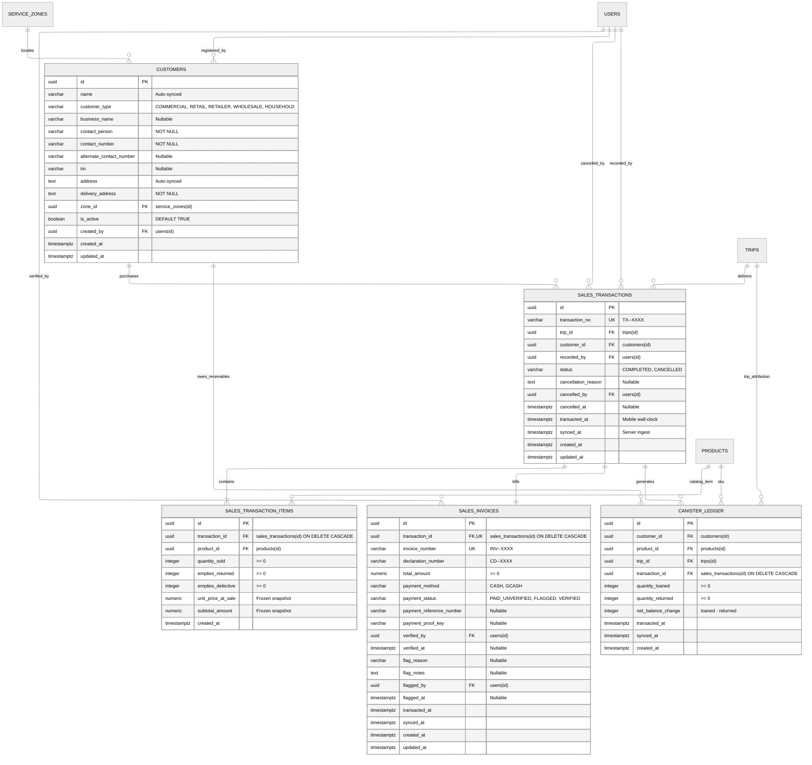

---

## 2. Table Specifications

### `customers`
Stores customer master profiles and institutional accounts for LPG distribution, orders, and delivery dispatch.

| Column | Data Type | Nullable | Default / Constraints | Description |
| :--- | :--- | :--- | :--- | :--- |
| `id` | `UUID` | No | `PRIMARY KEY DEFAULT gen_random_uuid()` | Unique customer identifier |
| `name` | `VARCHAR(255)` | No | Auto-synced via trigger | Legacy trade/full name for backward compatibility |
| `business_name` | `VARCHAR(150)` | Yes | — | Registered business/trade entity name |
| `contact_person` | `VARCHAR(100)` | No | Auto-synced from `name` | Primary contact name |
| `contact_number` | `VARCHAR(50)` | No | Standardized E.164 | Primary phone number |
| `alternate_contact_number` | `VARCHAR(30)` | Yes | Standardized E.164 | Secondary phone or landline |
| `tin` | `VARCHAR(30)` | Yes | — | Tax identification number |
| `address` | `TEXT` | No | Auto-synced via trigger | Legacy address column |
| `delivery_address` | `TEXT` | No | Auto-synced from `address` | Full delivery physical address |
| `customer_type` | `VARCHAR(30)` | No | `'COMMERCIAL'`, `'RETAIL'`, `'RETAILER'`, `'WHOLESALE'`, `'HOUSEHOLD'` | Account segment |
| `zone_id` | `UUID` | Yes | `REFERENCES service_zones(id)` | Assigned delivery route zone |
| `is_active` | `BOOLEAN` | No | `DEFAULT TRUE` | Soft-deactivation indicator |
| `created_by` | `UUID` | Yes | `REFERENCES users(id)` | User who registered the profile |
| `created_at` | `TIMESTAMPTZ` | No | `DEFAULT NOW()` | Record creation timestamp |
| `updated_at` | `TIMESTAMPTZ` | No | `DEFAULT NOW()` | Managed automatically via trigger |

---

### `sales_transactions`
Frontline delivery orders recorded in-field on the mobile register and synced idempotently.

| Column | Data Type | Nullable | Default / Constraints | Description |
| :--- | :--- | :--- | :--- | :--- |
| `id` | `UUID` | No | `PRIMARY KEY DEFAULT gen_random_uuid()` | Client-generated or server UUID |
| `transaction_no` | `VARCHAR(50)` | No | `UNIQUE` | Human-readable sequential reference |
| `trip_id` | `UUID` | No | `REFERENCES trips(id)` | Trip attribution |
| `customer_id` | `UUID` | No | `REFERENCES customers(id)` | Purchasing customer |
| `recorded_by` | `UUID` | No | `REFERENCES users(id)` | Sales Agent who processed order |
| `status` | `VARCHAR(20)` | No | `DEFAULT 'COMPLETED'` (`'COMPLETED'`, `'CANCELLED'`) | Order status |
| `cancellation_reason`| `TEXT` | Yes | — | Audit reason for cancellation |
| `cancelled_by` | `UUID` | Yes | `REFERENCES users(id)` | Supervisor who voided the sale |
| `cancelled_at` | `TIMESTAMPTZ`| Yes | — | Timestamp of cancellation |
| `transacted_at` | `TIMESTAMPTZ`| No | Mobile wall-clock | Time recorded on mobile device |
| `synced_at` | `TIMESTAMPTZ`| No | `DEFAULT NOW()` | Server ingestion timestamp |
| `created_at` | `TIMESTAMPTZ`| No | `DEFAULT NOW()` | Server record timestamp |
| `updated_at` | `TIMESTAMPTZ`| No | `DEFAULT NOW()` | Update timestamp |

---

### `sales_transaction_items`
Individual product line items within a sales order with frozen catalog pricing.

| Column | Data Type | Nullable | Default / Constraints | Description |
| :--- | :--- | :--- | :--- | :--- |
| `id` | `UUID` | No | `PRIMARY KEY DEFAULT gen_random_uuid()` | Line item identifier |
| `transaction_id` | `UUID` | No | `REFERENCES sales_transactions(id) ON DELETE CASCADE` | Parent transaction |
| `product_id` | `UUID` | No | `REFERENCES products(id)` | Catalog SKU |
| `quantity_sold` | `INTEGER` | No | `CHECK (quantity_sold >= 0)` | Number of full units sold |
| `empties_returned` | `INTEGER`| No | `DEFAULT 0 CHECK (empties_returned >= 0)` | Empty units swapped/returned |
| `empties_defective`| `INTEGER`| No | `DEFAULT 0 CHECK (empties_defective >= 0)`| Defective empty units |
| `unit_price_at_sale`|`NUMERIC(10,2)`| No | `CHECK (unit_price_at_sale >= 0)` | Frozen snapshot price per unit |
| `subtotal_amount` | `NUMERIC(12,2)`| No | `CHECK (subtotal_amount >= 0)` | Frozen total amount for line |
| `created_at` | `TIMESTAMPTZ`| No | `DEFAULT NOW()` | Creation timestamp |

---

### `sales_invoices`
Transactional invoices, customer declaration slips, and payment settlements.

| Column | Data Type | Nullable | Default / Constraints | Description |
| :--- | :--- | :--- | :--- | :--- |
| `id` | `UUID` | No | `PRIMARY KEY DEFAULT gen_random_uuid()` | Unique invoice identifier |
| `transaction_id` | `UUID` | No | `UNIQUE REFERENCES sales_transactions(id) ON DELETE CASCADE` | 1-to-1 transaction link |
| `invoice_number` | `VARCHAR(50)` | No | `UNIQUE` | Sequential invoice series |
| `declaration_number`| `VARCHAR(50)`| No | Sequential declaration series | Cylinder declaration number |
| `total_amount` | `NUMERIC(12,2)`| No | `CHECK (total_amount >= 0)` | Total invoice price |
| `payment_method` | `VARCHAR(20)` | No | `'CASH'`, `'GCASH'` | Mode of payment |
| `payment_status` | `VARCHAR(20)` | No | `DEFAULT 'PAID_UNVERIFIED'` (`'PAID_UNVERIFIED'`, `'FLAGGED'`, `'VERIFIED'`) | Verification state |
| `payment_reference_number`| `VARCHAR(100)`| Yes | — | GCash reference string |
| `payment_proof_key` | `VARCHAR(255)`| Yes | — | Media attachment key for receipt screenshot |
| `verified_by` | `UUID` | Yes | `REFERENCES users(id)` | Cashier/supervisor who verified payment |
| `verified_at` | `TIMESTAMPTZ` | Yes | — | Verification timestamp |
| `flag_reason` | `VARCHAR(100)` | Yes | — | Reason code when invoice is flagged |
| `flag_notes` | `TEXT` | Yes | — | Detailed notes explaining invoice flag |
| `flagged_by` | `UUID` | Yes | `REFERENCES users(id) ON DELETE SET NULL` | Supervisor who flagged the invoice |
| `flagged_at` | `TIMESTAMPTZ` | Yes | — | Timestamp when invoice was flagged |
| `transacted_at` | `TIMESTAMPTZ` | No | Mobile wall-clock | Transaction time |
| `synced_at` | `TIMESTAMPTZ` | No | `DEFAULT NOW()` | Ingestion timestamp |
| `created_at` | `TIMESTAMPTZ` | No | `DEFAULT NOW()` | Record creation timestamp |
| `updated_at` | `TIMESTAMPTZ` | No | `DEFAULT NOW()` | Record update timestamp |

---

### `canister_ledger`
Append-only ledger tracking loaned canisters, customer cylinder debt, and returns per product SKU.

| Column | Data Type | Nullable | Default / Constraints | Description |
| :--- | :--- | :--- | :--- | :--- |
| `id` | `UUID` | No | `PRIMARY KEY DEFAULT gen_random_uuid()` | Unique ledger entry identifier |
| `customer_id` | `UUID` | No | `REFERENCES customers(id)` | Debtor customer |
| `product_id` | `UUID` | No | `REFERENCES products(id)` | Product SKU |
| `trip_id` | `UUID` | No | `REFERENCES trips(id)` | Trip attribution for discrepancy reconciliation |
| `transaction_id` | `UUID` | No | `REFERENCES sales_transactions(id) ON DELETE CASCADE` | Originating sales order |
| `quantity_loaned` | `INTEGER` | No | `DEFAULT 0 CHECK (quantity_loaned >= 0)` | `GREATEST(0, sold - returned)` |
| `quantity_returned`| `INTEGER` | No | `DEFAULT 0 CHECK (quantity_returned >= 0)`| `GREATEST(0, returned - sold)` |
| `net_balance_change`|`INTEGER` | No | `CHECK (net_balance_change = quantity_loaned - quantity_returned)` | Signed delta |
| `transacted_at` | `TIMESTAMPTZ` | No | Mobile wall-clock | Ledger entry timestamp |
| `synced_at` | `TIMESTAMPTZ` | No | `DEFAULT NOW()` | Server ingestion timestamp |
| `created_at` | `TIMESTAMPTZ` | No | `DEFAULT NOW()` | Record creation timestamp |

---

## 3. Triggers & Automation

- **`trigger_sync_customer_profile`**: `BEFORE INSERT OR UPDATE` trigger on `customers` that synchronizes legacy `name`/`address` fields with modern `contact_person`/`business_name`/`delivery_address` fields.
- **`trigger_update_customers_updated_at`**: `BEFORE UPDATE` trigger on `customers` that automatically refreshes `updated_at`.
- **`trigger_update_sales_transactions_updated_at`**: `BEFORE UPDATE` trigger on `sales_transactions` that automatically refreshes `updated_at`.
- **`trigger_update_sales_invoices_updated_at`**: `BEFORE UPDATE` trigger on `sales_invoices` that automatically refreshes `updated_at`.
`````

## File: docs/erd-documentation.md
`````markdown
# MadayawGas Database Entity-Relationship & Schema Reference Documentation

> **Database Engine**: PostgreSQL 18.3  
> **Host Environment**: Windows x86_64 / Cloud PostgreSQL  
> **Schema Migrations**: `001_initial-setup.sql` through `027_sales_invoice_flagging.sql`  
> **Total Documented Tables**: 38 Base Tables (across 5 Main Subsystems + System Logic Infrastructure)  
> **Last Updated**: November 19, 2026  
> **Standard**: Single Source of Truth database documentation adhering to the 5 Main Subsystems (`User Management`, `Fleet & Maintenance`, `Trip & Schedule`, `Inventory`, `Sales & Delivery`) plus `System Logic` cross-cutting infrastructure.

---

## Table of Contents

- [Architectural Overview \& Global Conventions](#architectural-overview--global-conventions)
- [PostgreSQL Custom ENUM Catalog](#postgresql-custom-enum-catalog)
- [1. User Management](#1-user-management) (7 Tables)
- [2. Fleet \& Maintenance](#2-fleet--maintenance) (11 Tables)
- [3. Inventory](#3-inventory) (3 Tables)
- [4. Trip \& Schedule](#4-trip--schedule) (9 Tables)
- [5. Sales \& Delivery](#5-sales--delivery) (5 Tables)
- [System Logic (Cross-Cutting Infrastructure — Non-Subsystem)](#system-logic-cross-cutting-infrastructure--non-subsystem) (3 Tables)
- [Database Documentation Summary](#database-documentation-summary)

---

## Architectural Overview & Global Conventions

The MadayawGas backend data architecture is implemented on PostgreSQL 18. All tables, constraints, sequences, and relationships documented herein reflect the verified live database catalog extracted directly from the `public` schema.

### Global Design Invariants:
1. **Primary Keys**:
   - Application domain entities utilize UUID Version 4 primary keys generated natively via `UUID DEFAULT gen_random_uuid() PRIMARY KEY`.
   - Small classification lookup tables (`maintenance_types`, `incident_types`) and system sequencing tables (`schema_migrations`) use auto-incrementing integer `SERIAL PRIMARY KEY`.
2. **Temporal Integrity**:
   - All timestamp fields are explicitly typed as `TIMESTAMPTZ` (`timestamp with time zone`) to guarantee UTC normalization across distributed clients.
   - Mutable state tables employ automated PostgreSQL `BEFORE UPDATE` triggers calling `update_timestamp_column()` to keep `updated_at` synchronized.
3. **Foreign Key Integrity Rules**:
   - **RESTRICT**: Applied to core master data entities (users, vehicles, products, zones, trips) to prevent cascading deletes of critical audit records.
   - **CASCADE**: Applied to dependent operational children (such as `trip_load_items` on `trip_loads`, `trip_loads` on `trips`, `sales_transaction_items` on `sales_transactions`, `role_permissions` on `roles`, `user_roles` on `users`, `work_order_receipts` on `work_orders`).
   - **SET NULL**: Applied to supervisory, audit, and dispatch snapshot attributions (`decider_id`, `dispatched_by`, `verified_by`, `inspector_id`, `settled_by`, `uploaded_by`).
4. **Stored Generated Columns**:
   - Native PostgreSQL generated columns are used for computed business indicators to eliminate calculation drift:
     - `maintenance_logs.total_cost`: Evaluated automatically as `("parts_cost" + "labor_cost")`.
5. **Partial / Conditional Unique Indexes**:
   - `UQ_approval_requests_pending`: Enforces at most one pending approval request per work order (`WHERE is_approved IS NULL`), allowing subsequent requests upon rejection.
   - `UQ_trips_schedule_id`: Enforces a 1:1 execution for scheduled dispatch runs while allowing unscheduled ad-hoc trips (`WHERE schedule_id IS NOT NULL`).
   - `UQ_trips_active_truck`: Guarantees a truck cannot be dispatched simultaneously on multiple active runs (`WHERE status IN ('PENDING', 'IN_PROGRESS', 'RETURNED')`).
   - `UQ_truck_schedules_active_date`: Guarantees a vehicle is scheduled at most once per calendar date (`WHERE status != 'CANCELLED'`).
   - `idx_sales_invoices_flagged`: Partial index on `sales_invoices(payment_status) WHERE payment_status = 'FLAGGED'` for rapid supervisor triage of flagged invoices.

---

## PostgreSQL Custom ENUM Catalog

The database defines 10 custom PostgreSQL ENUM types to enforce strict state validation at the database engine level:

| ENUM Type Name | Allowed Literals | Used in Table(s) & Column(s) |
| :--- | :--- | :--- |
| `truck_status` | `'ACTIVE'`, `'INACTIVE'`, `'UNDER_MAINTENANCE'`, `'RETIRED'` | `vehicles.status` |
| `container_type_enum` | `'CYLINDER'`, `'CANISTER'` | `products.container_type` |
| `customer_type_enum` | `'RETAIL'`, `'COMMERCIAL'`, `'WHOLESALE'` | `customers` (domain catalog) |
| `schedule_status` | `'SCHEDULED'`, `'DISPATCHED'`, `'CANCELLED'` | `truck_schedules.status` |
| `trip_status` | `'PENDING'`, `'IN_PROGRESS'`, `'COMPLETED'`, `'CANCELLED'` | `trips.status` |
| `transfer_type` | `'DISPATCH_LOAD'`, `'RETURN_UNLOAD'` | `trip_loads.transfer_type` |
| `stock_condition` | `'FILLED'`, `'EMPTY_GOOD'`, `'DEFECTIVE'` | `trip_load_items.condition`, `plant_stock_adjustments.target_condition`, `plant_stock_adjustments.source_condition` |
| `reconciliation_status` | `'AWAITING_SYNC'`, `'SETTLED'`, `'FLAGGED_VARIANCE'` | `trip_stock_reconciliations.status` |
| `plant_adjustment_type` | `'INITIAL_COUNT'`, `'SUPPLIER_DELIVERY'`, `'PLANT_FILLING'`, `'DAMAGE_FOUND'`, `'REPAIR_COMPLETED'`, `'PHYSICAL_COUNT_ADJUSTMENT'` | `plant_stock_adjustments.adjustment_type` |
| `inventory_transfer_type` | `'DISPATCH_LOAD'`, `'RETURN_UNLOAD'` | Inventory transfer domain classification |

---

## 1. User Management

> **Scope**: Manages enterprise identity, authentication sessions, cryptographic credential lifecycles, role-based authorization matrices, and immutable administrative audit logging.  
> **Tables in Subsystem**: 7 tables *(Note: `history_logs` is documented under [System Logic](#system-logic-cross-cutting-infrastructure--non-subsystem) as cross-cutting infrastructure)*

### Table: `users`

<table>
  <thead>
    <tr>
      <th width="20%">Field</th>
      <th width="80%">Value</th>
    </tr>
  </thead>
  <tbody>
    <tr>
      <td><strong>Table Name</strong></td>
      <td><code>users</code></td>
    </tr>
    <tr>
      <td><strong>Purpose</strong></td>
      <td>Central user identity store containing credentials, full name, phone number, birthdate, status flags, and primary role assignment for system authentication and authorization.</td>
    </tr>
    <tr>
      <td><strong>Structure</strong></td>
      <td>
        <table>
          <thead>
            <tr>
              <th>Column</th>
              <th>Datatype</th>
            </tr>
          </thead>
          <tbody>
            <tr>
              <td><code>id</code></td>
              <td>UUID (Primary key, Default: <code>gen_random_uuid()</code>)</td>
            </tr>
            <tr>
              <td><code>username</code></td>
              <td>VARCHAR(50) (NOT NULL)</td>
            </tr>
            <tr>
              <td><code>password_hash</code></td>
              <td>TEXT (NOT NULL)</td>
            </tr>
            <tr>
              <td><code>first_name</code></td>
              <td>VARCHAR(100) (NOT NULL)</td>
            </tr>
            <tr>
              <td><code>last_name</code></td>
              <td>VARCHAR(100) (NOT NULL)</td>
            </tr>
            <tr>
              <td><code>phone</code></td>
              <td>VARCHAR(20) (NULL)</td>
            </tr>
            <tr>
              <td><code>birthdate</code></td>
              <td>DATE (NULL)</td>
            </tr>
            <tr>
              <td><code>role_id</code></td>
              <td>UUID (Foreign key &rarr; <code>roles.id</code>, NOT NULL)</td>
            </tr>
            <tr>
              <td><code>is_active</code></td>
              <td>BOOLEAN (NOT NULL, Default: <code>true</code>)</td>
            </tr>
            <tr>
              <td><code>is_blocked</code></td>
              <td>BOOLEAN (NOT NULL, Default: <code>false</code>)</td>
            </tr>
            <tr>
              <td><code>must_change_password</code></td>
              <td>BOOLEAN (NOT NULL, Default: <code>true</code>)</td>
            </tr>
            <tr>
              <td><code>created_at</code></td>
              <td>TIMESTAMPTZ (NOT NULL, Default: <code>now()</code>)</td>
            </tr>
          </tbody>
        </table>
      </td>
    </tr>
    <tr>
      <td><strong>Notes</strong></td>
      <td>
        <ol>
          <li><code>users.id</code> is the primary key (UUID, auto-generated via <code>gen_random_uuid()</code>).</li>
          <li><code>users.role_id</code> is a foreign key referencing <code>roles.id</code> with <code>ON DELETE RESTRICT</code>, representing the user's primary or legacy organizational role.</li>
          <li><code>users.username</code> is automatically generated by the backend username engine (e.g., first initial + last name + collision counter) and enforced with a UNIQUE constraint.</li>
          <li><code>users.must_change_password</code> enforces mandatory password replacement upon initial account setup or administrative credential reset.</li>
          <li>Multi-role assignments are supported through the junction table <code>user_roles</code>.</li>
          <li>Maintains an automated <code>updated_at</code> timestamp managed via database trigger.</li>
        </ol>
      </td>
    </tr>
  </tbody>
</table>

---

### Table: `roles`

<table>
  <thead>
    <tr>
      <th width="20%">Field</th>
      <th width="80%">Value</th>
    </tr>
  </thead>
  <tbody>
    <tr>
      <td><strong>Table Name</strong></td>
      <td><code>roles</code></td>
    </tr>
    <tr>
      <td><strong>Purpose</strong></td>
      <td>Defines organizational roles and job profiles (e.g., SUPER_ADMIN, ADMIN, DRIVER, SALES_REP, INVENTORY_STAFF, MAINTENANCE_STAFF).</td>
    </tr>
    <tr>
      <td><strong>Structure</strong></td>
      <td>
        <table>
          <thead>
            <tr>
              <th>Column</th>
              <th>Datatype</th>
            </tr>
          </thead>
          <tbody>
            <tr>
              <td><code>id</code></td>
              <td>UUID (Primary key, Default: <code>gen_random_uuid()</code>)</td>
            </tr>
            <tr>
              <td><code>name</code></td>
              <td>VARCHAR(50) (NOT NULL)</td>
            </tr>
            <tr>
              <td><code>description</code></td>
              <td>TEXT (NULL)</td>
            </tr>
            <tr>
              <td><code>created_at</code></td>
              <td>TIMESTAMPTZ (NOT NULL, Default: <code>now()</code>)</td>
            </tr>
          </tbody>
        </table>
      </td>
    </tr>
    <tr>
      <td><strong>Notes</strong></td>
      <td>
        <ol>
          <li><code>roles.id</code> is the primary key (UUID, auto-generated via <code>gen_random_uuid()</code>).</li>
          <li><code>roles.name</code> is unique and serves as the primary role identifier across RBAC authorization checks.</li>
          <li>Mapped to granular permissions through the junction table <code>role_permissions</code>.</li>
          <li>Assigned to users via <code>users.role_id</code> (primary role) and <code>user_roles</code> (multi-role memberships).</li>
        </ol>
      </td>
    </tr>
  </tbody>
</table>

---

### Table: `permissions`

<table>
  <thead>
    <tr>
      <th width="20%">Field</th>
      <th width="80%">Value</th>
    </tr>
  </thead>
  <tbody>
    <tr>
      <td><strong>Table Name</strong></td>
      <td><code>permissions</code></td>
    </tr>
    <tr>
      <td><strong>Purpose</strong></td>
      <td>Granular RBAC permission tokens defining specific system capabilities and access boundaries across all backend modules.</td>
    </tr>
    <tr>
      <td><strong>Structure</strong></td>
      <td>
        <table>
          <thead>
            <tr>
              <th>Column</th>
              <th>Datatype</th>
            </tr>
          </thead>
          <tbody>
            <tr>
              <td><code>id</code></td>
              <td>UUID (Primary key, Default: <code>gen_random_uuid()</code>)</td>
            </tr>
            <tr>
              <td><code>name</code></td>
              <td>VARCHAR(100) (NOT NULL)</td>
            </tr>
            <tr>
              <td><code>description</code></td>
              <td>TEXT (NULL)</td>
            </tr>
          </tbody>
        </table>
      </td>
    </tr>
    <tr>
      <td><strong>Notes</strong></td>
      <td>
        <ol>
          <li><code>permissions.id</code> is the primary key (UUID, auto-generated via <code>gen_random_uuid()</code>).</li>
          <li><code>permissions.name</code> is unique and follows the hierarchical <code>module.action</code> convention (e.g., <code>fleet.view_own</code>, <code>fuel.create</code>, <code>trips.dispatch</code>).</li>
          <li>Permissions are mapped to roles via <code>role_permissions</code> and evaluated at runtime by the <code>requirePermission</code> middleware.</li>
        </ol>
      </td>
    </tr>
  </tbody>
</table>

---

### Table: `role_permissions`

<table>
  <thead>
    <tr>
      <th width="20%">Field</th>
      <th width="80%">Value</th>
    </tr>
  </thead>
  <tbody>
    <tr>
      <td><strong>Table Name</strong></td>
      <td><code>role_permissions</code></td>
    </tr>
    <tr>
      <td><strong>Purpose</strong></td>
      <td>Many-to-many junction table binding granular system permissions to organizational roles.</td>
    </tr>
    <tr>
      <td><strong>Structure</strong></td>
      <td>
        <table>
          <thead>
            <tr>
              <th>Column</th>
              <th>Datatype</th>
            </tr>
          </thead>
          <tbody>
            <tr>
              <td><code>role_id</code></td>
              <td>UUID (Primary key, Foreign key &rarr; <code>roles.id</code>)</td>
            </tr>
            <tr>
              <td><code>permission_id</code></td>
              <td>UUID (Primary key, Foreign key &rarr; <code>permissions.id</code>)</td>
            </tr>
          </tbody>
        </table>
      </td>
    </tr>
    <tr>
      <td><strong>Notes</strong></td>
      <td>
        <ol>
          <li>Composite primary key comprising <code>(role_id, permission_id)</code>.</li>
          <li><code>role_permissions.role_id</code> references <code>roles.id</code> with <code>ON DELETE CASCADE</code>.</li>
          <li><code>role_permissions.permission_id</code> references <code>permissions.id</code> with <code>ON DELETE CASCADE</code>.</li>
          <li>Enables dynamic matrix updates without requiring alterations to individual user accounts.</li>
        </ol>
      </td>
    </tr>
  </tbody>
</table>

---

### Table: `user_roles`

<table>
  <thead>
    <tr>
      <th width="20%">Field</th>
      <th width="80%">Value</th>
    </tr>
  </thead>
  <tbody>
    <tr>
      <td><strong>Table Name</strong></td>
      <td><code>user_roles</code></td>
    </tr>
    <tr>
      <td><strong>Purpose</strong></td>
      <td>Junction table facilitating multi-role memberships per user, including designation of a primary active operational profile.</td>
    </tr>
    <tr>
      <td><strong>Structure</strong></td>
      <td>
        <table>
          <thead>
            <tr>
              <th>Column</th>
              <th>Datatype</th>
            </tr>
          </thead>
          <tbody>
            <tr>
              <td><code>user_id</code></td>
              <td>UUID (Primary key, Foreign key &rarr; <code>users.id</code>)</td>
            </tr>
            <tr>
              <td><code>role_id</code></td>
              <td>UUID (Primary key, Foreign key &rarr; <code>roles.id</code>)</td>
            </tr>
            <tr>
              <td><code>is_primary</code></td>
              <td>BOOLEAN (NOT NULL, Default: <code>false</code>)</td>
            </tr>
            <tr>
              <td><code>assigned_at</code></td>
              <td>TIMESTAMPTZ (NOT NULL, Default: <code>now()</code>)</td>
            </tr>
          </tbody>
        </table>
      </td>
    </tr>
    <tr>
      <td><strong>Notes</strong></td>
      <td>
        <ol>
          <li>Composite primary key comprising <code>(user_id, role_id)</code>.</li>
          <li><code>user_roles.user_id</code> references <code>users.id</code> with <code>ON DELETE CASCADE</code>.</li>
          <li><code>user_roles.role_id</code> references <code>roles.id</code> with <code>ON DELETE CASCADE</code>.</li>
          <li><code>is_primary</code> indicates whether this role serves as the active default role for UI dashboards and primary workflow permissions.</li>
        </ol>
      </td>
    </tr>
  </tbody>
</table>

---

### Table: `sessions`

<table>
  <thead>
    <tr>
      <th width="20%">Field</th>
      <th width="80%">Value</th>
    </tr>
  </thead>
  <tbody>
    <tr>
      <td><strong>Table Name</strong></td>
      <td><code>sessions</code></td>
    </tr>
    <tr>
      <td><strong>Purpose</strong></td>
      <td>Tracks active authenticated sessions, SHA-256 hashed session tokens, and expiration/revocation lifecycles for stateful cookie and Bearer authentication.</td>
    </tr>
    <tr>
      <td><strong>Structure</strong></td>
      <td>
        <table>
          <thead>
            <tr>
              <th>Column</th>
              <th>Datatype</th>
            </tr>
          </thead>
          <tbody>
            <tr>
              <td><code>id</code></td>
              <td>UUID (Primary key, Default: <code>gen_random_uuid()</code>)</td>
            </tr>
            <tr>
              <td><code>user_id</code></td>
              <td>UUID (Foreign key &rarr; <code>users.id</code>, NOT NULL)</td>
            </tr>
            <tr>
              <td><code>token_hash</code></td>
              <td>VARCHAR(255) (NOT NULL)</td>
            </tr>
            <tr>
              <td><code>created_at</code></td>
              <td>TIMESTAMPTZ (NOT NULL, Default: <code>now()</code>)</td>
            </tr>
            <tr>
              <td><code>expires_at</code></td>
              <td>TIMESTAMPTZ (NOT NULL)</td>
            </tr>
            <tr>
              <td><code>revoked_at</code></td>
              <td>TIMESTAMPTZ (NULL)</td>
            </tr>
          </tbody>
        </table>
      </td>
    </tr>
    <tr>
      <td><strong>Notes</strong></td>
      <td>
        <ol>
          <li><code>sessions.id</code> is the primary key (UUID, auto-generated via <code>gen_random_uuid()</code>).</li>
          <li><code>sessions.user_id</code> references <code>users.id</code> with <code>ON DELETE CASCADE</code>.</li>
          <li><code>token_hash</code> stores the cryptographic SHA-256 hash of the 32-byte hexadecimal session token delivered via the <code>mg_sid</code> HttpOnly cookie or Bearer header.</li>
          <li>Enforces dual expiration invariants: idle timeout (<code>now < expires_at</code>, rolling 8 hours) and absolute maximum session lifespan (<code>now < created_at + 30 days</code>).</li>
          <li><code>revoked_at</code> is stamped immediately upon explicit logout, administrative password reset, or role change.</li>
        </ol>
      </td>
    </tr>
  </tbody>
</table>

---

### Table: `audit_logs`

<table>
  <thead>
    <tr>
      <th width="20%">Field</th>
      <th width="80%">Value</th>
    </tr>
  </thead>
  <tbody>
    <tr>
      <td><strong>Table Name</strong></td>
      <td><code>audit_logs</code></td>
    </tr>
    <tr>
      <td><strong>Purpose</strong></td>
      <td>Administrative security audit ledger recording user management actions, credential resets, role changes, and status updates.</td>
    </tr>
    <tr>
      <td><strong>Structure</strong></td>
      <td>
        <table>
          <thead>
            <tr>
              <th>Column</th>
              <th>Datatype</th>
            </tr>
          </thead>
          <tbody>
            <tr>
              <td><code>id</code></td>
              <td>UUID (Primary key, Default: <code>gen_random_uuid()</code>)</td>
            </tr>
            <tr>
              <td><code>user_id</code></td>
              <td>UUID (Foreign key &rarr; <code>users.id</code>, NOT NULL)</td>
            </tr>
            <tr>
              <td><code>target_user_id</code></td>
              <td>UUID (Foreign key &rarr; <code>users.id</code>, NULL)</td>
            </tr>
            <tr>
              <td><code>action</code></td>
              <td>VARCHAR(100) (NOT NULL)</td>
            </tr>
            <tr>
              <td><code>description</code></td>
              <td>TEXT (NULL)</td>
            </tr>
            <tr>
              <td><code>created_at</code></td>
              <td>TIMESTAMPTZ (NOT NULL, Default: <code>now()</code>)</td>
            </tr>
          </tbody>
        </table>
      </td>
    </tr>
    <tr>
      <td><strong>Notes</strong></td>
      <td>
        <ol>
          <li><code>audit_logs.id</code> is the primary key (UUID, auto-generated via <code>gen_random_uuid()</code>).</li>
          <li><code>audit_logs.user_id</code> references <code>users.id</code> with <code>ON DELETE RESTRICT</code> (the actor performing the action).</li>
          <li><code>audit_logs.target_user_id</code> optionally references <code>users.id</code> with <code>ON DELETE RESTRICT</code> (the subject user of the administrative operation).</li>
          <li>Records are append-only and immutable for compliance and security auditing.</li>
        </ol>
      </td>
    </tr>
  </tbody>
</table>

---

### Table: `history_logs`

<table>
  <thead>
    <tr>
      <th width="20%">Field</th>
      <th width="80%">Value</th>
    </tr>
  </thead>
  <tbody>
    <tr>
      <td><strong>Table Name</strong></td>
      <td><code>history_logs</code></td>
    </tr>
    <tr>
      <td><strong>Purpose</strong></td>
      <td>Centralized enterprise event audit ledger capturing domain entity lifecycle transitions with denormalized actor snapshots and structured JSONB metadata.</td>
    </tr>
    <tr>
      <td><strong>Structure</strong></td>
      <td>
        <table>
          <thead>
            <tr>
              <th>Column</th>
              <th>Datatype</th>
            </tr>
          </thead>
          <tbody>
            <tr>
              <td><code>id</code></td>
              <td>UUID (Primary key, Default: <code>gen_random_uuid()</code>)</td>
            </tr>
            <tr>
              <td><code>user_id</code></td>
              <td>UUID (Foreign key &rarr; <code>users.id</code>, NULL)</td>
            </tr>
            <tr>
              <td><code>user_name</code></td>
              <td>VARCHAR(150) (NOT NULL)</td>
            </tr>
            <tr>
              <td><code>user_role</code></td>
              <td>VARCHAR(100) (NOT NULL)</td>
            </tr>
            <tr>
              <td><code>action_type</code></td>
              <td>VARCHAR(50) (NOT NULL)</td>
            </tr>
            <tr>
              <td><code>module</code></td>
              <td>VARCHAR(100) (NOT NULL)</td>
            </tr>
            <tr>
              <td><code>action</code></td>
              <td>VARCHAR(100) (NOT NULL)</td>
            </tr>
            <tr>
              <td><code>details</code></td>
              <td>TEXT (NOT NULL)</td>
            </tr>
            <tr>
              <td><code>target_id</code></td>
              <td>VARCHAR(255) (NULL)</td>
            </tr>
            <tr>
              <td><code>target_type</code></td>
              <td>VARCHAR(100) (NULL)</td>
            </tr>
            <tr>
              <td><code>metadata</code></td>
              <td>JSONB (NULL, Default: <code>'{}'</code>)</td>
            </tr>
            <tr>
              <td><code>created_at</code></td>
              <td>TIMESTAMPTZ (NOT NULL, Default: <code>now()</code>)</td>
            </tr>
          </tbody>
        </table>
      </td>
    </tr>
    <tr>
      <td><strong>Notes</strong></td>
      <td>
        <ol>
          <li><code>history_logs.id</code> is the primary key (UUID, auto-generated via <code>gen_random_uuid()</code>).</li>
          <li><code>history_logs.user_id</code> references <code>users.id</code> with <code>ON DELETE SET NULL</code>, ensuring audit history is preserved even if user accounts are purged.</li>
          <li>Denormalizes actor context (<code>user_name</code>, <code>user_role</code>) at the moment of the event to ensure historical fidelity.</li>
          <li><code>target_id</code> and <code>target_type</code> provide polymorphic linkages to modified domain entities across any subsystem.</li>
          <li><code>metadata</code> (JSONB) stores dynamic event payload details, changed attributes, and operational context.</li>
        </ol>
      </td>
    </tr>
  </tbody>
</table>

---

### Table: `vehicles`

<table>
  <thead>
    <tr>
      <th width="20%">Field</th>
      <th width="80%">Value</th>
    </tr>
  </thead>
  <tbody>
    <tr>
      <td><strong>Table Name</strong></td>
      <td><code>vehicles</code></td>
    </tr>
    <tr>
      <td><strong>Purpose</strong></td>
      <td>Fleet asset master table storing delivery trucks and operational vehicles, odometer telemetry, driver assignments, and preventive maintenance triggers.</td>
    </tr>
    <tr>
      <td><strong>Structure</strong></td>
      <td>
        <table>
          <thead>
            <tr>
              <th>Column</th>
              <th>Datatype</th>
            </tr>
          </thead>
          <tbody>
            <tr>
              <td><code>id</code></td>
              <td>UUID (Primary key, Default: <code>gen_random_uuid()</code>)</td>
            </tr>
            <tr>
              <td><code>driver_id</code></td>
              <td>UUID (Foreign key &rarr; <code>users.id</code>, NULL)</td>
            </tr>
            <tr>
              <td><code>plate_number</code></td>
              <td>VARCHAR(20) (NOT NULL)</td>
            </tr>
            <tr>
              <td><code>model</code></td>
              <td>VARCHAR(100) (NOT NULL)</td>
            </tr>
            <tr>
              <td><code>year_model</code></td>
              <td>INTEGER (NOT NULL)</td>
            </tr>
            <tr>
              <td><code>current_odometer</code></td>
              <td>INTEGER (NOT NULL, Default: <code>0</code>)</td>
            </tr>
            <tr>
              <td><code>last_pm_odometer</code></td>
              <td>INTEGER (NOT NULL, Default: <code>0</code>)</td>
            </tr>
            <tr>
              <td><code>status</code></td>
              <td>ENUM <code>truck_status</code> ('ACTIVE', 'INACTIVE', 'UNDER_MAINTENANCE', 'RETIRED') (NOT NULL, Default: <code>'ACTIVE'</code>)</td>
            </tr>
            <tr>
              <td><code>created_at</code></td>
              <td>TIMESTAMPTZ (NOT NULL, Default: <code>now()</code>)</td>
            </tr>
            <tr>
              <td><code>updated_at</code></td>
              <td>TIMESTAMPTZ (NOT NULL, Default: <code>now()</code>)</td>
            </tr>
            <tr>
              <td><code>vehicle_type</code></td>
              <td>VARCHAR(30) (NOT NULL, Default: <code>'DELIVERY_TRUCK'</code>)</td>
            </tr>
          </tbody>
        </table>
      </td>
    </tr>
    <tr>
      <td><strong>Notes</strong></td>
      <td>
        <ol>
          <li><code>vehicles.id</code> is the primary key (UUID, auto-generated via <code>gen_random_uuid()</code>).</li>
          <li><code>vehicles.driver_id</code> is a unique foreign key referencing <code>users.id</code> with <code>ON DELETE SET NULL</code>, enforcing a 1:1 soft assignment between a driver and vehicle.</li>
          <li><code>vehicles.plate_number</code> is unique.</li>
          <li>Preventive maintenance due status is evaluated dynamically in the service layer against the configurable <code>fleet.pm_odometer_threshold_km</code> setting in <code>system_settings</code>.</li>
          <li><code>vehicles.status</code> uses the custom ENUM <code>truck_status</code> (<code>'ACTIVE'</code>, <code>'INACTIVE'</code>, <code>'UNDER_MAINTENANCE'</code>, <code>'RETIRED'</code>).</li>
          <li>Maintains an automated <code>updated_at</code> trigger.</li>
        </ol>
      </td>
    </tr>
  </tbody>
</table>

---

### Table: `maintenance_types`

<table>
  <thead>
    <tr>
      <th width="20%">Field</th>
      <th width="80%">Value</th>
    </tr>
  </thead>
  <tbody>
    <tr>
      <td><strong>Table Name</strong></td>
      <td><code>maintenance_types</code></td>
    </tr>
    <tr>
      <td><strong>Purpose</strong></td>
      <td>Lookup classification catalog for preventive and corrective maintenance operations.</td>
    </tr>
    <tr>
      <td><strong>Structure</strong></td>
      <td>
        <table>
          <thead>
            <tr>
              <th>Column</th>
              <th>Datatype</th>
            </tr>
          </thead>
          <tbody>
            <tr>
              <td><code>id</code></td>
              <td>INTEGER (Primary key, Default: <code>SERIAL sequence</code>)</td>
            </tr>
            <tr>
              <td><code>type_name</code></td>
              <td>VARCHAR(50) (NOT NULL)</td>
            </tr>
            <tr>
              <td><code>created_at</code></td>
              <td>TIMESTAMPTZ (NOT NULL, Default: <code>now()</code>)</td>
            </tr>
          </tbody>
        </table>
      </td>
    </tr>
    <tr>
      <td><strong>Notes</strong></td>
      <td>
        <ol>
          <li><code>maintenance_types.id</code> is the primary key (INTEGER with auto-incrementing sequence <code>SERIAL</code>).</li>
          <li><code>maintenance_types.type_name</code> is unique.</li>
          <li>Referenced by <code>work_orders</code> and <code>maintenance_logs</code> to standardize maintenance categories.</li>
        </ol>
      </td>
    </tr>
  </tbody>
</table>

---

### Table: `incident_types`

<table>
  <thead>
    <tr>
      <th width="20%">Field</th>
      <th width="80%">Value</th>
    </tr>
  </thead>
  <tbody>
    <tr>
      <td><strong>Table Name</strong></td>
      <td><code>incident_types</code></td>
    </tr>
    <tr>
      <td><strong>Purpose</strong></td>
      <td>Lookup classification catalog for vehicle road incidents and physical asset damage events.</td>
    </tr>
    <tr>
      <td><strong>Structure</strong></td>
      <td>
        <table>
          <thead>
            <tr>
              <th>Column</th>
              <th>Datatype</th>
            </tr>
          </thead>
          <tbody>
            <tr>
              <td><code>id</code></td>
              <td>INTEGER (Primary key, Default: <code>SERIAL sequence</code>)</td>
            </tr>
            <tr>
              <td><code>type_name</code></td>
              <td>VARCHAR(50) (NOT NULL)</td>
            </tr>
            <tr>
              <td><code>created_at</code></td>
              <td>TIMESTAMPTZ (NOT NULL, Default: <code>now()</code>)</td>
            </tr>
          </tbody>
        </table>
      </td>
    </tr>
    <tr>
      <td><strong>Notes</strong></td>
      <td>
        <ol>
          <li><code>incident_types.id</code> is the primary key (INTEGER with auto-incrementing sequence <code>SERIAL</code>).</li>
          <li><code>incident_types.type_name</code> is unique.</li>
          <li>Referenced by <code>incident_reports</code> to categorize traffic accidents, breakdowns, or road damage.</li>
        </ol>
      </td>
    </tr>
  </tbody>
</table>

---

### Table: `vehicle_odometer_logs`

<table>
  <thead>
    <tr>
      <th width="20%">Field</th>
      <th width="80%">Value</th>
    </tr>
  </thead>
  <tbody>
    <tr>
      <td><strong>Table Name</strong></td>
      <td><code>vehicle_odometer_logs</code></td>
    </tr>
    <tr>
      <td><strong>Purpose</strong></td>
      <td>Immutable telemetry audit log capturing vehicle odometer readings from post-trip returns, refueling, inspections, and manual audits.</td>
    </tr>
    <tr>
      <td><strong>Structure</strong></td>
      <td>
        <table>
          <thead>
            <tr>
              <th>Column</th>
              <th>Datatype</th>
            </tr>
          </thead>
          <tbody>
            <tr>
              <td><code>id</code></td>
              <td>UUID (Primary key, Default: <code>gen_random_uuid()</code>)</td>
            </tr>
            <tr>
              <td><code>vehicle_id</code></td>
              <td>UUID (Foreign key &rarr; <code>vehicles.id</code>, NOT NULL)</td>
            </tr>
            <tr>
              <td><code>odometer_reading</code></td>
              <td>INTEGER (NOT NULL)</td>
            </tr>
            <tr>
              <td><code>logged_by</code></td>
              <td>UUID (Foreign key &rarr; <code>users.id</code>, NULL)</td>
            </tr>
            <tr>
              <td><code>source</code></td>
              <td>VARCHAR(30) (NOT NULL, Default: <code>'POST_DISPATCH_RETURN'</code>)</td>
            </tr>
            <tr>
              <td><code>notes</code></td>
              <td>TEXT (NULL)</td>
            </tr>
            <tr>
              <td><code>logged_at</code></td>
              <td>TIMESTAMPTZ (NOT NULL, Default: <code>CURRENT_TIMESTAMP</code>)</td>
            </tr>
          </tbody>
        </table>
      </td>
    </tr>
    <tr>
      <td><strong>Notes</strong></td>
      <td>
        <ol>
          <li><code>vehicle_odometer_logs.id</code> is the primary key (UUID, auto-generated via <code>gen_random_uuid()</code>).</li>
          <li><code>vehicle_odometer_logs.vehicle_id</code> references <code>vehicles.id</code> with <code>ON DELETE RESTRICT</code>.</li>
          <li><code>vehicle_odometer_logs.logged_by</code> references <code>users.id</code> with <code>ON DELETE SET NULL</code>.</li>
          <li>Referenced by <code>trips.return_odometer_log_id</code> with a UNIQUE constraint to certify final trip distance.</li>
        </ol>
      </td>
    </tr>
  </tbody>
</table>

---

### Table: `vehicle_inspections`

<table>
  <thead>
    <tr>
      <th width="20%">Field</th>
      <th width="80%">Value</th>
    </tr>
  </thead>
  <tbody>
    <tr>
      <td><strong>Table Name</strong></td>
      <td><code>vehicle_inspections</code></td>
    </tr>
    <tr>
      <td><strong>Purpose</strong></td>
      <td>Physical vehicle inspection checklist evaluations certifying roadworthiness and determining dispatch eligibility.</td>
    </tr>
    <tr>
      <td><strong>Structure</strong></td>
      <td>
        <table>
          <thead>
            <tr>
              <th>Column</th>
              <th>Datatype</th>
            </tr>
          </thead>
          <tbody>
            <tr>
              <td><code>id</code></td>
              <td>UUID (Primary key, Default: <code>gen_random_uuid()</code>)</td>
            </tr>
            <tr>
              <td><code>vehicle_id</code></td>
              <td>UUID (Foreign key &rarr; <code>vehicles.id</code>, NOT NULL)</td>
            </tr>
            <tr>
              <td><code>inspector_id</code></td>
              <td>UUID (Foreign key &rarr; <code>users.id</code>, NULL)</td>
            </tr>
            <tr>
              <td><code>result</code></td>
              <td>VARCHAR(20) (NOT NULL)</td>
            </tr>
            <tr>
              <td><code>findings</code></td>
              <td>TEXT (NOT NULL)</td>
            </tr>
            <tr>
              <td><code>issue_detected</code></td>
              <td>BOOLEAN (NOT NULL, Default: <code>true</code>)</td>
            </tr>
            <tr>
              <td><code>inspection_date</code></td>
              <td>TIMESTAMPTZ (NOT NULL, Default: <code>CURRENT_TIMESTAMP</code>)</td>
            </tr>
            <tr>
              <td><code>allow_dispatch</code></td>
              <td>BOOLEAN (NOT NULL, Default: <code>true</code>)</td>
            </tr>
          </tbody>
        </table>
      </td>
    </tr>
    <tr>
      <td><strong>Notes</strong></td>
      <td>
        <ol>
          <li><code>vehicle_inspections.id</code> is the primary key (UUID, auto-generated via <code>gen_random_uuid()</code>).</li>
          <li><code>vehicle_inspections.vehicle_id</code> references <code>vehicles.id</code> with <code>ON DELETE RESTRICT</code>.</li>
          <li><code>vehicle_inspections.inspector_id</code> references <code>users.id</code> with <code>ON DELETE SET NULL</code>.</li>
          <li><code>allow_dispatch</code> flags whether the vehicle is cleared for transit; when false or when issues are detected, it links to <code>work_orders.inspection_id</code>.</li>
        </ol>
      </td>
    </tr>
  </tbody>
</table>

---

### Table: `incident_reports`

<table>
  <thead>
    <tr>
      <th width="20%">Field</th>
      <th width="80%">Value</th>
    </tr>
  </thead>
  <tbody>
    <tr>
      <td><strong>Table Name</strong></td>
      <td><code>incident_reports</code></td>
    </tr>
    <tr>
      <td><strong>Purpose</strong></td>
      <td>Road accident, collision, and mechanical failure incident reports for fleet vehicles.</td>
    </tr>
    <tr>
      <td><strong>Structure</strong></td>
      <td>
        <table>
          <thead>
            <tr>
              <th>Column</th>
              <th>Datatype</th>
            </tr>
          </thead>
          <tbody>
            <tr>
              <td><code>id</code></td>
              <td>UUID (Primary key, Default: <code>gen_random_uuid()</code>)</td>
            </tr>
            <tr>
              <td><code>vehicle_id</code></td>
              <td>UUID (Foreign key &rarr; <code>vehicles.id</code>, NOT NULL)</td>
            </tr>
            <tr>
              <td><code>reporter_id</code></td>
              <td>UUID (Foreign key &rarr; <code>users.id</code>, NULL)</td>
            </tr>
            <tr>
              <td><code>incident_type_id</code></td>
              <td>INTEGER (Foreign key &rarr; <code>incident_types.id</code>, NOT NULL)</td>
            </tr>
            <tr>
              <td><code>severity</code></td>
              <td>VARCHAR(20) (NOT NULL)</td>
            </tr>
            <tr>
              <td><code>incident_location</code></td>
              <td>VARCHAR(255) (NULL)</td>
            </tr>
            <tr>
              <td><code>description</code></td>
              <td>TEXT (NOT NULL)</td>
            </tr>
            <tr>
              <td><code>report_date</code></td>
              <td>TIMESTAMPTZ (NOT NULL, Default: <code>CURRENT_TIMESTAMP</code>)</td>
            </tr>
          </tbody>
        </table>
      </td>
    </tr>
    <tr>
      <td><strong>Notes</strong></td>
      <td>
        <ol>
          <li><code>incident_reports.id</code> is the primary key (UUID, auto-generated via <code>gen_random_uuid()</code>).</li>
          <li><code>incident_reports.vehicle_id</code> references <code>vehicles.id</code> with <code>ON DELETE RESTRICT</code>.</li>
          <li><code>incident_reports.reporter_id</code> references <code>users.id</code> with <code>ON DELETE SET NULL</code>.</li>
          <li><code>incident_reports.incident_type_id</code> references <code>incident_types.id</code> with <code>ON DELETE RESTRICT</code>.</li>
          <li>Referenced by <code>work_orders.incident_report_id</code> to track downstream repairs resulting from the incident.</li>
        </ol>
      </td>
    </tr>
  </tbody>
</table>

---

### Table: `work_orders`

<table>
  <thead>
    <tr>
      <th width="20%">Field</th>
      <th width="80%">Value</th>
    </tr>
  </thead>
  <tbody>
    <tr>
      <td><strong>Table Name</strong></td>
      <td><code>work_orders</code></td>
    </tr>
    <tr>
      <td><strong>Purpose</strong></td>
      <td>Maintenance and repair authorizations coordinating vehicle servicing, third-party repair shops, cost estimations, and lifecycle statuses.</td>
    </tr>
    <tr>
      <td><strong>Structure</strong></td>
      <td>
        <table>
          <thead>
            <tr>
              <th>Column</th>
              <th>Datatype</th>
            </tr>
          </thead>
          <tbody>
            <tr>
              <td><code>id</code></td>
              <td>UUID (Primary key, Default: <code>gen_random_uuid()</code>)</td>
            </tr>
            <tr>
              <td><code>vehicle_id</code></td>
              <td>UUID (Foreign key &rarr; <code>vehicles.id</code>, NOT NULL)</td>
            </tr>
            <tr>
              <td><code>creator_id</code></td>
              <td>UUID (Foreign key &rarr; <code>users.id</code>, NULL)</td>
            </tr>
            <tr>
              <td><code>maintenance_type_id</code></td>
              <td>INTEGER (Foreign key &rarr; <code>maintenance_types.id</code>, NOT NULL)</td>
            </tr>
            <tr>
              <td><code>status</code></td>
              <td>VARCHAR(20) (NOT NULL, Default: <code>'PENDING'</code>)</td>
            </tr>
            <tr>
              <td><code>inspection_id</code></td>
              <td>UUID (Foreign key &rarr; <code>vehicle_inspections.id</code>, NULL)</td>
            </tr>
            <tr>
              <td><code>incident_report_id</code></td>
              <td>UUID (Foreign key &rarr; <code>incident_reports.id</code>, NULL)</td>
            </tr>
            <tr>
              <td><code>request_date</code></td>
              <td>TIMESTAMPTZ (NOT NULL, Default: <code>CURRENT_TIMESTAMP</code>)</td>
            </tr>
            <tr>
              <td><code>scheduled_date</code></td>
              <td>TIMESTAMPTZ (NULL)</td>
            </tr>
            <tr>
              <td><code>shop_name</code></td>
              <td>VARCHAR(150) (NULL)</td>
            </tr>
            <tr>
              <td><code>estimated_cost</code></td>
              <td>NUMERIC(12, 2) (NOT NULL, Default: <code>0.00</code>)</td>
            </tr>
            <tr>
              <td><code>description</code></td>
              <td>TEXT (NOT NULL)</td>
            </tr>
            <tr>
              <td><code>created_at</code></td>
              <td>TIMESTAMPTZ (NOT NULL, Default: <code>CURRENT_TIMESTAMP</code>)</td>
            </tr>
            <tr>
              <td><code>updated_at</code></td>
              <td>TIMESTAMPTZ (NOT NULL, Default: <code>CURRENT_TIMESTAMP</code>)</td>
            </tr>
          </tbody>
        </table>
      </td>
    </tr>
    <tr>
      <td><strong>Notes</strong></td>
      <td>
        <ol>
          <li><code>work_orders.id</code> is the primary key (UUID, auto-generated via <code>gen_random_uuid()</code>).</li>
          <li><code>work_orders.vehicle_id</code> references <code>vehicles.id</code> with <code>ON DELETE RESTRICT</code>.</li>
          <li><code>work_orders.creator_id</code> references <code>users.id</code> with <code>ON DELETE SET NULL</code>.</li>
          <li><code>work_orders.maintenance_type_id</code> references <code>maintenance_types.id</code> with <code>ON DELETE RESTRICT</code>.</li>
          <li><code>inspection_id</code> and <code>incident_report_id</code> optionally link the work order to its originating inspection or incident report.</li>
          <li>Serves as parent to <code>approval_requests</code>, <code>maintenance_logs</code>, and <code>work_order_receipts</code>.</li>
          <li>Maintains an automated <code>updated_at</code> trigger.</li>
        </ol>
      </td>
    </tr>
  </tbody>
</table>

---

### Table: `approval_requests`

<table>
  <thead>
    <tr>
      <th width="20%">Field</th>
      <th width="80%">Value</th>
    </tr>
  </thead>
  <tbody>
    <tr>
      <td><strong>Table Name</strong></td>
      <td><code>approval_requests</code></td>
    </tr>
    <tr>
      <td><strong>Purpose</strong></td>
      <td>Financial and managerial approval workflow records for work order repair expenditures.</td>
    </tr>
    <tr>
      <td><strong>Structure</strong></td>
      <td>
        <table>
          <thead>
            <tr>
              <th>Column</th>
              <th>Datatype</th>
            </tr>
          </thead>
          <tbody>
            <tr>
              <td><code>id</code></td>
              <td>UUID (Primary key, Default: <code>gen_random_uuid()</code>)</td>
            </tr>
            <tr>
              <td><code>work_order_id</code></td>
              <td>UUID (Foreign key &rarr; <code>work_orders.id</code>, NOT NULL)</td>
            </tr>
            <tr>
              <td><code>decider_id</code></td>
              <td>UUID (Foreign key &rarr; <code>users.id</code>, NULL)</td>
            </tr>
            <tr>
              <td><code>requested_date</code></td>
              <td>TIMESTAMPTZ (NOT NULL, Default: <code>CURRENT_TIMESTAMP</code>)</td>
            </tr>
            <tr>
              <td><code>decided_date</code></td>
              <td>TIMESTAMPTZ (NULL)</td>
            </tr>
            <tr>
              <td><code>amount_requested</code></td>
              <td>NUMERIC(12, 2) (NOT NULL)</td>
            </tr>
            <tr>
              <td><code>is_approved</code></td>
              <td>BOOLEAN (NULL)</td>
            </tr>
            <tr>
              <td><code>remarks</code></td>
              <td>TEXT (NULL)</td>
            </tr>
            <tr>
              <td><code>created_at</code></td>
              <td>TIMESTAMPTZ (NOT NULL, Default: <code>CURRENT_TIMESTAMP</code>)</td>
            </tr>
          </tbody>
        </table>
      </td>
    </tr>
    <tr>
      <td><strong>Notes</strong></td>
      <td>
        <ol>
          <li><code>approval_requests.id</code> is the primary key (UUID, auto-generated via <code>gen_random_uuid()</code>).</li>
          <li><code>approval_requests.work_order_id</code> references <code>work_orders.id</code> with <code>ON DELETE CASCADE</code>.</li>
          <li><code>approval_requests.decider_id</code> references <code>users.id</code> with <code>ON DELETE SET NULL</code>.</li>
          <li>Enforces partial unique index <code>UQ_approval_requests_pending</code> on <code>(work_order_id) WHERE is_approved IS NULL</code>, preventing duplicate pending requests while permitting resubmissions upon rejection.</li>
        </ol>
      </td>
    </tr>
  </tbody>
</table>

---

### Table: `maintenance_logs`

<table>
  <thead>
    <tr>
      <th width="20%">Field</th>
      <th width="80%">Value</th>
    </tr>
  </thead>
  <tbody>
    <tr>
      <td><strong>Table Name</strong></td>
      <td><code>maintenance_logs</code></td>
    </tr>
    <tr>
      <td><strong>Purpose</strong></td>
      <td>Historical record of completed maintenance work, detailing downtime, parts cost, labor cost, and odometer reading at service.</td>
    </tr>
    <tr>
      <td><strong>Structure</strong></td>
      <td>
        <table>
          <thead>
            <tr>
              <th>Column</th>
              <th>Datatype</th>
            </tr>
          </thead>
          <tbody>
            <tr>
              <td><code>id</code></td>
              <td>UUID (Primary key, Default: <code>gen_random_uuid()</code>)</td>
            </tr>
            <tr>
              <td><code>work_order_id</code></td>
              <td>UUID (Foreign key &rarr; <code>work_orders.id</code>, NOT NULL)</td>
            </tr>
            <tr>
              <td><code>maintenance_type_id</code></td>
              <td>INTEGER (Foreign key &rarr; <code>maintenance_types.id</code>, NOT NULL)</td>
            </tr>
            <tr>
              <td><code>severity</code></td>
              <td>VARCHAR(20) (NOT NULL)</td>
            </tr>
            <tr>
              <td><code>date_started</code></td>
              <td>TIMESTAMPTZ (NOT NULL)</td>
            </tr>
            <tr>
              <td><code>date_resolved</code></td>
              <td>TIMESTAMPTZ (NOT NULL)</td>
            </tr>
            <tr>
              <td><code>parts_cost</code></td>
              <td>NUMERIC(12, 2) (NOT NULL, Default: <code>0.00</code>)</td>
            </tr>
            <tr>
              <td><code>labor_cost</code></td>
              <td>NUMERIC(12, 2) (NOT NULL, Default: <code>0.00</code>)</td>
            </tr>
            <tr>
              <td><code>downtime_days</code></td>
              <td>INTEGER (NOT NULL, Default: <code>0</code>)</td>
            </tr>
            <tr>
              <td><code>odometer_at_service</code></td>
              <td>INTEGER (NOT NULL)</td>
            </tr>
            <tr>
              <td><code>created_at</code></td>
              <td>TIMESTAMPTZ (NOT NULL, Default: <code>CURRENT_TIMESTAMP</code>)</td>
            </tr>
            <tr>
              <td><code>total_cost</code></td>
              <td>NUMERIC(12, 2) (Stored Generated: <code>(parts_cost + labor_cost)</code>, NULL)</td>
            </tr>
          </tbody>
        </table>
      </td>
    </tr>
    <tr>
      <td><strong>Notes</strong></td>
      <td>
        <ol>
          <li><code>maintenance_logs.id</code> is the primary key (UUID, auto-generated via <code>gen_random_uuid()</code>).</li>
          <li><code>maintenance_logs.work_order_id</code> is a unique foreign key referencing <code>work_orders.id</code> with <code>ON DELETE RESTRICT</code>, enforcing an exact 1:1 relationship with its originating work order.</li>
          <li><code>maintenance_logs.maintenance_type_id</code> references <code>maintenance_types.id</code> with <code>ON DELETE RESTRICT</code>.</li>
          <li><code>maintenance_logs.total_cost</code> is a PostgreSQL stored generated column: <code>(parts_cost + labor_cost)</code>.</li>
        </ol>
      </td>
    </tr>
  </tbody>
</table>

---

### Table: `work_order_receipts`

<table>
  <thead>
    <tr>
      <th width="20%">Field</th>
      <th width="80%">Value</th>
    </tr>
  </thead>
  <tbody>
    <tr>
      <td><strong>Table Name</strong></td>
      <td><code>work_order_receipts</code></td>
    </tr>
    <tr>
      <td><strong>Purpose</strong></td>
      <td>Normalized media attachment ledger linking uploaded invoice and repair receipts to work orders.</td>
    </tr>
    <tr>
      <td><strong>Structure</strong></td>
      <td>
        <table>
          <thead>
            <tr>
              <th>Column</th>
              <th>Datatype</th>
            </tr>
          </thead>
          <tbody>
            <tr>
              <td><code>id</code></td>
              <td>UUID (Primary key, Default: <code>gen_random_uuid()</code>)</td>
            </tr>
            <tr>
              <td><code>work_order_id</code></td>
              <td>UUID (Foreign key &rarr; <code>work_orders.id</code>, NOT NULL)</td>
            </tr>
            <tr>
              <td><code>uploaded_by</code></td>
              <td>UUID (Foreign key &rarr; <code>users.id</code>, NULL)</td>
            </tr>
            <tr>
              <td><code>file_url</code></td>
              <td>TEXT (NOT NULL)</td>
            </tr>
            <tr>
              <td><code>created_at</code></td>
              <td>TIMESTAMPTZ (NOT NULL, Default: <code>CURRENT_TIMESTAMP</code>)</td>
            </tr>
          </tbody>
        </table>
      </td>
    </tr>
    <tr>
      <td><strong>Notes</strong></td>
      <td>
        <ol>
          <li><code>work_order_receipts.id</code> is the primary key (UUID, auto-generated via <code>gen_random_uuid()</code>).</li>
          <li><code>work_order_receipts.work_order_id</code> references <code>work_orders.id</code> with <code>ON DELETE CASCADE</code>.</li>
          <li><code>work_order_receipts.uploaded_by</code> references <code>users.id</code> with <code>ON DELETE SET NULL</code>.</li>
          <li><code>file_url</code> stores the cloud storage object key or public CDN URL for the document.</li>
        </ol>
      </td>
    </tr>
  </tbody>
</table>

---

### Table: `vehicle_fuel_logs`

<table>
  <thead>
    <tr>
      <th width="20%">Field</th>
      <th width="80%">Value</th>
    </tr>
  </thead>
  <tbody>
    <tr>
      <td><strong>Table Name</strong></td>
      <td><code>vehicle_fuel_logs</code></td>
    </tr>
    <tr>
      <td><strong>Purpose</strong></td>
      <td>Fleet fuel expenditure and telemetry ledger capturing liters pumped, total cost, fuel station, fuel type, and odometer reading at refueling.</td>
    </tr>
    <tr>
      <td><strong>Structure</strong></td>
      <td>
        <table>
          <thead>
            <tr>
              <th>Column</th>
              <th>Datatype</th>
            </tr>
          </thead>
          <tbody>
            <tr>
              <td><code>id</code></td>
              <td>UUID (Primary key, Default: <code>gen_random_uuid()</code>)</td>
            </tr>
            <tr>
              <td><code>vehicle_id</code></td>
              <td>UUID (Foreign key &rarr; <code>vehicles.id</code>, NOT NULL)</td>
            </tr>
            <tr>
              <td><code>driver_id</code></td>
              <td>UUID (Foreign key &rarr; <code>users.id</code>, NULL)</td>
            </tr>
            <tr>
              <td><code>trip_id</code></td>
              <td>UUID (Foreign key &rarr; <code>trips.id</code>, NULL)</td>
            </tr>
            <tr>
              <td><code>recorded_by</code></td>
              <td>UUID (Foreign key &rarr; <code>users.id</code>, NOT NULL)</td>
            </tr>
            <tr>
              <td><code>liters_pumped</code></td>
              <td>NUMERIC(8, 2) (NOT NULL)</td>
            </tr>
            <tr>
              <td><code>total_cost</code></td>
              <td>NUMERIC(10, 2) (NOT NULL)</td>
            </tr>
            <tr>
              <td><code>price_per_liter</code></td>
              <td>NUMERIC(8, 2) (NOT NULL)</td>
            </tr>
            <tr>
              <td><code>fuel_station</code></td>
              <td>VARCHAR(150) (NULL)</td>
            </tr>
            <tr>
              <td><code>fuel_type</code></td>
              <td>VARCHAR(50) (NOT NULL, Default: <code>'DIESEL'</code>)</td>
            </tr>
            <tr>
              <td><code>odometer_reading</code></td>
              <td>INTEGER (NULL)</td>
            </tr>
            <tr>
              <td><code>receipt_media_key</code></td>
              <td>VARCHAR(255) (NULL)</td>
            </tr>
            <tr>
              <td><code>fueled_at</code></td>
              <td>TIMESTAMPTZ (NOT NULL, Default: <code>CURRENT_TIMESTAMP</code>)</td>
            </tr>
            <tr>
              <td><code>notes</code></td>
              <td>TEXT (NULL)</td>
            </tr>
            <tr>
              <td><code>created_at</code></td>
              <td>TIMESTAMPTZ (NOT NULL, Default: <code>CURRENT_TIMESTAMP</code>)</td>
            </tr>
            <tr>
              <td><code>updated_at</code></td>
              <td>TIMESTAMPTZ (NOT NULL, Default: <code>CURRENT_TIMESTAMP</code>)</td>
            </tr>
          </tbody>
        </table>
      </td>
    </tr>
    <tr>
      <td><strong>Notes</strong></td>
      <td>
        <ol>
          <li><code>vehicle_fuel_logs.id</code> is the primary key (UUID, auto-generated via <code>gen_random_uuid()</code>).</li>
          <li><code>vehicle_fuel_logs.vehicle_id</code> references <code>vehicles.id</code> with <code>ON DELETE RESTRICT</code>.</li>
          <li><code>driver_id</code> and <code>trip_id</code> optionally link fuel intake to an active driver and trip dispatch.</li>
          <li><code>recorded_by</code> references <code>users.id</code> with <code>ON DELETE RESTRICT</code>.</li>
          <li>Automatically advances the associated vehicle's <code>current_odometer</code> when the logged reading exceeds the existing odometer value.</li>
          <li>Maintains an automated <code>updated_at</code> trigger.</li>
        </ol>
      </td>
    </tr>
  </tbody>
</table>

---

### Table: `driver_apprehensions`

<table>
  <thead>
    <tr>
      <th width="20%">Field</th>
      <th width="80%">Value</th>
    </tr>
  </thead>
  <tbody>
    <tr>
      <td><strong>Table Name</strong></td>
      <td><code>driver_apprehensions</code></td>
    </tr>
    <tr>
      <td><strong>Purpose</strong></td>
      <td>Roadside traffic apprehension and regulatory citation tracking with ticket media proof, penalty accounting, and settlement statuses.</td>
    </tr>
    <tr>
      <td><strong>Structure</strong></td>
      <td>
        <table>
          <thead>
            <tr>
              <th>Column</th>
              <th>Datatype</th>
            </tr>
          </thead>
          <tbody>
            <tr>
              <td><code>id</code></td>
              <td>UUID (Primary key, Default: <code>gen_random_uuid()</code>)</td>
            </tr>
            <tr>
              <td><code>vehicle_id</code></td>
              <td>UUID (Foreign key &rarr; <code>vehicles.id</code>, NOT NULL)</td>
            </tr>
            <tr>
              <td><code>driver_id</code></td>
              <td>UUID (Foreign key &rarr; <code>users.id</code>, NOT NULL)</td>
            </tr>
            <tr>
              <td><code>trip_id</code></td>
              <td>UUID (Foreign key &rarr; <code>trips.id</code>, NULL)</td>
            </tr>
            <tr>
              <td><code>recorded_by</code></td>
              <td>UUID (Foreign key &rarr; <code>users.id</code>, NOT NULL)</td>
            </tr>
            <tr>
              <td><code>citation_ticket_no</code></td>
              <td>VARCHAR(100) (NULL)</td>
            </tr>
            <tr>
              <td><code>violation_type</code></td>
              <td>VARCHAR(100) (NOT NULL)</td>
            </tr>
            <tr>
              <td><code>apprehending_agency</code></td>
              <td>VARCHAR(100) (NOT NULL)</td>
            </tr>
            <tr>
              <td><code>incident_time</code></td>
              <td>TIMESTAMPTZ (NOT NULL, Default: <code>CURRENT_TIMESTAMP</code>)</td>
            </tr>
            <tr>
              <td><code>location</code></td>
              <td>VARCHAR(255) (NULL)</td>
            </tr>
            <tr>
              <td><code>penalty_amount</code></td>
              <td>NUMERIC(10, 2) (NOT NULL, Default: <code>0.00</code>)</td>
            </tr>
            <tr>
              <td><code>ticket_media_key</code></td>
              <td>VARCHAR(255) (NOT NULL)</td>
            </tr>
            <tr>
              <td><code>notes</code></td>
              <td>TEXT (NULL)</td>
            </tr>
            <tr>
              <td><code>status</code></td>
              <td>VARCHAR(20) (NOT NULL, Default: <code>'RECORDED'</code>)</td>
            </tr>
            <tr>
              <td><code>settled_at</code></td>
              <td>TIMESTAMPTZ (NULL)</td>
            </tr>
            <tr>
              <td><code>settled_by</code></td>
              <td>UUID (Foreign key &rarr; <code>users.id</code>, NULL)</td>
            </tr>
            <tr>
              <td><code>created_at</code></td>
              <td>TIMESTAMPTZ (NOT NULL, Default: <code>CURRENT_TIMESTAMP</code>)</td>
            </tr>
            <tr>
              <td><code>updated_at</code></td>
              <td>TIMESTAMPTZ (NOT NULL, Default: <code>CURRENT_TIMESTAMP</code>)</td>
            </tr>
          </tbody>
        </table>
      </td>
    </tr>
    <tr>
      <td><strong>Notes</strong></td>
      <td>
        <ol>
          <li><code>driver_apprehensions.id</code> is the primary key (UUID, auto-generated via <code>gen_random_uuid()</code>).</li>
          <li><code>driver_apprehensions.vehicle_id</code> references <code>vehicles.id</code> with <code>ON DELETE RESTRICT</code>.</li>
          <li><code>driver_apprehensions.driver_id</code> references <code>users.id</code> with <code>ON DELETE RESTRICT</code>.</li>
          <li><code>trip_id</code> optionally references <code>trips.id</code> with <code>ON DELETE SET NULL</code>.</li>
          <li><code>recorded_by</code> references <code>users.id</code> with <code>ON DELETE RESTRICT</code>, and <code>settled_by</code> references <code>users.id</code> with <code>ON DELETE SET NULL</code>.</li>
          <li><code>penalty_amount</code> enforces a CHECK constraint <code>(penalty_amount >= 0)</code>.</li>
          <li>Maintains an automated <code>updated_at</code> trigger.</li>
        </ol>
      </td>
    </tr>
  </tbody>
</table>

---

### Table: `emergency_alerts`

<table>
  <thead>
    <tr>
      <th width="20%">Field</th>
      <th width="80%">Value</th>
    </tr>
  </thead>
  <tbody>
    <tr>
      <td><strong>Table Name</strong></td>
      <td><code>emergency_alerts</code></td>
    </tr>
    <tr>
      <td><strong>Purpose</strong></td>
      <td>Frontline driver emergency SOS dispatch, geolocated alert triage, and operational incident response ledger.</td>
    </tr>
    <tr>
      <td><strong>Structure</strong></td>
      <td>
        <table>
          <thead>
            <tr>
              <th>Column</th>
              <th>Datatype</th>
            </tr>
          </thead>
          <tbody>
            <tr>
              <td><code>id</code></td>
              <td>UUID (Primary key, Default: <code>gen_random_uuid()</code>)</td>
            </tr>
            <tr>
              <td><code>driver_id</code></td>
              <td>UUID (Foreign key &rarr; <code>users.id</code>, NOT NULL)</td>
            </tr>
            <tr>
              <td><code>vehicle_id</code></td>
              <td>UUID (Foreign key &rarr; <code>vehicles.id</code>, NULL)</td>
            </tr>
            <tr>
              <td><code>trip_id</code></td>
              <td>UUID (Foreign key &rarr; <code>trips.id</code>, NULL)</td>
            </tr>
            <tr>
              <td><code>latitude</code></td>
              <td>NUMERIC(10, 7) (NULL)</td>
            </tr>
            <tr>
              <td><code>longitude</code></td>
              <td>NUMERIC(10, 7) (NULL)</td>
            </tr>
            <tr>
              <td><code>emergency_type</code></td>
              <td>VARCHAR(50) (NOT NULL, Default: <code>'GENERAL'</code>)</td>
            </tr>
            <tr>
              <td><code>description</code></td>
              <td>TEXT (NULL)</td>
            </tr>
            <tr>
              <td><code>status</code></td>
              <td>VARCHAR(20) (NOT NULL, Default: <code>'ACTIVE'</code>)</td>
            </tr>
            <tr>
              <td><code>acknowledged_by</code></td>
              <td>UUID (Foreign key &rarr; <code>users.id</code>, NULL)</td>
            </tr>
            <tr>
              <td><code>acknowledged_at</code></td>
              <td>TIMESTAMPTZ (NULL)</td>
            </tr>
            <tr>
              <td><code>resolved_by</code></td>
              <td>UUID (Foreign key &rarr; <code>users.id</code>, NULL)</td>
            </tr>
            <tr>
              <td><code>resolved_at</code></td>
              <td>TIMESTAMPTZ (NULL)</td>
            </tr>
            <tr>
              <td><code>resolution_notes</code></td>
              <td>TEXT (NULL)</td>
            </tr>
            <tr>
              <td><code>created_at</code></td>
              <td>TIMESTAMPTZ (NOT NULL, Default: <code>CURRENT_TIMESTAMP</code>)</td>
            </tr>
            <tr>
              <td><code>updated_at</code></td>
              <td>TIMESTAMPTZ (NOT NULL, Default: <code>CURRENT_TIMESTAMP</code>)</td>
            </tr>
          </tbody>
        </table>
      </td>
    </tr>
    <tr>
      <td><strong>Notes</strong></td>
      <td>
        <ol>
          <li><code>emergency_alerts.id</code> is the primary key (UUID, auto-generated via <code>gen_random_uuid()</code>).</li>
          <li><code>emergency_alerts.driver_id</code> references <code>users.id</code> with <code>ON DELETE CASCADE</code>.</li>
          <li><code>vehicle_id</code> references <code>vehicles.id</code> with <code>ON DELETE SET NULL</code> and <code>trip_id</code> references <code>trips.id</code> with <code>ON DELETE SET NULL</code>.</li>
          <li><code>latitude</code> and <code>longitude</code> enforce valid geographic coordinate ranges (<code>[-90, 90]</code> and <code>[-180, 180]</code>).</li>
          <li><code>emergency_type</code> enforces CHECK constraints across valid categories (<code>'GENERAL'</code>, <code>'ACCIDENT'</code>, <code>'VEHICLE_BREAKDOWN'</code>, <code>'MEDICAL'</code>, <code>'SECURITY'</code>, <code>'OTHER'</code>).</li>
          <li>Maintains an automated <code>updated_at</code> trigger.</li>
        </ol>
      </td>
    </tr>
  </tbody>
</table>

---


## 3. Inventory

> **Scope**: Tracks central product SKU catalogs, LPG cylinder and canister specifications, plant warehouse physical inventory segregated by condition (filled, empty good, defective), and historical stock adjustment transactions.  
> **Tables in Subsystem**: 3 tables

### Table: `products`

<table>
  <thead>
    <tr>
      <th width="20%">Field</th>
      <th width="80%">Value</th>
    </tr>
  </thead>
  <tbody>
    <tr>
      <td><strong>Table Name</strong></td>
      <td><code>products</code></td>
    </tr>
    <tr>
      <td><strong>Purpose</strong></td>
      <td>Central product SKU catalog defining LPG cylinders and canisters, weight classifications, and container types.</td>
    </tr>
    <tr>
      <td><strong>Structure</strong></td>
      <td>
        <table>
          <thead>
            <tr>
              <th>Column</th>
              <th>Datatype</th>
            </tr>
          </thead>
          <tbody>
            <tr>
              <td><code>id</code></td>
              <td>UUID (Primary key, Default: <code>gen_random_uuid()</code>)</td>
            </tr>
            <tr>
              <td><code>name</code></td>
              <td>VARCHAR(255) (NOT NULL)</td>
            </tr>
            <tr>
              <td><code>category</code></td>
              <td>VARCHAR(100) (NOT NULL)</td>
            </tr>
            <tr>
              <td><code>container_type</code></td>
              <td>ENUM <code>container_type_enum</code> ('CYLINDER', 'CANISTER') (NOT NULL)</td>
            </tr>
            <tr>
              <td><code>net_weight_kg</code></td>
              <td>NUMERIC(6, 3) (NOT NULL)</td>
            </tr>
            <tr>
              <td><code>unit_price</code></td>
              <td>NUMERIC(10, 2) (NOT NULL, Default: <code>0.00</code>, CHECK (&gt;= 0))</td>
            </tr>
            <tr>
              <td><code>is_active</code></td>
              <td>BOOLEAN (NOT NULL, Default: <code>true</code>)</td>
            </tr>
            <tr>
              <td><code>created_at</code></td>
              <td>TIMESTAMPTZ (NOT NULL, Default: <code>now()</code>)</td>
            </tr>
            <tr>
              <td><code>updated_at</code></td>
              <td>TIMESTAMPTZ (NOT NULL, Default: <code>now()</code>)</td>
            </tr>
          </tbody>
        </table>
      </td>
    </tr>
    <tr>
      <td><strong>Notes</strong></td>
      <td>
        <ol>
          <li><code>products.id</code> is the primary key (UUID, auto-generated via <code>gen_random_uuid()</code>).</li>
          <li><code>products.name</code> is unique.</li>
          <li><code>container_type</code> uses the custom ENUM <code>container_type_enum</code> (<code>'CYLINDER'</code>, <code>'CANISTER'</code>).</li>
          <li><code>net_weight_kg</code> stores the exact gas net weight in kilograms.</li>
          <li><code>unit_price</code> stores the standard catalog unit selling price in PHP (non-negative).</li>
          <li>Maintains an automated <code>updated_at</code> trigger.</li>
        </ol>
      </td>
    </tr>
  </tbody>
</table>

---

### Table: `plant_inventory`

<table>
  <thead>
    <tr>
      <th width="20%">Field</th>
      <th width="80%">Value</th>
    </tr>
  </thead>
  <tbody>
    <tr>
      <td><strong>Table Name</strong></td>
      <td><code>plant_inventory</code></td>
    </tr>
    <tr>
      <td><strong>Purpose</strong></td>
      <td>Bulk warehouse inventory state at the central refilling plant, segregating stock by condition (filled, empty good, defective).</td>
    </tr>
    <tr>
      <td><strong>Structure</strong></td>
      <td>
        <table>
          <thead>
            <tr>
              <th>Column</th>
              <th>Datatype</th>
            </tr>
          </thead>
          <tbody>
            <tr>
              <td><code>id</code></td>
              <td>UUID (Primary key, Default: <code>gen_random_uuid()</code>)</td>
            </tr>
            <tr>
              <td><code>product_id</code></td>
              <td>UUID (Foreign key &rarr; <code>products.id</code>, NOT NULL)</td>
            </tr>
            <tr>
              <td><code>quantity_filled</code></td>
              <td>INTEGER (NOT NULL, Default: <code>0</code>)</td>
            </tr>
            <tr>
              <td><code>quantity_empty_good</code></td>
              <td>INTEGER (NOT NULL, Default: <code>0</code>)</td>
            </tr>
            <tr>
              <td><code>quantity_defective</code></td>
              <td>INTEGER (NOT NULL, Default: <code>0</code>)</td>
            </tr>
            <tr>
              <td><code>last_counted_at</code></td>
              <td>TIMESTAMPTZ (NOT NULL, Default: <code>CURRENT_TIMESTAMP</code>)</td>
            </tr>
            <tr>
              <td><code>created_at</code></td>
              <td>TIMESTAMPTZ (NOT NULL, Default: <code>CURRENT_TIMESTAMP</code>)</td>
            </tr>
            <tr>
              <td><code>updated_at</code></td>
              <td>TIMESTAMPTZ (NOT NULL, Default: <code>CURRENT_TIMESTAMP</code>)</td>
            </tr>
          </tbody>
        </table>
      </td>
    </tr>
    <tr>
      <td><strong>Notes</strong></td>
      <td>
        <ol>
          <li><code>plant_inventory.id</code> is the primary key (UUID, auto-generated via <code>gen_random_uuid()</code>).</li>
          <li><code>plant_inventory.product_id</code> is a unique foreign key referencing <code>products.id</code> with <code>ON DELETE RESTRICT</code>, guaranteeing exactly one inventory record per SKU.</li>
          <li>Enforces non-negative CHECK constraints on <code>quantity_filled</code>, <code>quantity_empty_good</code>, and <code>quantity_defective</code>.</li>
          <li>Maintains an automated <code>updated_at</code> trigger.</li>
        </ol>
      </td>
    </tr>
  </tbody>
</table>

---

### Table: `plant_stock_adjustments`

<table>
  <thead>
    <tr>
      <th width="20%">Field</th>
      <th width="80%">Value</th>
    </tr>
  </thead>
  <tbody>
    <tr>
      <td><strong>Table Name</strong></td>
      <td><code>plant_stock_adjustments</code></td>
    </tr>
    <tr>
      <td><strong>Purpose</strong></td>
      <td>Audit ledger of manual and physical count inventory adjustments at the plant (supplier receipts, filling gains, damage write-offs, physical count reconciliations).</td>
    </tr>
    <tr>
      <td><strong>Structure</strong></td>
      <td>
        <table>
          <thead>
            <tr>
              <th>Column</th>
              <th>Datatype</th>
            </tr>
          </thead>
          <tbody>
            <tr>
              <td><code>id</code></td>
              <td>UUID (Primary key, Default: <code>gen_random_uuid()</code>)</td>
            </tr>
            <tr>
              <td><code>product_id</code></td>
              <td>UUID (Foreign key &rarr; <code>products.id</code>, NOT NULL)</td>
            </tr>
            <tr>
              <td><code>recorded_by</code></td>
              <td>UUID (Foreign key &rarr; <code>users.id</code>, NULL)</td>
            </tr>
            <tr>
              <td><code>adjustment_type</code></td>
              <td>ENUM <code>plant_adjustment_type</code> ('SUPPLIER_PURCHASE', 'DEFECT_ADJUSTMENT', 'PHYSICAL_COUNT') (NOT NULL)</td>
            </tr>
            <tr>
              <td><code>target_condition</code></td>
              <td>ENUM <code>stock_condition</code> ('FILLED', 'EMPTY_GOOD', 'DEFECTIVE') (NOT NULL)</td>
            </tr>
            <tr>
              <td><code>delta_quantity</code></td>
              <td>INTEGER (NOT NULL)</td>
            </tr>
            <tr>
              <td><code>source_condition</code></td>
              <td>ENUM <code>stock_condition</code> ('FILLED', 'EMPTY_GOOD', 'DEFECTIVE') (NULL)</td>
            </tr>
            <tr>
              <td><code>supplier_invoice_number</code></td>
              <td>VARCHAR(100) (NULL)</td>
            </tr>
            <tr>
              <td><code>reason</code></td>
              <td>TEXT (NOT NULL)</td>
            </tr>
            <tr>
              <td><code>recorded_at</code></td>
              <td>TIMESTAMPTZ (NOT NULL, Default: <code>CURRENT_TIMESTAMP</code>)</td>
            </tr>
            <tr>
              <td><code>created_at</code></td>
              <td>TIMESTAMPTZ (NOT NULL, Default: <code>CURRENT_TIMESTAMP</code>)</td>
            </tr>
          </tbody>
        </table>
      </td>
    </tr>
    <tr>
      <td><strong>Notes</strong></td>
      <td>
        <ol>
          <li><code>plant_stock_adjustments.id</code> is the primary key (UUID, auto-generated via <code>gen_random_uuid()</code>).</li>
          <li><code>plant_stock_adjustments.product_id</code> references <code>products.id</code> with <code>ON DELETE RESTRICT</code>.</li>
          <li><code>plant_stock_adjustments.recorded_by</code> references <code>users.id</code> with <code>ON DELETE RESTRICT</code>.</li>
          <li><code>adjustment_type</code> uses the custom ENUM <code>plant_adjustment_type</code> (<code>'INITIAL_COUNT'</code>, <code>'SUPPLIER_DELIVERY'</code>, <code>'PLANT_FILLING'</code>, <code>'DAMAGE_FOUND'</code>, <code>'REPAIR_COMPLETED'</code>, <code>'PHYSICAL_COUNT_ADJUSTMENT'</code>).</li>
          <li><code>target_condition</code> and <code>source_condition</code> use the custom ENUM <code>stock_condition</code> (<code>'FILLED'</code>, <code>'EMPTY_GOOD'</code>, <code>'DEFECTIVE'</code>).</li>
        </ol>
      </td>
    </tr>
  </tbody>
</table>

---


## 4. Trip & Schedule

> **Scope**: Coordinates regional service zones, recurring weekly schedule master templates, daily truck dispatch schedules, live transit execution runs, material transfer manifest slips (loads and returns), manifest line items, post-trip stock variance reconciliations, roadside apprehensions, and driver emergency SOS alerts.  
> **Tables in Subsystem**: 9 tables *(includes `driver_apprehensions` and `emergency_alerts`)*

### Table: `service_zones`

<table>
  <thead>
    <tr>
      <th width="20%">Field</th>
      <th width="80%">Value</th>
    </tr>
  </thead>
  <tbody>
    <tr>
      <td><strong>Table Name</strong></td>
      <td><code>service_zones</code></td>
    </tr>
    <tr>
      <td><strong>Purpose</strong></td>
      <td>Geographic service territories, route groupings, and municipal delivery areas across the distribution network.</td>
    </tr>
    <tr>
      <td><strong>Structure</strong></td>
      <td>
        <table>
          <thead>
            <tr>
              <th>Column</th>
              <th>Datatype</th>
            </tr>
          </thead>
          <tbody>
            <tr>
              <td><code>id</code></td>
              <td>UUID (Primary key, Default: <code>gen_random_uuid()</code>)</td>
            </tr>
            <tr>
              <td><code>code</code></td>
              <td>VARCHAR(50) (NOT NULL)</td>
            </tr>
            <tr>
              <td><code>name</code></td>
              <td>VARCHAR(100) (NOT NULL)</td>
            </tr>
            <tr>
              <td><code>description</code></td>
              <td>TEXT (NULL)</td>
            </tr>
            <tr>
              <td><code>is_active</code></td>
              <td>BOOLEAN (NOT NULL, Default: <code>true</code>)</td>
            </tr>
            <tr>
              <td><code>created_at</code></td>
              <td>TIMESTAMPTZ (NOT NULL, Default: <code>CURRENT_TIMESTAMP</code>)</td>
            </tr>
            <tr>
              <td><code>updated_at</code></td>
              <td>TIMESTAMPTZ (NOT NULL, Default: <code>CURRENT_TIMESTAMP</code>)</td>
            </tr>
          </tbody>
        </table>
      </td>
    </tr>
    <tr>
      <td><strong>Notes</strong></td>
      <td>
        <ol>
          <li><code>service_zones.id</code> is the primary key (UUID, auto-generated via <code>gen_random_uuid()</code>).</li>
          <li>Both <code>code</code> and <code>name</code> are unique.</li>
          <li>Referenced by <code>schedule_templates</code>, <code>truck_schedules</code>, <code>trips</code>, and <code>customers</code> to coordinate regional operations.</li>
          <li>Maintains an automated <code>updated_at</code> trigger.</li>
        </ol>
      </td>
    </tr>
  </tbody>
</table>

---

### Table: `schedule_templates`

<table>
  <thead>
    <tr>
      <th width="20%">Field</th>
      <th width="80%">Value</th>
    </tr>
  </thead>
  <tbody>
    <tr>
      <td><strong>Table Name</strong></td>
      <td><code>schedule_templates</code></td>
    </tr>
    <tr>
      <td><strong>Purpose</strong></td>
      <td>Weekly master recurring route templates mapping delivery trucks and default sales reps to service zones by day of week.</td>
    </tr>
    <tr>
      <td><strong>Structure</strong></td>
      <td>
        <table>
          <thead>
            <tr>
              <th>Column</th>
              <th>Datatype</th>
            </tr>
          </thead>
          <tbody>
            <tr>
              <td><code>id</code></td>
              <td>UUID (Primary key, Default: <code>gen_random_uuid()</code>)</td>
            </tr>
            <tr>
              <td><code>truck_id</code></td>
              <td>UUID (Foreign key &rarr; <code>vehicles.id</code>, NOT NULL)</td>
            </tr>
            <tr>
              <td><code>zone_id</code></td>
              <td>UUID (Foreign key &rarr; <code>service_zones.id</code>, NOT NULL)</td>
            </tr>
            <tr>
              <td><code>day_of_week</code></td>
              <td>INTEGER (NOT NULL)</td>
            </tr>
            <tr>
              <td><code>default_sales_user_id</code></td>
              <td>UUID (Foreign key &rarr; <code>users.id</code>, NULL)</td>
            </tr>
            <tr>
              <td><code>is_active</code></td>
              <td>BOOLEAN (NOT NULL, Default: <code>true</code>)</td>
            </tr>
            <tr>
              <td><code>created_at</code></td>
              <td>TIMESTAMPTZ (NOT NULL, Default: <code>CURRENT_TIMESTAMP</code>)</td>
            </tr>
            <tr>
              <td><code>updated_at</code></td>
              <td>TIMESTAMPTZ (NOT NULL, Default: <code>CURRENT_TIMESTAMP</code>)</td>
            </tr>
          </tbody>
        </table>
      </td>
    </tr>
    <tr>
      <td><strong>Notes</strong></td>
      <td>
        <ol>
          <li><code>schedule_templates.id</code> is the primary key (UUID, auto-generated via <code>gen_random_uuid()</code>).</li>
          <li><code>schedule_templates.truck_id</code> references <code>vehicles.id</code> with <code>ON DELETE RESTRICT</code>.</li>
          <li><code>schedule_templates.zone_id</code> references <code>service_zones.id</code> with <code>ON DELETE RESTRICT</code>.</li>
          <li><code>schedule_templates.default_sales_user_id</code> references <code>users.id</code> with <code>ON DELETE SET NULL</code>.</li>
          <li><code>day_of_week</code> enforces a CHECK constraint between <code>0</code> (Sunday) and <code>6</code> (Saturday).</li>
          <li>Enforces partial unique index <code>idx_schedule_templates_active_unique</code> on <code>(truck_id, day_of_week) WHERE is_active = true</code>, preventing conflicting active templates.</li>
          <li>Maintains an automated <code>updated_at</code> trigger.</li>
        </ol>
      </td>
    </tr>
  </tbody>
</table>

---

### Table: `truck_schedules`

<table>
  <thead>
    <tr>
      <th width="20%">Field</th>
      <th width="80%">Value</th>
    </tr>
  </thead>
  <tbody>
    <tr>
      <td><strong>Table Name</strong></td>
      <td><code>truck_schedules</code></td>
    </tr>
    <tr>
      <td><strong>Purpose</strong></td>
      <td>Operational daily dispatch schedules assigning a vehicle, sales representative, and target zone for a specific calendar date.</td>
    </tr>
    <tr>
      <td><strong>Structure</strong></td>
      <td>
        <table>
          <thead>
            <tr>
              <th>Column</th>
              <th>Datatype</th>
            </tr>
          </thead>
          <tbody>
            <tr>
              <td><code>id</code></td>
              <td>UUID (Primary key, Default: <code>gen_random_uuid()</code>)</td>
            </tr>
            <tr>
              <td><code>scheduled_date</code></td>
              <td>DATE (NOT NULL)</td>
            </tr>
            <tr>
              <td><code>truck_id</code></td>
              <td>UUID (Foreign key &rarr; <code>vehicles.id</code>, NOT NULL)</td>
            </tr>
            <tr>
              <td><code>sales_user_id</code></td>
              <td>UUID (Foreign key &rarr; <code>users.id</code>, NOT NULL)</td>
            </tr>
            <tr>
              <td><code>zone_id</code></td>
              <td>UUID (Foreign key &rarr; <code>service_zones.id</code>, NOT NULL)</td>
            </tr>
            <tr>
              <td><code>created_by</code></td>
              <td>UUID (Foreign key &rarr; <code>users.id</code>, NULL)</td>
            </tr>
            <tr>
              <td><code>status</code></td>
              <td>ENUM <code>schedule_status</code> ('SCHEDULED', 'DISPATCHED', 'CANCELLED') (NOT NULL, Default: <code>'SCHEDULED'</code>)</td>
            </tr>
            <tr>
              <td><code>notes</code></td>
              <td>TEXT (NULL)</td>
            </tr>
            <tr>
              <td><code>created_at</code></td>
              <td>TIMESTAMPTZ (NOT NULL, Default: <code>CURRENT_TIMESTAMP</code>)</td>
            </tr>
            <tr>
              <td><code>updated_at</code></td>
              <td>TIMESTAMPTZ (NOT NULL, Default: <code>CURRENT_TIMESTAMP</code>)</td>
            </tr>
          </tbody>
        </table>
      </td>
    </tr>
    <tr>
      <td><strong>Notes</strong></td>
      <td>
        <ol>
          <li><code>truck_schedules.id</code> is the primary key (UUID, auto-generated via <code>gen_random_uuid()</code>).</li>
          <li><code>truck_schedules.truck_id</code> references <code>vehicles.id</code> with <code>ON DELETE RESTRICT</code>.</li>
          <li><code>truck_schedules.sales_user_id</code> references <code>users.id</code> with <code>ON DELETE RESTRICT</code>.</li>
          <li><code>truck_schedules.zone_id</code> references <code>service_zones.id</code> with <code>ON DELETE RESTRICT</code>.</li>
          <li><code>truck_schedules.created_by</code> references <code>users.id</code> with <code>ON DELETE SET NULL</code>.</li>
          <li><code>status</code> uses custom ENUM <code>schedule_status</code> (<code>'SCHEDULED'</code>, <code>'DISPATCHED'</code>, <code>'CANCELLED'</code>).</li>
          <li>Enforces partial unique index <code>UQ_truck_schedules_active_date</code> on <code>(truck_id, scheduled_date) WHERE status != 'CANCELLED'</code>.</li>
          <li>Maintains an automated <code>updated_at</code> trigger.</li>
        </ol>
      </td>
    </tr>
  </tbody>
</table>

---

### Table: `trips`

<table>
  <thead>
    <tr>
      <th width="20%">Field</th>
      <th width="80%">Value</th>
    </tr>
  </thead>
  <tbody>
    <tr>
      <td><strong>Table Name</strong></td>
      <td><code>trips</code></td>
    </tr>
    <tr>
      <td><strong>Purpose</strong></td>
      <td>Live dispatch run executing a route delivery, capturing personnel snapshots, departure/return timestamps, odometer logs, and lifecycle statuses.</td>
    </tr>
    <tr>
      <td><strong>Structure</strong></td>
      <td>
        <table>
          <thead>
            <tr>
              <th>Column</th>
              <th>Datatype</th>
            </tr>
          </thead>
          <tbody>
            <tr>
              <td><code>id</code></td>
              <td>UUID (Primary key, Default: <code>gen_random_uuid()</code>)</td>
            </tr>
            <tr>
              <td><code>schedule_id</code></td>
              <td>UUID (Foreign key &rarr; <code>truck_schedules.id</code>, NULL)</td>
            </tr>
            <tr>
              <td><code>truck_id</code></td>
              <td>UUID (Foreign key &rarr; <code>vehicles.id</code>, NOT NULL)</td>
            </tr>
            <tr>
              <td><code>driver_id</code></td>
              <td>UUID (Foreign key &rarr; <code>users.id</code>, NOT NULL)</td>
            </tr>
            <tr>
              <td><code>sales_user_id</code></td>
              <td>UUID (Foreign key &rarr; <code>users.id</code>, NOT NULL)</td>
            </tr>
            <tr>
              <td><code>zone_id</code></td>
              <td>UUID (Foreign key &rarr; <code>service_zones.id</code>, NOT NULL)</td>
            </tr>
            <tr>
              <td><code>dispatched_by</code></td>
              <td>UUID (Foreign key &rarr; <code>users.id</code>, NULL)</td>
            </tr>
            <tr>
              <td><code>return_odometer_log_id</code></td>
              <td>UUID (Foreign key &rarr; <code>vehicle_odometer_logs.id</code>, NULL)</td>
            </tr>
            <tr>
              <td><code>trip_number</code></td>
              <td>VARCHAR(50) (NOT NULL)</td>
            </tr>
            <tr>
              <td><code>status</code></td>
              <td>ENUM <code>trip_status</code> ('PENDING', 'IN_PROGRESS', 'COMPLETED', 'CANCELLED') (NOT NULL, Default: <code>'IN_PROGRESS'</code>)</td>
            </tr>
            <tr>
              <td><code>departure_time</code></td>
              <td>TIMESTAMPTZ (NOT NULL, Default: <code>CURRENT_TIMESTAMP</code>)</td>
            </tr>
            <tr>
              <td><code>return_time</code></td>
              <td>TIMESTAMPTZ (NULL)</td>
            </tr>
            <tr>
              <td><code>notes</code></td>
              <td>TEXT (NULL)</td>
            </tr>
            <tr>
              <td><code>created_at</code></td>
              <td>TIMESTAMPTZ (NOT NULL, Default: <code>CURRENT_TIMESTAMP</code>)</td>
            </tr>
            <tr>
              <td><code>updated_at</code></td>
              <td>TIMESTAMPTZ (NOT NULL, Default: <code>CURRENT_TIMESTAMP</code>)</td>
            </tr>
          </tbody>
        </table>
      </td>
    </tr>
    <tr>
      <td><strong>Notes</strong></td>
      <td>
        <ol>
          <li><code>trips.id</code> is the primary key (UUID, auto-generated via <code>gen_random_uuid()</code>).</li>
          <li><code>trips.schedule_id</code> optionally references <code>truck_schedules.id</code> with <code>ON DELETE RESTRICT</code>. Partial unique index <code>UQ_trips_schedule_id</code> on <code>(schedule_id) WHERE schedule_id IS NOT NULL</code> ensures 1:1 execution while permitting ad-hoc trips.</li>
          <li><code>trips.truck_id</code> references <code>vehicles.id</code> with <code>ON DELETE RESTRICT</code>.</li>
          <li><code>driver_id</code> and <code>sales_user_id</code> store immutable crew snapshots referencing <code>users.id</code>.</li>
          <li><code>zone_id</code> references <code>service_zones.id</code> with <code>ON DELETE RESTRICT</code>.</li>
          <li><code>dispatched_by</code> references <code>users.id</code> with <code>ON DELETE SET NULL</code>.</li>
          <li><code>return_odometer_log_id</code> is a unique foreign key referencing <code>vehicle_odometer_logs.id</code> with <code>ON DELETE SET NULL</code>.</li>
          <li><code>trip_number</code> is unique.</li>
          <li><code>status</code> uses custom ENUM <code>trip_status</code> (<code>'PENDING'</code>, <code>'IN_PROGRESS'</code>, <code>'COMPLETED'</code>, <code>'CANCELLED'</code>).</li>
          <li>Enforces partial unique index <code>UQ_trips_active_truck</code> on <code>(truck_id) WHERE status IN ('PENDING', 'IN_PROGRESS')</code>, ensuring a truck cannot be dispatched on overlapping runs.</li>
          <li>Maintains an automated <code>updated_at</code> trigger.</li>
        </ol>
      </td>
    </tr>
  </tbody>
</table>

---

### Table: `trip_loads`

<table>
  <thead>
    <tr>
      <th width="20%">Field</th>
      <th width="80%">Value</th>
    </tr>
  </thead>
  <tbody>
    <tr>
      <td><strong>Table Name</strong></td>
      <td><code>trip_loads</code></td>
    </tr>
    <tr>
      <td><strong>Purpose</strong></td>
      <td>Material transfer manifest slips representing batch loads dispatched onto the truck or returns unloaded back into the plant.</td>
    </tr>
    <tr>
      <td><strong>Structure</strong></td>
      <td>
        <table>
          <thead>
            <tr>
              <th>Column</th>
              <th>Datatype</th>
            </tr>
          </thead>
          <tbody>
            <tr>
              <td><code>id</code></td>
              <td>UUID (Primary key, Default: <code>gen_random_uuid()</code>)</td>
            </tr>
            <tr>
              <td><code>trip_id</code></td>
              <td>UUID (Foreign key &rarr; <code>trips.id</code>, NOT NULL)</td>
            </tr>
            <tr>
              <td><code>transfer_type</code></td>
              <td>ENUM <code>transfer_type</code> ('DISPATCH_LOAD', 'RETURN_UNLOAD') (NOT NULL)</td>
            </tr>
            <tr>
              <td><code>slip_number</code></td>
              <td>VARCHAR(50) (NOT NULL)</td>
            </tr>
            <tr>
              <td><code>recorded_by</code></td>
              <td>UUID (Foreign key &rarr; <code>users.id</code>, NULL)</td>
            </tr>
            <tr>
              <td><code>recorded_at</code></td>
              <td>TIMESTAMPTZ (NOT NULL, Default: <code>CURRENT_TIMESTAMP</code>)</td>
            </tr>
            <tr>
              <td><code>remarks</code></td>
              <td>TEXT (NULL)</td>
            </tr>
          </tbody>
        </table>
      </td>
    </tr>
    <tr>
      <td><strong>Notes</strong></td>
      <td>
        <ol>
          <li><code>trip_loads.id</code> is the primary key (UUID, auto-generated via <code>gen_random_uuid()</code>).</li>
          <li><code>trip_loads.trip_id</code> references <code>trips.id</code> with <code>ON DELETE CASCADE</code>.</li>
          <li><code>transfer_type</code> uses custom ENUM <code>transfer_type</code> (<code>'DISPATCH_LOAD'</code>, <code>'RETURN_UNLOAD'</code>).</li>
          <li><code>slip_number</code> is unique.</li>
          <li><code>recorded_by</code> references <code>users.id</code> with <code>ON DELETE RESTRICT</code>.</li>
        </ol>
      </td>
    </tr>
  </tbody>
</table>

---

### Table: `trip_load_items`

<table>
  <thead>
    <tr>
      <th width="20%">Field</th>
      <th width="80%">Value</th>
    </tr>
  </thead>
  <tbody>
    <tr>
      <td><strong>Table Name</strong></td>
      <td><code>trip_load_items</code></td>
    </tr>
    <tr>
      <td><strong>Purpose</strong></td>
      <td>Granular SKU line items within a transfer slip specifying product, stock condition, and unit quantity.</td>
    </tr>
    <tr>
      <td><strong>Structure</strong></td>
      <td>
        <table>
          <thead>
            <tr>
              <th>Column</th>
              <th>Datatype</th>
            </tr>
          </thead>
          <tbody>
            <tr>
              <td><code>id</code></td>
              <td>UUID (Primary key, Default: <code>gen_random_uuid()</code>)</td>
            </tr>
            <tr>
              <td><code>load_id</code></td>
              <td>UUID (Foreign key &rarr; <code>trip_loads.id</code>, NOT NULL)</td>
            </tr>
            <tr>
              <td><code>product_id</code></td>
              <td>UUID (Foreign key &rarr; <code>products.id</code>, NOT NULL)</td>
            </tr>
            <tr>
              <td><code>condition</code></td>
              <td>ENUM <code>stock_condition</code> ('FILLED', 'EMPTY_GOOD', 'DEFECTIVE') (NOT NULL)</td>
            </tr>
            <tr>
              <td><code>quantity_units</code></td>
              <td>INTEGER (NOT NULL)</td>
            </tr>
          </tbody>
        </table>
      </td>
    </tr>
    <tr>
      <td><strong>Notes</strong></td>
      <td>
        <ol>
          <li><code>trip_load_items.id</code> is the primary key (UUID, auto-generated via <code>gen_random_uuid()</code>).</li>
          <li><code>trip_load_items.load_id</code> references <code>trip_loads.id</code> with <code>ON DELETE CASCADE</code>.</li>
          <li><code>trip_load_items.product_id</code> references <code>products.id</code> with <code>ON DELETE RESTRICT</code>.</li>
          <li><code>condition</code> uses custom ENUM <code>stock_condition</code> (<code>'FILLED'</code>, <code>'EMPTY_GOOD'</code>, <code>'DEFECTIVE'</code>).</li>
          <li><code>quantity_units</code> enforces a CHECK constraint <code>(quantity_units > 0)</code>.</li>
        </ol>
      </td>
    </tr>
  </tbody>
</table>

---

### Table: `trip_stock_reconciliations`

<table>
  <thead>
    <tr>
      <th width="20%">Field</th>
      <th width="80%">Value</th>
    </tr>
  </thead>
  <tbody>
    <tr>
      <td><strong>Table Name</strong></td>
      <td><code>trip_stock_reconciliations</code></td>
    </tr>
    <tr>
      <td><strong>Purpose</strong></td>
      <td>Post-trip settlement and mathematical audit ledger reconciling loaded cylinders against sales, empties returned, customer canister debts, and physical plant returns.</td>
    </tr>
    <tr>
      <td><strong>Structure</strong></td>
      <td>
        <table>
          <thead>
            <tr>
              <th>Column</th>
              <th>Datatype</th>
            </tr>
          </thead>
          <tbody>
            <tr>
              <td><code>id</code></td>
              <td>UUID (Primary key, Default: <code>gen_random_uuid()</code>)</td>
            </tr>
            <tr>
              <td><code>trip_id</code></td>
              <td>UUID (Foreign key &rarr; <code>trips.id</code>, NOT NULL)</td>
            </tr>
            <tr>
              <td><code>verified_by</code></td>
              <td>UUID (Foreign key &rarr; <code>users.id</code>, NULL)</td>
            </tr>
            <tr>
              <td><code>total_loaded_full</code></td>
              <td>INTEGER (NOT NULL, Default: <code>0</code>)</td>
            </tr>
            <tr>
              <td><code>total_sold_full</code></td>
              <td>INTEGER (NOT NULL, Default: <code>0</code>)</td>
            </tr>
            <tr>
              <td><code>total_returned_full</code></td>
              <td>INTEGER (NOT NULL, Default: <code>0</code>)</td>
            </tr>
            <tr>
              <td><code>total_returned_empty_good</code></td>
              <td>INTEGER (NOT NULL, Default: <code>0</code>)</td>
            </tr>
            <tr>
              <td><code>total_returned_defective</code></td>
              <td>INTEGER (NOT NULL, Default: <code>0</code>)</td>
            </tr>
            <tr>
              <td><code>net_customer_debt_created</code></td>
              <td>INTEGER (NOT NULL, Default: <code>0</code>)</td>
            </tr>
            <tr>
              <td><code>status</code></td>
              <td>ENUM <code>reconciliation_status</code> ('AWAITING_SYNC', 'SETTLED', 'FLAGGED_VARIANCE') (NOT NULL, Default: <code>'AWAITING_SYNC'</code>)</td>
            </tr>
            <tr>
              <td><code>supervisor_notes</code></td>
              <td>TEXT (NULL)</td>
            </tr>
            <tr>
              <td><code>reconciled_at</code></td>
              <td>TIMESTAMPTZ (NULL)</td>
            </tr>
            <tr>
              <td><code>created_at</code></td>
              <td>TIMESTAMPTZ (NOT NULL, Default: <code>CURRENT_TIMESTAMP</code>)</td>
            </tr>
            <tr>
              <td><code>updated_at</code></td>
              <td>TIMESTAMPTZ (NOT NULL, Default: <code>CURRENT_TIMESTAMP</code>)</td>
            </tr>
            <tr>
              <td><code>full_discrepancy</code></td>
              <td>INTEGER (NOT NULL, Default: <code>0</code>)</td>
            </tr>
            <tr>
              <td><code>empty_discrepancy</code></td>
              <td>INTEGER (NOT NULL, Default: <code>0</code>)</td>
            </tr>
            <tr>
              <td><code>reconciliation_data</code></td>
              <td>JSONB (NOT NULL, Default: <code>'[]'</code>)</td>
            </tr>
          </tbody>
        </table>
      </td>
    </tr>
    <tr>
      <td><strong>Notes</strong></td>
      <td>
        <ol>
          <li><code>trip_stock_reconciliations.id</code> is the primary key (UUID, auto-generated via <code>gen_random_uuid()</code>).</li>
          <li><code>trip_stock_reconciliations.trip_id</code> is a unique foreign key referencing <code>trips.id</code> with <code>ON DELETE RESTRICT</code>, enforcing an exact 1:1 relationship with its parent trip.</li>
          <li><code>verified_by</code> references <code>users.id</code> with <code>ON DELETE SET NULL</code>.</li>
          <li>Tracks inventory discrepancies: <code>full_discrepancy</code> and <code>empty_discrepancy</code>.</li>
          <li><code>status</code> uses custom ENUM <code>reconciliation_status</code> (<code>'AWAITING_SYNC'</code>, <code>'SETTLED'</code>, <code>'FLAGGED_VARIANCE'</code>).</li>
          <li><code>reconciliation_data</code> stores granular JSONB mathematical breakdown of load items vs returns.</li>
          <li>Maintains an automated <code>updated_at</code> trigger.</li>
        </ol>
      </td>
    </tr>
  </tbody>
</table>

---


## 5. Sales & Delivery Subsystem

> **Scope**: Maintains customer commercial accounts and delivery points, mobile point-of-sale field transactions supporting offline store-and-forward synchronization, transaction itemized line items, financial billing invoices with payment verification, and customer canister lending ledgers.  
> **Tables in Subsystem**: 5 tables

### Table: `customers`

<table>
  <thead>
    <tr>
      <th width="20%">Field</th>
      <th width="80%">Value</th>
    </tr>
  </thead>
  <tbody>
    <tr>
      <td><strong>Table Name</strong></td>
      <td><code>customers</code></td>
    </tr>
    <tr>
      <td><strong>Purpose</strong></td>
      <td>Customer master directory containing business accounts, commercial entities, retail outlets, delivery addresses, and credit/canister balances.</td>
    </tr>
    <tr>
      <td><strong>Structure</strong></td>
      <td>
        <table>
          <thead>
            <tr>
              <th>Column</th>
              <th>Datatype</th>
            </tr>
          </thead>
          <tbody>
            <tr>
              <td><code>id</code></td>
              <td>UUID (Primary key, Default: <code>gen_random_uuid()</code>)</td>
            </tr>
            <tr>
              <td><code>name</code></td>
              <td>VARCHAR(255) (NOT NULL)</td>
            </tr>
            <tr>
              <td><code>address</code></td>
              <td>TEXT (NOT NULL)</td>
            </tr>
            <tr>
              <td><code>contact_number</code></td>
              <td>VARCHAR(50) (NOT NULL)</td>
            </tr>
            <tr>
              <td><code>customer_type</code></td>
              <td>VARCHAR(30) (NOT NULL)</td>
            </tr>
            <tr>
              <td><code>is_active</code></td>
              <td>BOOLEAN (NOT NULL, Default: <code>true</code>)</td>
            </tr>
            <tr>
              <td><code>created_at</code></td>
              <td>TIMESTAMPTZ (NOT NULL, Default: <code>now()</code>)</td>
            </tr>
            <tr>
              <td><code>updated_at</code></td>
              <td>TIMESTAMPTZ (NOT NULL, Default: <code>now()</code>)</td>
            </tr>
            <tr>
              <td><code>business_name</code></td>
              <td>VARCHAR(150) (NULL)</td>
            </tr>
            <tr>
              <td><code>contact_person</code></td>
              <td>VARCHAR(100) (NULL)</td>
            </tr>
            <tr>
              <td><code>alternate_contact_number</code></td>
              <td>VARCHAR(30) (NULL)</td>
            </tr>
            <tr>
              <td><code>tin</code></td>
              <td>VARCHAR(30) (NULL)</td>
            </tr>
            <tr>
              <td><code>delivery_address</code></td>
              <td>TEXT (NULL)</td>
            </tr>
            <tr>
              <td><code>zone_id</code></td>
              <td>UUID (Foreign key &rarr; <code>service_zones.id</code>, NULL)</td>
            </tr>
            <tr>
              <td><code>created_by</code></td>
              <td>UUID (Foreign key &rarr; <code>users.id</code>, NULL)</td>
            </tr>
          </tbody>
        </table>
      </td>
    </tr>
    <tr>
      <td><strong>Notes</strong></td>
      <td>
        <ol>
          <li><code>customers.id</code> is the primary key (UUID, auto-generated via <code>gen_random_uuid()</code>).</li>
          <li><code>customers.zone_id</code> references <code>service_zones.id</code> with <code>ON DELETE SET NULL</code>.</li>
          <li><code>customers.created_by</code> references <code>users.id</code> with <code>ON DELETE SET NULL</code>.</li>
          <li><code>customer_type</code> enforces a CHECK constraint across valid tiers (<code>'COMMERCIAL'</code>, <code>'RETAIL'</code>, <code>'RETAILER'</code>, <code>'WHOLESALE'</code>, <code>'HOUSEHOLD'</code>).</li>
          <li><code>name</code> and <code>address</code> fields are automatically synchronized with <code>business_name</code> / <code>contact_person</code> and <code>delivery_address</code> via database trigger.</li>
          <li>Maintains an automated <code>updated_at</code> trigger.</li>
        </ol>
      </td>
    </tr>
  </tbody>
</table>

---

### Table: `sales_transactions`

<table>
  <thead>
    <tr>
      <th width="20%">Field</th>
      <th width="80%">Value</th>
    </tr>
  </thead>
  <tbody>
    <tr>
      <td><strong>Table Name</strong></td>
      <td><code>sales_transactions</code></td>
    </tr>
    <tr>
      <td><strong>Purpose</strong></td>
      <td>Point-of-sale transaction records captured in the field during trip deliveries, supporting offline store-and-forward batch synchronization.</td>
    </tr>
    <tr>
      <td><strong>Structure</strong></td>
      <td>
        <table>
          <thead>
            <tr>
              <th>Column</th>
              <th>Datatype</th>
            </tr>
          </thead>
          <tbody>
            <tr>
              <td><code>id</code></td>
              <td>UUID (Primary key, Default: <code>gen_random_uuid()</code>)</td>
            </tr>
            <tr>
              <td><code>transaction_no</code></td>
              <td>VARCHAR(50) (NOT NULL)</td>
            </tr>
            <tr>
              <td><code>trip_id</code></td>
              <td>UUID (Foreign key &rarr; <code>trips.id</code>, NOT NULL)</td>
            </tr>
            <tr>
              <td><code>customer_id</code></td>
              <td>UUID (Foreign key &rarr; <code>customers.id</code>, NOT NULL)</td>
            </tr>
            <tr>
              <td><code>recorded_by</code></td>
              <td>UUID (Foreign key &rarr; <code>users.id</code>, NOT NULL)</td>
            </tr>
            <tr>
              <td><code>status</code></td>
              <td>VARCHAR(20) (NOT NULL, Default: <code>'COMPLETED'</code>)</td>
            </tr>
            <tr>
              <td><code>cancellation_reason</code></td>
              <td>TEXT (NULL)</td>
            </tr>
            <tr>
              <td><code>cancelled_by</code></td>
              <td>UUID (Foreign key &rarr; <code>users.id</code>, NULL)</td>
            </tr>
            <tr>
              <td><code>cancelled_at</code></td>
              <td>TIMESTAMPTZ (NULL)</td>
            </tr>
            <tr>
              <td><code>transacted_at</code></td>
              <td>TIMESTAMPTZ (NOT NULL)</td>
            </tr>
            <tr>
              <td><code>synced_at</code></td>
              <td>TIMESTAMPTZ (NOT NULL, Default: <code>CURRENT_TIMESTAMP</code>)</td>
            </tr>
            <tr>
              <td><code>created_at</code></td>
              <td>TIMESTAMPTZ (NOT NULL, Default: <code>CURRENT_TIMESTAMP</code>)</td>
            </tr>
            <tr>
              <td><code>updated_at</code></td>
              <td>TIMESTAMPTZ (NOT NULL, Default: <code>CURRENT_TIMESTAMP</code>)</td>
            </tr>
          </tbody>
        </table>
      </td>
    </tr>
    <tr>
      <td><strong>Notes</strong></td>
      <td>
        <ol>
          <li><code>sales_transactions.id</code> is the primary key (UUID, auto-generated via <code>gen_random_uuid()</code>).</li>
          <li><code>sales_transactions.transaction_no</code> is unique.</li>
          <li><code>sales_transactions.trip_id</code> references <code>trips.id</code> with <code>ON DELETE RESTRICT</code>.</li>
          <li><code>sales_transactions.customer_id</code> references <code>customers.id</code> with <code>ON DELETE RESTRICT</code>.</li>
          <li><code>recorded_by</code> references <code>users.id</code> with <code>ON DELETE RESTRICT</code>, and <code>cancelled_by</code> references <code>users.id</code> with <code>ON DELETE SET NULL</code>.</li>
          <li><code>status</code> enforces a CHECK constraint (<code>'COMPLETED'</code>, <code>'CANCELLED'</code>).</li>
          <li><code>synced_at</code> captures the exact timestamp of transmission from offline mobile devices.</li>
          <li>Maintains an automated <code>updated_at</code> trigger.</li>
        </ol>
      </td>
    </tr>
  </tbody>
</table>

---

### Table: `sales_transaction_items`

<table>
  <thead>
    <tr>
      <th width="20%">Field</th>
      <th width="80%">Value</th>
    </tr>
  </thead>
  <tbody>
    <tr>
      <td><strong>Table Name</strong></td>
      <td><code>sales_transaction_items</code></td>
    </tr>
    <tr>
      <td><strong>Purpose</strong></td>
      <td>Itemized transaction details specifying products sold, empties collected, unit pricing, and line subtotals.</td>
    </tr>
    <tr>
      <td><strong>Structure</strong></td>
      <td>
        <table>
          <thead>
            <tr>
              <th>Column</th>
              <th>Datatype</th>
            </tr>
          </thead>
          <tbody>
            <tr>
              <td><code>id</code></td>
              <td>UUID (Primary key, Default: <code>gen_random_uuid()</code>)</td>
            </tr>
            <tr>
              <td><code>transaction_id</code></td>
              <td>UUID (Foreign key &rarr; <code>sales_transactions.id</code>, NOT NULL)</td>
            </tr>
            <tr>
              <td><code>product_id</code></td>
              <td>UUID (Foreign key &rarr; <code>products.id</code>, NOT NULL)</td>
            </tr>
            <tr>
              <td><code>quantity_sold</code></td>
              <td>INTEGER (NOT NULL)</td>
            </tr>
            <tr>
              <td><code>empties_returned</code></td>
              <td>INTEGER (NOT NULL, Default: <code>0</code>)</td>
            </tr>
            <tr>
              <td><code>empties_defective</code></td>
              <td>INTEGER (NOT NULL, Default: <code>0</code>)</td>
            </tr>
            <tr>
              <td><code>unit_price_at_sale</code></td>
              <td>NUMERIC(10, 2) (NOT NULL)</td>
            </tr>
            <tr>
              <td><code>subtotal_amount</code></td>
              <td>NUMERIC(12, 2) (NOT NULL)</td>
            </tr>
            <tr>
              <td><code>created_at</code></td>
              <td>TIMESTAMPTZ (NOT NULL, Default: <code>CURRENT_TIMESTAMP</code>)</td>
            </tr>
          </tbody>
        </table>
      </td>
    </tr>
    <tr>
      <td><strong>Notes</strong></td>
      <td>
        <ol>
          <li><code>sales_transaction_items.id</code> is the primary key (UUID, auto-generated via <code>gen_random_uuid()</code>).</li>
          <li><code>sales_transaction_items.transaction_id</code> references <code>sales_transactions.id</code> with <code>ON DELETE CASCADE</code>.</li>
          <li><code>sales_transaction_items.product_id</code> references <code>products.id</code> with <code>ON DELETE RESTRICT</code>.</li>
          <li>Tracks <code>quantity_sold</code>, <code>empties_returned</code>, and <code>empties_defective</code>.</li>
          <li><code>unit_price_at_sale</code> and <code>subtotal_amount</code> use NUMERIC(10, 2) financial precision.</li>
        </ol>
      </td>
    </tr>
  </tbody>
</table>

---

### Table: `sales_invoices`

<table>
  <thead>
    <tr>
      <th width="20%">Field</th>
      <th width="80%">Value</th>
    </tr>
  </thead>
  <tbody>
    <tr>
      <td><strong>Table Name</strong></td>
      <td><code>sales_invoices</code></td>
    </tr>
    <tr>
      <td><strong>Purpose</strong></td>
      <td>Financial billing and payment records issued for sales transactions, supporting cash, GCash, and payment verification workflows.</td>
    </tr>
    <tr>
      <td><strong>Structure</strong></td>
      <td>
        <table>
          <thead>
            <tr>
              <th>Column</th>
              <th>Datatype</th>
            </tr>
          </thead>
          <tbody>
            <tr>
              <td><code>id</code></td>
              <td>UUID (Primary key, Default: <code>gen_random_uuid()</code>)</td>
            </tr>
            <tr>
              <td><code>transaction_id</code></td>
              <td>UUID (Foreign key &rarr; <code>sales_transactions.id</code>, NOT NULL)</td>
            </tr>
            <tr>
              <td><code>invoice_number</code></td>
              <td>VARCHAR(50) (NOT NULL)</td>
            </tr>
            <tr>
              <td><code>declaration_number</code></td>
              <td>VARCHAR(50) (NOT NULL)</td>
            </tr>
            <tr>
              <td><code>total_amount</code></td>
              <td>NUMERIC(12, 2) (NOT NULL)</td>
            </tr>
            <tr>
              <td><code>payment_method</code></td>
              <td>VARCHAR(20) (NOT NULL)</td>
            </tr>
            <tr>
              <td><code>payment_status</code></td>
              <td>VARCHAR(20) (NOT NULL, Default: <code>'PAID_UNVERIFIED'</code>)</td>
            </tr>
            <tr>
              <td><code>payment_reference_number</code></td>
              <td>VARCHAR(100) (NULL)</td>
            </tr>
            <tr>
              <td><code>payment_proof_key</code></td>
              <td>VARCHAR(255) (NULL)</td>
            </tr>
            <tr>
              <td><code>verified_by</code></td>
              <td>UUID (Foreign key &rarr; <code>users.id</code>, NULL)</td>
            </tr>
            <tr>
              <td><code>verified_at</code></td>
              <td>TIMESTAMPTZ (NULL)</td>
            </tr>
            <tr>
              <td><code>flag_reason</code></td>
              <td>VARCHAR(100) (NULL)</td>
            </tr>
            <tr>
              <td><code>flag_notes</code></td>
              <td>TEXT (NULL)</td>
            </tr>
            <tr>
              <td><code>flagged_by</code></td>
              <td>UUID (Foreign key &rarr; <code>users.id</code>, NULL)</td>
            </tr>
            <tr>
              <td><code>flagged_at</code></td>
              <td>TIMESTAMPTZ (NULL)</td>
            </tr>
            <tr>
              <td><code>transacted_at</code></td>
              <td>TIMESTAMPTZ (NOT NULL)</td>
            </tr>
            <tr>
              <td><code>synced_at</code></td>
              <td>TIMESTAMPTZ (NOT NULL, Default: <code>CURRENT_TIMESTAMP</code>)</td>
            </tr>
            <tr>
              <td><code>created_at</code></td>
              <td>TIMESTAMPTZ (NOT NULL, Default: <code>CURRENT_TIMESTAMP</code>)</td>
            </tr>
            <tr>
              <td><code>updated_at</code></td>
              <td>TIMESTAMPTZ (NOT NULL, Default: <code>CURRENT_TIMESTAMP</code>)</td>
            </tr>
          </tbody>
        </table>
      </td>
    </tr>
    <tr>
      <td><strong>Notes</strong></td>
      <td>
        <ol>
          <li><code>sales_invoices.id</code> is the primary key (UUID, auto-generated via <code>gen_random_uuid()</code>).</li>
          <li><code>sales_invoices.transaction_id</code> is a unique foreign key referencing <code>sales_transactions.id</code> with <code>ON DELETE CASCADE</code>, maintaining an exact 1:1 transaction-to-invoice relationship.</li>
          <li><code>invoice_number</code> is unique.</li>
          <li><code>payment_method</code> enforces a CHECK constraint (<code>'CASH'</code>, <code>'GCASH'</code>).</li>
          <li><code>payment_status</code> enforces a CHECK constraint (<code>'PAID_UNVERIFIED'</code>, <code>'FLAGGED'</code>, <code>'VERIFIED'</code>).</li>
          <li><code>verified_by</code> references <code>users.id</code> with <code>ON DELETE SET NULL</code> upon cash turn-in verification.</li>
          <li><code>flagged_by</code> references <code>users.id</code> with <code>ON DELETE SET NULL</code> when an invoice is flagged for review.</li>
          <li>Maintains an automated <code>updated_at</code> trigger.</li>
        </ol>
      </td>
    </tr>
  </tbody>
</table>

---

### Table: `canister_ledger`

<table>
  <thead>
    <tr>
      <th width="20%">Field</th>
      <th width="80%">Value</th>
    </tr>
  </thead>
  <tbody>
    <tr>
      <td><strong>Table Name</strong></td>
      <td><code>canister_ledger</code></td>
    </tr>
    <tr>
      <td><strong>Purpose</strong></td>
      <td>Customer cylinder and canister receivable/liability ledger tracking loan deposits, returns, and outstanding cylinder balances.</td>
    </tr>
    <tr>
      <td><strong>Structure</strong></td>
      <td>
        <table>
          <thead>
            <tr>
              <th>Column</th>
              <th>Datatype</th>
            </tr>
          </thead>
          <tbody>
            <tr>
              <td><code>id</code></td>
              <td>UUID (Primary key, Default: <code>gen_random_uuid()</code>)</td>
            </tr>
            <tr>
              <td><code>customer_id</code></td>
              <td>UUID (Foreign key &rarr; <code>customers.id</code>, NOT NULL)</td>
            </tr>
            <tr>
              <td><code>product_id</code></td>
              <td>UUID (Foreign key &rarr; <code>products.id</code>, NOT NULL)</td>
            </tr>
            <tr>
              <td><code>trip_id</code></td>
              <td>UUID (Foreign key &rarr; <code>trips.id</code>, NOT NULL)</td>
            </tr>
            <tr>
              <td><code>transaction_id</code></td>
              <td>UUID (Foreign key &rarr; <code>sales_transactions.id</code>, NOT NULL)</td>
            </tr>
            <tr>
              <td><code>quantity_loaned</code></td>
              <td>INTEGER (NOT NULL, Default: <code>0</code>)</td>
            </tr>
            <tr>
              <td><code>quantity_returned</code></td>
              <td>INTEGER (NOT NULL, Default: <code>0</code>)</td>
            </tr>
            <tr>
              <td><code>net_balance_change</code></td>
              <td>INTEGER (NOT NULL)</td>
            </tr>
            <tr>
              <td><code>transacted_at</code></td>
              <td>TIMESTAMPTZ (NOT NULL)</td>
            </tr>
            <tr>
              <td><code>synced_at</code></td>
              <td>TIMESTAMPTZ (NOT NULL, Default: <code>CURRENT_TIMESTAMP</code>)</td>
            </tr>
            <tr>
              <td><code>created_at</code></td>
              <td>TIMESTAMPTZ (NOT NULL, Default: <code>CURRENT_TIMESTAMP</code>)</td>
            </tr>
          </tbody>
        </table>
      </td>
    </tr>
    <tr>
      <td><strong>Notes</strong></td>
      <td>
        <ol>
          <li><code>canister_ledger.id</code> is the primary key (UUID, auto-generated via <code>gen_random_uuid()</code>).</li>
          <li><code>canister_ledger.customer_id</code> references <code>customers.id</code> with <code>ON DELETE RESTRICT</code>.</li>
          <li><code>canister_ledger.product_id</code> references <code>products.id</code> with <code>ON DELETE RESTRICT</code>.</li>
          <li><code>canister_ledger.trip_id</code> references <code>trips.id</code> with <code>ON DELETE RESTRICT</code>.</li>
          <li><code>canister_ledger.transaction_id</code> references <code>sales_transactions.id</code> with <code>ON DELETE RESTRICT</code>.</li>
          <li>Maintains an immutable, append-only historical audit trail of customer cylinder loan movements.</li>
        </ol>
      </td>
    </tr>
  </tbody>
</table>

---


## System Logic (Cross-Cutting Infrastructure — Non-Subsystem)

> **Scope**: Cross-cutting enterprise event history auditing (`history_logs`), configurable business thresholds (`system_settings`), and internal schema migration tracking (`schema_migrations`). These tables support all 5 main subsystems and are classified as System Logic infrastructure rather than a business subsystem.  
> **Tables in Group**: 3 tables (`history_logs` — detailed above; `system_settings` and `schema_migrations` — detailed below)

### Table: `system_settings`

<table>
  <thead>
    <tr>
      <th width="20%">Field</th>
      <th width="80%">Value</th>
    </tr>
  </thead>
  <tbody>
    <tr>
      <td><strong>Table Name</strong></td>
      <td><code>system_settings</code></td>
    </tr>
    <tr>
      <td><strong>Purpose</strong></td>
      <td>Stores configurable operational business thresholds and system variables managed by Super Admin and Admin accounts.</td>
    </tr>
    <tr>
      <td><strong>Structure</strong></td>
      <td>
        <table>
          <thead>
            <tr>
              <th>Column</th>
              <th>Datatype</th>
            </tr>
          </thead>
          <tbody>
            <tr><td><code>key</code></td><td>VARCHAR(100) (Primary key)</td></tr>
            <tr><td><code>value</code></td><td>TEXT (NOT NULL)</td></tr>
            <tr><td><code>value_type</code></td><td>VARCHAR(20) (NOT NULL, CHECK IN (<code>'INTEGER'</code>, <code>'NUMBER'</code>, <code>'BOOLEAN'</code>, <code>'STRING'</code>))</td></tr>
            <tr><td><code>category</code></td><td>VARCHAR(50) (NOT NULL)</td></tr>
            <tr><td><code>label</code></td><td>VARCHAR(150) (NOT NULL)</td></tr>
            <tr><td><code>description</code></td><td>TEXT (NULL)</td></tr>
            <tr><td><code>unit</code></td><td>VARCHAR(30) (NULL)</td></tr>
            <tr><td><code>min_value</code></td><td>NUMERIC (NULL)</td></tr>
            <tr><td><code>max_value</code></td><td>NUMERIC (NULL)</td></tr>
            <tr><td><code>updated_by</code></td><td>UUID (Foreign key &rarr; <code>users.id</code>, NULL)</td></tr>
            <tr><td><code>created_at</code></td><td>TIMESTAMPTZ (NOT NULL, Default: <code>now()</code>)</td></tr>
            <tr><td><code>updated_at</code></td><td>TIMESTAMPTZ (NOT NULL, Default: <code>now()</code>)</td></tr>
          </tbody>
        </table>
      </td>
    </tr>
    <tr>
      <td><strong>Notes</strong></td>
      <td>
        <ol>
          <li><code>system_settings.key</code> is the primary key (dot-delimited identifier such as <code>fleet.pm_odometer_threshold_km</code>).</li>
          <li><code>updated_by</code> references <code>users.id</code> with <code>ON DELETE SET NULL</code>.</li>
        </ol>
      </td>
    </tr>
  </tbody>
</table>

### Table: `schema_migrations`

<table>
  <thead>
    <tr>
      <th width="20%">Field</th>
      <th width="80%">Value</th>
    </tr>
  </thead>
  <tbody>
    <tr>
      <td><strong>Table Name</strong></td>
      <td><code>schema_migrations</code></td>
    </tr>
    <tr>
      <td><strong>Purpose</strong></td>
      <td>Internal database migration tracking ledger maintained by the Node.js migration runner (<code>database/scripts/migrate.js</code>) to guarantee ordered, transactional execution.</td>
    </tr>
    <tr>
      <td><strong>Structure</strong></td>
      <td>
        <table>
          <thead>
            <tr>
              <th>Column</th>
              <th>Datatype</th>
            </tr>
          </thead>
          <tbody>
            <tr>
              <td><code>id</code></td>
              <td>INTEGER (Primary key, Default: <code>SERIAL sequence</code>)</td>
            </tr>
            <tr>
              <td><code>filename</code></td>
              <td>TEXT (NOT NULL)</td>
            </tr>
            <tr>
              <td><code>applied_at</code></td>
              <td>TIMESTAMPTZ (NOT NULL, Default: <code>now()</code>)</td>
            </tr>
          </tbody>
        </table>
      </td>
    </tr>
    <tr>
      <td><strong>Notes</strong></td>
      <td>
        <ol>
          <li><code>schema_migrations.id</code> is the primary key (INTEGER with auto-incrementing sequence <code>SERIAL</code>).</li>
          <li><code>schema_migrations.filename</code> is unique, recording the executed SQL migration script name (e.g., <code>001_initial-setup.sql</code>).</li>
          <li><code>applied_at</code> records the exact execution timestamp when the migration transaction was committed.</li>
        </ol>
      </td>
    </tr>
  </tbody>
</table>

---

## Database Documentation Summary

### 1. Overall Statistics
- **Total Tables Documented**: **38** database tables.
- **Main Subsystems Covered**: **5** business subsystems (`User Management`, `Fleet & Maintenance`, `Trip & Schedule`, `Inventory`, `Sales & Delivery`) + **System Logic** cross-cutting infrastructure.
- **Verification**: 100% concordance with live PostgreSQL 18.3 database catalog (`information_schema.tables`).

### 2. Breakdown by Subsystem
| # | Classification | Table Count | Tables Included |
| :---: | :--- | :---: | :--- |
| 1 | **User Management** *(Subsystem)* | **7** | `users`, `roles`, `permissions`, `role_permissions`, `user_roles`, `sessions`, `audit_logs` |
| 2 | **Fleet & Maintenance** *(Subsystem)* | **11** | `vehicles`, `maintenance_types`, `incident_types`, `vehicle_odometer_logs`, `vehicle_inspections`, `incident_reports`, `work_orders`, `approval_requests`, `maintenance_logs`, `work_order_receipts`, `vehicle_fuel_logs` |
| 3 | **Trip & Schedule** *(Subsystem)* | **9** | `service_zones`, `schedule_templates`, `truck_schedules`, `trips`, `trip_loads`, `trip_load_items`, `trip_stock_reconciliations`, `driver_apprehensions`, `emergency_alerts` |
| 4 | **Inventory** *(Subsystem)* | **3** | `products`, `plant_inventory`, `plant_stock_adjustments` |
| 5 | **Sales & Delivery** *(Subsystem)* | **5** | `customers`, `sales_transactions`, `sales_transaction_items`, `sales_invoices`, `canister_ledger` |
| — | **System Logic** *(Cross-Cutting Infrastructure — Non-Subsystem)* | **3** | `history_logs`, `system_settings`, `schema_migrations` |
| | **TOTAL** | **38** | All base tables in `public` schema |

### 3. Reconciliation with Proposed Architecture Reference
The table below details all reconciliations between the initial proposed architecture reference and the actual live database schema:

| Entity Name in Proposal | Actual Database Status | Action Taken in Documentation | Technical Rationale & Context |
| :--- | :--- | :--- | :--- |
| **`User Presence`** | ❌ Not in Database | Replaced with `role_permissions` | `user_presence` was proposed as an estimate, but real-time presence is handled via in-memory Socket.IO rooms. The actual RBAC database junction table is `role_permissions`. |
| **`role_permissions`** | ✅ Exists in Database | Documented in Subsystem 1 | Junction table mapping `roles` to `permissions` (Migration `001`). |
| **`driver_apprehensions`** | ✅ Exists in Database | Documented in Subsystem 2 | Road traffic citations and violations with ticket proof (Migration `016`). |
| **`vehicle_fuel_logs`** | ✅ Exists in Database | Documented in Subsystem 2 | Vehicle fuel telemetry and odometer advancement tracking (Migration `016`). |
| **`emergency_alerts`** | ✅ Exists in Database | Documented in Subsystem 2 | In-transit driver emergency SOS dispatch and triage (Migration `016`). |
| **`maintenance_types`** | ✅ Exists in Database | Documented in Subsystem 2 | Lookup table for maintenance categorization (Migration `002` / `008`). |
| **`incident_types`** | ✅ Exists in Database | Documented in Subsystem 2 | Lookup table for vehicle incident categorization (Migration `002` / `008`). |
| **`schema_migrations`** | ✅ Exists in Database | Documented in Subsystem 6 | Migration tracking ledger created by the database migration runner (`database/scripts/migrate.js`). |

---

*Documentation compiled and verified against PostgreSQL 18.3 on November 4, 2026.*
`````

## File: src/config/cors.js
`````javascript
require('dotenv').config();

const defaultAllowedOrigins = [
  'https://madayawgas.vercel.app',
  'http://localhost:3000',
  'http://localhost:5173',
  'http://localhost:5174',
  'http://127.0.0.1:3000',
  'http://127.0.0.1:5173',
];

const envAllowedOrigins = process.env.CORS_ORIGIN
  ? process.env.CORS_ORIGIN.split(',')
      .map((origin) => origin.trim().replace(/\/+$/, ''))
      .filter(Boolean)
  : [];

const frontendUrlOrigins = process.env.FRONTEND_URL
  ? [process.env.FRONTEND_URL.trim().replace(/\/+$/, '')]
  : [];

const allowedOriginsSet = new Set([
  ...defaultAllowedOrigins.map((origin) => origin.replace(/\/+$/, '')),
  ...envAllowedOrigins,
  ...frontendUrlOrigins,
]);

// Localhost, IPv4 private ranges (10.0.0.0/8, 172.16.0.0/12, 192.168.0.0/16),
// Carrier-Grade NAT (100.64.0.0/10), link-local (169.254.0.0/16), and IPv6 loopback [::1] on arbitrary ports
const LOCAL_AND_PRIVATE_NETWORK_REGEX =
  /^https?:\/\/(localhost|127\.0\.0\.1|\[::1\]|10\.\d{1,3}\.\d{1,3}\.\d{1,3}|192\.168\.\d{1,3}\.\d{1,3}|172\.(1[6-9]|2\d|3[01])\.\d{1,3}\.\d{1,3}|100\.(6[4-9]|[7-9]\d|1[01]\d|12[0-7])\.\d{1,3}\.\d{1,3}|169\.254\.\d{1,3}\.\d{1,3})(:\d+)?$/;

// Mobile hybrid webview schemes (Capacitor, Ionic)
const MOBILE_HYBRID_REGEX = /^(capacitor|ionic):\/\/localhost$/;

// Mobile development tunnels (Expo tunnels, ngrok, localtunnel, Cloudflare tunnels)
const DEV_TUNNEL_REGEX =
  /^https?:\/\/[a-zA-Z0-9.-]+\.(exp\.direct|expo\.dev|ngrok-free\.app|ngrok\.io|ngrok\.app|localtunnel\.me|trycloudflare\.com)(:\d+)?$/;

// Vercel deployment and preview URLs for madayawgas
const VERCEL_PREVIEW_REGEX =
  /^https:\/\/(madayawgas|[\w-]+-madayawgas|madayawgas-[\w-]+)\.vercel\.app$/;

/**
 * Standard allowed headers for web, mobile browsers, and mobile WebViews
 */
const defaultAllowedHeaders = [
  'Content-Type',
  'Authorization',
  'X-Requested-With',
  'Accept',
  'Origin',
  'Cache-Control',
  'Pragma',
  'X-Confirm-Password',
  'x-confirm-password',
  'X-Access-Token',
  'x-access-token',
  'X-Auth-Token',
  'x-auth-token',
  'Range',
  'Access-Control-Request-Private-Network',
  'Sec-CH-UA',
  'Sec-CH-UA-Mobile',
  'Sec-CH-UA-Platform',
];

/**
 * Validates if incoming Origin header is permitted.
 * Supports:
 * - Direct matches in whitelist or CORS_ORIGIN
 * - Local development and private LAN networks (192.168.x.x, 10.x.x.x, 172.16-31.x.x, 100.64-127.x.x)
 * - Mobile hybrid app schemes (capacitor://localhost, ionic://localhost)
 * - Mobile development tunnels (ngrok, localtunnel, Cloudflare tunnels)
 * - Any Vercel branch / preview deployments for madayawgas
 * - Origin-less requests (curl, server-to-server, mobile native apps)
 */
function isOriginAllowed(origin) {
  if (!origin) return true;

  const cleanOrigin = origin.trim().replace(/\/+$/, '');

  // 1. Explicitly whitelisted
  if (allowedOriginsSet.has(cleanOrigin)) {
    return true;
  }

  // 2. Localhost or private LAN network on any port (HTTP or HTTPS)
  if (LOCAL_AND_PRIVATE_NETWORK_REGEX.test(cleanOrigin)) {
    return true;
  }

  // 3. Mobile hybrid app runtimes
  if (MOBILE_HYBRID_REGEX.test(cleanOrigin)) {
    return true;
  }

  // 4. Development tunnels for mobile testing
  if (DEV_TUNNEL_REGEX.test(cleanOrigin)) {
    return true;
  }

  // 5. Vercel deployment and preview URLs for madayawgas
  if (VERCEL_PREVIEW_REGEX.test(cleanOrigin)) {
    return true;
  }

  return false;
}

/**
 * Dynamic CORS options generator.
 * Allows custom header reflection so mobile Safari (Cache-Control, Pragma)
 * and mobile Chrome preflights are never rejected due to unlisted headers.
 */
const corsOptions = (req, callback) => {
  const origin = req.headers?.origin;
  const isAllowed = isOriginAllowed(origin);

  // Extract requested headers from preflight and union with default allowed headers
  const requestedHeaders = req.headers?.['access-control-request-headers']
    ? req.headers['access-control-request-headers']
        .split(',')
        .map((h) => h.trim())
        .filter(Boolean)
    : [];

  const mergedHeaders = Array.from(new Set([...defaultAllowedHeaders, ...requestedHeaders]));

  const options = {
    origin: isAllowed ? origin || true : false,
    credentials: true,
    methods: ['GET', 'POST', 'PUT', 'PATCH', 'DELETE', 'OPTIONS', 'HEAD'],
    allowedHeaders: mergedHeaders,
    exposedHeaders: ['Set-Cookie', 'Authorization', 'Content-Disposition'],
    optionsSuccessStatus: 200, // Legacy mobile browser / Smart TV compatibility
    maxAge: 86400, // 24 hours preflight cache to minimize mobile network round-trips
  };

  callback(null, options);
};

// Attach helpers and defaults for backward compatibility and test inspections
corsOptions.isOriginAllowed = isOriginAllowed;
corsOptions.defaultAllowedOrigins = defaultAllowedOrigins;
corsOptions.defaultAllowedHeaders = defaultAllowedHeaders;
corsOptions.origin = (origin, callback) => {
  if (isOriginAllowed(origin)) {
    return callback(null, true);
  }
  return callback(null, false);
};
corsOptions.credentials = true;
corsOptions.methods = ['GET', 'POST', 'PUT', 'PATCH', 'DELETE', 'OPTIONS', 'HEAD'];
corsOptions.allowedHeaders = defaultAllowedHeaders;
corsOptions.exposedHeaders = ['Set-Cookie', 'Authorization', 'Content-Disposition'];
corsOptions.optionsSuccessStatus = 200;
corsOptions.maxAge = 86400;

module.exports = corsOptions;
`````

## File: src/features/operations/alerts/alerts.service.js
`````javascript
const alertsRepository = require('./alerts.repository');
const alertsNotifier = require('./alerts.notifier');
const vehiclesRepository = require('../../fleet/vehicles/vehicles.repository');
const tripsRepository = require('../../trips/trips.repository');
const { historyService, EVENTS } = require('../../history');
const { calculateOffset, buildPaginationMeta } = require('../../../utils/pagination');
const { settingsService } = require('../../settings');
const systemConfig = require('../../../config/system.config');

const DEFAULT_SOS_DEDUP_SECONDS = systemConfig.businessDefaults['operations.sos_dedup_window_seconds'];

/**
 * Formats database row into camelCase API DTO.
 */
function formatAlertRecord(row) {
  if (!row) return null;

  return {
    id: row.id,
    driverId: row.driver_id,
    vehicleId: row.vehicle_id,
    tripId: row.trip_id,
    latitude: row.latitude !== null ? Number(row.latitude) : null,
    longitude: row.longitude !== null ? Number(row.longitude) : null,
    location: row.latitude !== null && row.longitude !== null
      ? { latitude: Number(row.latitude), longitude: Number(row.longitude) }
      : null,
    emergencyType: row.emergency_type,
    description: row.description || null,
    status: row.status,
    acknowledgedBy: row.acknowledged_by || null,
    acknowledgedByName: row.acknowledged_by_username || null,
    acknowledgedAt: row.acknowledged_at || null,
    resolvedBy: row.resolved_by || null,
    resolvedByName: row.resolved_by_username || null,
    resolvedAt: row.resolved_at || null,
    resolutionNotes: row.resolution_notes || null,
    createdAt: row.created_at,
    updatedAt: row.updated_at,
    vehicle: row.vehicle_id
      ? {
          id: row.vehicle_id,
          plateNumber: row.vehicle_plate_number,
          model: row.vehicle_model,
          vehicleType: row.vehicle_type,
        }
      : null,
    driver: {
      id: row.driver_id,
      username: row.driver_username,
      firstName: row.driver_first_name,
      lastName: row.driver_last_name,
      fullName: [row.driver_first_name, row.driver_last_name].filter(Boolean).join(' ') || row.driver_username,
      phone: row.driver_phone,
    },
    trip: row.trip_id
      ? {
          id: row.trip_id,
          tripNumber: row.trip_number,
        }
      : null,
  };
}

/**
 * Driver Emergency Alerts Service
 * Provides rapid, lightweight SOS dispatches for mobile drivers with automatic context resolution,
 * anti-spam idempotency, standing WebSocket adapter notification hooks, and audit trails.
 */
class AlertsService {
  /**
   * Triggers an emergency SOS alert for the authenticated driver.
   *
   * @param {Object} actorUser - Authenticated user context
   * @param {Object} payload - { latitude, longitude, emergencyType, description, vehicleId, tripId }
   * @returns {Promise<Object>} Created or deduplicated alert DTO
   */
  async triggerAlert(actorUser, payload = {}) {
    const driverId = actorUser.id;

    // 1. Anti-Spam Idempotency Guard:
    // Check if the driver already submitted an ACTIVE alert within the configured deduplication window
    const dedupWindowSeconds = await settingsService.getInteger('operations.sos_dedup_window_seconds', DEFAULT_SOS_DEDUP_SECONDS);
    const recentAlert = await alertsRepository.findRecentActiveAlertByDriverId(driverId, dedupWindowSeconds);
    if (recentAlert) {
      const fullRecord = await alertsRepository.getAlertById(recentAlert.id);
      const existingDto = formatAlertRecord(fullRecord);
      return {
        ...existingDto,
        isDuplicate: true,
        message: 'Active emergency alert already registered. Dispatchers are processing your call.',
      };
    }

    // 2. Geolocation validation (Graceful fallback to null)
    let validLat = null;
    let validLng = null;

    const rawLat = payload.latitude !== undefined && payload.latitude !== null && payload.latitude !== ''
      ? payload.latitude
      : payload.location?.latitude;

    if (rawLat !== undefined && rawLat !== null && rawLat !== '') {
      const lat = Number(rawLat);
      if (!isNaN(lat) && lat >= -90.0 && lat <= 90.0) {
        validLat = lat;
      }
    }

    const rawLng = payload.longitude !== undefined && payload.longitude !== null && payload.longitude !== ''
      ? payload.longitude
      : payload.location?.longitude;

    if (rawLng !== undefined && rawLng !== null && rawLng !== '') {
      const lng = Number(rawLng);
      if (!isNaN(lng) && lng >= -180.0 && lng <= 180.0) {
        validLng = lng;
      }
    }

    // 3. Operational Context Auto-Resolution:
    // Query active trip or assigned vehicle automatically to minimize required driver input
    const UUID_REGEX = /^[0-9a-f]{8}-[0-9a-f]{4}-[0-9a-f]{4}-[0-9a-f]{4}-[0-9a-f]{12}$/i;
    const isValidUuid = (val) => typeof val === 'string' && UUID_REGEX.test(val.trim());

    let resolvedTripId = isValidUuid(payload.tripId)
      ? payload.tripId.trim()
      : null;

    let resolvedVehicleId = isValidUuid(payload.vehicleId)
      ? payload.vehicleId.trim()
      : null;

    // Verify provided tripId exists in database to prevent foreign key violations
    if (resolvedTripId) {
      const existingTrip = await tripsRepository.getTripById(resolvedTripId);
      if (!existingTrip) {
        resolvedTripId = null;
      }
    }

    // Verify provided vehicleId exists in database to prevent foreign key violations
    if (resolvedVehicleId) {
      const existingVehicle = await vehiclesRepository.getVehicleById(resolvedVehicleId);
      if (!existingVehicle) {
        resolvedVehicleId = null;
      }
    }

    if (!resolvedTripId || !resolvedVehicleId) {
      const activeTrip = await tripsRepository.findActiveTripByDriverId(driverId);
      if (activeTrip) {
        if (!resolvedTripId) resolvedTripId = activeTrip.id;
        if (!resolvedVehicleId) resolvedVehicleId = activeTrip.truck_id;
      }
    }

    if (!resolvedVehicleId) {
      const assigned = await vehiclesRepository.findVehicleByDriverId(driverId);
      if (assigned) {
        resolvedVehicleId = assigned.id;
      }
    }

    const validTypes = ['GENERAL', 'ACCIDENT', 'VEHICLE_BREAKDOWN', 'MEDICAL', 'SECURITY', 'OTHER'];
    let cleanType = 'GENERAL';
    if (payload.emergencyType && typeof payload.emergencyType === 'string') {
      const upper = payload.emergencyType.trim().toUpperCase();
      if (validTypes.includes(upper)) {
        cleanType = upper;
      }
    }

    // 4. Persistence
    const created = await alertsRepository.createAlert({
      driverId,
      vehicleId: resolvedVehicleId,
      tripId: resolvedTripId,
      latitude: validLat,
      longitude: validLng,
      emergencyType: cleanType,
      description: payload.description ? String(payload.description).trim() : null,
    });

    const fullRecord = await alertsRepository.getAlertById(created.id);
    const dto = formatAlertRecord(fullRecord);

    // 5. Standing Notifier Hook (for future WebSockets / SSE)
    alertsNotifier.dispatchEmergencyAlert(dto);

    // 6. Centralized Event History Audit Trail
    await historyService.log(EVENTS.EMERGENCY_ALERT_TRIGGERED, {
      actorUser,
      targetId: created.id,
      payload: {
        driverName: dto.driver.fullName,
        plateNumber: dto.vehicle?.plateNumber || 'N/A',
        emergencyType: cleanType,
      },
      metadata: {
        alertId: created.id,
        vehicleId: resolvedVehicleId,
        tripId: resolvedTripId,
        coordinates: validLat && validLng ? { lat: validLat, lng: validLng } : null,
      },
    });

    return {
      ...dto,
      isDuplicate: false,
    };
  }

  /**
   * Retrieves single emergency alert by UUID.
   * @param {string} id - Alert UUID
   * @param {Object} actorUser
   */
  async getAlertById(id, actorUser) {
    if (!id || typeof id !== 'string') {
      const err = new Error('Alert ID is required');
      err.statusCode = 400;
      throw err;
    }

    const row = await alertsRepository.getAlertById(id.trim());
    if (!row) {
      const err = new Error('Emergency alert not found');
      err.statusCode = 404;
      throw err;
    }

    const permissions = actorUser?.permissions || [];
    const hasGlobalView = permissions.includes('alerts.view') || permissions.includes('alerts.manage');

    if (!hasGlobalView && row.driver_id !== actorUser.id) {
      const err = new Error('Access denied: You are only authorized to view your own emergency alerts');
      err.statusCode = 403;
      throw err;
    }

    return formatAlertRecord(row);
  }

  /**
   * Acknowledges an active emergency alert.
   * @param {string} id - Alert UUID
   * @param {Object} actorUser - Supervisor/Admin
   */
  async acknowledgeAlert(id, actorUser) {
    if (!id || typeof id !== 'string') {
      const err = new Error('Alert ID is required');
      err.statusCode = 400;
      throw err;
    }

    const alert = await alertsRepository.getAlertById(id.trim());
    if (!alert) {
      const err = new Error('Emergency alert not found');
      err.statusCode = 404;
      throw err;
    }

    await alertsRepository.acknowledgeAlert(id.trim(), actorUser.id);
    const fullRecord = await alertsRepository.getAlertById(id.trim());
    const dto = formatAlertRecord(fullRecord);

    alertsNotifier.dispatchStatusUpdate(dto);

    await historyService.log(EVENTS.EMERGENCY_ALERT_ACKNOWLEDGED, {
      actorUser,
      targetId: id.trim(),
      payload: {
        alertId: id.trim(),
        supervisorName: [actorUser.firstName, actorUser.lastName].filter(Boolean).join(' ') || actorUser.username,
        driverName: dto.driver.fullName,
      },
    });

    return dto;
  }

  /**
   * Resolves an emergency alert with notes.
   * @param {string} id - Alert UUID
   * @param {Object} actorUser - Supervisor/Admin
   * @param {Object} payload - { resolutionNotes, status }
   */
  async resolveAlert(id, actorUser, payload = {}) {
    if (!id || typeof id !== 'string') {
      const err = new Error('Alert ID is required');
      err.statusCode = 400;
      throw err;
    }

    const alert = await alertsRepository.getAlertById(id.trim());
    if (!alert) {
      const err = new Error('Emergency alert not found');
      err.statusCode = 404;
      throw err;
    }

    const validResolutionStatuses = ['RESOLVED', 'FALSE_ALARM'];
    let targetStatus = 'RESOLVED';
    if (payload.status && typeof payload.status === 'string') {
      const upper = payload.status.trim().toUpperCase();
      if (validResolutionStatuses.includes(upper)) {
        targetStatus = upper;
      }
    }

    await alertsRepository.resolveAlert(id.trim(), {
      resolvedBy: actorUser.id,
      resolutionNotes: payload.resolutionNotes || payload.notes || null,
      status: targetStatus,
    });

    const fullRecord = await alertsRepository.getAlertById(id.trim());
    const dto = formatAlertRecord(fullRecord);

    alertsNotifier.dispatchStatusUpdate(dto);

    await historyService.log(EVENTS.EMERGENCY_ALERT_RESOLVED, {
      actorUser,
      targetId: id.trim(),
      payload: {
        alertId: id.trim(),
        supervisorName: [actorUser.firstName, actorUser.lastName].filter(Boolean).join(' ') || actorUser.username,
        driverName: dto.driver.fullName,
      },
    });

    return dto;
  }

  /**
   * Retrieves all currently active and ongoing alerts (for dispatcher real-time screens).
   */
  async getActiveAlerts() {
    const rows = await alertsRepository.getActiveAlerts();
    return rows.map(formatAlertRecord);
  }

  /**
   * Retrieves delta alerts modified or created since a given timestamp (for admin polling).
   * @param {string} sinceTimestamp - ISO date string
   */
  async getPollAlerts(sinceTimestamp) {
    if (!sinceTimestamp) {
      const err = new Error('The since query parameter is required (e.g. ?since=2026-10-17T12:00:00Z)');
      err.statusCode = 400;
      throw err;
    }

    const parsed = new Date(sinceTimestamp);
    if (isNaN(parsed.getTime())) {
      const err = new Error('Invalid ISO date format for since parameter');
      err.statusCode = 400;
      throw err;
    }

    const rows = await alertsRepository.getPollAlerts(parsed.toISOString());
    return rows.map(formatAlertRecord);
  }

  /**
   * Retrieves paginated emergency alert logs with filtering.
   *
   * @param {Object} actorUser
   * @param {Object} filters - { status, driverId, vehicleId, emergencyType, startDate, endDate }
   * @param {Object|null} pagination
   */
  async getAlerts(actorUser, filters = {}, pagination = null) {
    const permissions = actorUser?.permissions || [];
    const hasGlobalView = permissions.includes('alerts.view') || permissions.includes('alerts.manage');

    const effectiveFilters = { ...filters };

    if (!hasGlobalView) {
      effectiveFilters.driverId = actorUser.id;
    }

    if (!pagination || !pagination.isPaginated) {
      const rows = await alertsRepository.getAlerts(effectiveFilters, null);
      return rows.map(formatAlertRecord);
    }

    const offset = calculateOffset(pagination.page, pagination.limit);
    const { rows, total } = await alertsRepository.getAlerts(effectiveFilters, {
      ...pagination,
      offset,
    });

    const items = rows.map(formatAlertRecord);
    const meta = buildPaginationMeta(total, pagination.page, pagination.limit);

    return {
      items,
      meta,
    };
  }
}

module.exports = new AlertsService();
`````

## File: src/features/sales/sync/sync.service.js
`````javascript
const crypto = require('crypto');
const { pool } = require('../../../../database/connection');
const { historyService } = require('../../history');
const { EVENTS } = require('../../history/history.events');
const { safeEmitSocketEvent } = require('../../../socket');
const { extractStorageKey } = require('../../media');

// ============================================================
// Standardized Sync Error Code Classifier
// ============================================================

/**
 * Maps a raw database or validation error to a standardized errorCode
 * and a clean, human-readable errorMessage for the mobile client.
 * @param {Error} err - The caught error
 * @param {string} context - A human-readable hint about where the error occurred
 * @returns {{ errorCode: string, errorMessage: string, details: string }}
 */
function classifySyncError(err, context = '') {
  const msg = err.message || '';
  const detail = context ? `${context}: ${msg}` : msg;

  // Deterministic validation failures (no point retrying)
  if (msg.includes('Transaction number is required') || msg.includes('Customer ID is required') || msg.includes('invalid input syntax for type uuid')) {
    return {
      errorCode: 'INVALID_TRANSACTION_HEADER',
      errorMessage: msg,
      details: detail,
    };
  }

  if (msg.includes('violates foreign key constraint') && msg.includes('customer')) {
    return {
      errorCode: 'INVALID_CUSTOMER_ID',
      errorMessage: 'Customer UUID does not exist in the master customer database',
      details: detail,
    };
  }

  if (msg.includes('Product ID is required')) {
    return {
      errorCode: 'INVALID_ITEM_PAYLOAD',
      errorMessage: msg,
      details: detail,
    };
  }

  if (msg.includes('violates foreign key constraint') && msg.includes('product')) {
    return {
      errorCode: 'INVALID_ITEM_PAYLOAD',
      errorMessage: 'Product UUID does not exist in the product catalog',
      details: detail,
    };
  }

  if (msg.includes('violates check constraint') && msg.includes('payment_method')) {
    return {
      errorCode: 'INVALID_INVOICE_PAYLOAD',
      errorMessage: 'Payment method must be CASH or GCASH',
      details: detail,
    };
  }

  if (msg.includes('violates check constraint') && (msg.includes('quantity') || msg.includes('amount'))) {
    return {
      errorCode: 'INVALID_ITEM_PAYLOAD',
      errorMessage: 'Line item quantity or amount violates constraints (must be >= 0)',
      details: detail,
    };
  }

  if (msg.includes('CHK_canister_ledger_net_balance') || msg.includes('canister_ledger')) {
    return {
      errorCode: 'CANISTER_LEDGER_ERROR',
      errorMessage: 'Canister ledger arithmetic check failed — recalculate net balance on device',
      details: detail,
    };
  }

  if (msg.includes('duplicate key') && (msg.includes('transaction_no') || msg.includes('invoice_number'))) {
    return {
      errorCode: 'DUPLICATE_ORDER_CONFLICT',
      errorMessage: 'A transaction or invoice with this number already exists under a different UUID',
      details: detail,
    };
  }

  // Transient / unexpected DB failures — client should retry up to threshold
  return {
    errorCode: 'DB_CONSTRAINT_ERROR',
    errorMessage: msg,
    details: detail,
  };
}

/**
 * Sync Service
 * Encapsulates the store-and-forward batch sync engine for offline mobile registers:
 * - Optional offline customer pre-ingestion before transaction processing
 * - Itemized per-order transaction isolation (eliminates Head-of-Line blocking)
 * - Idempotent transaction ingestion (ON CONFLICT (id) DO NOTHING) with full acknowledgment
 * - Automatic canister debt calculation and append-only ledger rows
 * - Permissive ingestion (never rejecting offline sales due to negative vehicle inventory)
 * - Dual-clock recording (transacted_at vs synced_at)
 * - Structured partial-acknowledgment response with per-item error codes
 */
class SyncService {
  /**
   * Process a batch of offline mobile sales transactions with itemized isolation.
   * Each transaction is committed in its own independent BEGIN…COMMIT block so that
   * one malformed order never rolls back the surrounding valid orders.
   *
   * @param {Object} actorUser - Authenticated user context
   * @param {Object} syncPayload - { tripId, customers?: [...], transactions: [...] }
   * @returns {Promise<Object>} Structured partial-acknowledgment summary
   */
  async processBatchSync(actorUser, syncPayload = {}) {
    const { tripId, trip_id, transactions, batches, items: rootItems, customers: offlineCustomers } = syncPayload;
    const resolvedTripId = tripId || trip_id;
    const rawList = Array.isArray(transactions)
      ? transactions
      : (Array.isArray(batches) ? batches : (Array.isArray(rootItems) ? rootItems : null));

    // ── Batch-level validation (fatal: return 400/404 immediately) ──
    if (!resolvedTripId || typeof resolvedTripId !== 'string') {
      const err = new Error('Trip ID is required');
      err.statusCode = 400;
      throw err;
    }

    if (!Array.isArray(rawList)) {
      const err = new Error('Transactions must be an array');
      err.statusCode = 400;
      throw err;
    }

    // ── Check trip existence before acquiring a long-lived client ──
    const tripCheck = await pool.query(
      `SELECT id, trip_number FROM trips WHERE id = $1`,
      [resolvedTripId]
    );
    if (tripCheck.rows.length === 0) {
      const err = new Error('Trip not found');
      err.statusCode = 404;
      throw err;
    }
    const trip = tripCheck.rows[0];

    // ── Acquire a single pooled client for the entire batch lifecycle ──
    const client = await pool.connect();

    // Itemized result accumulators
    const syncedTransactionIds = [];
    const ignoredTransactionIds = [];
    const failedTransactions = [];
    const syncedCustomerIds = [];
    const failedCustomers = [];
    const priceOverrides = [];
    let processedCount = 0;
    let ignoredCount = 0;

    try {
      // ──────────────────────────────────────────────────────────────
      // Phase 1: Optional Offline Customer Pre-Ingestion
      // Registers new customer profiles created on the device before
      // processing transactions that reference them. Each customer
      // gets its own isolated transaction so a bad customer record
      // never blocks valid customer inserts.
      // ──────────────────────────────────────────────────────────────
      if (Array.isArray(offlineCustomers) && offlineCustomers.length > 0) {
        for (const cust of offlineCustomers) {
          const custId = cust.id || crypto.randomUUID();

          try {
            await client.query('BEGIN');

            const insertCustomerSql = `
              INSERT INTO customers (
                id,
                customer_type,
                business_name,
                contact_person,
                contact_number,
                alternate_contact_number,
                tin,
                delivery_address,
                zone_id,
                created_by,
                is_active
              )
              VALUES ($1, $2, $3, $4, $5, $6, $7, $8, $9, $10, TRUE)
              ON CONFLICT (id) DO NOTHING
              RETURNING id;
            `;

            const customerType = (cust.customerType || cust.customer_type || 'COMMERCIAL').toUpperCase();
            const businessName = cust.businessName || cust.business_name || null;
            const contactPerson = cust.contactPerson || cust.contact_person || businessName || 'Customer';
            const contactNumber = cust.contactNumber || cust.contact_number || null;
            const altContact = cust.alternateContactNumber || cust.alternate_contact_number || null;
            const tin = cust.tin || null;
            const deliveryAddress = cust.deliveryAddress || cust.delivery_address || cust.address || '';
            const zoneId = cust.zoneId || cust.zone_id || null;
            const createdBy = actorUser?.id || null;

            await client.query(insertCustomerSql, [
              custId,
              customerType,
              businessName,
              contactPerson,
              contactNumber,
              altContact,
              tin,
              deliveryAddress,
              zoneId,
              createdBy,
            ]);

            await client.query('COMMIT');
            syncedCustomerIds.push(custId);
          } catch (custErr) {
            await client.query('ROLLBACK');
            const classified = classifySyncError(custErr, `Customer ID ${custId}`);
            failedCustomers.push({
              id: custId,
              ...classified,
            });
          }
        }
      }

      // ──────────────────────────────────────────────────────────────
      // Phase 2: Itemized Transaction Ingestion
      // Each order gets its own BEGIN…COMMIT block. Errors in one
      // order roll back only that order; all previously committed
      // orders remain in the database.
      // ──────────────────────────────────────────────────────────────
      for (const entry of rawList) {
        const tx = entry.payload || entry;
        const txId = tx.id || crypto.randomUUID();
        const txNo = tx.transactionNo || tx.transaction_no || tx.order_number || tx.orderNumber;
        const customerId = tx.customerId || tx.customer_id;

        // ── Itemized validation: if header is fundamentally broken, fail
        //    this item without touching the DB at all ──
        if (!txNo) {
          failedTransactions.push({
            id: txId,
            transactionNo: null,
            errorCode: 'INVALID_TRANSACTION_HEADER',
            errorMessage: 'Transaction number is required for each transaction',
            details: `Entry at index ${rawList.indexOf(entry)} has no transactionNo`,
          });
          continue;
        }

        if (!customerId) {
          failedTransactions.push({
            id: txId,
            transactionNo: txNo,
            errorCode: 'INVALID_TRANSACTION_HEADER',
            errorMessage: `Customer ID is required for transaction #${txNo}`,
            details: `Transaction #${txNo} is missing customerId`,
          });
          continue;
        }

        // ── Idempotency pre-check (outside transaction — fast path) ──
        const existingTxRes = await client.query(
          `SELECT id FROM sales_transactions WHERE id = $1 OR transaction_no = $2`,
          [txId, txNo]
        );

        if (existingTxRes.rows.length > 0) {
          // Transaction already exists — acknowledge it idempotently so the
          // mobile SQLite queue can safely remove it from the outbound buffer.
          const existingId = existingTxRes.rows[0].id;
          ignoredCount++;
          syncedTransactionIds.push(existingId);
          ignoredTransactionIds.push(existingId);
          continue;
        }

        // ── Per-order transaction isolation ──
        try {
          await client.query('BEGIN');

          const transactedAt = tx.transactedAt || tx.transacted_at || tx.ordered_at || tx.created_at || new Date().toISOString();

          // 1. Insert sales transaction header
          const insertTxSql = `
            INSERT INTO sales_transactions (
              id,
              transaction_no,
              trip_id,
              customer_id,
              recorded_by,
              status,
              transacted_at,
              synced_at,
              created_at,
              updated_at
            )
            VALUES ($1, $2, $3, $4, $5, 'COMPLETED', $6, CURRENT_TIMESTAMP, CURRENT_TIMESTAMP, CURRENT_TIMESTAMP)
            ON CONFLICT (id) DO NOTHING
            RETURNING id;
          `;

          const txInsertRes = await client.query(insertTxSql, [
            txId,
            txNo,
            resolvedTripId,
            customerId,
            actorUser?.id || null,
            transactedAt,
          ]);

          if (txInsertRes.rows.length === 0) {
            // Race: another worker committed the same UUID between our pre-check and BEGIN.
            // Count as idempotently acknowledged.
            await client.query('COMMIT');
            ignoredCount++;
            syncedTransactionIds.push(txId);
            ignoredTransactionIds.push(txId);
            continue;
          }

          // 2. Insert transaction line items & evaluate canister receivables deltas
          const items = Array.isArray(tx.items)
            ? tx.items
            : (Array.isArray(tx.order_items) ? tx.order_items : (Array.isArray(tx.line_items) ? tx.line_items : []));

          const txPriceOverrides = [];

          for (const item of items) {
            const itemId = item.id || crypto.randomUUID();
            const productId = item.productId || item.product_id;
            const quantitySold = parseInt(
              item.quantitySold !== undefined ? item.quantitySold : (item.quantity_sold !== undefined ? item.quantity_sold : (item.quantity !== undefined ? item.quantity : item.qty)),
              10
            ) || 0;
            const emptiesReturned = parseInt(
              item.emptiesReturned !== undefined ? item.emptiesReturned : (item.empties_returned !== undefined ? item.empties_returned : (item.emptiesReturnedCount !== undefined ? item.emptiesReturnedCount : item.empties_returned_count)),
              10
            ) || 0;
            const emptiesDefective = parseInt(
              item.emptiesDefective !== undefined ? item.emptiesDefective : (item.empties_defective !== undefined ? item.empties_defective : 0),
              10
            ) || 0;

            if (!productId) {
              throw new Error(`Product ID is required for line item in transaction #${txNo}`);
            }

            if (quantitySold < 0 || emptiesReturned < 0 || emptiesDefective < 0) {
              throw new Error(`Quantities cannot be negative in transaction #${txNo}`);
            }

            // Look up authoritative product catalog record
            const prodRes = await client.query(
              `SELECT id, name, unit_price, is_active FROM products WHERE id = $1`,
              [productId]
            );
            if (prodRes.rows.length === 0) {
              throw new Error(`Product '${productId}' not found for transaction #${txNo}`);
            }
            const catalogProduct = prodRes.rows[0];
            const catalogPrice = Number(catalogProduct.unit_price ?? 0);

            const rawUnitPrice = item.unitPriceAtSale !== undefined
              ? item.unitPriceAtSale
              : (item.unit_price_at_sale !== undefined
                ? item.unit_price_at_sale
                : (item.unitPrice !== undefined ? item.unitPrice : item.unit_price));

            let unitPrice;
            if (rawUnitPrice !== undefined && rawUnitPrice !== null && rawUnitPrice !== '') {
              unitPrice = Number(rawUnitPrice);
              if (!Number.isFinite(unitPrice) || unitPrice < 0) {
                throw new Error(`Invalid negative or non-numeric unit price in transaction #${txNo}`);
              }
            } else {
              unitPrice = catalogPrice;
            }

            if (catalogPrice > 0 && Math.abs(unitPrice - catalogPrice) > 0.009) {
              txPriceOverrides.push({
                transactionId: txId,
                transactionNo: txNo,
                productId,
                productName: catalogProduct.name,
                catalogPrice,
                syncedPrice: unitPrice,
              });
            }

            const rawSubtotal = item.subtotalAmount !== undefined
              ? item.subtotalAmount
              : (item.subtotal_amount !== undefined
                ? item.subtotal_amount
                : (item.totalPrice !== undefined ? item.totalPrice : item.total_price));

            const subtotal = rawSubtotal !== undefined && rawSubtotal !== null && rawSubtotal !== ''
              ? Number(rawSubtotal)
              : Number((quantitySold * unitPrice).toFixed(2));

            if (!Number.isFinite(subtotal) || subtotal < 0) {
              throw new Error(`Invalid subtotal amount in transaction #${txNo}`);
            }

            // Insert line item
            const insertItemSql = `
              INSERT INTO sales_transaction_items (
                id,
                transaction_id,
                product_id,
                quantity_sold,
                empties_returned,
                empties_defective,
                unit_price_at_sale,
                subtotal_amount,
                created_at
              )
              VALUES ($1, $2, $3, $4, $5, $6, $7, $8, CURRENT_TIMESTAMP)
              ON CONFLICT (id) DO NOTHING;
            `;

            await client.query(insertItemSql, [
              itemId,
              txId,
              productId,
              quantitySold,
              emptiesReturned,
              emptiesDefective,
              unitPrice,
              subtotal,
            ]);

            // Append-only canister receivables ledger
            const quantityLoaned = Math.max(0, quantitySold - emptiesReturned);
            const quantityReturned = Math.max(0, emptiesReturned - quantitySold);
            const netBalanceChange = quantityLoaned - quantityReturned;

            if (quantityLoaned > 0 || quantityReturned > 0) {
              const ledgerId = item.canisterLedgerId || item.canister_ledger_id || crypto.randomUUID();

              const insertLedgerSql = `
                INSERT INTO canister_ledger (
                  id,
                  customer_id,
                  product_id,
                  trip_id,
                  transaction_id,
                  quantity_loaned,
                  quantity_returned,
                  net_balance_change,
                  transacted_at,
                  synced_at,
                  created_at
                )
                VALUES ($1, $2, $3, $4, $5, $6, $7, $8, $9, CURRENT_TIMESTAMP, CURRENT_TIMESTAMP)
                ON CONFLICT (id) DO NOTHING;
              `;

              await client.query(insertLedgerSql, [
                ledgerId,
                customerId,
                productId,
                resolvedTripId,
                txId,
                quantityLoaned,
                quantityReturned,
                netBalanceChange,
                transactedAt,
              ]);
            }
          }

          // 3. Insert sales invoice if provided
          const inv = tx.invoice;
          if (inv) {
            const invId = inv.id || crypto.randomUUID();
            const invoiceNumber = inv.invoiceNumber || inv.invoice_number || `INV-${txNo}`;
            const declarationNumber = inv.declarationNumber || inv.declaration_number || `CD-${txNo}`;
            const totalAmount = Number(
              inv.totalAmount !== undefined ? inv.totalAmount : inv.total_amount
            ) || 0;
            const paymentMethod = (inv.paymentMethod || inv.payment_method || 'CASH').toUpperCase();
            const paymentStatus = (inv.paymentStatus || inv.payment_status || 'PAID_UNVERIFIED').toUpperCase();
            const paymentRef = inv.paymentReferenceNumber || inv.payment_reference_number || null;
            const rawProof = inv.paymentProofKey || inv.payment_proof_key || null;
            const paymentProof = rawProof ? (extractStorageKey(rawProof) || rawProof) : null;

            const insertInvoiceSql = `
              INSERT INTO sales_invoices (
                id,
                transaction_id,
                invoice_number,
                declaration_number,
                total_amount,
                payment_method,
                payment_status,
                payment_reference_number,
                payment_proof_key,
                transacted_at,
                synced_at,
                created_at,
                updated_at
              )
              VALUES ($1, $2, $3, $4, $5, $6, $7, $8, $9, $10, CURRENT_TIMESTAMP, CURRENT_TIMESTAMP, CURRENT_TIMESTAMP)
              ON CONFLICT (id) DO NOTHING;
            `;

            await client.query(insertInvoiceSql, [
              invId,
              txId,
              invoiceNumber,
              declarationNumber,
              totalAmount,
              paymentMethod,
              paymentStatus,
              paymentRef,
              paymentProof,
              transactedAt,
            ]);
          }

          await client.query('COMMIT');

          processedCount++;
          syncedTransactionIds.push(txId);
          if (txPriceOverrides.length > 0) {
            priceOverrides.push(...txPriceOverrides);
          }

        } catch (itemErr) {
          // Roll back only this order — all previously committed orders survive
          await client.query('ROLLBACK');

          const classified = classifySyncError(itemErr, `Transaction #${txNo}`);
          failedTransactions.push({
            id: txId,
            transactionNo: txNo,
            ...classified,
          });
        }
      }
    } finally {
      client.release();
    }

    // ── Phase 3: Audit History & Real-Time WebSocket Broadcast ──
    const failedCount = failedTransactions.length;
    const totalSubmitted = rawList.length;
    const totalTransactions = processedCount + ignoredCount;

    if (processedCount > 0 || ignoredCount > 0) {
      safeEmitSocketEvent('SALES_BATCH_SYNCED', {
        tripId: resolvedTripId,
        tripNumber: trip.trip_number,
        processedCount,
        ignoredCount,
        failedCount,
        syncedAt: new Date().toISOString(),
      }, 'room:sales');

      await historyService.log(EVENTS.SALES_BATCH_SYNCED, {
        actorUser,
        targetId: resolvedTripId,
        payload: {
          tripId: resolvedTripId,
          tripNumber: trip.trip_number,
          count: processedCount,
          processedCount,
          failedCount,
        },
        metadata: {
          tripId: resolvedTripId,
          processedCount,
          ignoredCount,
          failedCount,
          totalSubmitted,
          priceOverrideCount: priceOverrides.length,
          priceOverrides,
        },
      });
    } else if (failedCount > 0) {
      await historyService.log(EVENTS.SALES_BATCH_SYNC_FAILED, {
        actorUser,
        targetId: resolvedTripId,
        payload: {
          tripId: resolvedTripId,
          tripNumber: trip.trip_number,
          failedCount,
        },
        metadata: {
          tripId: resolvedTripId,
          totalSubmitted,
          failedCount,
          failedTransactions: failedTransactions.map((f) => ({
            id: f.id,
            transactionNo: f.transactionNo,
            errorCode: f.errorCode,
          })),
        },
      });
    }

    // ── Determine top-level status for controller ──
    let syncStatus;
    if (failedCount === 0) {
      syncStatus = 'success';
    } else if (processedCount > 0 || ignoredCount > 0) {
      syncStatus = 'partial_success';
    } else {
      syncStatus = 'fail';
    }

    return {
      syncStatus,
      tripId: resolvedTripId,
      summary: {
        totalSubmitted,
        processed: processedCount,
        ignored: ignoredCount,
        failed: failedCount,
      },
      // Legacy-compatible flat fields
      processedCount,
      ignoredCount,
      failedCount,
      totalTransactions,
      // Itemized acknowledgment arrays for mobile sync queue binding
      transactionIds: syncedTransactionIds.filter((id) => !ignoredTransactionIds.includes(id)),
      syncedTransactionIds,
      ignoredTransactionIds,
      syncedCustomerIds,
      failedTransactions,
      failedCustomers,
    };
  }
}

module.exports = new SyncService();
`````

## File: src/features/sales/transactions/transactions.repository.js
`````javascript
const { query: defaultQuery, pool } = require('../../../../database/connection');

/**
 * Transactions Repository
 * Handles parameterized SQL operations for sales_transactions, sales_transaction_items,
 * shift closeout summaries, and cross-subsystem reconciliation hooks.
 */
class TransactionsRepository {
  /**
   * Helper to normalize client runner.
   */
  _resolveRunner(clientOrParam, ...rest) {
    if (clientOrParam && typeof clientOrParam.query === 'function') {
      return [clientOrParam.query.bind(clientOrParam), ...rest];
    }
    if (clientOrParam === null || clientOrParam === undefined) {
      return [defaultQuery, ...rest];
    }
    return [defaultQuery, clientOrParam, ...rest];
  }

  /**
   * Retrieves paginated or complete transactions list with filtering.
   * @param {Object} [client]
   * @param {Object} [filters] - { tripId, customerId, status, paymentMethod, search, startDate, endDate, recordedBy }
   * @param {Object} [pagination] - { page, limit, offset, sortColumn, sortOrder }
   * @returns {Promise<Array|{rows: Array, total: number}>}
   */
  async findPaginatedTransactions(client, filters = {}, pagination = null) {
    const [dbQuery, actualFilters, actualPagination] = this._resolveRunner(client, filters, pagination);
    const {
      tripId,
      trip_id,
      customerId,
      customer_id,
      status,
      paymentMethod,
      payment_method,
      search,
      startDate,
      endDate,
      recordedBy,
      recorded_by,
    } = actualFilters || {};

    const conditions = [];
    const params = [];
    let paramIndex = 1;

    const resolvedTripId = tripId || trip_id;
    if (resolvedTripId) {
      conditions.push(`st.trip_id = $${paramIndex++}`);
      params.push(resolvedTripId);
    }

    const resolvedCustomerId = customerId || customer_id;
    if (resolvedCustomerId) {
      conditions.push(`st.customer_id = $${paramIndex++}`);
      params.push(resolvedCustomerId);
    }

    if (status) {
      conditions.push(`st.status = $${paramIndex++}`);
      params.push(status.toUpperCase().trim());
    }

    const resolvedPaymentMethod = paymentMethod || payment_method;
    if (resolvedPaymentMethod) {
      conditions.push(`si.payment_method = $${paramIndex++}`);
      params.push(resolvedPaymentMethod.toUpperCase().trim());
    }

    const resolvedRecordedBy = recordedBy || recorded_by;
    if (resolvedRecordedBy) {
      conditions.push(`st.recorded_by = $${paramIndex++}`);
      params.push(resolvedRecordedBy);
    }

    if (startDate) {
      conditions.push(`st.transacted_at >= $${paramIndex++}`);
      params.push(startDate);
    }

    if (endDate) {
      conditions.push(`st.transacted_at <= $${paramIndex++}`);
      params.push(endDate);
    }

    if (search && typeof search === 'string' && search.trim() !== '') {
      const searchPlaceholder = `$${paramIndex++}`;
      conditions.push(`(
        st.transaction_no ILIKE ${searchPlaceholder} OR
        si.invoice_number ILIKE ${searchPlaceholder} OR
        si.declaration_number ILIKE ${searchPlaceholder} OR
        c.name ILIKE ${searchPlaceholder} OR
        c.business_name ILIKE ${searchPlaceholder} OR
        c.contact_person ILIKE ${searchPlaceholder}
      )`);
      params.push(`%${search.trim()}%`);
    }

    const whereClause = conditions.length > 0 ? `WHERE ${conditions.join(' AND ')}` : '';

    if (!actualPagination) {
      const sql = `
        SELECT 
          st.id,
          st.transaction_no,
          st.trip_id,
          st.customer_id,
          c.name AS customer_name,
          c.business_name AS customer_business_name,
          c.contact_person AS customer_contact_person,
          c.contact_number AS customer_contact_number,
          st.recorded_by,
          u.username AS recorded_by_username,
          CONCAT(u.first_name, ' ', u.last_name) AS recorded_by_name,
          st.status,
          st.cancellation_reason,
          st.cancelled_by,
          st.cancelled_at,
          st.transacted_at,
          st.synced_at,
          st.created_at,
          st.updated_at,
          si.id AS invoice_id,
          si.invoice_number,
          si.declaration_number,
          si.total_amount,
          si.payment_method,
          si.payment_status,
          si.payment_reference_number,
          si.payment_proof_key
        FROM sales_transactions st
        JOIN customers c ON c.id = st.customer_id
        LEFT JOIN users u ON u.id = st.recorded_by
        LEFT JOIN sales_invoices si ON si.transaction_id = st.id
        ${whereClause}
        ORDER BY st.transacted_at DESC, st.created_at DESC
      `;

      const result = await dbQuery(sql, params);
      return result.rows;
    }

    const { limit, offset, sortColumn = 'st.transacted_at', sortOrder = 'DESC' } = actualPagination;
    const limitPlaceholder = `$${params.length + 1}`;
    const offsetPlaceholder = `$${params.length + 2}`;

    const dataSql = `
      SELECT 
        st.id,
        st.transaction_no,
        st.trip_id,
        st.customer_id,
        c.name AS customer_name,
        c.business_name AS customer_business_name,
        c.contact_person AS customer_contact_person,
        c.contact_number AS customer_contact_number,
        st.recorded_by,
        u.username AS recorded_by_username,
        CONCAT(u.first_name, ' ', u.last_name) AS recorded_by_name,
        st.status,
        st.cancellation_reason,
        st.cancelled_by,
        st.cancelled_at,
        st.transacted_at,
        st.synced_at,
        st.created_at,
        st.updated_at,
        si.id AS invoice_id,
        si.invoice_number,
        si.declaration_number,
        si.total_amount,
        si.payment_method,
        si.payment_status,
        si.payment_reference_number,
        si.payment_proof_key
      FROM sales_transactions st
      JOIN customers c ON c.id = st.customer_id
      LEFT JOIN users u ON u.id = st.recorded_by
      LEFT JOIN sales_invoices si ON si.transaction_id = st.id
      ${whereClause}
      ORDER BY ${sortColumn} ${sortOrder}, st.id DESC
      LIMIT ${limitPlaceholder} OFFSET ${offsetPlaceholder}
    `;

    const countSql = `
      SELECT COUNT(*) AS count
      FROM sales_transactions st
      JOIN customers c ON c.id = st.customer_id
      LEFT JOIN sales_invoices si ON si.transaction_id = st.id
      ${whereClause}
    `;

    const [dataResult, countResult] = await Promise.all([
      dbQuery(dataSql, [...params, limit, offset]),
      dbQuery(countSql, params),
    ]);

    return {
      rows: dataResult.rows,
      total: parseInt(countResult.rows[0]?.count || 0, 10),
    };
  }

  /**
   * Retrieves a single transaction by UUID with line items and invoice.
   * @param {Object} [client]
   * @param {string} id - Transaction UUID
   * @returns {Promise<Object|null>}
   */
  async getTransactionById(client, id) {
    const [dbQuery, actualId] = this._resolveRunner(client, id);

    const txSql = `
      SELECT 
        st.id,
        st.transaction_no,
        st.trip_id,
        st.customer_id,
        c.name AS customer_name,
        c.business_name AS customer_business_name,
        c.contact_person AS customer_contact_person,
        c.contact_number AS customer_contact_number,
        c.delivery_address AS customer_delivery_address,
        st.recorded_by,
        u.username AS recorded_by_username,
        CONCAT(u.first_name, ' ', u.last_name) AS recorded_by_name,
        st.status,
        st.cancellation_reason,
        st.cancelled_by,
        cu.username AS cancelled_by_username,
        CONCAT(cu.first_name, ' ', cu.last_name) AS cancelled_by_name,
        st.cancelled_at,
        st.transacted_at,
        st.synced_at,
        st.created_at,
        st.updated_at
      FROM sales_transactions st
      JOIN customers c ON c.id = st.customer_id
      LEFT JOIN users u ON u.id = st.recorded_by
      LEFT JOIN users cu ON cu.id = st.cancelled_by
      WHERE st.id = $1
    `;

    const txRes = await dbQuery(txSql, [actualId]);
    if (txRes.rows.length === 0) return null;

    const itemsSql = `
      SELECT 
        sti.id,
        sti.transaction_id,
        sti.product_id,
        p.name AS product_name,
        p.category AS product_category,
        p.container_type,
        p.net_weight_kg,
        sti.quantity_sold,
        sti.empties_returned,
        sti.empties_defective,
        sti.unit_price_at_sale,
        sti.subtotal_amount,
        sti.created_at
      FROM sales_transaction_items sti
      JOIN products p ON p.id = sti.product_id
      WHERE sti.transaction_id = $1
      ORDER BY sti.created_at ASC
    `;

    const invoiceSql = `
      SELECT 
        si.id,
        si.transaction_id,
        si.invoice_number,
        si.declaration_number,
        si.total_amount,
        si.payment_method,
        si.payment_status,
        si.payment_reference_number,
        si.payment_proof_key,
        si.verified_by,
        vu.username AS verified_by_username,
        CONCAT(vu.first_name, ' ', vu.last_name) AS verified_by_name,
        si.verified_at,
        si.transacted_at,
        si.synced_at,
        si.created_at,
        si.updated_at
      FROM sales_invoices si
      LEFT JOIN users vu ON vu.id = si.verified_by
      WHERE si.transaction_id = $1
    `;

    const [itemsRes, invoiceRes] = await Promise.all([
      dbQuery(itemsSql, [actualId]),
      dbQuery(invoiceSql, [actualId]),
    ]);

    return {
      ...txRes.rows[0],
      items: itemsRes.rows,
      invoice: invoiceRes.rows[0] || null,
    };
  }

  /**
   * Retrieves all transactions associated with a specific trip.
   * @param {Object} [client]
   * @param {string} tripId
   * @returns {Promise<Array>}
   */
  async getTransactionsByTripId(client, tripId) {
    const [dbQuery, actualTripId] = this._resolveRunner(client, tripId);

    const sql = `
      SELECT 
        st.id,
        st.transaction_no,
        st.trip_id,
        st.customer_id,
        c.name AS customer_name,
        c.business_name AS customer_business_name,
        st.status,
        st.transacted_at,
        st.synced_at,
        si.invoice_number,
        si.total_amount,
        si.payment_method,
        si.payment_status
      FROM sales_transactions st
      JOIN customers c ON c.id = st.customer_id
      LEFT JOIN sales_invoices si ON si.transaction_id = st.id
      WHERE st.trip_id = $1
      ORDER BY st.transacted_at ASC
    `;

    const result = await dbQuery(sql, [actualTripId]);
    return result.rows;
  }

  /**
   * Cancels a transaction and cleans associated canister ledger entries.
   * @param {Object} [client]
   * @param {string} id - Transaction UUID
   * @param {Object} param2 - { reason, cancelledBy }
   * @returns {Promise<Object>} Updated transaction row
   */
  async cancelTransaction(client, id, { reason, cancelledBy }) {
    const [dbQuery, actualId] = this._resolveRunner(client, id);

    // 1. Delete canister ledger entries so cancelled orders don't inflate debt
    await dbQuery(`DELETE FROM canister_ledger WHERE transaction_id = $1`, [actualId]);

    // 2. Mark transaction as CANCELLED
    const updateSql = `
      UPDATE sales_transactions
      SET 
        status = 'CANCELLED',
        cancellation_reason = $2,
        cancelled_by = $3,
        cancelled_at = CURRENT_TIMESTAMP,
        updated_at = CURRENT_TIMESTAMP
      WHERE id = $1
      RETURNING *;
    `;

    const result = await dbQuery(updateSql, [actualId, reason, cancelledBy]);
    return result.rows[0] || null;
  }

  /**
   * Cross-Subsystem Hook: Retrieves net customer debt created for a trip grouped per product SKU.
   * Consumed by Inventory Reconciliation: database/migrations/011_plant_inventory_and_reconciliation.sql
   * @param {Object} [client]
   * @param {string} tripId - Trip UUID
   * @returns {Promise<Array>}
   */
  async getTripNetCustomerDebtCreated(client, tripId) {
    const [dbQuery, actualTripId] = this._resolveRunner(client, tripId);

    const sql = `
      SELECT 
        cl.product_id,
        p.name AS product_name,
        p.container_type,
        COALESCE(SUM(cl.quantity_loaned - cl.quantity_returned), 0)::int AS net_customer_debt_created
      FROM canister_ledger cl
      JOIN products p ON p.id = cl.product_id
      WHERE cl.trip_id = $1
      GROUP BY cl.product_id, p.name, p.container_type;
    `;

    const result = await dbQuery(sql, [actualTripId]);
    return result.rows;
  }

  /**
   * Cross-Subsystem Hook: Returns the total aggregate net customer debt created across all items in a trip.
   * @param {Object} [client]
   * @param {string} tripId - Trip UUID
   * @returns {Promise<number>} Total integer count
   */
  async getTripTotalNetCustomerDebtCreated(client, tripId) {
    const [dbQuery, actualTripId] = this._resolveRunner(client, tripId);

    const sql = `
      SELECT COALESCE(SUM(quantity_loaned - quantity_returned), 0)::int AS total_net_customer_debt_created
      FROM canister_ledger
      WHERE trip_id = $1;
    `;

    const result = await dbQuery(sql, [actualTripId]);
    return parseInt(result.rows[0]?.total_net_customer_debt_created || 0, 10);
  }

  /**
   * Cross-Subsystem Hook: Returns the total count of filled units sold for a trip (COMPLETED transactions only).
   * @param {Object} [client]
   * @param {string} tripId - Trip UUID
   * @returns {Promise<number>} Total integer units sold
   */
  async getTripTotalSoldFull(client, tripId) {
    const [dbQuery, actualTripId] = this._resolveRunner(client, tripId);

    const sql = `
      SELECT COALESCE(SUM(sti.quantity_sold), 0)::int AS total_sold_full
      FROM sales_transaction_items sti
      JOIN sales_transactions st ON st.id = sti.transaction_id
      WHERE st.trip_id = $1 AND st.status = 'COMPLETED';
    `;

    const result = await dbQuery(sql, [actualTripId]);
    return parseInt(result.rows[0]?.total_sold_full || 0, 10);
  }

  /**
   * Aggregates shift closeout remittance summary for a trip.
   * @param {Object} [client]
   * @param {string} tripId - Trip UUID
   * @returns {Promise<Object>} Aggregated remittance summary
   */
  async getTripShiftSummary(client, tripId) {
    const [dbQuery, actualTripId] = this._resolveRunner(client, tripId);

    // 1. Transaction counts and revenue by payment method (COMPLETED transactions)
    const financialSql = `
      SELECT 
        st.id,
        st.transaction_no,
        st.status,
        si.id AS invoice_id,
        si.invoice_number,
        si.declaration_number,
        si.total_amount,
        si.payment_method,
        si.payment_status,
        si.payment_reference_number,
        si.payment_proof_key,
        c.name AS customer_name,
        c.business_name AS customer_business_name,
        c.contact_person AS customer_contact_person
      FROM sales_transactions st
      LEFT JOIN sales_invoices si ON si.transaction_id = st.id
      LEFT JOIN customers c ON c.id = st.customer_id
      WHERE st.trip_id = $1
      ORDER BY st.transacted_at ASC;
    `;

    // 2. Aggregate empty cylinders returned grouped by product SKU
    const emptiesSql = `
      SELECT 
        p.id AS product_id,
        p.name AS product_name,
        p.category,
        p.container_type,
        p.net_weight_kg,
        COALESCE(SUM(sti.empties_returned), 0)::int AS total_empties_returned,
        COALESCE(SUM(sti.quantity_sold), 0)::int AS total_quantity_sold
      FROM sales_transaction_items sti
      JOIN sales_transactions st ON st.id = sti.transaction_id
      JOIN products p ON p.id = sti.product_id
      WHERE st.trip_id = $1 AND st.status = 'COMPLETED'
      GROUP BY p.id, p.name, p.category, p.container_type, p.net_weight_kg
      ORDER BY p.name ASC;
    `;

    // 3. Per-product and overall net customer debt created on trip
    const netDebtSql = `
      SELECT 
        cl.product_id,
        p.name AS product_name,
        p.category,
        p.container_type,
        p.net_weight_kg,
        COALESCE(SUM(cl.quantity_loaned - cl.quantity_returned), 0)::int AS net_debt
      FROM canister_ledger cl
      JOIN products p ON p.id = cl.product_id
      WHERE cl.trip_id = $1
      GROUP BY cl.product_id, p.name, p.category, p.container_type, p.net_weight_kg;
    `;

    const [finRes, emptiesRes, debtRes] = await Promise.all([
      dbQuery(financialSql, [actualTripId]),
      dbQuery(emptiesSql, [actualTripId]),
      dbQuery(netDebtSql, [actualTripId]),
    ]);

    const txRows = finRes.rows;
    let totalCashAmount = 0;
    let cashCount = 0;
    let totalGcashAmount = 0;
    let gcashCount = 0;
    let unverifiedGcashCount = 0;
    let completedCount = 0;
    let cancelledCount = 0;
    const gcashPayments = [];

    for (const row of txRows) {
      if (row.status === 'COMPLETED') {
        completedCount++;
        const amount = Number(row.total_amount) || 0;
        if (row.payment_method === 'CASH') {
          totalCashAmount += amount;
          cashCount++;
        } else if (row.payment_method === 'GCASH') {
          totalGcashAmount += amount;
          gcashCount++;
          if (row.payment_status === 'PAID_UNVERIFIED') {
            unverifiedGcashCount++;
          }
          gcashPayments.push({
            invoiceId: row.invoice_id,
            invoiceNumber: row.invoice_number,
            transactionId: row.id,
            transactionNo: row.transaction_no,
            customerName: row.customer_business_name || row.customer_contact_person || row.customer_name,
            totalAmount: amount,
            paymentStatus: row.payment_status,
            paymentReferenceNumber: row.payment_reference_number,
            paymentProofKey: row.payment_proof_key,
          });
        }
      } else if (row.status === 'CANCELLED') {
        cancelledCount++;
      }
    }

    const debtByProductMap = new Map();
    let netCustomerDebtCreated = 0;
    for (const d of debtRes.rows) {
      const debt = parseInt(d.net_debt || 0, 10);
      netCustomerDebtCreated += debt;
      debtByProductMap.set(d.product_id, {
        productId: d.product_id,
        productName: d.product_name,
        category: d.category,
        containerType: d.container_type,
        netWeightKg: Number(d.net_weight_kg),
        netCustomerDebtCreated: debt,
      });
    }

    const emptiesBreakdown = emptiesRes.rows.map((r) => {
      const debtEntry = debtByProductMap.get(r.product_id);
      if (debtEntry) debtByProductMap.delete(r.product_id);
      return {
        productId: r.product_id,
        productName: r.product_name,
        category: r.category,
        containerType: r.container_type,
        netWeightKg: Number(r.net_weight_kg),
        quantitySold: r.total_quantity_sold,
        emptiesReturned: r.total_empties_returned,
        netCustomerDebtCreated: debtEntry ? debtEntry.netCustomerDebtCreated : 0,
      };
    });

    for (const remaining of debtByProductMap.values()) {
      emptiesBreakdown.push({
        ...remaining,
        quantitySold: 0,
        emptiesReturned: 0,
      });
    }

    const totalEmptiesCount = emptiesBreakdown.reduce((sum, item) => sum + item.emptiesReturned, 0);
    const totalRevenue = totalCashAmount + totalGcashAmount;

    return {
      tripId: actualTripId,
      totalTransactions: txRows.length,
      completedTransactions: completedCount,
      cancelledTransactions: cancelledCount,
      revenue: {
        totalRevenue,
        cash: {
          totalAmount: totalCashAmount,
          transactionCount: cashCount,
        },
        gcash: {
          totalAmount: totalGcashAmount,
          transactionCount: gcashCount,
          unverifiedCount: unverifiedGcashCount,
          payments: gcashPayments,
        },
      },
      empties: {
        totalEmptiesCount,
        breakdown: emptiesBreakdown,
      },
      netCustomerDebtCreated,
    };
  }

  /**
   * Builds the time-series trends SQL query for a given timeframe.
   * @param {'daily'|'weekly'|'monthly'|'annually'} timeframe
   * @param {string[]} conditions
   * @returns {string}
   */
  _buildTrendsSql(timeframe, conditions) {
    let dateTruncUnit = 'month';
    if (timeframe === 'daily') dateTruncUnit = 'day';
    else if (timeframe === 'weekly') dateTruncUnit = 'week';
    else if (timeframe === 'annually') dateTruncUnit = 'year';

    return `
      SELECT 
        DATE_TRUNC('${dateTruncUnit}', st.transacted_at AT TIME ZONE 'Asia/Manila') AS bucket_date,
        COUNT(DISTINCT st.id)::int AS transaction_count,
        COALESCE(SUM(si.total_amount), 0)::numeric AS total_sales,
        COALESCE(SUM(sti.quantity_sold), 0)::int AS total_units,
        COALESCE(SUM(CASE WHEN p.container_type = 'CANISTER' THEN sti.quantity_sold ELSE 0 END), 0)::int AS butane,
        COALESCE(SUM(CASE WHEN p.container_type = 'CYLINDER' AND p.net_weight_kg <= 22 THEN sti.quantity_sold ELSE 0 END), 0)::int AS lpg11kg,
        COALESCE(SUM(CASE WHEN p.container_type = 'CYLINDER' AND p.net_weight_kg > 22 THEN sti.quantity_sold ELSE 0 END), 0)::int AS lpg50kg
      FROM sales_transactions st
      JOIN sales_invoices si ON si.transaction_id = st.id
      LEFT JOIN trips tr ON tr.id = st.trip_id
      LEFT JOIN sales_transaction_items sti ON sti.transaction_id = st.id
      LEFT JOIN products p ON p.id = sti.product_id
      WHERE st.status = 'COMPLETED' ${conditions.length > 0 ? `AND ${conditions.join(' AND ')}` : ''}
      GROUP BY bucket_date
      ORDER BY bucket_date ASC;
    `;
  }

  /**
   * Formats raw trend rows into chart-ready series objects.
   * @param {Array} rows
   * @param {'daily'|'weekly'|'monthly'|'annually'} timeframe
   * @returns {Array<Object>}
   */
  _formatTrends(rows, timeframe) {
    return rows.map((t) => {
      const bDate = new Date(t.bucket_date);
      let label = bDate.toLocaleDateString('en-US', { timeZone: 'Asia/Manila', month: 'short', day: 'numeric' });
      if (timeframe === 'monthly') {
        label = bDate.toLocaleDateString('en-US', { timeZone: 'Asia/Manila', month: 'short', year: 'numeric' });
      } else if (timeframe === 'annually') {
        label = bDate.toLocaleDateString('en-US', { timeZone: 'Asia/Manila', year: 'numeric' });
      }

      return {
        date: t.bucket_date,
        name: label,
        totalSales: Number(t.total_sales) || 0,
        transactionCount: parseInt(t.transaction_count || 0, 10),
        totalUnits: parseInt(t.total_units || 0, 10),
        butane: parseInt(t.butane || 0, 10),
        lpg11kg: parseInt(t.lpg11kg || 0, 10),
        lpg50kg: parseInt(t.lpg50kg || 0, 10),
      };
    });
  }

  /**
   * Retrieves authoritative sales analytics, KPI metrics, trends over time,
   * SKU breakdowns, and payment settlement statistics using a single pooled connection.
   *
   * @param {Object} [client]
   * @param {Object} [filters] - { startDate, endDate, timeframe, tripId, truckId, recordedBy }
   * @returns {Promise<Object>} Aggregated analytics data
   */
  async getSalesAnalytics(client, filters = {}) {
    const [, actualFilters] = this._resolveRunner(client, filters);
    const { startDate, endDate, timeframe = 'monthly', tripId, truckId, recordedBy } = actualFilters || {};
    const normalizedTimeframe = ['daily', 'weekly', 'monthly', 'annually'].includes(String(timeframe).toLowerCase())
      ? String(timeframe).toLowerCase()
      : 'monthly';

    const conditions = [];
    const params = [];
    let paramIndex = 1;

    if (tripId) {
      conditions.push(`st.trip_id = $${paramIndex++}`);
      params.push(tripId);
    }

    if (truckId) {
      conditions.push(`tr.truck_id = $${paramIndex++}`);
      params.push(truckId);
    }

    if (recordedBy) {
      conditions.push(`st.recorded_by = $${paramIndex++}`);
      params.push(recordedBy);
    }

    if (startDate) {
      conditions.push(`st.transacted_at >= $${paramIndex++}`);
      params.push(startDate);
    }

    if (endDate) {
      conditions.push(`st.transacted_at <= $${paramIndex++}`);
      params.push(endDate);
    }

    const whereClause = conditions.length > 0 ? `WHERE ${conditions.join(' AND ')}` : '';

    // 1. Overall Summary KPIs
    const summarySql = `
      SELECT 
        COUNT(st.id) AS total_transactions,
        COUNT(st.id) FILTER (WHERE st.status = 'COMPLETED') AS completed_transactions,
        COUNT(st.id) FILTER (WHERE st.status = 'CANCELLED') AS cancelled_transactions,
        COALESCE(SUM(si.total_amount) FILTER (WHERE st.status = 'COMPLETED'), 0) AS total_gross_sales,
        COALESCE(SUM(items_sum.units_sold) FILTER (WHERE st.status = 'COMPLETED'), 0) AS total_units_sold,
        COALESCE(SUM(items_sum.canister_units) FILTER (WHERE st.status = 'COMPLETED'), 0) AS canister_units_sold,
        COALESCE(SUM(items_sum.cylinder_units) FILTER (WHERE st.status = 'COMPLETED'), 0) AS cylinder_units_sold,
        COALESCE(SUM(items_sum.empties_returned) FILTER (WHERE st.status = 'COMPLETED'), 0) AS total_empties_returned,
        COALESCE(SUM(items_sum.empties_defective) FILTER (WHERE st.status = 'COMPLETED'), 0) AS total_empties_defective
      FROM sales_transactions st
      LEFT JOIN trips tr ON tr.id = st.trip_id
      LEFT JOIN sales_invoices si ON si.transaction_id = st.id
      LEFT JOIN (
        SELECT 
          sti.transaction_id,
          SUM(sti.quantity_sold) AS units_sold,
          SUM(CASE WHEN p.container_type = 'CANISTER' THEN sti.quantity_sold ELSE 0 END) AS canister_units,
          SUM(CASE WHEN p.container_type = 'CYLINDER' THEN sti.quantity_sold ELSE 0 END) AS cylinder_units,
          SUM(sti.empties_returned) AS empties_returned,
          SUM(sti.empties_defective) AS empties_defective
        FROM sales_transaction_items sti
        JOIN products p ON p.id = sti.product_id
        GROUP BY sti.transaction_id
      ) items_sum ON items_sum.transaction_id = st.id
      ${whereClause};
    `;

    // 2. Canister Debt Created
    const debtConditions = [];
    const debtParams = [];
    let debtParamIndex = 1;
    if (tripId) {
      debtConditions.push(`cl.trip_id = $${debtParamIndex++}`);
      debtParams.push(tripId);
    }
    if (startDate) {
      debtConditions.push(`cl.transacted_at >= $${debtParamIndex++}`);
      debtParams.push(startDate);
    }
    if (endDate) {
      debtConditions.push(`cl.transacted_at <= $${debtParamIndex++}`);
      debtParams.push(endDate);
    }
    const debtWhere = debtConditions.length > 0 ? `WHERE ${debtConditions.join(' AND ')}` : '';
    const debtSql = `
      SELECT COALESCE(SUM(quantity_loaned - quantity_returned), 0)::int AS net_debt
      FROM canister_ledger cl
      ${debtWhere};
    `;

    // 3. Product SKU Breakdown
    const productSql = `
      SELECT 
        p.id AS product_id,
        p.name AS product_name,
        p.category,
        p.container_type,
        p.net_weight_kg,
        COALESCE(SUM(sti.quantity_sold), 0)::int AS units_sold,
        COALESCE(SUM(sti.subtotal_amount), 0)::numeric AS total_revenue,
        COALESCE(SUM(sti.empties_returned), 0)::int AS empties_returned,
        COALESCE(SUM(sti.empties_defective), 0)::int AS empties_defective
      FROM products p
      LEFT JOIN sales_transaction_items sti ON sti.product_id = p.id
      LEFT JOIN sales_transactions st ON st.id = sti.transaction_id AND st.status = 'COMPLETED'
      LEFT JOIN trips tr ON tr.id = st.trip_id
      ${whereClause ? whereClause.replace('WHERE', 'AND') : ''}
      GROUP BY p.id, p.name, p.category, p.container_type, p.net_weight_kg
      ORDER BY total_revenue DESC, p.name ASC;
    `;

    // 4. Payment Method Breakdown
    const paymentSql = `
      SELECT 
        si.payment_method,
        COUNT(si.id)::int AS transaction_count,
        COALESCE(SUM(si.total_amount), 0)::numeric AS total_amount,
        COUNT(si.id) FILTER (WHERE si.payment_status = 'PAID_UNVERIFIED')::int AS unverified_count,
        COUNT(si.id) FILTER (WHERE si.payment_status = 'VERIFIED')::int AS verified_count
      FROM sales_invoices si
      JOIN sales_transactions st ON st.id = si.transaction_id AND st.status = 'COMPLETED'
      LEFT JOIN trips tr ON tr.id = st.trip_id
      ${whereClause}
      GROUP BY si.payment_method;
    `;

    // 5. Time-Series Trends (weekly, monthly, annually + optional daily)
    const weeklyTrendsSql = this._buildTrendsSql('weekly', conditions);
    const monthlyTrendsSql = this._buildTrendsSql('monthly', conditions);
    const annualTrendsSql = this._buildTrendsSql('annually', conditions);
    const dailyTrendsSql = normalizedTimeframe === 'daily' ? this._buildTrendsSql('daily', conditions) : null;

    // Acquire a single pooled client when none was provided so all queries pipeline over 1 session
    const hasExternalClient = Boolean(client && typeof client.query === 'function');
    const txClient = hasExternalClient ? client : await pool.connect();

    let summaryRes;
    let debtRes;
    let productRes;
    let paymentRes;
    let weeklyRes;
    let monthlyRes;
    let annualRes;
    let dailyRes = null;

    try {
      summaryRes = await txClient.query(summarySql, params);
      debtRes = await txClient.query(debtSql, debtParams);
      productRes = await txClient.query(productSql, params);
      paymentRes = await txClient.query(paymentSql, params);
      weeklyRes = await txClient.query(weeklyTrendsSql, params);
      monthlyRes = await txClient.query(monthlyTrendsSql, params);
      annualRes = await txClient.query(annualTrendsSql, params);
      if (dailyTrendsSql) {
        dailyRes = await txClient.query(dailyTrendsSql, params);
      }
    } finally {
      if (!hasExternalClient) {
        txClient.release();
      }
    }

    const sRow = summaryRes.rows[0] || {};
    const totalGrossSales = Number(sRow.total_gross_sales) || 0;
    const completedTransactions = parseInt(sRow.completed_transactions || 0, 10);
    const totalTransactions = parseInt(sRow.total_transactions || 0, 10);
    const cancelledTransactions = parseInt(sRow.cancelled_transactions || 0, 10);
    const averageOrderValue = completedTransactions > 0 ? totalGrossSales / completedTransactions : 0;
    const netCanisterDebtCreated = parseInt(debtRes.rows[0]?.net_debt || 0, 10);

    // Format Product Breakdown with percentage calculation
    const products = productRes.rows.map((r) => {
      const revenue = Number(r.total_revenue) || 0;
      return {
        productId: r.product_id,
        productName: r.product_name,
        category: r.category,
        containerType: r.container_type,
        netWeightKg: Number(r.net_weight_kg),
        unitsSold: parseInt(r.units_sold || 0, 10),
        totalRevenue: revenue,
        emptiesReturned: parseInt(r.empties_returned || 0, 10),
        emptiesDefective: parseInt(r.empties_defective || 0, 10),
        percentageRevenue: totalGrossSales > 0 ? Math.round((revenue / totalGrossSales) * 1000) / 10 : 0,
      };
    });

    // Format Payment Breakdown
    let cashAmount = 0;
    let cashCount = 0;
    let gcashAmount = 0;
    let gcashCount = 0;
    let gcashUnverified = 0;
    let gcashVerified = 0;

    for (const pRow of paymentRes.rows) {
      const amount = Number(pRow.total_amount) || 0;
      const count = parseInt(pRow.transaction_count || 0, 10);
      if (pRow.payment_method === 'CASH') {
        cashAmount += amount;
        cashCount += count;
      } else if (pRow.payment_method === 'GCASH') {
        gcashAmount += amount;
        gcashCount += count;
        gcashUnverified += parseInt(pRow.unverified_count || 0, 10);
        gcashVerified += parseInt(pRow.verified_count || 0, 10);
      }
    }

    // Format Trends
    const weekly = this._formatTrends(weeklyRes.rows, 'weekly');
    const monthly = this._formatTrends(monthlyRes.rows, 'monthly');
    const annually = this._formatTrends(annualRes.rows, 'annually');

    let salesTrends = monthly;
    if (normalizedTimeframe === 'weekly') salesTrends = weekly;
    else if (normalizedTimeframe === 'annually') salesTrends = annually;
    else if (normalizedTimeframe === 'daily' && dailyRes) {
      salesTrends = this._formatTrends(dailyRes.rows, 'daily');
    }

    return {
      summary: {
        totalGrossSales,
        totalTransactions,
        completedTransactions,
        cancelledTransactions,
        totalUnitsSold: parseInt(sRow.total_units_sold || 0, 10),
        canisterUnitsSold: parseInt(sRow.canister_units_sold || 0, 10),
        cylinderUnitsSold: parseInt(sRow.cylinder_units_sold || 0, 10),
        averageOrderValue: Math.round(averageOrderValue * 100) / 100,
        totalEmptiesReturned: parseInt(sRow.total_empties_returned || 0, 10),
        totalEmptiesDefective: parseInt(sRow.total_empties_defective || 0, 10),
        netCanisterDebtCreated,
      },
      productBreakdown: products,
      paymentBreakdown: {
        cash: {
          totalAmount: cashAmount,
          count: cashCount,
          percentage: totalGrossSales > 0 ? Math.round((cashAmount / totalGrossSales) * 1000) / 10 : 0,
        },
        gcash: {
          totalAmount: gcashAmount,
          count: gcashCount,
          unverifiedCount: gcashUnverified,
          verifiedCount: gcashVerified,
          percentage: totalGrossSales > 0 ? Math.round((gcashAmount / totalGrossSales) * 1000) / 10 : 0,
        },
      },
      salesTrends,
      weekly,
      monthly,
      annually,
    };
  }

  /**
   * Retrieves operational delivery trip performance with sales and revenue attribution.
   *
   * @param {Object} [client]
   * @param {Object} [filters] - { startDate, endDate, truckId, status, search }
   * @param {Object|null} [pagination] - { page, limit, offset, sortColumn, sortOrder }
   * @returns {Promise<Array|{rows: Array, total: number}>}
   */
  async getTripSalesPerformance(client, filters = {}, pagination = null) {
    const [dbQuery, actualFilters, actualPagination] = this._resolveRunner(client, filters, pagination);
    const { startDate, endDate, truckId, status, search } = actualFilters || {};

    const conditions = [];
    const params = [];
    let paramIndex = 1;

    if (status) {
      conditions.push(`t.status = $${paramIndex++}`);
      params.push(status.toUpperCase().trim());
    }

    if (truckId) {
      conditions.push(`t.truck_id = $${paramIndex++}`);
      params.push(truckId);
    }

    if (startDate) {
      conditions.push(`t.departure_time >= $${paramIndex++}`);
      params.push(startDate);
    }

    if (endDate) {
      conditions.push(`t.departure_time <= $${paramIndex++}`);
      params.push(endDate);
    }

    if (search && typeof search === 'string' && search.trim() !== '') {
      const searchPlaceholder = `$${paramIndex++}`;
      conditions.push(`(
        t.trip_number ILIKE ${searchPlaceholder} OR
        v.plate_number ILIKE ${searchPlaceholder} OR
        v.model ILIKE ${searchPlaceholder} OR
        z.name ILIKE ${searchPlaceholder} OR
        CONCAT(d.first_name, ' ', d.last_name) ILIKE ${searchPlaceholder} OR
        CONCAT(su.first_name, ' ', su.last_name) ILIKE ${searchPlaceholder}
      )`);
      params.push(`%${search.trim()}%`);
    }

    const whereClause = conditions.length > 0 ? `WHERE ${conditions.join(' AND ')}` : '';

    const baseSql = `
      SELECT 
        t.id,
        t.trip_number,
        t.status,
        t.departure_time,
        t.return_time,
        t.notes,
        t.created_at,
        v.id AS truck_id,
        v.plate_number AS truck_plate_number,
        v.model AS truck_model,
        v.status AS truck_status,
        d.id AS driver_id,
        CONCAT(d.first_name, ' ', d.last_name) AS driver_name,
        d.phone AS driver_phone,
        su.id AS sales_user_id,
        CONCAT(su.first_name, ' ', su.last_name) AS sales_name,
        su.phone AS sales_phone,
        z.id AS zone_id,
        z.code AS zone_code,
        z.name AS zone_name,
        COALESCE(st_agg.transaction_count, 0)::int AS total_transactions,
        COALESCE(st_agg.completed_count, 0)::int AS completed_transactions,
        COALESCE(st_agg.cancelled_count, 0)::int AS cancelled_transactions,
        COALESCE(rev_agg.total_revenue, 0)::numeric AS total_sales_amount,
        COALESCE(rev_agg.cash_revenue, 0)::numeric AS cash_revenue,
        COALESCE(rev_agg.gcash_revenue, 0)::numeric AS gcash_revenue,
        COALESCE(item_agg.units_sold, 0)::int AS total_units_sold,
        COALESCE(item_agg.empties_returned, 0)::int AS total_empties_returned,
        COALESCE(item_agg.canister_units, 0)::int AS canister_units_sold,
        COALESCE(item_agg.cylinder_units, 0)::int AS cylinder_units_sold,
        COALESCE(debt_agg.net_debt, 0)::int AS net_debt_created
      FROM trips t
      JOIN vehicles v ON v.id = t.truck_id
      JOIN users d ON d.id = t.driver_id
      JOIN users su ON su.id = t.sales_user_id
      JOIN service_zones z ON z.id = t.zone_id
      LEFT JOIN (
        SELECT 
          trip_id,
          COUNT(id) AS transaction_count,
          COUNT(id) FILTER (WHERE status = 'COMPLETED') AS completed_count,
          COUNT(id) FILTER (WHERE status = 'CANCELLED') AS cancelled_count
        FROM sales_transactions
        GROUP BY trip_id
      ) st_agg ON st_agg.trip_id = t.id
      LEFT JOIN (
        SELECT 
          st.trip_id,
          COALESCE(SUM(si.total_amount), 0) AS total_revenue,
          COALESCE(SUM(si.total_amount) FILTER (WHERE si.payment_method = 'CASH'), 0) AS cash_revenue,
          COALESCE(SUM(si.total_amount) FILTER (WHERE si.payment_method = 'GCASH'), 0) AS gcash_revenue
        FROM sales_transactions st
        JOIN sales_invoices si ON si.transaction_id = st.id
        WHERE st.status = 'COMPLETED'
        GROUP BY st.trip_id
      ) rev_agg ON rev_agg.trip_id = t.id
      LEFT JOIN (
        SELECT 
          st.trip_id,
          COALESCE(SUM(sti.quantity_sold), 0) AS units_sold,
          COALESCE(SUM(sti.empties_returned), 0) AS empties_returned,
          COALESCE(SUM(sti.quantity_sold) FILTER (WHERE p.container_type = 'CANISTER'), 0) AS canister_units,
          COALESCE(SUM(sti.quantity_sold) FILTER (WHERE p.container_type = 'CYLINDER'), 0) AS cylinder_units
        FROM sales_transactions st
        JOIN sales_transaction_items sti ON sti.transaction_id = st.id
        JOIN products p ON p.id = sti.product_id
        WHERE st.status = 'COMPLETED'
        GROUP BY st.trip_id
      ) item_agg ON item_agg.trip_id = t.id
      LEFT JOIN (
        SELECT 
          trip_id,
          COALESCE(SUM(quantity_loaned - quantity_returned), 0) AS net_debt
        FROM canister_ledger
        GROUP BY trip_id
      ) debt_agg ON debt_agg.trip_id = t.id
      ${whereClause}
    `;

    if (!actualPagination) {
      const sql = `${baseSql} ORDER BY t.departure_time DESC, t.id DESC`;
      const result = await dbQuery(sql, params);
      return result.rows;
    }

    const { limit, offset, sortColumn = 't.departure_time', sortOrder = 'DESC' } = actualPagination;
    const limitPlaceholder = `$${params.length + 1}`;
    const offsetPlaceholder = `$${params.length + 2}`;

    const dataSql = `
      ${baseSql}
      ORDER BY ${sortColumn} ${sortOrder}, t.id DESC
      LIMIT ${limitPlaceholder} OFFSET ${offsetPlaceholder}
    `;

    const countSql = `
      SELECT COUNT(*) AS count
      FROM trips t
      JOIN vehicles v ON v.id = t.truck_id
      JOIN users d ON d.id = t.driver_id
      JOIN users su ON su.id = t.sales_user_id
      JOIN service_zones z ON z.id = t.zone_id
      ${whereClause}
    `;

    const [dataResult, countResult] = await Promise.all([
      dbQuery(dataSql, [...params, limit, offset]),
      dbQuery(countSql, params),
    ]);

    return {
      rows: dataResult.rows,
      total: parseInt(countResult.rows[0]?.count || 0, 10),
    };
  }

  /**
   * Updates editable header metadata on a sales transaction and keeps canister_ledger customer_id in sync.
   * @param {Object} [client]
   * @param {string} id
   * @param {Object} updateData
   * @returns {Promise<Object|null>}
   */
  async updateTransaction(client, id, updateData = {}) {
    const [dbQuery, actualId] = this._resolveRunner(client, id);

    const fields = [];
    const params = [actualId];
    let idx = 2;

    if (updateData.customerId !== undefined) {
      fields.push(`customer_id = $${idx++}`);
      params.push(updateData.customerId);
    }
    if (updateData.transactedAt !== undefined) {
      fields.push(`transacted_at = $${idx++}`);
      params.push(updateData.transactedAt);
    }
    if (updateData.cancellationReason !== undefined) {
      fields.push(`cancellation_reason = $${idx++}`);
      params.push(updateData.cancellationReason);
    }

    if (fields.length === 0) {
      return this.getTransactionById(client, actualId);
    }

    fields.push('updated_at = CURRENT_TIMESTAMP');

    await dbQuery(
      `UPDATE sales_transactions SET ${fields.join(', ')} WHERE id = $1`,
      params
    );

    if (updateData.customerId !== undefined) {
      await dbQuery(
        `UPDATE canister_ledger SET customer_id = $2 WHERE transaction_id = $1`,
        [actualId, updateData.customerId]
      );
    }

    return this.getTransactionById(client, actualId);
  }
}

module.exports = new TransactionsRepository();
`````

## File: src/features/sales/sales.routes.js
`````javascript
const express = require('express');
const router = express.Router();

const { customerRoutes } = require('./customers');
const { syncRoutes } = require('./sync');
const { transactionsRoutes, transactionsController } = require('./transactions');
const { invoicesRoutes } = require('./invoices');
const {
  authenticate,
  requirePermission,
} = require('../../middleware/auth.middleware');
const asyncHandler = require('../../utils/asyncHandler');

// ============================================================
// Sales & Delivery Subsystem Route Mounts
// ============================================================

// 1. Shift Closeout Remittance Summary
router.get(
  '/trips/:tripId/shift-summary',
  authenticate,
  requirePermission(['sales.view', 'sales.view_own']),
  asyncHandler(transactionsController.getShiftSummary.bind(transactionsController))
);

// 2. High-Level Sales Analytics & Dashboard Overview
router.get(
  '/overview',
  authenticate,
  requirePermission(['sales.view', 'sales.view_own', 'dashboard.view']),
  asyncHandler(transactionsController.getSalesAnalytics.bind(transactionsController))
);

router.get(
  '/analytics',
  authenticate,
  requirePermission(['sales.view', 'sales.view_own', 'dashboard.view']),
  asyncHandler(transactionsController.getSalesAnalytics.bind(transactionsController))
);

// 3. Operational Delivery Trip Performance
router.get(
  '/trip-performance',
  authenticate,
  requirePermission(['sales.view', 'sales.view_own']),
  asyncHandler(transactionsController.getTripSalesPerformance.bind(transactionsController))
);


// 2. Submodule Routes
router.use('/customers', customerRoutes);
router.use('/sync-batch', syncRoutes);
router.use('/transactions', transactionsRoutes);
router.use('/invoices', invoicesRoutes);

module.exports = router;
`````

## File: src/features/trips/loads/loads.repository.js
`````javascript
const { query, pool } = require('../../../../database/connection');

/**
 * Trip Loads Repository
 * Data access layer for multi-load inventory transfers and line items.
 */
class LoadsRepository {
  /**
   * Creates a load transfer slip and inserts its items atomically.
   * @param {Object} loadData - { tripId, transferType, slipNumber, recordedBy, remarks, items }
   * @param {Object} [client] - Optional transaction client
   */
  async createLoadWithItems(
    { tripId, transferType, slipNumber, recordedBy = null, remarks = null, items = [] },
    client = null
  ) {
    const shouldManageTx = !client;
    const txClient = client || (await pool.connect());

    try {
      if (shouldManageTx) {
        await txClient.query('BEGIN');
      }

      // 1. Insert Load Slip
      const loadSql = `
        INSERT INTO trip_loads (
          trip_id,
          transfer_type,
          slip_number,
          recorded_by,
          remarks
        )
        VALUES ($1, $2, $3, $4, $5)
        RETURNING *
      `;
      const loadRes = await txClient.query(loadSql, [
        tripId,
        transferType,
        slipNumber,
        recordedBy,
        remarks,
      ]);
      const createdLoad = loadRes.rows[0];

      // 2. Insert Load Items
      const createdItems = [];
      for (const item of items) {
        const itemSql = `
          INSERT INTO trip_load_items (
            load_id,
            product_id,
            condition,
            quantity_units
          )
          VALUES ($1, $2, $3, $4)
          RETURNING *
        `;
        const itemRes = await txClient.query(itemSql, [
          createdLoad.id,
          item.productId,
          item.condition,
          item.quantityUnits,
        ]);
        createdItems.push(itemRes.rows[0]);
      }

      if (shouldManageTx) {
        await txClient.query('COMMIT');
      }

      return {
        ...createdLoad,
        items: createdItems,
      };
    } catch (err) {
      if (shouldManageTx) {
        await txClient.query('ROLLBACK');
      }
      throw err;
    } finally {
      if (shouldManageTx) {
        txClient.release();
      }
    }
  }

  /**
   * Retrieves all load slips for a trip with line items and product details.
   * @param {string} tripId - Trip UUID
   */
  async getLoadsByTripId(tripId) {
    const loadsSql = `
      SELECT 
        tl.id,
        tl.trip_id,
        tl.transfer_type,
        tl.slip_number,
        tl.recorded_by,
        tl.recorded_at,
        tl.remarks,
        u.username AS recorded_by_username
      FROM trip_loads tl
      LEFT JOIN users u ON tl.recorded_by = u.id
      WHERE tl.trip_id = $1
      ORDER BY tl.recorded_at ASC, tl.id ASC
    `;

    const loadsRes = await query(loadsSql, [tripId]);
    const loads = loadsRes.rows;

    if (loads.length === 0) {
      return [];
    }

    const loadIds = loads.map((l) => l.id);
    const itemsSql = `
      SELECT 
        tli.id,
        tli.load_id,
        tli.product_id,
        tli.condition,
        tli.quantity_units,
        p.name AS product_name,
        p.category AS product_category,
        p.container_type,
        p.net_weight_kg
      FROM trip_load_items tli
      JOIN products p ON tli.product_id = p.id
      WHERE tli.load_id = ANY($1::uuid[])
      ORDER BY p.name ASC, tli.condition ASC
    `;

    const itemsRes = await query(itemsSql, [loadIds]);
    const itemsByLoad = {};
    for (const item of itemsRes.rows) {
      if (!itemsByLoad[item.load_id]) {
        itemsByLoad[item.load_id] = [];
      }
      itemsByLoad[item.load_id].push(item);
    }

    return loads.map((load) => ({
      ...load,
      items: itemsByLoad[load.id] || [],
    }));
  }

  /**
   * Retrieves all load slips and line items for multiple trips in batch.
   * @param {string[]} tripIds - Array of Trip UUIDs
   */
  async getLoadsByTripIds(tripIds) {
    if (!Array.isArray(tripIds) || tripIds.length === 0) return {};
    const loadsSql = `
      SELECT 
        tl.id,
        tl.trip_id,
        tl.transfer_type,
        tl.slip_number,
        tl.recorded_by,
        tl.recorded_at,
        tl.remarks,
        u.username AS recorded_by_username
      FROM trip_loads tl
      LEFT JOIN users u ON tl.recorded_by = u.id
      WHERE tl.trip_id = ANY($1::uuid[])
      ORDER BY tl.recorded_at ASC, tl.id ASC
    `;

    const loadsRes = await query(loadsSql, [tripIds]);
    const loads = loadsRes.rows;
    if (loads.length === 0) return {};

    const loadIds = loads.map((l) => l.id);
    const itemsSql = `
      SELECT 
        tli.id,
        tli.load_id,
        tli.product_id,
        tli.condition,
        tli.quantity_units,
        p.name AS product_name,
        p.category AS product_category,
        p.container_type,
        p.net_weight_kg
      FROM trip_load_items tli
      JOIN products p ON tli.product_id = p.id
      WHERE tli.load_id = ANY($1::uuid[])
      ORDER BY p.name ASC, tli.condition ASC
    `;

    const itemsRes = await query(itemsSql, [loadIds]);
    const itemsByLoad = {};
    for (const item of itemsRes.rows) {
      if (!itemsByLoad[item.load_id]) {
        itemsByLoad[item.load_id] = [];
      }
      itemsByLoad[item.load_id].push(item);
    }

    const loadsByTrip = {};
    for (const load of loads) {
      if (!loadsByTrip[load.trip_id]) {
        loadsByTrip[load.trip_id] = [];
      }
      loadsByTrip[load.trip_id].push({
        ...load,
        items: itemsByLoad[load.id] || [],
      });
    }

    return loadsByTrip;
  }

  /**
   * Computes aggregated stock counts across all loads for a trip.
   * @param {string} tripId - Trip UUID
   */
  async calculateTripStockSummary(tripId) {
    const sql = `
      SELECT 
        COALESCE(SUM(CASE WHEN tl.transfer_type = 'DISPATCH_LOAD' AND tli.condition = 'FILLED' THEN tli.quantity_units ELSE 0 END), 0)::int AS total_loaded_full,
        COALESCE(SUM(CASE WHEN tl.transfer_type = 'RETURN_UNLOAD' AND tli.condition = 'FILLED' THEN tli.quantity_units ELSE 0 END), 0)::int AS total_returned_full,
        COALESCE(SUM(CASE WHEN tl.transfer_type = 'RETURN_UNLOAD' AND tli.condition = 'EMPTY_GOOD' THEN tli.quantity_units ELSE 0 END), 0)::int AS total_returned_empty_good,
        COALESCE(SUM(CASE WHEN tl.transfer_type = 'RETURN_UNLOAD' AND tli.condition = 'DEFECTIVE' THEN tli.quantity_units ELSE 0 END), 0)::int AS total_returned_defective
      FROM trip_loads tl
      JOIN trip_load_items tli ON tl.id = tli.load_id
      WHERE tl.trip_id = $1
    `;

    const res = await query(sql, [tripId]);
    return res.rows[0] || {
      total_loaded_full: 0,
      total_returned_full: 0,
      total_returned_empty_good: 0,
      total_returned_defective: 0,
    };
  }

  /**
   * Retrieves all existing RETURN_UNLOAD line items for a trip.
   * @param {string} tripId
   * @param {Object} [client]
   */
  async getReturnUnloadItemsByTripId(tripId, client = null) {
    const sql = `
      SELECT tli.product_id, tli.condition, tli.quantity_units
      FROM trip_load_items tli
      JOIN trip_loads tl ON tl.id = tli.load_id
      WHERE tl.trip_id = $1 AND tl.transfer_type = 'RETURN_UNLOAD'
    `;
    const runner = client || { query };
    const res = await runner.query(sql, [tripId]);
    return res.rows;
  }

  /**
   * Deletes all existing RETURN_UNLOAD slips (and their items) for a trip.
   * @param {string} tripId
   * @param {Object} [client]
   */
  async deleteReturnUnloadsByTripId(tripId, client = null) {
    const runner = client || { query };
    await runner.query(
      `DELETE FROM trip_load_items
       WHERE load_id IN (
         SELECT id FROM trip_loads WHERE trip_id = $1 AND transfer_type = 'RETURN_UNLOAD'
       )`,
      [tripId]
    );
    await runner.query(
      `DELETE FROM trip_loads WHERE trip_id = $1 AND transfer_type = 'RETURN_UNLOAD'`,
      [tripId]
    );
  }
}

module.exports = new LoadsRepository();
`````

## File: src/features/trips/trips.repository.js
`````javascript
const { query } = require('../../../database/connection');

/**
 * Trips Repository
 * Data access layer for trip lifecycles, crew attribution, and plant check-in records.
 */
class TripsRepository {
  /**
   * Retrieves all trips with filtering and pagination.
   * @param {Object} filters - { status, truckId, salesUserId, driverId, zoneId, startDate, endDate, search }
   * @param {Object|null} pagination
   */
  async getAllTrips(filters = {}, pagination = null) {
    const { status, truckId, salesUserId, driverId, crewUserId, zoneId, startDate, endDate, search } = filters;
    const conditions = [];
    const params = [];
    let paramIndex = 1;

    if (status) {
      const statuses = String(status)
        .split(',')
        .map((s) => s.trim().toUpperCase())
        .filter(Boolean);
      if (statuses.length === 1) {
        conditions.push(`t.status = $${paramIndex++}`);
        params.push(statuses[0]);
      } else if (statuses.length > 1) {
        conditions.push(`t.status = ANY($${paramIndex++}::trip_status[])`);
        params.push(statuses);
      }
    }

    if (truckId) {
      conditions.push(`t.truck_id = $${paramIndex++}`);
      params.push(truckId);
    }

    if (crewUserId) {
      conditions.push(`(t.sales_user_id = $${paramIndex} OR t.driver_id = $${paramIndex})`);
      params.push(crewUserId);
      paramIndex++;
    }

    if (salesUserId) {
      conditions.push(`t.sales_user_id = $${paramIndex++}`);
      params.push(salesUserId);
    }

    if (driverId) {
      conditions.push(`t.driver_id = $${paramIndex++}`);
      params.push(driverId);
    }

    if (zoneId) {
      conditions.push(`t.zone_id = $${paramIndex++}`);
      params.push(zoneId);
    }

    if (startDate) {
      conditions.push(`t.departure_time >= $${paramIndex++}`);
      params.push(startDate);
    }

    if (endDate) {
      conditions.push(`t.departure_time <= $${paramIndex++}`);
      params.push(endDate);
    }

    if (search && typeof search === 'string' && search.trim() !== '') {
      conditions.push(
        `(t.trip_number ILIKE $${paramIndex} OR v.plate_number ILIKE $${paramIndex} OR z.name ILIKE $${paramIndex} OR su.first_name ILIKE $${paramIndex} OR su.last_name ILIKE $${paramIndex} OR d.first_name ILIKE $${paramIndex} OR d.last_name ILIKE $${paramIndex})`
      );
      params.push(`%${search.trim()}%`);
      paramIndex++;
    }

    const whereClause = conditions.length > 0 ? `WHERE ${conditions.join(' AND ')}` : '';

    const baseSelect = `
      SELECT 
        t.id,
        t.schedule_id,
        t.truck_id,
        t.driver_id,
        t.sales_user_id,
        t.zone_id,
        t.dispatched_by,
        t.ended_by,
        t.return_odometer_log_id,
        t.trip_number,
        t.status,
        t.departure_time,
        t.return_time,
        t.notes,
        t.created_at,
        t.updated_at,
        v.plate_number AS truck_plate_number,
        v.model AS truck_model,
        v.status AS truck_status,
        v.current_odometer AS truck_current_odometer,
        d.username AS driver_username,
        d.first_name AS driver_first_name,
        d.last_name AS driver_last_name,
        d.phone AS driver_phone,
        su.username AS sales_username,
        su.first_name AS sales_first_name,
        su.last_name AS sales_last_name,
        su.phone AS sales_phone,
        z.code AS zone_code,
        z.name AS zone_name,
        dp.username AS dispatched_by_username,
        eu.username AS ended_by_username,
        eu.first_name AS ended_by_first_name,
        eu.last_name AS ended_by_last_name,
        ts.scheduled_date,
        vol.odometer_reading AS return_odometer_reading,
        tsr.status AS reconciliation_status
      FROM trips t
      JOIN vehicles v ON t.truck_id = v.id
      JOIN users d ON t.driver_id = d.id
      JOIN users su ON t.sales_user_id = su.id
      JOIN service_zones z ON t.zone_id = z.id
      LEFT JOIN users dp ON t.dispatched_by = dp.id
      LEFT JOIN users eu ON t.ended_by = eu.id
      LEFT JOIN truck_schedules ts ON t.schedule_id = ts.id
      LEFT JOIN vehicle_odometer_logs vol ON t.return_odometer_log_id = vol.id
      LEFT JOIN trip_stock_reconciliations tsr ON t.id = tsr.trip_id
      ${whereClause}
    `;

    if (!pagination || !pagination.isPaginated) {
      const sql = `
        ${baseSelect}
        ORDER BY t.departure_time DESC, t.id DESC
      `;
      const result = await query(sql, params);
      return result.rows;
    }

    const sortColumn = pagination.sortColumn || 't.departure_time';
    const sortOrder = pagination.sortOrder === 'ASC' ? 'ASC' : 'DESC';
    const limit = pagination.limit || 20;
    const offset = pagination.offset || 0;

    const dataParams = [...params, limit, offset];
    const limitPlaceholder = `$${params.length + 1}`;
    const offsetPlaceholder = `$${params.length + 2}`;

    const dataSql = `
      ${baseSelect}
      ORDER BY ${sortColumn} ${sortOrder}, t.id DESC
      LIMIT ${limitPlaceholder} OFFSET ${offsetPlaceholder}
    `;

    const countSql = `
      SELECT COUNT(*) AS total
      FROM trips t
      JOIN vehicles v ON t.truck_id = v.id
      JOIN users d ON t.driver_id = d.id
      JOIN users su ON t.sales_user_id = su.id
      JOIN service_zones z ON t.zone_id = z.id
      ${whereClause}
    `;

    const [dataRes, countRes] = await Promise.all([
      query(dataSql, dataParams),
      query(countSql, params),
    ]);

    return {
      rows: dataRes.rows,
      total: parseInt(countRes.rows[0]?.total || 0, 10),
    };
  }

  /**
   * Retrieves single trip by UUID with complete details.
   * @param {string} id - Trip UUID
   * @param {Object} [client] - Optional transactional client runner
   */
  async getTripById(id, client = null) {
    const sql = `
      SELECT 
        t.id,
        t.schedule_id,
        t.truck_id,
        t.driver_id,
        t.sales_user_id,
        t.zone_id,
        t.dispatched_by,
        t.ended_by,
        t.return_odometer_log_id,
        t.trip_number,
        t.status,
        t.departure_time,
        t.return_time,
        t.notes,
        t.created_at,
        t.updated_at,
        v.plate_number AS truck_plate_number,
        v.model AS truck_model,
        v.status AS truck_status,
        v.current_odometer AS truck_current_odometer,
        d.username AS driver_username,
        d.first_name AS driver_first_name,
        d.last_name AS driver_last_name,
        d.phone AS driver_phone,
        su.username AS sales_username,
        su.first_name AS sales_first_name,
        su.last_name AS sales_last_name,
        su.phone AS sales_phone,
        z.code AS zone_code,
        z.name AS zone_name,
        dp.username AS dispatched_by_username,
        eu.username AS ended_by_username,
        eu.first_name AS ended_by_first_name,
        eu.last_name AS ended_by_last_name,
        ts.scheduled_date,
        vol.odometer_reading AS return_odometer_reading,
        vol.logged_at AS return_odometer_logged_at,
        tsr.status AS reconciliation_status,
        tsr.total_loaded_full,
        tsr.total_sold_full,
        tsr.total_returned_full,
        tsr.total_returned_empty_good,
        tsr.total_returned_defective,
        tsr.net_customer_debt_created
      FROM trips t
      JOIN vehicles v ON t.truck_id = v.id
      JOIN users d ON t.driver_id = d.id
      JOIN users su ON t.sales_user_id = su.id
      JOIN service_zones z ON t.zone_id = z.id
      LEFT JOIN users dp ON t.dispatched_by = dp.id
      LEFT JOIN users eu ON t.ended_by = eu.id
      LEFT JOIN truck_schedules ts ON t.schedule_id = ts.id
      LEFT JOIN vehicle_odometer_logs vol ON t.return_odometer_log_id = vol.id
      LEFT JOIN trip_stock_reconciliations tsr ON t.id = tsr.trip_id
      WHERE t.id = $1
    `;

    const runner = client || { query };
    const result = await runner.query(sql, [id]);
    return result.rows[0] || null;
  }

  /**
   * Checks if a vehicle has an ongoing active or returned-unreconciled trip.
   * @param {string} truckId
   */
  async findActiveTripByTruckId(truckId) {
    const sql = `
      SELECT *
      FROM trips
      WHERE truck_id = $1 AND status IN ('PENDING', 'IN_PROGRESS', 'RETURNED')
      LIMIT 1
    `;

    const result = await query(sql, [truckId]);
    return result.rows[0] || null;
  }

  /**
   * Checks if a driver has an ongoing active trip (IN_PROGRESS).
   * @param {string} driverId
   */
  async findActiveTripByDriverId(driverId) {
    const sql = `
      SELECT *
      FROM trips
      WHERE driver_id = $1 AND status IN ('PENDING', 'IN_PROGRESS')
      LIMIT 1
    `;

    const result = await query(sql, [driverId]);
    return result.rows[0] || null;
  }

  /**
   * Checks if a sales user has an ongoing active trip (IN_PROGRESS).
   * @param {string} salesUserId
   */
  async findActiveTripBySalesUserId(salesUserId) {
    const sql = `
      SELECT *
      FROM trips
      WHERE sales_user_id = $1 AND status IN ('PENDING', 'IN_PROGRESS')
      LIMIT 1
    `;

    const result = await query(sql, [salesUserId]);
    return result.rows[0] || null;
  }

  /**
   * Inserts a new trip record.
   * @param {Object} tripData
   * @param {Object} [client]
   */
  async createTrip(
    {
      scheduleId = null,
      truckId,
      driverId,
      salesUserId,
      zoneId,
      dispatchedBy = null,
      tripNumber,
      status = 'IN_PROGRESS',
      departureTime = new Date(),
      notes = null,
    },
    client = null
  ) {
    const sql = `
      INSERT INTO trips (
        schedule_id,
        truck_id,
        driver_id,
        sales_user_id,
        zone_id,
        dispatched_by,
        trip_number,
        status,
        departure_time,
        notes
      )
      VALUES ($1, $2, $3, $4, $5, $6, $7, $8, $9, $10)
      RETURNING *
    `;

    const runner = client || { query };
    const res = await runner.query(sql, [
      scheduleId,
      truckId,
      driverId,
      salesUserId,
      zoneId,
      dispatchedBy,
      tripNumber,
      status,
      departureTime,
      notes,
    ]);

    return res.rows[0];
  }

  /**
   * Updates an existing trip record.
   * @param {string} id
   * @param {Object} updateData
   * @param {Object} [client]
   */
  async updateTrip(id, updateData, client = null) {
    const fields = [];
    const params = [];
    let paramIndex = 1;

    if (updateData.status !== undefined) {
      fields.push(`status = $${paramIndex++}`);
      params.push(updateData.status);
    }

    if (updateData.endedBy !== undefined) {
      fields.push(`ended_by = $${paramIndex++}`);
      params.push(updateData.endedBy);
    }

    if (updateData.returnTime !== undefined) {
      fields.push(`return_time = $${paramIndex++}`);
      params.push(updateData.returnTime);
    }

    if (updateData.returnOdometerLogId !== undefined) {
      fields.push(`return_odometer_log_id = $${paramIndex++}`);
      params.push(updateData.returnOdometerLogId);
    }

    if (updateData.notes !== undefined) {
      fields.push(`notes = $${paramIndex++}`);
      params.push(updateData.notes);
    }

    if (fields.length === 0) {
      return this.getTripById(id);
    }

    params.push(id);
    const sql = `
      UPDATE trips
      SET ${fields.join(', ')}
      WHERE id = $${paramIndex}
      RETURNING *
    `;

    const runner = client || { query };
    await runner.query(sql, params);
    return this.getTripById(id, client);
  }
}

module.exports = new TripsRepository();
`````

## File: src/features/trips/trips.routes.js
`````javascript
const express = require('express');
const router = express.Router();

const tripsController = require('./trips.controller');
const { authenticate, requirePermission } = require('../../middleware/auth.middleware');
const asyncHandler = require('../../utils/asyncHandler');

// ============================================================
// 1. Static & Dispatch Endpoints
// ============================================================

router.post(
  '/dispatch',
  authenticate,
  requirePermission('route.manage'),
  asyncHandler(tripsController.dispatchTrip.bind(tripsController))
);

router.get(
  '/',
  authenticate,
  requirePermission(['route.view', 'route.view_own']),
  asyncHandler(tripsController.getAllTrips.bind(tripsController))
);

router.get(
  '/active-assignment',
  authenticate,
  requirePermission(['route.view', 'route.view_own']),
  asyncHandler(tripsController.getActiveAssignment.bind(tripsController))
);


// ============================================================
// 2. Action Endpoints on Specific Trips
// ============================================================

router.patch(
  '/:id/cancel',
  authenticate,
  requirePermission('route.manage'),
  asyncHandler(tripsController.cancelTrip.bind(tripsController))
);

router.post(
  '/:id/loads',
  authenticate,
  requirePermission(['route.manage', 'inventory.vehicle.manage']),
  asyncHandler(tripsController.recordTripLoad.bind(tripsController))
);

router.get(
  '/:id/loads',
  authenticate,
  requirePermission(['route.view', 'route.view_own', 'inventory.vehicle.manage']),
  asyncHandler(tripsController.getTripLoads.bind(tripsController))
);

router.post(
  '/:id/end',
  authenticate,
  requirePermission(['route.manage', 'route.end_own']),
  asyncHandler(tripsController.endTrip.bind(tripsController))
);

router.post(
  '/:id/reconcile',
  authenticate,
  requirePermission(['route.manage', 'inventory.vehicle.manage']),
  asyncHandler(tripsController.reconcileTrip.bind(tripsController))
);

router.get(
  '/:id/reconciliation',
  authenticate,
  requirePermission(['route.view', 'route.view_own', 'inventory.vehicle.manage']),
  asyncHandler(tripsController.getTripReconciliation.bind(tripsController))
);


// ============================================================
// 3. Generic Parameterized Trip Detail Endpoint (:id)
// ============================================================

router.get(
  '/:id',
  authenticate,
  requirePermission(['route.view', 'route.view_own']),
  asyncHandler(tripsController.getTripById.bind(tripsController))
);

module.exports = router;
`````

## File: src/features/users/auth.service.js
`````javascript
const crypto = require('crypto');
const bcrypt = require('bcrypt');
const usersRepository = require('./users.repository');
const permissionService = require('./permission.service');
const mediaStorage = require('../media/media.storage');
const systemConfig = require('../../config/system.config');

const IDLE_TIMEOUT_MS = systemConfig.system.auth.idleTimeoutMs;
const ABSOLUTE_LIFETIME_MS = systemConfig.system.auth.absoluteLifetimeMs;

/**
 * Authentication Service
 * Handles user login verification, server-side session lifecycle (token generation,
 * SHA-256 hashing, 8-hour idle timeout & 30-day absolute expiration enforcement),
 * logout, and self password change.
 */
class AuthService {
  /**
   * Creates a new server-side session for a user.
   */
  async createSession(userId) {
    const rawToken = crypto.randomBytes(32).toString('hex');
    const tokenHash = crypto.createHash('sha256').update(rawToken).digest('hex');
    const expiresAt = new Date(Date.now() + IDLE_TIMEOUT_MS);

    const sessionRecord = await usersRepository.createSession({
      userId,
      tokenHash,
      expiresAt,
    });

    return {
      token: rawToken,
      session: sessionRecord,
    };
  }

  /**
   * Validates raw session token from HTTP cookie.
   * Enforces 8-hour idle timeout and 30-day absolute lifetime.
   * Refreshes idle expiration if session is valid.
   */
  async validateSession(rawToken) {
    if (!rawToken || typeof rawToken !== 'string') {
      return null;
    }

    const tokenHash = crypto.createHash('sha256').update(rawToken).digest('hex');
    const sessionData = await usersRepository.findSessionByTokenHash(tokenHash);

    if (!sessionData || sessionData.revoked_at) {
      return null;
    }

    if (!sessionData.is_active || sessionData.is_blocked) {
      await usersRepository.revokeSession(sessionData.session_id);
      return null;
    }

    const now = Date.now();
    const idleExpiresAt = new Date(sessionData.expires_at).getTime();
    const createdAt = new Date(sessionData.created_at).getTime();
    const absoluteExpiresAt = createdAt + ABSOLUTE_LIFETIME_MS;

    // Check expiration rule: current_time < idle_expires_at AND current_time < absolute_expires_at
    if (now >= idleExpiresAt || now >= absoluteExpiresAt) {
      await usersRepository.revokeSession(sessionData.session_id);
      return null;
    }

    // Refresh Idle Expiration (capped at 30-day absolute expiration limit)
    let newExpiresAtMs = now + IDLE_TIMEOUT_MS;
    if (newExpiresAtMs > absoluteExpiresAt) {
      newExpiresAtMs = absoluteExpiresAt;
    }

    const newExpiresAt = new Date(newExpiresAtMs);
    await usersRepository.updateSessionExpiration(sessionData.session_id, newExpiresAt);

    const userRoles = await usersRepository.getUserRoles(sessionData.user_id);
    const permissions = await permissionService.getPermissionsForUser(sessionData.user_id);
    const primaryRole = userRoles.find((r) => r.is_primary) || userRoles[0];

    return {
      user: {
        id: sessionData.user_id,
        username: sessionData.username,
        firstName: sessionData.first_name,
        lastName: sessionData.last_name,
        phone: sessionData.phone,
        birthdate: sessionData.birthdate,
        role: primaryRole ? primaryRole.name : sessionData.role_name,
        roleId: primaryRole ? primaryRole.id : sessionData.role_id,
        roles: userRoles.map((r) => ({ id: r.id, name: r.name, isPrimary: r.is_primary })),
        roleNames: userRoles.map((r) => r.name),
        isActive: sessionData.is_active,
        isBlocked: sessionData.is_blocked,
        mustChangePassword: sessionData.must_change_password,
        avatarMediaKey: sessionData.avatar_media_key || null,
        avatarUrl: sessionData.avatar_media_key ? mediaStorage.resolveMediaUrl(sessionData.avatar_media_key) : null,
        permissions,
      },
      session: {
        id: sessionData.session_id,
        createdAt: sessionData.created_at,
        expiresAt: newExpiresAt,
      },
    };
  }

  /**
   * Authenticates user credentials and generates a new session.
   */
  async login(username, password) {
    if (!username || !password) {
      throw new Error('Invalid credentials');
    }

    const user = await usersRepository.findUserByUsername(username);

    // Generic error response to avoid leaking username existence
    if (!user || !user.is_active || user.is_blocked) {
      throw new Error('Invalid credentials');
    }

    const isPasswordValid = await bcrypt.compare(password, user.password_hash);
    if (!isPasswordValid) {
      throw new Error('Invalid credentials');
    }

    const { token } = await this.createSession(user.id);
    const userRoles = await usersRepository.getUserRoles(user.id);
    const permissions = await permissionService.getPermissionsForUser(user.id);
    const primaryRole = userRoles.find((r) => r.is_primary) || userRoles[0];

    const userSummary = {
      id: user.id,
      username: user.username,
      firstName: user.first_name,
      lastName: user.last_name,
      phone: user.phone,
      birthdate: user.birthdate,
      role: primaryRole ? primaryRole.name : user.role_name,
      roleId: primaryRole ? primaryRole.id : user.role_id,
      roles: userRoles.map((r) => ({ id: r.id, name: r.name, isPrimary: r.is_primary })),
      roleNames: userRoles.map((r) => r.name),
      isActive: user.is_active,
      isBlocked: user.is_blocked,
      mustChangePassword: user.must_change_password,
      avatarMediaKey: user.avatar_media_key || null,
      avatarUrl: user.avatar_media_key ? mediaStorage.resolveMediaUrl(user.avatar_media_key) : null,
      permissions,
    };

    return {
      token,
      user: userSummary,
    };
  }

  /**
   * Logs out user by revoking session in DB.
   */
  async logout(rawToken) {
    if (!rawToken || typeof rawToken !== 'string') {
      return true;
    }

    const tokenHash = crypto.createHash('sha256').update(rawToken).digest('hex');
    await usersRepository.revokeSessionByTokenHash(tokenHash);
    return true;
  }

  /**
   * Changes authenticated user's password, sets must_change_password to FALSE,
   * and revokes all active sessions.
   * - If user is in first-login state (mustChangePassword = true), currentPassword is NOT required.
   * - If user is performing a voluntary change (mustChangePassword = false), currentPassword IS required.
   */
  async changePassword(actorUser, { currentPassword, newPassword }) {
    if (!newPassword || typeof newPassword !== 'string' || newPassword.length < 8) {
      throw new Error('New password must be at least 8 characters long');
    }

    const userId = actorUser.id;
    const user = await usersRepository.findUserWithPasswordById(userId);
    if (!user) {
      throw new Error('User not found');
    }

    // Only require currentPassword verification if user is NOT in mandatory first-login state
    if (!user.must_change_password) {
      if (!currentPassword || typeof currentPassword !== 'string') {
        throw new Error('Current password is required');
      }

      const isCurrentValid = await bcrypt.compare(currentPassword, user.password_hash);
      if (!isCurrentValid) {
        throw new Error('Current password is incorrect');
      }
    }

    const newPasswordHash = await bcrypt.hash(newPassword, 10);
    // Sets must_change_password = false
    await usersRepository.updatePasswordHash(userId, newPasswordHash, false);

    // Invalidate all active sessions for security
    await this.revokeAllUserSessions(userId);

    return { message: 'Password changed successfully. Please log in again.' };
  }

  /**
   * Helper to revoke all active sessions for a user.
   */
  async revokeAllUserSessions(userId) {
    if (!userId) return;
    await usersRepository.revokeAllUserSessions(userId);
    try {
      const { safeEmitSocketEvent } = require('../../socket');
      safeEmitSocketEvent('AUTH_SESSION_REVOKED', {
        userId,
        revokedAt: new Date().toISOString(),
      }, `user:${userId}`);
    } catch (_) {
      // Safe fallback
    }
  }

  /**
   * Verifies a user's password against their stored hash in the database.
   */
  async verifyPassword(userId, rawPassword) {
    if (!userId || !rawPassword || typeof rawPassword !== 'string' || rawPassword.trim().length === 0) {
      return false;
    }

    const user = await usersRepository.findUserWithPasswordById(userId);
    if (!user || !user.password_hash) {
      return false;
    }

    return bcrypt.compare(rawPassword, user.password_hash);
  }
}

module.exports = new AuthService();
`````

## File: src/middleware/auth.middleware.js
`````javascript
const authService = require('../features/users/auth.service');
const permissionService = require('../features/users/permission.service');
const { COOKIE_NAME, getClearCookieOptions } = require('../config/cookie');

/**
 * Authentication Middleware
 * Validates server-side session from HTTP cookie (or Authorization Bearer fallback),
 * refreshes idle expiration, and attaches authenticated user & session to request context.
 */
const authenticate = async (req, res, next) => {
  try {
    const cookieToken = req.cookies?.[COOKIE_NAME];
    const authHeader = req.headers.authorization;
    const bearerToken =
      authHeader && /^Bearer\s+/i.test(authHeader)
        ? authHeader.replace(/^Bearer\s+/i, '').trim()
        : null;
    const customHeaderToken =
      (typeof req.headers['x-access-token'] === 'string' && req.headers['x-access-token'].trim()) ||
      (typeof req.headers['x-auth-token'] === 'string' && req.headers['x-auth-token'].trim()) ||
      null;

    const rawToken = cookieToken || bearerToken || customHeaderToken;

    if (!rawToken) {
      return res.status(401).json({
        status: 'fail',
        message: 'Unauthorized',
      });
    }

    const authResult = await authService.validateSession(rawToken);

    if (!authResult) {
      res.clearCookie(COOKIE_NAME, getClearCookieOptions());
      return res.status(401).json({
        status: 'fail',
        message: 'Unauthorized',
      });
    }

    req.user = authResult.user;
    req.session = authResult.session;

    // Enforce mandatory password change if user is on temporary credentials
    if (req.user.mustChangePassword) {
      const fullPath = (req.baseUrl || '') + req.path;
      const allowedFullPaths = ['/api/users/change-password', '/api/users/me', '/api/users/logout'];
      if (!allowedFullPaths.includes(fullPath)) {
        return res.status(403).json({
          status: 'fail',
          code: 'MUST_CHANGE_PASSWORD',
          message: 'You must change your temporary password before accessing other system features',
        });
      }
    }

    next();
  } catch (error) {
    next(error);
  }
};

/**
 * RBAC Permission Authorization Middleware
 * Uses permissionService.can / canAny to enforce route-level permissions.
 * Accepts a single permission string or an array of permissions.
 * Returns 403 Forbidden if user lacks the required permission(s).
 */
const requirePermission = (permission) => {
  return (req, res, next) => {
    if (!req.user) {
      return res.status(401).json({
        status: 'fail',
        message: 'Unauthorized',
      });
    }

    const hasPermission = Array.isArray(permission)
      ? permissionService.canAny(req.user, permission)
      : permissionService.can(req.user, permission);

    if (!hasPermission) {
      return res.status(403).json({
        status: 'fail',
        message: 'Forbidden',
      });
    }

    next();
  };
};

/**
 * Dangerous Operations Password Confirmation Middleware
 * Verifies the acting user's current password for high-impact/destructive actions.
 * Accepts password from req.body.confirmPassword, req.body.adminPassword, req.body.password,
 * or the 'x-confirm-password' header.
 */
const requirePasswordConfirmation = async (req, res, next) => {
  try {
    if (!req.user) {
      return res.status(401).json({
        status: 'fail',
        message: 'Unauthorized',
      });
    }

    const rawPassword =
      req.body?.confirmPassword ||
      req.body?.adminPassword ||
      req.body?.password ||
      req.headers['x-confirm-password'];

    if (!rawPassword || typeof rawPassword !== 'string' || rawPassword.trim().length === 0) {
      return res.status(401).json({
        status: 'fail',
        code: 'PASSWORD_CONFIRMATION_REQUIRED',
        message: 'Password confirmation is required for this dangerous action',
      });
    }

    const isValid = await authService.verifyPassword(req.user.id, rawPassword);
    if (!isValid) {
      return res.status(401).json({
        status: 'fail',
        code: 'INVALID_CONFIRMATION_PASSWORD',
        message: 'Invalid confirmation password',
      });
    }

    next();
  } catch (error) {
    next(error);
  }
};

module.exports = {
  authenticate,
  requirePermission,
  requirePasswordConfirmation,
};
`````

## File: src/test/customer.test.js
`````javascript
const { test, before, after, beforeEach } = require('node:test');
const assert = require('node:assert/strict');
const bcrypt = require('bcrypt');
const app = require('../app');
const { query, pool } = require('../../database/connection');

let server;
let baseUrl;

before(async () => {
  await new Promise((resolve) => {
    server = app.listen(0, () => {
      const port = server.address().port;
      baseUrl = `http://localhost:${port}`;
      resolve();
    });
  });
});

after(async () => {
  if (server) {
    server.close();
  }
  await pool.end();
});

function parseCookieHeader(res) {
  const setCookie = res.headers.get('set-cookie');
  if (!setCookie) return null;
  const match = setCookie.match(/mg_sid=([^;]+)/);
  return match ? match[1] : null;
}

test('Sales Customer Profile CRUD Subsystem Tests', async (t) => {
  let superAdminCookie;
  let adminCookie;
  let salesManagerCookie;
  let fleetManagerCookie;
  let salesPersonCookie;

  beforeEach(async () => {
    // 1. Clean test records with isolation prefix test_cust_ and TEST-CUST-
    await query(`DELETE FROM history_logs WHERE user_id IN (SELECT id FROM users WHERE username LIKE 'test_cust_%') OR details LIKE '%TEST-CUST-%'`);
    await query(`DELETE FROM customers WHERE name LIKE 'TEST-CUST-%'`);
    await query(
      `DELETE FROM audit_logs WHERE user_id IN (SELECT id FROM users WHERE username LIKE 'test_cust_%') OR target_user_id IN (SELECT id FROM users WHERE username LIKE 'test_cust_%')`
    );
    await query(`DELETE FROM sessions WHERE user_id IN (SELECT id FROM users WHERE username LIKE 'test_cust_%')`);
    await query(`DELETE FROM users WHERE username LIKE 'test_cust_%'`);

    // 2. Fetch role IDs
    const superAdminRole = (await query(`SELECT id FROM roles WHERE name = 'Super Admin'`)).rows[0].id;
    const adminRole = (await query(`SELECT id FROM roles WHERE name = 'Admin'`)).rows[0].id;
    const salesManagerRole = (await query(`SELECT id FROM roles WHERE name = 'Sales Supervisor'`)).rows[0].id;
    const fleetManagerRole = (await query(`SELECT id FROM roles WHERE name = 'Logistics Supervisor'`)).rows[0].id;
    const salesPersonRole = (await query(`SELECT id FROM roles WHERE name = 'Sales Person'`)).rows[0].id;

    // 3. Create test users
    const passwordHash = await bcrypt.hash('CustPass123!', 10);

    await query(
      `INSERT INTO users (username, password_hash, first_name, last_name, phone, role_id, is_active, is_blocked, must_change_password)
       VALUES ($1, $2, $3, $4, $5, $6, TRUE, FALSE, FALSE)`,
      ['test_cust_superadmin', passwordHash, 'Super', 'Admin', '+639173000001', superAdminRole]
    );

    await query(
      `INSERT INTO users (username, password_hash, first_name, last_name, phone, role_id, is_active, is_blocked, must_change_password)
       VALUES ($1, $2, $3, $4, $5, $6, TRUE, FALSE, FALSE)`,
      ['test_cust_admin', passwordHash, 'Admin', 'User', '+639173000002', adminRole]
    );

    await query(
      `INSERT INTO users (username, password_hash, first_name, last_name, phone, role_id, is_active, is_blocked, must_change_password)
       VALUES ($1, $2, $3, $4, $5, $6, TRUE, FALSE, FALSE)`,
      ['test_cust_sales_mgr', passwordHash, 'Sales', 'Manager', '+639173000003', salesManagerRole]
    );

    await query(
      `INSERT INTO users (username, password_hash, first_name, last_name, phone, role_id, is_active, is_blocked, must_change_password)
       VALUES ($1, $2, $3, $4, $5, $6, TRUE, FALSE, FALSE)`,
      ['test_cust_fleet', passwordHash, 'Fleet', 'Manager', '+639173000004', fleetManagerRole]
    );

    await query(
      `INSERT INTO users (username, password_hash, first_name, last_name, phone, role_id, is_active, is_blocked, must_change_password)
       VALUES ($1, $2, $3, $4, $5, $6, TRUE, FALSE, FALSE)`,
      ['test_cust_sales', passwordHash, 'Sales', 'Rep', '+639173000005', salesPersonRole]
    );

    // 4. Authenticate users to obtain session cookies
    const saLogin = await fetch(`${baseUrl}/api/users/login`, {
      method: 'POST',
      headers: { 'Content-Type': 'application/json' },
      body: JSON.stringify({ username: 'test_cust_superadmin', password: 'CustPass123!' }),
    });
    superAdminCookie = parseCookieHeader(saLogin);

    const adminLogin = await fetch(`${baseUrl}/api/users/login`, {
      method: 'POST',
      headers: { 'Content-Type': 'application/json' },
      body: JSON.stringify({ username: 'test_cust_admin', password: 'CustPass123!' }),
    });
    adminCookie = parseCookieHeader(adminLogin);

    const smLogin = await fetch(`${baseUrl}/api/users/login`, {
      method: 'POST',
      headers: { 'Content-Type': 'application/json' },
      body: JSON.stringify({ username: 'test_cust_sales_mgr', password: 'CustPass123!' }),
    });
    salesManagerCookie = parseCookieHeader(smLogin);

    const fmLogin = await fetch(`${baseUrl}/api/users/login`, {
      method: 'POST',
      headers: { 'Content-Type': 'application/json' },
      body: JSON.stringify({ username: 'test_cust_fleet', password: 'CustPass123!' }),
    });
    fleetManagerCookie = parseCookieHeader(fmLogin);

    const salesLogin = await fetch(`${baseUrl}/api/users/login`, {
      method: 'POST',
      headers: { 'Content-Type': 'application/json' },
      body: JSON.stringify({ username: 'test_cust_sales', password: 'CustPass123!' }),
    });
    salesPersonCookie = parseCookieHeader(salesLogin);
  });

  // ============================================================
  // Subtest 1: RBAC Route Protection
  // ============================================================
  await t.test('1. RBAC Route Protection - 401 Unauthorized vs 403 Forbidden vs 200/201 OK', async () => {
    // A. Unauthenticated request -> 401 Unauthorized
    const unauthGet = await fetch(`${baseUrl}/api/sales/customers`);
    assert.equal(unauthGet.status, 401);
    const unauthJson = await unauthGet.json();
    assert.equal(unauthJson.status, 'fail');
    assert.equal(unauthJson.message, 'Unauthorized');

    const unauthPost = await fetch(`${baseUrl}/api/sales/customers`, {
      method: 'POST',
      headers: { 'Content-Type': 'application/json' },
      body: JSON.stringify({ name: 'TEST-CUST- Unauth Customer' }),
    });
    assert.equal(unauthPost.status, 401);

    // B. Logistics Supervisor (no sales permissions) -> GET 403 Forbidden, POST 403 Forbidden
    const fmGet = await fetch(`${baseUrl}/api/sales/customers`, {
      headers: { Cookie: `mg_sid=${fleetManagerCookie}` },
    });
    assert.equal(fmGet.status, 403);
    const fmGetJson = await fmGet.json();
    assert.equal(fmGetJson.status, 'fail');
    assert.equal(fmGetJson.message, 'Forbidden');

    const fmPost = await fetch(`${baseUrl}/api/sales/customers`, {
      method: 'POST',
      headers: {
        'Content-Type': 'application/json',
        Cookie: `mg_sid=${fleetManagerCookie}`,
      },
      body: JSON.stringify({
        name: 'TEST-CUST- FM Customer',
        address: '123 Test St',
        contactNumber: '09170000000',
        customerType: 'RETAIL',
      }),
    });
    assert.equal(fmPost.status, 403);

    // C. Sales Supervisor has sales.view and sales.create -> GET 200 OK, POST 201 Created
    const smGet = await fetch(`${baseUrl}/api/sales/customers`, {
      headers: { Cookie: `mg_sid=${salesManagerCookie}` },
    });
    assert.equal(smGet.status, 200);

    const smPost = await fetch(`${baseUrl}/api/sales/customers`, {
      method: 'POST',
      headers: {
        'Content-Type': 'application/json',
        Cookie: `mg_sid=${salesManagerCookie}`,
      },
      body: JSON.stringify({
        name: 'TEST-CUST- SM Customer',
        address: '123 Test St',
        contactNumber: '09170000000',
        customerType: 'RETAIL',
      }),
    });
    assert.equal(smPost.status, 201);

    // D. Sales Person has sales.view_own and sales.create -> GET 200, POST 201
    const salesGet = await fetch(`${baseUrl}/api/sales/customers`, {
      headers: { Cookie: `mg_sid=${salesPersonCookie}` },
    });
    assert.equal(salesGet.status, 200);

    const salesPost = await fetch(`${baseUrl}/api/sales/customers`, {
      method: 'POST',
      headers: {
        'Content-Type': 'application/json',
        Cookie: `mg_sid=${salesPersonCookie}`,
      },
      body: JSON.stringify({
        name: 'TEST-CUST- Sales Rep Customer',
        address: '456 Sales St, Davao City',
        contactNumber: '+639171112233',
        customerType: 'COMMERCIAL',
      }),
    });
    assert.equal(salesPost.status, 201);
  });

  // ============================================================
  // Subtest 2: Register Customer (POST /api/sales/customers)
  // ============================================================
  await t.test('2. Register Customer - Validation, Customer Types & Creation', async () => {
    // A. Successfully create RETAIL customer
    const createRetailRes = await fetch(`${baseUrl}/api/sales/customers`, {
      method: 'POST',
      headers: {
        'Content-Type': 'application/json',
        Cookie: `mg_sid=${salesPersonCookie}`,
      },
      body: JSON.stringify({
        name: 'TEST-CUST- Maria Santos',
        address: 'Block 5 Lot 12, Deca Homes, Davao City',
        contactNumber: '+639181234567',
        customerType: 'RETAIL',
      }),
    });
    assert.equal(createRetailRes.status, 201);
    const retailData = await createRetailRes.json();
    assert.equal(retailData.status, 'success');
    assert.ok(retailData.data.customer.id);
    assert.equal(retailData.data.customer.name, 'TEST-CUST- Maria Santos');
    assert.equal(retailData.data.customer.address, 'Block 5 Lot 12, Deca Homes, Davao City');
    assert.equal(retailData.data.customer.contactNumber, '+639181234567');
    assert.equal(retailData.data.customer.customerType, 'RETAIL');
    assert.equal(retailData.data.customer.isActive, true);
    assert.ok(retailData.data.customer.createdAt);
    assert.ok(retailData.data.customer.updatedAt);

    // B. Successfully create COMMERCIAL customer with formatted landline: (082) 224-5678
    const createCommercialRes = await fetch(`${baseUrl}/api/sales/customers`, {
      method: 'POST',
      headers: {
        'Content-Type': 'application/json',
        Cookie: `mg_sid=${adminCookie}`,
      },
      body: JSON.stringify({
        name: 'TEST-CUST- Davao Central Bakery',
        address: 'Corner San Pedro St, Davao City',
        contactNumber: '(082) 224-5678', // Formatted landline
        customerType: 'COMMERCIAL',
      }),
    });
    assert.equal(createCommercialRes.status, 201);
    const commercialData = await createCommercialRes.json();
    assert.equal(commercialData.status, 'success');
    assert.equal(commercialData.data.customer.customerType, 'COMMERCIAL');
    assert.equal(commercialData.data.customer.contactNumber, '+63822245678'); // Standardized to +63...

    // C. Successfully create WHOLESALE customer with hyphenated mobile: 0917-123-4567
    const createWholesaleRes = await fetch(`${baseUrl}/api/sales/customers`, {
      method: 'POST',
      headers: {
        'Content-Type': 'application/json',
        Cookie: `mg_sid=${superAdminCookie}`,
      },
      body: JSON.stringify({
        name: 'TEST-CUST- Mindanao LPG Distro',
        address: 'Km 11 Sasa, Davao City',
        contactNumber: '0917-123-4567', // Hyphenated mobile
        customerType: 'WHOLESALE',
      }),
    });
    assert.equal(createWholesaleRes.status, 201);
    const wholesaleData = await createWholesaleRes.json();
    assert.equal(wholesaleData.status, 'success');
    assert.equal(wholesaleData.data.customer.customerType, 'WHOLESALE');
    assert.equal(wholesaleData.data.customer.contactNumber, '+639171234567'); // Standardized to +63...

    // D. Validation: Missing name
    const missingNameRes = await fetch(`${baseUrl}/api/sales/customers`, {
      method: 'POST',
      headers: {
        'Content-Type': 'application/json',
        Cookie: `mg_sid=${salesPersonCookie}`,
      },
      body: JSON.stringify({
        address: '123 Address',
        contactNumber: '09170000000',
        customerType: 'RETAIL',
      }),
    });
    assert.equal(missingNameRes.status, 400);
    const missingNameJson = await missingNameRes.json();
    assert.equal(missingNameJson.status, 'fail');
    assert.match(missingNameJson.message, /Customer name is required/i);

    // E. Validation: Missing address
    const missingAddressRes = await fetch(`${baseUrl}/api/sales/customers`, {
      method: 'POST',
      headers: {
        'Content-Type': 'application/json',
        Cookie: `mg_sid=${salesPersonCookie}`,
      },
      body: JSON.stringify({
        name: 'TEST-CUST- No Address',
        contactNumber: '09170000000',
        customerType: 'RETAIL',
      }),
    });
    assert.equal(missingAddressRes.status, 400);
    const missingAddressJson = await missingAddressRes.json();
    assert.equal(missingAddressJson.status, 'fail');
    assert.match(missingAddressJson.message, /Address is required/i);

    // F. Validation: Missing contactNumber
    const missingContactRes = await fetch(`${baseUrl}/api/sales/customers`, {
      method: 'POST',
      headers: {
        'Content-Type': 'application/json',
        Cookie: `mg_sid=${salesPersonCookie}`,
      },
      body: JSON.stringify({
        name: 'TEST-CUST- No Contact',
        address: '123 Address',
        customerType: 'RETAIL',
      }),
    });
    assert.equal(missingContactRes.status, 400);
    const missingContactJson = await missingContactRes.json();
    assert.equal(missingContactJson.status, 'fail');
    assert.match(missingContactJson.message, /Contact number is required/i);

    // G. Validation: Invalid customerType
    const invalidTypeRes = await fetch(`${baseUrl}/api/sales/customers`, {
      method: 'POST',
      headers: {
        'Content-Type': 'application/json',
        Cookie: `mg_sid=${salesPersonCookie}`,
      },
      body: JSON.stringify({
        name: 'TEST-CUST- Invalid Type',
        address: '123 Address',
        contactNumber: '09170000000',
        customerType: 'GOVERNMENT',
      }),
    });
    assert.equal(invalidTypeRes.status, 400);
    const invalidTypeJson = await invalidTypeRes.json();
    assert.equal(invalidTypeJson.status, 'fail');
    assert.match(invalidTypeJson.message, /Invalid customer type/i);

    // H. Validation: Invalid Phone Format (non-PH)
    const invalidPhoneRes = await fetch(`${baseUrl}/api/sales/customers`, {
      method: 'POST',
      headers: {
        'Content-Type': 'application/json',
        Cookie: `mg_sid=${salesPersonCookie}`,
      },
      body: JSON.stringify({
        name: 'TEST-CUST- Invalid Phone',
        address: '123 Address',
        contactNumber: '12345',
        customerType: 'RETAIL',
      }),
    });
    assert.equal(invalidPhoneRes.status, 400);
    const invalidPhoneJson = await invalidPhoneRes.json();
    assert.equal(invalidPhoneJson.status, 'fail');
    assert.match(invalidPhoneJson.message, /Invalid Philippine phone number format/i);
  });

  // ============================================================
  // Subtest 3: View Customer Overview & Search (GET /api/sales/customers)
  // ============================================================
  await t.test('3. View Customer Overview - List, Filters, Search & Counts', async () => {
    // 1. Seed multiple customers
    const c1 = await fetch(`${baseUrl}/api/sales/customers`, {
      method: 'POST',
      headers: { 'Content-Type': 'application/json', Cookie: `mg_sid=${superAdminCookie}` },
      body: JSON.stringify({
        name: 'TEST-CUST- Retail Shop Alpha',
        address: 'Matina, Davao City',
        contactNumber: '+639171110001',
        customerType: 'RETAIL',
      }),
    });
    const c1Id = (await c1.json()).data.customer.id;

    const c2 = await fetch(`${baseUrl}/api/sales/customers`, {
      method: 'POST',
      headers: { 'Content-Type': 'application/json', Cookie: `mg_sid=${superAdminCookie}` },
      body: JSON.stringify({
        name: 'TEST-CUST- Commercial Grill Bravo',
        address: 'Bajada, Davao City',
        contactNumber: '+639171110002',
        customerType: 'COMMERCIAL',
      }),
    });
    const c2Id = (await c2.json()).data.customer.id;

    const c3 = await fetch(`${baseUrl}/api/sales/customers`, {
      method: 'POST',
      headers: { 'Content-Type': 'application/json', Cookie: `mg_sid=${superAdminCookie}` },
      body: JSON.stringify({
        name: 'TEST-CUST- Wholesale Trader Charlie',
        address: 'Lanang, Davao City',
        contactNumber: '+639171110003',
        customerType: 'WHOLESALE',
      }),
    });
    const c3Id = (await c3.json()).data.customer.id;

    // 2. View all customers overview
    const listRes = await fetch(`${baseUrl}/api/sales/customers`, {
      headers: { Cookie: `mg_sid=${salesPersonCookie}` },
    });
    assert.equal(listRes.status, 200);
    const listJson = await listRes.json();
    assert.equal(listJson.status, 'success');
    assert.ok(listJson.data.count >= 3);
    const testCustomers = listJson.data.customers.filter((c) => c.name.startsWith('TEST-CUST-'));
    assert.equal(testCustomers.length, 3);

    // 3. Filter by customerType=COMMERCIAL
    const commFilterRes = await fetch(`${baseUrl}/api/sales/customers?customerType=COMMERCIAL`, {
      headers: { Cookie: `mg_sid=${salesPersonCookie}` },
    });
    const commJson = await commFilterRes.json();
    const testCommercials = commJson.data.customers.filter((c) => c.name.startsWith('TEST-CUST-'));
    assert.equal(testCommercials.length, 1);
    assert.equal(testCommercials[0].id, c2Id);

    // 4. Search filter by name or address
    const searchRes = await fetch(`${baseUrl}/api/sales/customers?search=Bajada`, {
      headers: { Cookie: `mg_sid=${salesPersonCookie}` },
    });
    const searchJson = await searchRes.json();
    const searchMatches = searchJson.data.customers.filter((c) => c.name.startsWith('TEST-CUST-'));
    assert.equal(searchMatches.length, 1);
    assert.equal(searchMatches[0].id, c2Id);
  });

  // ============================================================
  // Subtest 4: View Single Customer Profile (GET /api/sales/customers/:id)
  // ============================================================
  await t.test('4. View Single Customer Profile - Detail Viewing & 404 Not Found', async () => {
    // 1. Create a customer
    const createRes = await fetch(`${baseUrl}/api/sales/customers`, {
      method: 'POST',
      headers: { 'Content-Type': 'application/json', Cookie: `mg_sid=${salesPersonCookie}` },
      body: JSON.stringify({
        name: 'TEST-CUST- Profile Test Customer',
        address: 'Buhangin, Davao City',
        contactNumber: '+639190001122',
        customerType: 'RETAIL',
      }),
    });
    const createdCust = (await createRes.json()).data.customer;

    // 2. Fetch customer by ID
    const singleRes = await fetch(`${baseUrl}/api/sales/customers/${createdCust.id}`, {
      headers: { Cookie: `mg_sid=${salesPersonCookie}` },
    });
    assert.equal(singleRes.status, 200);
    const singleJson = await singleRes.json();
    assert.equal(singleJson.status, 'success');
    assert.equal(singleJson.data.customer.id, createdCust.id);
    assert.equal(singleJson.data.customer.name, 'TEST-CUST- Profile Test Customer');
    assert.equal(singleJson.data.customer.address, 'Buhangin, Davao City');
    assert.equal(singleJson.data.customer.contactNumber, '+639190001122');
    assert.equal(singleJson.data.customer.customerType, 'RETAIL');
    assert.equal(singleJson.data.customer.isActive, true);

    // 3. Non-existent UUID -> 404 Not Found
    const notFoundRes = await fetch(`${baseUrl}/api/sales/customers/00000000-0000-0000-0000-000000000000`, {
      headers: { Cookie: `mg_sid=${salesPersonCookie}` },
    });
    assert.equal(notFoundRes.status, 404);
    const notFoundJson = await notFoundRes.json();
    assert.equal(notFoundJson.status, 'fail');
    assert.equal(notFoundJson.message, 'Customer not found');
  });

  // ============================================================
  // Subtest 5: Update Customer Profile (PATCH /api/sales/customers/:id)
  // ============================================================
  await t.test('5. Update Customer Profile - Modifications & Validation', async () => {
    // 1. Create customer
    const createRes = await fetch(`${baseUrl}/api/sales/customers`, {
      method: 'POST',
      headers: { 'Content-Type': 'application/json', Cookie: `mg_sid=${salesPersonCookie}` },
      body: JSON.stringify({
        name: 'TEST-CUST- Original Customer Name',
        address: 'Original Address, Davao City',
        contactNumber: '+639170001234',
        customerType: 'RETAIL',
      }),
    });
    const createdCust = (await createRes.json()).data.customer;

    // 2. Update multiple fields with formatted landline: (02) 8123-4567
    const updateRes = await fetch(`${baseUrl}/api/sales/customers/${createdCust.id}`, {
      method: 'PATCH',
      headers: { 'Content-Type': 'application/json', Cookie: `mg_sid=${salesPersonCookie}` },
      body: JSON.stringify({
        name: 'TEST-CUST- Updated Customer Name',
        address: 'Updated Address, Davao City',
        contactNumber: '(02) 8123-4567', // Formatted landline
        customerType: 'COMMERCIAL',
      }),
    });
    assert.equal(updateRes.status, 200);
    const updateJson = await updateRes.json();
    assert.equal(updateJson.status, 'success');
    assert.equal(updateJson.data.customer.id, createdCust.id);
    assert.equal(updateJson.data.customer.name, 'TEST-CUST- Updated Customer Name');
    assert.equal(updateJson.data.customer.address, 'Updated Address, Davao City');
    assert.equal(updateJson.data.customer.contactNumber, '+63281234567'); // Standardized to +63...
    assert.equal(updateJson.data.customer.customerType, 'COMMERCIAL');

    // 3. Validation: Empty name on update -> 400
    const invalidNameRes = await fetch(`${baseUrl}/api/sales/customers/${createdCust.id}`, {
      method: 'PATCH',
      headers: { 'Content-Type': 'application/json', Cookie: `mg_sid=${salesPersonCookie}` },
      body: JSON.stringify({ name: '   ' }),
    });
    assert.equal(invalidNameRes.status, 400);
    const invalidNameJson = await invalidNameRes.json();
    assert.equal(invalidNameJson.status, 'fail');
    assert.match(invalidNameJson.message, /Customer name cannot be empty/i);

    // 4. Update non-existent customer -> 404
    const notFoundUpdate = await fetch(`${baseUrl}/api/sales/customers/00000000-0000-0000-0000-000000000000`, {
      method: 'PATCH',
      headers: { 'Content-Type': 'application/json', Cookie: `mg_sid=${salesPersonCookie}` },
      body: JSON.stringify({ name: 'TEST-CUST- Nonexistent' }),
    });
    assert.equal(notFoundUpdate.status, 404);
    const notFoundJson = await notFoundUpdate.json();
    assert.equal(notFoundJson.status, 'fail');
    assert.equal(notFoundJson.message, 'Customer not found');
  });

  // ============================================================
  // Subtest 6: Deactivate Customer (PATCH /api/sales/customers/:id/deactivate)
  // ============================================================
  await t.test('6. Deactivate Customer - Soft Deactivation & Status Reflection', async () => {
    // 1. Create customer (default is_active = true)
    const createRes = await fetch(`${baseUrl}/api/sales/customers`, {
      method: 'POST',
      headers: { 'Content-Type': 'application/json', Cookie: `mg_sid=${salesPersonCookie}` },
      body: JSON.stringify({
        name: 'TEST-CUST- Customer To Deactivate',
        address: 'Toril, Davao City',
        contactNumber: '+639175556677',
        customerType: 'RETAIL',
      }),
    });
    const createdCust = (await createRes.json()).data.customer;
    assert.equal(createdCust.isActive, true);

    // 2. Rejection without password confirmation
    const noPassDeact = await fetch(`${baseUrl}/api/sales/customers/${createdCust.id}/deactivate`, {
      method: 'PATCH',
      headers: { Cookie: `mg_sid=${salesPersonCookie}` },
    });
    assert.equal(noPassDeact.status, 401);
    const noPassJson = await noPassDeact.json();
    assert.equal(noPassJson.code, 'PASSWORD_CONFIRMATION_REQUIRED');

    // 3. Rejection with incorrect password confirmation
    const wrongPassDeact = await fetch(`${baseUrl}/api/sales/customers/${createdCust.id}/deactivate`, {
      method: 'PATCH',
      headers: { 'Content-Type': 'application/json', Cookie: `mg_sid=${salesPersonCookie}` },
      body: JSON.stringify({ confirmPassword: 'WrongPassword123!' }),
    });
    assert.equal(wrongPassDeact.status, 401);
    const wrongPassJson = await wrongPassDeact.json();
    assert.equal(wrongPassJson.code, 'INVALID_CONFIRMATION_PASSWORD');

    // 4. Successfully deactivate customer with valid password
    const deactRes = await fetch(`${baseUrl}/api/sales/customers/${createdCust.id}/deactivate`, {
      method: 'PATCH',
      headers: { 'Content-Type': 'application/json', Cookie: `mg_sid=${salesPersonCookie}` },
      body: JSON.stringify({ confirmPassword: 'CustPass123!' }),
    });
    assert.equal(deactRes.status, 200);
    const deactJson = await deactRes.json();
    assert.equal(deactJson.status, 'success');
    assert.equal(deactJson.message, 'Customer successfully deactivated');
    assert.equal(deactJson.data.customer.id, createdCust.id);
    assert.equal(deactJson.data.customer.isActive, false);

    // 5. Verify single GET shows isActive = false
    const getRes = await fetch(`${baseUrl}/api/sales/customers/${createdCust.id}`, {
      headers: { Cookie: `mg_sid=${salesPersonCookie}` },
    });
    const getJson = await getRes.json();
    assert.equal(getJson.data.customer.isActive, false);

    // 6. Verify isActive=true filter excludes the deactivated customer
    const activeFilterRes = await fetch(`${baseUrl}/api/sales/customers?isActive=true`, {
      headers: { Cookie: `mg_sid=${salesPersonCookie}` },
    });
    const activeJson = await activeFilterRes.json();
    const activeMatch = activeJson.data.customers.find((c) => c.id === createdCust.id);
    assert.equal(activeMatch, undefined);

    // 7. Verify isActive=false filter includes the deactivated customer
    const inactiveFilterRes = await fetch(`${baseUrl}/api/sales/customers?isActive=false`, {
      headers: { Cookie: `mg_sid=${salesPersonCookie}` },
    });
    const inactiveJson = await inactiveFilterRes.json();
    const inactiveMatch = inactiveJson.data.customers.find((c) => c.id === createdCust.id);
    assert.ok(inactiveMatch);
    assert.equal(inactiveMatch.isActive, false);

    // 8. Deactivating non-existent customer with valid password -> 404
    const notFoundDeact = await fetch(`${baseUrl}/api/sales/customers/00000000-0000-0000-0000-000000000000/deactivate`, {
      method: 'PATCH',
      headers: { 'Content-Type': 'application/json', Cookie: `mg_sid=${salesPersonCookie}` },
      body: JSON.stringify({ confirmPassword: 'CustPass123!' }),
    });
    assert.equal(notFoundDeact.status, 404);
    const notFoundJson = await notFoundDeact.json();
    assert.equal(notFoundJson.status, 'fail');
    assert.equal(notFoundJson.message, 'Customer not found');
  });
});
`````

## File: src/test/media.test.js
`````javascript
const { test, before, after, beforeEach } = require('node:test');
const assert = require('node:assert/strict');
const fs = require('fs');
const path = require('path');
const bcrypt = require('bcrypt');
const app = require('../app');
const { query, pool } = require('../../database/connection');
const {
  mediaService,
  mediaStorage,
  ALLOWED_DOMAINS,
  ALLOWED_MIME_TYPES,
  MAX_FILE_SIZE_BYTES,
  extractStorageKey,
} = require('../features/media');

const PREFIX = 'test_media_';
const TEST_UPLOAD_DIR = path.resolve('./uploads-test-media');
let server;
let baseUrl;
let adminCookie;
const createdStorageKeys = new Set();
const originalProduction = process.env.PRODUCTION;
const originalNodeEnv = process.env.NODE_ENV;
const originalLocalMediaPath = process.env.LOCAL_MEDIA_PATH;

before(async () => {
  process.env.PRODUCTION = 'false';
  process.env.NODE_ENV = 'test';
  process.env.LOCAL_MEDIA_PATH = TEST_UPLOAD_DIR;

  await new Promise((resolve) => {
    server = app.listen(0, () => {
      const port = server.address().port;
      baseUrl = `http://localhost:${port}`;
      resolve();
    });
  });
});

after(async () => {
  if (server) {
    server.close();
  }

  // Clean created test files from local disk (while in local mode)
  for (const key of createdStorageKeys) {
    try {
      await mediaStorage.deleteFromStorage(key);
    } catch {
      // Ignore cleanup error
    }
  }

  // Clean isolated test uploads directory
  try {
    if (fs.existsSync(TEST_UPLOAD_DIR)) {
      fs.rmSync(TEST_UPLOAD_DIR, { recursive: true, force: true });
    }
  } catch {
    // Ignore cleanup error
  }

  process.env.PRODUCTION = originalProduction;
  process.env.NODE_ENV = originalNodeEnv;
  if (originalLocalMediaPath === undefined) {
    delete process.env.LOCAL_MEDIA_PATH;
  } else {
    process.env.LOCAL_MEDIA_PATH = originalLocalMediaPath;
  }

  // Clean test users & sessions
  try {
    await query(`DELETE FROM history_logs WHERE user_id IN (SELECT id FROM users WHERE username LIKE '${PREFIX}%')`);
    await query(`DELETE FROM audit_logs WHERE user_id IN (SELECT id FROM users WHERE username LIKE '${PREFIX}%') OR target_user_id IN (SELECT id FROM users WHERE username LIKE '${PREFIX}%')`);
    await query(`DELETE FROM sessions WHERE user_id IN (SELECT id FROM users WHERE username LIKE '${PREFIX}%')`);
    await query(`DELETE FROM users WHERE username LIKE '${PREFIX}%'`);
  } catch {
    // Ignore db cleanup error during shutdown
  }

  await pool.end();
});

beforeEach(async () => {
  // Ensure clean test environment for test_media_ users
  await query(`DELETE FROM history_logs WHERE user_id IN (SELECT id FROM users WHERE username LIKE '${PREFIX}%')`);
  await query(`DELETE FROM audit_logs WHERE user_id IN (SELECT id FROM users WHERE username LIKE '${PREFIX}%') OR target_user_id IN (SELECT id FROM users WHERE username LIKE '${PREFIX}%')`);
  await query(`DELETE FROM sessions WHERE user_id IN (SELECT id FROM users WHERE username LIKE '${PREFIX}%')`);
  await query(`DELETE FROM users WHERE username LIKE '${PREFIX}%'`);

  // Get Super Admin role
  const roleRes = await query(`SELECT id FROM roles WHERE name = 'Super Admin'`);
  const adminRoleId = roleRes.rows[0].id;

  // Insert superadmin
  const passwordHash = await bcrypt.hash('TestPass123!', 10);
  await query(
    `INSERT INTO users (username, password_hash, first_name, last_name, phone, role_id, is_active, is_blocked, must_change_password)
     VALUES ($1, $2, $3, $4, $5, $6, TRUE, FALSE, FALSE)`,
    [`${PREFIX}admin`, passwordHash, 'Media', 'Admin', '+639170000077', adminRoleId]
  );

  // Authenticate and obtain session cookie
  const loginRes = await fetch(`${baseUrl}/api/users/login`, {
    method: 'POST',
    headers: { 'Content-Type': 'application/json' },
    body: JSON.stringify({
      username: `${PREFIX}admin`,
      password: 'TestPass123!',
    }),
  });

  const setCookie = loginRes.headers.get('set-cookie');
  const match = setCookie ? setCookie.match(/mg_sid=([^;]+)/) : null;
  adminCookie = match ? `mg_sid=${match[1]}` : null;
});

test('Media Subsystem Integration Tests', async (t) => {
  await t.test('1. Authentication Guard - Unauthenticated Requests are Rejected (401)', async () => {
    // Attempt upload without cookie
    const formData = new FormData();
    formData.append('domain', 'maintenance/receipts');
    formData.append('file', new Blob([Buffer.from('dummy')], { type: 'image/jpeg' }), 'rec.jpg');

    const unauthUploadRes = await fetch(`${baseUrl}/api/media/upload`, {
      method: 'POST',
      body: formData,
    });
    assert.equal(unauthUploadRes.status, 401);
    const unauthUploadBody = await unauthUploadRes.json();
    assert.equal(unauthUploadBody.status, 'fail');

    // Attempt resolve without cookie
    const unauthResolveRes = await fetch(`${baseUrl}/api/media/resolve`, {
      method: 'POST',
      headers: { 'Content-Type': 'application/json' },
      body: JSON.stringify({ storageKey: 'maintenance/receipts/test.jpg' }),
    });
    assert.equal(unauthResolveRes.status, 401);
  });

  await t.test('2. Input Validation - Missing File or Missing Domain Rejection (400)', async () => {
    // Missing file
    const noFileForm = new FormData();
    noFileForm.append('domain', 'maintenance/receipts');

    const noFileRes = await fetch(`${baseUrl}/api/media/upload`, {
      method: 'POST',
      headers: { Cookie: adminCookie },
      body: noFileForm,
    });
    assert.equal(noFileRes.status, 400);
    const noFileBody = await noFileRes.json();
    assert.equal(noFileBody.code, 'FILE_REQUIRED');

    // Missing domain
    const noDomainForm = new FormData();
    noDomainForm.append('file', new Blob([Buffer.from('dummy')], { type: 'image/jpeg' }), 'rec.jpg');

    const noDomainRes = await fetch(`${baseUrl}/api/media/upload`, {
      method: 'POST',
      headers: { Cookie: adminCookie },
      body: noDomainForm,
    });
    assert.equal(noDomainRes.status, 400);
    const noDomainBody = await noDomainRes.json();
    assert.equal(noDomainBody.code, 'DOMAIN_REQUIRED');
  });

  await t.test('3. MIME Whitelist Enforcement - Rejects Unapproved File Types (400)', async () => {
    // Attempt plain text upload
    const txtForm = new FormData();
    txtForm.append('domain', 'maintenance/receipts');
    txtForm.append('file', new Blob(['console.log("hello")'], { type: 'text/plain' }), 'script.txt');

    const txtRes = await fetch(`${baseUrl}/api/media/upload`, {
      method: 'POST',
      headers: { Cookie: adminCookie },
      body: txtForm,
    });
    assert.equal(txtRes.status, 400);
    const txtBody = await txtRes.json();
    assert.equal(txtBody.code, 'UNSUPPORTED_MEDIA_TYPE');

    // Attempt executable upload
    const exeForm = new FormData();
    exeForm.append('domain', 'maintenance/receipts');
    exeForm.append('file', new Blob([Buffer.from('MZ0000')], { type: 'application/x-msdownload' }), 'malware.exe');

    const exeRes = await fetch(`${baseUrl}/api/media/upload`, {
      method: 'POST',
      headers: { Cookie: adminCookie },
      body: exeForm,
    });
    assert.equal(exeRes.status, 400);
    const exeBody = await exeRes.json();
    assert.equal(exeBody.code, 'UNSUPPORTED_MEDIA_TYPE');
  });

  await t.test('4. Payload Size Limit - Rejects Payloads Exceeding 5 MB (413 / FILE_TOO_LARGE)', async () => {
    // Create oversized buffer (5 MB + 256 bytes)
    const oversizedBuffer = Buffer.alloc(MAX_FILE_SIZE_BYTES + 256, 0);

    const oversizedForm = new FormData();
    oversizedForm.append('domain', 'maintenance/receipts');
    oversizedForm.append('file', new Blob([oversizedBuffer], { type: 'image/jpeg' }), 'huge.jpg');

    const oversizedRes = await fetch(`${baseUrl}/api/media/upload`, {
      method: 'POST',
      headers: { Cookie: adminCookie },
      body: oversizedForm,
    });

    assert.equal(oversizedRes.status, 413);
    const oversizedBody = await oversizedRes.json();
    assert.equal(oversizedBody.code, 'FILE_TOO_LARGE');
  });

  await t.test('5. Domain Whitelist & Path Traversal Guard - Rejects Non-Whitelisted Domains (400)', async () => {
    const invalidDomains = [
      '../../secrets',
      'system/root',
      'passwords',
      '../uploads',
      'maintenance',
      'something/random',
    ];

    for (const invalidDomain of invalidDomains) {
      const form = new FormData();
      form.append('domain', invalidDomain);
      form.append('file', new Blob([Buffer.from('data')], { type: 'image/jpeg' }), 'pic.jpg');

      const res = await fetch(`${baseUrl}/api/media/upload`, {
        method: 'POST',
        headers: { Cookie: adminCookie },
        body: form,
      });

      assert.equal(res.status, 400, `Expected 400 for domain '${invalidDomain}'`);
      const body = await res.json();
      assert.equal(body.code, 'INVALID_MEDIA_DOMAIN');
    }
  });

  await t.test('6. Successful Upload & Static File Delivery in Local Mode (201 Created)', async () => {
    const testBuffer = Buffer.from('TEST_IMAGE_BINARY_CONTENT_2026');

    for (const domain of ALLOWED_DOMAINS) {
      const form = new FormData();
      form.append('domain', domain);
      form.append('file', new Blob([testBuffer], { type: 'image/jpeg' }), 'invoice-101.jpeg');

      const uploadRes = await fetch(`${baseUrl}/api/media/upload`, {
        method: 'POST',
        headers: { Cookie: adminCookie },
        body: form,
      });

      assert.equal(uploadRes.status, 201, `Failed to upload to domain ${domain}`);
      const uploadBody = await uploadRes.json();
      assert.equal(uploadBody.status, 'success');

      const { storageKey, url, mimeType, sizeBytes, originalName } = uploadBody.data;
      assert.ok(storageKey, 'Storage key must be returned');
      assert.ok(storageKey.startsWith(`${domain}/`), `Storage key must start with domain ${domain}`);
      assert.match(
        storageKey,
        new RegExp(`^${domain}/([a-f0-9]{16}|\\d+-[a-f0-9]{12})\\.jpg$`),
        'Storage key must match canonical pattern {domain}/{hash}.jpg'
      );
      assert.equal(mimeType, 'image/jpeg');
      assert.equal(sizeBytes, testBuffer.length);
      assert.equal(originalName, 'invoice-101.jpeg');
      assert.ok(url.includes(`/media/${storageKey}`), 'URL must contain /media/{storageKey}');

      createdStorageKeys.add(storageKey);

      // Verify file exists on local filesystem
      const localFilePath = path.resolve(TEST_UPLOAD_DIR, storageKey);
      assert.ok(fs.existsSync(localFilePath), 'Uploaded file must exist in isolated test uploads directory');
      const fileData = fs.readFileSync(localFilePath);
      assert.equal(fileData.toString(), testBuffer.toString());

      // Verify Express serves file statically at GET /media/{storageKey}
      const staticGetRes = await fetch(`${baseUrl}/media/${storageKey}`);
      assert.equal(staticGetRes.status, 200);
      const retrievedBytes = await staticGetRes.arrayBuffer();
      assert.equal(Buffer.from(retrievedBytes).toString(), testBuffer.toString());
    }
  });

  await t.test('7. Supported MIME Types - PNG, WebP, and PDF Uploads', async () => {
    const typesToTest = [
      { mime: 'image/png', ext: '.png', name: 'photo.png' },
      { mime: 'image/webp', ext: '.webp', name: 'banner.webp' },
      { mime: 'application/pdf', ext: '.pdf', name: 'contract.pdf' },
    ];

    for (const { mime, ext, name } of typesToTest) {
      const form = new FormData();
      form.append('domain', 'maintenance/inspections');
      form.append('file', new Blob([Buffer.from(`CONTENT_FOR_${mime}`)], { type: mime }), name);

      const res = await fetch(`${baseUrl}/api/media/upload`, {
        method: 'POST',
        headers: { Cookie: adminCookie },
        body: form,
      });

      assert.equal(res.status, 201);
      const body = await res.json();
      assert.equal(body.data.mimeType, mime);
      assert.ok(body.data.storageKey.endsWith(ext), `Expected storage key to end with ${ext}`);
      createdStorageKeys.add(body.data.storageKey);
    }
  });

  await t.test('8. Canonical Storage Key Resolution (/api/media/resolve & Service Logic)', async () => {
    const key = 'fleet/vehicles/1775731200000-4b2a8f9c1d0e.jpg';

    // POST /api/media/resolve endpoint
    const resolveRes = await fetch(`${baseUrl}/api/media/resolve`, {
      method: 'POST',
      headers: {
        'Content-Type': 'application/json',
        Cookie: adminCookie,
      },
      body: JSON.stringify({ storageKey: key }),
    });

    assert.equal(resolveRes.status, 200);
    const resolveBody = await resolveRes.json();
    assert.equal(resolveBody.status, 'success');
    assert.equal(resolveBody.data.storageKey, key);
    assert.ok(
      resolveBody.data.url.endsWith(`/media/${key}`),
      'Resolved URL must end with /media/{key}'
    );

    // Test resolveMedia with missing key
    const missingKeyRes = await fetch(`${baseUrl}/api/media/resolve`, {
      method: 'POST',
      headers: {
        'Content-Type': 'application/json',
        Cookie: adminCookie,
      },
      body: JSON.stringify({ storageKey: '' }),
    });
    assert.equal(missingKeyRes.status, 400);

    // Unit test URL resolution in local and production simulation
    const originalProd = process.env.PRODUCTION;
    const originalSupabaseUrl = process.env.SUPABASE_URL;

    try {
      // Local mode
      process.env.PRODUCTION = 'false';
      const localUrl = mediaStorage.resolveMediaUrl(key);
      assert.ok(localUrl.includes(`/media/${key}`));

      // Production mode
      process.env.PRODUCTION = 'true';
      process.env.SUPABASE_URL = 'https://test-project.supabase.co';
      process.env.SUPABASE_MEDIA_BUCKET = 'madayawgas-media';
      const prodUrl = mediaStorage.resolveMediaUrl(key);
      assert.equal(
        prodUrl,
        `https://test-project.supabase.co/storage/v1/object/public/madayawgas-media/${key}`
      );

      // Already absolute URL is preserved
      const absoluteUrl = 'https://external-cdn.com/assets/receipt.jpg';
      assert.equal(mediaStorage.resolveMediaUrl(absoluteUrl), absoluteUrl);

      // Null or empty returns null
      assert.equal(mediaStorage.resolveMediaUrl(null), null);
      assert.equal(mediaStorage.resolveMediaUrl(''), null);
    } finally {
      process.env.PRODUCTION = originalProd;
      process.env.SUPABASE_URL = originalSupabaseUrl;
    }
  });

  await t.test('9. Storage Deletion Lifecycle (media.service.deleteMedia & DELETE /api/media)', async () => {
    // Upload a test file
    const form = new FormData();
    form.append('domain', 'sales/receipts');
    form.append('file', new Blob([Buffer.from('TO_BE_DELETED')], { type: 'image/jpeg' }), 'delete-me.jpg');

    const res = await fetch(`${baseUrl}/api/media/upload`, {
      method: 'POST',
      headers: { Cookie: adminCookie },
      body: form,
    });

    assert.equal(res.status, 201);
    const body = await res.json();
    const key = body.data.storageKey;
    const localPath = path.resolve(TEST_UPLOAD_DIR, key);

    assert.ok(fs.existsSync(localPath), 'File should exist prior to deletion');

    // Delete via HTTP DELETE /api/media
    const deleteRes = await fetch(`${baseUrl}/api/media`, {
      method: 'DELETE',
      headers: {
        'Content-Type': 'application/json',
        Cookie: adminCookie,
      },
      body: JSON.stringify({ storageKey: key }),
    });

    assert.equal(deleteRes.status, 200);
    const deleteJson = await deleteRes.json();
    assert.equal(deleteJson.status, 'success');
    assert.equal(deleteJson.data.success, true);
    assert.equal(fs.existsSync(localPath), false, 'File must be unlinked after deletion');

    // Repeating delete returns success: false
    const repeatRes = await fetch(`${baseUrl}/api/media?storageKey=${encodeURIComponent(key)}`, {
      method: 'DELETE',
      headers: { Cookie: adminCookie },
    });
    assert.equal(repeatRes.status, 200);
    const repeatJson = await repeatRes.json();
    assert.equal(repeatJson.data.success, false);
  });

  await t.test('10. Content-Addressable Deduplication (Identical uploads produce identical keys)', async () => {
    const identicalData = Buffer.from('IDENTICAL_CONTENT_FOR_DEDUPLICATION_TEST');

    const form1 = new FormData();
    form1.append('domain', 'maintenance/receipts');
    form1.append('file', new Blob([identicalData], { type: 'image/jpeg' }), 'receipt_attempt_1.jpg');

    const res1 = await fetch(`${baseUrl}/api/media/upload`, {
      method: 'POST',
      headers: { Cookie: adminCookie },
      body: form1,
    });
    assert.equal(res1.status, 201);
    const body1 = await res1.json();

    const form2 = new FormData();
    form2.append('domain', 'maintenance/receipts');
    form2.append('file', new Blob([identicalData], { type: 'image/jpeg' }), 'receipt_attempt_2.jpg');

    const res2 = await fetch(`${baseUrl}/api/media/upload`, {
      method: 'POST',
      headers: { Cookie: adminCookie },
      body: form2,
    });
    assert.equal(res2.status, 201);
    const body2 = await res2.json();

    assert.equal(
      body1.data.storageKey,
      body2.data.storageKey,
      'Identical content must produce identical storageKey (deduplication)'
    );

    createdStorageKeys.add(body1.data.storageKey);
  });

  await t.test('11. extractStorageKey URL Normalization Utility', async () => {
    // Relative key
    assert.equal(
      extractStorageKey('maintenance/receipts/abc.jpg'),
      'maintenance/receipts/abc.jpg'
    );
    assert.equal(
      extractStorageKey('/maintenance/receipts/abc.jpg'),
      'maintenance/receipts/abc.jpg'
    );

    // Supabase public URL
    assert.equal(
      extractStorageKey('https://example.supabase.co/storage/v1/object/public/madayawgas-media/maintenance/receipts/abc.jpg'),
      'maintenance/receipts/abc.jpg'
    );

    // Local media URL
    assert.equal(
      extractStorageKey('http://localhost:5000/media/maintenance/receipts/abc.jpg'),
      'maintenance/receipts/abc.jpg'
    );
    assert.equal(
      extractStorageKey('https://madayawgas-backend.onrender.com/media/maintenance/receipts/abc.jpg'),
      'maintenance/receipts/abc.jpg'
    );

    // Null or invalid
    assert.equal(extractStorageKey(null), null);
    assert.equal(extractStorageKey(''), null);
    assert.equal(extractStorageKey('   '), null);
  });

  await t.test('12. /media Static and Production Redirect Behavior', async () => {
    const key = 'sales/payments/test-payment-proof.jpg';
    const originalProd = process.env.PRODUCTION;
    const originalSupabaseUrl = process.env.SUPABASE_URL;

    try {
      // In production mode: GET /media/:storageKey redirects (302) to Supabase CDN
      process.env.PRODUCTION = 'true';
      process.env.SUPABASE_URL = 'https://test-project.supabase.co';
      process.env.SUPABASE_MEDIA_BUCKET = 'madayawgas-media';

      const prodRes = await fetch(`${baseUrl}/media/${key}`, {
        redirect: 'manual',
      });

      assert.equal(prodRes.status, 302);
      assert.equal(
        prodRes.headers.get('location'),
        `https://test-project.supabase.co/storage/v1/object/public/madayawgas-media/${key}`
      );

      // In local mode: nonexistent file falls through to 404
      process.env.PRODUCTION = 'false';
      const localMissingRes = await fetch(`${baseUrl}/media/nonexistent/file.jpg`);
      assert.equal(localMissingRes.status, 404);
    } finally {
      process.env.PRODUCTION = originalProd;
      process.env.SUPABASE_URL = originalSupabaseUrl;
    }
  });
});
`````

## File: src/test/sales.transactions.test.js
`````javascript
const { test, before, after, beforeEach } = require('node:test');
const assert = require('node:assert/strict');
const crypto = require('crypto');
const bcrypt = require('bcrypt');
const app = require('../app');
const { query, pool } = require('../../database/connection');
const {
  getTripNetCustomerDebtCreated,
  getTripTotalNetCustomerDebtCreated,
  getTripTotalSoldFull,
} = require('../features/sales');

let server;
let baseUrl;

before(async () => {
  await new Promise((resolve) => {
    server = app.listen(0, () => {
      const port = server.address().port;
      baseUrl = `http://localhost:${port}`;
      resolve();
    });
  });
});

after(async () => {
  if (server) {
    server.close();
  }
  // Cleanup lingering records
  await query(`DELETE FROM canister_ledger WHERE trip_id IN (SELECT id FROM trips WHERE trip_number LIKE 'TEST-TXSYNC-%') OR customer_id IN (SELECT id FROM customers WHERE contact_person LIKE 'TEST-TXSYNC-%' OR business_name LIKE 'TEST-TXSYNC-%')`);
  await query(`DELETE FROM sales_invoices WHERE invoice_number LIKE 'INV-TEST-TXSYNC-%' OR invoice_number LIKE 'CD-TEST-TXSYNC-%'`);
  await query(`DELETE FROM sales_transaction_items WHERE transaction_id IN (SELECT id FROM sales_transactions WHERE transaction_no LIKE 'TEST-TXSYNC-%')`);
  await query(`DELETE FROM sales_transactions WHERE transaction_no LIKE 'TEST-TXSYNC-%'`);
  await query(`DELETE FROM trips WHERE trip_number LIKE 'TEST-TXSYNC-%'`);
  await query(`DELETE FROM customers WHERE contact_person LIKE 'TEST-TXSYNC-%' OR business_name LIKE 'TEST-TXSYNC-%'`);
  await query(`DELETE FROM vehicles WHERE plate_number LIKE 'TEST-TXSYNC-%'`);
  await query(`DELETE FROM service_zones WHERE code LIKE 'TEST-TXSYNC-%'`);
  await query(`DELETE FROM history_logs WHERE user_id IN (SELECT id FROM users WHERE username LIKE 'test_sales_tx_%') OR details LIKE '%TEST-TXSYNC-%'`);
  await query(`DELETE FROM sessions WHERE user_id IN (SELECT id FROM users WHERE username LIKE 'test_sales_tx_%')`);
  await query(`DELETE FROM users WHERE username LIKE 'test_sales_tx_%'`);
  await pool.end();
});

function parseCookieHeader(res) {
  const setCookie = res.headers.get('set-cookie');
  if (!setCookie) return null;
  const match = setCookie.match(/mg_sid=([^;]+)/);
  return match ? match[1] : null;
}

test('Sales & Delivery Subsystem - Batch Sync, Invoicing & Receivables (Phase 4 & 5)', async (t) => {
  let superAdminCookie;
  let salesSupervisorCookie;
  let salesPersonCookie;
  let driverCookie;

  let superAdminUser;
  let salesSupervisorUser;
  let salesPersonUser;

  let testZoneId;
  let testVehicleId;
  let testTripId;
  let butaneProductId;
  let lpg11kgProductId;
  let testCustomerId1;
  let testCustomerId2;

  beforeEach(async () => {
    // 1. Clean test records with isolation prefix test_sales_tx_ and TEST-TXSYNC-
    await query(`DELETE FROM canister_ledger WHERE trip_id IN (SELECT id FROM trips WHERE trip_number LIKE 'TEST-TXSYNC-%') OR customer_id IN (SELECT id FROM customers WHERE contact_person LIKE 'TEST-TXSYNC-%' OR business_name LIKE 'TEST-TXSYNC-%')`);
    await query(`DELETE FROM sales_invoices WHERE invoice_number LIKE 'INV-TEST-TXSYNC-%' OR invoice_number LIKE 'CD-TEST-TXSYNC-%'`);
    await query(`DELETE FROM sales_transaction_items WHERE transaction_id IN (SELECT id FROM sales_transactions WHERE transaction_no LIKE 'TEST-TXSYNC-%')`);
    await query(`DELETE FROM sales_transactions WHERE transaction_no LIKE 'TEST-TXSYNC-%'`);
    await query(`DELETE FROM trips WHERE trip_number LIKE 'TEST-TXSYNC-%'`);
    await query(`DELETE FROM customers WHERE contact_person LIKE 'TEST-TXSYNC-%' OR business_name LIKE 'TEST-TXSYNC-%'`);
    await query(`DELETE FROM vehicles WHERE plate_number LIKE 'TEST-TXSYNC-%'`);
    await query(`DELETE FROM service_zones WHERE code LIKE 'TEST-TXSYNC-%'`);
    await query(`DELETE FROM history_logs WHERE user_id IN (SELECT id FROM users WHERE username LIKE 'test_sales_tx_%') OR details LIKE '%TEST-TXSYNC-%'`);
    await query(`DELETE FROM audit_logs WHERE user_id IN (SELECT id FROM users WHERE username LIKE 'test_sales_tx_%') OR target_user_id IN (SELECT id FROM users WHERE username LIKE 'test_sales_tx_%')`);
    await query(`DELETE FROM sessions WHERE user_id IN (SELECT id FROM users WHERE username LIKE 'test_sales_tx_%')`);
    await query(`DELETE FROM users WHERE username LIKE 'test_sales_tx_%'`);

    // 2. Fetch role IDs
    const superAdminRole = (await query(`SELECT id FROM roles WHERE name = 'Super Admin'`)).rows[0].id;
    const salesSupervisorRole = (await query(`SELECT id FROM roles WHERE name = 'Sales Supervisor'`)).rows[0].id;
    const salesPersonRole = (await query(`SELECT id FROM roles WHERE name = 'Sales Person'`)).rows[0].id;
    const driverRole = (await query(`SELECT id FROM roles WHERE name = 'Driver'`)).rows[0].id;

    // 3. Create test users
    const passwordHash = await bcrypt.hash('TxSalesPass123!', 10);

    const saRes = await query(
      `INSERT INTO users (username, password_hash, first_name, last_name, phone, role_id, is_active, is_blocked, must_change_password)
       VALUES ($1, $2, $3, $4, $5, $6, TRUE, FALSE, FALSE) RETURNING id, username`,
      ['test_sales_tx_superadmin', passwordHash, 'Super', 'Admin', '+639175000001', superAdminRole]
    );
    superAdminUser = saRes.rows[0];

    const ssRes = await query(
      `INSERT INTO users (username, password_hash, first_name, last_name, phone, role_id, is_active, is_blocked, must_change_password)
       VALUES ($1, $2, $3, $4, $5, $6, TRUE, FALSE, FALSE) RETURNING id, username`,
      ['test_sales_tx_supervisor', passwordHash, 'Sales', 'Supervisor', '+639175000002', salesSupervisorRole]
    );
    salesSupervisorUser = ssRes.rows[0];

    const spRes = await query(
      `INSERT INTO users (username, password_hash, first_name, last_name, phone, role_id, is_active, is_blocked, must_change_password)
       VALUES ($1, $2, $3, $4, $5, $6, TRUE, FALSE, FALSE) RETURNING id, username`,
      ['test_sales_tx_salesrep', passwordHash, 'Sales', 'Rep', '+639175000003', salesPersonRole]
    );
    salesPersonUser = spRes.rows[0];

    await query(
      `INSERT INTO users (username, password_hash, first_name, last_name, phone, role_id, is_active, is_blocked, must_change_password)
       VALUES ($1, $2, $3, $4, $5, $6, TRUE, FALSE, FALSE)`,
      ['test_sales_tx_driver', passwordHash, 'Delivery', 'Driver', '+639175000004', driverRole]
    );

    // 4. Authenticate users
    const saLogin = await fetch(`${baseUrl}/api/users/login`, {
      method: 'POST',
      headers: { 'Content-Type': 'application/json' },
      body: JSON.stringify({ username: 'test_sales_tx_superadmin', password: 'TxSalesPass123!' }),
    });
    superAdminCookie = parseCookieHeader(saLogin);

    const ssLogin = await fetch(`${baseUrl}/api/users/login`, {
      method: 'POST',
      headers: { 'Content-Type': 'application/json' },
      body: JSON.stringify({ username: 'test_sales_tx_supervisor', password: 'TxSalesPass123!' }),
    });
    salesSupervisorCookie = parseCookieHeader(ssLogin);

    const spLogin = await fetch(`${baseUrl}/api/users/login`, {
      method: 'POST',
      headers: { 'Content-Type': 'application/json' },
      body: JSON.stringify({ username: 'test_sales_tx_salesrep', password: 'TxSalesPass123!' }),
    });
    salesPersonCookie = parseCookieHeader(spLogin);

    const driverLogin = await fetch(`${baseUrl}/api/users/login`, {
      method: 'POST',
      headers: { 'Content-Type': 'application/json' },
      body: JSON.stringify({ username: 'test_sales_tx_driver', password: 'TxSalesPass123!' }),
    });
    driverCookie = parseCookieHeader(driverLogin);

    // 5. Create service zone & vehicle & active trip
    const zoneRes = await query(
      `INSERT INTO service_zones (code, name, description, is_active)
       VALUES ('TEST-TXSYNC-ZONE', 'Test Route Zone', 'Zone for sales testing', TRUE) RETURNING id`
    );
    testZoneId = zoneRes.rows[0].id;

    const vehRes = await query(
      `INSERT INTO vehicles (plate_number, model, year_model, status)
       VALUES ('TEST-TXSYNC-TRK', 'Isuzu Elf', 2023, 'ACTIVE') RETURNING id`
    );
    testVehicleId = vehRes.rows[0].id;

    const tripRes = await query(
      `INSERT INTO trips (truck_id, driver_id, sales_user_id, zone_id, trip_number, status)
       VALUES ($1, $2, $3, $4, 'TEST-TXSYNC-TRIP-01', 'IN_PROGRESS') RETURNING id`,
      [testVehicleId, salesPersonUser.id, salesPersonUser.id, testZoneId]
    );
    testTripId = tripRes.rows[0].id;

    // 6. Fetch products
    const butaneRow = (await query(`SELECT id FROM products WHERE name = 'Butane Canister 170g'`)).rows[0];
    butaneProductId = butaneRow ? butaneRow.id : (await query(
      `INSERT INTO products (name, category, container_type, net_weight_kg, is_active)
       VALUES ('Butane Canister 170g', 'Canister', 'CANISTER', 0.170, TRUE) RETURNING id`
    )).rows[0].id;

    const lpgRow = (await query(`SELECT id FROM products WHERE name = '11kg LPG Cylinder'`)).rows[0];
    lpg11kgProductId = lpgRow ? lpgRow.id : (await query(
      `INSERT INTO products (name, category, container_type, net_weight_kg, is_active)
       VALUES ('11kg LPG Cylinder', 'LPG Cylinder', 'CYLINDER', 11.000, TRUE) RETURNING id`
    )).rows[0].id;

    // 7. Create test customers
    const cust1Res = await query(
      `INSERT INTO customers (business_name, contact_person, contact_number, delivery_address, zone_id, customer_type, is_active)
       VALUES ('TEST-TXSYNC- Commercial Diner', 'TEST-TXSYNC- Maria Chef', '+639176000001', 'Matina, Davao', $1, 'COMMERCIAL', TRUE)
       RETURNING id`,
      [testZoneId]
    );
    testCustomerId1 = cust1Res.rows[0].id;

    const cust2Res = await query(
      `INSERT INTO customers (business_name, contact_person, contact_number, delivery_address, zone_id, customer_type, is_active)
       VALUES ('TEST-TXSYNC- Corner Retailer', 'TEST-TXSYNC- Juan Tindero', '+639176000002', 'Toril, Davao', $1, 'RETAILER', TRUE)
       RETURNING id`,
      [testZoneId]
    );
    testCustomerId2 = cust2Res.rows[0].id;
  });

  // ============================================================
  // Subtest 1: Store-and-Forward Ingestion Engine (POST /api/sales/sync-batch)
  // ============================================================
  await t.test('1. Store-and-Forward Sync - Dual Timestamps, Client UUIDs & Price Freezing', async () => {
    // 1. Unauthenticated -> 401
    const unauthRes = await fetch(`${baseUrl}/api/sales/sync-batch`, {
      method: 'POST',
      headers: { 'Content-Type': 'application/json' },
      body: JSON.stringify({ tripId: testTripId, transactions: [] }),
    });
    assert.equal(unauthRes.status, 401);

    // 2. Unauthorized role (Driver lacks sales.create) -> 403
    const driverRes = await fetch(`${baseUrl}/api/sales/sync-batch`, {
      method: 'POST',
      headers: { 'Content-Type': 'application/json', Cookie: `mg_sid=${driverCookie}` },
      body: JSON.stringify({ tripId: testTripId, transactions: [] }),
    });
    assert.equal(driverRes.status, 403);

    // 3. Valid batch submission by Sales Person
    const clientTxId = crypto.randomUUID();
    const clientItemId1 = crypto.randomUUID();
    const clientItemId2 = crypto.randomUUID();
    const clientInvoiceId = crypto.randomUUID();
    const deviceTime = '2026-10-15T08:30:00.000Z';

    const syncRes = await fetch(`${baseUrl}/api/sales/sync-batch`, {
      method: 'POST',
      headers: { 'Content-Type': 'application/json', Cookie: `mg_sid=${salesPersonCookie}` },
      body: JSON.stringify({
        tripId: testTripId,
        transactions: [
          {
            id: clientTxId,
            transactionNo: 'TEST-TXSYNC-001',
            customerId: testCustomerId1,
            transactedAt: deviceTime,
            items: [
              {
                id: clientItemId1,
                productId: butaneProductId,
                quantitySold: 10,
                emptiesReturned: 6,
                emptiesDefective: 0,
                unitPriceAtSale: 125.00,
                subtotalAmount: 1250.00,
              },
              {
                id: clientItemId2,
                productId: lpg11kgProductId,
                quantitySold: 2,
                emptiesReturned: 0,
                emptiesDefective: 0,
                unitPriceAtSale: 950.00,
                subtotalAmount: 1900.00,
              },
            ],
            invoice: {
              id: clientInvoiceId,
              invoiceNumber: 'INV-TEST-TXSYNC-001',
              declarationNumber: 'CD-TEST-TXSYNC-001',
              totalAmount: 3150.00,
              paymentMethod: 'CASH',
              paymentStatus: 'PAID_UNVERIFIED',
            },
          },
        ],
      }),
    });

    assert.equal(syncRes.status, 200);
    const syncJson = await syncRes.json();
    assert.equal(syncJson.status, 'success');
    assert.equal(syncJson.data.processedCount, 1);
    assert.equal(syncJson.data.ignoredCount, 0);
    assert.ok(syncJson.data.transactionIds.includes(clientTxId));

    // 4. Verify DB records reflect client UUIDs, dual timestamps & frozen prices
    const txRow = (await query(`SELECT * FROM sales_transactions WHERE id = $1`, [clientTxId])).rows[0];
    assert.ok(txRow, 'Transaction record should exist');
    assert.equal(txRow.transaction_no, 'TEST-TXSYNC-001');
    assert.equal(txRow.status, 'COMPLETED');
    assert.equal(new Date(txRow.transacted_at).toISOString(), deviceTime);
    assert.ok(txRow.synced_at, 'Server synced_at should be populated');

    const itemsRows = (await query(
      `SELECT * FROM sales_transaction_items WHERE transaction_id = $1 ORDER BY unit_price_at_sale ASC`,
      [clientTxId]
    )).rows;
    assert.equal(itemsRows.length, 2);
    assert.equal(itemsRows[0].id, clientItemId1);
    assert.equal(Number(itemsRows[0].unit_price_at_sale), 125.00);
    assert.equal(Number(itemsRows[0].subtotal_amount), 1250.00);
    assert.equal(itemsRows[1].id, clientItemId2);
    assert.equal(Number(itemsRows[1].unit_price_at_sale), 950.00);
    assert.equal(Number(itemsRows[1].subtotal_amount), 1900.00);

    const invRow = (await query(`SELECT * FROM sales_invoices WHERE id = $1`, [clientInvoiceId])).rows[0];
    assert.ok(invRow, 'Invoice record should exist');
    assert.equal(invRow.invoice_number, 'INV-TEST-TXSYNC-001');
    assert.equal(Number(invRow.total_amount), 3150.00);
    assert.equal(invRow.payment_method, 'CASH');
    assert.equal(invRow.payment_status, 'PAID_UNVERIFIED');
  });

  // ============================================================
  // Subtest 2: Batch Idempotency & Fringe Cellular Resubmission
  // ============================================================
  await t.test('2. Idempotency - Resubmission of Identical Batch (ON CONFLICT DO NOTHING)', async () => {
    const fixedTxId = crypto.randomUUID();
    const fixedItemId = crypto.randomUUID();
    const fixedInvId = crypto.randomUUID();

    const payload = {
      tripId: testTripId,
      transactions: [
        {
          id: fixedTxId,
          transactionNo: 'TEST-TXSYNC-IDEMP',
          customerId: testCustomerId2,
          transactedAt: '2026-10-15T09:00:00.000Z',
          items: [
            {
              id: fixedItemId,
              productId: butaneProductId,
              quantitySold: 4,
              emptiesReturned: 4,
              unitPriceAtSale: 120.00,
              subtotalAmount: 480.00,
            },
          ],
          invoice: {
            id: fixedInvId,
            invoiceNumber: 'INV-TEST-TXSYNC-IDEMP',
            declarationNumber: 'CD-TEST-TXSYNC-IDEMP',
            totalAmount: 480.00,
            paymentMethod: 'CASH',
          },
        },
      ],
    };

    // First push -> processed
    const firstRes = await fetch(`${baseUrl}/api/sales/sync-batch`, {
      method: 'POST',
      headers: { 'Content-Type': 'application/json', Cookie: `mg_sid=${salesPersonCookie}` },
      body: JSON.stringify(payload),
    });
    assert.equal(firstRes.status, 200);
    const firstJson = await firstRes.json();
    assert.equal(firstJson.data.processedCount, 1);
    assert.equal(firstJson.data.ignoredCount, 0);

    // Second push (simulating fringe connection network retry) -> ignored idempotently
    const retryRes = await fetch(`${baseUrl}/api/sales/sync-batch`, {
      method: 'POST',
      headers: { 'Content-Type': 'application/json', Cookie: `mg_sid=${salesPersonCookie}` },
      body: JSON.stringify(payload),
    });
    assert.equal(retryRes.status, 200);
    const retryJson = await retryRes.json();
    assert.equal(retryJson.data.processedCount, 0);
    assert.equal(retryJson.data.ignoredCount, 1);

    // Verify exactly 1 transaction and 1 item exist in the database
    const txCount = (await query(
      `SELECT COUNT(*)::int AS count FROM sales_transactions WHERE transaction_no = 'TEST-TXSYNC-IDEMP'`
    )).rows[0].count;
    assert.equal(txCount, 1);

    const invCount = (await query(
      `SELECT COUNT(*)::int AS count FROM sales_invoices WHERE invoice_number = 'INV-TEST-TXSYNC-IDEMP'`
    )).rows[0].count;
    assert.equal(invCount, 1);
  });

  // ============================================================
  // Subtest 3: Deterministic Append-Only Canister Debt Accounting
  // ============================================================
  await t.test('3. Canister Receivables - Signed Deltas & Zero-Sale Pickup Stops', async () => {
    // A. Stop 1: Standard Sale with Loan & Return
    // Butane: 10 sold, 6 returned -> loaned = 4, returned = 0, delta = +4
    // 11kg LPG: 2 sold, 0 returned -> loaned = 2, returned = 0, delta = +2
    const tx1Id = crypto.randomUUID();
    await fetch(`${baseUrl}/api/sales/sync-batch`, {
      method: 'POST',
      headers: { 'Content-Type': 'application/json', Cookie: `mg_sid=${salesPersonCookie}` },
      body: JSON.stringify({
        tripId: testTripId,
        transactions: [
          {
            id: tx1Id,
            transactionNo: 'TEST-TXSYNC-SWAP-1',
            customerId: testCustomerId1,
            transactedAt: '2026-10-15T10:00:00.000Z',
            items: [
              {
                productId: butaneProductId,
                quantitySold: 10,
                emptiesReturned: 6,
                unitPriceAtSale: 120.00,
                subtotalAmount: 1200.00,
              },
              {
                productId: lpg11kgProductId,
                quantitySold: 2,
                emptiesReturned: 0,
                unitPriceAtSale: 900.00,
                subtotalAmount: 1800.00,
              },
            ],
            invoice: {
              invoiceNumber: 'INV-TEST-TXSYNC-SWAP-1',
              declarationNumber: 'CD-TEST-TXSYNC-SWAP-1',
              totalAmount: 3000.00,
              paymentMethod: 'CASH',
            },
          },
        ],
      }),
    });

    // B. Stop 2: Zero-Sale Stop (Pick up loaned empties without sales)
    // 0 sold, 3 returned empty Butane -> loaned = 0, returned = 3, delta = -3
    const tx2Id = crypto.randomUUID();
    await fetch(`${baseUrl}/api/sales/sync-batch`, {
      method: 'POST',
      headers: { 'Content-Type': 'application/json', Cookie: `mg_sid=${salesPersonCookie}` },
      body: JSON.stringify({
        tripId: testTripId,
        transactions: [
          {
            id: tx2Id,
            transactionNo: 'TEST-TXSYNC-PICKUP-2',
            customerId: testCustomerId1,
            transactedAt: '2026-10-15T11:00:00.000Z',
            items: [
              {
                productId: butaneProductId,
                quantitySold: 0,
                emptiesReturned: 3,
                unitPriceAtSale: 0,
                subtotalAmount: 0,
              },
            ],
            invoice: {
              invoiceNumber: 'CD-TEST-TXSYNC-PICKUP-2',
              declarationNumber: 'CD-TEST-TXSYNC-PICKUP-2',
              totalAmount: 0.00,
              paymentMethod: 'CASH',
            },
          },
        ],
      }),
    });

    // C. Verify canister ledger entries for Stop 1
    const ledgerTx1 = (await query(
      `SELECT * FROM canister_ledger WHERE transaction_id = $1 ORDER BY quantity_loaned DESC`,
      [tx1Id]
    )).rows;
    assert.equal(ledgerTx1.length, 2);

    const butaneLedger1 = ledgerTx1.find((l) => l.product_id === butaneProductId);
    assert.equal(butaneLedger1.quantity_loaned, 4);
    assert.equal(butaneLedger1.quantity_returned, 0);
    assert.equal(butaneLedger1.net_balance_change, 4);

    const lpgLedger1 = ledgerTx1.find((l) => l.product_id === lpg11kgProductId);
    assert.equal(lpgLedger1.quantity_loaned, 2);
    assert.equal(lpgLedger1.quantity_returned, 0);
    assert.equal(lpgLedger1.net_balance_change, 2);

    // D. Verify canister ledger entry for Zero-Sale Pickup Stop 2
    const ledgerTx2 = (await query(
      `SELECT * FROM canister_ledger WHERE transaction_id = $1`,
      [tx2Id]
    )).rows;
    assert.equal(ledgerTx2.length, 1);
    assert.equal(ledgerTx2[0].quantity_loaned, 0);
    assert.equal(ledgerTx2[0].quantity_returned, 3);
    assert.equal(ledgerTx2[0].net_balance_change, -3);

    // E. Verify customer profile dynamically computes net balance:
    // Butane: +4 - 3 = +1 net debt
    // 11kg LPG: +2 net debt
    // Total net debt = 3
    const custRes = await fetch(`${baseUrl}/api/sales/customers/${testCustomerId1}`, {
      headers: { Cookie: `mg_sid=${salesPersonCookie}` },
    });
    const custJson = await custRes.json();
    assert.equal(custJson.data.customer.totalNetCanisterDebt, 3);
  });

  // ============================================================
  // Subtest 4: Supervisor GCash Verification (PATCH /api/sales/invoices/:id/verify)
  // ============================================================
  await t.test('4. Supervisor Verification - GCash Settlement & Proof Invariants', async () => {
    // 1. Ingest transaction with GCash payment (PAID_UNVERIFIED)
    const gcashTxId = crypto.randomUUID();
    const gcashInvId = crypto.randomUUID();

    await fetch(`${baseUrl}/api/sales/sync-batch`, {
      method: 'POST',
      headers: { 'Content-Type': 'application/json', Cookie: `mg_sid=${salesPersonCookie}` },
      body: JSON.stringify({
        tripId: testTripId,
        transactions: [
          {
            id: gcashTxId,
            transactionNo: 'TEST-TXSYNC-GCASH-1',
            customerId: testCustomerId2,
            transactedAt: '2026-10-15T12:00:00.000Z',
            items: [
              {
                productId: butaneProductId,
                quantitySold: 2,
                emptiesReturned: 2,
                unitPriceAtSale: 120.00,
                subtotalAmount: 240.00,
              },
            ],
            invoice: {
              id: gcashInvId,
              invoiceNumber: 'INV-TEST-TXSYNC-GCASH-1',
              declarationNumber: 'CD-TEST-TXSYNC-GCASH-1',
              totalAmount: 240.00,
              paymentMethod: 'GCASH',
              paymentStatus: 'PAID_UNVERIFIED',
              paymentReferenceNumber: 'GCASH-REF-889900',
              paymentProofKey: 'proofs/gcash-889900.png',
            },
          },
        ],
      }),
    });

    // 2. Frontline sales person cannot verify payment (lacks global sales.view)
    const unauthVerify = await fetch(`${baseUrl}/api/sales/invoices/${gcashInvId}/verify`, {
      method: 'PATCH',
      headers: { Cookie: `mg_sid=${salesPersonCookie}` },
    });
    assert.equal(unauthVerify.status, 403);

    // 3. Supervisor verifies invoice payment
    const verifyRes = await fetch(`${baseUrl}/api/sales/invoices/${gcashInvId}/verify`, {
      method: 'PATCH',
      headers: { Cookie: `mg_sid=${salesSupervisorCookie}` },
    });
    assert.equal(verifyRes.status, 200);
    const verifyJson = await verifyRes.json();
    assert.equal(verifyJson.status, 'success');
    assert.equal(verifyJson.message, 'Invoice payment successfully verified');

    const inv = verifyJson.data.invoice;
    assert.equal(inv.payment_status, 'VERIFIED');
    assert.equal(inv.verified_by, salesSupervisorUser.id);
    assert.ok(inv.verified_at);
    assert.equal(inv.payment_proof_key, 'proofs/gcash-889900.png');
    assert.ok(inv.payment_proof_url.includes('proofs/gcash-889900.png'));
    assert.ok(inv.paymentProofUrl.includes('proofs/gcash-889900.png'));

    // 4. Re-verification should fail with 400 (already verified)
    const repeatVerify = await fetch(`${baseUrl}/api/sales/invoices/${gcashInvId}/verify`, {
      method: 'PATCH',
      headers: { Cookie: `mg_sid=${salesSupervisorCookie}` },
    });
    assert.equal(repeatVerify.status, 400);
    const repeatJson = await repeatVerify.json();
    assert.match(repeatJson.message, /already verified/i);
  });

  // ============================================================
  // Subtest 5: Shift Closeout Remittance Aggregation (GET /api/sales/trips/:tripId/shift-summary)
  // ============================================================
  await t.test('5. Shift Closeout - Cash, GCash References & Empties Aggregation', async () => {
    // 1. Seed transactions for closeout
    await fetch(`${baseUrl}/api/sales/sync-batch`, {
      method: 'POST',
      headers: { 'Content-Type': 'application/json', Cookie: `mg_sid=${salesPersonCookie}` },
      body: JSON.stringify({
        tripId: testTripId,
        transactions: [
          {
            transactionNo: 'TEST-TXSYNC-SUM-1',
            customerId: testCustomerId1,
            transactedAt: '2026-10-15T09:00:00.000Z',
            items: [
              {
                productId: butaneProductId,
                quantitySold: 5,
                emptiesReturned: 3,
                unitPriceAtSale: 120.00,
                subtotalAmount: 600.00,
              },
            ],
            invoice: {
              invoiceNumber: 'INV-TEST-TXSYNC-SUM-1',
              declarationNumber: 'CD-TEST-TXSYNC-SUM-1',
              totalAmount: 600.00,
              paymentMethod: 'CASH',
            },
          },
          {
            transactionNo: 'TEST-TXSYNC-SUM-2',
            customerId: testCustomerId2,
            transactedAt: '2026-10-15T10:00:00.000Z',
            items: [
              {
                productId: lpg11kgProductId,
                quantitySold: 2,
                emptiesReturned: 1,
                unitPriceAtSale: 900.00,
                subtotalAmount: 1800.00,
              },
            ],
            invoice: {
              invoiceNumber: 'INV-TEST-TXSYNC-SUM-2',
              declarationNumber: 'CD-TEST-TXSYNC-SUM-2',
              totalAmount: 1800.00,
              paymentMethod: 'GCASH',
              paymentStatus: 'PAID_UNVERIFIED',
              paymentReferenceNumber: 'GCASH-REF-554433',
              paymentProofKey: 'proofs/gcash-554433.jpg',
            },
          },
        ],
      }),
    });

    const summaryRes = await fetch(`${baseUrl}/api/sales/trips/${testTripId}/shift-summary`, {
      headers: { Cookie: `mg_sid=${salesSupervisorCookie}` },
    });
    assert.equal(summaryRes.status, 200);
    const summaryJson = await summaryRes.json();
    assert.equal(summaryJson.status, 'success');

    const summary = summaryJson.data;
    assert.equal(summary.tripId, testTripId);
    assert.equal(summary.totalTransactions, 2);
    assert.equal(summary.completedTransactions, 2);
    assert.equal(summary.cancelledTransactions, 0);

    // Revenue breakdown
    assert.equal(summary.revenue.cash.totalAmount, 600.00);
    assert.equal(summary.revenue.cash.transactionCount, 1);
    assert.equal(summary.revenue.gcash.totalAmount, 1800.00);
    assert.equal(summary.revenue.gcash.transactionCount, 1);
    assert.equal(summary.revenue.gcash.unverifiedCount, 1);
    assert.equal(summary.revenue.totalRevenue, 2400.00);

    // GCash payment slip items
    assert.ok(Array.isArray(summary.revenue.gcash.payments));
    assert.equal(summary.revenue.gcash.payments.length, 1);
    assert.equal(summary.revenue.gcash.payments[0].paymentReferenceNumber, 'GCASH-REF-554433');
    assert.equal(summary.revenue.gcash.payments[0].paymentProofKey, 'proofs/gcash-554433.jpg');
    assert.ok(summary.revenue.gcash.payments[0].paymentProofUrl.includes('proofs/gcash-554433.jpg'));
    assert.ok(summary.revenue.gcash.payments[0].payment_proof_url.includes('proofs/gcash-554433.jpg'));

    // Empties returned breakdown
    assert.equal(summary.empties.totalEmptiesCount, 4); // 3 butane + 1 lpg
    assert.ok(Array.isArray(summary.empties.breakdown));
    assert.equal(summary.empties.breakdown.length, 2);

    // Net debt created: (5-3) + (2-1) = 2 + 1 = 3
    assert.equal(summary.netCustomerDebtCreated, 3);
  });

  // ============================================================
  // Subtest 6: Transaction Cancellation & Canister Debt Reversal
  // ============================================================
  await t.test('6. Transaction Voiding - Status Cancellation & Canister Ledger Cleanup', async () => {
    // 1. Ingest a transaction creating canister debt
    const cancelTxId = crypto.randomUUID();
    await fetch(`${baseUrl}/api/sales/sync-batch`, {
      method: 'POST',
      headers: { 'Content-Type': 'application/json', Cookie: `mg_sid=${salesPersonCookie}` },
      body: JSON.stringify({
        tripId: testTripId,
        transactions: [
          {
            id: cancelTxId,
            transactionNo: 'TEST-TXSYNC-TO-CANCEL',
            customerId: testCustomerId2,
            transactedAt: '2026-10-15T13:00:00.000Z',
            items: [
              {
                productId: butaneProductId,
                quantitySold: 8,
                emptiesReturned: 0, // Creates +8 debt
                unitPriceAtSale: 120.00,
                subtotalAmount: 960.00,
              },
            ],
            invoice: {
              invoiceNumber: 'INV-TEST-TXSYNC-CANCEL',
              declarationNumber: 'CD-TEST-TXSYNC-CANCEL',
              totalAmount: 960.00,
              paymentMethod: 'CASH',
            },
          },
        ],
      }),
    });

    // Verify 8 canisters loaned
    const debtBefore = (await query(
      `SELECT COUNT(*)::int AS count FROM canister_ledger WHERE transaction_id = $1`,
      [cancelTxId]
    )).rows[0].count;
    assert.equal(debtBefore, 1);

    // 2. Frontline sales rep cannot cancel (lacks sales.delete)
    const unauthCancel = await fetch(`${baseUrl}/api/sales/transactions/${cancelTxId}/cancel`, {
      method: 'PATCH',
      headers: { 'Content-Type': 'application/json', Cookie: `mg_sid=${salesPersonCookie}` },
      body: JSON.stringify({ reason: 'Customer rejected cylinders' }),
    });
    assert.equal(unauthCancel.status, 403);

    // 3. Supervisor cancels transaction with reason
    const cancelRes = await fetch(`${baseUrl}/api/sales/transactions/${cancelTxId}/cancel`, {
      method: 'PATCH',
      headers: { 'Content-Type': 'application/json', Cookie: `mg_sid=${salesSupervisorCookie}` },
      body: JSON.stringify({ reason: 'Customer rejected cylinders due to valve damage' }),
    });
    assert.equal(cancelRes.status, 200);
    const cancelJson = await cancelRes.json();
    assert.equal(cancelJson.status, 'success');
    assert.equal(cancelJson.message, 'Transaction successfully cancelled');
    assert.equal(cancelJson.data.transaction.status, 'CANCELLED');
    assert.equal(cancelJson.data.transaction.cancellation_reason, 'Customer rejected cylinders due to valve damage');
    assert.equal(cancelJson.data.transaction.cancelled_by, salesSupervisorUser.id);

    // 4. Verify canister ledger entries for this transaction were cleanly removed
    const debtAfter = (await query(
      `SELECT COUNT(*)::int AS count FROM canister_ledger WHERE transaction_id = $1`,
      [cancelTxId]
    )).rows[0].count;
    assert.equal(debtAfter, 0, 'Canister ledger entries should be removed upon transaction cancellation');
  });

  // ============================================================
  // Subtest 7: Cross-Subsystem Inventory Reconciliation Hooks
  // ============================================================
  await t.test('7. Reconciliation Hooks - Automated Net Debt & Sold Counts Calculation', async () => {
    // 1. Ingest transactions on trip
    await fetch(`${baseUrl}/api/sales/sync-batch`, {
      method: 'POST',
      headers: { 'Content-Type': 'application/json', Cookie: `mg_sid=${salesPersonCookie}` },
      body: JSON.stringify({
        tripId: testTripId,
        transactions: [
          {
            transactionNo: 'TEST-TXSYNC-RECON-1',
            customerId: testCustomerId1,
            transactedAt: '2026-10-15T14:00:00.000Z',
            items: [
              {
                productId: butaneProductId,
                quantitySold: 10,
                emptiesReturned: 6, // Net debt +4
                unitPriceAtSale: 120.00,
                subtotalAmount: 1200.00,
              },
              {
                productId: lpg11kgProductId,
                quantitySold: 2,
                emptiesReturned: 0, // Net debt +2
                unitPriceAtSale: 900.00,
                subtotalAmount: 1800.00,
              },
            ],
          },
        ],
      }),
    });

    // 2. Test getTripNetCustomerDebtCreated
    const debtBySku = await getTripNetCustomerDebtCreated(testTripId);
    assert.equal(debtBySku.length, 2);

    const butaneDebt = debtBySku.find((d) => d.product_id === butaneProductId);
    assert.equal(butaneDebt.net_customer_debt_created, 4);

    const lpgDebt = debtBySku.find((d) => d.product_id === lpg11kgProductId);
    assert.equal(lpgDebt.net_customer_debt_created, 2);

    // 3. Test getTripTotalNetCustomerDebtCreated
    const totalDebt = await getTripTotalNetCustomerDebtCreated(testTripId);
    assert.equal(totalDebt, 6);

    // 4. Test getTripTotalSoldFull
    const totalSold = await getTripTotalSoldFull(testTripId);
    assert.equal(totalSold, 12); // 10 butane + 2 lpg
  });

  // ============================================================
  // Subtest 8: Centralized Audit Trail Verification
  // ============================================================
  await t.test('8. Audit Trail - Event History Logging & Resolvers', async () => {
    // 1. Perform sync, invoice verify, and cancel to trigger audit logs
    const auditTxId = crypto.randomUUID();
    const auditInvId = crypto.randomUUID();

    await fetch(`${baseUrl}/api/sales/sync-batch`, {
      method: 'POST',
      headers: { 'Content-Type': 'application/json', Cookie: `mg_sid=${salesPersonCookie}` },
      body: JSON.stringify({
        tripId: testTripId,
        transactions: [
          {
            id: auditTxId,
            transactionNo: 'TEST-TXSYNC-AUDIT-1',
            customerId: testCustomerId1,
            transactedAt: '2026-10-15T15:00:00.000Z',
            items: [
              {
                productId: butaneProductId,
                quantitySold: 1,
                emptiesReturned: 1,
                unitPriceAtSale: 120.00,
                subtotalAmount: 120.00,
              },
            ],
            invoice: {
              id: auditInvId,
              invoiceNumber: 'INV-TEST-TXSYNC-AUDIT-1',
              declarationNumber: 'CD-TEST-TXSYNC-AUDIT-1',
              totalAmount: 120.00,
              paymentMethod: 'GCASH',
              paymentStatus: 'PAID_UNVERIFIED',
              paymentReferenceNumber: 'GCASH-AUDIT-9988',
            },
          },
        ],
      }),
    });

    await fetch(`${baseUrl}/api/sales/invoices/${auditInvId}/verify`, {
      method: 'PATCH',
      headers: { Cookie: `mg_sid=${salesSupervisorCookie}` },
    });

    await fetch(`${baseUrl}/api/sales/transactions/${auditTxId}/cancel`, {
      method: 'PATCH',
      headers: { 'Content-Type': 'application/json', Cookie: `mg_sid=${salesSupervisorCookie}` },
      body: JSON.stringify({ reason: 'Audit cancellation test' }),
    });

    // 2. Query history_logs for target transaction
    const logsRes = await query(
      `SELECT module, action_type, details FROM history_logs
       WHERE details LIKE '%TEST-TXSYNC-%' OR details LIKE '%INV-TEST-TXSYNC-%'
       ORDER BY created_at ASC`
    );

    assert.ok(logsRes.rows.length >= 3, 'Should record audit entries for sync, cancel, and verify');

    // Verify SALES_BATCH_SYNCED
    const syncLog = logsRes.rows.find((l) => l.details.includes('Synchronized batch of'));
    assert.ok(syncLog, 'SALES_BATCH_SYNCED log should exist');
    assert.equal(syncLog.module, 'Sales & Delivery');

    // Verify SALES_INVOICE_VERIFIED
    const verifyLog = logsRes.rows.find((l) => l.details.includes('Verified payment for invoice'));
    assert.ok(verifyLog, 'SALES_INVOICE_VERIFIED log should exist');
    assert.equal(verifyLog.module, 'Sales & Delivery');

    // Verify SALES_TRANSACTION_CANCELLED
    const cancelLog = logsRes.rows.find((l) => l.details.includes('Cancelled sales transaction'));
    assert.ok(cancelLog, 'SALES_TRANSACTION_CANCELLED log should exist');
    assert.equal(cancelLog.module, 'Sales & Delivery');
  });

  // ============================================================
  // Subtest 9: Partial Batch Resilience — HoL Blocking Elimination
  // ============================================================
  await t.test('9. Partial Batch Resilience - Valid Orders Survive One Bad Item', async () => {
    const goodTxId1 = crypto.randomUUID();
    const goodTxId2 = crypto.randomUUID();
    const badTxId = crypto.randomUUID();
    const goodItemId1 = crypto.randomUUID();
    const goodItemId2 = crypto.randomUUID();
    const fakeProdId = '00000000-dead-4000-beef-000000000000';

    const partialRes = await fetch(`${baseUrl}/api/sales/sync-batch`, {
      method: 'POST',
      headers: { 'Content-Type': 'application/json', Cookie: `mg_sid=${salesPersonCookie}` },
      body: JSON.stringify({
        tripId: testTripId,
        transactions: [
          // Transaction 1 — valid
          {
            id: goodTxId1,
            transactionNo: 'TEST-TXSYNC-PARTIAL-GOOD-1',
            customerId: testCustomerId1,
            transactedAt: '2026-10-19T08:00:00.000Z',
            items: [
              {
                id: goodItemId1,
                productId: butaneProductId,
                quantitySold: 3,
                emptiesReturned: 1,
                unitPriceAtSale: 120.00,
                subtotalAmount: 360.00,
              },
            ],
            invoice: {
              invoiceNumber: 'INV-TEST-TXSYNC-PARTIAL-GOOD-1',
              declarationNumber: 'CD-TEST-TXSYNC-PARTIAL-GOOD-1',
              totalAmount: 360.00,
              paymentMethod: 'CASH',
            },
          },
          // Transaction 2 — bad productId (non-existent UUID → FK violation)
          {
            id: badTxId,
            transactionNo: 'TEST-TXSYNC-PARTIAL-BAD',
            customerId: testCustomerId1,
            transactedAt: '2026-10-19T08:05:00.000Z',
            items: [
              {
                productId: fakeProdId,
                quantitySold: 5,
                emptiesReturned: 0,
                unitPriceAtSale: 950.00,
                subtotalAmount: 4750.00,
              },
            ],
          },
          // Transaction 3 — valid
          {
            id: goodTxId2,
            transactionNo: 'TEST-TXSYNC-PARTIAL-GOOD-2',
            customerId: testCustomerId2,
            transactedAt: '2026-10-19T08:10:00.000Z',
            items: [
              {
                id: goodItemId2,
                productId: lpg11kgProductId,
                quantitySold: 1,
                emptiesReturned: 1,
                unitPriceAtSale: 900.00,
                subtotalAmount: 900.00,
              },
            ],
            invoice: {
              invoiceNumber: 'INV-TEST-TXSYNC-PARTIAL-GOOD-2',
              declarationNumber: 'CD-TEST-TXSYNC-PARTIAL-GOOD-2',
              totalAmount: 900.00,
              paymentMethod: 'CASH',
            },
          },
        ],
      }),
    });

    assert.equal(partialRes.status, 200);
    const partialJson = await partialRes.json();

    // Top-level status should be partial_success
    assert.equal(partialJson.status, 'partial_success');

    const d = partialJson.data;
    assert.equal(d.processedCount, 2);
    assert.equal(d.ignoredCount, 0);
    assert.equal(d.failedCount, 1);
    assert.equal(d.summary.totalSubmitted, 3);
    assert.equal(d.summary.processed, 2);
    assert.equal(d.summary.failed, 1);

    // Both good orders must be acknowledged
    assert.ok(d.syncedTransactionIds.includes(goodTxId1), 'Good TX 1 must be in syncedTransactionIds');
    assert.ok(d.syncedTransactionIds.includes(goodTxId2), 'Good TX 2 must be in syncedTransactionIds');
    assert.ok(!d.syncedTransactionIds.includes(badTxId), 'Bad TX must NOT be in syncedTransactionIds');

    // Failed item must be in failedTransactions with correct errorCode
    assert.equal(d.failedTransactions.length, 1);
    assert.equal(d.failedTransactions[0].id, badTxId);
    assert.equal(d.failedTransactions[0].transactionNo, 'TEST-TXSYNC-PARTIAL-BAD');
    assert.ok(
      d.failedTransactions[0].errorCode === 'INVALID_ITEM_PAYLOAD' ||
      d.failedTransactions[0].errorCode === 'DB_CONSTRAINT_ERROR',
      `Unexpected errorCode: ${d.failedTransactions[0].errorCode}`
    );
    assert.ok(d.failedTransactions[0].errorMessage, 'errorMessage should be present');
    assert.ok(d.failedTransactions[0].details, 'details should be present');

    // Verify the two good orders are actually in the database
    const good1Row = (await query(`SELECT id FROM sales_transactions WHERE id = $1`, [goodTxId1])).rows[0];
    assert.ok(good1Row, 'Good TX 1 must exist in sales_transactions');

    const good2Row = (await query(`SELECT id FROM sales_transactions WHERE id = $1`, [goodTxId2])).rows[0];
    assert.ok(good2Row, 'Good TX 2 must exist in sales_transactions');

    // The bad order must NOT exist in the database
    const badRow = (await query(`SELECT id FROM sales_transactions WHERE id = $1`, [badTxId])).rows[0];
    assert.ok(!badRow, 'Bad TX must NOT exist in sales_transactions');
  });

  // ============================================================
  // Subtest 10: Idempotency Completeness — syncedTransactionIds Includes Ignored Items
  // ============================================================
  await t.test('10. Idempotency Completeness - syncedTransactionIds Covers Ignored Items on Re-Submission', async () => {
    const fixedTxId = crypto.randomUUID();

    const originalPayload = {
      tripId: testTripId,
      transactions: [
        {
          id: fixedTxId,
          transactionNo: 'TEST-TXSYNC-IDEMP2',
          customerId: testCustomerId1,
          transactedAt: '2026-10-19T09:00:00.000Z',
          items: [
            {
              productId: butaneProductId,
              quantitySold: 2,
              emptiesReturned: 2,
              unitPriceAtSale: 120.00,
              subtotalAmount: 240.00,
            },
          ],
          invoice: {
            invoiceNumber: 'INV-TEST-TXSYNC-IDEMP2',
            declarationNumber: 'CD-TEST-TXSYNC-IDEMP2',
            totalAmount: 240.00,
            paymentMethod: 'CASH',
          },
        },
      ],
    };

    // First push — should process
    const firstRes = await fetch(`${baseUrl}/api/sales/sync-batch`, {
      method: 'POST',
      headers: { 'Content-Type': 'application/json', Cookie: `mg_sid=${salesPersonCookie}` },
      body: JSON.stringify(originalPayload),
    });
    const firstJson = await firstRes.json();
    assert.equal(firstRes.status, 200);
    assert.equal(firstJson.data.processedCount, 1);
    assert.equal(firstJson.data.ignoredCount, 0);
    assert.ok(firstJson.data.syncedTransactionIds.includes(fixedTxId));

    // Re-submit identical payload (simulating network retry after ambiguous response)
    const retryRes = await fetch(`${baseUrl}/api/sales/sync-batch`, {
      method: 'POST',
      headers: { 'Content-Type': 'application/json', Cookie: `mg_sid=${salesPersonCookie}` },
      body: JSON.stringify(originalPayload),
    });
    const retryJson = await retryRes.json();
    assert.equal(retryRes.status, 200);
    assert.equal(retryJson.status, 'success');
    assert.equal(retryJson.data.processedCount, 0);
    assert.equal(retryJson.data.ignoredCount, 1);

    // Critical: The re-submitted ID MUST appear in syncedTransactionIds so the
    // mobile client can safely mark it SYNCED and remove it from the queue.
    assert.ok(
      retryJson.data.syncedTransactionIds.includes(fixedTxId),
      'Re-submitted transaction UUID must appear in syncedTransactionIds even when ignored'
    );
    assert.ok(
      retryJson.data.ignoredTransactionIds.includes(fixedTxId),
      'Re-submitted transaction UUID must appear in ignoredTransactionIds'
    );

    // Confirm still exactly one record in DB
    const count = (await query(
      `SELECT COUNT(*)::int AS c FROM sales_transactions WHERE transaction_no = 'TEST-TXSYNC-IDEMP2'`
    )).rows[0].c;
    assert.equal(count, 1, 'Only one record should exist after idempotent re-submission');
  });

  // ============================================================
  // Subtest 11: Duplicate Transaction Number Isolation
  // ============================================================
  await t.test('11. Duplicate Transaction Number Conflict - First Commits, Second Idempotently Handled', async () => {
    const tx1Id = crypto.randomUUID();
    const tx2Id = crypto.randomUUID(); // Different UUID, same transactionNo as tx1Id

    const batchRes = await fetch(`${baseUrl}/api/sales/sync-batch`, {
      method: 'POST',
      headers: { 'Content-Type': 'application/json', Cookie: `mg_sid=${salesPersonCookie}` },
      body: JSON.stringify({
        tripId: testTripId,
        transactions: [
          {
            id: tx1Id,
            transactionNo: 'TEST-TXSYNC-DUP-NO',
            customerId: testCustomerId1,
            transactedAt: '2026-10-19T10:00:00.000Z',
            items: [
              {
                productId: butaneProductId,
                quantitySold: 2,
                emptiesReturned: 0,
                unitPriceAtSale: 120.00,
                subtotalAmount: 240.00,
              },
            ],
          },
          {
            id: tx2Id,
            transactionNo: 'TEST-TXSYNC-DUP-NO', // Same transactionNo — caught by idempotency pre-check
            customerId: testCustomerId2,
            transactedAt: '2026-10-19T10:05:00.000Z',
            items: [
              {
                productId: lpg11kgProductId,
                quantitySold: 1,
                emptiesReturned: 0,
                unitPriceAtSale: 900.00,
                subtotalAmount: 900.00,
              },
            ],
          },
        ],
      }),
    });

    assert.equal(batchRes.status, 200);
    const batchJson = await batchRes.json();

    // The idempotency pre-check catches the duplicate transactionNo before any DB transaction
    // is opened for the second entry. tx2 is resolved to the existing tx1Id row and counted
    // as ignoredCount=1. No failures. Total result: 1 processed + 1 ignored = 'success'.
    assert.equal(batchJson.status, 'success');
    assert.equal(batchJson.data.processedCount, 1);
    assert.equal(batchJson.data.ignoredCount, 1);
    assert.equal(batchJson.data.failedCount, 0);

    // tx1Id must be in syncedTransactionIds (committed normally)
    assert.ok(batchJson.data.syncedTransactionIds.includes(tx1Id), 'First TX must be in syncedTransactionIds');
    // The first tx1Id should also appear in ignoredTransactionIds because the second entry
    // resolved to it via transactionNo match
    assert.ok(batchJson.data.ignoredTransactionIds.includes(tx1Id), 'Duplicate-no resolution should appear in ignoredTransactionIds');

    // DB: only one record with this transactionNo (the first one)
    const dbCount = (await query(
      `SELECT COUNT(*)::int AS c FROM sales_transactions WHERE transaction_no = 'TEST-TXSYNC-DUP-NO'`
    )).rows[0].c;
    assert.equal(dbCount, 1, 'Only one transaction should be persisted for a duplicate transactionNo batch');

    // Verify it is the first submitted transaction (tx1Id) that was committed
    const committedRow = (await query(
      `SELECT id FROM sales_transactions WHERE transaction_no = 'TEST-TXSYNC-DUP-NO'`
    )).rows[0];
    assert.equal(committedRow.id, tx1Id, 'Only the first transaction UUID should be in the DB');
  });

  // ============================================================
  // Subtest 12: Optional Offline Customer Pre-Ingestion
  // ============================================================
  await t.test('12. Offline Customer Pre-Ingestion - New Customers Created Before Referencing Transactions', async () => {
    // Customer created offline on mobile with a device-generated UUID
    const offlineCustId = crypto.randomUUID();
    const offlineTxId = crypto.randomUUID();

    const preIngestRes = await fetch(`${baseUrl}/api/sales/sync-batch`, {
      method: 'POST',
      headers: { 'Content-Type': 'application/json', Cookie: `mg_sid=${salesPersonCookie}` },
      body: JSON.stringify({
        tripId: testTripId,
        customers: [
          {
            id: offlineCustId,
            businessName: 'TEST-TXSYNC- Offline Sari Sari Store',
            contactPerson: 'TEST-TXSYNC- Pedro Offline',
            contactNumber: '+639171239999',
            deliveryAddress: 'Talomo District, Davao City',
            customerType: 'RETAILER',
          },
        ],
        transactions: [
          {
            id: offlineTxId,
            transactionNo: 'TEST-TXSYNC-OFFLINE-CUST-1',
            customerId: offlineCustId, // References the newly created offline customer
            transactedAt: '2026-10-19T11:00:00.000Z',
            items: [
              {
                productId: butaneProductId,
                quantitySold: 4,
                emptiesReturned: 0,
                unitPriceAtSale: 125.00,
                subtotalAmount: 500.00,
              },
            ],
            invoice: {
              invoiceNumber: 'INV-TEST-TXSYNC-OFFLINE-CUST-1',
              declarationNumber: 'CD-TEST-TXSYNC-OFFLINE-CUST-1',
              totalAmount: 500.00,
              paymentMethod: 'CASH',
            },
          },
        ],
      }),
    });

    assert.equal(preIngestRes.status, 200);
    const preIngestJson = await preIngestRes.json();

    // Should be full success — customer pre-ingested then transaction committed
    assert.equal(preIngestJson.status, 'success');
    assert.equal(preIngestJson.data.processedCount, 1);
    assert.equal(preIngestJson.data.failedCount, 0);
    assert.ok(preIngestJson.data.syncedTransactionIds.includes(offlineTxId));
    assert.ok(preIngestJson.data.syncedCustomerIds.includes(offlineCustId));
    assert.equal(preIngestJson.data.failedCustomers.length, 0);

    // Verify customer exists in DB with correct data
    const custRow = (await query(`SELECT * FROM customers WHERE id = $1`, [offlineCustId])).rows[0];
    assert.ok(custRow, 'Offline customer must exist in customers table');
    assert.equal(custRow.contact_number, '+639171239999');

    // Verify the transaction referencing the offline customer is also persisted
    const txRow = (await query(`SELECT id, customer_id FROM sales_transactions WHERE id = $1`, [offlineTxId])).rows[0];
    assert.ok(txRow, 'Transaction referencing offline customer must exist');
    assert.equal(txRow.customer_id, offlineCustId);

    // Re-submit same payload — customer pre-ingestion must be idempotent (ON CONFLICT DO NOTHING)
    const resubmitRes = await fetch(`${baseUrl}/api/sales/sync-batch`, {
      method: 'POST',
      headers: { 'Content-Type': 'application/json', Cookie: `mg_sid=${salesPersonCookie}` },
      body: JSON.stringify({
        tripId: testTripId,
        customers: [
          {
            id: offlineCustId,
            businessName: 'TEST-TXSYNC- Offline Sari Sari Store',
            contactPerson: 'TEST-TXSYNC- Pedro Offline',
            contactNumber: '+639171239999',
            deliveryAddress: 'Talomo District, Davao City',
            customerType: 'RETAILER',
          },
        ],
        transactions: [
          {
            id: offlineTxId,
            transactionNo: 'TEST-TXSYNC-OFFLINE-CUST-1',
            customerId: offlineCustId,
            transactedAt: '2026-10-19T11:00:00.000Z',
            items: [
              {
                productId: butaneProductId,
                quantitySold: 4,
                emptiesReturned: 0,
                unitPriceAtSale: 125.00,
                subtotalAmount: 500.00,
              },
            ],
          },
        ],
      }),
    });

    assert.equal(resubmitRes.status, 200);
    const resubmitJson = await resubmitRes.json();
    assert.equal(resubmitJson.status, 'success');
    assert.equal(resubmitJson.data.processedCount, 0);
    assert.equal(resubmitJson.data.ignoredCount, 1);
    // The idempotently ignored transaction must still be acknowledged to the mobile client
    assert.ok(resubmitJson.data.syncedTransactionIds.includes(offlineTxId));

    // DB count still = 1 customer
    const custCount = (await query(
      `SELECT COUNT(*)::int AS c FROM customers WHERE id = $1`, [offlineCustId]
    )).rows[0].c;
    assert.equal(custCount, 1, 'Idempotent re-submission must not create duplicate customer');
  });

  // ============================================================
  // Subtest 13: Sales Overview & Analytics Consolidation
  // ============================================================
  await t.test('13. Sales Overview & Analytics - Timeframes & Concurrent Requests', async () => {
    // 1. Seed a completed transaction in the queried date window
    const overviewTxId = crypto.randomUUID();
    const syncRes = await fetch(`${baseUrl}/api/sales/sync-batch`, {
      method: 'POST',
      headers: { 'Content-Type': 'application/json', Cookie: `mg_sid=${salesPersonCookie}` },
      body: JSON.stringify({
        tripId: testTripId,
        transactions: [
          {
            id: overviewTxId,
            transactionNo: 'TEST-TXSYNC-OVERVIEW-1',
            customerId: testCustomerId1,
            transactedAt: '2026-10-20T10:00:00.000Z',
            items: [
              {
                productId: butaneProductId,
                quantitySold: 2,
                emptiesReturned: 1,
                unitPriceAtSale: 120.0,
                subtotalAmount: 240.0,
              },
            ],
            invoice: {
              invoiceNumber: 'INV-TEST-TXSYNC-OVERVIEW-1',
              declarationNumber: 'CD-TEST-TXSYNC-OVERVIEW-1',
              totalAmount: 240.0,
              paymentMethod: 'CASH',
            },
          },
        ],
      }),
    });
    assert.equal(syncRes.status, 200);

    // 2. Concurrent burst across timeframes (mirrors frontend SalesAndDelivery.jsx Promise.all)
    const urls = [
      `${baseUrl}/api/sales/overview?startDate=2026-10-15T13%3A55%3A11.370Z&endDate=2026-11-14T13%3A55%3A11.370Z&timeframe=monthly`,
      `${baseUrl}/api/sales/overview?startDate=2026-10-15T13%3A55%3A11.370Z&endDate=2026-11-14T13%3A55%3A11.370Z&timeframe=weekly`,
      `${baseUrl}/api/sales/overview?startDate=2026-10-15T13%3A55%3A11.370Z&endDate=2026-11-14T13%3A55%3A11.370Z&timeframe=annually`,
      `${baseUrl}/api/sales/overview?timeframe=daily`,
      `${baseUrl}/api/sales/analytics?timeframe=monthly`,
    ];

    const responses = await Promise.all(
      urls.map((url) =>
        fetch(url, {
          headers: { Cookie: `mg_sid=${salesSupervisorCookie}` },
        })
      )
    );

    for (const res of responses) {
      assert.equal(res.status, 200, `Expected 200 OK from ${res.url}, got ${res.status}`);
      const json = await res.json();
      assert.equal(json.status, 'success');
      assert.ok(json.data.summary, 'summary must be present');
      assert.ok(Array.isArray(json.data.productBreakdown), 'productBreakdown must be an array');
      assert.ok(json.data.paymentBreakdown, 'paymentBreakdown must be present');
      assert.ok(Array.isArray(json.data.salesTrends), 'salesTrends must be an array');
      assert.ok(Array.isArray(json.data.weekly), 'weekly series must be an array');
      assert.ok(Array.isArray(json.data.monthly), 'monthly series must be an array');
      assert.ok(Array.isArray(json.data.annually), 'annually series must be an array');
    }
  });

  // ============================================================
  // Subtest 14: Catalog Price Fallback, Override Audit Trail, Invoice Payment & Transaction Edit
  // ============================================================
  await t.test('14. Catalog Price Fallback, Override Audit Trail, Invoice Payment & Transaction Edit', async () => {
    // 1. Sync transaction with omitted unitPriceAtSale -> defaults to catalog unit_price (75.00 for Butane 170g)
    //    and a second line item with overridden price -> recorded in audit metadata
    const txId = crypto.randomUUID();
    const invId = crypto.randomUUID();

    const syncRes = await fetch(`${baseUrl}/api/sales/sync-batch`, {
      method: 'POST',
      headers: { 'Content-Type': 'application/json', Cookie: `mg_sid=${salesPersonCookie}` },
      body: JSON.stringify({
        tripId: testTripId,
        transactions: [
          {
            id: txId,
            transactionNo: 'TEST-TXSYNC-PRICE-1',
            customerId: testCustomerId1,
            transactedAt: '2026-10-15T14:00:00.000Z',
            items: [
              {
                productId: butaneProductId,
                quantitySold: 2,
                emptiesReturned: 2,
              },
              {
                productId: lpg11kgProductId,
                quantitySold: 1,
                emptiesReturned: 1,
                unitPriceAtSale: 920.0,
              },
            ],
            invoice: {
              id: invId,
              invoiceNumber: 'INV-TEST-TXSYNC-PRICE-1',
              declarationNumber: 'CD-TEST-TXSYNC-PRICE-1',
              totalAmount: 1070.0,
              paymentMethod: 'CASH',
              paymentStatus: 'PAID_UNVERIFIED',
            },
          },
        ],
      }),
    });
    assert.equal(syncRes.status, 200);
    const syncJson = await syncRes.json();
    assert.equal(syncJson.data.processedCount, 1);

    const itemRows = (await query(
      `SELECT product_id, unit_price_at_sale, subtotal_amount FROM sales_transaction_items WHERE transaction_id = $1`,
      [txId]
    )).rows;
    const butaneItem = itemRows.find((r) => r.product_id === butaneProductId);
    assert.equal(Number(butaneItem.unit_price_at_sale), 75.0);
    assert.equal(Number(butaneItem.subtotal_amount), 150.0);

    // 2. Verify priceOverrides recorded in history_logs metadata
    const histRes = await query(
      `SELECT metadata FROM history_logs WHERE action = 'SALES_BATCH_SYNCED' AND target_id = $1 ORDER BY created_at DESC LIMIT 1`,
      [testTripId]
    );
    const meta = histRes.rows[0].metadata;
    assert.ok(meta.priceOverrideCount >= 1);
    assert.ok(meta.priceOverrides.some((o) => o.transactionNo === 'TEST-TXSYNC-PRICE-1' && o.syncedPrice === 920));

    // 3. Update unverified invoice payment details (PATCH /api/sales/invoices/:id/payment)
    const payRes = await fetch(`${baseUrl}/api/sales/invoices/${invId}/payment`, {
      method: 'PATCH',
      headers: { 'Content-Type': 'application/json', Cookie: `mg_sid=${salesPersonCookie}` },
      body: JSON.stringify({
        paymentMethod: 'GCASH',
        paymentReferenceNumber: 'GCASH-NEW-999',
        paymentProofKey: 'proofs/new-999.png',
      }),
    });
    assert.equal(payRes.status, 200);
    const payJson = await payRes.json();
    assert.equal(payJson.data.invoice.payment_method, 'GCASH');
    assert.equal(payJson.data.invoice.payment_reference_number, 'GCASH-NEW-999');

    // 4. Update transaction customerId (PATCH /api/sales/transactions/:id)
    const txPatchRes = await fetch(`${baseUrl}/api/sales/transactions/${txId}`, {
      method: 'PATCH',
      headers: { 'Content-Type': 'application/json', Cookie: `mg_sid=${salesPersonCookie}` },
      body: JSON.stringify({ customerId: testCustomerId2 }),
    });
    assert.equal(txPatchRes.status, 200);
    const txPatchJson = await txPatchRes.json();
    assert.equal(txPatchJson.data.transaction.customer_id, testCustomerId2);
  });
});
`````

## File: src/test/socket.test.js
`````javascript
const { test, describe, before, after, beforeEach, afterEach } = require('node:test');
const assert = require('node:assert/strict');
const http = require('node:http');
const ioClient = require('socket.io-client');
const bcrypt = require('bcrypt');
const {
  initializeSocket,
  getIO,
  emitSocketEvent,
  safeEmitSocketEvent,
  isSocketInitialized,
  closeSocket,
} = require('../socket');
const corsOptions = require('../config/cors');
const { query } = require('../../database/connection');
const authService = require('../features/users/auth.service');
const alertsNotifier = require('../features/operations/alerts/alerts.notifier');

describe('Socket.IO Foundation & Authentication Integration Tests', () => {
  let server;
  let port;
  let socketUrl;
  const TEST_PREFIX = 'test_sock_';

  async function cleanupTestData() {
    await query(`DELETE FROM sessions WHERE user_id IN (SELECT id FROM users WHERE username LIKE '${TEST_PREFIX}%')`);
    await query(`DELETE FROM users WHERE username LIKE '${TEST_PREFIX}%'`);
  }

  async function createTestUser(username, roleName = 'Logistics Supervisor') {
    const roleRes = await query('SELECT id FROM roles WHERE name = $1', [roleName]);
    if (!roleRes.rows[0]) {
      throw new Error(`Role ${roleName} not found in database`);
    }
    const roleId = roleRes.rows[0].id;
    const passwordHash = await bcrypt.hash('TestPass123!', 10);
    const userRes = await query(
      `INSERT INTO users (username, password_hash, first_name, last_name, phone, role_id, is_active, is_blocked, must_change_password)
       VALUES ($1, $2, $3, $4, $5, $6, TRUE, FALSE, FALSE)
       RETURNING id, username`,
      [username, passwordHash, 'Test', 'SocketUser', '+639179999999', roleId]
    );
    return userRes.rows[0];
  }

  beforeEach(async () => {
    // Ensure clean state before each test
    await closeSocket();
    await cleanupTestData();
  });

  afterEach(async () => {
    // Clean up socket and server after each test
    await closeSocket();
    if (server && server.listening) {
      await new Promise((resolve) => server.close(resolve));
    }
    await cleanupTestData();
  });

  after(async () => {
    await cleanupTestData();
  });

  test('1. getIO() throws descriptive error before initialization', () => {
    assert.throws(
      () => getIO(),
      /Socket\.IO has not been initialized\. Call initializeSocket\(httpServer\) first\./
    );
  });

  test('2. initializeSocket throws if httpServer is omitted', () => {
    assert.throws(
      () => initializeSocket(null),
      /initializeSocket requires an HTTP server instance/
    );
  });

  test('3. initializeSocket initializes Socket.IO successfully and getIO() returns it', () => {
    server = http.createServer();
    const ioInstance = initializeSocket(server, { skipAuth: true });

    assert.ok(ioInstance, 'Expected ioInstance to be defined');
    assert.strictEqual(getIO(), ioInstance, 'getIO() should return the initialized instance');
  });

  test('4. Repeated initializeSocket() calls idempotently return the existing instance', () => {
    server = http.createServer();
    const firstInstance = initializeSocket(server, { skipAuth: true });
    const secondInstance = initializeSocket(server, { skipAuth: true });

    assert.strictEqual(
      firstInstance,
      secondInstance,
      'Subsequent initializeSocket calls should return the existing instance'
    );
  });

  test('5. closeSocket() resets singleton and subsequent getIO() throws', async () => {
    server = http.createServer();
    initializeSocket(server, { skipAuth: true });

    assert.ok(getIO());
    await closeSocket();

    assert.throws(
      () => getIO(),
      /Socket\.IO has not been initialized/
    );
  });

  test('6. emitSocketEvent validates eventName', () => {
    server = http.createServer();
    initializeSocket(server, { skipAuth: true });

    assert.throws(() => emitSocketEvent(''), /emitSocketEvent requires a valid string eventName/);
    assert.throws(() => emitSocketEvent(null), /emitSocketEvent requires a valid string eventName/);
    assert.throws(() => emitSocketEvent(123), /emitSocketEvent requires a valid string eventName/);
  });

  test('7. emitSocketEvent constructs standardized event envelope', () => {
    server = http.createServer();
    initializeSocket(server, { skipAuth: true });

    const eventName = 'TEST_ENVELOPE';
    const eventData = { truckId: 'TRK-001', status: 'available' };

    const beforeTimestamp = new Date(Date.now() - 1000).toISOString();
    const envelope = emitSocketEvent(eventName, eventData);
    const afterTimestamp = new Date(Date.now() + 1000).toISOString();

    assert.strictEqual(envelope.event, eventName);
    assert.deepStrictEqual(envelope.data, eventData);
    assert.strictEqual(envelope.meta.version, '1.0');
    assert.ok(envelope.meta.timestamp >= beforeTimestamp && envelope.meta.timestamp <= afterTimestamp);

    // Verify null/undefined data fallback to empty object
    const nullEnvelope = emitSocketEvent('NULL_DATA_TEST', null);
    assert.deepStrictEqual(nullEnvelope.data, {});

    const undefinedEnvelope = emitSocketEvent('UNDEF_DATA_TEST');
    assert.deepStrictEqual(undefinedEnvelope.data, {});
  });

  test('8. Client connects, receives global broadcast envelope, and disconnects cleanly', async () => {
    server = http.createServer();
    initializeSocket(server, { skipAuth: true });

    await new Promise((resolve) => {
      server.listen(0, '127.0.0.1', () => {
        port = server.address().port;
        socketUrl = `http://127.0.0.1:${port}`;
        resolve();
      });
    });

    const client = ioClient(socketUrl, {
      transports: ['websocket', 'polling'],
      forceNew: true,
    });

    await new Promise((resolve, reject) => {
      const timer = setTimeout(() => reject(new Error('Connection timed out')), 5000);
      client.on('connect', () => {
        clearTimeout(timer);
        resolve();
      });
      client.on('connect_error', reject);
    });

    assert.ok(client.connected, 'Client should be connected');

    // Test receiving globally broadcast event
    const receivedPromise = new Promise((resolve, reject) => {
      const timer = setTimeout(() => reject(new Error('Event reception timed out')), 5000);
      client.on('SYSTEM_NOTIFICATION', (payload) => {
        clearTimeout(timer);
        resolve(payload);
      });
    });

    const emittedPayload = emitSocketEvent('SYSTEM_NOTIFICATION', { message: 'Real-time test active' });
    const receivedPayload = await receivedPromise;

    assert.deepStrictEqual(receivedPayload, emittedPayload);
    assert.strictEqual(receivedPayload.event, 'SYSTEM_NOTIFICATION');
    assert.strictEqual(receivedPayload.data.message, 'Real-time test active');
    assert.strictEqual(receivedPayload.meta.version, '1.0');

    client.disconnect();
    assert.strictEqual(client.connected, false);
  });

  test('9. Room-targeted emission delivers event only to clients inside that room', async () => {
    server = http.createServer();
    const ioInstance = initializeSocket(server, { skipAuth: true });

    await new Promise((resolve) => {
      server.listen(0, '127.0.0.1', () => {
        port = server.address().port;
        socketUrl = `http://127.0.0.1:${port}`;
        resolve();
      });
    });

    const clientInRoom = ioClient(socketUrl, { transports: ['websocket', 'polling'], forceNew: true });
    const clientOutsideRoom = ioClient(socketUrl, { transports: ['websocket', 'polling'], forceNew: true });

    await Promise.all([
      new Promise((resolve) => clientInRoom.on('connect', resolve)),
      new Promise((resolve) => clientOutsideRoom.on('connect', resolve)),
    ]);

    // Server-side join clientInRoom into 'zone-davao-central'
    const serverSockets = await ioInstance.fetchSockets();
    const targetSocket = serverSockets.find((s) => s.id === clientInRoom.id);
    assert.ok(targetSocket, 'Target socket should exist on server');
    await targetSocket.join('zone-davao-central');

    let clientInRoomReceived = null;
    let clientOutsideReceived = null;

    clientInRoom.on('ZONE_UPDATE', (payload) => {
      clientInRoomReceived = payload;
    });

    clientOutsideRoom.on('ZONE_UPDATE', (payload) => {
      clientOutsideReceived = payload;
    });

    emitSocketEvent('ZONE_UPDATE', { zone: 'davao-central', active: true }, 'zone-davao-central');

    // Wait a brief period for event delivery
    await new Promise((resolve) => setTimeout(resolve, 300));

    assert.ok(clientInRoomReceived, 'Client in room should have received event');
    assert.strictEqual(clientInRoomReceived.event, 'ZONE_UPDATE');
    assert.strictEqual(clientInRoomReceived.data.zone, 'davao-central');
    assert.strictEqual(clientOutsideReceived, null, 'Client outside room must NOT receive event');

    clientInRoom.disconnect();
    clientOutsideRoom.disconnect();
  });

  test('10. CORS validation: Allowed origins permitted, disallowed origins rejected', async () => {
    server = http.createServer();
    initializeSocket(server, { skipAuth: true });

    await new Promise((resolve) => {
      server.listen(0, '127.0.0.1', () => {
        port = server.address().port;
        socketUrl = `http://127.0.0.1:${port}`;
        resolve();
      });
    });

    // 1. Whitelisted origin
    const allowedClient = ioClient(socketUrl, {
      transports: ['polling'],
      extraHeaders: {
        Origin: 'https://madayawgas.vercel.app',
      },
      forceNew: true,
    });

    await new Promise((resolve, reject) => {
      const timer = setTimeout(() => reject(new Error('Allowed client connection timed out')), 5000);
      allowedClient.on('connect', () => {
        clearTimeout(timer);
        resolve();
      });
      allowedClient.on('connect_error', reject);
    });

    assert.ok(allowedClient.connected, 'Whitelisted origin should connect successfully');
    allowedClient.disconnect();

    // 2. Disallowed external origin
    const disallowedClient = ioClient(socketUrl, {
      transports: ['polling'],
      extraHeaders: {
        Origin: 'https://malicious-external-site.com',
      },
      forceNew: true,
    });

    const connectError = await new Promise((resolve) => {
      disallowedClient.on('connect_error', (err) => resolve(err));
      disallowedClient.on('connect', () => resolve(null));
    });

    assert.ok(connectError, 'Disallowed origin should be rejected by CORS');
    disallowedClient.disconnect();
  });

  test('11. safeEmitSocketEvent and isSocketInitialized guard uninitialized state', () => {
    assert.strictEqual(isSocketInitialized(), false);
    const safeResult = safeEmitSocketEvent('TEST_UNINITIALIZED', { data: 123 });
    assert.strictEqual(safeResult, null, 'safeEmitSocketEvent should return null without throwing when uninitialized');
  });

  test('12. Handshake authentication rejects connection when token is missing', async () => {
    server = http.createServer();
    initializeSocket(server); // Auth enabled by default

    await new Promise((resolve) => {
      server.listen(0, '127.0.0.1', () => {
        port = server.address().port;
        socketUrl = `http://127.0.0.1:${port}`;
        resolve();
      });
    });

    const unauthClient = ioClient(socketUrl, {
      transports: ['websocket', 'polling'],
      forceNew: true,
    });

    const connectErr = await new Promise((resolve) => {
      unauthClient.on('connect_error', (err) => resolve(err));
      unauthClient.on('connect', () => resolve(null));
    });

    assert.ok(connectErr, 'Expected handshake rejection without token');
    assert.match(connectErr.message, /Authentication error: Unauthorized/);
    unauthClient.disconnect();
  });

  test('13. Handshake authentication rejects connection when token is invalid', async () => {
    server = http.createServer();
    initializeSocket(server); // Auth enabled by default

    await new Promise((resolve) => {
      server.listen(0, '127.0.0.1', () => {
        port = server.address().port;
        socketUrl = `http://127.0.0.1:${port}`;
        resolve();
      });
    });

    const invalidClient = ioClient(socketUrl, {
      transports: ['websocket', 'polling'],
      forceNew: true,
      auth: { token: 'invalid_dummy_token_9999999999999999' },
    });

    const connectErr = await new Promise((resolve) => {
      invalidClient.on('connect_error', (err) => resolve(err));
      invalidClient.on('connect', () => resolve(null));
    });

    assert.ok(connectErr, 'Expected handshake rejection with invalid token');
    assert.match(connectErr.message, /Authentication error: Unauthorized/);
    invalidClient.disconnect();
  });

  test('14. Handshake authentication succeeds with valid session cookie (mg_sid)', async () => {
    const testUser = await createTestUser(`${TEST_PREFIX}cookie_user`);
    const sessionResult = await authService.createSession(testUser.id);

    server = http.createServer();
    initializeSocket(server);

    await new Promise((resolve) => {
      server.listen(0, '127.0.0.1', () => {
        port = server.address().port;
        socketUrl = `http://127.0.0.1:${port}`;
        resolve();
      });
    });

    const authenticatedClient = ioClient(socketUrl, {
      transports: ['websocket', 'polling'],
      forceNew: true,
      extraHeaders: {
        Cookie: `mg_sid=${sessionResult.token}`,
      },
    });

    await new Promise((resolve, reject) => {
      const timer = setTimeout(() => reject(new Error('Connection timed out')), 5000);
      authenticatedClient.on('connect', () => {
        clearTimeout(timer);
        resolve();
      });
      authenticatedClient.on('connect_error', reject);
    });

    assert.ok(authenticatedClient.connected, 'Client with valid cookie should connect');
    authenticatedClient.disconnect();
  });

  test('15. Handshake authentication succeeds with auth.token payload', async () => {
    const testUser = await createTestUser(`${TEST_PREFIX}token_user`);
    const sessionResult = await authService.createSession(testUser.id);

    server = http.createServer();
    initializeSocket(server);

    await new Promise((resolve) => {
      server.listen(0, '127.0.0.1', () => {
        port = server.address().port;
        socketUrl = `http://127.0.0.1:${port}`;
        resolve();
      });
    });

    const tokenClient = ioClient(socketUrl, {
      transports: ['websocket', 'polling'],
      forceNew: true,
      auth: {
        token: sessionResult.token,
      },
    });

    await new Promise((resolve, reject) => {
      const timer = setTimeout(() => reject(new Error('Connection timed out')), 5000);
      tokenClient.on('connect', () => {
        clearTimeout(timer);
        resolve();
      });
      tokenClient.on('connect_error', reject);
    });

    assert.ok(tokenClient.connected, 'Client with valid auth.token should connect');
    tokenClient.disconnect();
  });

  test('16. Server automatically joins authenticated clients into authorized rooms based on RBAC permissions', async () => {
    // 1. Create a Logistics Supervisor (has alerts.view, fleet.view, etc.)
    const supervisorUser = await createTestUser(`${TEST_PREFIX}supervisor`, 'Logistics Supervisor');
    const supervisorSession = await authService.createSession(supervisorUser.id);

    // 2. Create a Driver (frontline mobile user lacking alerts.view and inventory.view)
    const driverUser = await createTestUser(`${TEST_PREFIX}driver`, 'Driver');
    const driverSession = await authService.createSession(driverUser.id);

    server = http.createServer();
    initializeSocket(server);

    await new Promise((resolve) => {
      server.listen(0, '127.0.0.1', () => {
        port = server.address().port;
        socketUrl = `http://127.0.0.1:${port}`;
        resolve();
      });
    });

    const supervisorClient = ioClient(socketUrl, {
      transports: ['websocket', 'polling'],
      forceNew: true,
      auth: { token: supervisorSession.token },
    });

    const driverClient = ioClient(socketUrl, {
      transports: ['websocket', 'polling'],
      forceNew: true,
      auth: { token: driverSession.token },
    });

    await Promise.all([
      new Promise((res) => supervisorClient.on('connect', res)),
      new Promise((res) => driverClient.on('connect', res)),
    ]);

    let supervisorReceivedAlert = null;
    let driverReceivedAlert = null;

    supervisorClient.on('EMERGENCY_ALERT_TRIGGERED', (payload) => {
      supervisorReceivedAlert = payload;
    });

    driverClient.on('EMERGENCY_ALERT_TRIGGERED', (payload) => {
      driverReceivedAlert = payload;
    });

    // Emit event to room:alerts
    emitSocketEvent('EMERGENCY_ALERT_TRIGGERED', {
      alertId: 'alert-001',
      emergencyType: 'ACCIDENT',
      description: 'Accident reported near Panacan',
    }, 'room:alerts');

    await new Promise((res) => setTimeout(res, 300));

    // Assert: Supervisor received the alert because they have alerts.view
    assert.ok(supervisorReceivedAlert, 'Supervisor in room:alerts should have received event');
    assert.strictEqual(supervisorReceivedAlert.data.alertId, 'alert-001');

    // Assert: Driver did NOT receive the alert because they are not in room:alerts
    assert.strictEqual(driverReceivedAlert, null, 'Driver lacking alerts.view must not receive event from room:alerts');

    supervisorClient.disconnect();
    driverClient.disconnect();
  });

  test('17. alertsNotifier automatically delivers EMERGENCY_ALERT_TRIGGERED and EMERGENCY_ALERT_STATUS_UPDATED to room:alerts', async () => {
    const supervisorUser = await createTestUser(`${TEST_PREFIX}sup_notifier`, 'Super Admin');
    const sessionResult = await authService.createSession(supervisorUser.id);

    server = http.createServer();
    initializeSocket(server);

    await new Promise((resolve) => {
      server.listen(0, '127.0.0.1', () => {
        port = server.address().port;
        socketUrl = `http://127.0.0.1:${port}`;
        resolve();
      });
    });

    const client = ioClient(socketUrl, {
      transports: ['websocket', 'polling'],
      forceNew: true,
      auth: { token: sessionResult.token },
    });

    await new Promise((res) => client.on('connect', res));

    let triggeredPayload = null;
    let statusUpdatedPayload = null;

    client.on('EMERGENCY_ALERT_TRIGGERED', (payload) => {
      triggeredPayload = payload;
    });

    client.on('EMERGENCY_ALERT_STATUS_UPDATED', (payload) => {
      statusUpdatedPayload = payload;
    });

    // 1. Dispatch Emergency Alert
    alertsNotifier.dispatchEmergencyAlert({
      id: 'alert-notifier-01',
      emergencyType: 'SECURITY',
      description: 'Suspicious individual near truck',
    });

    // 2. Dispatch Status Update
    alertsNotifier.dispatchStatusUpdate({
      id: 'alert-notifier-01',
      status: 'ACKNOWLEDGED',
      acknowledgedByName: 'Supervisor Bob',
    });

    await new Promise((res) => setTimeout(res, 300));

    assert.ok(triggeredPayload, 'Expected EMERGENCY_ALERT_TRIGGERED event');
    assert.strictEqual(triggeredPayload.data.id, 'alert-notifier-01');
    assert.strictEqual(triggeredPayload.data.emergencyType, 'SECURITY');

    assert.ok(statusUpdatedPayload, 'Expected EMERGENCY_ALERT_STATUS_UPDATED event');
    assert.strictEqual(statusUpdatedPayload.data.id, 'alert-notifier-01');
    assert.strictEqual(statusUpdatedPayload.data.status, 'ACKNOWLEDGED');

    client.disconnect();
  });

  test('18. Array-based multi-room emission delivers event to all targeted rooms and users', async () => {
    server = http.createServer();
    const ioInstance = initializeSocket(server, { skipAuth: true });

    await new Promise((resolve) => {
      server.listen(0, '127.0.0.1', () => {
        port = server.address().port;
        socketUrl = `http://127.0.0.1:${port}`;
        resolve();
      });
    });

    const clientA = ioClient(socketUrl, { transports: ['websocket'], forceNew: true });
    const clientB = ioClient(socketUrl, { transports: ['websocket'], forceNew: true });
    const clientC = ioClient(socketUrl, { transports: ['websocket'], forceNew: true });

    await Promise.all([
      new Promise((res) => clientA.on('connect', res)),
      new Promise((res) => clientB.on('connect', res)),
      new Promise((res) => clientC.on('connect', res)),
    ]);

    const serverSockets = await ioInstance.fetchSockets();
    const socketA = serverSockets.find((s) => s.id === clientA.id);
    const socketB = serverSockets.find((s) => s.id === clientB.id);
    await socketA.join('room:alpha');
    await socketB.join('room:beta');

    let payloadA = null;
    let payloadB = null;
    let payloadC = null;

    clientA.on('MULTI_TARGET_EVENT', (p) => { payloadA = p; });
    clientB.on('MULTI_TARGET_EVENT', (p) => { payloadB = p; });
    clientC.on('MULTI_TARGET_EVENT', (p) => { payloadC = p; });

    emitSocketEvent('MULTI_TARGET_EVENT', { message: 'Multi-room delivery active' }, ['room:alpha', 'room:beta']);

    await new Promise((res) => setTimeout(res, 300));

    assert.ok(payloadA, 'Client A in room:alpha should receive event');
    assert.strictEqual(payloadA.data.message, 'Multi-room delivery active');
    assert.ok(payloadB, 'Client B in room:beta should receive event');
    assert.strictEqual(payloadB.data.message, 'Multi-room delivery active');
    assert.strictEqual(payloadC, null, 'Client C in neither room must not receive event');

    clientA.disconnect();
    clientB.disconnect();
    clientC.disconnect();
  });

  test('19. Server automatically joins clients into room:trips, room:schedules, and room:operations based on RBAC', async () => {
    const logisticsUser = await createTestUser(`${TEST_PREFIX}sup_ops`, 'Logistics Supervisor');
    const logisticsSession = await authService.createSession(logisticsUser.id);

    const salesSupUser = await createTestUser(`${TEST_PREFIX}sup_sales_trips`, 'Sales Supervisor');
    const salesSupSession = await authService.createSession(salesSupUser.id);

    const driverUser = await createTestUser(`${TEST_PREFIX}drv_ops`, 'Driver');
    const driverSession = await authService.createSession(driverUser.id);

    server = http.createServer();
    initializeSocket(server);

    await new Promise((resolve) => {
      server.listen(0, '127.0.0.1', () => {
        port = server.address().port;
        socketUrl = `http://127.0.0.1:${port}`;
        resolve();
      });
    });

    const logClient = ioClient(socketUrl, {
      transports: ['websocket'],
      forceNew: true,
      auth: { token: logisticsSession.token },
    });

    const salesClient = ioClient(socketUrl, {
      transports: ['websocket'],
      forceNew: true,
      auth: { token: salesSupSession.token },
    });

    const drvClient = ioClient(socketUrl, {
      transports: ['websocket'],
      forceNew: true,
      auth: { token: driverSession.token },
    });

    await Promise.all([
      new Promise((res) => logClient.on('connect', res)),
      new Promise((res) => salesClient.on('connect', res)),
      new Promise((res) => drvClient.on('connect', res)),
    ]);

    let logTripPayload = null;
    let salesTripPayload = null;
    let drvTripPayload = null;
    let logOpsPayload = null;
    let salesOpsPayload = null;
    let drvOpsPayload = null;

    logClient.on('TRIP_EVENT', (p) => { logTripPayload = p; });
    salesClient.on('TRIP_EVENT', (p) => { salesTripPayload = p; });
    drvClient.on('TRIP_EVENT', (p) => { drvTripPayload = p; });
    logClient.on('OPS_EVENT', (p) => { logOpsPayload = p; });
    salesClient.on('OPS_EVENT', (p) => { salesOpsPayload = p; });
    drvClient.on('OPS_EVENT', (p) => { drvOpsPayload = p; });

    // Emit to room:trips
    emitSocketEvent('TRIP_EVENT', { route: 'Davao-Tagum' }, 'room:trips');
    // Emit to room:operations
    emitSocketEvent('OPS_EVENT', { dutyNotice: 'Shift roster updated' }, 'room:operations');

    await new Promise((res) => setTimeout(res, 300));

    assert.strictEqual(logTripPayload, null, 'Logistics Supervisor lacking route permissions must NOT receive event from room:trips');
    assert.ok(salesTripPayload, 'Sales Supervisor should receive event from room:trips');
    assert.strictEqual(drvTripPayload, null, 'Driver lacking route.view must NOT receive event from room:trips');
    assert.ok(logOpsPayload, 'Logistics Supervisor should receive event from room:operations');
    assert.strictEqual(salesOpsPayload, null, 'Sales Supervisor lacking operations permissions must NOT receive event from room:operations');
    assert.strictEqual(drvOpsPayload, null, 'Driver lacking operations permissions must NOT receive event from room:operations');

    logClient.disconnect();
    salesClient.disconnect();
    drvClient.disconnect();
  });

  test('20. Targeted trip assignment delivers TRIP_DISPATCHED to room:trips and assigned driver private room', async () => {
    const supervisorUser = await createTestUser(`${TEST_PREFIX}sup_trip`, 'Sales Supervisor');
    const supervisorSession = await authService.createSession(supervisorUser.id);

    const assignedDriver = await createTestUser(`${TEST_PREFIX}assigned_drv`, 'Driver');
    const assignedSession = await authService.createSession(assignedDriver.id);

    const otherDriver = await createTestUser(`${TEST_PREFIX}other_drv`, 'Driver');
    const otherSession = await authService.createSession(otherDriver.id);

    server = http.createServer();
    initializeSocket(server);

    await new Promise((resolve) => {
      server.listen(0, '127.0.0.1', () => {
        port = server.address().port;
        socketUrl = `http://127.0.0.1:${port}`;
        resolve();
      });
    });

    const supClient = ioClient(socketUrl, { transports: ['websocket'], forceNew: true, auth: { token: supervisorSession.token } });
    const assignedClient = ioClient(socketUrl, { transports: ['websocket'], forceNew: true, auth: { token: assignedSession.token } });
    const otherClient = ioClient(socketUrl, { transports: ['websocket'], forceNew: true, auth: { token: otherSession.token } });

    await Promise.all([
      new Promise((res) => supClient.on('connect', res)),
      new Promise((res) => assignedClient.on('connect', res)),
      new Promise((res) => otherClient.on('connect', res)),
    ]);

    let supReceived = null;
    let assignedReceived = null;
    let otherReceived = null;

    supClient.on('TRIP_DISPATCHED', (p) => { supReceived = p; });
    assignedClient.on('TRIP_DISPATCHED', (p) => { assignedReceived = p; });
    otherClient.on('TRIP_DISPATCHED', (p) => { otherReceived = p; });

    // Target room:trips, room:schedules, and user:${assignedDriver.id}
    emitSocketEvent('TRIP_DISPATCHED', {
      tripNumber: 'TRIP-20261019-TEST',
      truckPlateNumber: 'ABC-1234',
      status: 'IN_PROGRESS',
    }, ['room:trips', `user:${assignedDriver.id}`]);

    await new Promise((res) => setTimeout(res, 300));

    assert.ok(supReceived, 'Supervisor should receive TRIP_DISPATCHED from room:trips');
    assert.ok(assignedReceived, 'Assigned driver should receive TRIP_DISPATCHED via private user room');
    assert.strictEqual(assignedReceived.data.tripNumber, 'TRIP-20261019-TEST');
    assert.strictEqual(otherReceived, null, 'Unassigned driver must NOT receive TRIP_DISPATCHED');

    supClient.disconnect();
    assignedClient.disconnect();
    otherClient.disconnect();
  });

  test('21. Driver vehicle assignment delivers VEHICLE_DRIVER_ASSIGNED to room:fleet and driver private room', async () => {
    const supervisorUser = await createTestUser(`${TEST_PREFIX}sup_flt`, 'Logistics Supervisor');
    const supervisorSession = await authService.createSession(supervisorUser.id);

    const driverUser = await createTestUser(`${TEST_PREFIX}drv_flt`, 'Driver');
    const driverSession = await authService.createSession(driverUser.id);

    server = http.createServer();
    initializeSocket(server);

    await new Promise((resolve) => {
      server.listen(0, '127.0.0.1', () => {
        port = server.address().port;
        socketUrl = `http://127.0.0.1:${port}`;
        resolve();
      });
    });

    const supClient = ioClient(socketUrl, { transports: ['websocket'], forceNew: true, auth: { token: supervisorSession.token } });
    const drvClient = ioClient(socketUrl, { transports: ['websocket'], forceNew: true, auth: { token: driverSession.token } });

    await Promise.all([
      new Promise((res) => supClient.on('connect', res)),
      new Promise((res) => drvClient.on('connect', res)),
    ]);

    let supReceived = null;
    let drvReceived = null;

    supClient.on('VEHICLE_DRIVER_ASSIGNED', (p) => { supReceived = p; });
    drvClient.on('VEHICLE_DRIVER_ASSIGNED', (p) => { drvReceived = p; });

    safeEmitSocketEvent('VEHICLE_DRIVER_ASSIGNED', {
      vehicleId: 'veh-123',
      plateNumber: 'LPG-888',
      driverId: driverUser.id,
      driverName: 'Test Driver',
    }, ['room:fleet', `user:${driverUser.id}`]);

    await new Promise((res) => setTimeout(res, 300));

    assert.ok(supReceived, 'Supervisor should receive VEHICLE_DRIVER_ASSIGNED via room:fleet');
    assert.ok(drvReceived, 'Driver should receive VEHICLE_DRIVER_ASSIGNED via private user room');
    assert.strictEqual(drvReceived.data.plateNumber, 'LPG-888');

    supClient.disconnect();
    drvClient.disconnect();
  });

  test('22. authService.revokeAllUserSessions delivers AUTH_SESSION_REVOKED to target user private room', async () => {
    const targetUser = await createTestUser(`${TEST_PREFIX}target_rev`, 'Driver');
    const targetSession = await authService.createSession(targetUser.id);

    const unrelatedUser = await createTestUser(`${TEST_PREFIX}unrel_rev`, 'Driver');
    const unrelatedSession = await authService.createSession(unrelatedUser.id);

    server = http.createServer();
    initializeSocket(server);

    await new Promise((resolve) => {
      server.listen(0, '127.0.0.1', () => {
        port = server.address().port;
        socketUrl = `http://127.0.0.1:${port}`;
        resolve();
      });
    });

    const targetClient = ioClient(socketUrl, { transports: ['websocket'], forceNew: true, auth: { token: targetSession.token } });
    const unrelatedClient = ioClient(socketUrl, { transports: ['websocket'], forceNew: true, auth: { token: unrelatedSession.token } });

    await Promise.all([
      new Promise((res) => targetClient.on('connect', res)),
      new Promise((res) => unrelatedClient.on('connect', res)),
    ]);

    let targetReceivedRevoke = null;
    let unrelatedReceivedRevoke = null;

    targetClient.on('AUTH_SESSION_REVOKED', (p) => { targetReceivedRevoke = p; });
    unrelatedClient.on('AUTH_SESSION_REVOKED', (p) => { unrelatedReceivedRevoke = p; });

    // Revoke all sessions for targetUser
    await authService.revokeAllUserSessions(targetUser.id);

    await new Promise((res) => setTimeout(res, 300));

    assert.ok(targetReceivedRevoke, 'Target user should receive AUTH_SESSION_REVOKED');
    assert.strictEqual(targetReceivedRevoke.data.userId, targetUser.id);
    assert.strictEqual(unrelatedReceivedRevoke, null, 'Unrelated user must NOT receive session revocation');

    targetClient.disconnect();
    unrelatedClient.disconnect();
  });

  test('23. Frontline Sales Person receives PRODUCT_CATALOG_UPDATED (unitPrice) via room:catalog without leaking room:sales', async () => {
    const salesRep = await createTestUser(`${TEST_PREFIX}sales_cat`, 'Sales Person');
    const salesRepSession = await authService.createSession(salesRep.id);

    const adminUser = await createTestUser(`${TEST_PREFIX}admin_cat`, 'Admin');
    const adminSession = await authService.createSession(adminUser.id);

    server = http.createServer();
    initializeSocket(server);

    await new Promise((resolve) => {
      server.listen(0, '127.0.0.1', () => {
        port = server.address().port;
        socketUrl = `http://127.0.0.1:${port}`;
        resolve();
      });
    });

    const repClient = ioClient(socketUrl, { transports: ['websocket'], forceNew: true, auth: { token: salesRepSession.token } });
    const adminClient = ioClient(socketUrl, { transports: ['websocket'], forceNew: true, auth: { token: adminSession.token } });

    await Promise.all([
      new Promise((res) => repClient.on('connect', res)),
      new Promise((res) => adminClient.on('connect', res)),
    ]);

    let repCatalogEvent = null;
    let repSalesEvent = null;
    let adminCatalogEvent = null;

    repClient.on('PRODUCT_CATALOG_UPDATED', (p) => { repCatalogEvent = p; });
    repClient.on('SALES_BATCH_SYNCED', (p) => { repSalesEvent = p; });
    adminClient.on('PRODUCT_CATALOG_UPDATED', (p) => { adminCatalogEvent = p; });

    const { productsService } = require('../features/inventory');
    const created = await productsService.createProduct(adminUser, {
      name: `${TEST_PREFIX}Socket Price Cylinder`,
      category: 'LPG Cylinder',
      containerType: 'CYLINDER',
      netWeightKg: 11.0,
      unitPrice: 980.0,
    });

    try {
      await productsService.updateProduct(adminUser, created.id, { unitPrice: 1015.0 });
      safeEmitSocketEvent('SALES_BATCH_SYNCED', { tripId: 't-1', processedCount: 1 }, 'room:sales');

      await new Promise((res) => setTimeout(res, 300));

      assert.ok(repCatalogEvent, 'Sales Person must receive PRODUCT_CATALOG_UPDATED via room:catalog');
      assert.strictEqual(repCatalogEvent.data.action, 'UPDATED');
      assert.strictEqual(repCatalogEvent.data.previousUnitPrice, 980);
      assert.strictEqual(repCatalogEvent.data.product.unitPrice, 1015);
      assert.strictEqual(repSalesEvent, null, 'Sales Person must NOT receive room:sales events');
      assert.ok(adminCatalogEvent, 'Admin must also receive PRODUCT_CATALOG_UPDATED');
    } finally {
      await query(`DELETE FROM history_logs WHERE target_id = $1`, [created.id]);
      await query(`DELETE FROM products WHERE id = $1`, [created.id]);
      repClient.disconnect();
      adminClient.disconnect();
    }
  });
});
`````

## File: src/app.js
`````javascript
const express = require('express');
const path = require('path');
const cors = require('cors');
const corsOptions = require('./config/cors');
const routes = require('./routes');
const errorHandler = require('./middleware/error.middleware');
const cookieParser = require('./middleware/cookie.middleware');
const { mediaStorage, isProductionMode } = require('./features/media');

const app = express();


// Trust reverse proxy (Render, Railway, Nginx) for TLS termination & secure cookie transmission
app.set('trust proxy', 1);

// Middlewares
// Support Private Network Access (PNA) for Chrome/Android & local mobile dev
app.use((req, res, next) => {
  if (req.headers['access-control-request-private-network']) {
    res.setHeader('Access-Control-Allow-Private-Network', 'true');
  }
  next();
});

app.use(cors(corsOptions));
app.use(express.json());
app.use(express.urlencoded({ extended: true }));
app.use(cookieParser);


// Root / Health Check Endpoint
app.get('/health', (req, res) => {
  res.status(200).json({
    status: 'success',
    message: 'MadayawGas Backend API is operating normally.',
    timestamp: new Date().toISOString(),
  });
});

app.get('/problem', (req, res) => {
  res.status(500).json({
    status: 'error',
    message: 'Ang problem kay si von',
    timestamp: new Date().toISOString(),
  });
});

// API Routes (Direct endpoints without versioning)
app.use('/api', routes);

// Static & Cloud Media Serving
app.use('/media', (req, res, next) => {
  if (isProductionMode()) {
    const rawKey = decodeURIComponent(req.path || '').replace(/^\/+/, '').replace(/^media\//i, '');
    if (!rawKey) return next();
    const publicUrl = mediaStorage.resolveMediaUrl(rawKey);
    if (publicUrl && /^https?:\/\//i.test(publicUrl)) {
      return res.redirect(302, publicUrl);
    }
    return next();
  }
  const localUploadDir = path.resolve(process.env.LOCAL_MEDIA_PATH || './uploads');
  return express.static(localUploadDir)(req, res, next);
});

// Handle 404 (Not Found) Routes
app.use((req, res, next) => {
  res.status(404).json({
    status: 'fail',
    message: `Cannot find endpoint ${req.originalUrl} on this server.`,
  });
});

// Centralized Global Error Handler
app.use(errorHandler);

module.exports = app;
`````

## File: src/server.js
`````javascript
require("dotenv").config();

const http = require("node:http");
const app = require("./app");
const { initializeSocket, closeSocket } = require("./socket");
const { testConnection, isProduction, getConnectionInfo } = require("../database/connection");
const { getBaseUrl } = require("./config/env");

const PORT = process.env.PORT || 5000;

const server = http.createServer(app);
initializeSocket(server);

// ======================
// Database Initialization
// ======================

async function initializeDatabase() {
    await testConnection();
}

// ======================
// Start Server
// ======================

async function startServer() {
    try {
        await initializeDatabase();

        server.on("error", (error) => {
            if (error.code === "EADDRINUSE") {
                console.error(`\n❌ Port ${PORT} is already in use by another process.`);
                console.error(`👉 Terminate the process using port ${PORT} or configure a different PORT in .env.\n`);
            } else {
                console.error("\n❌ Server encountered an unexpected error:", error.message);
            }
            process.exit(1);
        });

        server.listen(PORT, '0.0.0.0', () => {
            const baseUrl = getBaseUrl(PORT);
            const dbInfo = getConnectionInfo();

            console.log("");
            console.log("🚀 MadayawGas Backend");
            console.log(`Environment : ${isProduction ? "production (PRODUCTION=true)" : "development (PRODUCTION=false)"}`);
            console.log(`Database    : PostgreSQL [${dbInfo.mode}]`);
            console.log(`Target Host : ${dbInfo.targetHost}/${dbInfo.targetDatabase}`);
            console.log(`Source Var  : ${dbInfo.sourceEnv}`);
            console.log(`Target URL  : ${dbInfo.maskedUrl}`);
            console.log(`SSL Enabled : ${dbInfo.requiresSsl ? "true" : "false"}`);
            console.log(`Port        : ${PORT}`);
            console.log(`Health      : ${baseUrl}/health`);
            console.log(`API         : ${baseUrl}/api`);
            console.log("");
        });
    } catch (error) {
        console.error("❌ Failed to start server.");
        console.error(error.message);

        process.exit(1);
    }
}

// ======================
// Graceful Shutdown
// ======================

async function handleShutdown(signal) {
    if (!isProduction) {
        console.log(`\n[Server] Received ${signal}. Shutting down gracefully...`);
    }
    try {
        await closeSocket();
        server.close(() => {
            process.exit(0);
        });
    } catch (err) {
        process.exit(1);
    }
}

process.on('SIGTERM', () => handleShutdown('SIGTERM'));
process.on('SIGINT', () => handleShutdown('SIGINT'));

if (require.main === module) {
    startServer();
}

module.exports = { server, startServer };
`````

## File: database/connection.js
`````javascript
const { Pool, types } = require("pg");
require("dotenv").config();

// PostgreSQL OID 1082 is DATE. Return raw YYYY-MM-DD string to prevent local midnight Date conversion
types.setTypeParser(1082, (val) => val);

const {
  isProduction,
  isTest,
  getDatabaseUrl,
  getDatabaseUrlSource,
  maskDatabaseUrl,
  shouldEnableSsl,
} = require("../src/config/env");

const connectionString = getDatabaseUrl();
const requiresSsl = shouldEnableSsl(connectionString, isProduction);
const isSupabasePooler = Boolean(connectionString && connectionString.includes('pooler.supabase.com'));
const defaultPoolMax = isSupabasePooler ? 10 : (isProduction ? 15 : 50);

const pool = new Pool({
    connectionString,

    // Supabase and remote PostgreSQL cloud providers require SSL in production
    ssl: requiresSsl ? { rejectUnauthorized: false } : false,

    // Sized for direct / pooler connections (customizable via DB_POOL_MAX)
    // Supabase Supavisor Session Mode limits pool_size to 15; cap default at 10 when using the pooler.
    max: process.env.DB_POOL_MAX ? parseInt(process.env.DB_POOL_MAX, 10) : defaultPoolMax,
    idleTimeoutMillis: 30000,
    connectionTimeoutMillis: 10000,
});

// Handle unexpected errors from idle clients
pool.on("error", (error) => {
    console.error(
        "Unexpected PostgreSQL pool error:",
        error
    );
});

// Execute a query
const query = (text, params) => {
    return pool.query(text, params);
};

// Retrieve structured connection diagnostic details
const getConnectionInfo = () => {
    let targetHost = "PostgreSQL";
    let targetDatabase = "unknown";
    try {
        const parsed = new URL(connectionString);
        targetHost = `${parsed.hostname}:${parsed.port || 5432}`;
        targetDatabase = parsed.pathname.replace(/^\/+/, '') || 'postgres';
    } catch {
        // fallback if URL parsing fails
    }

    const mode = isProduction
        ? "Production (Supabase)"
        : (isTest ? "Test Environment (Local)" : "Local Development");

    const sourceEnv = getDatabaseUrlSource();
    const maskedUrl = maskDatabaseUrl(connectionString);

    return {
        mode,
        sourceEnv,
        targetHost,
        targetDatabase,
        maskedUrl,
        requiresSsl,
        isProduction,
        isTest,
        connectionString,
    };
};

// Test database connectivity
const testConnection = async () => {
    try {
        const result = await pool.query(
            "SELECT NOW() as now, current_database() as db_name, current_user as db_user"
        );
        const { now, db_name, db_user } = result.rows[0];
        const info = getConnectionInfo();

        console.log("==================================================");
        console.log(`✅ PostgreSQL Connected [${info.mode}]`);
        console.log(`   Database : ${db_name} (User: ${db_user})`);
        console.log(`   Host     : ${info.targetHost}`);
        console.log(`   Source   : ${info.sourceEnv}`);
        console.log(`   Target   : ${info.maskedUrl}`);
        console.log(`   SSL      : ${info.requiresSsl ? 'Enabled' : 'Disabled'}`);
        console.log(`   Time     : ${now}`);
        console.log("==================================================");

        return true;
    } catch (error) {
        console.error("==================================================");
        console.error("❌ PostgreSQL connection failed:");
        console.error(`   Error    : ${error.message}`);
        console.error("==================================================");

        throw error;
    }
};

module.exports = {
    pool,
    query,
    testConnection,
    isProduction,
    getDatabaseUrl,
    getConnectionInfo,
    maskDatabaseUrl,
};
`````

## File: docs/api-contracts/trips/trips.api.md
`````markdown
# MadayawGas API Contract: Trip Subsystem

This document specifies the HTTP endpoints, payload structures, headers, authentication mechanics, RBAC permissions, and response schemas for Trip Lifecycles, Multi-Load Inventory Transfers, Single-Point Return Odometer Telemetry, and Post-Trip Stock Reconciliation.

---

## General Information

- **Base URL Path**: `/api/trips`
- **Request / Response Format**: `application/json`
- **Authentication**: Server-side session via HTTP-Only cookie (`mg_sid`).
- **Authorization**: Role-Based Access Control (RBAC).

---

## Permissions Summary

| Permission | Description | Allowed Roles (Default) |
| :--- | :--- | :--- |
| `route.view` | View all delivery trips, load manifests, and reconciliation records | Super Admin, Admin, Logistics Supervisor |
| `route.view_own` | View trips and load manifests assigned to the authenticated user | Sales Person, Driver |
| `route.end_own` | End active delivery trip with mandatory odometer reading for own assigned trip | Driver, Logistics Supervisor, Admin, Super Admin |
| `route.manage` | Dispatch trips, cancel trips, record reloads/unloads, end trips (supervisor override), and settle stock reconciliation | Super Admin, Admin, Logistics Supervisor |

---

## Data Models & Database Schemas

### 1. `trips` Table
| Column | Type | Nullable | Constraints & Defaults | Description |
| :--- | :--- | :--- | :--- | :--- |
| `id` | `UUID` | No | `PRIMARY KEY DEFAULT gen_random_uuid()` | Unique trip identifier |
| `schedule_id` | `UUID` | Yes | `REFERENCES truck_schedules(id)` | Scheduled assignment (nullable for ad-hoc) |
| `truck_id` | `UUID` | No | `REFERENCES vehicles(id)` | Physical delivery vehicle |
| `driver_id` | `UUID` | No | `REFERENCES users(id)` | Soft-bound Driver snapshot at dispatch |
| `sales_user_id` | `UUID` | No | `REFERENCES users(id)` | Authenticated cabin Sales Person snapshot |
| `zone_id` | `UUID` | No | `REFERENCES service_zones(id)` | Delivery route target zone |
| `dispatched_by` | `UUID` | Yes | `REFERENCES users(id)` | User authorizing vehicle departure |
| `ended_by` | `UUID` | Yes | `REFERENCES users(id)` | Driver or supervisor who ended the active run |
| `return_odometer_log_id` | `UUID` | Yes | `REFERENCES vehicle_odometer_logs(id) UNIQUE` | Telemetry link to yard return check-in |
| `trip_number` | `VARCHAR(50)` | No | `UNIQUE` | Unique human-readable trip identifier |
| `status` | `trip_status` | No | `'PENDING'` \| `'IN_PROGRESS'` \| `'RETURNED'` \| `'COMPLETED'` \| `'CANCELLED'` | Current operational state |
| `departure_time` | `TIMESTAMPTZ` | No | `DEFAULT CURRENT_TIMESTAMP` | Yard departure timestamp |
| `return_time` | `TIMESTAMPTZ` | Yes | Nullable | Yard return timestamp |
| `notes` | `TEXT` | Yes | Nullable | Trip dispatch & supervisor notes |

### 2. `trip_loads` Table
| Column | Type | Nullable | Constraints & Defaults | Description |
| :--- | :--- | :--- | :--- | :--- |
| `id` | `UUID` | No | `PRIMARY KEY DEFAULT gen_random_uuid()` | Transfer slip UUID |
| `trip_id` | `UUID` | No | `REFERENCES trips(id) ON DELETE CASCADE` | Associated trip |
| `transfer_type` | `transfer_type` | No | `'DISPATCH_LOAD'` \| `'RETURN_UNLOAD'` | Direction of transfer |
| `slip_number` | `VARCHAR(50)` | No | `UNIQUE` | Physical transfer slip number |
| `recorded_by` | `UUID` | Yes | `REFERENCES users(id)` | Plant/logistics personnel |
| `recorded_at` | `TIMESTAMPTZ` | No | `DEFAULT CURRENT_TIMESTAMP` | Transfer timestamp |
| `remarks` | `TEXT` | Yes | Nullable | Remarks / special instructions |

### 3. `trip_load_items` Table
| Column | Type | Nullable | Constraints & Defaults | Description |
| :--- | :--- | :--- | :--- | :--- |
| `id` | `UUID` | No | `PRIMARY KEY DEFAULT gen_random_uuid()` | Line item identifier |
| `load_id` | `UUID` | No | `REFERENCES trip_loads(id) ON DELETE CASCADE` | Parent transfer slip |
| `product_id` | `UUID` | No | `REFERENCES products(id)` | Catalog item reference |
| `condition` | `stock_condition` | No | `'FILLED'` \| `'EMPTY_GOOD'` \| `'DEFECTIVE'` | Physical canister condition |
| `quantity_units` | `INT` | No | `CHECK (quantity_units >= 0)` | Canonical item unit count |

### 4. `trip_stock_reconciliations` Table
| Column | Type | Nullable | Constraints & Defaults | Description |
| :--- | :--- | :--- | :--- | :--- |
| `id` | `UUID` | No | `PRIMARY KEY DEFAULT gen_random_uuid()` | Unique reconciliation record |
| `trip_id` | `UUID` | No | `REFERENCES trips(id) UNIQUE ON DELETE CASCADE` | 1:1 Trip reference |
| `verified_by` | `UUID` | Yes | `REFERENCES users(id)` | Supervisor settling reconciliation |
| `total_loaded_full` | `INT` | No | `DEFAULT 0` | Aggregated filled units loaded (dispatches + reloads) |
| `total_sold_full` | `INT` | No | `DEFAULT 0` | Synchronized full units sold in cabin app |
| `total_returned_full` | `INT` | No | `DEFAULT 0` | Physical filled units returned to plant |
| `total_returned_empty_good` | `INT` | No | `DEFAULT 0` | Physical good empty canisters returned |
| `total_returned_defective` | `INT` | No | `DEFAULT 0` | Defective canisters returned |
| `net_customer_debt_created` | `INT` | No | `DEFAULT 0` | Net customer debt canisters created |
| `status` | `reconciliation_status`| No | `'AWAITING_SYNC'` \| `'SETTLED'` \| `'FLAGGED_VARIANCE'` | Post-trip audit settlement status |
| `supervisor_notes` | `TEXT` | Yes | Nullable | Discrepancy explanation or settlement audit note |
| `reconciled_at` | `TIMESTAMPTZ` | Yes | Nullable | Final settlement timestamp |

---

## Reconciliation Math & Formulas

$$\text{Full Discrepancy} = \text{Total Loaded Full} - \text{Total Sold Full} - \text{Total Returned Full}$$
$$\text{Empty Discrepancy} = \text{Total Sold Full} - (\text{Total Returned Empty Good} + \text{Net Customer Canister Debt Created})$$

- **`SETTLED`**: Both `Full Discrepancy === 0` AND `Empty Discrepancy === 0`.
- **`FLAGGED_VARIANCE`**: Either discrepancy is non-zero (missing cylinders or debt imbalance).
- **`AWAITING_SYNC`**: Offline mobile sales batch has not yet been processed.

---

## Endpoints

### 1. Dispatch Trip (`POST /api/trips/dispatch`)
Dispatches a delivery truck for a scheduled or ad-hoc run.
- **Permission**: `route.manage`
- **Request Body (Scheduled Run)**:
```json
{
  "scheduleId": "5c123456-7890-4abc-def1-234567890abc",
  "notes": "Morning departure manifest",
  "initialLoads": [
    { "productId": "1a234567-8901-4bcd-ef12-345678901bcd", "condition": "FILLED", "quantityUnits": 100 },
    { "productId": "2b345678-9012-4cde-f123-456789012cde", "condition": "FILLED", "quantityUnits": 20 }
  ]
}
```
- **Request Body (Ad-Hoc / Emergency Run)**:
```json
{
  "truckId": "4a123456-7890-4abc-def1-234567890abc",
  "salesUserId": "3c987654-3210-4cba-fed0-987654321cba",
  "driverId": "8f123456-7890-4abc-def1-234567890abc",
  "zoneId": "7b8f9e6a-5432-41a9-83bc-9d0e12345678",
  "notes": "Emergency hospital supply run"
}
```

---

### 2. Multi-Load Inventory Transfer (`POST /api/trips/:id/loads`)
Records a midday stock reload or evening unload manifest slip.
- **Permission**: `route.manage`
- **Request Body**:
```json
{
  "transferType": "DISPATCH_LOAD",
  "remarks": "Midday plant reload slip",
  "items": [
    { "productId": "1a234567-8901-4bcd-ef12-345678901bcd", "condition": "FILLED", "quantityUnits": 40 }
  ]
}
```

---

### 3. Driver End Trip (`POST /api/trips/:id/end`)
Ends an active delivery run upon vehicle return to the plant yard.
- **Trigger**: Serves as the strict condition and trigger for plant physical count reconciliation.
- **Permissions**: `route.end_own` or `route.manage`.
- **Actor Authorization**: Only the assigned Driver (or a supervisor holding `route.manage`) can end the trip. Frontline `Sales Person` accounts are rejected with `403 Forbidden`.
- **Mandatory Telemetry**: Requires `currentOdometer` (positive integer, monotonically `>= truck.current_odometer`). Feeds into the maintenance engine to advance vehicle asset odometer and evaluate 5,000-km PM baseline.
- **State Transition**: Transitions trip from `IN_PROGRESS` to `RETURNED`. Records `ended_by`, `return_time`, and `return_odometer_log_id`.
- **Truck Lock Invariant**: Truck remains guarded by partial unique index `UQ_trips_active_truck` until final reconciliation marks the trip `COMPLETED`.
- **Request Body**:
```json
{
  "currentOdometer": 45450,
  "notes": "Arrived back at Bunawan plant yard, trip uneventful",
  "returnTime": "2026-10-06T16:45:00.000Z"
}
```
- **Response**: `200 OK`
```json
{
  "status": "success",
  "data": {
    "trip": {
      "id": "9e123456-7890-4abc-def1-234567890abc",
      "tripNumber": "TRIP-20261006-A1B2",
      "status": "RETURNED",
      "truckId": "4a123456-7890-4abc-def1-234567890abc",
      "driverId": "8f123456-7890-4abc-def1-234567890abc",
      "salesUserId": "3c987654-3210-4cba-fed0-987654321cba",
      "endedBy": "8f123456-7890-4abc-def1-234567890abc",
      "returnTime": "2026-10-06T16:45:00.000Z",
      "returnOdometerLogId": "6d123456-7890-4abc-def1-234567890abc",
      "departureTime": "2026-10-06T08:00:00.000Z"
    },
    "odometerTelemetry": {
      "logId": "6d123456-7890-4abc-def1-234567890abc",
      "readingKm": 45450,
      "distanceDriven": 120,
      "requiresMaintenance": false
    }
  }
}
```

---

### 4. Post-Trip Stock Reconciliation (`POST /api/trips/:id/reconcile`)
Executes plant physical count reconciliation and settles inventory variance.
- **Permissions**: `route.manage`, `inventory.vehicle.manage`, or `inventory.plant.manage`.
- **Prerequisite Condition**: Trip must be in `RETURNED` status (or re-reconciling a `COMPLETED` trip). Attempting reconciliation while `status === 'IN_PROGRESS'` is blocked with `400 Bad Request` (`Trip must be ended by the driver before stock reconciliation can occur`).
- **Physical Unload Processing**: Optional `returnLoads` array records physical cylinders unloaded at plant, creates a `RETURN_UNLOAD` transfer slip, and directly increments Bunawan bulk plant stock. On re-reconciliation, prior `RETURN_UNLOAD` slips are reversed and replaced atomically.
- **Outbound Load Aggregation**: `totalLoadedFull` aggregates `FILLED` items across both `DISPATCH_LOAD` and `MIDDAY_RELOAD` slips.
- **Variance Audit Math**: Evaluates full cylinder and empty canister discrepancies against mobile sales records (`useSyncedSales: true` or explicit `totalSoldFull`) and `netCustomerDebtCreated` (defaults to synced `canister_ledger` net debt if omitted, or uses explicit `0` when all sold containers are expected back as empties).
- **Completion**: Marks reconciliation as `SETTLED` (if 0 discrepancy) or `FLAGGED_VARIANCE`, and transitions trip `status` to `COMPLETED`.
- **Request Body**:
```json
{
  "totalSoldFull": 80,
  "netCustomerDebtCreated": 5,
  "supervisorNotes": "Balanced return verified against driver receipts",
  "returnLoads": [
    { "productId": "1a234567-8901-4bcd-ef12-345678901bcd", "condition": "FILLED", "quantityUnits": 20 },
    { "productId": "1a234567-8901-4bcd-ef12-345678901bcd", "condition": "EMPTY_GOOD", "quantityUnits": 75 },
    { "productId": "1a234567-8901-4bcd-ef12-345678901bcd", "condition": "DEFECTIVE", "quantityUnits": 5 }
  ]
}
```
- **Response**: `200 OK`
```json
{
  "status": "success",
  "data": {
    "reconciliation": {
      "tripId": "9e123456-7890-4abc-def1-234567890abc",
      "tripNumber": "TRIP-20261006-A1B2",
      "status": "SETTLED",
      "totalLoadedFull": 100,
      "totalSoldFull": 80,
      "totalReturnedFull": 20,
      "totalReturnedEmptyGood": 75,
      "totalReturnedDefective": 5,
      "netCustomerDebtCreated": 5,
      "fullDiscrepancy": 0,
      "emptyDiscrepancy": 0,
      "isSettled": true,
      "reconciledAt": "2026-10-06T17:30:00.000Z"
    },
    "trip": {
      "id": "9e123456-7890-4abc-def1-234567890abc",
      "tripNumber": "TRIP-20261006-A1B2",
      "status": "COMPLETED",
      "endedBy": "8f123456-7890-4abc-def1-234567890abc"
    }
  }
}
```

---

### 5. Driver Active Assignment (`GET /api/trips/active-assignment`)

Retrieves the authenticated driver or sales person's currently active (`PENDING`, `IN_PROGRESS`, or `RETURNED`) trip assignment and vehicle context for mobile hydration.

- **Permission**: `route.view`, `route.view_own`, or `route.end_own`
- **Response (`200 OK`)**: `{ status: 'success', data: { trip, ... } }` (or `null` when no active trip is assigned).
`````

## File: docs/api-contracts/websockets.md
`````markdown
# Real-Time WebSocket API Contracts & Event Specifications

> **Protocol:** WebSockets (`ws://`, `wss://`) over Socket.IO v4.8.x  
> **Backend Service:** `madayawgas-backend` (Single-instance Express v5 + Socket.IO on Render)  
> **Connected Clients:** Office Web Dashboards (Vercel) & Field Mobile POS (React Native / Expo)  
> **Last Updated:** October 19, 2026  

---

## 1. Connection Architecture & Lifecycle

### 1.1. Base URL & Transports
* **Production**: `wss://madayawgas-backend.onrender.com`
* **Local Development**: `ws://localhost:5000` (or `ws://127.0.0.1:5000`)
* **Transports**: `['websocket', 'polling']` (WebSocket-first with HTTP long-polling fallback for constrained cellular environments).
* **Credentials**: `true` (enables cross-origin cookie transmission).

### 1.2. Handshake Authentication Policy
Socket connections strictly require authenticated server-side sessions. Handshake requests are evaluated by the connection middleware before socket establishment:

1. **Office Web Dashboards (Browser / Vercel)**:
   - When establishing the socket connection with `withCredentials: true`, the browser automatically transmits the HTTP-Only `mg_sid` cookie.
2. **Mobile POS & Driver Clients (React Native / Expo)**:
   - Transmits the session token in the Socket.IO `auth` handshake object:
     ```javascript
     const socket = io('https://madayawgas-backend.onrender.com', {
       transports: ['websocket', 'polling'],
       auth: {
         token: '<session_token>',
       },
     });
     ```
   - Alternatively, pass `Authorization: Bearer <token>` in the handshake headers.

> [!WARNING]
> **Authentication Failure Rejection**:
> If the session token is missing, invalid, expired, or revoked, the connection is immediately rejected during handshake with:
> `Error: Authentication error: Unauthorized`

---

## 2. Standardized Application Event Envelope

All application-level events emitted by the backend conform to the unified event envelope:

```json
{
  "event": "EVENT_NAME",
  "data": {
    "...": "Domain-specific payload object"
  },
  "meta": {
    "timestamp": "2026-10-19T08:00:00.120Z",
    "version": "1.0"
  }
}
```

- **`event`** *(string)*: Unique, capitalized, snake_case/constant event name.
- **`data`** *(object)*: Typed domain payload. For high-volume transactional mutations, this follows the **"Poke and Invalidate"** pattern, containing target resource identifiers rather than full entity dumps.
- **`meta.timestamp`** *(string)*: ISO-8601 UTC timestamp of server emission.
- **`meta.version`** *(string)*: Schema version (currently `"1.0"`).

---

## 3. Authorized Rooms & RBAC Scoping

Clients are **automatically joined** to authorized Socket.IO rooms upon successful authentication based on their database-verified RBAC permissions. Clients cannot request arbitrary room subscriptions manually.

| Room Name | Required Permission(s) | Eligible Roles | Description & Scope |
| :--- | :--- | :--- | :--- |
| **`room:alerts`** | `alerts.view` OR `alerts.manage` | Super Admin, Admin, Logistics Supervisor, Sales Supervisor | Real-time driver emergency SOS dispatches, acknowledgments, and triage updates. |
| **`room:fleet`** | `fleet.view` OR `fleet.manage` OR `route.manage` | Super Admin, Admin, Logistics Supervisor | Vehicle operational readiness, groundings (`UNDER_MAINTENANCE`), maintenance releases, driver assignments, and vehicle status changes. |
| **`room:inventory`** | `inventory.view` OR `inventory.plant.manage` OR `inventory.vehicle.manage` | Super Admin, Admin, Plant Supervisor, Sales Supervisor, Logistics Supervisor | Master plant bulk stock changes, load manifests, vehicle stock mutations, product catalog changes, return unloads, and trip reconciliation settlement. |
| **`room:sales`** | `sales.view` OR `dashboard.view` | Super Admin, Admin, Sales Supervisor | Shift sales counters, offline batch ingestion notifications, transaction cancellations, and invoice verifications. |
| **`room:trips`** | `route.manage` OR `route.view_all` OR `route.reconcile` | Super Admin, Admin, Logistics Supervisor, Plant Supervisor | Daily trip dispatches, midday reload manifests, return check-ins, variance reconciliations, and cancellations. |
| **`room:schedules`** | `route.manage` OR `route.view_all` | Super Admin, Admin, Logistics Supervisor | Daily truck schedule creations, batch template generations, route modifications, and schedule cancellations. |
| **`room:operations`** | `operations.apprehensions.view_all` OR `operations.apprehensions.manage` OR `operations.fuel.view_all` OR `operations.fuel.manage` | Super Admin, Admin, Logistics Supervisor, Sales Supervisor | Operational frontline logging: Roadside traffic apprehensions and vehicle refueling telemetry. |
| **`user:{userId}`** | Authenticated User Identity | All Authenticated Users | Dedicated private channel for direct user notifications: assigned driver trip dispatches/reloads/completions, driver vehicle assignment alerts, driver apprehension logging, and immediate session revocation (`AUTH_SESSION_REVOKED`). |

> [!NOTE]
> **Mobile Driver & Sales Rep Scoping**:
> Field crew accounts holding scoped permissions (`route.view_own`, `fleet.view_own`) are **not** joined to broad supervisor rooms (`room:trips` or `room:fleet`). Instead, they receive their specific dispatches, reloads, vehicle assignments, and alerts directly via their private **`user:{userId}`** room.

---

## 4. Domain Event Catalog

### 4.1. Driver Emergency Alerts (`src/features/operations/alerts/`)

#### Event: `EMERGENCY_ALERT_TRIGGERED`
Emitted immediately when a mobile driver presses the emergency SOS button.

* **Trigger**: `POST /api/operations/alerts` committed in database.
* **Target Room**: `room:alerts`
* **Payload Structure**:
```json
{
  "event": "EMERGENCY_ALERT_TRIGGERED",
  "data": {
    "id": "c5a7f29b-98f1-4df2-9b22-824c084e7a11",
    "driverId": "e829bf42-9988-4db8-8314-8782a62ffb52",
    "vehicleId": "7fa8411b-10ab-4841-8693-01865a94eb73",
    "tripId": "90d1525a-4ba4-4113-a442-fcaeeeb08df5",
    "emergencyType": "ACCIDENT",
    "description": "Blown tire on highway, truck pulled over to shoulder",
    "status": "ACTIVE",
    "location": {
      "latitude": 7.1907,
      "longitude": 125.4553
    },
    "driver": {
      "id": "e829bf42-9988-4db8-8314-8782a62ffb52",
      "fullName": "Pedro Penduko",
      "phone": "+639171234567"
    },
    "vehicle": {
      "id": "7fa8411b-10ab-4841-8693-01865a94eb73",
      "plateNumber": "XYZ-1234",
      "model": "Isuzu Forward 10-Wheeler"
    },
    "trip": {
      "id": "90d1525a-4ba4-4113-a442-fcaeeeb08df5",
      "tripNumber": "TRIP-20261017-001"
    },
    "createdAt": "2026-10-17T09:30:00.000Z"
  },
  "meta": {
    "timestamp": "2026-10-17T09:30:00.120Z",
    "version": "1.0"
  }
}
```
* **Frontend Action**: Play audio alarm cue, display modal takeover, pin location on live operations map, increment active alerts counter.

---

#### Event: `EMERGENCY_ALERT_STATUS_UPDATED`
Emitted when a supervisor acknowledges or resolves an active emergency alert.

* **Trigger**: `PATCH /api/operations/alerts/:id/acknowledge` or `PATCH /api/operations/alerts/:id/resolve`.
* **Target Room**: `room:alerts`
* **Payload Structure**:
```json
{
  "event": "EMERGENCY_ALERT_STATUS_UPDATED",
  "data": {
    "id": "c5a7f29b-98f1-4df2-9b22-824c084e7a11",
    "status": "ACKNOWLEDGED",
    "acknowledgedBy": "8a32a611-6453-4876-96cb-8d02df918231",
    "acknowledgedByName": "Juan Dela Cruz",
    "acknowledgedAt": "2026-10-17T09:32:15.000Z",
    "resolvedBy": null,
    "resolvedByName": null,
    "resolvedAt": null,
    "resolutionNotes": null
  },
  "meta": {
    "timestamp": "2026-10-17T09:32:15.150Z",
    "version": "1.0"
  }
}
```
* **Frontend Action**: Silence audio cue, update triage status pill from `ACTIVE` to `ACKNOWLEDGED` or `RESOLVED`, prevent duplicate supervisor actions.

---

### 4.2. Trips & Route Dispatching (`src/features/trips/`)

#### Event: `TRIP_DISPATCHED`
Emitted when a schedule is dispatched into an active field delivery trip. Immediately notifies both office dispatchers and the assigned driver's mobile device so the driver's active trip screen updates automatically without requiring pull-to-refresh.

* **Trigger**: `POST /api/trips/:id/dispatch`
* **Target Rooms**: `room:trips`, `user:{driverUserId}`
* **Payload Structure**:
```json
{
  "event": "TRIP_DISPATCHED",
  "data": {
    "tripId": "90d1525a-4ba4-4113-a442-fcaeeeb08df5",
    "tripNumber": "TRIP-20261019-001",
    "scheduleId": "fa71e892-1b32-47ef-a0f1-0985cc312101",
    "vehicleId": "7fa8411b-10ab-4841-8693-01865a94eb73",
    "driverId": "e829bf42-9988-4db8-8314-8782a62ffb52",
    "driverUserId": "3c82fa11-4712-4eb2-a9b3-11985da38101",
    "status": "DISPATCHED",
    "dispatchedAt": "2026-10-19T06:30:00.000Z",
    "initialLoadCount": 140
  },
  "meta": {
    "timestamp": "2026-10-19T06:30:00.120Z",
    "version": "1.0"
  }
}
```
* **Client Action**:
  - **Driver Mobile**: Switch view from "No Active Trip" standby to the Active Route Screen, hydrate load inventory, begin delivery navigation.
  - **Office Web**: Invalidate `['active-trips']`, `['trip', tripId]`, and `['daily-schedules']`.

---

#### Event: `TRIP_LOAD_RECORDED`
Emitted when an initial load slip or midday reload slip is recorded for a trip.

* **Trigger**: `POST /api/trips/:id/loads`
* **Target Rooms**: `room:trips`, `room:inventory`, `user:{driverUserId}`
* **Payload Structure**:
```json
{
  "event": "TRIP_LOAD_RECORDED",
  "data": {
    "tripId": "90d1525a-4ba4-4113-a442-fcaeeeb08df5",
    "tripNumber": "TRIP-20261019-001",
    "slipNumber": "LOAD-20261019-102",
    "loadType": "MIDDAY_RELOAD",
    "itemCount": 50,
    "recordedAt": "2026-10-19T11:15:00.000Z"
  },
  "meta": {
    "timestamp": "2026-10-19T11:15:00.150Z",
    "version": "1.0"
  }
}
```
* **Client Action**: Driver mobile updates onboard cylinder stock balances; warehouse inventory dashboard invalidates active transfers.

---

#### Event: `VEHICLE_STOCK_UPDATED`
Emitted whenever the physical inventory carried by a delivery truck changes (after load addition or post-trip return).

* **Trigger**: `POST /api/trips/:id/loads`, `POST /api/trips/:id/reconcile`
* **Target Rooms**: `room:inventory`, `room:trips`, `user:{driverUserId}`
* **Payload Structure**:
```json
{
  "event": "VEHICLE_STOCK_UPDATED",
  "data": {
    "tripId": "90d1525a-4ba4-4113-a442-fcaeeeb08df5",
    "vehicleId": "7fa8411b-10ab-4841-8693-01865a94eb73",
    "action": "LOAD_ADDED",
    "updatedAt": "2026-10-19T11:15:00.000Z"
  },
  "meta": {
    "timestamp": "2026-10-19T11:15:00.180Z",
    "version": "1.0"
  }
}
```
* **Client Action**: Invalidate `['vehicle-stock', vehicleId]` and `['trip-stock', tripId]`.

---

#### Event: `TRIP_ENDED`
Emitted when an assigned driver (or supervisor) marks an active delivery trip as returned to the plant yard and enters the return odometer reading.

* **Trigger**: `POST /api/trips/:id/end`
* **Target Rooms**: `room:trips`, `user:{driverUserId}`
* **Payload Structure**:
```json
{
  "event": "TRIP_ENDED",
  "data": {
    "tripId": "90d1525a-4ba4-4113-a442-fcaeeeb08df5",
    "tripNumber": "TRIP-20261019-001",
    "status": "RETURNED",
    "endedBy": "e829bf42-9988-4db8-8314-8782a62ffb52",
    "returnTime": "2026-10-19T17:15:00.000Z"
  },
  "meta": {
    "timestamp": "2026-10-19T17:15:00.200Z",
    "version": "1.0"
  }
}
```
* **Client Action**: Driver mobile transitions from active route navigation to "Trip Returned / Awaiting Plant Physical Count & Stock Reconciliation" screen; plant/logistics supervisor dashboard queues trip for physical count and reconciliation.

---

#### Event: `TRIP_COMPLETED`
Emitted when plant stock reconciliation is finalized and settled, completing the trip lifecycle and releasing the truck.

* **Trigger**: `POST /api/trips/:id/reconcile`
* **Target Rooms**: `room:trips`, `user:{driverUserId}`
* **Payload Structure**:
```json
{
  "event": "TRIP_COMPLETED",
  "data": {
    "tripId": "90d1525a-4ba4-4113-a442-fcaeeeb08df5",
    "tripNumber": "TRIP-20261019-001",
    "status": "COMPLETED",
    "completedAt": "2026-10-19T17:30:00.000Z"
  },
  "meta": {
    "timestamp": "2026-10-19T17:30:00.200Z",
    "version": "1.0"
  }
}
```
* **Client Action**: Driver mobile clears returned trip standby; office supervisor dashboard marks trip fully closed and reconciliations settled.

---

#### Event: `TRIP_RECONCILED`
Emitted when a plant supervisor settles post-trip cylinder variances and unloads.

* **Trigger**: `POST /api/trips/:id/reconcile`
* **Target Rooms**: `room:trips`, `room:inventory`, `user:{driverUserId}`
* **Payload Structure**:
```json
{
  "event": "TRIP_RECONCILED",
  "data": {
    "tripId": "90d1525a-4ba4-4113-a442-fcaeeeb08df5",
    "tripNumber": "TRIP-20261019-001",
    "status": "RECONCILED",
    "varianceFound": false,
    "discrepancyCount": 0,
    "reconciledAt": "2026-10-19T18:00:00.000Z"
  },
  "meta": {
    "timestamp": "2026-10-19T18:00:00.220Z",
    "version": "1.0"
  }
}
```
* **Client Action**: Invalidate `['trip-reconciliation', tripId]`, `['active-trips']`, and `['inventory-plant']`.

---

#### Event: `TRIP_CANCELLED`
Emitted when an uncompleted or drafted trip is cancelled by logistics dispatch.

* **Trigger**: `POST /api/trips/:id/cancel`
* **Target Rooms**: `room:trips`, `user:{driverUserId}`
* **Payload Structure**:
```json
{
  "event": "TRIP_CANCELLED",
  "data": {
    "tripId": "90d1525a-4ba4-4113-a442-fcaeeeb08df5",
    "tripNumber": "TRIP-20261019-001",
    "status": "CANCELLED",
    "reason": "Severe weather alert in target zone",
    "cancelledAt": "2026-10-19T07:00:00.000Z"
  },
  "meta": {
    "timestamp": "2026-10-19T07:00:00.250Z",
    "version": "1.0"
  }
}
```
* **Client Action**: Revert driver mobile screen back to route selection; clear active route indicators.

---

### 4.3. Daily Schedules & Route Planning (`src/features/schedules/`)

#### Event: `SCHEDULE_CREATED`
* **Trigger**: `POST /api/schedules`
* **Target Room**: `room:schedules`
* **Payload Structure**:
```json
{
  "event": "SCHEDULE_CREATED",
  "data": {
    "scheduleId": "fa71e892-1b32-47ef-a0f1-0985cc312101",
    "scheduleDate": "2026-10-20",
    "zoneId": "a1b2c3d4-0001-4000-8000-000000000001",
    "vehicleId": "7fa8411b-10ab-4841-8693-01865a94eb73",
    "driverId": "e829bf42-9988-4db8-8314-8782a62ffb52",
    "status": "DRAFT",
    "createdAt": "2026-10-19T14:00:00.000Z"
  },
  "meta": {
    "timestamp": "2026-10-19T14:00:00.100Z",
    "version": "1.0"
  }
}
```

---

#### Event: `SCHEDULES_BATCH_GENERATED`
* **Trigger**: `POST /api/schedules/generate-batch`
* **Target Room**: `room:schedules`
* **Payload Structure**:
```json
{
  "event": "SCHEDULES_BATCH_GENERATED",
  "data": {
    "generatedCount": 12,
    "scheduleDate": "2026-10-20",
    "generatedAt": "2026-10-19T14:05:00.000Z"
  },
  "meta": {
    "timestamp": "2026-10-19T14:05:00.150Z",
    "version": "1.0"
  }
}
```

---

#### Event: `SCHEDULE_UPDATED`
* **Trigger**: `PUT /api/schedules/:id` or `PATCH /api/schedules/:id`
* **Target Room**: `room:schedules`
* **Payload Structure**:
```json
{
  "event": "SCHEDULE_UPDATED",
  "data": {
    "scheduleId": "fa71e892-1b32-47ef-a0f1-0985cc312101",
    "scheduleDate": "2026-10-20",
    "zoneId": "a1b2c3d4-0001-4000-8000-000000000001",
    "vehicleId": "7fa8411b-10ab-4841-8693-01865a94eb73",
    "driverId": "e829bf42-9988-4db8-8314-8782a62ffb52",
    "status": "CONFIRMED",
    "updatedAt": "2026-10-19T14:10:00.000Z"
  },
  "meta": {
    "timestamp": "2026-10-19T14:10:00.120Z",
    "version": "1.0"
  }
}
```

---

#### Event: `SCHEDULE_CANCELLED`
* **Trigger**: `POST /api/schedules/:id/cancel`
* **Target Room**: `room:schedules`
* **Payload Structure**:
```json
{
  "event": "SCHEDULE_CANCELLED",
  "data": {
    "scheduleId": "fa71e892-1b32-47ef-a0f1-0985cc312101",
    "reason": "Truck reassigned to emergency maintenance",
    "cancelledAt": "2026-10-19T14:15:00.000Z"
  },
  "meta": {
    "timestamp": "2026-10-19T14:15:00.130Z",
    "version": "1.0"
  }
}
```

---

### 4.4. Fleet Assets & Vehicle Readiness (`src/features/fleet/`)

#### Event: `FLEET_VEHICLE_GROUNDED`
Emitted when a vehicle is grounded (`UNDER_MAINTENANCE`) due to inspection failure or roadside incident.

* **Trigger**: `POST /api/fleet/maintenance/inspections`, `POST /api/fleet/maintenance/incidents`, or `PATCH /api/fleet/vehicles/:id/status`.
* **Target Room**: `room:fleet`
* **Payload Structure**:
```json
{
  "event": "FLEET_VEHICLE_GROUNDED",
  "data": {
    "vehicleId": "7fa8411b-10ab-4841-8693-01865a94eb73",
    "plateNumber": "XYZ-1234",
    "status": "UNDER_MAINTENANCE",
    "reason": "FAILED_INSPECTION",
    "sourceId": "553b6d21-411a-428e-8a9d-b8d2a6e9f1a0",
    "findings": "Severely worn brake pads detected during morning inspection",
    "groundedAt": "2026-10-17T07:15:00.000Z"
  },
  "meta": {
    "timestamp": "2026-10-17T07:15:00.250Z",
    "version": "1.0"
  }
}
```

---

#### Event: `FLEET_VEHICLE_RELEASED`
Emitted when servicing is complete and a vehicle returns to operational service (`ACTIVE`).

* **Trigger**: `POST /api/fleet/maintenance/work-orders/:id/finalize` or `PATCH /api/fleet/vehicles/:id/status`.
* **Target Room**: `room:fleet`
* **Payload Structure**:
```json
{
  "event": "FLEET_VEHICLE_RELEASED",
  "data": {
    "vehicleId": "7fa8411b-10ab-4841-8693-01865a94eb73",
    "plateNumber": "XYZ-1234",
    "status": "ACTIVE",
    "workOrderId": "e4412c9b-6512-4091-b3b1-ef4a54c82b99",
    "releasedAt": "2026-10-17T14:45:00.000Z"
  },
  "meta": {
    "timestamp": "2026-10-17T14:45:00.180Z",
    "version": "1.0"
  }
}
```

---

#### Event: `VEHICLE_DRIVER_ASSIGNED`
Emitted when a driver is assigned to a delivery vehicle. Updates fleet boards and immediately notifies the assigned driver.

* **Trigger**: `POST /api/fleet/trucks/:id/assign-driver`
* **Target Rooms**: `room:fleet`, `user:{driverUserId}`
* **Payload Structure**:
```json
{
  "event": "VEHICLE_DRIVER_ASSIGNED",
  "data": {
    "vehicleId": "7fa8411b-10ab-4841-8693-01865a94eb73",
    "plateNumber": "XYZ-1234",
    "driverId": "e829bf42-9988-4db8-8314-8782a62ffb52",
    "driverUserId": "3c82fa11-4712-4eb2-a9b3-11985da38101",
    "assignedAt": "2026-10-19T06:00:00.000Z"
  },
  "meta": {
    "timestamp": "2026-10-19T06:00:00.150Z",
    "version": "1.0"
  }
}
```
* **Client Action**: Driver mobile updates default vehicle profile, plate number, and current odometer reading automatically.

---

#### Event: `VEHICLE_DRIVER_UNASSIGNED`
Emitted when a driver is unassigned from a delivery vehicle.

* **Trigger**: `POST /api/fleet/trucks/:id/unassign-driver`
* **Target Rooms**: `room:fleet`, `user:{unassignedDriverUserId}`
* **Payload Structure**:
```json
{
  "event": "VEHICLE_DRIVER_UNASSIGNED",
  "data": {
    "vehicleId": "7fa8411b-10ab-4841-8693-01865a94eb73",
    "plateNumber": "XYZ-1234",
    "unassignedDriverId": "e829bf42-9988-4db8-8314-8782a62ffb52",
    "unassignedDriverUserId": "3c82fa11-4712-4eb2-a9b3-11985da38101",
    "unassignedAt": "2026-10-19T18:30:00.000Z"
  },
  "meta": {
    "timestamp": "2026-10-19T18:30:00.160Z",
    "version": "1.0"
  }
}
```

---

#### Event: `VEHICLE_STATUS_UPDATED`
Emitted on general vehicle operational status updates.

* **Trigger**: `PATCH /api/fleet/trucks/:id/status`
* **Target Room**: `room:fleet`
* **Payload Structure**:
```json
{
  "event": "VEHICLE_STATUS_UPDATED",
  "data": {
    "vehicleId": "7fa8411b-10ab-4841-8693-01865a94eb73",
    "plateNumber": "XYZ-1234",
    "status": "STANDBY",
    "reason": "Scheduled rest day",
    "updatedAt": "2026-10-19T18:35:00.000Z"
  },
  "meta": {
    "timestamp": "2026-10-19T18:35:00.170Z",
    "version": "1.0"
  }
}
```

---

### 4.5. Inventory & Product Catalog (`src/features/inventory/`)

#### Event: `PLANT_STOCK_UPDATED` (Poke & Invalidate)
Emitted whenever bulk plant stock balances mutate at the Bunawan refilling yard.

* **Trigger**: `POST /api/inventory/trips/:tripId/dispatch-load`, `POST /api/inventory/trips/:tripId/return-unload`, `POST /api/inventory/plant/restock`, `POST /api/inventory/plant/quarantine-defects`.
* **Target Room**: `room:inventory`
* **Payload Structure**:
```json
{
  "event": "PLANT_STOCK_UPDATED",
  "data": {
    "operation": "DISPATCH_LOAD",
    "tripId": "90d1525a-4ba4-4113-a442-fcaeeeb08df5",
    "slipNumber": "LOAD-20261017-4F9A",
    "affectedProductIds": [
      "11111111-1111-1111-1111-111111111111",
      "22222222-2222-2222-2222-222222222222"
    ],
    "updatedAt": "2026-10-17T06:30:00.000Z"
  },
  "meta": {
    "timestamp": "2026-10-17T06:30:00.310Z",
    "version": "1.0"
  }
}
```
* **Frontend Action**: Invalidate `['inventory-plant']`, `['transfers']`, and `['trip-stock', tripId]`. TanStack Query refetches authoritative balances via `GET /api/inventory/plant`.

---

#### Event: `PRODUCT_CATALOG_UPDATED`
Emitted when products in the catalog are added, modified (including `unitPrice`), activated, or deactivated.

* **Trigger**: `POST /api/inventory/products`, `PATCH`/`PUT /api/inventory/products/:id`, `PATCH /api/inventory/products/:id/activate`, `PATCH /api/inventory/products/:id/deactivate`.
* **Target Rooms**: `room:inventory`, `room:sales`, `room:catalog` (includes frontline `Sales Person` clients).
* **Payload Structure**:
```json
{
  "event": "PRODUCT_CATALOG_UPDATED",
  "data": {
    "action": "UPDATED",
    "previousUnitPrice": 980,
    "product": {
      "id": "11111111-1111-1111-1111-111111111111",
      "name": "11kg LPG Cylinder",
      "category": "LPG Cylinder",
      "containerType": "CYLINDER",
      "netWeightKg": 11,
      "unitPrice": 995,
      "isActive": true
    },
    "updatedAt": "2026-10-19T10:00:00.000Z"
  },
  "meta": {
    "timestamp": "2026-10-19T10:00:00.120Z",
    "version": "1.0"
  }
}
```
* **Frontend Action**: Invalidate `['inventory-products']` and POS product selection pickers.

---

### 4.6. Commercial Sales & Invoicing (`src/features/sales/`)

#### Event: `SALES_BATCH_SYNCED` (Poke & Invalidate)
Emitted when offline frontline sales transactions from mobile trucks are committed.

* **Trigger**: `POST /api/sales/sync-batch` commits with `processedCount > 0`.
* **Zero-Emission Invariant**: If `processedCount === 0` (entire batch was duplicate retry), **zero events are emitted**.
* **Target Room**: `room:sales`
* **Payload Structure**:
```json
{
  "event": "SALES_BATCH_SYNCED",
  "data": {
    "tripId": "90d1525a-4ba4-4113-a442-fcaeeeb08df5",
    "tripNumber": "TRIP-20261017-001",
    "processedCount": 8,
    "syncedAt": "2026-10-17T16:45:00.000Z"
  },
  "meta": {
    "timestamp": "2026-10-17T16:45:00.220Z",
    "version": "1.0"
  }
}
```
* **Frontend Action**: Invalidate `['sales-shift-summary', tripId]`, `['sales-transactions']`, and `['trip-stock', tripId]`. Dashboard refetches fresh shift remittance totals via `GET /api/sales/trips/:tripId/shift-summary`.

---

#### Event: `SALES_TRANSACTION_CANCELLED`
Emitted when a supervisor voids an erroneously entered sales transaction.

* **Trigger**: `PATCH /api/sales/transactions/:id/cancel`
* **Target Room**: `room:sales`
* **Payload Structure**:
```json
{
  "event": "SALES_TRANSACTION_CANCELLED",
  "data": {
    "transactionId": "bbbbbbbb-2222-2222-2222-bbbbbbbbbbbb",
    "tripId": "90d1525a-4ba4-4113-a442-fcaeeeb08df5",
    "cancellationReason": "Customer duplicate order error",
    "cancelledAt": "2026-10-19T15:20:00.000Z"
  },
  "meta": {
    "timestamp": "2026-10-19T15:20:00.140Z",
    "version": "1.0"
  }
}
```
* **Frontend Action**: Invalidate `['sales-transactions']`, `['sales-shift-summary', tripId]`, and customer balance records.

---

#### Event: `SALES_INVOICE_VERIFIED`
Emitted when a supervisor validates and confirms GCash payment proof for an invoice.

* **Trigger**: `PATCH /api/sales/invoices/:id/verify`
* **Target Room**: `room:sales`
* **Payload Structure**:
```json
{
  "event": "SALES_INVOICE_VERIFIED",
  "data": {
    "invoiceId": "cccccccc-3333-3333-3333-cccccccccccc",
    "tripId": "90d1525a-4ba4-4113-a442-fcaeeeb08df5",
    "invoiceNumber": "INV-20261019-0012",
    "paymentStatus": "VERIFIED",
    "verifiedAt": "2026-10-19T15:30:00.000Z"
  },
  "meta": {
    "timestamp": "2026-10-19T15:30:00.150Z",
    "version": "1.0"
  }
}
```
* **Frontend Action**: Invalidate `['sales-invoices']` and update payment badge from `PAID_UNVERIFIED` to `VERIFIED`.

---

### 4.7. Frontline Operations Telemetry (`src/features/operations/`)

#### Event: `APPREHENSION_LOGGED`
Emitted when a driver logs a roadside traffic citation or ticket.

* **Trigger**: `POST /api/operations/apprehensions`
* **Target Rooms**: `room:operations`, `user:{driverUserId}`
* **Payload Structure**:
```json
{
  "event": "APPREHENSION_LOGGED",
  "data": {
    "apprehensionId": "eeeeeeee-5555-5555-5555-eeeeeeeeeeee",
    "driverId": "e829bf42-9988-4db8-8314-8782a62ffb52",
    "vehicleId": "7fa8411b-10ab-4841-8693-01865a94eb73",
    "violationType": "ILLEGAL_PARKING",
    "fineAmount": 1500,
    "status": "RECORDED",
    "loggedAt": "2026-10-19T11:45:00.000Z"
  },
  "meta": {
    "timestamp": "2026-10-19T11:45:00.110Z",
    "version": "1.0"
  }
}
```
* **Frontend Action**: Invalidate `['operations-apprehensions']` on supervisor portal.

---

#### Event: `APPREHENSION_STATUS_UPDATED`
Emitted when a supervisor resolves or settles an apprehension.

* **Trigger**: `PATCH /api/operations/apprehensions/:id/status`
* **Target Rooms**: `room:operations`, `user:{driverUserId}`
* **Payload Structure**:
```json
{
  "event": "APPREHENSION_STATUS_UPDATED",
  "data": {
    "apprehensionId": "eeeeeeee-5555-5555-5555-eeeeeeeeeeee",
    "driverId": "e829bf42-9988-4db8-8314-8782a62ffb52",
    "status": "SETTLED",
    "resolutionNotes": "Fine paid at CTTMO Davao",
    "updatedAt": "2026-10-19T16:00:00.000Z"
  },
  "meta": {
    "timestamp": "2026-10-19T16:00:00.130Z",
    "version": "1.0"
  }
}
```

---

#### Event: `FUEL_LOGGED`
Emitted when a vehicle refueling entry is recorded.

* **Trigger**: `POST /api/operations/fuel`
* **Target Room**: `room:operations`
* **Payload Structure**:
```json
{
  "event": "FUEL_LOGGED",
  "data": {
    "fuelLogId": "ffffffff-6666-6666-6666-ffffffffffff",
    "vehicleId": "7fa8411b-10ab-4841-8693-01865a94eb73",
    "liters": 45.5,
    "totalCost": 2730,
    "fuelType": "DIESEL",
    "odometerKm": 48250,
    "loggedAt": "2026-10-19T07:15:00.000Z"
  },
  "meta": {
    "timestamp": "2026-10-19T07:15:00.140Z",
    "version": "1.0"
  }
}
```
* **Frontend Action**: Invalidate `['operations-fuel']`, `['fleet-vehicles']`, and vehicle odometer cards.

---

#### Event: `FUEL_LOG_UPDATED` & `FUEL_LOG_DELETED`
Emitted when a supervisor/admin edits or deletes a vehicle fuel log (`PATCH /api/operations/fuel/:id`, `DELETE /api/operations/fuel/:id`).
* **Target Rooms**: `room:operations`, `room:fleet`, `user:{driverId}`
* **Frontend Action**: Invalidate `['operations-fuel']` and `['fleet-vehicles']`.

---

#### Event: `APPREHENSION_UPDATED`
Emitted when a supervisor/admin updates citation details on a road apprehension (`PATCH /api/operations/apprehensions/:id`).
* **Target Rooms**: `room:operations`, `room:fleet`, `user:{driverId}`
* **Frontend Action**: Invalidate `['operations-apprehensions']`.

---

#### Event: `SALES_TRANSACTION_UPDATED` & `SALES_INVOICE_UPDATED`
Emitted when transaction metadata (`PATCH /api/sales/transactions/:id`) or unverified invoice payment details (`PATCH /api/sales/invoices/:id/payment`) are updated.
* **Target Room**: `room:sales`
* **Frontend Action**: Invalidate `['sales-transactions']` or `['sales-invoices']`.

---

### 4.8. User Security & Session Invalidation (`src/features/users/`)

#### Event: `AUTH_SESSION_REVOKED`
Emitted to a specific user's private channel when their active sessions are invalidated (due to role modification, admin credential reset, account deactivation, or password change).

* **Trigger**: `authService.revokeAllUserSessions(userId)`
* **Target Room**: `user:{userId}`
* **Payload Structure**:
```json
{
  "event": "AUTH_SESSION_REVOKED",
  "data": {
    "userId": "3c82fa11-4712-4eb2-a9b3-11985da38101",
    "reason": "REVOKED_BY_ADMIN_OR_PASSWORD_CHANGE",
    "revokedAt": "2026-10-19T16:45:00.000Z"
  },
  "meta": {
    "timestamp": "2026-10-19T16:45:00.050Z",
    "version": "1.0"
  }
}
```
* **Client Action**: Immediately disconnect socket, clear client-side token/storage, display session termination alert, and redirect user to the login screen.

---

## 5. Client Integration Patterns

### 5.1. Web Dashboard (TanStack Query Invalidation)

```typescript
// Example TanStack Query Invalidation Integration in React Web Dashboard
import { useEffect } from 'react';
import { useQueryClient } from '@tanstack/react-query';
import { io } from 'socket.io-client';

export function useRealtimeDashboardSync() {
  const queryClient = useQueryClient();

  useEffect(() => {
    const socket = io(process.env.NEXT_PUBLIC_API_URL, {
      withCredentials: true,
      transports: ['websocket', 'polling'],
    });

    // 1. Trips & Route Planning
    socket.on('TRIP_DISPATCHED', (envelope) => {
      queryClient.invalidateQueries({ queryKey: ['active-trips'] });
      queryClient.invalidateQueries({ queryKey: ['daily-schedules'] });
    });

    socket.on('TRIP_ENDED', (envelope) => {
      queryClient.invalidateQueries({ queryKey: ['active-trips'] });
      queryClient.invalidateQueries({ queryKey: ['trip-reconciliations'] });
    });

    socket.on('TRIP_COMPLETED', (envelope) => {
      queryClient.invalidateQueries({ queryKey: ['active-trips'] });
      queryClient.invalidateQueries({ queryKey: ['trip-reconciliations'] });
    });

    socket.on('TRIP_RECONCILED', (envelope) => {
      queryClient.invalidateQueries({ queryKey: ['active-trips'] });
      queryClient.invalidateQueries({ queryKey: ['inventory-plant'] });
    });

    // 2. Driver Emergency Alerts
    socket.on('EMERGENCY_ALERT_TRIGGERED', (envelope) => {
      queryClient.invalidateQueries({ queryKey: ['operations-alerts-active'] });
      playAlertAudio();
    });

    socket.on('EMERGENCY_ALERT_STATUS_UPDATED', (envelope) => {
      queryClient.invalidateQueries({ queryKey: ['operations-alerts-active'] });
    });

    // 3. Fleet Readiness
    socket.on('FLEET_VEHICLE_GROUNDED', () => {
      queryClient.invalidateQueries({ queryKey: ['fleet-availability'] });
      queryClient.invalidateQueries({ queryKey: ['fleet-vehicles'] });
    });

    socket.on('FLEET_VEHICLE_RELEASED', () => {
      queryClient.invalidateQueries({ queryKey: ['fleet-availability'] });
      queryClient.invalidateQueries({ queryKey: ['fleet-vehicles'] });
    });

    // 4. Inventory & Sales (Poke & Invalidate)
    socket.on('PLANT_STOCK_UPDATED', (envelope) => {
      queryClient.invalidateQueries({ queryKey: ['inventory-plant'] });
      queryClient.invalidateQueries({ queryKey: ['transfers'] });
      if (envelope.data.tripId) {
        queryClient.invalidateQueries({ queryKey: ['trip-stock', envelope.data.tripId] });
      }
    });

    socket.on('SALES_BATCH_SYNCED', (envelope) => {
      queryClient.invalidateQueries({ queryKey: ['sales-transactions'] });
      queryClient.invalidateQueries({ queryKey: ['sales-shift-summary', envelope.data.tripId] });
      queryClient.invalidateQueries({ queryKey: ['trip-stock', envelope.data.tripId] });
    });

    return () => {
      socket.disconnect();
    };
  }, [queryClient]);
}
```

---

### 5.2. Mobile Driver Client (React Native / Expo Hooks)

Frontline mobile applications (e.g. `madayaw-mobile`) eliminate manual pull-to-refresh by subscribing to their private user room events:

```typescript
// hooks/useDriverActiveTrip.ts
import { useEffect, useState } from 'react';
import { io, Socket } from 'socket.io-client';
import { fetchMyActiveTrip, logoutLocally } from '../services/api';

export function useDriverActiveTrip(sessionToken: string) {
  const [activeTrip, setActiveTrip] = useState<any>(null);
  const [loading, setLoading] = useState<boolean>(true);

  useEffect(() => {
    // 1. Initial REST Hydration
    fetchMyActiveTrip()
      .then((trip) => setActiveTrip(trip))
      .finally(() => setLoading(false));

    // 2. Establish Socket Connection with Auth Token
    const socket: Socket = io('https://madayawgas-backend.onrender.com', {
      transports: ['websocket', 'polling'],
      auth: { token: sessionToken },
    });

    // Real-Time Dispatch: Update active trip immediately upon office dispatch
    socket.on('TRIP_DISPATCHED', (envelope) => {
      console.log('New trip dispatched to me:', envelope.data.tripNumber);
      fetchMyActiveTrip().then((trip) => setActiveTrip(trip));
    });

    // Midday Reload or Stock Change
    socket.on('TRIP_LOAD_RECORDED', (envelope) => {
      console.log('Load slip recorded:', envelope.data.slipNumber);
      fetchMyActiveTrip().then((trip) => setActiveTrip(trip));
    });

    // Trip Ended: Transition to returned summary / waiting for physical count
    socket.on('TRIP_ENDED', (envelope) => {
      console.log('Trip ended, awaiting reconciliation:', envelope.data.tripNumber);
      fetchMyActiveTrip().then((trip) => setActiveTrip(trip));
    });

    // Trip Completion: Final settlement complete, release active trip
    socket.on('TRIP_COMPLETED', () => {
      setActiveTrip(null);
    });

    // Vehicle Assignment Change
    socket.on('VEHICLE_DRIVER_ASSIGNED', (envelope) => {
      console.log('Assigned to vehicle:', envelope.data.plateNumber);
    });

    // Session Revocation (Immediate Security Logout)
    socket.on('AUTH_SESSION_REVOKED', () => {
      socket.disconnect();
      logoutLocally();
    });

    return () => {
      socket.disconnect();
    };
  }, [sessionToken]);

  return { activeTrip, loading };
}
```

---

## 6. Offline Mobile Resilience & Recovery Invariants

1. **Write Independence**: Frontline React Native / Expo clients perform actions (sales, return unloads, SOS alerts) through HTTPS REST endpoints or local SQLite offline queues. Sockets are **NEVER** required to commit work.
2. **Post-Reconnection REST Recovery**: Office web dashboards always execute authoritative REST queries (`GET /api/operations/alerts/active`, `GET /api/inventory/plant`, `GET /api/fleet/availability`) upon initial component mount or reconnection. Missed socket events during temporary disconnections are automatically reconciled by REST refetching.
3. **Headless & Offline Test Safety**: All backend domain services emit through safe wrappers (`safeEmitSocketEvent`). Sockets failing to broadcast or running in headless testing environments will never fail or roll back the underlying database transactions.
`````

## File: docs/ERD_mermaid/README.md
`````markdown
# Entity-Relationship Diagrams (ERD) — Directory & Architecture Guide

> **Database Engine**: PostgreSQL 18.x  
> **Schema Migrations**: 001 through 027 (`database/migrations/`)  
> **Last Synchronized**: November 19, 2026

Welcome to the Entity-Relationship Diagram (ERD) directory for the MadayawGas backend. All schemas documented here reflect the exact live database implementation across all migrations (`001` through `027`) and are organized strictly around the **5 Main Subsystems** plus **System Logic** cross-cutting infrastructure.

---

## 1. Subsystem ERD Documents

| Classification | Scope & Tables | Document Link |
| :--- | :--- | :--- |
| **Unified Master Database (Full)** | Complete 38-table system diagram with all fields and constraints | [**`master_database_erd.md`**](./master_database_erd.md) |
| **Unified Master Database (Relationships Only)** | Clean high-level table-and-connector diagram without fields | [**`master_database_relationships_erd.md`**](./master_database_relationships_erd.md) |
| **1. User Management** *(Subsystem)* | `roles`, `permissions`, `role_permissions`, `users`, `user_roles`, `sessions`, `audit_logs` | [**`users_and_rbac_erd.md`**](./users_and_rbac_erd.md) |
| **2. Fleet & Maintenance** *(Subsystem)* | `vehicles`, `maintenance_types`, `incident_types`, `vehicle_odometer_logs`, `vehicle_inspections`, `incident_reports`, `work_orders`, `approval_requests`, `maintenance_logs`, `work_order_receipts`, `vehicle_fuel_logs` | [**`fleet_and_maintenance_erd.md`**](./fleet_and_maintenance_erd.md) |
| **3. Trip & Schedule** *(Subsystem)* | `service_zones`, `schedule_templates`, `truck_schedules`, `trips`, `trip_loads`, `trip_load_items`, `trip_stock_reconciliations`, `driver_apprehensions`, `emergency_alerts` | [**`schedule_and_trip_erd.md`**](./schedule_and_trip_erd.md) |
| **4. Inventory** *(Subsystem)* | `products`, `plant_inventory`, `plant_stock_adjustments` *(plus cross-references to `trip_loads`, `trip_load_items`, `trip_stock_reconciliations`)* | [**`inventory_erd.md`**](./inventory_erd.md) |
| **5. Sales & Delivery** *(Subsystem)* | `customers`, `sales_transactions`, `sales_transaction_items`, `sales_invoices`, `canister_ledger` | [**`sales_and_delivery_erd.md`**](./sales_and_delivery_erd.md) |
| **System Logic** *(Cross-Cutting Infrastructure — Non-Subsystem)* | `history_logs`, `system_settings`, `schema_migrations` | [**`system_logic_erd.md`**](./system_logic_erd.md) |

---

## 2. PostgreSQL 18 Custom ENUM Types

| ENUM Name | Allowed Literals | Used In Table(s) |
| :--- | :--- | :--- |
| `truck_status` | `'ACTIVE'`, `'INACTIVE'`, `'UNDER_MAINTENANCE'`, `'RETIRED'` | `vehicles.status` |
| `container_type_enum` | `'CYLINDER'`, `'CANISTER'` | `products.container_type` |
| `customer_type_enum` | `'RETAIL'`, `'COMMERCIAL'`, `'WHOLESALE'` | Legacy enum (replaced on `customers.customer_type` in Migration `015` by `VARCHAR(30)` check `'COMMERCIAL'`, `'RETAIL'`, `'RETAILER'`, `'WHOLESALE'`, `'HOUSEHOLD'`) |
| `plant_adjustment_type` | `'SUPPLIER_PURCHASE'`, `'DEFECT_ADJUSTMENT'`, `'PHYSICAL_COUNT'` | `plant_stock_adjustments.adjustment_type` |
| `inventory_transfer_type` | `'DISPATCH_LOAD'`, `'RETURN_UNLOAD'`, `'SUPPLIER_PURCHASE'`, `'DEFECT_ADJUSTMENT'` | Inventory transfer audit classification |
| `schedule_status` | `'SCHEDULED'`, `'DISPATCHED'`, `'CANCELLED'` | `truck_schedules.status` |
| `trip_status` | `'PENDING'`, `'IN_PROGRESS'`, `'RETURNED'`, `'COMPLETED'`, `'CANCELLED'` | `trips.status` |
| `transfer_type` | `'DISPATCH_LOAD'`, `'RETURN_UNLOAD'` | `trip_loads.transfer_type` |
| `stock_condition` | `'FILLED'`, `'EMPTY_GOOD'`, `'DEFECTIVE'` | `trip_load_items.condition` |
| `reconciliation_status` | `'AWAITING_SYNC'`, `'SETTLED'`, `'FLAGGED_VARIANCE'` | `trip_stock_reconciliations.status` |

---

## 3. Database Conventions

1. **Primary Keys**: Every application table uses `UUID DEFAULT gen_random_uuid() PRIMARY KEY`, except classification lookup tables (`maintenance_types`, `incident_types`) which use integer `SERIAL PRIMARY KEY`.
2. **Timestamps**: All temporal fields are typed `TIMESTAMPTZ` with defaults (`NOW()` or `CURRENT_TIMESTAMP`).
3. **Automated Maintenance**: Tables with mutable states maintain `updated_at` timestamps backed by PostgreSQL `BEFORE UPDATE` trigger functions.
4. **Generated Columns**:
   - `maintenance_logs.total_cost`: Computed automatically from parts and labor costs.
5. **Partial Indexes**:
   - `idx_sales_invoices_flagged`: `ON sales_invoices (payment_status) WHERE payment_status = 'FLAGGED'`.
   - `UQ_approval_requests_pending`: `ON approval_requests (work_order_id) WHERE is_approved IS NULL`.
   - `UQ_trips_schedule_id`: `ON trips (schedule_id) WHERE schedule_id IS NOT NULL`.
   - `UQ_trips_active_truck`: `ON trips (truck_id) WHERE status IN ('PENDING', 'IN_PROGRESS', 'RETURNED')`.
   - `UQ_trips_active_driver`: `ON trips (driver_id) WHERE status IN ('PENDING', 'IN_PROGRESS')`.
   - `UQ_trips_active_sales_user`: `ON trips (sales_user_id) WHERE status IN ('PENDING', 'IN_PROGRESS')`.
   - `UQ_truck_schedules_active_truck_date`: `ON truck_schedules (truck_id, scheduled_date) WHERE status <> 'CANCELLED'`.
   - `UQ_truck_schedules_active_sales_date`: `ON truck_schedules (sales_user_id, scheduled_date) WHERE status <> 'CANCELLED'`.
   - `UQ_schedule_templates_active_sales_day`: `ON schedule_templates (default_sales_user_id, day_of_week) WHERE is_active = TRUE AND default_sales_user_id IS NOT NULL`.
`````

## File: src/features/fleet/vehicles/vehicles.service.js
`````javascript
const vehiclesRepository = require('./vehicles.repository');
const { historyService, EVENTS } = require('../../history');
const { calculateOffset, buildPaginationMeta } = require('../../../utils/pagination');
const { safeEmitSocketEvent } = require('../../../socket');
const { settingsService } = require('../../settings');
const systemConfig = require('../../../config/system.config');

const DEFAULT_PM_THRESHOLD_KM = systemConfig.businessDefaults['fleet.pm_odometer_threshold_km'];

const VALID_VEHICLE_TYPES = ['DELIVERY_TRUCK', 'SERVICE_PICKUP', 'MOTORCYCLE', 'UTILITY_VAN'];
const VALID_STATUSES = ['ACTIVE', 'INACTIVE', 'UNDER_MAINTENANCE', 'RETIRED'];

/**
 * Maps database row to camelCase DTO with soft-bounded driver details and availability.
 */
function formatVehicle(row, pmThresholdKm = DEFAULT_PM_THRESHOLD_KM) {
  if (!row) return null;

  const isPmDue = Number(row.current_odometer) - Number(row.last_pm_odometer) >= pmThresholdKm;

  const vehicle = {
    id: row.id,
    plateNumber: row.plate_number,
    model: row.model,
    yearModel: Number(row.year_model),
    vehicleType: row.vehicle_type || 'DELIVERY_TRUCK',
    currentOdometer: Number(row.current_odometer),
    lastPmOdometer: Number(row.last_pm_odometer),
    isPmDue,
    pmDueFlag: isPmDue,
    status: row.status,
    operationalStatus: row.status,
    isAvailable: row.status === 'ACTIVE',
    driverId: row.driver_id || null,
    createdAt: row.created_at,
    updatedAt: row.updated_at,
  };

  if (row.driver_id && row.driver_first_name !== undefined) {
    vehicle.driver = {
      id: row.driver_id,
      firstName: row.driver_first_name,
      lastName: row.driver_last_name,
      phone: row.driver_phone,
      username: row.driver_username,
    };
  } else if (row.driver_id) {
    vehicle.driver = { id: row.driver_id };
  } else {
    vehicle.driver = null;
  }

  return vehicle;
}

/**
 * Maps database driver row to camelCase DTO with live assignment status.
 */
function formatDriver(row) {
  if (!row) return null;

  const isAssigned = row.assigned_vehicle_id !== null && row.assigned_vehicle_id !== undefined;

  return {
    id: row.id,
    username: row.username,
    firstName: row.first_name,
    lastName: row.last_name,
    phone: row.phone,
    role: row.role_name,
    isAssigned,
    status: isAssigned ? 'ASSIGNED' : 'AVAILABLE',
    assignedVehicle: isAssigned
      ? {
          id: row.assigned_vehicle_id,
          plateNumber: row.assigned_vehicle_plate,
          model: row.assigned_vehicle_model,
          vehicleType: row.assigned_vehicle_type,
        }
      : null,
    assignedTruck: isAssigned
      ? {
          id: row.assigned_vehicle_id,
          plateNumber: row.assigned_vehicle_plate,
          model: row.assigned_vehicle_model,
          vehicleType: row.assigned_vehicle_type,
        }
      : null,
  };
}

/**
 * Vehicles Service
 * Handles business rules and domain logic for fleet vehicle management.
 */
class VehiclesService {
  /**
   * Retrieves all fleet vehicles with optional filtering and pagination.
   *
   * @param {Object} [filters={}] - Optional filters { status, search, driverAssigned, vehicleType }
   * @param {Object} [pagination=null] - Optional pagination { page, limit, sortColumn, sortOrder }
   * @returns {Promise<Array|Object>}
   */
  async getAllVehicles(filters = {}, pagination = null, actorUser = null) {
    const effectiveFilters = { ...filters };
    if (actorUser) {
      const permissions = actorUser.permissions || [];
      const hasGlobal =
        permissions.includes('fleet.view') ||
        permissions.includes('fleet.manage') ||
        permissions.includes('route.view') ||
        permissions.includes('route.manage');
      const hasOwn = permissions.includes('fleet.view_own');
      if (!hasGlobal && hasOwn) {
        effectiveFilters.driverId = actorUser.id;
      }
    }

    const pmThresholdKm = await settingsService.getInteger('fleet.pm_odometer_threshold_km', DEFAULT_PM_THRESHOLD_KM);

    if (!pagination) {
      const rows = await vehiclesRepository.getAllVehicles(effectiveFilters);
      return rows.map((row) => formatVehicle(row, pmThresholdKm));
    }

    const offset = calculateOffset(pagination.page, pagination.limit);
    const { rows, total } = await vehiclesRepository.getAllVehicles(effectiveFilters, {
      ...pagination,
      offset,
    });

    const items = rows.map((row) => formatVehicle(row, pmThresholdKm));
    const meta = buildPaginationMeta(total, pagination.page, pagination.limit);

    return {
      items,
      meta,
    };
  }

  /**
   * Retrieves a single vehicle by ID.
   * @param {string} id - Vehicle UUID
   * @param {Object} [actorUser=null] - Authenticated user context
   */
  async getVehicleById(id, actorUser = null) {
    if (!id || typeof id !== 'string') {
      const err = new Error('Vehicle ID is required');
      err.statusCode = 400;
      throw err;
    }

    const row = await vehiclesRepository.getVehicleById(id.trim());
    if (!row) {
      const err = new Error('Vehicle not found');
      err.statusCode = 404;
      throw err;
    }

    if (actorUser) {
      const permissions = actorUser.permissions || [];
      const hasGlobal =
        permissions.includes('fleet.view') ||
        permissions.includes('fleet.manage') ||
        permissions.includes('route.view') ||
        permissions.includes('route.manage');
      const hasOwn = permissions.includes('fleet.view_own');
      if (!hasGlobal && hasOwn && row.driver_id !== actorUser.id) {
        const err = new Error('Access denied: You can only view details for your assigned vehicle');
        err.statusCode = 403;
        throw err;
      }
    }

    const pmThresholdKm = await settingsService.getInteger('fleet.pm_odometer_threshold_km', DEFAULT_PM_THRESHOLD_KM);
    return formatVehicle(row, pmThresholdKm);
  }

  /**
   * Retrieves assigned vehicle for the authenticated driver.
   * @param {Object} actorUser
   */
  async getMyAssignedVehicle(actorUser) {
    if (!actorUser || !actorUser.id) {
      const err = new Error('Unauthorized');
      err.statusCode = 401;
      throw err;
    }

    const row = await vehiclesRepository.findVehicleByDriverId(actorUser.id);
    if (!row) {
      const err = new Error('No assigned vehicle found for this driver');
      err.statusCode = 404;
      throw err;
    }

    const pmThresholdKm = await settingsService.getInteger('fleet.pm_odometer_threshold_km', DEFAULT_PM_THRESHOLD_KM);
    return formatVehicle(row, pmThresholdKm);
  }

  /**
   * Registers a new fleet vehicle with validations.
   * @param {Object} actorUser - Authenticated user issuing request
   * @param {Object} vehicleData - { plateNumber, model, yearModel, vehicleType, currentOdometer, lastPmOdometer, status, driverId }
   */
  async createVehicle(actorUser, vehicleData) {
    const {
      plateNumber,
      model,
      yearModel,
      vehicleType = 'DELIVERY_TRUCK',
      currentOdometer = 0,
      lastPmOdometer = 0,
      status = 'ACTIVE',
      driverId = null,
    } = vehicleData;

    // 1. Validate Plate Number
    if (!plateNumber || typeof plateNumber !== 'string' || plateNumber.trim() === '') {
      throw new Error('Plate number is required');
    }
    const cleanPlate = plateNumber.trim().toUpperCase();

    const existingByPlate = await vehiclesRepository.findVehicleByPlateNumber(cleanPlate);
    if (existingByPlate) {
      throw new Error(`Vehicle with plate number '${cleanPlate}' already exists`);
    }

    // 2. Validate Model
    if (!model || typeof model !== 'string' || model.trim() === '') {
      throw new Error('Vehicle model is required');
    }
    const cleanModel = model.trim();

    // 3. Validate Year Model
    const numYear = Number(yearModel);
    const currentYear = new Date().getFullYear();
    if (!yearModel || isNaN(numYear) || numYear < 1900 || numYear > currentYear + 1) {
      throw new Error(`Year model must be a valid year between 1900 and ${currentYear + 1}`);
    }

    // 4. Validate Vehicle Type
    const cleanVehicleType = vehicleType ? vehicleType.trim().toUpperCase() : 'DELIVERY_TRUCK';
    if (!VALID_VEHICLE_TYPES.includes(cleanVehicleType)) {
      throw new Error(`Vehicle type must be one of: ${VALID_VEHICLE_TYPES.join(', ')}`);
    }

    // 5. Validate Odometers
    const numCurrentOdo = Number(currentOdometer);
    if (isNaN(numCurrentOdo) || numCurrentOdo < 0) {
      throw new Error('Current odometer must be a non-negative number');
    }

    const numLastPmOdo = Number(lastPmOdometer);
    if (isNaN(numLastPmOdo) || numLastPmOdo < 0) {
      throw new Error('Last PM odometer must be a non-negative number');
    }

    if (numLastPmOdo > numCurrentOdo) {
      throw new Error('Last PM odometer cannot be greater than current odometer');
    }

    // 6. Validate Initial Status
    const cleanStatus = status ? status.trim().toUpperCase() : 'ACTIVE';
    if (!VALID_STATUSES.includes(cleanStatus)) {
      throw new Error(`Status must be one of: ${VALID_STATUSES.join(', ')}`);
    }

    // 7. Validate Driver Assignment (if supplied)
    let cleanDriverId = null;
    if (driverId) {
      cleanDriverId = String(driverId).trim();
      const driver = await vehiclesRepository.findDriverUserById(cleanDriverId);
      if (!driver) {
        throw new Error('Assigned driver user not found');
      }
      if (!driver.is_active || driver.is_blocked) {
        throw new Error('Assigned driver account is inactive or blocked');
      }
      if (!driver.is_driver) {
        throw new Error('Assigned user does not hold the Driver role');
      }

      const assignedVehicle = await vehiclesRepository.findVehicleByDriverId(cleanDriverId);
      if (assignedVehicle) {
        throw new Error(
          `Driver is already assigned to vehicle with plate number '${assignedVehicle.plate_number}'`
        );
      }
    }

    // 8. Insert into Database
    const createdRow = await vehiclesRepository.createVehicle({
      plateNumber: cleanPlate,
      model: cleanModel,
      yearModel: numYear,
      vehicleType: cleanVehicleType,
      currentOdometer: numCurrentOdo,
      lastPmOdometer: numLastPmOdo,
      status: cleanStatus,
      driverId: cleanDriverId,
    });

    // 9. Emit Audit History Event
    try {
      const eventKey = EVENTS.VEHICLE_REGISTERED || EVENTS.TRUCK_REGISTERED;
      await historyService.log(eventKey, {
        actorUser,
        targetId: createdRow.id,
        payload: {
          plateNumber: createdRow.plate_number,
          model: createdRow.model,
          vehicleType: createdRow.vehicle_type,
        },
      });
    } catch (auditErr) {
      console.error('Failed to emit history log for VEHICLE_REGISTERED:', auditErr);
    }

    return this.getVehicleById(createdRow.id);
  }

  /**
   * Updates general vehicle information.
   * @param {Object} actorUser
   * @param {string} id - Vehicle UUID
   * @param {Object} updateData - { plateNumber, model, yearModel, vehicleType, currentOdometer, lastPmOdometer }
   */
  async updateVehicle(actorUser, id, updateData) {
    if (!id || typeof id !== 'string') {
      throw new Error('Vehicle ID is required');
    }

    const existing = await vehiclesRepository.getVehicleById(id.trim());
    if (!existing) {
      throw new Error('Vehicle not found');
    }

    const payload = {};

    if (updateData.plateNumber !== undefined) {
      const cleanPlate = String(updateData.plateNumber).trim().toUpperCase();
      if (cleanPlate === '') {
        throw new Error('Plate number cannot be empty');
      }
      const existingPlate = await vehiclesRepository.findVehicleByPlateNumber(cleanPlate);
      if (existingPlate && existingPlate.id !== existing.id) {
        throw new Error(`Vehicle with plate number '${cleanPlate}' already exists`);
      }
      payload.plateNumber = cleanPlate;
    }

    if (updateData.model !== undefined) {
      const cleanModel = String(updateData.model).trim();
      if (cleanModel === '') {
        throw new Error('Vehicle model cannot be empty');
      }
      payload.model = cleanModel;
    }

    if (updateData.yearModel !== undefined) {
      const numYear = Number(updateData.yearModel);
      const currentYear = new Date().getFullYear();
      if (isNaN(numYear) || numYear < 1900 || numYear > currentYear + 1) {
        throw new Error(`Year model must be a valid year between 1900 and ${currentYear + 1}`);
      }
      payload.yearModel = numYear;
    }

    if (updateData.vehicleType !== undefined) {
      const cleanType = String(updateData.vehicleType).trim().toUpperCase();
      if (!VALID_VEHICLE_TYPES.includes(cleanType)) {
        throw new Error(`Vehicle type must be one of: ${VALID_VEHICLE_TYPES.join(', ')}`);
      }
      payload.vehicleType = cleanType;
    }

    if (updateData.currentOdometer !== undefined) {
      const numCurrent = Number(updateData.currentOdometer);
      if (isNaN(numCurrent) || numCurrent < 0) {
        throw new Error('Current odometer must be a non-negative number');
      }
      payload.currentOdometer = numCurrent;
    }

    if (updateData.lastPmOdometer !== undefined) {
      const numLastPm = Number(updateData.lastPmOdometer);
      if (isNaN(numLastPm) || numLastPm < 0) {
        throw new Error('Last PM odometer must be a non-negative number');
      }
      payload.lastPmOdometer = numLastPm;
    }

    const targetCurrent = payload.currentOdometer !== undefined ? payload.currentOdometer : Number(existing.current_odometer);
    const targetLastPm = payload.lastPmOdometer !== undefined ? payload.lastPmOdometer : Number(existing.last_pm_odometer);

    if (targetLastPm > targetCurrent) {
      throw new Error('Last PM odometer cannot be greater than current odometer');
    }

    const updatedRow = await vehiclesRepository.updateVehicle(existing.id, payload);

    try {
      const eventKey = EVENTS.VEHICLE_UPDATED || EVENTS.TRUCK_UPDATED;
      await historyService.log(eventKey, {
        actorUser,
        targetId: existing.id,
        payload: {
          plateNumber: updatedRow.plate_number,
        },
      });
    } catch (auditErr) {
      console.error('Failed to emit history log for VEHICLE_UPDATED:', auditErr);
    }

    return this.getVehicleById(existing.id);
  }

  /**
   * Updates vehicle status.
   * @param {Object} actorUser
   * @param {string} id - Vehicle UUID
   * @param {string} status - 'ACTIVE' | 'INACTIVE' | 'UNDER_MAINTENANCE' | 'RETIRED'
   */
  async updateVehicleStatus(actorUser, id, status) {
    if (!id || typeof id !== 'string') {
      throw new Error('Vehicle ID is required');
    }

    const existing = await vehiclesRepository.getVehicleById(id.trim());
    if (!existing) {
      throw new Error('Vehicle not found');
    }

    if (!status || typeof status !== 'string') {
      throw new Error('Status is required');
    }

    const cleanStatus = status.trim().toUpperCase();
    if (!VALID_STATUSES.includes(cleanStatus)) {
      throw new Error(`Status must be one of: ${VALID_STATUSES.join(', ')}`);
    }

    const shouldUnassignDriver = cleanStatus === 'INACTIVE' || cleanStatus === 'RETIRED';

    let updatedRow;
    if (shouldUnassignDriver) {
      updatedRow = await vehiclesRepository.deactivateVehicle(existing.id);
      if (cleanStatus === 'RETIRED') {
        const { query } = require('../../../../database/connection');
        const res = await query('UPDATE vehicles SET status = $1 WHERE id = $2 RETURNING *', ['RETIRED', existing.id]);
        updatedRow = res.rows[0];
      }
    } else {
      const { query } = require('../../../../database/connection');
      const res = await query('UPDATE vehicles SET status = $1 WHERE id = $2 RETURNING *', [cleanStatus, existing.id]);
      updatedRow = res.rows[0];
    }

    try {
      const eventKey = EVENTS.VEHICLE_STATUS_UPDATED || EVENTS.TRUCK_STATUS_UPDATED;
      await historyService.log(eventKey, {
        actorUser,
        targetId: existing.id,
        payload: {
          plateNumber: updatedRow.plate_number,
          status: cleanStatus,
        },
      });
    } catch (auditErr) {
      console.error('Failed to emit history log for VEHICLE_STATUS_UPDATED:', auditErr);
    }

    const statusTargets = ['room:fleet'];
    if (existing.driver_id) statusTargets.push(`user:${existing.driver_id}`);
    safeEmitSocketEvent('VEHICLE_STATUS_UPDATED', {
      vehicleId: existing.id,
      plateNumber: updatedRow.plate_number,
      status: cleanStatus,
      updatedAt: new Date().toISOString(),
    }, statusTargets);

    return this.getVehicleById(existing.id);
  }

  /**
   * Deactivates a vehicle and unassigns any assigned driver.
   * @param {Object} actorUser
   * @param {string} id - Vehicle UUID
   */
  async deactivateVehicle(actorUser, id) {
    if (!id || typeof id !== 'string') {
      throw new Error('Vehicle ID is required');
    }

    const existing = await vehiclesRepository.getVehicleById(id.trim());
    if (!existing) {
      throw new Error('Vehicle not found');
    }

    const deactivatedRow = await vehiclesRepository.deactivateVehicle(existing.id);

    try {
      const eventKey = EVENTS.VEHICLE_DEACTIVATED || EVENTS.TRUCK_DEACTIVATED;
      await historyService.log(eventKey, {
        actorUser,
        targetId: existing.id,
        payload: {
          plateNumber: deactivatedRow.plate_number,
        },
      });
    } catch (auditErr) {
      console.error('Failed to emit history log for VEHICLE_DEACTIVATED:', auditErr);
    }

    const deactTargets = ['room:fleet'];
    if (existing.driver_id) deactTargets.push(`user:${existing.driver_id}`);
    safeEmitSocketEvent('VEHICLE_STATUS_UPDATED', {
      vehicleId: existing.id,
      plateNumber: deactivatedRow.plate_number,
      status: 'INACTIVE',
      updatedAt: new Date().toISOString(),
    }, deactTargets);

    return this.getVehicleById(existing.id);
  }

  /**
   * Assigns a driver to a vehicle.
   * @param {Object} actorUser
   * @param {string} vehicleId - Vehicle UUID
   * @param {string} driverId - User UUID
   */
  async assignDriver(actorUser, vehicleId, driverId) {
    if (!vehicleId || typeof vehicleId !== 'string') {
      throw new Error('Vehicle ID is required');
    }

    // Unassignment case
    if (driverId === null || driverId === undefined || driverId === '') {
      return this.unassignDriver(actorUser, vehicleId);
    }

    if (typeof driverId !== 'string') {
      throw new Error('Driver ID is required');
    }

    const cleanVehicleId = vehicleId.trim();
    const cleanDriverId = driverId.trim();

    const vehicle = await vehiclesRepository.getVehicleById(cleanVehicleId);
    if (!vehicle) {
      throw new Error('Vehicle not found');
    }

    // Assignment case: verify vehicle is not inactive or retired
    if (vehicle.status === 'INACTIVE' || vehicle.status === 'RETIRED') {
      throw new Error(`Cannot assign a driver to a vehicle with status '${vehicle.status}'`);
    }

    // Check if target vehicle already has another driver assigned
    if (vehicle.driver_id) {
      if (vehicle.driver_id === cleanDriverId) {
        return this.getVehicleById(vehicle.id);
      }
      const currentDriverName = vehicle.driver_first_name
        ? `${vehicle.driver_first_name} ${vehicle.driver_last_name}`
        : 'another driver';
      throw new Error(
        `Vehicle '${vehicle.plate_number}' is already assigned to driver '${currentDriverName}'. Please unassign the current driver first before assigning a new driver.`
      );
    }

    const driver = await vehiclesRepository.findDriverUserById(cleanDriverId);
    if (!driver) {
      throw new Error('Driver not found');
    }
    if (!driver.is_active || driver.is_blocked) {
      throw new Error('Driver account is inactive or blocked');
    }
    if (!driver.is_driver) {
      throw new Error('User does not hold the Driver role');
    }

    const alreadyAssignedVehicle = await vehiclesRepository.findVehicleByDriverId(cleanDriverId);
    if (alreadyAssignedVehicle && alreadyAssignedVehicle.id !== vehicle.id) {
      throw new Error(
        `Driver is already assigned to vehicle '${alreadyAssignedVehicle.plate_number}'`
      );
    }

    await vehiclesRepository.assignDriver(vehicle.id, cleanDriverId);

    try {
      const eventKey = EVENTS.VEHICLE_DRIVER_ASSIGNED || EVENTS.TRUCK_DRIVER_ASSIGNED;
      await historyService.log(eventKey, {
        actorUser,
        targetId: vehicle.id,
        payload: {
          plateNumber: vehicle.plate_number,
          driverName: `${driver.first_name} ${driver.last_name}`,
        },
      });
    } catch (auditErr) {
      console.error('Failed to emit history log for VEHICLE_DRIVER_ASSIGNED:', auditErr);
    }

    safeEmitSocketEvent('VEHICLE_DRIVER_ASSIGNED', {
      vehicleId: vehicle.id,
      plateNumber: vehicle.plate_number,
      model: vehicle.model,
      driverId: cleanDriverId,
      driverName: `${driver.first_name} ${driver.last_name}`.trim(),
      assignedAt: new Date().toISOString(),
    }, ['room:fleet', `user:${cleanDriverId}`]);

    return this.getVehicleById(vehicle.id);
  }

  /**
   * Unassigns the driver from a vehicle.
   * @param {Object} actorUser
   * @param {string} vehicleId - Vehicle UUID
   */
  async unassignDriver(actorUser, vehicleId) {
    if (!vehicleId || typeof vehicleId !== 'string') {
      throw new Error('Vehicle ID is required');
    }

    const cleanVehicleId = vehicleId.trim();
    const vehicle = await vehiclesRepository.getVehicleById(cleanVehicleId);
    if (!vehicle) {
      throw new Error('Vehicle not found');
    }

    if (!vehicle.driver_id) {
      throw new Error('Vehicle does not have an assigned driver');
    }

    const previousDriverId = vehicle.driver_id;
    await vehiclesRepository.unassignDriver(vehicle.id);

    try {
      const eventKey = EVENTS.VEHICLE_DRIVER_UNASSIGNED || EVENTS.TRUCK_DRIVER_UNASSIGNED;
      await historyService.log(eventKey, {
        actorUser,
        targetId: vehicle.id,
        payload: {
          plateNumber: vehicle.plate_number,
        },
      });
    } catch (auditErr) {
      console.error('Failed to emit history log for VEHICLE_DRIVER_UNASSIGNED:', auditErr);
    }

    safeEmitSocketEvent('VEHICLE_DRIVER_UNASSIGNED', {
      vehicleId: vehicle.id,
      plateNumber: vehicle.plate_number,
      driverId: previousDriverId,
      unassignedAt: new Date().toISOString(),
    }, ['room:fleet', `user:${previousDriverId}`]);

    return this.getVehicleById(vehicle.id);
  }

  /**
   * Retrieves all driver users with assignment state.
   */
  async getAllDrivers(filters = {}, pagination = null) {
    if (!pagination) {
      const rows = await vehiclesRepository.getAllDrivers(filters);
      return rows.map(formatDriver);
    }

    const offset = calculateOffset(pagination.page, pagination.limit);
    const { rows, total } = await vehiclesRepository.getAllDrivers(filters, {
      ...pagination,
      offset,
    });

    const items = rows.map(formatDriver);
    const meta = buildPaginationMeta(total, pagination.page, pagination.limit);

    return {
      items,
      meta,
    };
  }

  /**
   * Retrieves active, unblocked users with Driver role who are not assigned to any vehicle.
   */
  async getAvailableDrivers() {
    const rows = await vehiclesRepository.getAvailableDrivers();
    return rows.map(formatDriver);
  }

  /**
   * Form configuration metadata and unassigned drivers for vehicle registration.
   */
  async getRegisterOptions() {
    const availableDrivers = await this.getAvailableDrivers();

    return {
      statuses: VALID_STATUSES,
      statusOptions: VALID_STATUSES,
      vehicleTypes: VALID_VEHICLE_TYPES,
      availableDrivers,
      drivers: availableDrivers,
    };
  }

  /**
   * Records a new mileage reading for a vehicle and calculates usage metrics.
   *
   * @param {Object} actorUser - Authenticated user context
   * @param {string} vehicleId - Vehicle UUID
   * @param {Object} data - { odometer, mileage, currentOdometer }
   * @returns {Promise<Object>} Updated vehicle details and mileage summary
   */
  async recordMileage(actorUser, vehicleId, data = {}) {
    if (!vehicleId || typeof vehicleId !== 'string') {
      throw new Error('Vehicle ID is required');
    }

    const rawOdo = data.odometer !== undefined ? data.odometer : (data.mileage !== undefined ? data.mileage : data.currentOdometer);
    if (rawOdo === undefined || rawOdo === null || rawOdo === '') {
      throw new Error('Odometer reading is required');
    }

    const newOdometer = Number(rawOdo);
    if (isNaN(newOdometer) || newOdometer < 0) {
      throw new Error('Odometer reading must be a non-negative number');
    }

    const existingVehicle = await vehiclesRepository.getVehicleById(vehicleId.trim());
    if (!existingVehicle) {
      throw new Error('Vehicle not found');
    }

    const previousOdometer = Number(existingVehicle.current_odometer);
    if (newOdometer < previousOdometer) {
      throw new Error(`New odometer reading (${newOdometer} km) cannot be less than current recorded odometer (${previousOdometer} km)`);
    }

    await vehiclesRepository.updateVehicleOdometer(vehicleId.trim(), newOdometer);
    const updatedVehicle = await this.getVehicleById(vehicleId.trim());

    const lastPmOdometer = Number(existingVehicle.last_pm_odometer);
    const distanceRecorded = newOdometer - previousOdometer;
    const distanceSinceLastPm = newOdometer - lastPmOdometer;

    try {
      const eventKey = EVENTS.VEHICLE_ODOMETER_RECORDED || EVENTS.TRUCK_ODOMETER_RECORDED;
      await historyService.log(eventKey, {
        actorUser,
        targetId: vehicleId.trim(),
        payload: { plateNumber: updatedVehicle.plateNumber, odometer: newOdometer },
      });
    } catch (auditErr) {
      console.error('Failed to emit history log for VEHICLE_ODOMETER_RECORDED:', auditErr);
    }

    return {
      vehicle: updatedVehicle,
      truck: updatedVehicle,
      mileageSummary: {
        previousOdometer,
        currentOdometer: newOdometer,
        distanceRecorded,
        lastPmOdometer,
        distanceSinceLastPm,
      },
    };
  }
}

module.exports = new VehiclesService();
`````

## File: src/features/inventory/inventory.repository.js
`````javascript
const { query, pool } = require('../../../database/connection');

/**
 * Inventory Repository
 * PostgreSQL data access for plant bulk inventory, stock adjustments,
 * vehicle route stock transfers, and multi-product reconciliation.
 */
class InventoryRepository {
  /**
   * Retrieves all plant inventory balances joined with product details.
   */
  async getPlantInventory() {
    const sql = `
      SELECT 
        COALESCE(pi.id, gen_random_uuid()) AS id,
        p.id AS product_id,
        COALESCE(pi.quantity_filled, 0) AS quantity_filled,
        COALESCE(pi.quantity_empty_good, 0) AS quantity_empty_good,
        COALESCE(pi.quantity_defective, 0) AS quantity_defective,
        (COALESCE(pi.quantity_filled, 0) + COALESCE(pi.quantity_empty_good, 0) + COALESCE(pi.quantity_defective, 0)) AS total_physical_units,
        COALESCE(pi.last_counted_at, p.created_at) AS last_counted_at,
        COALESCE(pi.created_at, p.created_at) AS created_at,
        COALESCE(pi.updated_at, p.updated_at) AS updated_at,
        p.name AS product_name,
        p.category,
        p.container_type,
        p.net_weight_kg,
        p.is_active
      FROM products p
      LEFT JOIN plant_inventory pi ON p.id = pi.product_id
      WHERE p.is_active = TRUE
      ORDER BY p.name ASC
    `;
    const res = await query(sql);
    return res.rows;
  }

  /**
   * Retrieves plant inventory balance for a single product.
   * Supports row locking with FOR UPDATE within transactions.
   */
  async getPlantStockByProductId(productId, client = null, forUpdate = false) {
    const runner = client || { query };
    await runner.query(
      `INSERT INTO plant_inventory (product_id, quantity_filled, quantity_empty_good, quantity_defective)
       VALUES ($1, 0, 0, 0)
       ON CONFLICT (product_id) DO NOTHING`,
      [productId]
    );

    const sql = `
      SELECT 
        pi.*,
        (pi.quantity_filled + pi.quantity_empty_good + pi.quantity_defective) AS total_physical_units,
        p.name AS product_name,
        p.category,
        p.container_type,
        p.net_weight_kg,
        p.is_active
      FROM plant_inventory pi
      JOIN products p ON pi.product_id = p.id
      WHERE pi.product_id = $1
      ${forUpdate ? 'FOR UPDATE OF pi' : ''}
    `;
    const res = await runner.query(sql, [productId]);
    return res.rows[0] || null;
  }

  /**
   * Adjusts discrete unit balances on plant inventory.
   */
  async adjustPlantStock(
    { productId, deltaFilled = 0, deltaEmptyGood = 0, deltaDefective = 0 },
    client = null
  ) {
    const runner = client || { query };
    await runner.query(
      `INSERT INTO plant_inventory (product_id, quantity_filled, quantity_empty_good, quantity_defective)
       VALUES ($1, 0, 0, 0)
       ON CONFLICT (product_id) DO NOTHING`,
      [productId]
    );

    const sql = `
      UPDATE plant_inventory
      SET 
        quantity_filled = quantity_filled + $2,
        quantity_empty_good = quantity_empty_good + $3,
        quantity_defective = quantity_defective + $4,
        last_counted_at = CURRENT_TIMESTAMP,
        updated_at = CURRENT_TIMESTAMP
      WHERE product_id = $1
      RETURNING *
    `;
    const res = await runner.query(sql, [
      productId,
      deltaFilled,
      deltaEmptyGood,
      deltaDefective,
    ]);
    return res.rows[0];
  }

  /**
   * Records a plant stock adjustment audit entry.
   */
  async recordStockAdjustment(
    {
      productId,
      recordedBy = null,
      adjustmentType,
      targetCondition,
      deltaQuantity,
      sourceCondition = null,
      supplierInvoiceNumber = null,
      reason,
    },
    client = null
  ) {
    const runner = client || { query };
    const sql = `
      INSERT INTO plant_stock_adjustments (
        product_id,
        recorded_by,
        adjustment_type,
        target_condition,
        delta_quantity,
        source_condition,
        supplier_invoice_number,
        reason
      )
      VALUES ($1, $2, $3, $4, $5, $6, $7, $8)
      RETURNING *
    `;
    const res = await runner.query(sql, [
      productId,
      recordedBy,
      adjustmentType,
      targetCondition,
      deltaQuantity,
      sourceCondition,
      supplierInvoiceNumber,
      reason,
    ]);
    return res.rows[0];
  }

  /**
   * Retrieves plant stock adjustments audit history.
   */
  async getPlantAdjustments(filters = {}, pagination = null) {
    const conditions = [];
    const values = [];

    if (filters.productId) {
      values.push(filters.productId);
      conditions.push(`psa.product_id = $${values.length}`);
    }

    if (filters.adjustmentType) {
      values.push(filters.adjustmentType);
      conditions.push(`psa.adjustment_type = $${values.length}`);
    }

    if (filters.targetCondition) {
      values.push(filters.targetCondition);
      conditions.push(`psa.target_condition = $${values.length}`);
    }

    const whereClause = conditions.length > 0 ? `WHERE ${conditions.join(' AND ')}` : '';

    let total = null;
    if (pagination && pagination.isPaginated) {
      const countSql = `SELECT COUNT(*)::int AS count FROM plant_stock_adjustments psa ${whereClause}`;
      const countRes = await query(countSql, values);
      total = countRes.rows[0].count;
    }

    let limitOffsetClause = '';
    if (pagination && pagination.isPaginated) {
      limitOffsetClause = `LIMIT ${pagination.limit} OFFSET ${pagination.offset}`;
    }

    const sql = `
      SELECT 
        psa.*,
        p.name AS product_name,
        p.category AS product_category,
        u.username AS recorded_by_username,
        u.first_name AS recorded_by_first_name,
        u.last_name AS recorded_by_last_name
      FROM plant_stock_adjustments psa
      JOIN products p ON psa.product_id = p.id
      LEFT JOIN users u ON psa.recorded_by = u.id
      ${whereClause}
      ORDER BY psa.recorded_at DESC
      ${limitOffsetClause}
    `;

    const res = await query(sql, values);

    if (pagination && pagination.isPaginated) {
      return { rows: res.rows, total };
    }
    return res.rows;
  }

  /**
   * Looks up trip by UUID.
   */
  async getTripById(tripId) {
    const sql = `
      SELECT 
        t.id,
        t.trip_number,
        t.status,
        t.truck_id,
        t.sales_user_id,
        t.driver_id,
        t.departure_time,
        t.return_time,
        v.plate_number AS truck_plate_number,
        u.username AS sales_username
      FROM trips t
      JOIN vehicles v ON t.truck_id = v.id
      JOIN users u ON t.sales_user_id = u.id
      WHERE t.id = $1
    `;
    const res = await query(sql, [tripId]);
    return res.rows[0] || null;
  }

  /**
   * Creates a trip load/unload transfer slip and items atomically.
   */
  async createTripTransferWithItems(
    { tripId, transferType, slipNumber, recordedBy = null, remarks = null, items = [] },
    client = null
  ) {
    const shouldManageTx = !client;
    const txClient = client || (await pool.connect());

    try {
      if (shouldManageTx) {
        await txClient.query('BEGIN');
      }

      // 1. Insert Load Slip into trip_loads
      const loadSql = `
        INSERT INTO trip_loads (
          trip_id,
          transfer_type,
          slip_number,
          recorded_by,
          remarks
        )
        VALUES ($1, $2, $3, $4, $5)
        RETURNING *
      `;
      const loadRes = await txClient.query(loadSql, [
        tripId,
        transferType,
        slipNumber,
        recordedBy,
        remarks,
      ]);
      const createdLoad = loadRes.rows[0];

      // 2. Insert Line Items into trip_load_items
      const createdItems = [];
      for (const item of items) {
        const itemSql = `
          INSERT INTO trip_load_items (
            load_id,
            product_id,
            condition,
            quantity_units
          )
          VALUES ($1, $2, $3, $4)
          RETURNING *
        `;
        const itemRes = await txClient.query(itemSql, [
          createdLoad.id,
          item.productId,
          item.condition,
          item.quantityUnits,
        ]);
        createdItems.push(itemRes.rows[0]);
      }

      if (shouldManageTx) {
        await txClient.query('COMMIT');
      }

      return {
        ...createdLoad,
        items: createdItems,
      };
    } catch (err) {
      if (shouldManageTx) {
        await txClient.query('ROLLBACK');
      }
      throw err;
    } finally {
      if (shouldManageTx) {
        txClient.release();
      }
    }
  }

  /**
   * Retrieves all transfer slips and items for a trip.
   */
  async getTransfersByTripId(tripId) {
    const sql = `
      SELECT 
        tl.id,
        tl.trip_id,
        tl.transfer_type,
        tl.slip_number,
        tl.recorded_by,
        tl.recorded_at,
        tl.remarks,
        u.username AS recorded_by_username
      FROM trip_loads tl
      LEFT JOIN users u ON tl.recorded_by = u.id
      WHERE tl.trip_id = $1
      ORDER BY tl.recorded_at ASC, tl.id ASC
    `;
    const loadsRes = await query(sql, [tripId]);
    const loads = loadsRes.rows;

    if (loads.length === 0) return [];

    const loadIds = loads.map((l) => l.id);
    const itemsSql = `
      SELECT 
        tli.id,
        tli.load_id,
        tli.product_id,
        tli.condition,
        tli.quantity_units,
        p.name AS product_name,
        p.category AS product_category,
        p.container_type,
        p.net_weight_kg
      FROM trip_load_items tli
      JOIN products p ON tli.product_id = p.id
      WHERE tli.load_id = ANY($1::uuid[])
      ORDER BY p.name ASC, tli.condition ASC
    `;
    const itemsRes = await query(itemsSql, [loadIds]);

    const itemsByLoad = {};
    for (const item of itemsRes.rows) {
      if (!itemsByLoad[item.load_id]) {
        itemsByLoad[item.load_id] = [];
      }
      itemsByLoad[item.load_id].push(item);
    }

    return loads.map((load) => ({
      ...load,
      items: itemsByLoad[load.id] || [],
    }));
  }

  /**
   * Computes vehicle active on-board stock per product for a trip.
   */
  async getVehicleActiveStockPerProduct(tripId) {
    const sql = `
      SELECT 
        p.id AS product_id,
        p.name AS product_name,
        p.category,
        p.container_type,
        p.net_weight_kg,
        COALESCE(SUM(CASE WHEN tl.transfer_type = 'DISPATCH_LOAD' AND tli.condition = 'FILLED' THEN tli.quantity_units ELSE 0 END), 0)::int AS loaded_full,
        COALESCE(SUM(CASE WHEN tl.transfer_type = 'RETURN_UNLOAD' AND tli.condition = 'FILLED' THEN tli.quantity_units ELSE 0 END), 0)::int AS returned_full,
        COALESCE(SUM(CASE WHEN tl.transfer_type = 'RETURN_UNLOAD' AND tli.condition = 'EMPTY_GOOD' THEN tli.quantity_units ELSE 0 END), 0)::int AS returned_empty_good,
        COALESCE(SUM(CASE WHEN tl.transfer_type = 'RETURN_UNLOAD' AND tli.condition = 'DEFECTIVE' THEN tli.quantity_units ELSE 0 END), 0)::int AS returned_defective
      FROM trip_loads tl
      JOIN trip_load_items tli ON tl.id = tli.load_id
      JOIN products p ON tli.product_id = p.id
      WHERE tl.trip_id = $1
      GROUP BY p.id, p.name, p.category, p.container_type, p.net_weight_kg
      ORDER BY p.name ASC
    `;
    const res = await query(sql, [tripId]);
    return res.rows;
  }

  /**
   * Retrieves operational count of trucks/trips for split calculations.
   */
  async getActiveCounts() {
    const truckSql = `SELECT COUNT(*)::int AS count FROM vehicles WHERE status = 'ACTIVE'`;
    const tripSql = `SELECT COUNT(*)::int AS count FROM trips WHERE status = 'IN_PROGRESS'`;

    const [truckRes, tripRes] = await Promise.all([
      query(truckSql),
      query(tripSql),
    ]);

    return {
      activeTruckCount: truckRes.rows[0].count,
      activeTripCount: tripRes.rows[0].count,
    };
  }

  /**
   * Upserts reconciliation record with structured per-product JSONB breakdown.
   */
  async upsertReconciliation(
    {
      tripId,
      verifiedBy = null,
      totalLoadedFull = 0,
      totalSoldFull = 0,
      totalReturnedFull = 0,
      totalReturnedEmptyGood = 0,
      totalReturnedDefective = 0,
      netCustomerDebtCreated = 0,
      fullDiscrepancy = 0,
      emptyDiscrepancy = 0,
      reconciliationData = [],
      status = 'AWAITING_SYNC',
      supervisorNotes = null,
      reconciledAt = null,
    },
    client = null
  ) {
    const runner = client || { query };
    const sql = `
      INSERT INTO trip_stock_reconciliations (
        trip_id,
        verified_by,
        total_loaded_full,
        total_sold_full,
        total_returned_full,
        total_returned_empty_good,
        total_returned_defective,
        net_customer_debt_created,
        full_discrepancy,
        empty_discrepancy,
        reconciliation_data,
        status,
        supervisor_notes,
        reconciled_at
      )
      VALUES ($1, $2, $3, $4, $5, $6, $7, $8, $9, $10, $11, $12, $13, $14)
      ON CONFLICT (trip_id) DO UPDATE SET
        verified_by = COALESCE(EXCLUDED.verified_by, trip_stock_reconciliations.verified_by),
        total_loaded_full = EXCLUDED.total_loaded_full,
        total_sold_full = EXCLUDED.total_sold_full,
        total_returned_full = EXCLUDED.total_returned_full,
        total_returned_empty_good = EXCLUDED.total_returned_empty_good,
        total_returned_defective = EXCLUDED.total_returned_defective,
        net_customer_debt_created = EXCLUDED.net_customer_debt_created,
        full_discrepancy = EXCLUDED.full_discrepancy,
        empty_discrepancy = EXCLUDED.empty_discrepancy,
        reconciliation_data = EXCLUDED.reconciliation_data,
        status = EXCLUDED.status,
        supervisor_notes = COALESCE(EXCLUDED.supervisor_notes, trip_stock_reconciliations.supervisor_notes),
        reconciled_at = COALESCE(EXCLUDED.reconciled_at, trip_stock_reconciliations.reconciled_at),
        updated_at = CURRENT_TIMESTAMP
      RETURNING *
    `;

    const res = await runner.query(sql, [
      tripId,
      verifiedBy,
      totalLoadedFull,
      totalSoldFull,
      totalReturnedFull,
      totalReturnedEmptyGood,
      totalReturnedDefective,
      netCustomerDebtCreated,
      fullDiscrepancy,
      emptyDiscrepancy,
      JSON.stringify(reconciliationData),
      status,
      supervisorNotes,
      reconciledAt,
    ]);

    return res.rows[0];
  }

  /**
   * Retrieves reconciliation record by trip UUID.
   */
  async getReconciliationByTripId(tripId) {
    const sql = `
      SELECT 
        tsr.*,
        u.username AS verified_by_username,
        u.first_name AS verified_by_first_name,
        u.last_name AS verified_by_last_name
      FROM trip_stock_reconciliations tsr
      LEFT JOIN users u ON tsr.verified_by = u.id
      WHERE tsr.trip_id = $1
    `;
    const res = await query(sql, [tripId]);
    return res.rows[0] || null;
  }

  /**
   * Retrieves a unified cross-fleet ledger of all transfer slips (DISPATCH_LOAD, RETURN_UNLOAD)
   * and plant stock adjustments (SUPPLIER_PURCHASE, DEFECT_ADJUSTMENT, PHYSICAL_COUNT).
   *
   * @param {Object} [filters]
   * @param {string} [filters.transferType] - DISPATCH_LOAD, RETURN_UNLOAD, SUPPLIER_PURCHASE, DEFECT_ADJUSTMENT, PHYSICAL_COUNT
   * @param {string} [filters.sourceType] - TRIP_LOAD, PLANT_ADJUSTMENT
   * @param {string} [filters.productId] - UUID of product
   * @param {string} [filters.tripId] - UUID of trip
   * @param {string} [filters.truckId] - UUID of vehicle
   * @param {string} [filters.startDate] - ISO timestamp or date
   * @param {string} [filters.endDate] - ISO timestamp or date
   * @param {string} [filters.search] - Search string
   * @param {Object} [pagination] - Sanitized pagination options from parsePaginationQuery
   * @param {number} [canistersPerCrate=24] - Configured canister units per crate
   */
  async getGlobalTransfers(filters = {}, pagination = null, canistersPerCrate = 24) {
    let includeTripLoads = true;
    let includePlantAdjustments = true;

    if (filters.sourceType) {
      const st = String(filters.sourceType).toUpperCase().trim();
      if (st === 'TRIP_LOAD') includePlantAdjustments = false;
      if (st === 'PLANT_ADJUSTMENT') includeTripLoads = false;
    }

    if (filters.transferType) {
      const tt = String(filters.transferType).toUpperCase().trim();
      if (['DISPATCH_LOAD', 'RETURN_UNLOAD'].includes(tt)) {
        includePlantAdjustments = false;
      } else if (['SUPPLIER_PURCHASE', 'DEFECT_ADJUSTMENT', 'PHYSICAL_COUNT'].includes(tt)) {
        includeTripLoads = false;
      }
    }

    if (filters.tripId || filters.truckId) {
      includePlantAdjustments = false;
    }

    if (!includeTripLoads && !includePlantAdjustments) {
      if (pagination && pagination.isPaginated) {
        return { rows: [], total: 0 };
      }
      return [];
    }

    const values = [];
    const tlConditions = [];
    const psaConditions = [];

    if (includeTripLoads) {
      if (filters.transferType) {
        values.push(filters.transferType.toUpperCase().trim());
        tlConditions.push(`tl.transfer_type = $${values.length}::transfer_type`);
      }
      if (filters.productId) {
        values.push(filters.productId.trim());
        tlConditions.push(
          `EXISTS (SELECT 1 FROM trip_load_items tli WHERE tli.load_id = tl.id AND tli.product_id = $${values.length})`
        );
      }
      if (filters.tripId) {
        values.push(filters.tripId.trim());
        tlConditions.push(`tl.trip_id = $${values.length}`);
      }
      if (filters.truckId) {
        values.push(filters.truckId.trim());
        tlConditions.push(`t.truck_id = $${values.length}`);
      }
      if (filters.startDate) {
        values.push(filters.startDate);
        tlConditions.push(`tl.recorded_at >= $${values.length}`);
      }
      if (filters.endDate) {
        values.push(filters.endDate);
        tlConditions.push(`tl.recorded_at <= $${values.length}`);
      }
      if (filters.search) {
        values.push(`%${filters.search.trim()}%`);
        tlConditions.push(
          `(tl.slip_number ILIKE $${values.length} OR t.trip_number ILIKE $${values.length} OR v.plate_number ILIKE $${values.length} OR tl.remarks ILIKE $${values.length})`
        );
      }
    }

    if (includePlantAdjustments) {
      if (filters.transferType) {
        values.push(filters.transferType.toUpperCase().trim());
        psaConditions.push(`psa.adjustment_type = $${values.length}::plant_adjustment_type`);
      }
      if (filters.productId) {
        values.push(filters.productId.trim());
        psaConditions.push(`psa.product_id = $${values.length}`);
      }
      if (filters.startDate) {
        values.push(filters.startDate);
        psaConditions.push(`psa.recorded_at >= $${values.length}`);
      }
      if (filters.endDate) {
        values.push(filters.endDate);
        psaConditions.push(`psa.recorded_at <= $${values.length}`);
      }
      if (filters.search) {
        values.push(`%${filters.search.trim()}%`);
        psaConditions.push(
          `(psa.supplier_invoice_number ILIKE $${values.length} OR psa.reason ILIKE $${values.length} OR p.name ILIKE $${values.length})`
        );
      }
    }

    const subqueries = [];

    if (includeTripLoads) {
      const whereTL = tlConditions.length > 0 ? `WHERE ${tlConditions.join(' AND ')}` : '';
      subqueries.push(`
        SELECT
          tl.id,
          'TRIP_LOAD'::text AS source_type,
          tl.transfer_type::text AS transfer_type,
          tl.slip_number,
          tl.recorded_at,
          tl.recorded_by,
          tl.remarks,
          t.id AS trip_id,
          t.trip_number::text AS trip_number,
          v.id AS truck_id,
          v.plate_number::text AS truck_plate_number,
          NULL::text AS supplier_invoice_number,
          NULL::uuid AS product_id,
          NULL::text AS product_name,
          NULL::text AS product_category,
          NULL::text AS container_type,
          NULL::numeric AS net_weight_kg,
          NULL::text AS target_condition,
          NULL::int AS delta_quantity,
          u.username AS recorded_by_username,
          u.first_name AS recorded_by_first_name,
          u.last_name AS recorded_by_last_name
        FROM trip_loads tl
        LEFT JOIN trips t ON tl.trip_id = t.id
        LEFT JOIN vehicles v ON t.truck_id = v.id
        LEFT JOIN users u ON tl.recorded_by = u.id
        ${whereTL}
      `);
    }

    if (includePlantAdjustments) {
      const wherePSA = psaConditions.length > 0 ? `WHERE ${psaConditions.join(' AND ')}` : '';
      subqueries.push(`
        SELECT
          psa.id,
          'PLANT_ADJUSTMENT'::text AS source_type,
          psa.adjustment_type::text AS transfer_type,
          COALESCE(psa.supplier_invoice_number, 'ADJ-' || UPPER(SUBSTRING(psa.id::text, 1, 8))) AS slip_number,
          psa.recorded_at,
          psa.recorded_by,
          psa.reason AS remarks,
          NULL::uuid AS trip_id,
          NULL::text AS trip_number,
          NULL::uuid AS truck_id,
          NULL::text AS truck_plate_number,
          psa.supplier_invoice_number::text AS supplier_invoice_number,
          psa.product_id,
          p.name AS product_name,
          p.category AS product_category,
          p.container_type::text AS container_type,
          p.net_weight_kg,
          psa.target_condition::text AS target_condition,
          psa.delta_quantity::int AS delta_quantity,
          u.username AS recorded_by_username,
          u.first_name AS recorded_by_first_name,
          u.last_name AS recorded_by_last_name
        FROM plant_stock_adjustments psa
        JOIN products p ON psa.product_id = p.id
        LEFT JOIN users u ON psa.recorded_by = u.id
        ${wherePSA}
      `);
    }

    const unionSql = subqueries.join(' UNION ALL ');

    let total = null;
    if (pagination && pagination.isPaginated) {
      const countSql = `SELECT COUNT(*)::int AS count FROM (${unionSql}) AS combined`;
      const countRes = await query(countSql, values);
      total = countRes.rows[0].count;
    }

    let limitOffsetClause = '';
    const queryValues = [...values];
    if (pagination && pagination.isPaginated) {
      const offset = (pagination.page - 1) * pagination.limit;
      queryValues.push(pagination.limit);
      const limitParam = `$${queryValues.length}`;
      queryValues.push(offset);
      const offsetParam = `$${queryValues.length}`;
      limitOffsetClause = `LIMIT ${limitParam} OFFSET ${offsetParam}`;
    }

    const selectSql = `
      SELECT * FROM (${unionSql}) AS combined
      ORDER BY recorded_at DESC, id DESC
      ${limitOffsetClause}
    `;

    const res = await query(selectSql, queryValues);
    const rows = res.rows;

    const tripLoadIds = rows.filter((r) => r.source_type === 'TRIP_LOAD').map((r) => r.id);
    const itemsByLoad = {};
    if (tripLoadIds.length > 0) {
      const itemsSql = `
        SELECT 
          tli.id,
          tli.load_id,
          tli.product_id,
          tli.condition,
          tli.quantity_units,
          p.name AS product_name,
          p.category AS product_category,
          p.container_type,
          p.net_weight_kg
        FROM trip_load_items tli
        JOIN products p ON tli.product_id = p.id
        WHERE tli.load_id = ANY($1::uuid[])
        ORDER BY p.name ASC, tli.condition ASC
      `;
      const itemsRes = await query(itemsSql, [tripLoadIds]);
      for (const it of itemsRes.rows) {
        if (!itemsByLoad[it.load_id]) {
          itemsByLoad[it.load_id] = [];
        }
        const isCanister = it.container_type === 'CANISTER';
        itemsByLoad[it.load_id].push({
          id: it.id,
          productId: it.product_id,
          productName: it.product_name,
          productCategory: it.product_category,
          containerType: it.container_type,
          netWeightKg: it.net_weight_kg != null ? parseFloat(it.net_weight_kg) : null,
          condition: it.condition,
          quantityUnits: it.quantity_units,
          crates: isCanister ? Math.floor(it.quantity_units / canistersPerCrate) : null,
        });
      }
    }

    const formattedTransfers = rows.map((r) => {
      let items = [];
      if (r.source_type === 'TRIP_LOAD') {
        items = itemsByLoad[r.id] || [];
      } else if (r.source_type === 'PLANT_ADJUSTMENT') {
        const isCanister = r.container_type === 'CANISTER';
        const qty = Math.abs(r.delta_quantity);
        items = [
          {
            id: r.id,
            productId: r.product_id,
            productName: r.product_name,
            productCategory: r.product_category,
            containerType: r.container_type,
            netWeightKg: r.net_weight_kg != null ? parseFloat(r.net_weight_kg) : null,
            condition: r.target_condition,
            quantityUnits: qty,
            crates: isCanister ? Math.floor(qty / canistersPerCrate) : null,
          },
        ];
      }

      return {
        id: r.id,
        sourceType: r.source_type,
        transferType: r.transfer_type,
        slipNumber: r.slip_number,
        recordedAt: r.recorded_at,
        recordedBy: r.recorded_by
          ? {
              id: r.recorded_by,
              username: r.recorded_by_username,
              firstName: r.recorded_by_first_name,
              lastName: r.recorded_by_last_name,
            }
          : null,
        remarks: r.remarks,
        trip: r.trip_id
          ? {
              id: r.trip_id,
              tripNumber: r.trip_number,
              truckId: r.truck_id,
              plateNumber: r.truck_plate_number,
            }
          : null,
        supplierInvoiceNumber: r.supplier_invoice_number || null,
        items,
      };
    });

    if (pagination && pagination.isPaginated) {
      return { rows: formattedTransfers, total };
    }
    return formattedTransfers;
  }
}

module.exports = new InventoryRepository();
`````

## File: src/features/schedules/schedules.service.js
`````javascript
const schedulesRepository = require('./schedules.repository');
const templatesRepository = require('./templates/templates.repository');
const templatesService = require('./templates/templates.service');
const zonesRepository = require('./zones/zones.repository');
const vehiclesRepository = require('../fleet/vehicles/vehicles.repository');
const { historyService, EVENTS } = require('../history');
const { safeEmitSocketEvent } = require('../../socket');
const { settingsService } = require('../settings');
const systemConfig = require('../../config/system.config');

const DEFAULT_MAX_GENERATION_DAYS = systemConfig.businessDefaults['schedules.max_generation_days'];

/**
 * Truck Schedules Service
 * Business logic, batch generation, and constraint validation for operational schedules.
 */
class SchedulesService {
  /**
   * Retrieves operational schedules.
   * If actorUser has only 'route.view_own' permission, automatically constrains to actorUser's assignments.
   * @param {Object} actorUser
   * @param {Object} filters
   * @param {Object|null} pagination
   */
  async getAllSchedules(actorUser, filters = {}, pagination = null) {
    const permissions = actorUser?.permissions || [];
    const hasGlobalView = permissions.includes('route.view') || permissions.includes('route.manage');
    const hasOwnView = permissions.includes('route.view_own');

    const effectiveFilters = { ...filters };

    if (!hasGlobalView && hasOwnView) {
      effectiveFilters.crewUserId = actorUser.id;
    }

    if (!pagination || !pagination.isPaginated) {
      return schedulesRepository.getAllSchedules(effectiveFilters, null);
    }

    const { rows, total } = await schedulesRepository.getAllSchedules(effectiveFilters, pagination);
    const { buildPaginationMeta } = require('../../utils/pagination');
    const meta = buildPaginationMeta(total, pagination.page, pagination.limit);

    return { items: rows, meta };
  }

  /**
   * Retrieves single operational schedule by UUID.
   * @param {string} id
   * @param {Object} actorUser
   */
  async getScheduleById(id, actorUser) {
    if (!id || typeof id !== 'string') {
      const err = new Error('Schedule ID is required');
      err.statusCode = 400;
      throw err;
    }

    const schedule = await schedulesRepository.getScheduleById(id);
    if (!schedule) {
      const err = new Error('Truck schedule not found');
      err.statusCode = 404;
      throw err;
    }

    const permissions = actorUser?.permissions || [];
    const hasGlobalView = permissions.includes('route.view') || permissions.includes('route.manage');
    const hasOwnView = permissions.includes('route.view_own');

    if (!hasGlobalView && hasOwnView && schedule.sales_user_id !== actorUser.id && schedule.truck_driver_id !== actorUser.id) {
      const err = new Error('Access denied: You can only view schedules assigned to you');
      err.statusCode = 403;
      throw err;
    }

    return schedule;
  }

  /**
   * Creates an operational date-stamped schedule ad-hoc.
   * @param {Object} actorUser
   * @param {Object} data - { scheduledDate, truckId, salesUserId, zoneId, notes }
   */
  async createSchedule(actorUser, data = {}) {
    const { scheduledDate, truckId, salesUserId, zoneId, notes } = data;

    if (!scheduledDate || typeof scheduledDate !== 'string') {
      const err = new Error('Scheduled date is required (YYYY-MM-DD)');
      err.statusCode = 400;
      throw err;
    }

    const dateRegex = /^\d{4}-\d{2}-\d{2}$/;
    if (!dateRegex.test(scheduledDate.trim())) {
      const err = new Error('Scheduled date must follow YYYY-MM-DD format');
      err.statusCode = 400;
      throw err;
    }

    if (!truckId || typeof truckId !== 'string') {
      const err = new Error('Vehicle ID is required');
      err.statusCode = 400;
      throw err;
    }

    const vehicle = await vehiclesRepository.getVehicleById(truckId.trim());
    if (!vehicle) {
      const err = new Error('Vehicle not found');
      err.statusCode = 404;
      throw err;
    }

    if (vehicle.status !== 'ACTIVE') {
      const err = new Error(
        `Cannot schedule vehicle '${vehicle.plate_number}' because it is currently ${vehicle.status}`
      );
      err.statusCode = 400;
      throw err;
    }

    if (!salesUserId || typeof salesUserId !== 'string') {
      const err = new Error('Sales user ID is required');
      err.statusCode = 400;
      throw err;
    }

    const salesUser = await templatesService.verifySalesUser(salesUserId.trim());

    if (!zoneId || typeof zoneId !== 'string') {
      const err = new Error('Zone ID is required');
      err.statusCode = 400;
      throw err;
    }

    const zone = await zonesRepository.getZoneById(zoneId.trim());
    if (!zone) {
      const err = new Error('Service zone not found');
      err.statusCode = 404;
      throw err;
    }

    if (!zone.is_active) {
      const err = new Error(`Service zone '${zone.name}' is inactive and cannot be scheduled`);
      err.statusCode = 400;
      throw err;
    }

    const cleanDate = scheduledDate.trim();

    // Check unique constraint for truck and date (excluding cancelled)
    const existing = await schedulesRepository.findByTruckAndDate(vehicle.id, cleanDate, true);
    if (existing) {
      const err = new Error(
        `Vehicle '${vehicle.plate_number}' already has a schedule for ${cleanDate}`
      );
      err.statusCode = 409;
      throw err;
    }

    // Check unique constraint for sales person and date (excluding cancelled)
    const existingSalesSched = await schedulesRepository.findBySalesUserAndDate(salesUser.id, cleanDate, true);
    if (existingSalesSched) {
      const err = new Error(
        `Sales representative '${salesUser.username}' already has a schedule for ${cleanDate}`
      );
      err.statusCode = 409;
      throw err;
    }

    const created = await schedulesRepository.createSchedule({
      scheduledDate: cleanDate,
      truckId: vehicle.id,
      salesUserId: salesUser.id,
      zoneId: zone.id,
      createdBy: actorUser?.id || null,
      status: 'SCHEDULED',
      notes: notes ? notes.trim() : null,
    });

    // Centralized Event History Logging
    await historyService.log(EVENTS.SCHEDULE_CREATED, {
      actorUser,
      targetId: created.id,
      payload: {
        plateNumber: created.truck_plate_number,
        date: created.scheduled_date,
      },
      metadata: {
        zoneName: created.zone_name,
        salesRep: created.sales_username,
        notes: created.notes,
      },
    });

    // Real-Time WebSocket Emission
    safeEmitSocketEvent('SCHEDULE_CREATED', {
      scheduleId: created.id,
      scheduledDate: created.scheduled_date,
      truckId: created.truck_id,
      truckPlateNumber: created.truck_plate_number,
      salesUserId: created.sales_user_id,
      salesUserName: created.sales_username,
      zoneId: created.zone_id,
      zoneName: created.zone_name,
      status: created.status,
      notes: created.notes,
      createdAt: new Date().toISOString(),
    }, ['room:schedules', `user:${created.sales_user_id}`]);

    return created;
  }

  /**
   * Generates operational date-stamped schedules from weekly master templates across a date range.
   * Skips grounded trucks (UNDER_MAINTENANCE) and trucks with existing deployments.
   *
   * @param {Object} actorUser
   * @param {Object} options - { startDate, endDate }
   */
  async generateWeeklySchedules(actorUser, options = {}) {
    const { startDate, endDate } = options;

    if (!startDate || !endDate) {
      const err = new Error('Both startDate and endDate are required (YYYY-MM-DD)');
      err.statusCode = 400;
      throw err;
    }

    const dateRegex = /^\d{4}-\d{2}-\d{2}$/;
    if (!dateRegex.test(startDate.trim()) || !dateRegex.test(endDate.trim())) {
      const err = new Error('Dates must follow YYYY-MM-DD format');
      err.statusCode = 400;
      throw err;
    }

    const start = new Date(`${startDate.trim()}T00:00:00Z`);
    const end = new Date(`${endDate.trim()}T00:00:00Z`);

    if (isNaN(start.getTime()) || isNaN(end.getTime())) {
      const err = new Error('Invalid date provided');
      err.statusCode = 400;
      throw err;
    }

    if (start > end) {
      const err = new Error('startDate cannot be after endDate');
      err.statusCode = 400;
      throw err;
    }

    const maxGenerationDays = await settingsService.getInteger('schedules.max_generation_days', DEFAULT_MAX_GENERATION_DAYS);
    const diffDays = Math.round((end - start) / (1000 * 60 * 60 * 24)) + 1;
    if (diffDays > maxGenerationDays) {
      const err = new Error(`Schedule generation date range cannot exceed ${maxGenerationDays} days`);
      err.statusCode = 400;
      throw err;
    }

    const generatedSchedules = [];
    const skippedDetails = [];

    // Iterate through each date in the range
    const current = new Date(start);
    while (current <= end) {
      const dateStr = current.toISOString().split('T')[0];
      // ISO day of week: 1 (Mon) to 7 (Sun)
      const jsDay = current.getUTCDay();
      const dayOfWeek = jsDay === 0 ? 7 : jsDay;

      // Fetch active templates for this day of week
      const templates = await templatesRepository.getAllTemplates({
        dayOfWeek,
        isActive: true,
      });

      for (const tpl of templates) {
        // 1. Check truck condition - skip grounded/inactive trucks
        if (tpl.truck_status !== 'ACTIVE') {
          skippedDetails.push({
            date: dateStr,
            truckId: tpl.truck_id,
            plateNumber: tpl.truck_plate_number,
            reason: `Vehicle is ${tpl.truck_status} (under maintenance or inactive)`,
          });
          continue;
        }

        // 2. Check truck double booking (excluding cancelled)
        const existing = await schedulesRepository.findByTruckAndDate(tpl.truck_id, dateStr, true);
        if (existing) {
          skippedDetails.push({
            date: dateStr,
            truckId: tpl.truck_id,
            plateNumber: tpl.truck_plate_number,
            reason: `Schedule already exists with status '${existing.status}'`,
          });
          continue;
        }

        // 3. Sales rep validation & double booking check
        let assignedSalesUserId = tpl.default_sales_user_id;
        if (!assignedSalesUserId) {
          skippedDetails.push({
            date: dateStr,
            truckId: tpl.truck_id,
            plateNumber: tpl.truck_plate_number,
            reason: 'Template has no default Sales Person assigned',
          });
          continue;
        }

        let salesUserObj;
        try {
          salesUserObj = await templatesService.verifySalesUser(assignedSalesUserId);
        } catch (repErr) {
          skippedDetails.push({
            date: dateStr,
            truckId: tpl.truck_id,
            plateNumber: tpl.truck_plate_number,
            reason: `Default sales user is invalid: ${repErr.message}`,
          });
          continue;
        }

        const existingSalesSched = await schedulesRepository.findBySalesUserAndDate(
          salesUserObj.id,
          dateStr,
          true
        );
        if (existingSalesSched) {
          skippedDetails.push({
            date: dateStr,
            truckId: tpl.truck_id,
            plateNumber: tpl.truck_plate_number,
            reason: `Sales Person '${salesUserObj.username}' is already scheduled on another vehicle for ${dateStr}`,
          });
          continue;
        }

        // 4. Create schedule
        const created = await schedulesRepository.createSchedule({
          scheduledDate: dateStr,
          truckId: tpl.truck_id,
          salesUserId: assignedSalesUserId,
          zoneId: tpl.zone_id,
          createdBy: actorUser?.id || null,
          status: 'SCHEDULED',
          notes: `Auto-generated from weekly template (Day ${dayOfWeek})`,
        });

        // Emit history log
        await historyService.log(EVENTS.SCHEDULE_CREATED, {
          actorUser,
          targetId: created.id,
          payload: {
            plateNumber: created.truck_plate_number,
            date: created.scheduled_date,
          },
          metadata: {
            source: 'TEMPLATE_GENERATION',
            templateId: tpl.id,
            zoneName: created.zone_name,
          },
        });

        generatedSchedules.push(created);
      }

      current.setUTCDate(current.getUTCDate() + 1);
    }

    if (generatedSchedules.length > 0) {
      safeEmitSocketEvent('SCHEDULES_BATCH_GENERATED', {
        startDate: startDate.trim(),
        endDate: endDate.trim(),
        generatedCount: generatedSchedules.length,
        generatedAt: new Date().toISOString(),
      }, 'room:schedules');

      for (const sched of generatedSchedules) {
        if (sched.sales_user_id) {
          safeEmitSocketEvent('SCHEDULE_CREATED', {
            scheduleId: sched.id,
            scheduledDate: sched.scheduled_date,
            truckId: sched.truck_id,
            truckPlateNumber: sched.truck_plate_number,
            salesUserId: sched.sales_user_id,
            zoneId: sched.zone_id,
            zoneName: sched.zone_name,
            status: sched.status,
            createdAt: new Date().toISOString(),
          }, `user:${sched.sales_user_id}`);
        }
      }
    }

    return {
      dateRange: { startDate: startDate.trim(), endDate: endDate.trim() },
      generatedCount: generatedSchedules.length,
      skippedCount: skippedDetails.length,
      skippedDetails,
      skipped: skippedDetails,
      generatedSchedules,
    };
  }

  /**
   * Updates operational schedule attributes.
   * @param {string} id
   * @param {Object} actorUser
   * @param {Object} data
   */
  async updateSchedule(id, actorUser, data = {}) {
    const current = await this.getScheduleById(id, actorUser);

    if (current.status === 'DISPATCHED') {
      const err = new Error('Cannot modify a schedule that has already been dispatched');
      err.statusCode = 400;
      throw err;
    }

    if (current.status === 'CANCELLED') {
      const err = new Error('Cannot modify a cancelled schedule');
      err.statusCode = 400;
      throw err;
    }

    const updatePayload = {};

    const targetDate = data.scheduledDate ? data.scheduledDate.trim() : current.scheduled_date;

    if (data.salesUserId !== undefined) {
      const user = await templatesService.verifySalesUser(data.salesUserId.trim());
      const existingSales = await schedulesRepository.findBySalesUserAndDate(user.id, targetDate, true);
      if (existingSales && existingSales.id !== id) {
        const err = new Error(
          `Sales representative '${user.username}' already has a schedule for ${targetDate}`
        );
        err.statusCode = 409;
        throw err;
      }
      updatePayload.salesUserId = user.id;
    }

    if (data.zoneId !== undefined) {
      const zone = await zonesRepository.getZoneById(data.zoneId.trim());
      if (!zone) {
        const err = new Error('Service zone not found');
        err.statusCode = 404;
        throw err;
      }
      if (!zone.is_active) {
        const err = new Error(`Service zone '${zone.name}' is inactive`);
        err.statusCode = 400;
        throw err;
      }
      updatePayload.zoneId = zone.id;
    }

    if (data.notes !== undefined) {
      updatePayload.notes = data.notes ? data.notes.trim() : null;
    }

    if (data.scheduledDate !== undefined) {
      const dateRegex = /^\d{4}-\d{2}-\d{2}$/;
      if (!dateRegex.test(data.scheduledDate.trim())) {
        const err = new Error('Scheduled date must follow YYYY-MM-DD format');
        err.statusCode = 400;
        throw err;
      }
      const existing = await schedulesRepository.findByTruckAndDate(
        current.truck_id,
        data.scheduledDate.trim(),
        true
      );
      if (existing && existing.id !== id) {
        const err = new Error(
          `Vehicle '${current.truck_plate_number}' already has a schedule for ${data.scheduledDate.trim()}`
        );
        err.statusCode = 409;
        throw err;
      }

      const activeSalesId = updatePayload.salesUserId || current.sales_user_id;
      const existingSales = await schedulesRepository.findBySalesUserAndDate(
        activeSalesId,
        data.scheduledDate.trim(),
        true
      );
      if (existingSales && existingSales.id !== id) {
        const err = new Error(
          `Assigned sales representative already has an active schedule for ${data.scheduledDate.trim()}`
        );
        err.statusCode = 409;
        throw err;
      }
      updatePayload.scheduledDate = data.scheduledDate.trim();
    }

    const updated = await schedulesRepository.updateSchedule(id, updatePayload);

    const targetSales = updatePayload.salesUserId || current.sales_user_id;
    const targetRooms = ['room:schedules'];
    if (targetSales) targetRooms.push(`user:${targetSales}`);
    if (updatePayload.salesUserId && updatePayload.salesUserId !== current.sales_user_id) {
      targetRooms.push(`user:${current.sales_user_id}`);
    }

    safeEmitSocketEvent('SCHEDULE_UPDATED', {
      scheduleId: updated.id,
      scheduledDate: updated.scheduled_date,
      truckId: updated.truck_id,
      salesUserId: updated.sales_user_id,
      zoneId: updated.zone_id,
      status: updated.status,
      notes: updated.notes,
      updatedAt: new Date().toISOString(),
    }, targetRooms);

    return updated;
  }

  /**
   * Cancels a scheduled truck deployment.
   * @param {string} id
   * @param {Object} actorUser
   * @param {Object} data - { reason }
   */
  async cancelSchedule(id, actorUser, data = {}) {
    const current = await this.getScheduleById(id, actorUser);

    if (current.status === 'DISPATCHED') {
      const err = new Error('Cannot cancel a schedule that has already been dispatched');
      err.statusCode = 400;
      throw err;
    }

    if (current.status === 'CANCELLED') {
      return current;
    }

    const updated = await schedulesRepository.updateSchedule(id, {
      status: 'CANCELLED',
      notes: data.reason
        ? `${current.notes ? `${current.notes} | ` : ''}Cancelled: ${data.reason.trim()}`
        : current.notes,
    });

    await historyService.log(EVENTS.SCHEDULE_CANCELLED, {
      actorUser,
      targetId: id,
      payload: {
        plateNumber: current.truck_plate_number,
        date: current.scheduled_date,
      },
      metadata: {
        reason: data.reason || null,
        zoneName: current.zone_name,
      },
    });

    const cancelTargets = ['room:schedules'];
    if (current.sales_user_id) cancelTargets.push(`user:${current.sales_user_id}`);

    safeEmitSocketEvent('SCHEDULE_CANCELLED', {
      scheduleId: updated.id,
      scheduledDate: current.scheduled_date,
      truckPlateNumber: current.truck_plate_number,
      salesUserId: current.sales_user_id,
      status: 'CANCELLED',
      reason: data.reason ? data.reason.trim() : null,
      cancelledAt: new Date().toISOString(),
    }, cancelTargets);

    return updated;
  }

  /**
   * Retrieves active sales persons eligible for route scheduling.
   * @param {Object} [filters]
   */
  async getActiveSalesPersons(filters = {}) {
    const rows = await schedulesRepository.getActiveSalesPersons(filters);
    return rows.map((r) => ({
      id: r.id,
      username: r.username,
      firstName: r.first_name,
      lastName: r.last_name,
      fullName: `${r.first_name} ${r.last_name}`.trim(),
      phone: r.phone,
      roleName: r.role_name,
    }));
  }
}

module.exports = new SchedulesService();
`````

## File: src/features/users/profile.service.js
`````javascript
const usersRepository = require('./users.repository');
const permissionService = require('./permission.service');
const { historyService, EVENTS } = require('../history');
const { parsePhoneNumber } = require('../../utils/phoneParser');
const mediaService = require('../media/media.service');
const mediaStorage = require('../media/media.storage');
const { extractStorageKey } = require('../media/media.service');

/**
 * Profile Service
 * Handles user profile retrieval and personal details updates (first name, last name, phone, birthdate).
 */
class ProfileService {
  /**
   * Checks whether a target user account holds the Super Admin role
   * (by username, primary role, or secondary user_roles assignment).
   */
  async _isSuperAdminUser(targetUser) {
    if (!targetUser) return false;
    if (targetUser.username === 'superadmin' || targetUser.role_name === 'Super Admin') {
      return true;
    }
    const userRoles = await usersRepository.getUserRoles(targetUser.id);
    return userRoles.some((r) => r.name === 'Super Admin');
  }

  /**
   * Retrieves profile information and permissions for a user ID.
   */
  async getProfile(userId) {
    if (!userId) {
      throw new Error('User ID is required');
    }

    const user = await usersRepository.findUserById(userId);
    if (!user) {
      throw new Error('User not found');
    }

    const permissions = await permissionService.getPermissionsForUser(userId);
    const userRoles = await usersRepository.getUserRoles(userId);
    const primaryRole = userRoles.find((r) => r.is_primary) || userRoles[0];

    return {
      id: user.id,
      username: user.username,
      firstName: user.first_name,
      lastName: user.last_name,
      phone: user.phone,
      birthdate: user.birthdate,
      role: primaryRole ? primaryRole.name : user.role_name,
      roleId: primaryRole ? primaryRole.id : user.role_id,
      roles: userRoles.map((r) => ({ id: r.id, name: r.name, isPrimary: r.is_primary })),
      roleNames: userRoles.map((r) => r.name),
      isActive: user.is_active,
      isBlocked: user.is_blocked,
      mustChangePassword: user.must_change_password,
      avatarMediaKey: user.avatar_media_key || null,
      avatarUrl: user.avatar_media_key ? mediaStorage.resolveMediaUrl(user.avatar_media_key) : null,
      permissions,
      createdAt: user.created_at,
    };
  }

  /**
   * Updates personal profile information (firstName, lastName, phone, birthdate, avatarMediaKey).
   * Enforces self-update vs admin management authorization.
   */
  async updateProfile(actorUser, targetUserId, { firstName, lastName, phone, birthdate, avatarMediaKey }) {
    if (!targetUserId) {
      throw new Error('Target user ID is required');
    }

    const target = await usersRepository.findUserById(targetUserId);
    if (!target) {
      throw new Error('User not found');
    }

    const isSelf = actorUser.id === targetUserId;
    const canManage = permissionService.can(actorUser, 'users.manage');

    if (!isSelf && !canManage) {
      throw new Error('Forbidden: You do not have permission to update this profile');
    }

    if (!isSelf && (await this._isSuperAdminUser(target))) {
      const err = new Error('Forbidden: Super Admin profile can only be modified by the Super Admin account itself');
      err.statusCode = 403;
      throw err;
    }

    const updatePayload = {};

    if (firstName !== undefined) {
      if (typeof firstName !== 'string' || firstName.trim().length === 0) {
        throw new Error('First name cannot be empty');
      }
      updatePayload.firstName = firstName.trim();
    }

    if (lastName !== undefined) {
      if (typeof lastName !== 'string' || lastName.trim().length === 0) {
        throw new Error('Last name cannot be empty');
      }
      updatePayload.lastName = lastName.trim();
    }

    if (phone !== undefined) {
      updatePayload.phone = parsePhoneNumber(phone, { required: false });
    }

    if (birthdate !== undefined) {
      updatePayload.birthdate = birthdate;
    }

    if (avatarMediaKey !== undefined) {
      if (avatarMediaKey === null || (typeof avatarMediaKey === 'string' && avatarMediaKey.trim() === '')) {
        // Clearing avatar: delete old asset if not shared
        if (target.avatar_media_key) {
          try {
            const count = await usersRepository.countUsersWithAvatarKey(target.avatar_media_key, targetUserId);
            if (count === 0) {
              await mediaService.deleteMedia(target.avatar_media_key);
            }
          } catch (cleanupErr) {
            console.warn('Failed to delete old avatar asset:', cleanupErr.message);
          }
        }
        updatePayload.avatarMediaKey = null;
      } else {
        const cleanKey = extractStorageKey(String(avatarMediaKey).trim()) || String(avatarMediaKey).trim();
        if (target.avatar_media_key && target.avatar_media_key !== cleanKey) {
          try {
            const count = await usersRepository.countUsersWithAvatarKey(target.avatar_media_key, targetUserId);
            if (count === 0) {
              await mediaService.deleteMedia(target.avatar_media_key);
            }
          } catch (cleanupErr) {
            console.warn('Failed to delete old avatar asset:', cleanupErr.message);
          }
        }
        updatePayload.avatarMediaKey = cleanKey;
      }
    }

    if (Object.keys(updatePayload).length === 0) {
      return this.getProfile(targetUserId);
    }

    const updated = await usersRepository.updateUserProfile(targetUserId, updatePayload);

    if (actorUser.id !== targetUserId) {
      await usersRepository.createAuditLog({
        userId: actorUser.id,
        targetUserId,
        action: 'USER_PROFILE_UPDATED',
        description: `Updated profile for user ${target.username}`,
      });
    }

    await historyService.log(EVENTS.USER_PROFILE_UPDATED, {
      actorUser,
      targetId: targetUserId,
      payload: { isSelf, username: target.username },
    });

    const userRoles = await usersRepository.getUserRoles(targetUserId);
    const primaryRole = userRoles.find((r) => r.is_primary) || userRoles[0];

    return {
      id: updated.id,
      username: updated.username,
      firstName: updated.first_name,
      lastName: updated.last_name,
      phone: updated.phone,
      birthdate: updated.birthdate,
      role: primaryRole ? primaryRole.name : updated.role_name,
      roleId: primaryRole ? primaryRole.id : updated.role_id,
      roles: userRoles.map((r) => ({ id: r.id, name: r.name, isPrimary: r.is_primary })),
      roleNames: userRoles.map((r) => r.name),
      isActive: updated.is_active,
      isBlocked: updated.is_blocked,
      mustChangePassword: updated.must_change_password,
      avatarMediaKey: updated.avatar_media_key || null,
      avatarUrl: updated.avatar_media_key ? mediaStorage.resolveMediaUrl(updated.avatar_media_key) : null,
      createdAt: updated.created_at,
    };
  }

  /**
   * Uploads and attaches a new profile photo for a user.
   * Purges previous avatar photo from active storage if present and not referenced by another user.
   *
   * @param {object} actorUser - Authenticated user performing the upload
   * @param {string} targetUserId - Target user receiving the new avatar
   * @param {Express.Multer.File} file - Uploaded image binary buffer
   * @param {import('express').Request} [req] - Express request for URL resolution
   * @returns {Promise<object>} Updated user profile
   */
  async uploadAvatar(actorUser, targetUserId, file, req) {
    if (!targetUserId) {
      const err = new Error('Target user ID is required');
      err.statusCode = 400;
      throw err;
    }

    const target = await usersRepository.findUserById(targetUserId);
    if (!target) {
      const err = new Error('User not found');
      err.statusCode = 404;
      throw err;
    }

    const isSelf = actorUser.id === targetUserId;
    const canManage = permissionService.can(actorUser, 'users.manage');

    if (!isSelf && !canManage) {
      const err = new Error('Forbidden: You do not have permission to update this profile picture');
      err.statusCode = 403;
      throw err;
    }

    if (!isSelf && (await this._isSuperAdminUser(target))) {
      const err = new Error('Forbidden: Super Admin profile picture can only be modified by the Super Admin account itself');
      err.statusCode = 403;
      throw err;
    }

    if (!file || !file.buffer) {
      const err = new Error('No avatar image uploaded or file buffer is empty');
      err.statusCode = 400;
      err.code = 'FILE_REQUIRED';
      throw err;
    }

    // Ingest into unified media subsystem under canonical 'users/avatars' domain
    const uploadRes = await mediaService.uploadMedia({
      file,
      domain: 'users/avatars',
      req,
    });
    const newKey = uploadRes.storageKey;

    // Purge old avatar from storage if different and not referenced by another user
    if (target.avatar_media_key && target.avatar_media_key !== newKey) {
      try {
        const count = await usersRepository.countUsersWithAvatarKey(target.avatar_media_key, targetUserId);
        if (count === 0) {
          await mediaService.deleteMedia(target.avatar_media_key);
        }
      } catch (cleanupErr) {
        console.warn('Failed to delete old avatar asset:', cleanupErr.message);
      }
    }

    // Persist new avatar relative key in users table
    await usersRepository.updateUserProfile(targetUserId, { avatarMediaKey: newKey });

    if (actorUser.id !== targetUserId) {
      await usersRepository.createAuditLog({
        userId: actorUser.id,
        targetUserId,
        action: 'USER_AVATAR_UPDATED',
        description: `Updated profile picture for user ${target.username}`,
      });
    }

    await historyService.log(EVENTS.USER_AVATAR_UPDATED, {
      actorUser,
      targetId: targetUserId,
      payload: { isSelf, username: target.username },
    });

    return this.getProfile(targetUserId);
  }

  /**
   * Removes profile photo for a user.
   * Purges previous avatar photo from active storage if present and not referenced by another user.
   *
   * @param {object} actorUser - Authenticated user performing the removal
   * @param {string} targetUserId - Target user losing their avatar
   * @returns {Promise<object>} Updated user profile
   */
  async removeAvatar(actorUser, targetUserId) {
    if (!targetUserId) {
      const err = new Error('Target user ID is required');
      err.statusCode = 400;
      throw err;
    }

    const target = await usersRepository.findUserById(targetUserId);
    if (!target) {
      const err = new Error('User not found');
      err.statusCode = 404;
      throw err;
    }

    const isSelf = actorUser.id === targetUserId;
    const canManage = permissionService.can(actorUser, 'users.manage');

    if (!isSelf && !canManage) {
      const err = new Error('Forbidden: You do not have permission to remove this profile picture');
      err.statusCode = 403;
      throw err;
    }

    if (!isSelf && (await this._isSuperAdminUser(target))) {
      const err = new Error('Forbidden: Super Admin profile picture can only be modified by the Super Admin account itself');
      err.statusCode = 403;
      throw err;
    }

    if (target.avatar_media_key) {
      try {
        const count = await usersRepository.countUsersWithAvatarKey(target.avatar_media_key, targetUserId);
        if (count === 0) {
          await mediaService.deleteMedia(target.avatar_media_key);
        }
      } catch (cleanupErr) {
        console.warn('Failed to delete avatar asset during removal:', cleanupErr.message);
      }
      await usersRepository.updateUserProfile(targetUserId, { avatarMediaKey: null });
    }

    if (actorUser.id !== targetUserId) {
      await usersRepository.createAuditLog({
        userId: actorUser.id,
        targetUserId,
        action: 'USER_AVATAR_REMOVED',
        description: `Removed profile picture for user ${target.username}`,
      });
    }

    await historyService.log(EVENTS.USER_AVATAR_REMOVED, {
      actorUser,
      targetId: targetUserId,
      payload: { isSelf, username: target.username },
    });

    return this.getProfile(targetUserId);
  }
}

module.exports = new ProfileService();
`````

## File: docs/ERD_mermaid/schedule_and_trip_erd.md
`````markdown
# Schedule & Trip Subsystem — Entity Relationship Diagram (ERD)

> **Module**: Schedule & Trip Subsystem  
> **Target Database**: PostgreSQL 18.x  
> **Key Architecture Decisions**:
> - **Crew Modeling & Soft-Binding**: Vehicles are generalized under `vehicles` (referenced as `truck_id REFERENCES vehicles(id)`). Drivers and sales representatives authenticate through the mobile application. Vehicles maintain an optional default driver assignment, while trips preserve the actual assigned crew for historical accountability.
> - **Frozen Crew Attribution**: Trips snapshot `driver_id` and `sales_user_id` at dispatch time for strict historical audit integrity.
> - **Ad-Hoc / Emergency Runs**: `trips.schedule_id` is nullable with a partial unique index (`UQ_trips_schedule_id`), allowing unscheduled dispatches.
> - **Single-Point Return Telemetry**: Trips record yard return odometer readings via `trips.return_odometer_log_id UNIQUE REFERENCES vehicle_odometer_logs(id)`.
> - **Canonical Packaging Units**: Quantities are stored strictly as integer unit counts (`quantity_units INT NOT NULL`).

---

## 1. Mermaid Entity-Relationship Diagram

```mermaid
---
config:
  layout: elk
  theme: neutral
---

erDiagram

    %% ==========================================
    %% ENUMS
    %% ==========================================
    %% schedule_status: SCHEDULED, DISPATCHED, CANCELLED
    %% trip_status: PENDING, IN_PROGRESS, RETURNED, COMPLETED, CANCELLED
    %% transfer_type: DISPATCH_LOAD, RETURN_UNLOAD
    %% stock_condition: FILLED, EMPTY_GOOD, DEFECTIVE
    %% reconciliation_status: AWAITING_SYNC, SETTLED, FLAGGED_VARIANCE


    %% ==========================================
    %% EXTERNAL SUBSYSTEM BOUNDARY STUBS
    %% ==========================================

    USERS {
        uuid id PK
        string username UK
        string first_name
        string last_name
    }

    VEHICLES {
        uuid id PK
        string plate_number UK
        string model
        int current_odometer
        enum status
    }

    PRODUCTS {
        uuid id PK
        string name UK
        enum container_type
        numeric net_weight_kg
        numeric unit_price
    }

    VEHICLE_ODOMETER_LOGS {
        uuid id PK
        uuid vehicle_id FK
        int odometer_reading
        timestamptz logged_at
    }


    %% ==========================================
    %% SCHEDULE & TRIP SUBSYSTEM (3NF)
    %% ==========================================

    SERVICE_ZONES {
        uuid id PK
        string code UK
        string name UK
        string description "Nullable"
        boolean is_active
        timestamptz created_at
        timestamptz updated_at
    }

    SCHEDULE_TEMPLATES {
        uuid id PK
        uuid truck_id FK "References vehicles(id)"
        uuid zone_id FK "References service_zones(id)"
        int day_of_week "1 (Mon) - 7 (Sun)"
        uuid default_sales_user_id FK "Nullable, References users(id)"
        boolean is_active
        timestamptz created_at
        timestamptz updated_at
    }

    TRUCK_SCHEDULES {
        uuid id PK
        date scheduled_date
        uuid truck_id FK "References vehicles(id)"
        uuid sales_user_id FK "References users(id)"
        uuid zone_id FK "References service_zones(id)"
        uuid created_by FK "Nullable, References users(id)"
        enum status "schedule_status: SCHEDULED, DISPATCHED, CANCELLED"
        string notes "Nullable"
        timestamptz created_at
        timestamptz updated_at
    }

    TRIPS {
        uuid id PK
        uuid schedule_id FK "Nullable, Partial UK"
        uuid truck_id FK "References vehicles(id)"
        uuid driver_id FK "Frozen Snapshot, References users(id)"
        uuid sales_user_id FK "Frozen Snapshot, References users(id)"
        uuid zone_id FK "References service_zones(id)"
        uuid dispatched_by FK "Nullable, References users(id)"
        uuid ended_by FK "Nullable, References users(id)"
        uuid return_odometer_log_id FK "Nullable, UK, References vehicle_odometer_logs(id)"
        string trip_number UK
        enum status "trip_status: PENDING, IN_PROGRESS, RETURNED, COMPLETED, CANCELLED"
        timestamptz departure_time
        timestamptz return_time "Nullable"
        string notes "Nullable"
        timestamptz created_at
        timestamptz updated_at
    }

    TRIP_LOADS {
        uuid id PK
        uuid trip_id FK "References trips(id)"
        enum transfer_type "transfer_type: DISPATCH_LOAD, RETURN_UNLOAD"
        string slip_number UK
        uuid recorded_by FK "Nullable, References users(id)"
        timestamptz recorded_at
        string remarks "Nullable"
    }

    TRIP_LOAD_ITEMS {
        uuid id PK
        uuid load_id FK "References trip_loads(id)"
        uuid product_id FK "References products(id)"
        enum condition "stock_condition: FILLED, EMPTY_GOOD, DEFECTIVE"
        int quantity_units "CHECK >= 0"
    }

    TRIP_STOCK_RECONCILIATIONS {
        uuid id PK
        uuid trip_id FK "UK, References trips(id)"
        uuid verified_by FK "Nullable, References users(id)"
        int total_loaded_full "CHECK >= 0"
        int total_sold_full "CHECK >= 0"
        int total_returned_full "CHECK >= 0"
        int total_returned_empty_good "CHECK >= 0"
        int total_returned_defective "CHECK >= 0"
        int net_customer_debt_created "Signed Integer"
        int full_discrepancy "Computed Variance"
        int empty_discrepancy "Computed Variance"
        jsonb reconciliation_data "Per-Product Breakdown"
        enum status "reconciliation_status: AWAITING_SYNC, SETTLED, FLAGGED_VARIANCE"
        string supervisor_notes "Nullable"
        timestamptz reconciled_at "Nullable"
        timestamptz created_at
        timestamptz updated_at
    }

    DRIVER_APPREHENSIONS {
        uuid id PK
        uuid vehicle_id FK "vehicles(id)"
        uuid driver_id FK "users(id)"
        uuid trip_id FK "Nullable, trips(id)"
        uuid recorded_by FK "users(id)"
        string citation_ticket_no "Nullable"
        string violation_type
        string apprehending_agency
        timestamptz incident_time
        string location "Nullable"
        numeric penalty_amount "NUMERIC(10, 2) >= 0"
        string ticket_media_key "Mandatory media proof"
        string notes "Nullable"
        string status "RECORDED, SETTLED, DISPUTED, CANCELLED"
        timestamptz settled_at "Nullable"
        uuid settled_by FK "Nullable, users(id)"
        timestamptz created_at
        timestamptz updated_at
    }

    EMERGENCY_ALERTS {
        uuid id PK
        uuid driver_id FK "users(id)"
        uuid vehicle_id FK "Nullable, vehicles(id)"
        uuid trip_id FK "Nullable, trips(id)"
        numeric latitude "Nullable [-90, 90]"
        numeric longitude "Nullable [-180, 180]"
        string emergency_type "GENERAL, ACCIDENT, VEHICLE_BREAKDOWN, MEDICAL, SECURITY, OTHER"
        string description "Nullable"
        string status "ACTIVE, ACKNOWLEDGED, RESOLVED, FALSE_ALARM"
        uuid acknowledged_by FK "Nullable, users(id)"
        timestamptz acknowledged_at "Nullable"
        uuid resolved_by FK "Nullable, users(id)"
        timestamptz resolved_at "Nullable"
        string resolution_notes "Nullable"
        timestamptz created_at
        timestamptz updated_at
    }


    %% ==========================================
    %% RELATIONSHIPS
    %% ==========================================

    %% User associations
    USERS ||--o{ SCHEDULE_TEMPLATES : "mapped_sales_rep (default_sales_user_id)"
    USERS ||--o{ TRUCK_SCHEDULES : "assigned_sales_rep (sales_user_id)"
    USERS ||--o{ TRUCK_SCHEDULES : "created_by"
    USERS ||--o{ TRIPS : "dispatched_by"
    USERS ||--o{ TRIPS : "ended_by"
    USERS ||--o{ TRIPS : "driver_snapshot (driver_id)"
    USERS ||--o{ TRIPS : "sales_rep (sales_user_id)"
    USERS ||--o{ TRIP_LOADS : "recorded_by"
    USERS ||--o{ TRIP_STOCK_RECONCILIATIONS : "verified_by"

    %% Vehicle associations (truck_id points to vehicles.id)
    VEHICLES ||--o{ SCHEDULE_TEMPLATES : "mapped_in (truck_id)"
    VEHICLES ||--o{ TRUCK_SCHEDULES : "scheduled_for (truck_id)"
    VEHICLES ||--o{ TRIPS : "assigned_truck (truck_id)"

    %% Service zone routing
    SERVICE_ZONES ||--o{ SCHEDULE_TEMPLATES : "defines"
    SERVICE_ZONES ||--o{ TRUCK_SCHEDULES : "targets"
    SERVICE_ZONES ||--o{ TRIPS : "covers"

    %% Schedule execution
    TRUCK_SCHEDULES |o--o| TRIPS : "dispatched_as (schedule_id)"

    %% Inventory movement ledger
    TRIPS ||--o{ TRIP_LOADS : "tracks_transfers"
    TRIP_LOADS ||--|{ TRIP_LOAD_ITEMS : "contains"
    PRODUCTS ||--o{ TRIP_LOAD_ITEMS : "references"

    %% Post-trip reconciliation settlement
    TRIPS ||--o| TRIP_STOCK_RECONCILIATIONS : "settled_by"

    %% Fleet maintenance odometer integration
    VEHICLE_ODOMETER_LOGS ||--o| TRIPS : "recorded_from (return_odometer_log_id)"

    %% Field apprehensions & emergency SOS alerts
    VEHICLES ||--o{ DRIVER_APPREHENSIONS : "cited_in"
    USERS ||--o{ DRIVER_APPREHENSIONS : "driver (driver_id)"
    USERS ||--o{ DRIVER_APPREHENSIONS : "recorded_by"
    USERS ||--o{ DRIVER_APPREHENSIONS : "settled_by"
    TRIPS ||--o{ DRIVER_APPREHENSIONS : "occurred_during"

    USERS ||--o{ EMERGENCY_ALERTS : "triggered_by (driver_id)"
    USERS ||--o{ EMERGENCY_ALERTS : "acknowledged_by"
    USERS ||--o{ EMERGENCY_ALERTS : "resolved_by"
    VEHICLES ||--o{ EMERGENCY_ALERTS : "involved_in"
    TRIPS ||--o{ EMERGENCY_ALERTS : "occurred_during"
```

---

## 2. Table Specifications

### `service_zones`
Stores geographical delivery service areas and route jurisdictions in the Davao region.

| Column | Data Type | Nullable | Default / Constraints | Description |
| :--- | :--- | :--- | :--- | :--- |
| `id` | `UUID` | No | `PRIMARY KEY DEFAULT gen_random_uuid()` | Unique service zone identifier |
| `code` | `VARCHAR(50)` | No | `UNIQUE` | Unique short alphanumeric code (e.g. `TORIL`, `CALINAN`) |
| `name` | `VARCHAR(100)` | No | `UNIQUE` | Human-readable name (e.g. `Toril District`) |
| `description` | `TEXT` | Yes | `NULL` | Route boundary and landmark details |
| `is_active` | `BOOLEAN` | No | `DEFAULT TRUE` | Soft-deactivation indicator |
| `created_at` | `TIMESTAMPTZ` | No | `DEFAULT CURRENT_TIMESTAMP` | Record creation timestamp |
| `updated_at` | `TIMESTAMPTZ` | No | `DEFAULT CURRENT_TIMESTAMP` | Managed automatically via trigger |

---

### `schedule_templates`
Stores recurring weekly master route templates per vehicle (`day_of_week` 1 to 7).

| Column | Data Type | Nullable | Default / Constraints | Description |
| :--- | :--- | :--- | :--- | :--- |
| `id` | `UUID` | No | `PRIMARY KEY DEFAULT gen_random_uuid()` | Master template identifier |
| `truck_id` | `UUID` | No | `FK -> vehicles(id) ON DELETE CASCADE` | Assigned delivery vehicle |
| `zone_id` | `UUID` | No | `FK -> service_zones(id) ON DELETE RESTRICT` | Default destination service zone |
| `day_of_week` | `INT` | No | `CHECK (day_of_week BETWEEN 1 AND 7)` | Day number: 1 = Monday, 7 = Sunday |
| `default_sales_user_id` | `UUID` | Yes | `FK -> users(id) ON DELETE SET NULL` | Default assigned frontline sales representative |
| `is_active` | `BOOLEAN` | No | `DEFAULT TRUE` | Active template indicator |
| `created_at` | `TIMESTAMPTZ` | No | `DEFAULT CURRENT_TIMESTAMP` | Record creation timestamp |
| `updated_at` | `TIMESTAMPTZ` | No | `DEFAULT CURRENT_TIMESTAMP` | Managed automatically via trigger |

**Composite Constraints & Indexes:**
- `UQ_schedule_templates_truck_day`: `UNIQUE (truck_id, day_of_week)` (prevents multiple recurring templates for one truck on the same day).

---

### `truck_schedules`
Stores concrete, date-stamped daily operational assignments generated from templates or created ad-hoc.

| Column | Data Type | Nullable | Default / Constraints | Description |
| :--- | :--- | :--- | :--- | :--- |
| `id` | `UUID` | No | `PRIMARY KEY DEFAULT gen_random_uuid()` | Operational schedule identifier |
| `scheduled_date` | `DATE` | No | Calendar date (`YYYY-MM-DD`) | Target dispatch date |
| `truck_id` | `UUID` | No | `FK -> vehicles(id) ON DELETE RESTRICT` | Assigned operational vehicle |
| `sales_user_id` | `UUID` | No | `FK -> users(id) ON DELETE RESTRICT` | Assigned frontline sales representative |
| `zone_id` | `UUID` | No | `FK -> service_zones(id) ON DELETE RESTRICT` | Target route service zone |
| `created_by` | `UUID` | Yes | `FK -> users(id) ON DELETE SET NULL` | Logistics Supervisor who generated/created the schedule |
| `status` | `schedule_status` | No | `DEFAULT 'SCHEDULED'` | Lifecycle state: `'SCHEDULED'`, `'DISPATCHED'`, `'CANCELLED'` |
| `notes` | `TEXT` | Yes | `NULL` | Dispatch instructions or special handling remarks |
| `created_at` | `TIMESTAMPTZ` | No | `DEFAULT CURRENT_TIMESTAMP` | Record creation timestamp |
| `updated_at` | `TIMESTAMPTZ` | No | `DEFAULT CURRENT_TIMESTAMP` | Managed automatically via trigger |

**Composite Constraints & Indexes:**
- `UQ_truck_schedules_truck_date`: `UNIQUE (truck_id, scheduled_date)` (prevents double-booking a truck on the same calendar day).

---

### `trips`
Tracks live trip execution, departure/return timestamps, and captures frozen crew snapshots at dispatch time.

| Column | Data Type | Nullable | Default / Constraints | Description |
| :--- | :--- | :--- | :--- | :--- |
| `id` | `UUID` | No | `PRIMARY KEY DEFAULT gen_random_uuid()` | Trip unique identifier |
| `schedule_id` | `UUID` | Yes | `FK -> truck_schedules(id) ON DELETE SET NULL` | Linked operational schedule (nullable for ad-hoc dispatches) |
| `truck_id` | `UUID` | No | `FK -> vehicles(id) ON DELETE RESTRICT` | Dispatched delivery truck |
| `driver_id` | `UUID` | No | `FK -> users(id) ON DELETE RESTRICT` | Frozen snapshot of assigned driver at dispatch time |
| `sales_user_id` | `UUID` | No | `FK -> users(id) ON DELETE RESTRICT` | Frozen snapshot of cabin sales representative at dispatch time |
| `zone_id` | `UUID` | No | `FK -> service_zones(id) ON DELETE RESTRICT` | Target delivery zone |
| `dispatched_by` | `UUID` | Yes | `FK -> users(id) ON DELETE SET NULL` | Supervisor who authorized the dispatch |
| `ended_by` | `UUID` | Yes | `FK -> users(id) ON DELETE SET NULL` | Driver or supervisor who ended the active run |
| `return_odometer_log_id` | `UUID` | Yes | `UNIQUE, FK -> vehicle_odometer_logs(id) ON DELETE SET NULL` | Telemetry link to yard return odometer reading |
| `trip_number` | `VARCHAR(50)` | No | `UNIQUE` | Human-readable sequential identifier (e.g. `TRIP-20260928-1001`) |
| `status` | `trip_status` | No | `DEFAULT 'IN_PROGRESS'` | Execution lifecycle: `'PENDING'`, `'IN_PROGRESS'`, `'RETURNED'`, `'COMPLETED'`, `'CANCELLED'` |
| `departure_time` | `TIMESTAMPTZ` | No | `DEFAULT CURRENT_TIMESTAMP` | Physical plant departure timestamp |
| `return_time` | `TIMESTAMPTZ` | Yes | `NULL` | Physical plant return check-in timestamp |
| `notes` | `TEXT` | Yes | `NULL` | Trip log notes or route incident remarks |
| `created_at` | `TIMESTAMPTZ` | No | `DEFAULT CURRENT_TIMESTAMP` | Record creation timestamp |
| `updated_at` | `TIMESTAMPTZ` | No | `DEFAULT CURRENT_TIMESTAMP` | Managed automatically via trigger |

**Unique Constraints & Partial Indexes:**
- `UQ_trips_schedule_id`: `CREATE UNIQUE INDEX ... WHERE schedule_id IS NOT NULL` (ensures a schedule is executed at most once, while allowing unlimited ad-hoc trips).
- `UQ_trips_active_truck`: `CREATE UNIQUE INDEX ... (truck_id) WHERE status IN ('PENDING', 'IN_PROGRESS', 'RETURNED')` (locks truck to prevent double-dispatch until trip is fully reconciled and completed).
- `IX_trips_ended_by`: `CREATE INDEX ... (ended_by)` (optimizes auditing and querying trips ended by user).

---

### `trip_loads`
Represents physical stock transfer manifests (morning dispatch loads, midday reloads, and post-trip return unloads).

| Column | Data Type | Nullable | Default / Constraints | Description |
| :--- | :--- | :--- | :--- | :--- |
| `id` | `UUID` | No | `PRIMARY KEY DEFAULT gen_random_uuid()` | Transfer slip unique identifier |
| `trip_id` | `UUID` | No | `FK -> trips(id) ON DELETE CASCADE` | Parent trip record |
| `transfer_type` | `transfer_type` | No | `DISPATCH_LOAD` or `RETURN_UNLOAD` | Transfer directionality |
| `slip_number` | `VARCHAR(50)` | No | `UNIQUE` | Physical transfer slip number (e.g. `SLIP-LOAD-TRIP-001`) |
| `recorded_by` | `UUID` | Yes | `FK -> users(id) ON DELETE SET NULL` | Plant/yard supervisor who recorded the count |
| `recorded_at` | `TIMESTAMPTZ` | No | `DEFAULT CURRENT_TIMESTAMP` | Timestamp when transfer was recorded |
| `remarks` | `TEXT` | Yes | `NULL` | Optional loading/unloading observations |

---

### `trip_load_items`
Stores canonical packaging line items for a stock transfer slip.

| Column | Data Type | Nullable | Default / Constraints | Description |
| :--- | :--- | :--- | :--- | :--- |
| `id` | `UUID` | No | `PRIMARY KEY DEFAULT gen_random_uuid()` | Line item identifier |
| `load_id` | `UUID` | No | `FK -> trip_loads(id) ON DELETE CASCADE` | Parent load slip |
| `product_id` | `UUID` | No | `FK -> products(id) ON DELETE RESTRICT` | Referenced catalog product |
| `condition` | `stock_condition` | No | `'FILLED'`, `'EMPTY_GOOD'`, `'DEFECTIVE'` | Physical condition of items |
| `quantity_units` | `INT` | No | `CHECK (quantity_units >= 0)` | Canonical item count (e.g. 24 canisters) |

---

### `trip_stock_reconciliations`
Tracks post-trip financial and inventory reconciliation between loaded stock, mobile app sales, customer cylinder debt, and physical yard returns.

| Column | Data Type | Nullable | Default / Constraints | Description |
| :--- | :--- | :--- | :--- | :--- |
| `id` | `UUID` | No | `PRIMARY KEY DEFAULT gen_random_uuid()` | Reconciliation record identifier |
| `trip_id` | `UUID` | No | `UNIQUE, FK -> trips(id) ON DELETE CASCADE` | 1:1 linked completed trip |
| `verified_by` | `UUID` | Yes | `FK -> users(id) ON DELETE SET NULL` | Supervisor who verified the reconciliation |
| `total_loaded_full` | `INT` | No | `DEFAULT 0, CHECK >= 0` | Aggregated full canisters/cylinders loaded |
| `total_sold_full` | `INT` | No | `DEFAULT 0, CHECK >= 0` | Aggregated full units sold from mobile app |
| `total_returned_full` | `INT` | No | `DEFAULT 0, CHECK >= 0` | Aggregated full units returned unsold |
| `total_returned_empty_good` | `INT` | No | `DEFAULT 0, CHECK >= 0` | Aggregated good empty units received back |
| `total_returned_defective` | `INT` | No | `DEFAULT 0, CHECK >= 0` | Aggregated defective empty units received back |
| `net_customer_debt_created` | `INT` | No | `DEFAULT 0` | Net customer canister debt ledger movement |
| `full_discrepancy` | `INT` | No | `DEFAULT 0` | Computed variance for full units |
| `empty_discrepancy` | `INT` | No | `DEFAULT 0` | Computed variance for empty units |
| `reconciliation_data` | `JSONB` | Yes | `DEFAULT '{}'::jsonb` | Per-product reconciliation breakdown |
| `status` | `reconciliation_status` | No | `DEFAULT 'AWAITING_SYNC'` | Status: `'AWAITING_SYNC'`, `'SETTLED'`, `'FLAGGED_VARIANCE'` |
| `supervisor_notes` | `TEXT` | Yes | `NULL` | Variance explanations or supervisory notes |
| `reconciled_at` | `TIMESTAMPTZ` | Yes | `NULL` | Settlement verification timestamp |
| `created_at` | `TIMESTAMPTZ` | No | `DEFAULT CURRENT_TIMESTAMP` | Record creation timestamp |
| `updated_at` | `TIMESTAMPTZ` | No | `DEFAULT CURRENT_TIMESTAMP` | Managed automatically via trigger |

---

## 3. Triggers & Automation

- **`trigger_update_service_zones_updated_at`**: `BEFORE UPDATE` trigger on `service_zones` executing `update_timestamp_column()`.
- **`trigger_update_schedule_templates_updated_at`**: `BEFORE UPDATE` trigger on `schedule_templates` executing `update_timestamp_column()`.
- **`trigger_update_truck_schedules_updated_at`**: `BEFORE UPDATE` trigger on `truck_schedules` executing `update_timestamp_column()`.
- **`trigger_update_trips_updated_at`**: `BEFORE UPDATE` trigger on `trips` executing `update_timestamp_column()`.
- **`trigger_update_trip_stock_reconciliations_updated_at`**: `BEFORE UPDATE` trigger on `trip_stock_reconciliations` executing `update_timestamp_column()`.
- **`trigger_update_driver_apprehensions_updated_at`**: `BEFORE UPDATE` trigger on `driver_apprehensions` executing `update_timestamp_column()`.
- **`trigger_update_emergency_alerts_updated_at`**: `BEFORE UPDATE` trigger on `emergency_alerts` executing `update_timestamp_column()`.

---

### `driver_apprehensions`
Records roadside traffic apprehensions, regulatory citations, and ticket settlement status.

| Column | Data Type | Nullable | Default / Constraints | Description |
| :--- | :--- | :--- | :--- | :--- |
| `id` | `UUID` | No | `PRIMARY KEY DEFAULT gen_random_uuid()` | Unique apprehension record identifier |
| `vehicle_id` | `UUID` | No | `FK -> vehicles(id) ON DELETE RESTRICT` | Vehicle involved in the citation |
| `driver_id` | `UUID` | No | `FK -> users(id) ON DELETE RESTRICT` | Apprehended driver |
| `trip_id` | `UUID` | Yes | `FK -> trips(id) ON DELETE SET NULL` | Active trip during which apprehension occurred |
| `recorded_by` | `UUID` | No | `FK -> users(id) ON DELETE RESTRICT` | User who logged the apprehension |
| `citation_ticket_no` | `VARCHAR(100)` | Yes | `NULL` | Official traffic citation ticket number |
| `violation_type` | `VARCHAR(100)` | No | Non-empty | Traffic or regulatory violation classification |
| `apprehending_agency` | `VARCHAR(100)` | No | Non-empty | Issuing agency (e.g. LTO, CTTMO, HPG) |
| `incident_time` | `TIMESTAMPTZ` | No | `DEFAULT CURRENT_TIMESTAMP` | Timestamp of the traffic stop |
| `location` | `VARCHAR(255)` | Yes | `NULL` | Street or landmark location of apprehension |
| `penalty_amount` | `NUMERIC(10, 2)` | No | `DEFAULT 0.00 CHECK (penalty_amount >= 0)` | Assessed fine or penalty amount |
| `ticket_media_key` | `VARCHAR(255)` | No | Non-empty | Canonical media key for citation ticket photo |
| `notes` | `TEXT` | Yes | `NULL` | Additional context or remarks |
| `status` | `VARCHAR(20)` | No | `DEFAULT 'RECORDED'` (`'RECORDED'`, `'SETTLED'`, `'DISPUTED'`, `'CANCELLED'`) | Ticket resolution status |
| `settled_at` | `TIMESTAMPTZ` | Yes | `NULL` | Timestamp when ticket was settled |
| `settled_by` | `UUID` | Yes | `FK -> users(id) ON DELETE SET NULL` | Supervisor who settled/closed the ticket |
| `created_at` | `TIMESTAMPTZ` | No | `DEFAULT CURRENT_TIMESTAMP` | Record creation timestamp |
| `updated_at` | `TIMESTAMPTZ` | No | `DEFAULT CURRENT_TIMESTAMP` | Managed automatically via trigger |

---

### `emergency_alerts`
Stores one-action driver SOS dispatches, GPS coordinates, and supervisory triage lifecycle.

| Column | Data Type | Nullable | Default / Constraints | Description |
| :--- | :--- | :--- | :--- | :--- |
| `id` | `UUID` | No | `PRIMARY KEY DEFAULT gen_random_uuid()` | Unique emergency alert identifier |
| `driver_id` | `UUID` | No | `FK -> users(id) ON DELETE CASCADE` | Driver who triggered the SOS alert |
| `vehicle_id` | `UUID` | Yes | `FK -> vehicles(id) ON DELETE SET NULL` | Vehicle associated with the emergency |
| `trip_id` | `UUID` | Yes | `FK -> trips(id) ON DELETE SET NULL` | Active trip during the emergency |
| `latitude` | `NUMERIC(10, 7)` | Yes | `CHECK (latitude IS NULL OR (latitude >= -90.0 AND latitude <= 90.0))` | GPS latitude coordinate |
| `longitude` | `NUMERIC(10, 7)` | Yes | `CHECK (longitude IS NULL OR (longitude >= -180.0 AND longitude <= 180.0))` | GPS longitude coordinate |
| `emergency_type` | `VARCHAR(50)` | No | `DEFAULT 'GENERAL'` (`'GENERAL'`, `'ACCIDENT'`, `'VEHICLE_BREAKDOWN'`, `'MEDICAL'`, `'SECURITY'`, `'OTHER'`) | Emergency classification |
| `description` | `TEXT` | Yes | `NULL` | Optional driver description of the situation |
| `status` | `VARCHAR(20)` | No | `DEFAULT 'ACTIVE'` (`'ACTIVE'`, `'ACKNOWLEDGED'`, `'RESOLVED'`, `'FALSE_ALARM'`) | Triage lifecycle state |
| `acknowledged_by` | `UUID` | Yes | `FK -> users(id) ON DELETE SET NULL` | Supervisor who acknowledged the alert |
| `acknowledged_at` | `TIMESTAMPTZ` | Yes | `NULL` | Acknowledgement timestamp |
| `resolved_by` | `UUID` | Yes | `FK -> users(id) ON DELETE SET NULL` | Supervisor who resolved/closed the alert |
| `resolved_at` | `TIMESTAMPTZ` | Yes | `NULL` | Resolution timestamp |
| `resolution_notes` | `TEXT` | Yes | `NULL` | Post-incident resolution notes |
| `created_at` | `TIMESTAMPTZ` | No | `DEFAULT CURRENT_TIMESTAMP` | Alert creation timestamp |
| `updated_at` | `TIMESTAMPTZ` | No | `DEFAULT CURRENT_TIMESTAMP` | Managed automatically via trigger |
`````

## File: src/features/fleet/maintenance/maintenance.controller.js
`````javascript
const { z } = require('zod');
const maintenanceService = require('./maintenance.service');

// Zod Validation Schemas for Work Order Receipts & Finalization
const AttachReceiptSchema = z.object({
  fileUrl: z
    .string({ required_error: 'Receipt file URL is required and must be valid' })
    .trim()
    .min(1, 'Receipt file URL cannot be empty')
    .refine(
      (val) => !['receipts/n/a', 'n/a', 'null', 'undefined', '[object object]'].includes(val.toLowerCase()),
      'Receipt file URL cannot be a placeholder'
    ),
});

const FinalizeWorkOrderSchema = z.object({
  severity: z.enum(['LOW', 'MEDIUM', 'HIGH', 'CRITICAL'], {
    errorMap: () => ({ message: 'Severity must be one of: LOW, MEDIUM, HIGH, CRITICAL' }),
  }),
  dateStarted: z.string().min(1, 'Date started is required'),
  dateResolved: z.string().min(1, 'Date resolved is required'),
  partsCost: z.coerce.number().min(0, 'Parts cost must be a non-negative number').optional().default(0),
  laborCost: z.coerce.number().min(0, 'Labor cost must be a non-negative number').optional().default(0),
  downtimeDays: z.coerce.number().int().min(0, 'Downtime days must be a non-negative integer').optional(),
  odometerAtService: z.coerce.number().int().min(0, 'Odometer at service must be a non-negative integer'),
  receiptUrls: z
    .array(
      z
        .string()
        .trim()
        .min(1)
        .refine(
          (val) => !['receipts/n/a', 'n/a', 'null', 'undefined', '[object object]'].includes(val.toLowerCase()),
          'Receipt file URL cannot be a placeholder'
        )
    )
    .optional()
    .default([]),
});

/**
 * Maintenance Controller
 * HTTP parameter parsing, payload extraction, and status response formatting
 * for vehicle odometer logging and preventive maintenance status.
 */
class MaintenanceController {
  /**
   * POST /api/fleet/maintenance/odometer
   * Records single-point post-dispatch return odometer reading for a vehicle.
   */
  async logOdometer(req, res) {
    const { vehicleId, truckId, odometerReading, odometer, source, notes } = req.body || {};

    try {
      const data = await maintenanceService.logOdometerReading(req.user, {
        vehicleId: vehicleId || truckId,
        truckId: vehicleId || truckId,
        odometerReading: odometerReading !== undefined ? odometerReading : odometer,
        source,
        notes,
      });

      return res.status(201).json({
        status: 'success',
        message: 'Odometer reading recorded successfully.',
        data,
      });
    } catch (err) {
      const statusCode = err.statusCode || (err.message.includes('not found') ? 404 : 400);
      return res.status(statusCode).json({
        status: 'fail',
        message: err.message,
      });
    }
  }

  /**
   * GET /api/fleet/maintenance/odometer/truck/:truckId
   * Retrieves paginated odometer history logs for a specific vehicle.
   */
  async getTruckOdometerHistory(req, res) {
    try {
      const targetVehicleId = req.params.vehicleId || req.params.truckId;
      const data = await maintenanceService.getTruckOdometerHistory(
        targetVehicleId,
        req.query,
        req.user
      );

      return res.status(200).json({
        status: 'success',
        data,
      });
    } catch (err) {
      const statusCode = err.statusCode || (err.message.includes('not found') ? 404 : 400);
      return res.status(statusCode).json({
        status: 'fail',
        message: err.message,
      });
    }
  }

  /**
   * GET /api/fleet/maintenance/pm-overview
   * Retrieves summary of all trucks with PM due indicators and distance deltas.
   */
  async getPmOverview(req, res) {
    try {
      const data = await maintenanceService.getFleetPmOverview(req.query);

      return res.status(200).json({
        status: 'success',
        data,
      });
    } catch (err) {
      const statusCode = err.statusCode || 400;
      return res.status(statusCode).json({
        status: 'fail',
        message: err.message,
      });
    }
  }

  // ============================================================
  // SAFETY INSPECTION HANDLERS
  // ============================================================

  /**
   * POST /api/fleet/maintenance/inspections
   * Records a vehicle safety inspection and automatically grounds the vehicle if failed.
   */
  async recordInspection(req, res) {
    try {
      const data = await maintenanceService.recordInspection(req.user, req.body || {});
      return res.status(201).json({
        status: 'success',
        message: 'Vehicle inspection recorded successfully.',
        data,
      });
    } catch (err) {
      const statusCode = err.statusCode || (err.message.includes('not found') ? 404 : 400);
      return res.status(statusCode).json({
        status: 'fail',
        message: err.message,
      });
    }
  }

  /**
   * GET /api/fleet/maintenance/inspections/truck/:truckId
   * Retrieves paginated inspections for a specific truck.
   */
  async getTruckInspections(req, res) {
    try {
      const targetVehicleId = req.params.vehicleId || req.params.truckId;
      const data = await maintenanceService.getTruckInspections(targetVehicleId, req.query, req.user);
      return res.status(200).json({
        status: 'success',
        data,
      });
    } catch (err) {
      const statusCode = err.statusCode || (err.message.includes('not found') ? 404 : 400);
      return res.status(statusCode).json({
        status: 'fail',
        message: err.message,
      });
    }
  }

  /**
   * GET /api/fleet/maintenance/inspections/:id
   * Retrieves single inspection record by UUID.
   */
  async getInspectionById(req, res) {
    try {
      const data = await maintenanceService.getInspectionById(req.params.id);
      return res.status(200).json({
        status: 'success',
        data,
      });
    } catch (err) {
      const statusCode = err.statusCode || (err.message.includes('not found') ? 404 : 400);
      return res.status(statusCode).json({
        status: 'fail',
        message: err.message,
      });
    }
  }

  // ============================================================
  // INCIDENT REPORTING HANDLERS
  // ============================================================

  /**
   * GET /api/fleet/maintenance/incidents/types
   * Retrieves list of available incident classification types.
   */
  async getIncidentTypes(req, res) {
    try {
      const data = await maintenanceService.getIncidentTypesList();
      return res.status(200).json({
        status: 'success',
        data,
      });
    } catch (err) {
      const statusCode = err.statusCode || 400;
      return res.status(statusCode).json({
        status: 'fail',
        message: err.message,
      });
    }
  }

  /**
   * POST /api/fleet/maintenance/incidents
   * Records a mid-route incident/breakdown and automatically grounds truck if critical.
   */
  async reportIncident(req, res) {
    try {
      const data = await maintenanceService.reportIncident(req.user, req.body || {});
      return res.status(201).json({
        status: 'success',
        message: 'Incident reported successfully.',
        data,
      });
    } catch (err) {
      const statusCode = err.statusCode || (err.message.includes('not found') ? 404 : 400);
      return res.status(statusCode).json({
        status: 'fail',
        message: err.message,
      });
    }
  }

  /**
   * GET /api/fleet/maintenance/incidents
   * Retrieves fleet-wide incident reports with filter support.
   */
  async getIncidents(req, res) {
    try {
      const data = await maintenanceService.getIncidents(req.query);
      return res.status(200).json({
        status: 'success',
        data,
      });
    } catch (err) {
      const statusCode = err.statusCode || 400;
      return res.status(statusCode).json({
        status: 'fail',
        message: err.message,
      });
    }
  }

  /**
   * GET /api/fleet/maintenance/incidents/truck/:truckId
   * Retrieves paginated incident reports for a specific truck.
   */
  async getTruckIncidents(req, res) {
    try {
      const targetVehicleId = req.params.vehicleId || req.params.truckId;
      const data = await maintenanceService.getTruckIncidents(targetVehicleId, req.query, req.user);
      return res.status(200).json({
        status: 'success',
        data,
      });
    } catch (err) {
      const statusCode = err.statusCode || (err.message.includes('not found') ? 404 : 400);
      return res.status(statusCode).json({
        status: 'fail',
        message: err.message,
      });
    }
  }

  /**
   * GET /api/fleet/maintenance/incidents/:id
   * Retrieves single incident report by UUID.
   */
  async getIncidentById(req, res) {
    try {
      const data = await maintenanceService.getIncidentById(req.params.id);
      return res.status(200).json({
        status: 'success',
        data,
      });
    } catch (err) {
      const statusCode = err.statusCode || (err.message.includes('not found') ? 404 : 400);
      return res.status(statusCode).json({
        status: 'fail',
        message: err.message,
      });
    }
  }

  // ============================================================
  // WORK ORDERS & REPAIR LIFECYCLE HANDLERS
  // ============================================================

  /**
   * GET /api/fleet/maintenance/work-orders/types
   * Retrieves list of available maintenance categories.
   */
  async getMaintenanceTypes(req, res) {
    try {
      const data = await maintenanceService.getMaintenanceTypesList();
      return res.status(200).json({
        status: 'success',
        data,
      });
    } catch (err) {
      const statusCode = err.statusCode || 400;
      return res.status(statusCode).json({
        status: 'fail',
        message: err.message,
      });
    }
  }

  /**
   * POST /api/fleet/maintenance/work-orders
   * Creates a new vehicle work order with optional cost review gatekeeping.
   */
  async createWorkOrder(req, res) {
    try {
      const data = await maintenanceService.createWorkOrder(req.user, req.body || {});
      return res.status(201).json({
        status: 'success',
        message: 'Work order created successfully.',
        data,
      });
    } catch (err) {
      const statusCode = err.statusCode || (err.message.includes('not found') ? 404 : 400);
      return res.status(statusCode).json({
        status: 'fail',
        message: err.message,
      });
    }
  }

  /**
   * GET /api/fleet/maintenance/work-orders
   * Retrieves paginated work orders with filtering.
   */
  async getWorkOrders(req, res) {
    try {
      const data = await maintenanceService.getWorkOrders(req.query);
      return res.status(200).json({
        status: 'success',
        data,
      });
    } catch (err) {
      const statusCode = err.statusCode || 400;
      return res.status(statusCode).json({
        status: 'fail',
        message: err.message,
      });
    }
  }

  /**
   * GET /api/fleet/maintenance/work-orders/:id
   * Retrieves single work order with joined truck and approval context.
   */
  async getWorkOrderById(req, res) {
    try {
      const data = await maintenanceService.getWorkOrderById(req.params.id);
      return res.status(200).json({
        status: 'success',
        data,
      });
    } catch (err) {
      const statusCode = err.statusCode || (err.message.includes('not found') ? 404 : 400);
      return res.status(statusCode).json({
        status: 'fail',
        message: err.message,
      });
    }
  }

  /**
   * PATCH /api/fleet/maintenance/work-orders/:id/status
   * Advances repair status progression (e.g. APPROVED -> SCHEDULED -> IN_PROGRESS or CANCELLED).
   */
  async updateWorkOrderStatus(req, res) {
    try {
      const data = await maintenanceService.updateWorkOrderStatus(
        req.user,
        req.params.id,
        req.body || {}
      );
      return res.status(200).json({
        status: 'success',
        message: 'Work order status updated successfully.',
        data,
      });
    } catch (err) {
      const statusCode = err.statusCode || (err.message.includes('not found') ? 404 : 400);
      return res.status(statusCode).json({
        status: 'fail',
        message: err.message,
      });
    }
  }

  /**
   * POST /api/fleet/maintenance/work-orders/:id/approve
   * Executive cost approval decision on PENDING work orders (Admin/Super Admin only).
   */
  async decideApproval(req, res) {
    try {
      const data = await maintenanceService.decideApprovalRequest(
        req.user,
        req.params.id,
        req.body || {}
      );
      return res.status(200).json({
        status: 'success',
        message: 'Work order approval decision recorded.',
        data,
      });
    } catch (err) {
      const statusCode = err.statusCode || (err.message.includes('not found') ? 404 : 400);
      return res.status(statusCode).json({
        status: 'fail',
        message: err.message,
      });
    }
  }

  /**
   * POST /api/fleet/maintenance/work-orders/:id/approval-requests
   * Submits a cost approval request for a work order (supports revised sequential requests).
   */
  async requestApproval(req, res) {
    try {
      const data = await maintenanceService.requestApproval(
        req.user,
        req.params.id,
        req.body || {}
      );
      return res.status(201).json({
        status: 'success',
        message: 'Approval request submitted successfully.',
        data,
      });
    } catch (err) {
      const statusCode = err.statusCode || (err.message.includes('not found') ? 404 : 400);
      return res.status(statusCode).json({
        status: 'fail',
        message: err.message,
      });
    }
  }

  /**
   * GET /api/fleet/maintenance/work-orders/:id/approval-requests
   * Retrieves all historical approval requests for a work order.
   */
  async getWorkOrderApprovalRequests(req, res) {
    try {
      const data = await maintenanceService.getWorkOrderApprovalRequests(req.params.id);
      return res.status(200).json({
        status: 'success',
        data: {
          count: data.length,
          approvalRequests: data,
        },
      });
    } catch (err) {
      const statusCode = err.statusCode || (err.message.includes('not found') ? 404 : 400);
      return res.status(statusCode).json({
        status: 'fail',
        message: err.message,
      });
    }
  }

  /**
   * POST /api/fleet/maintenance/work-orders/:id/finalize
   * Finalizes maintenance servicing, creates permanent maintenance_logs entry,
   * resets PM baseline if PREVENTIVE type, and releases truck back to ACTIVE.
   */
  async finalizeMaintenanceLog(req, res) {
    try {
      const parsed = FinalizeWorkOrderSchema.safeParse(req.body || {});
      if (!parsed.success) {
        return res.status(400).json({
          status: 'fail',
          message: parsed.error.issues[0]?.message || 'Invalid finalize data',
        });
      }
      const data = await maintenanceService.finalizeMaintenanceLog(
        req.user,
        req.params.id,
        parsed.data
      );
      return res.status(201).json({
        status: 'success',
        message: 'Maintenance log finalized and vehicle operational status restored.',
        data,
      });
    } catch (err) {
      const statusCode = err.statusCode || (err.message.includes('not found') ? 404 : 400);
      return res.status(statusCode).json({
        status: 'fail',
        message: err.message,
      });
    }
  }

  /**
   * GET /api/fleet/maintenance/logs
   * Retrieves paginated historical maintenance logs with filtering.
   */
  async getMaintenanceLogs(req, res) {
    try {
      const data = await maintenanceService.getMaintenanceLogs(req.query);
      return res.status(200).json({
        status: 'success',
        data,
      });
    } catch (err) {
      const statusCode = err.statusCode || 400;
      return res.status(statusCode).json({
        status: 'fail',
        message: err.message,
      });
    }
  }

  /**
   * GET /api/fleet/maintenance/analytics/recurring-issues
   * Aggregates recurring vehicle defects and incident analytics.
   */
  async getRecurringIssues(req, res) {
    try {
      const data = await maintenanceService.getRecurringIssuesAnalytics(req.query);
      return res.status(200).json({
        status: 'success',
        data,
      });
    } catch (err) {
      const statusCode = err.statusCode || (err.message.includes('not found') ? 404 : 400);
      return res.status(statusCode).json({
        status: 'fail',
        message: err.message,
      });
    }
  }

  /**
   * POST /api/fleet/maintenance/work-orders/:id/receipts
   * Attaches a receipt document to a work order.
   */
  async addWorkOrderReceipt(req, res) {
    try {
      const parsed = AttachReceiptSchema.safeParse(req.body || {});
      if (!parsed.success) {
        return res.status(400).json({
          status: 'fail',
          message: parsed.error.issues[0]?.message || 'Receipt file URL is required and must be valid',
        });
      }
      const data = await maintenanceService.addWorkOrderReceipt(req.user, req.params.id, parsed.data);
      return res.status(201).json({
        status: 'success',
        message: 'Receipt attached successfully',
        data: { receipt: data },
      });
    } catch (err) {
      const statusCode = err.statusCode || (err.message.includes('not found') ? 404 : 400);
      return res.status(statusCode).json({
        status: 'fail',
        message: err.message,
      });
    }
  }

  /**
   * GET /api/fleet/maintenance/work-orders/:id/receipts
   * Retrieves all receipts attached to a work order.
   */
  async getWorkOrderReceipts(req, res) {
    try {
      const data = await maintenanceService.getWorkOrderReceipts(req.params.id);
      return res.status(200).json({
        status: 'success',
        data,
      });
    } catch (err) {
      const statusCode = err.statusCode || (err.message.includes('not found') ? 404 : 400);
      return res.status(statusCode).json({
        status: 'fail',
        message: err.message,
      });
    }
  }

  /**
   * DELETE /api/fleet/maintenance/receipts/:receiptId
   * Deletes a receipt attachment.
   */
  async deleteWorkOrderReceipt(req, res) {
    try {
      const data = await maintenanceService.deleteWorkOrderReceipt(req.user, req.params.receiptId);
      return res.status(200).json({
        status: 'success',
        message: data.message,
      });
    } catch (err) {
      const statusCode = err.statusCode || (err.message.includes('not found') ? 404 : 400);
      return res.status(statusCode).json({
        status: 'fail',
        message: err.message,
      });
    }
  }
}

module.exports = new MaintenanceController();
`````

## File: src/features/fleet/maintenance/maintenance.routes.js
`````javascript
const express = require('express');
const router = express.Router();
const maintenanceController = require('./maintenance.controller');
const { authenticate, requirePermission } = require('../../../middleware/auth.middleware');
const asyncHandler = require('../../../utils/asyncHandler');

// ============================================================
// Fleet Maintenance & Odometer Routes
// Base Path (when mounted): /api/fleet/maintenance
// ============================================================

/**
 * POST /api/fleet/maintenance/odometer
 * Records single-point post-dispatch return odometer reading for a vehicle asset.
 * Enforces monotonic check and calculates distance-based 5,000-km PM threshold.
 */
router.post(
  '/odometer',
  authenticate,
  requirePermission('fleet.manage'),
  asyncHandler(maintenanceController.logOdometer.bind(maintenanceController))
);

/**
 * GET /api/fleet/maintenance/pm-overview
 * Retrieves summary of all trucks with PM due indicators and distance deltas.
 * (Declared before parameterized routes to prevent route collisions)
 */
router.get(
  '/pm-overview',
  authenticate,
  requirePermission('fleet.view'),
  asyncHandler(maintenanceController.getPmOverview.bind(maintenanceController))
);

/**
 * GET /api/fleet/maintenance/odometer/truck/:truckId
 * GET /api/fleet/maintenance/odometer/vehicle/:vehicleId
 * Retrieves paginated history of odometer logs for a specific vehicle.
 */
router.get(
  '/odometer/truck/:truckId',
  authenticate,
  requirePermission(['fleet.view', 'fleet.view_own']),
  asyncHandler(maintenanceController.getTruckOdometerHistory.bind(maintenanceController))
);
router.get(
  '/odometer/vehicle/:vehicleId',
  authenticate,
  requirePermission(['fleet.view', 'fleet.view_own']),
  asyncHandler(maintenanceController.getTruckOdometerHistory.bind(maintenanceController))
);

// ============================================================
// Safety Inspection Routes (No Checklists - Issue Reporting Only)
// ============================================================

/**
 * POST /api/fleet/maintenance/inspections
 * Records safety inspection; automatically grounds truck to UNDER_MAINTENANCE on failure.
 */
router.post(
  '/inspections',
  authenticate,
  requirePermission('fleet.manage'),
  asyncHandler(maintenanceController.recordInspection.bind(maintenanceController))
);

/**
 * GET /api/fleet/maintenance/inspections/truck/:truckId
 * GET /api/fleet/maintenance/inspections/vehicle/:vehicleId
 * Retrieves paginated safety inspections for a specific vehicle.
 */
router.get(
  '/inspections/truck/:truckId',
  authenticate,
  requirePermission(['fleet.view', 'fleet.view_own']),
  asyncHandler(maintenanceController.getTruckInspections.bind(maintenanceController))
);
router.get(
  '/inspections/vehicle/:vehicleId',
  authenticate,
  requirePermission(['fleet.view', 'fleet.view_own']),
  asyncHandler(maintenanceController.getTruckInspections.bind(maintenanceController))
);

/**
 * GET /api/fleet/maintenance/inspections/:id
 * Retrieves single safety inspection record by UUID.
 */
router.get(
  '/inspections/:id',
  authenticate,
  requirePermission('fleet.view'),
  asyncHandler(maintenanceController.getInspectionById.bind(maintenanceController))
);

// ============================================================
// Incident & Breakdown Reporting Routes
// ============================================================

/**
 * GET /api/fleet/maintenance/incidents/types
 * Retrieves catalog of available incident classifications (e.g. MECHANICAL_DEFECT, TIRE_FAILURE).
 * (Declared before parameterized :id to prevent route collisions)
 */
router.get(
  '/incidents/types',
  authenticate,
  requirePermission('fleet.view'),
  asyncHandler(maintenanceController.getIncidentTypes.bind(maintenanceController))
);

/**
 * POST /api/fleet/maintenance/incidents
 * Records mid-route incident/breakdown; automatically grounds truck on CRITICAL severity.
 */
router.post(
  '/incidents',
  authenticate,
  requirePermission(['fleet.manage', 'fleet.view_own']),
  asyncHandler(maintenanceController.reportIncident.bind(maintenanceController))
);

/**
 * GET /api/fleet/maintenance/incidents
 * Retrieves fleet-wide incident reports with filter support.
 */
router.get(
  '/incidents',
  authenticate,
  requirePermission('fleet.view'),
  asyncHandler(maintenanceController.getIncidents.bind(maintenanceController))
);

/**
 * GET /api/fleet/maintenance/incidents/truck/:truckId
 * GET /api/fleet/maintenance/incidents/vehicle/:vehicleId
 * Retrieves paginated incident reports for a specific vehicle.
 */
router.get(
  '/incidents/truck/:truckId',
  authenticate,
  requirePermission(['fleet.view', 'fleet.view_own']),
  asyncHandler(maintenanceController.getTruckIncidents.bind(maintenanceController))
);
router.get(
  '/incidents/vehicle/:vehicleId',
  authenticate,
  requirePermission(['fleet.view', 'fleet.view_own']),
  asyncHandler(maintenanceController.getTruckIncidents.bind(maintenanceController))
);

/**
 * GET /api/fleet/maintenance/incidents/:id
 * Retrieves single incident report by UUID.
 */
router.get(
  '/incidents/:id',
  authenticate,
  requirePermission('fleet.view'),
  asyncHandler(maintenanceController.getIncidentById.bind(maintenanceController))
);

// ============================================================
// Historical Maintenance Logs Routes
// ============================================================

/**
 * GET /api/fleet/maintenance/logs
 * Retrieves paginated historical maintenance logs with filtering.
 */
router.get(
  '/logs',
  authenticate,
  requirePermission(['fleet.view', 'fleet.view_own']),
  asyncHandler(maintenanceController.getMaintenanceLogs.bind(maintenanceController))
);

// ============================================================
// Work Orders & Cost Approvals Routes
// ============================================================

/**
 * GET /api/fleet/maintenance/work-orders/types
 * Retrieves list of available maintenance categories (PREVENTIVE, CORRECTIVE, etc.).
 * (Declared before parameterized :id routes to prevent routing collisions)
 */
router.get(
  '/work-orders/types',
  authenticate,
  requirePermission('fleet.view'),
  asyncHandler(maintenanceController.getMaintenanceTypes.bind(maintenanceController))
);

/**
 * POST /api/fleet/maintenance/work-orders
 * Creates a vehicle work order; initiates cost approval review if cost >= ₱5,000.00.
 */
router.post(
  '/work-orders',
  authenticate,
  requirePermission('fleet.manage'),
  asyncHandler(maintenanceController.createWorkOrder.bind(maintenanceController))
);

/**
 * GET /api/fleet/maintenance/work-orders
 * Retrieves fleet-wide work orders with status, truck, and search filters.
 */
router.get(
  '/work-orders',
  authenticate,
  requirePermission('fleet.view'),
  asyncHandler(maintenanceController.getWorkOrders.bind(maintenanceController))
);

/**
 * GET /api/fleet/maintenance/work-orders/:id
 * Retrieves single work order with joined truck, creator, and approval context.
 */
router.get(
  '/work-orders/:id',
  authenticate,
  requirePermission('fleet.view'),
  asyncHandler(maintenanceController.getWorkOrderById.bind(maintenanceController))
);

/**
 * PATCH /api/fleet/maintenance/work-orders/:id/status
 * Advances repair execution status (e.g. APPROVED -> SCHEDULED -> IN_PROGRESS or CANCELLED).
 */
router.patch(
  '/work-orders/:id/status',
  authenticate,
  requirePermission('fleet.manage'),
  asyncHandler(maintenanceController.updateWorkOrderStatus.bind(maintenanceController))
);

/**
 * POST /api/fleet/maintenance/work-orders/:id/approve
 * Executive cost approval decision on PENDING work order (Admin / Super Admin only).
 */
router.post(
  '/work-orders/:id/approve',
  authenticate,
  asyncHandler(maintenanceController.decideApproval.bind(maintenanceController))
);

/**
 * POST /api/fleet/maintenance/work-orders/:id/approval-requests
 * Submits a cost approval request for a work order (supports revised sequential requests).
 */
router.post(
  '/work-orders/:id/approval-requests',
  authenticate,
  requirePermission('fleet.manage'),
  asyncHandler(maintenanceController.requestApproval.bind(maintenanceController))
);

/**
 * GET /api/fleet/maintenance/work-orders/:id/approval-requests
 * Retrieves all historical approval requests for a work order.
 */
router.get(
  '/work-orders/:id/approval-requests',
  authenticate,
  requirePermission('fleet.view'),
  asyncHandler(maintenanceController.getWorkOrderApprovalRequests.bind(maintenanceController))
);

/**
 * POST /api/fleet/maintenance/work-orders/:id/finalize
 * Finalizes servicing, creates maintenance log, resets PM odometer if PREVENTIVE, and restores truck to ACTIVE.
 */
router.post(
  '/work-orders/:id/finalize',
  authenticate,
  requirePermission('fleet.manage'),
  asyncHandler(maintenanceController.finalizeMaintenanceLog.bind(maintenanceController))
);

// ============================================================
// Fleet Maintenance Analytics Routes
// ============================================================

/**
 * GET /api/fleet/maintenance/analytics/recurring-issues
 * Aggregates recurring vehicle incident history within a given time window.
 */
router.get(
  '/analytics/recurring-issues',
  authenticate,
  requirePermission('fleet.view'),
  asyncHandler(maintenanceController.getRecurringIssues.bind(maintenanceController))
);

// ============================================================
// Work Order Receipts Routes (0..N Audit Attachments)
// ============================================================

/**
 * POST /api/fleet/maintenance/work-orders/:id/receipts
 * Attaches a receipt document to an existing work order.
 */
router.post(
  '/work-orders/:id/receipts',
  authenticate,
  requirePermission('fleet.manage'),
  asyncHandler(maintenanceController.addWorkOrderReceipt.bind(maintenanceController))
);

/**
 * GET /api/fleet/maintenance/work-orders/:id/receipts
 * Retrieves all receipts attached to a specific work order.
 */
router.get(
  '/work-orders/:id/receipts',
  authenticate,
  requirePermission('fleet.view'),
  asyncHandler(maintenanceController.getWorkOrderReceipts.bind(maintenanceController))
);

/**
 * DELETE /api/fleet/maintenance/receipts/:receiptId
 * Deletes a receipt attachment.
 */
router.delete(
  '/receipts/:receiptId',
  authenticate,
  requirePermission('fleet.manage'),
  asyncHandler(maintenanceController.deleteWorkOrderReceipt.bind(maintenanceController))
);

module.exports = router;
`````

## File: src/features/inventory/products/products.service.js
`````javascript
const productsRepository = require('./products.repository');
const { historyService, EVENTS } = require('../../history');
const { calculateOffset, buildPaginationMeta } = require('../../../utils/pagination');
const { safeEmitSocketEvent } = require('../../../socket');

const ALLOWED_CONTAINER_TYPES = ['CYLINDER', 'CANISTER'];

/**
 * Maps database row to camelCase DTO.
 * @param {Object} row
 * @returns {Object|null}
 */
function formatProduct(row) {
  if (!row) return null;

  return {
    id: row.id,
    name: row.name,
    category: row.category,
    containerType: row.container_type,
    netWeightKg: Number(row.net_weight_kg),
    unitPrice: Number(row.unit_price ?? 0),
    isActive: Boolean(row.is_active),
    createdAt: row.created_at,
    updatedAt: row.updated_at,
  };
}

/**
 * Validates and normalizes a product unit price.
 * @param {*} rawPrice
 * @returns {number}
 */
function parseAndValidateUnitPrice(rawPrice) {
  if (rawPrice === undefined || rawPrice === null || rawPrice === '') {
    throw new Error('Unit price is required');
  }
  const numPrice = Number(rawPrice);
  if (!Number.isFinite(numPrice) || numPrice < 0) {
    throw new Error('Unit price must be a non-negative number (>= 0)');
  }
  if (numPrice > 99999999.99) {
    throw new Error('Unit price cannot exceed 99,999,999.99');
  }
  return Number(numPrice.toFixed(2));
}

/**
 * Products Service
 * Encapsulates domain logic, validation, and DTO transformation for Inventory Item/Product management.
 */
class ProductsService {
  /**
   * Retrieves all inventory products with optional filters and pagination.
   *
   * @param {Object} [filters={}] - { isActive, status, category, containerType, search }
   * @param {Object} [pagination=null] - Optional pagination { page, limit, sortColumn, sortOrder }
   * @returns {Promise<Array|Object>}
   */
  async getAllProducts(filters = {}, pagination = null) {
    if (!pagination) {
      const rows = await productsRepository.getAllProducts(filters);
      return rows.map(formatProduct);
    }

    const offset = calculateOffset(pagination.page, pagination.limit);
    const { rows, total } = await productsRepository.getAllProducts(filters, {
      ...pagination,
      offset,
    });

    const items = rows.map(formatProduct);
    const meta = buildPaginationMeta(total, pagination.page, pagination.limit);

    return {
      items,
      meta,
    };
  }

  /**
   * Retrieves a single product by ID.
   * @param {string} id - Product UUID
   * @returns {Promise<Object>}
   */
  async getProductById(id) {
    if (!id || typeof id !== 'string') {
      throw new Error('Product ID is required');
    }

    const row = await productsRepository.getProductById(id);
    if (!row) {
      throw new Error('Product not found');
    }

    return formatProduct(row);
  }

  /**
   * Registers a new product into the inventory system.
   * @param {Object} actorUser - Authenticated user context
   * @param {Object} data - { name, category, containerType, netWeightKg, isActive }
   * @returns {Promise<Object>}
   */
  async createProduct(actorUser, data = {}) {
    const name = data.name;
    const category = data.category;
    const rawContainerType = data.containerType || data.container_type;
    const rawNetWeight = data.netWeightKg !== undefined ? data.netWeightKg : data.net_weight_kg;

    // 1. Validate name
    if (!name || typeof name !== 'string' || name.trim().length === 0) {
      throw new Error('Product name is required');
    }
    const cleanName = name.trim();
    if (cleanName.length > 255) {
      throw new Error('Product name cannot exceed 255 characters');
    }

    // Check duplicate name
    const existing = await productsRepository.findProductByName(cleanName);
    if (existing) {
      throw new Error(`Product with name '${cleanName}' already exists`);
    }

    // 2. Validate category
    if (!category || typeof category !== 'string' || category.trim().length === 0) {
      throw new Error('Category is required');
    }
    const cleanCategory = category.trim();
    if (cleanCategory.length > 100) {
      throw new Error('Category cannot exceed 100 characters');
    }

    // 3. Validate container type
    if (!rawContainerType || typeof rawContainerType !== 'string') {
      throw new Error('Container type is required (CYLINDER or CANISTER)');
    }
    const normalizedContainerType = rawContainerType.trim().toUpperCase();
    if (!ALLOWED_CONTAINER_TYPES.includes(normalizedContainerType)) {
      throw new Error(`Invalid container type '${rawContainerType}'. Allowed values: ${ALLOWED_CONTAINER_TYPES.join(', ')}`);
    }

    // 4. Validate net weight
    const numWeight = Number(rawNetWeight);
    if (rawNetWeight === undefined || rawNetWeight === null || isNaN(numWeight) || numWeight <= 0) {
      throw new Error('Net weight (kg) must be a positive number greater than 0');
    }
    if (numWeight > 999.999) {
      throw new Error('Net weight (kg) cannot exceed 999.999 kg');
    }

    // 5. Validate unit price (required, >= 0.00)
    const rawUnitPrice = data.unitPrice !== undefined ? data.unitPrice : (data.unit_price !== undefined ? data.unit_price : data.price);
    const numUnitPrice = parseAndValidateUnitPrice(rawUnitPrice);

    const createdRow = await productsRepository.createProduct({
      name: cleanName,
      category: cleanCategory,
      containerType: normalizedContainerType,
      netWeightKg: numWeight,
      unitPrice: numUnitPrice,
      isActive: data.isActive !== undefined ? Boolean(data.isActive) : true,
    });

    const result = formatProduct(createdRow);

    await historyService.log(EVENTS.PRODUCT_CREATED, {
      actorUser,
      targetId: result.id,
      payload: { name: result.name, category: result.category },
      metadata: {
        containerType: result.containerType,
        netWeightKg: result.netWeightKg,
        unitPrice: result.unitPrice,
      },
    });

    safeEmitSocketEvent('PRODUCT_CATALOG_UPDATED', {
      product: result,
      action: 'CREATED',
      updatedAt: new Date().toISOString(),
    }, ['room:inventory', 'room:sales', 'room:catalog']);

    return result;
  }

  /**
   * Updates an existing product profile.
   * @param {Object} actorUser - Authenticated user context
   * @param {string} id - Product UUID
   * @param {Object} data - Update fields
   * @returns {Promise<Object>}
   */
  async updateProduct(actorUser, id, data = {}) {
    if (!id || typeof id !== 'string') {
      throw new Error('Product ID is required');
    }

    const existing = await productsRepository.getProductById(id);
    if (!existing) {
      throw new Error('Product not found');
    }

    const updateFields = {};

    // Validate name if provided
    if (data.name !== undefined) {
      if (typeof data.name !== 'string' || data.name.trim().length === 0) {
        throw new Error('Product name cannot be empty');
      }
      const cleanName = data.name.trim();
      if (cleanName.length > 255) {
        throw new Error('Product name cannot exceed 255 characters');
      }
      const existingWithName = await productsRepository.findProductByName(cleanName);
      if (existingWithName && existingWithName.id !== id) {
        throw new Error(`Product with name '${cleanName}' already exists`);
      }
      updateFields.name = cleanName;
    }

    // Validate category if provided
    if (data.category !== undefined) {
      if (typeof data.category !== 'string' || data.category.trim().length === 0) {
        throw new Error('Category cannot be empty');
      }
      const cleanCategory = data.category.trim();
      if (cleanCategory.length > 100) {
        throw new Error('Category cannot exceed 100 characters');
      }
      updateFields.category = cleanCategory;
    }

    // Validate container type if provided
    const rawContainerType = data.containerType || data.container_type;
    if (rawContainerType !== undefined) {
      if (typeof rawContainerType !== 'string') {
        throw new Error('Invalid container type');
      }
      const normalizedContainerType = rawContainerType.trim().toUpperCase();
      if (!ALLOWED_CONTAINER_TYPES.includes(normalizedContainerType)) {
        throw new Error(`Invalid container type '${rawContainerType}'. Allowed values: ${ALLOWED_CONTAINER_TYPES.join(', ')}`);
      }
      updateFields.containerType = normalizedContainerType;
    }

    // Validate net weight if provided
    const rawNetWeight = data.netWeightKg !== undefined ? data.netWeightKg : data.net_weight_kg;
    if (rawNetWeight !== undefined) {
      const numWeight = Number(rawNetWeight);
      if (isNaN(numWeight) || numWeight <= 0) {
        throw new Error('Net weight (kg) must be a positive number greater than 0');
      }
      if (numWeight > 999.999) {
        throw new Error('Net weight (kg) cannot exceed 999.999 kg');
      }
      updateFields.netWeightKg = numWeight;
    }

    // Validate unit price if provided
    const rawUnitPrice = data.unitPrice !== undefined ? data.unitPrice : (data.unit_price !== undefined ? data.unit_price : data.price);
    if (rawUnitPrice !== undefined) {
      updateFields.unitPrice = parseAndValidateUnitPrice(rawUnitPrice);
    }

    // Guard deactivation behind dedicated password-confirmed endpoint
    if (data.isActive !== undefined) {
      if (Boolean(data.isActive) === false) {
        throw new Error('Use PATCH /api/inventory/products/:id/deactivate with password confirmation to deactivate a product');
      }
      updateFields.isActive = true;
    }

    const updatedRow = await productsRepository.updateProduct(id, updateFields);
    const updated = formatProduct(updatedRow);

    await historyService.log(EVENTS.PRODUCT_UPDATED, {
      actorUser,
      targetId: id,
      payload: { name: updated.name },
      metadata: {
        updatedFields: Object.keys(updateFields),
        previousUnitPrice: Number(existing.unit_price ?? 0),
        unitPrice: updated.unitPrice,
      },
    });

    safeEmitSocketEvent('PRODUCT_CATALOG_UPDATED', {
      product: updated,
      action: 'UPDATED',
      previousUnitPrice: Number(existing.unit_price ?? 0),
      updatedAt: new Date().toISOString(),
    }, ['room:inventory', 'room:sales', 'room:catalog']);

    return updated;
  }

  /**
   * Deactivates a product by setting is_active to false.
   * @param {Object} actorUser - Authenticated user context
   * @param {string} id - Product UUID
   * @returns {Promise<Object>}
   */
  async deactivateProduct(actorUser, id) {
    if (!id || typeof id !== 'string') {
      throw new Error('Product ID is required');
    }

    const existing = await productsRepository.getProductById(id);
    if (!existing) {
      throw new Error('Product not found');
    }

    const deactivatedRow = await productsRepository.deactivateProduct(id);
    const deactivated = formatProduct(deactivatedRow);

    await historyService.log(EVENTS.PRODUCT_DEACTIVATED, {
      actorUser,
      targetId: id,
      payload: { name: deactivated.name },
    });

    safeEmitSocketEvent('PRODUCT_CATALOG_UPDATED', {
      product: deactivated,
      action: 'DEACTIVATED',
      updatedAt: new Date().toISOString(),
    }, ['room:inventory', 'room:sales', 'room:catalog']);

    return deactivated;
  }

  /**
   * Re-activates a product by setting is_active to true.
   * @param {Object} actorUser - Authenticated user context
   * @param {string} id - Product UUID
   * @returns {Promise<Object>}
   */
  async activateProduct(actorUser, id) {
    if (!id || typeof id !== 'string') {
      throw new Error('Product ID is required');
    }

    const existing = await productsRepository.getProductById(id);
    if (!existing) {
      throw new Error('Product not found');
    }

    const activatedRow = await productsRepository.activateProduct(id);
    const activated = formatProduct(activatedRow);

    await historyService.log(EVENTS.PRODUCT_ACTIVATED, {
      actorUser,
      targetId: id,
      payload: { name: activated.name },
    });

    safeEmitSocketEvent('PRODUCT_CATALOG_UPDATED', {
      product: activated,
      action: 'ACTIVATED',
      updatedAt: new Date().toISOString(),
    }, ['room:inventory', 'room:sales', 'room:catalog']);

    return activated;
  }
}

module.exports = new ProductsService();
`````

## File: src/features/operations/fuel/fuel.service.js
`````javascript
const { pool } = require('../../../../database/connection');
const fuelRepository = require('./fuel.repository');
const vehiclesRepository = require('../../fleet/vehicles/vehicles.repository');
const maintenanceRepository = require('../../fleet/maintenance/maintenance.repository');
const tripsRepository = require('../../trips/trips.repository');
const { historyService, EVENTS } = require('../../history');
const { mediaStorage, extractStorageKey } = require('../../media');
const { calculateOffset, buildPaginationMeta } = require('../../../utils/pagination');
const { safeEmitSocketEvent } = require('../../../socket');
const { settingsService } = require('../../settings');
const systemConfig = require('../../../config/system.config');

const DEFAULT_VARIANCE_PERCENT = systemConfig.businessDefaults['operations.fuel_efficiency_variance_percent'];

/**
 * Formats database row into camelCase API DTO with resolved receipt URL.
 */
function formatFuelRecord(row) {
  if (!row) return null;

  const rawKey = row.receipt_media_key;
  const canonicalKey = rawKey ? (extractStorageKey(rawKey) || rawKey) : null;
  const receiptMediaUrl = canonicalKey ? mediaStorage.resolveMediaUrl(canonicalKey) : null;

  return {
    id: row.id,
    vehicleId: row.vehicle_id,
    driverId: row.driver_id,
    tripId: row.trip_id,
    litersPumped: Number(row.liters_pumped),
    totalCost: Number(row.total_cost),
    pricePerLiter: Number(row.price_per_liter),
    fuelStation: row.fuel_station || null,
    fuelType: row.fuel_type,
    odometerReading: row.odometer_reading !== null ? Number(row.odometer_reading) : null,
    receiptMediaKey: canonicalKey,
    receiptMediaUrl,
    fueledAt: row.fueled_at,
    notes: row.notes || null,
    createdAt: row.created_at,
    updatedAt: row.updated_at,
    vehicle: {
      id: row.vehicle_id,
      plateNumber: row.vehicle_plate_number,
      model: row.vehicle_model,
      vehicleType: row.vehicle_type,
    },
    driver: row.driver_id
      ? {
          id: row.driver_id,
          username: row.driver_username,
          firstName: row.driver_first_name,
          lastName: row.driver_last_name,
          fullName: [row.driver_first_name, row.driver_last_name].filter(Boolean).join(' ') || row.driver_username,
          phone: row.driver_phone,
        }
      : null,
    trip: row.trip_id
      ? {
          id: row.trip_id,
          tripNumber: row.trip_number,
        }
      : null,
  };
}

/**
 * Vehicle Fuel Logging Service
 * Handles fuel entries, strict non-negative input validations, monotonic odometer checks,
 * optional OR slip attachments, and summary aggregations.
 */
class FuelService {
  /**
   * Records a fuel intake entry for a vehicle asset.
   *
   * @param {Object} actorUser - Authenticated user context
   * @param {Object} payload - { vehicleId, driverId, tripId, litersPumped, totalCost, pricePerLiter, fuelStation, fuelType, odometerReading, receiptMediaKey, fueledAt, notes }
   * @returns {Promise<Object>} Created fuel log DTO
   */
  async recordFuelEntry(actorUser, payload = {}) {
    const {
      vehicleId,
      truckId,
      driverId,
      tripId,
      litersPumped,
      liters,
      totalCost,
      pricePerLiter,
      fuelStation,
      fuelType,
      odometerReading,
      odometer,
      receiptMediaKey,
      receiptImageUrl,
      receiptPhotoUri,
      fueledAt,
      timestamp,
      notes,
    } = payload;

    const rawLiters = litersPumped !== undefined && litersPumped !== null && litersPumped !== ''
      ? litersPumped
      : liters;

    // 1. Telemetry input validation
    if (rawLiters === undefined || rawLiters === null || rawLiters === '') {
      const err = new Error('Fuel volume (liters) is required');
      err.statusCode = 400;
      throw err;
    }

    const numLiters = Number(rawLiters);
    if (isNaN(numLiters) || numLiters <= 0) {
      const err = new Error('Liters pumped must be a positive number greater than 0');
      err.statusCode = 400;
      throw err;
    }

    if (totalCost === undefined || totalCost === null || totalCost === '') {
      const err = new Error('Total fuel cost is required');
      err.statusCode = 400;
      throw err;
    }

    const numCost = Number(totalCost);
    if (isNaN(numCost) || numCost < 0) {
      const err = new Error('Total fuel cost must be a non-negative number');
      err.statusCode = 400;
      throw err;
    }

    let calculatedPricePerLiter = pricePerLiter !== undefined && pricePerLiter !== null && pricePerLiter !== ''
      ? Number(pricePerLiter)
      : Number((numCost / numLiters).toFixed(2));

    if (isNaN(calculatedPricePerLiter) || calculatedPricePerLiter < 0) {
      calculatedPricePerLiter = Number((numCost / numLiters).toFixed(2));
    }

    // 2. Resolve Driver ID
    let resolvedDriverId = driverId && typeof driverId === 'string' && driverId.trim().length > 0
      ? driverId.trim()
      : actorUser.id;

    // 3. Resolve Vehicle ID
    const targetVehicle = vehicleId || truckId;
    let resolvedVehicleId = targetVehicle && typeof targetVehicle === 'string' && targetVehicle.trim().length > 0
      ? targetVehicle.trim()
      : null;

    if (!resolvedVehicleId) {
      const assigned = await vehiclesRepository.findVehicleByDriverId(resolvedDriverId);
      if (assigned) {
        resolvedVehicleId = assigned.id;
      }
    }

    if (!resolvedVehicleId) {
      const err = new Error('Vehicle ID is required');
      err.statusCode = 400;
      throw err;
    }

    let vehicle = await vehiclesRepository.getVehicleById(resolvedVehicleId);
    if (!vehicle) {
      const assigned = await vehiclesRepository.findVehicleByDriverId(resolvedDriverId);
      if (assigned) {
        vehicle = assigned;
        resolvedVehicleId = assigned.id;
      } else {
        const err = new Error('Vehicle not found');
        err.statusCode = 404;
        throw err;
      }
    }

    const permissions = actorUser?.permissions || [];
    const hasManage = permissions.includes('fuel.manage');
    if (!hasManage && vehicle.driver_id && vehicle.driver_id !== actorUser.id) {
      const err = new Error('Access denied: You are only authorized to log fuel for your assigned vehicle');
      err.statusCode = 403;
      throw err;
    }

    // 4. Resolve Trip ID
    let resolvedTripId = tripId && typeof tripId === 'string' && tripId.trim().length > 0
      ? tripId.trim()
      : null;

    if (!resolvedTripId) {
      const activeTrip = await tripsRepository.findActiveTripByDriverId(resolvedDriverId);
      if (activeTrip && activeTrip.truck_id === resolvedVehicleId) {
        resolvedTripId = activeTrip.id;
      }
    }

    // 5. Odometer Sequence Validation
    let validOdometer = null;
    let shouldAdvanceOdometer = false;

    if (odometerReading !== undefined && odometerReading !== null && odometerReading !== '') {
      const numOdo = Number(odometerReading);
      if (isNaN(numOdo) || !Number.isInteger(numOdo) || numOdo < 0) {
        const err = new Error('Odometer reading must be a non-negative integer');
        err.statusCode = 400;
        throw err;
      }

      const currentOdo = Number(vehicle.current_odometer || 0);
      if (numOdo < currentOdo) {
        const err = new Error(
          `New odometer reading (${numOdo} km) cannot be less than current vehicle odometer (${currentOdo} km).`
        );
        err.statusCode = 400;
        err.code = 'INVALID_ODOMETER_SEQUENCE';
        throw err;
      }

      validOdometer = numOdo;
      shouldAdvanceOdometer = numOdo > currentOdo;
    }

    // 6. Optional Receipt Proof Key
    const rawKey = receiptMediaKey || receiptImageUrl || null;
    const canonicalReceiptKey = rawKey ? (extractStorageKey(rawKey) || rawKey.trim()) : null;

    let parsedFueledAt = null;
    if (fueledAt) {
      parsedFueledAt = new Date(fueledAt);
      if (isNaN(parsedFueledAt.getTime())) {
        const err = new Error('Invalid fueling timestamp format');
        err.statusCode = 400;
        throw err;
      }
    }

    // 7. Atomic Transaction Execution
    const client = await pool.connect();
    let created;

    try {
      await client.query('BEGIN');

      created = await fuelRepository.createFuelLog(
        {
          vehicleId: resolvedVehicleId,
          driverId: resolvedDriverId,
          tripId: resolvedTripId,
          recordedBy: actorUser.id,
          litersPumped: numLiters,
          totalCost: numCost,
          pricePerLiter: calculatedPricePerLiter,
          fuelStation: fuelStation ? fuelStation.trim() : null,
          fuelType: fuelType ? fuelType.trim().toUpperCase() : 'DIESEL',
          odometerReading: validOdometer,
          receiptMediaKey: canonicalReceiptKey,
          fueledAt: parsedFueledAt ? parsedFueledAt.toISOString() : null,
          notes: notes ? notes.trim() : null,
        },
        client
      );

      // Advance odometer and write to odometer logs if reading increased
      if (shouldAdvanceOdometer && validOdometer !== null) {
        await maintenanceRepository.updateTruckOdometer(
          { truckId: resolvedVehicleId, currentOdometer: validOdometer },
          client
        );

        await maintenanceRepository.insertOdometerLog(
          {
            vehicleId: resolvedVehicleId,
            odometerReading: validOdometer,
            loggedBy: actorUser.id,
            source: 'FUEL_ENTRY',
            notes: notes ? `Fuel intake: ${notes}` : 'Recorded during fuel entry',
          },
          client
        );
      }

      await client.query('COMMIT');
    } catch (txError) {
      await client.query('ROLLBACK');
      throw txError;
    } finally {
      client.release();
    }

    const fullRecord = await fuelRepository.getFuelLogById(created.id);
    const dto = formatFuelRecord(fullRecord);

    await historyService.log(EVENTS.FUEL_LOGGED, {
      actorUser,
      targetId: created.id,
      payload: {
        plateNumber: dto.vehicle.plateNumber,
        litersPumped: dto.litersPumped,
        totalCost: dto.totalCost,
      },
      metadata: {
        fuelLogId: created.id,
        vehicleId: resolvedVehicleId,
        driverId: resolvedDriverId,
        litersPumped: dto.litersPumped,
        totalCost: dto.totalCost,
        odometerReading: validOdometer,
      },
    });

    safeEmitSocketEvent('FUEL_LOGGED', {
      id: dto.id,
      vehicleId: dto.vehicleId,
      plateNumber: dto.vehicle.plateNumber,
      driverId: dto.driverId,
      driverName: dto.driver ? dto.driver.fullName : null,
      tripId: dto.tripId,
      litersPumped: dto.litersPumped,
      totalCost: dto.totalCost,
      odometerReading: validOdometer,
      fueledAt: dto.fueledAt,
      recordedAt: new Date().toISOString(),
    }, 'room:fleet');

    return dto;
  }

  /**
   * Retrieves single fuel log by UUID.
   * @param {string} id - Fuel Log UUID
   * @param {Object} actorUser
   */
  async getFuelLogById(id, actorUser) {
    if (!id || typeof id !== 'string') {
      const err = new Error('Fuel Log ID is required');
      err.statusCode = 400;
      throw err;
    }

    const row = await fuelRepository.getFuelLogById(id.trim());
    if (!row) {
      const err = new Error('Fuel log record not found');
      err.statusCode = 404;
      throw err;
    }

    const permissions = actorUser?.permissions || [];
    const hasGlobalView = permissions.includes('fuel.view') || permissions.includes('fuel.manage');

    // Scoped check for Driver
    if (!hasGlobalView) {
      const assigned = await vehiclesRepository.findVehicleByDriverId(actorUser.id);
      const isAssignedTruck = assigned && assigned.id === row.vehicle_id;
      const isDriverLogged = row.driver_id === actorUser.id;

      if (!isAssignedTruck && !isDriverLogged) {
        const err = new Error('Access denied: You are only authorized to view fuel logs for your assigned vehicle');
        err.statusCode = 403;
        throw err;
      }
    }

    return formatFuelRecord(row);
  }

  /**
   * Computes aggregate summary metrics (total liters, total cost, average price/L) for filtered vehicle logs.
   * @param {Object} actorUser
   * @param {Object} filters
   */
  async getFuelSummary(actorUser, filters = {}) {
    const permissions = actorUser?.permissions || [];
    const hasGlobalView = permissions.includes('fuel.view') || permissions.includes('fuel.manage');

    const effectiveFilters = { ...filters };

    if (!hasGlobalView) {
      const assigned = await vehiclesRepository.findVehicleByDriverId(actorUser.id);
      effectiveFilters.vehicleId = assigned ? assigned.id : '00000000-0000-0000-0000-000000000000';
    }

    return fuelRepository.getFuelSummary(effectiveFilters);
  }

  /**
   * Retrieves paginated fuel logs with summary metrics and server-side filtering.
   *
   * @param {Object} actorUser
   * @param {Object} filters - { vehicleId, driverId, tripId, fuelType, startDate, endDate, search }
   * @param {Object|null} pagination
   */
  async getFuelLogs(actorUser, filters = {}, pagination = null) {
    const permissions = actorUser?.permissions || [];
    const hasGlobalView = permissions.includes('fuel.view') || permissions.includes('fuel.manage');

    const effectiveFilters = { ...filters };

    if (!hasGlobalView) {
      const assigned = await vehiclesRepository.findVehicleByDriverId(actorUser.id);
      effectiveFilters.vehicleId = assigned ? assigned.id : '00000000-0000-0000-0000-000000000000';
    }

    const summary = await fuelRepository.getFuelSummary(effectiveFilters);

    if (!pagination || !pagination.isPaginated) {
      const rows = await fuelRepository.getFuelLogs(effectiveFilters, null);
      return {
        items: rows.map(formatFuelRecord),
        summary,
      };
    }

    const offset = calculateOffset(pagination.page, pagination.limit);
    const { rows, total } = await fuelRepository.getFuelLogs(effectiveFilters, {
      ...pagination,
      offset,
    });

    const items = rows.map(formatFuelRecord);
    const meta = buildPaginationMeta(total, pagination.page, pagination.limit);

    return {
      items,
      meta,
      summary,
    };
  }

  /**
   * Resolves date boundaries and preset label from input filters.
   *
   * @param {Object} query - { startDate, endDate, period }
   * @returns {{ startDate: string|null, endDate: string|null, preset: string }}
   */
  resolvePeriodDates(query = {}) {
    const { startDate, endDate, period } = query;
    const now = new Date();
    let resolvedStart = null;
    let resolvedEnd = null;
    let resolvedPreset = 'custom';

    const cleanPeriod = period ? String(period).trim().toLowerCase() : null;

    if (cleanPeriod && !startDate && !endDate) {
      resolvedPreset = cleanPeriod;
      switch (cleanPeriod) {
        case 'today': {
          const start = new Date(now);
          start.setHours(0, 0, 0, 0);
          const end = new Date(now);
          end.setHours(23, 59, 59, 999);
          resolvedStart = start.toISOString();
          resolvedEnd = end.toISOString();
          break;
        }
        case 'yesterday': {
          const start = new Date(now);
          start.setDate(start.getDate() - 1);
          start.setHours(0, 0, 0, 0);
          const end = new Date(now);
          end.setDate(end.getDate() - 1);
          end.setHours(23, 59, 59, 999);
          resolvedStart = start.toISOString();
          resolvedEnd = end.toISOString();
          break;
        }
        case 'this_week': {
          const start = new Date(now);
          const day = start.getDay();
          const diff = start.getDate() - day + (day === 0 ? -6 : 1);
          start.setDate(diff);
          start.setHours(0, 0, 0, 0);
          resolvedStart = start.toISOString();
          resolvedEnd = now.toISOString();
          break;
        }
        case 'last_week': {
          const start = new Date(now);
          const day = start.getDay();
          const diff = start.getDate() - day + (day === 0 ? -6 : 1) - 7;
          start.setDate(diff);
          start.setHours(0, 0, 0, 0);
          const end = new Date(start);
          end.setDate(end.getDate() + 6);
          end.setHours(23, 59, 59, 999);
          resolvedStart = start.toISOString();
          resolvedEnd = end.toISOString();
          break;
        }
        case 'this_month': {
          const start = new Date(now.getFullYear(), now.getMonth(), 1, 0, 0, 0, 0);
          resolvedStart = start.toISOString();
          resolvedEnd = now.toISOString();
          break;
        }
        case 'last_month': {
          const start = new Date(now.getFullYear(), now.getMonth() - 1, 1, 0, 0, 0, 0);
          const end = new Date(now.getFullYear(), now.getMonth(), 0, 23, 59, 59, 999);
          resolvedStart = start.toISOString();
          resolvedEnd = end.toISOString();
          break;
        }
        case 'last_30_days': {
          const start = new Date(now.getTime() - 30 * 24 * 60 * 60 * 1000);
          resolvedStart = start.toISOString();
          resolvedEnd = now.toISOString();
          break;
        }
        case 'last_90_days': {
          const start = new Date(now.getTime() - 90 * 24 * 60 * 60 * 1000);
          resolvedStart = start.toISOString();
          resolvedEnd = now.toISOString();
          break;
        }
        case 'this_year': {
          const start = new Date(now.getFullYear(), 0, 1, 0, 0, 0, 0);
          resolvedStart = start.toISOString();
          resolvedEnd = now.toISOString();
          break;
        }
        case 'all_time': {
          resolvedStart = null;
          resolvedEnd = null;
          break;
        }
        default: {
          const start = new Date(now.getFullYear(), now.getMonth(), 1, 0, 0, 0, 0);
          resolvedStart = start.toISOString();
          resolvedEnd = now.toISOString();
          resolvedPreset = 'this_month';
        }
      }
    } else if (startDate || endDate) {
      resolvedPreset = 'custom';
      if (startDate) {
        const sDate = new Date(startDate);
        if (isNaN(sDate.getTime())) {
          const err = new Error('Invalid startDate query parameter format');
          err.statusCode = 400;
          throw err;
        }
        resolvedStart = sDate.toISOString();
      }
      if (endDate) {
        const eDate = new Date(endDate);
        if (isNaN(eDate.getTime())) {
          const err = new Error('Invalid endDate query parameter format');
          err.statusCode = 400;
          throw err;
        }
        if (typeof endDate === 'string' && endDate.trim().length <= 10) {
          eDate.setHours(23, 59, 59, 999);
        }
        resolvedEnd = eDate.toISOString();
      }
    } else {
      resolvedPreset = 'this_month';
      const start = new Date(now.getFullYear(), now.getMonth(), 1, 0, 0, 0, 0);
      resolvedStart = start.toISOString();
      resolvedEnd = now.toISOString();
    }

    if (resolvedStart && resolvedEnd && new Date(resolvedStart) > new Date(resolvedEnd)) {
      const err = new Error('startDate cannot be later than endDate');
      err.statusCode = 400;
      throw err;
    }

    return {
      startDate: resolvedStart,
      endDate: resolvedEnd,
      preset: resolvedPreset,
    };
  }

  /**
   * Formats raw vehicle DB row into clean API DTO with telemetry math.
   *
   * @param {Object} v - DB Row
   * @param {number|null} fleetAverageKmPerLiter
   * @returns {Object}
   */
  _formatVehicleAnalysis(v, fleetAverageKmPerLiter = null, varianceThresholdPercent = 5) {
    const fuelUsedLiters = Number(Number(v.total_liters || 0).toFixed(2));
    const fuelCost = Number(Number(v.total_cost || 0).toFixed(2));
    const totalEntries = parseInt(v.total_entries || 0, 10);
    const averagePricePerLiter = fuelUsedLiters > 0 ? Number((fuelCost / fuelUsedLiters).toFixed(2)) : 0.00;

    const startOdo = v.start_odometer !== null && v.start_odometer !== undefined ? Number(v.start_odometer) : null;
    const endOdo = v.end_odometer !== null && v.end_odometer !== undefined ? Number(v.end_odometer) : null;
    const distanceTraveledKm = startOdo !== null && endOdo !== null && endOdo >= startOdo ? endOdo - startOdo : 0;

    const kmPerLiter = fuelUsedLiters > 0 && distanceTraveledKm > 0
      ? Number((distanceTraveledKm / fuelUsedLiters).toFixed(2))
      : null;

    const costPerKm = distanceTraveledKm > 0 && fuelCost > 0
      ? Number((fuelCost / distanceTraveledKm).toFixed(2))
      : null;

    let efficiencyRating = 'AVERAGE';
    let varianceFromFleetAvgPercent = null;

    if (kmPerLiter !== null && fleetAverageKmPerLiter !== null && fleetAverageKmPerLiter > 0) {
      const variance = ((kmPerLiter - fleetAverageKmPerLiter) / fleetAverageKmPerLiter) * 100;
      varianceFromFleetAvgPercent = Number(variance.toFixed(2));
      if (variance >= varianceThresholdPercent) {
        efficiencyRating = 'ABOVE_AVERAGE';
      } else if (variance <= -varianceThresholdPercent) {
        efficiencyRating = 'BELOW_AVERAGE';
      }
    }

    return {
      vehicleId: v.vehicle_id,
      plateNumber: v.plate_number,
      model: v.model,
      vehicleType: v.vehicle_type,
      status: v.vehicle_status,
      currentOdometer: Number(v.current_odometer || 0),
      driver: v.driver_id
        ? {
            id: v.driver_id,
            username: v.driver_username,
            fullName: [v.driver_first_name, v.driver_last_name].filter(Boolean).join(' ') || v.driver_username,
            phone: v.driver_phone || null,
          }
        : null,
      fuelUsedLiters,
      fuelCost,
      averagePricePerLiter,
      startOdometer: startOdo,
      endOdometer: endOdo,
      distanceTraveledKm,
      kmPerLiter,
      costPerKm,
      fuelEntriesCount: totalEntries,
      lastFueledAt: v.last_fueled_at || null,
      efficiencyRating,
      varianceFromFleetAvgPercent,
    };
  }

  /**
   * Computes comprehensive fleet-wide fuel analysis, vehicle breakdowns, and efficiency benchmarks.
   *
   * @param {Object} actorUser
   * @param {Object} queryParams - { startDate, endDate, period, fuelType, vehicleType, vehicleId, sortBy, order }
   * @returns {Promise<Object>} Fleet analysis DTO
   */
  async getFleetFuelAnalysis(actorUser, queryParams = {}) {
    const permissions = actorUser?.permissions || [];
    const hasGlobalView = permissions.includes('fuel.view') || permissions.includes('fleet.view') || permissions.includes('fuel.manage');

    const periodInfo = this.resolvePeriodDates(queryParams);
    const { fuelType, vehicleType, sortBy = 'fuelUsedLiters', order = 'DESC' } = queryParams;

    let targetVehicleId = queryParams.vehicleId || queryParams.truckId || null;

    // Driver Scoping: Drivers without global view are restricted to their assigned vehicle
    if (!hasGlobalView) {
      const assigned = await vehiclesRepository.findVehicleByDriverId(actorUser.id);
      if (!assigned) {
        return {
          period: periodInfo,
          fleetTotals: {
            totalFuelUsedLiters: 0,
            totalFuelCost: 0,
            averagePricePerLiter: 0,
            totalDistanceTraveledKm: 0,
            averageKmPerLiter: null,
            averageCostPerKm: null,
            totalFuelEntries: 0,
            activeVehiclesCount: 0,
            totalFleetVehiclesCount: 0,
          },
          fuelTypesBreakdown: [],
          topEfficientVehicles: [],
          leastEfficientVehicles: [],
          vehicles: [],
        };
      }
      targetVehicleId = assigned.id;
    }

    const { vehicles, fuelTypesBreakdown } = await fuelRepository.getFleetFuelAnalysis({
      startDate: periodInfo.startDate,
      endDate: periodInfo.endDate,
      fuelType,
      vehicleType,
      vehicleId: targetVehicleId,
    });

    // 1. Calculate overall fleet totals
    let totalFuelUsedLiters = 0;
    let totalFuelCost = 0;
    let totalDistanceTraveledKm = 0;
    let totalFuelEntries = 0;
    let activeVehiclesCount = 0;

    for (const v of vehicles) {
      const liters = Number(v.total_liters || 0);
      const cost = Number(v.total_cost || 0);
      const entries = parseInt(v.total_entries || 0, 10);

      const startOdo = v.start_odometer !== null && v.start_odometer !== undefined ? Number(v.start_odometer) : null;
      const endOdo = v.end_odometer !== null && v.end_odometer !== undefined ? Number(v.end_odometer) : null;
      const dist = startOdo !== null && endOdo !== null && endOdo >= startOdo ? endOdo - startOdo : 0;

      totalFuelUsedLiters += liters;
      totalFuelCost += cost;
      totalDistanceTraveledKm += dist;
      totalFuelEntries += entries;

      if (liters > 0 || dist > 0) {
        activeVehiclesCount++;
      }
    }

    const averageKmPerLiter = totalFuelUsedLiters > 0 && totalDistanceTraveledKm > 0
      ? Number((totalDistanceTraveledKm / totalFuelUsedLiters).toFixed(2))
      : null;

    const averageCostPerKm = totalDistanceTraveledKm > 0 && totalFuelCost > 0
      ? Number((totalFuelCost / totalDistanceTraveledKm).toFixed(2))
      : null;

    const averagePricePerLiter = totalFuelUsedLiters > 0
      ? Number((totalFuelCost / totalFuelUsedLiters).toFixed(2))
      : 0.00;

    // 2. Format individual vehicle metrics
    const varianceThresholdPercent = await settingsService.getNumber(
      'operations.fuel_efficiency_variance_percent',
      DEFAULT_VARIANCE_PERCENT
    );
    let formattedVehicles = vehicles.map((v) =>
      this._formatVehicleAnalysis(v, averageKmPerLiter, varianceThresholdPercent)
    );

    // 3. Apply sorting
    const isAsc = String(order).trim().toUpperCase() === 'ASC';
    formattedVehicles.sort((a, b) => {
      let valA;
      let valB;

      switch (sortBy) {
        case 'kmPerLiter':
          valA = a.kmPerLiter !== null ? a.kmPerLiter : (isAsc ? Infinity : -Infinity);
          valB = b.kmPerLiter !== null ? b.kmPerLiter : (isAsc ? Infinity : -Infinity);
          break;
        case 'fuelCost':
          valA = a.fuelCost;
          valB = b.fuelCost;
          break;
        case 'distanceTraveledKm':
          valA = a.distanceTraveledKm;
          valB = b.distanceTraveledKm;
          break;
        case 'plateNumber':
          return isAsc ? a.plateNumber.localeCompare(b.plateNumber) : b.plateNumber.localeCompare(a.plateNumber);
        case 'fuelEntriesCount':
          valA = a.fuelEntriesCount;
          valB = b.fuelEntriesCount;
          break;
        case 'fuelUsedLiters':
        default:
          valA = a.fuelUsedLiters;
          valB = b.fuelUsedLiters;
      }

      if (valA < valB) return isAsc ? -1 : 1;
      if (valA > valB) return isAsc ? 1 : -1;
      return 0;
    });

    // 4. Extract highlights (vehicles with non-null kmPerLiter)
    const ratedVehicles = formattedVehicles
      .filter(v => v.kmPerLiter !== null)
      .sort((a, b) => b.kmPerLiter - a.kmPerLiter);

    const topEfficientVehicles = ratedVehicles.slice(0, 3);
    const leastEfficientVehicles = ratedVehicles.length > 1
      ? [...ratedVehicles].reverse().slice(0, 3)
      : [];

    // 5. Format fuel types breakdown
    const formattedFuelTypes = fuelTypesBreakdown.map(ft => {
      const liters = Number(Number(ft.liters || 0).toFixed(2));
      const cost = Number(Number(ft.total_cost || 0).toFixed(2));
      return {
        fuelType: ft.fuel_type,
        liters,
        totalCost: cost,
        averagePricePerLiter: liters > 0 ? Number((cost / liters).toFixed(2)) : 0.00,
        entriesCount: parseInt(ft.entries_count || 0, 10),
      };
    });

    return {
      period: periodInfo,
      fleetTotals: {
        totalFuelUsedLiters: Number(totalFuelUsedLiters.toFixed(2)),
        totalFuelCost: Number(totalFuelCost.toFixed(2)),
        averagePricePerLiter,
        totalDistanceTraveledKm,
        averageKmPerLiter,
        averageCostPerKm,
        totalFuelEntries,
        activeVehiclesCount,
        totalFleetVehiclesCount: vehicles.length,
      },
      fuelTypesBreakdown: formattedFuelTypes,
      topEfficientVehicles,
      leastEfficientVehicles,
      vehicles: formattedVehicles,
    };
  }

  /**
   * Retrieves single vehicle detailed fuel analysis, fill-up telemetry chronology, and station breakdowns.
   *
   * @param {string} vehicleId
   * @param {Object} actorUser
   * @param {Object} queryParams - { startDate, endDate, period, fuelType }
   * @returns {Promise<Object>} Single vehicle fuel analysis DTO
   */
  async getSingleVehicleFuelAnalysis(vehicleId, actorUser, queryParams = {}) {
    if (!vehicleId || typeof vehicleId !== 'string') {
      const err = new Error('Vehicle ID is required');
      err.statusCode = 400;
      throw err;
    }

    const cleanVehicleId = vehicleId.trim();

    // 1. Verify vehicle exists
    const vehicle = await vehiclesRepository.getVehicleById(cleanVehicleId);
    if (!vehicle) {
      const err = new Error('Vehicle not found');
      err.statusCode = 404;
      throw err;
    }

    // 2. Driver Scoping Guard
    const permissions = actorUser?.permissions || [];
    const hasGlobalView = permissions.includes('fuel.view') || permissions.includes('fleet.view') || permissions.includes('fuel.manage');

    if (!hasGlobalView) {
      const assigned = await vehiclesRepository.findVehicleByDriverId(actorUser.id);
      const isAssigned = assigned && assigned.id === cleanVehicleId;
      const isDirectDriver = vehicle.driver_id === actorUser.id;

      if (!isAssigned && !isDirectDriver) {
        const err = new Error('Access denied: You are only authorized to view fuel analysis for your assigned vehicle');
        err.statusCode = 403;
        err.code = 'FORBIDDEN';
        throw err;
      }
    }

    // 3. Resolve Period Bounds
    const periodInfo = this.resolvePeriodDates(queryParams);
    const { fuelType } = queryParams;

    // 4. Retrieve single vehicle analysis data and fleet efficiency baseline
    const [analysisData, baseline] = await Promise.all([
      fuelRepository.getVehicleFuelAnalysis(cleanVehicleId, {
        startDate: periodInfo.startDate,
        endDate: periodInfo.endDate,
        fuelType,
      }),
      fuelRepository.getFleetEfficiencyBaseline({
        startDate: periodInfo.startDate,
        endDate: periodInfo.endDate,
      }),
    ]);

    if (!analysisData) {
      const err = new Error('Vehicle analysis data could not be computed');
      err.statusCode = 404;
      throw err;
    }

    // 5. Format vehicle telemetry & efficiency benchmarks
    const vehicleMetrics = this._formatVehicleAnalysis(analysisData.vehicle, baseline.averageKmPerLiter);

    // 6. Format chronological fill-up events with delta km/L
    let runningOdometer = vehicleMetrics.startOdometer;
    const chronologicalLogs = [...analysisData.fillUpLogs];

    const formattedFillUpLogs = chronologicalLogs.map(log => {
      const rawKey = log.receipt_media_key;
      const canonicalKey = rawKey ? (extractStorageKey(rawKey) || rawKey) : null;
      const receiptMediaUrl = canonicalKey ? mediaStorage.resolveMediaUrl(canonicalKey) : null;

      const liters = Number(Number(log.liters_pumped).toFixed(2));
      const cost = Number(Number(log.total_cost).toFixed(2));
      const odo = log.odometer_reading !== null ? Number(log.odometer_reading) : null;

      let distanceSinceLast = null;
      let kmPerLiter = null;
      let costPerKm = null;
      let previousOdometer = null;

      if (odo !== null && runningOdometer !== null && odo >= runningOdometer) {
        distanceSinceLast = odo - runningOdometer;
        previousOdometer = runningOdometer;

        if (liters > 0 && distanceSinceLast > 0) {
          kmPerLiter = Number((distanceSinceLast / liters).toFixed(2));
        }
        if (cost > 0 && distanceSinceLast > 0) {
          costPerKm = Number((cost / distanceSinceLast).toFixed(2));
        }
      }

      if (odo !== null) {
        runningOdometer = odo;
      }

      return {
        id: log.id,
        fueledAt: log.fueled_at,
        litersPumped: liters,
        totalCost: cost,
        pricePerLiter: Number(log.price_per_liter),
        fuelStation: log.fuel_station,
        fuelType: log.fuel_type,
        odometerReading: odo,
        previousOdometerReading: previousOdometer,
        distanceSinceLastFuelKm: distanceSinceLast,
        kmPerLiter,
        costPerKm,
        notes: log.notes,
        driver: log.driver_id
          ? {
              id: log.driver_id,
              username: log.driver_username,
              fullName: [log.driver_first_name, log.driver_last_name].filter(Boolean).join(' ') || log.driver_username,
              phone: log.driver_phone,
            }
          : null,
        tripNumber: log.trip_number || null,
        receiptMediaKey: canonicalKey,
        receiptMediaUrl,
      };
    });

    // Reverse fill-up logs to present most recent fueling first
    formattedFillUpLogs.reverse();

    // 7. Format breakdowns
    const fuelTypesBreakdown = analysisData.fuelTypesBreakdown.map(ft => {
      const liters = Number(Number(ft.liters || 0).toFixed(2));
      const cost = Number(Number(ft.total_cost || 0).toFixed(2));
      return {
        fuelType: ft.fuel_type,
        liters,
        totalCost: cost,
        averagePricePerLiter: liters > 0 ? Number((cost / liters).toFixed(2)) : 0.00,
        entriesCount: parseInt(ft.entries_count || 0, 10),
      };
    });

    const fuelStationsBreakdown = analysisData.fuelStationsBreakdown.map(st => {
      const liters = Number(Number(st.liters || 0).toFixed(2));
      const cost = Number(Number(st.total_cost || 0).toFixed(2));
      return {
        station: st.station,
        liters,
        totalCost: cost,
        averagePricePerLiter: liters > 0 ? Number((cost / liters).toFixed(2)) : 0.00,
        entriesCount: parseInt(st.entries_count || 0, 10),
      };
    });

    return {
      vehicle: {
        id: vehicle.id,
        plateNumber: vehicle.plate_number,
        model: vehicle.model,
        yearModel: vehicle.year_model,
        vehicleType: vehicle.vehicle_type,
        status: vehicle.status,
        currentOdometer: Number(vehicle.current_odometer || 0),
        lastPmOdometer: Number(vehicle.last_pm_odometer || 0),
        driver: vehicleMetrics.driver,
      },
      period: periodInfo,
      metrics: {
        fuelUsedLiters: vehicleMetrics.fuelUsedLiters,
        totalFuelCost: vehicleMetrics.fuelCost,
        averagePricePerLiter: vehicleMetrics.averagePricePerLiter,
        startOdometer: vehicleMetrics.startOdometer,
        endOdometer: vehicleMetrics.endOdometer,
        distanceTraveledKm: vehicleMetrics.distanceTraveledKm,
        kmPerLiter: vehicleMetrics.kmPerLiter,
        costPerKm: vehicleMetrics.costPerKm,
        totalFuelEntries: vehicleMetrics.fuelEntriesCount,
        lastFueledAt: vehicleMetrics.lastFueledAt,
        fleetAverageKmPerLiter: baseline.averageKmPerLiter,
        efficiencyRating: vehicleMetrics.efficiencyRating,
        varianceFromFleetAvgPercent: vehicleMetrics.varianceFromFleetAvgPercent,
      },
      fuelTypesBreakdown,
      fuelStationsBreakdown,
      fillUpLogs: formattedFillUpLogs,
    };
  }

  /**
   * Updates an existing fuel log record (Supervisor/Admin action).
   * @param {string} id
   * @param {Object} actorUser
   * @param {Object} payload
   * @returns {Promise<Object>}
   */
  async updateFuelLog(id, actorUser, payload = {}) {
    const existing = await fuelRepository.getFuelLogById(id);
    if (!existing) {
      const err = new Error('Fuel log not found');
      err.statusCode = 404;
      throw err;
    }

    const updateData = {};

    let effectiveLiters = Number(existing.liters_pumped);
    if (payload.litersPumped !== undefined) {
      const numLiters = Number(payload.litersPumped);
      if (!Number.isFinite(numLiters) || numLiters <= 0) {
        const err = new Error('Fuel volume (litersPumped) must be greater than 0');
        err.statusCode = 400;
        throw err;
      }
      effectiveLiters = numLiters;
      updateData.litersPumped = numLiters;
    }

    let effectiveCost = Number(existing.total_cost);
    if (payload.totalCost !== undefined) {
      const numCost = Number(payload.totalCost);
      if (!Number.isFinite(numCost) || numCost < 0) {
        const err = new Error('Total fuel cost must be a non-negative number');
        err.statusCode = 400;
        throw err;
      }
      effectiveCost = numCost;
      updateData.totalCost = numCost;
    }

    if (payload.pricePerLiter !== undefined && payload.pricePerLiter !== null && payload.pricePerLiter !== '') {
      const numPpl = Number(payload.pricePerLiter);
      if (!Number.isFinite(numPpl) || numPpl < 0) {
        const err = new Error('Price per liter must be a non-negative number');
        err.statusCode = 400;
        throw err;
      }
      updateData.pricePerLiter = Number(numPpl.toFixed(2));
    } else if (payload.litersPumped !== undefined || payload.totalCost !== undefined) {
      updateData.pricePerLiter = Number((effectiveCost / effectiveLiters).toFixed(2));
    }

    if (payload.fuelStation !== undefined) {
      updateData.fuelStation = payload.fuelStation ? String(payload.fuelStation).trim() : null;
    }

    if (payload.fuelType !== undefined) {
      if (!payload.fuelType || typeof payload.fuelType !== 'string' || !payload.fuelType.trim()) {
        const err = new Error('Fuel type cannot be empty');
        err.statusCode = 400;
        throw err;
      }
      updateData.fuelType = payload.fuelType.trim().toUpperCase();
    }

    if (payload.notes !== undefined) {
      updateData.notes = payload.notes ? String(payload.notes).trim() : null;
    }

    const rawKey = payload.receiptMediaKey !== undefined ? payload.receiptMediaKey : payload.receiptImageUrl;
    if (rawKey !== undefined) {
      updateData.receiptMediaKey = rawKey ? (extractStorageKey(String(rawKey)) || String(rawKey).trim()) : null;
    }

    if (payload.fueledAt !== undefined) {
      const parsed = new Date(payload.fueledAt);
      if (isNaN(parsed.getTime())) {
        const err = new Error('Invalid fueling timestamp format');
        err.statusCode = 400;
        throw err;
      }
      updateData.fueledAt = parsed.toISOString();
    }

    let shouldAdvanceOdometer = false;
    let validOdometer = null;
    if (payload.odometerReading !== undefined) {
      if (payload.odometerReading === null || payload.odometerReading === '') {
        updateData.odometerReading = null;
      } else {
        const numOdo = Number(payload.odometerReading);
        if (!Number.isInteger(numOdo) || numOdo < 0) {
          const err = new Error('Odometer reading must be a non-negative integer');
          err.statusCode = 400;
          throw err;
        }
        const vehicle = await vehiclesRepository.getVehicleById(existing.vehicle_id);
        const currentOdo = Number(vehicle?.current_odometer || 0);
        if (numOdo !== Number(existing.odometer_reading) && numOdo < currentOdo) {
          const err = new Error(
            `New odometer reading (${numOdo} km) cannot be less than current vehicle odometer (${currentOdo} km).`
          );
          err.statusCode = 400;
          err.code = 'INVALID_ODOMETER_SEQUENCE';
          throw err;
        }
        validOdometer = numOdo;
        updateData.odometerReading = numOdo;
        shouldAdvanceOdometer = numOdo > currentOdo;
      }
    }

    if (Object.keys(updateData).length === 0) {
      const err = new Error('At least one editable fuel log field is required');
      err.statusCode = 400;
      throw err;
    }

    const client = await pool.connect();
    try {
      await client.query('BEGIN');
      await fuelRepository.updateFuelLog(id, updateData, client);

      if (shouldAdvanceOdometer && validOdometer !== null) {
        await maintenanceRepository.updateTruckOdometer(
          { truckId: existing.vehicle_id, currentOdometer: validOdometer },
          client
        );
        await maintenanceRepository.insertOdometerLog(
          {
            vehicleId: existing.vehicle_id,
            odometerReading: validOdometer,
            loggedBy: actorUser.id,
            source: 'FUEL_ENTRY',
            notes: `Updated fuel entry #${id}`,
          },
          client
        );
      }
      await client.query('COMMIT');
    } catch (err) {
      await client.query('ROLLBACK');
      throw err;
    } finally {
      client.release();
    }

    const fullRecord = await fuelRepository.getFuelLogById(id);
    const dto = formatFuelRecord(fullRecord);

    await historyService.log(EVENTS.FUEL_UPDATED, {
      actorUser,
      targetId: id,
      payload: {
        plateNumber: dto.vehicle.plateNumber,
        litersPumped: dto.litersPumped,
        totalCost: dto.totalCost,
      },
      metadata: {
        fuelLogId: id,
        updatedFields: Object.keys(updateData),
      },
    });

    safeEmitSocketEvent('FUEL_LOG_UPDATED', {
      fuelLog: dto,
      updatedAt: new Date().toISOString(),
    }, ['room:operations', 'room:fleet', `user:${dto.driverId}`]);

    return dto;
  }

  /**
   * Deletes a fuel log record (Supervisor/Admin action).
   * @param {string} id
   * @param {Object} actorUser
   * @returns {Promise<Object>} Deleted fuel log snapshot
   */
  async deleteFuelLog(id, actorUser) {
    const existing = await fuelRepository.getFuelLogById(id);
    if (!existing) {
      const err = new Error('Fuel log not found');
      err.statusCode = 404;
      throw err;
    }

    const dto = formatFuelRecord(existing);

    const client = await pool.connect();
    try {
      await client.query('BEGIN');
      await fuelRepository.deleteFuelLog(id, client);
      await client.query('COMMIT');
    } catch (err) {
      await client.query('ROLLBACK');
      throw err;
    } finally {
      client.release();
    }

    await historyService.log(EVENTS.FUEL_DELETED, {
      actorUser,
      targetId: id,
      payload: {
        plateNumber: dto.vehicle.plateNumber,
        litersPumped: dto.litersPumped,
        totalCost: dto.totalCost,
      },
      metadata: {
        fuelLogId: id,
        vehicleId: dto.vehicleId,
        driverId: dto.driverId,
        litersPumped: dto.litersPumped,
        totalCost: dto.totalCost,
        odometerReading: dto.odometerReading,
      },
    });

    safeEmitSocketEvent('FUEL_LOG_DELETED', {
      fuelLogId: id,
      vehicleId: dto.vehicleId,
      deletedAt: new Date().toISOString(),
    }, ['room:operations', 'room:fleet', `user:${dto.driverId}`]);

    return dto;
  }
}

module.exports = new FuelService();
`````

## File: src/features/sales/transactions/transactions.service.js
`````javascript
const transactionsRepository = require('./transactions.repository');
const { pool } = require('../../../../database/connection');
const { historyService } = require('../../history');
const { EVENTS } = require('../../history/history.events');
const { mediaStorage, extractStorageKey } = require('../../media');
const {
  parsePaginationQuery,
  calculateOffset,
  buildPaginationMeta,
} = require('../../../utils/pagination');
const { safeEmitSocketEvent } = require('../../../socket');
const ttlCache = require('../../../utils/ttlCache');

const ALLOWED_TRANSACTION_SORT_FIELDS = Object.freeze({
  transactedAt: 'st.transacted_at',
  transacted_at: 'st.transacted_at',
  createdAt: 'st.created_at',
  created_at: 'st.created_at',
  transactionNo: 'st.transaction_no',
  transaction_no: 'st.transaction_no',
  status: 'st.status',
});

/**
 * Enriches a sales transaction entity and any nested invoice with resolved public media URLs.
 *
 * @param {Object|null} tx
 * @returns {Object|null}
 */
function enrichTransactionMedia(tx) {
  if (!tx) return null;

  const enriched = { ...tx };
  const rawKey = tx.payment_proof_key || tx.paymentProofKey;
  const canonicalKey = rawKey ? (extractStorageKey(rawKey) || rawKey) : null;
  const publicUrl = canonicalKey ? mediaStorage.resolveMediaUrl(canonicalKey) : null;

  if (tx.payment_proof_key !== undefined || tx.paymentProofKey !== undefined) {
    enriched.payment_proof_key = canonicalKey;
    enriched.paymentProofKey = canonicalKey;
    enriched.payment_proof_url = publicUrl;
    enriched.paymentProofUrl = publicUrl;
  }

  // If nested invoice object exists (e.g. from getTransactionById / getTransactionDetails)
  if (enriched.invoice) {
    const invRawKey = enriched.invoice.payment_proof_key || enriched.invoice.paymentProofKey;
    const invCanonicalKey = invRawKey ? (extractStorageKey(invRawKey) || invRawKey) : null;
    const invPublicUrl = invCanonicalKey ? mediaStorage.resolveMediaUrl(invCanonicalKey) : null;

    enriched.invoice = {
      ...enriched.invoice,
      payment_proof_key: invCanonicalKey,
      paymentProofKey: invCanonicalKey,
      payment_proof_url: invPublicUrl,
      paymentProofUrl: invPublicUrl,
    };

    if (!enriched.payment_proof_url && invPublicUrl) {
      enriched.payment_proof_url = invPublicUrl;
      enriched.paymentProofUrl = invPublicUrl;
      enriched.payment_proof_key = invCanonicalKey;
      enriched.paymentProofKey = invCanonicalKey;
    }
  }

  return enriched;
}

/**
 * Transactions Service
 * Encapsulates domain logic for sales orders, item snapshots, shift summaries, and audit cancellations.
 */
class TransactionsService {
  /**
   * Retrieves transactions with optional pagination and filtering.
   * Scopes to actorUser's own records if user holds only 'sales.view_own'.
   * @param {Object} actorUser
   * @param {Object} queryFilters
   * @returns {Promise<Object|Array>}
   */
  async getAllTransactions(actorUser, queryFilters = {}) {
    const permissions = actorUser?.permissions || [];
    const hasGlobalView = permissions.includes('sales.view');
    const hasOwnView = permissions.includes('sales.view_own');

    const filters = {
      tripId: queryFilters.tripId || queryFilters.trip_id,
      customerId: queryFilters.customerId || queryFilters.customer_id,
      status: queryFilters.status,
      paymentMethod: queryFilters.paymentMethod || queryFilters.payment_method,
      search: queryFilters.search,
      startDate: queryFilters.startDate || queryFilters.start_date,
      endDate: queryFilters.endDate || queryFilters.end_date,
    };

    if (!hasGlobalView && hasOwnView) {
      filters.recordedBy = actorUser.id;
    }

    const pagination = parsePaginationQuery(queryFilters, {
      defaultLimit: 20,
      maxLimit: 100,
      defaultSort: 'transactedAt',
      defaultOrder: 'DESC',
      allowedSortFields: ALLOWED_TRANSACTION_SORT_FIELDS,
    });

    if (!pagination.isPaginated) {
      const rows = await transactionsRepository.findPaginatedTransactions(null, filters, null);
      return rows.map(enrichTransactionMedia);
    }

    const calcOffset = calculateOffset(pagination.page, pagination.limit);
    const paginationParams = {
      limit: pagination.limit,
      offset: calcOffset,
      sortColumn: pagination.sortColumn,
      sortOrder: pagination.sortOrder,
    };

    const { rows, total } = await transactionsRepository.findPaginatedTransactions(
      null,
      filters,
      paginationParams
    );

    const meta = buildPaginationMeta(total, pagination.page, pagination.limit);
    return {
      items: rows.map(enrichTransactionMedia),
      meta,
    };
  }

  /**
   * Retrieves a single transaction by UUID.
   * @param {Object} actorUser
   * @param {string} id - Transaction UUID
   * @returns {Promise<Object>}
   */
  async getTransactionDetails(actorUser, id) {
    if (!id || typeof id !== 'string') {
      const err = new Error('Transaction ID is required');
      err.statusCode = 400;
      throw err;
    }

    const tx = await transactionsRepository.getTransactionById(null, id);
    if (!tx) {
      const err = new Error('Transaction not found');
      err.statusCode = 404;
      throw err;
    }

    const permissions = actorUser?.permissions || [];
    const hasGlobalView = permissions.includes('sales.view');
    const hasOwnView = permissions.includes('sales.view_own');

    if (!hasGlobalView && hasOwnView && tx.recorded_by !== actorUser.id) {
      const err = new Error('Forbidden');
      err.statusCode = 403;
      throw err;
    }

    return enrichTransactionMedia(tx);
  }

  /**
   * Cancels/voids a sales transaction and reverses its canister ledger impact.
   * @param {Object} actorUser - Authenticated user context
   * @param {string} id - Transaction UUID
   * @param {Object} payload - { reason }
   * @returns {Promise<Object>} Updated transaction DTO
   */
  async cancelTransaction(actorUser, id, payload = {}) {
    if (!id || typeof id !== 'string') {
      const err = new Error('Transaction ID is required');
      err.statusCode = 400;
      throw err;
    }

    const tx = await transactionsRepository.getTransactionById(null, id);
    if (!tx) {
      const err = new Error('Transaction not found');
      err.statusCode = 404;
      throw err;
    }

    if (tx.status === 'CANCELLED') {
      const err = new Error('Transaction is already cancelled');
      err.statusCode = 400;
      throw err;
    }

    const rawReason = payload.reason || payload.cancellationReason || payload.cancellation_reason;
    if (!rawReason || typeof rawReason !== 'string' || rawReason.trim().length === 0) {
      const err = new Error('Cancellation reason is required');
      err.statusCode = 400;
      throw err;
    }

    const cleanReason = rawReason.trim();

    const cancelledTx = await transactionsRepository.cancelTransaction(null, id, {
      reason: cleanReason,
      cancelledBy: actorUser?.id || null,
    });

    // Centralized Audit Logging
    await historyService.log(EVENTS.SALES_TRANSACTION_CANCELLED, {
      actorUser,
      targetId: id,
      payload: {
        transactionNo: tx.transaction_no,
        reason: cleanReason,
      },
      metadata: {
        tripId: tx.trip_id,
        customerId: tx.customer_id,
        reason: cleanReason,
      },
    });

    safeEmitSocketEvent('SALES_TRANSACTION_CANCELLED', {
      transactionId: id,
      transactionNo: tx.transaction_no,
      tripId: tx.trip_id,
      customerId: tx.customer_id,
      reason: cleanReason,
      cancelledAt: new Date().toISOString(),
    }, ['room:sales', 'room:inventory']);

    return enrichTransactionMedia(cancelledTx);
  }

  /**
   * Retrieves shift summary and financial closeout for a trip.
   * @param {Object} actorUser
   * @param {string} tripId - Trip UUID
   * @returns {Promise<Object>}
   */
  async getShiftSummary(actorUser, tripId) {
    if (!tripId || typeof tripId !== 'string') {
      const err = new Error('Trip ID is required');
      err.statusCode = 400;
      throw err;
    }

    const summary = await transactionsRepository.getTripShiftSummary(null, tripId);
    const payments = summary?.revenue?.gcash?.payments || summary?.gcashPayments;
    if (summary && Array.isArray(payments)) {
      const enrichedPayments = payments.map((p) => {
        const rawKey = p.paymentProofKey || p.payment_proof_key;
        const key = rawKey ? (extractStorageKey(rawKey) || rawKey) : null;
        const url = key ? mediaStorage.resolveMediaUrl(key) : null;
        return {
          ...p,
          paymentProofKey: key,
          payment_proof_key: key,
          paymentProofUrl: url,
          payment_proof_url: url,
        };
      });
      if (summary.revenue?.gcash) {
        summary.revenue.gcash.payments = enrichedPayments;
      }
      summary.gcashPayments = enrichedPayments;
    }
    return summary;
  }

  // ============================================================
  // Cross-Subsystem Inventory Reconciliation Hooks
  // ============================================================

  async getTripNetCustomerDebtCreated(tripId) {
    return transactionsRepository.getTripNetCustomerDebtCreated(null, tripId);
  }

  async getTripTotalNetCustomerDebtCreated(tripId) {
    return transactionsRepository.getTripTotalNetCustomerDebtCreated(null, tripId);
  }

  async getTripTotalSoldFull(tripId) {
    return transactionsRepository.getTripTotalSoldFull(null, tripId);
  }

  // Backward-compatible alias
  async getTransactionById(id) {
    return this.getTransactionDetails(null, id);
  }

  async getTransactionsByTripId(tripId) {
    const rows = await transactionsRepository.getTransactionsByTripId(null, tripId);
    return rows.map(enrichTransactionMedia);
  }

  /**
   * Retrieves authoritative sales analytics with KPI summaries, trends,
   * product SKU performance, and payment breakdown.
   *
   * @param {Object} actorUser
   * @param {Object} queryFilters
   * @returns {Promise<Object>}
   */
  async getSalesAnalytics(actorUser, queryFilters = {}) {
    const permissions = actorUser?.permissions || [];
    const hasGlobalView = permissions.includes('sales.view') || permissions.includes('dashboard.view');
    const hasOwnView = permissions.includes('sales.view_own');

    const filters = {
      startDate: queryFilters.startDate || queryFilters.start_date,
      endDate: queryFilters.endDate || queryFilters.end_date,
      timeframe: (queryFilters.timeframe || 'monthly').toLowerCase(),
      tripId: queryFilters.tripId || queryFilters.trip_id,
      truckId: queryFilters.truckId || queryFilters.truck_id,
    };

    if (!hasGlobalView && hasOwnView) {
      filters.recordedBy = actorUser.id;
    }

    const cacheKey = `sales:analytics:${filters.recordedBy || 'global'}:${filters.startDate || ''}:${filters.endDate || ''}:${filters.timeframe}:${filters.tripId || ''}:${filters.truckId || ''}`;
    const cached = ttlCache.get(cacheKey);
    if (cached !== undefined) {
      return cached;
    }

    const analytics = await transactionsRepository.getSalesAnalytics(null, filters);
    ttlCache.set(cacheKey, analytics, 60000);
    return analytics;
  }

  /**
   * Retrieves delivery trip sales performance with revenue and unit attribution.
   *
   * @param {Object} actorUser
   * @param {Object} queryFilters
   * @returns {Promise<Object|Array>}
   */
  async getTripSalesPerformance(actorUser, queryFilters = {}) {
    const filters = {
      startDate: queryFilters.startDate || queryFilters.start_date,
      endDate: queryFilters.endDate || queryFilters.end_date,
      truckId: queryFilters.truckId || queryFilters.truck_id,
      status: queryFilters.status,
      search: queryFilters.search,
    };

    const pagination = parsePaginationQuery(queryFilters, {
      defaultLimit: 20,
      maxLimit: 100,
      defaultSort: 'departureTime',
      defaultOrder: 'DESC',
      allowedSortFields: {
        departureTime: 't.departure_time',
        departure_time: 't.departure_time',
        tripNumber: 't.trip_number',
        trip_number: 't.trip_number',
        totalRevenue: 'rev_agg.total_revenue',
        total_revenue: 'rev_agg.total_revenue',
        status: 't.status',
      },
    });

    if (!pagination.isPaginated) {
      return transactionsRepository.getTripSalesPerformance(null, filters, null);
    }

    const calcOffset = calculateOffset(pagination.page, pagination.limit);
    const paginationParams = {
      limit: pagination.limit,
      offset: calcOffset,
      sortColumn: pagination.sortColumn,
      sortOrder: pagination.sortOrder,
    };

    const { rows, total } = await transactionsRepository.getTripSalesPerformance(
      null,
      filters,
      paginationParams
    );

    const meta = buildPaginationMeta(total, pagination.page, pagination.limit);
    return {
      items: rows,
      meta,
    };
  }

  /**
   * Updates editable metadata on a sales transaction (customerId, transactedAt, cancellationReason).
   * @param {Object} actorUser
   * @param {string} id
   * @param {Object} payload
   * @returns {Promise<Object>}
   */
  async updateTransaction(actorUser, id, payload = {}) {
    if (!id || typeof id !== 'string') {
      const err = new Error('Transaction ID is required');
      err.statusCode = 400;
      throw err;
    }

    const existing = await transactionsRepository.getTransactionById(null, id);
    if (!existing) {
      const err = new Error('Transaction not found');
      err.statusCode = 404;
      throw err;
    }

    const permissions = actorUser?.permissions || [];
    const hasGlobalView = permissions.includes('sales.view');
    if (!hasGlobalView && existing.recorded_by !== actorUser?.id) {
      const err = new Error('Forbidden');
      err.statusCode = 403;
      throw err;
    }

    const updateData = {};

    const rawCustomerId = payload.customerId || payload.customer_id;
    if (rawCustomerId !== undefined) {
      if (existing.status === 'CANCELLED') {
        const err = new Error('Cannot reassign customer on a cancelled transaction');
        err.statusCode = 400;
        throw err;
      }
      const custRes = await pool.query(`SELECT id FROM customers WHERE id = $1`, [rawCustomerId]);
      if (custRes.rows.length === 0) {
        const err = new Error('Customer not found');
        err.statusCode = 404;
        throw err;
      }
      updateData.customerId = rawCustomerId;
    }

    const rawTransactedAt = payload.transactedAt || payload.transacted_at;
    if (rawTransactedAt !== undefined) {
      const parsed = new Date(rawTransactedAt);
      if (isNaN(parsed.getTime())) {
        const err = new Error('Invalid transactedAt timestamp format');
        err.statusCode = 400;
        throw err;
      }
      updateData.transactedAt = parsed.toISOString();
    }

    const rawReason = payload.cancellationReason !== undefined ? payload.cancellationReason : payload.cancellation_reason;
    if (rawReason !== undefined) {
      if (existing.status !== 'CANCELLED') {
        const err = new Error('Cancellation reason can only be updated on a cancelled transaction');
        err.statusCode = 400;
        throw err;
      }
      updateData.cancellationReason = rawReason ? String(rawReason).trim() : null;
    }

    if (Object.keys(updateData).length === 0) {
      const err = new Error('At least one editable field (customerId, transactedAt, cancellationReason) is required');
      err.statusCode = 400;
      throw err;
    }

    const client = await pool.connect();
    let updated;
    try {
      await client.query('BEGIN');
      updated = await transactionsRepository.updateTransaction(client, id, updateData);
      await client.query('COMMIT');
    } catch (err) {
      await client.query('ROLLBACK');
      throw err;
    } finally {
      client.release();
    }

    ttlCache.invalidatePrefix('sales:');

    await historyService.log(EVENTS.SALES_TRANSACTION_UPDATED, {
      actorUser,
      targetId: id,
      payload: { transactionNo: existing.transaction_no },
      metadata: {
        updatedFields: Object.keys(updateData),
      },
    });

    safeEmitSocketEvent('SALES_TRANSACTION_UPDATED', {
      transactionId: id,
      transactionNo: existing.transaction_no,
      updatedAt: new Date().toISOString(),
    }, 'room:sales');

    return enrichTransactionMedia(updated);
  }
}

module.exports = new TransactionsService();
`````

## File: src/test/fleet.maintenance.test.js
`````javascript
const test = require('node:test');
const assert = require('node:assert/strict');
const http = require('node:http');
const bcrypt = require('bcrypt');
const app = require('../app');
const { pool, query } = require('../../database/connection');

const PREFIX = 'test_maint_odo_';
const TRUCK_PREFIX = 'T-ODO-';

function makeRequest(server, options, body = null) {
  return new Promise((resolve, reject) => {
    const req = http.request(options, (res) => {
      let data = '';
      res.on('data', (chunk) => {
        data += chunk;
      });
      res.on('end', () => {
        let parsed = null;
        try {
          parsed = data ? JSON.parse(data) : null;
        } catch {
          parsed = data;
        }
        resolve({
          statusCode: res.statusCode,
          headers: res.headers,
          body: parsed,
        });
      });
    });

    req.on('error', reject);

    if (body) {
      req.write(typeof body === 'string' ? body : JSON.stringify(body));
    }
    req.end();
  });
}

function parseCookie(setCookieHeaders) {
  if (!setCookieHeaders) return '';
  const cookies = Array.isArray(setCookieHeaders) ? setCookieHeaders : [setCookieHeaders];
  for (const c of cookies) {
    if (c.startsWith('mg_sid=')) {
      return c.split(';')[0];
    }
  }
  return '';
}

test('Fleet Maintenance Subsystem: Odometer Engine & PM Tracking Tests', async (t) => {
  let server;
  let port;

  let supervisorCookie;
  let adminCookie;
  let salesCookie;
  let driverCookie;

  let supervisorId;
  let testTruck1Id;
  let testTruck2Id;

  async function cleanupTestData() {
    await query(`
      DELETE FROM work_order_receipts
      WHERE work_order_id IN (
        SELECT id FROM work_orders WHERE vehicle_id IN (SELECT id FROM vehicles WHERE plate_number LIKE '${TRUCK_PREFIX}%')
      )
    `);
    await query(`
      DELETE FROM maintenance_logs
      WHERE work_order_id IN (
        SELECT id FROM work_orders WHERE vehicle_id IN (SELECT id FROM vehicles WHERE plate_number LIKE '${TRUCK_PREFIX}%')
      )
    `);
    await query(`
      DELETE FROM approval_requests
      WHERE work_order_id IN (
        SELECT id FROM work_orders WHERE vehicle_id IN (SELECT id FROM vehicles WHERE plate_number LIKE '${TRUCK_PREFIX}%')
      )
    `);
    await query(`
      DELETE FROM work_orders
      WHERE vehicle_id IN (SELECT id FROM vehicles WHERE plate_number LIKE '${TRUCK_PREFIX}%')
         OR description LIKE '%${PREFIX}%'
    `);
    await query(`
      DELETE FROM vehicle_inspections
      WHERE vehicle_id IN (SELECT id FROM vehicles WHERE plate_number LIKE '${TRUCK_PREFIX}%')
         OR findings LIKE '%${PREFIX}%'
    `);
    await query(`
      DELETE FROM incident_reports
      WHERE vehicle_id IN (SELECT id FROM vehicles WHERE plate_number LIKE '${TRUCK_PREFIX}%')
         OR description LIKE '%${PREFIX}%'
    `);
    await query(`
      DELETE FROM vehicle_odometer_logs 
      WHERE vehicle_id IN (SELECT id FROM vehicles WHERE plate_number LIKE '${TRUCK_PREFIX}%')
         OR notes LIKE '%${PREFIX}%'
    `);
    await query(`
      DELETE FROM history_logs 
      WHERE details LIKE '%${PREFIX}%'
         OR details LIKE '%${TRUCK_PREFIX}%'
         OR user_name LIKE '${PREFIX}%'
         OR user_id IN (SELECT id FROM users WHERE username LIKE '${PREFIX}%')
         OR target_id IN (SELECT id::text FROM vehicles WHERE plate_number LIKE '${TRUCK_PREFIX}%')
         OR target_id IN (SELECT id::text FROM work_orders WHERE vehicle_id IN (SELECT id FROM vehicles WHERE plate_number LIKE '${TRUCK_PREFIX}%'))
    `);
    await query(`DELETE FROM vehicles WHERE plate_number LIKE '${TRUCK_PREFIX}%'`);
    await query(`DELETE FROM sessions WHERE user_id IN (SELECT id FROM users WHERE username LIKE '${PREFIX}%')`);
    await query(`DELETE FROM user_roles WHERE user_id IN (SELECT id FROM users WHERE username LIKE '${PREFIX}%')`);
    await query(`
      DELETE FROM audit_logs 
      WHERE user_id IN (SELECT id FROM users WHERE username LIKE '${PREFIX}%')
         OR target_user_id IN (SELECT id FROM users WHERE username LIKE '${PREFIX}%')
    `);
    await query(`DELETE FROM users WHERE username LIKE '${PREFIX}%'`);
  }

    t.before(async () => {
    await new Promise((resolve) => {
      server = http.createServer(app);
      server.listen(0, () => {
        port = server.address().port;
        resolve();
      });
    });
  });

  t.after(async () => {
    await cleanupTestData();
    await new Promise((resolve) => server.close(resolve));
    await pool.end();
  });

  t.beforeEach(async () => {
    await cleanupTestData();

    // 1. Fetch roles
    const supervisorRole = (await query(`SELECT id FROM roles WHERE name = 'Logistics Supervisor'`)).rows[0].id;
    const adminRole = (await query(`SELECT id FROM roles WHERE name = 'Admin'`)).rows[0].id;
    const salesRole = (await query(`SELECT id FROM roles WHERE name = 'Sales Person'`)).rows[0].id;
    const driverRole = (await query(`SELECT id FROM roles WHERE name = 'Driver'`)).rows[0].id;

    const passwordHash = await bcrypt.hash('TestPass123!', 10);

    // 2. Create test accounts
    const supervisorRes = await query(
      `INSERT INTO users (username, password_hash, first_name, last_name, phone, role_id, is_active, is_blocked, must_change_password)
       VALUES ($1, $2, 'Logistics', 'Sup', '+639170010001', $3, TRUE, FALSE, FALSE) RETURNING id`,
      [`${PREFIX}supervisor`, passwordHash, supervisorRole]
    );
    supervisorId = supervisorRes.rows[0].id;

    await query(
      `INSERT INTO users (username, password_hash, first_name, last_name, phone, role_id, is_active, is_blocked, must_change_password)
       VALUES ($1, $2, 'Admin', 'User', '+639170010002', $3, TRUE, FALSE, FALSE)`,
      [`${PREFIX}admin`, passwordHash, adminRole]
    );

    await query(
      `INSERT INTO users (username, password_hash, first_name, last_name, phone, role_id, is_active, is_blocked, must_change_password)
       VALUES ($1, $2, 'Sales', 'Rep', '+639170010003', $3, TRUE, FALSE, FALSE)`,
      [`${PREFIX}sales`, passwordHash, salesRole]
    );

    await query(
      `INSERT INTO users (username, password_hash, first_name, last_name, phone, role_id, is_active, is_blocked, must_change_password)
       VALUES ($1, $2, 'Driver', 'Test', '+639170010004', $3, TRUE, FALSE, FALSE)`,
      [`${PREFIX}driver`, passwordHash, driverRole]
    );

    // 3. Create test trucks
    const truck1Res = await query(
      `INSERT INTO vehicles (plate_number, model, year_model, current_odometer, last_pm_odometer, status)
       VALUES ($1, 'Isuzu Elf 1', 2022, 10000, 10000, 'ACTIVE')
       RETURNING id`,
      [`${TRUCK_PREFIX}101`]
    );
    testTruck1Id = truck1Res.rows[0].id;

    const truck2Res = await query(
      `INSERT INTO vehicles (plate_number, model, year_model, current_odometer, last_pm_odometer, status)
       VALUES ($1, 'Hino 300', 2023, 24500, 20000, 'ACTIVE')
       RETURNING id`,
      [`${TRUCK_PREFIX}202`]
    );
    testTruck2Id = truck2Res.rows[0].id;

    // 4. Authenticate accounts
    async function login(username) {
      const res = await makeRequest(
        server,
        {
          hostname: '127.0.0.1',
          port,
          path: '/api/users/login',
          method: 'POST',
          headers: { 'Content-Type': 'application/json' },
        },
        { username, password: 'TestPass123!' }
      );
      assert.equal(res.statusCode, 200);
      return parseCookie(res.headers['set-cookie']);
    }

    supervisorCookie = await login(`${PREFIX}supervisor`);
    adminCookie = await login(`${PREFIX}admin`);
    salesCookie = await login(`${PREFIX}sales`);
    driverCookie = await login(`${PREFIX}driver`);
  });

  await t.test('1. RBAC Route Protection - 401 Unauthorized vs 403 Forbidden vs 200/201 OK', async () => {
    // A. Unauthenticated requests -> 401
    const unauthPost = await makeRequest(server, {
      hostname: '127.0.0.1',
      port,
      path: '/api/fleet/maintenance/odometer',
      method: 'POST',
      headers: { 'Content-Type': 'application/json' },
    }, { truckId: testTruck1Id, odometerReading: 10500 });
    assert.equal(unauthPost.statusCode, 401);

    const unauthGetOverview = await makeRequest(server, {
      hostname: '127.0.0.1',
      port,
      path: '/api/fleet/maintenance/pm-overview',
      method: 'GET',
    });
    assert.equal(unauthGetOverview.statusCode, 401);

    const unauthGetTruck = await makeRequest(server, {
      hostname: '127.0.0.1',
      port,
      path: `/api/fleet/maintenance/odometer/truck/${testTruck1Id}`,
      method: 'GET',
    });
    assert.equal(unauthGetTruck.statusCode, 401);

    // Unauth inspections & incidents -> 401
    const unauthInspectionPost = await makeRequest(server, {
      hostname: '127.0.0.1',
      port,
      path: '/api/fleet/maintenance/inspections',
      method: 'POST',
      headers: { 'Content-Type': 'application/json' },
    }, { truckId: testTruck1Id, result: 'PASSED', findings: 'All good' });
    assert.equal(unauthInspectionPost.statusCode, 401);

    const unauthIncidentsGet = await makeRequest(server, {
      hostname: '127.0.0.1',
      port,
      path: '/api/fleet/maintenance/incidents',
      method: 'GET',
    });
    assert.equal(unauthIncidentsGet.statusCode, 401);

    const unauthWorkOrdersPost = await makeRequest(server, {
      hostname: '127.0.0.1',
      port,
      path: '/api/fleet/maintenance/work-orders',
      method: 'POST',
      headers: { 'Content-Type': 'application/json' },
    }, { truckId: testTruck1Id, maintenanceTypeId: 1, description: 'Test' });
    assert.equal(unauthWorkOrdersPost.statusCode, 401);

    const unauthLogsGet = await makeRequest(server, {
      hostname: '127.0.0.1',
      port,
      path: '/api/fleet/maintenance/logs',
      method: 'GET',
    });
    assert.equal(unauthLogsGet.statusCode, 401);

    const unauthAnalyticsGet = await makeRequest(server, {
      hostname: '127.0.0.1',
      port,
      path: '/api/fleet/maintenance/analytics/recurring-issues',
      method: 'GET',
    });
    assert.equal(unauthAnalyticsGet.statusCode, 401);

    // B. Sales Person (Forbidden on fleet.manage and fleet.view) -> 403
    const salesPost = await makeRequest(server, {
      hostname: '127.0.0.1',
      port,
      path: '/api/fleet/maintenance/odometer',
      method: 'POST',
      headers: { 'Content-Type': 'application/json', Cookie: salesCookie },
    }, { truckId: testTruck1Id, odometerReading: 10500 });
    assert.equal(salesPost.statusCode, 403);

    const salesOverview = await makeRequest(server, {
      hostname: '127.0.0.1',
      port,
      path: '/api/fleet/maintenance/pm-overview',
      method: 'GET',
      headers: { Cookie: salesCookie },
    });
    assert.equal(salesOverview.statusCode, 403);

    const salesInspectionPost = await makeRequest(server, {
      hostname: '127.0.0.1',
      port,
      path: '/api/fleet/maintenance/inspections',
      method: 'POST',
      headers: { 'Content-Type': 'application/json', Cookie: salesCookie },
    }, { truckId: testTruck1Id, result: 'PASSED', findings: 'All good' });
    assert.equal(salesInspectionPost.statusCode, 403);

    const salesIncidentsGet = await makeRequest(server, {
      hostname: '127.0.0.1',
      port,
      path: '/api/fleet/maintenance/incidents',
      method: 'GET',
      headers: { Cookie: salesCookie },
    });
    assert.equal(salesIncidentsGet.statusCode, 403);

    const salesWorkOrdersPost = await makeRequest(server, {
      hostname: '127.0.0.1',
      port,
      path: '/api/fleet/maintenance/work-orders',
      method: 'POST',
      headers: { 'Content-Type': 'application/json', Cookie: salesCookie },
    }, { truckId: testTruck1Id, maintenanceTypeId: 1, description: 'Test' });
    assert.equal(salesWorkOrdersPost.statusCode, 403);

    const salesLogsGet = await makeRequest(server, {
      hostname: '127.0.0.1',
      port,
      path: '/api/fleet/maintenance/logs',
      method: 'GET',
      headers: { Cookie: salesCookie },
    });
    assert.equal(salesLogsGet.statusCode, 403);

    const salesAnalyticsGet = await makeRequest(server, {
      hostname: '127.0.0.1',
      port,
      path: '/api/fleet/maintenance/analytics/recurring-issues',
      method: 'GET',
      headers: { Cookie: salesCookie },
    });
    assert.equal(salesAnalyticsGet.statusCode, 403);

    // C. Driver (Forbidden on fleet.manage and fleet.view) -> 403
    const driverPost = await makeRequest(server, {
      hostname: '127.0.0.1',
      port,
      path: '/api/fleet/maintenance/odometer',
      method: 'POST',
      headers: { 'Content-Type': 'application/json', Cookie: driverCookie },
    }, { truckId: testTruck1Id, odometerReading: 10500 });
    assert.equal(driverPost.statusCode, 403);

    // D. Logistics Supervisor -> 201 on POST, 200 on GET
    const supPost = await makeRequest(server, {
      hostname: '127.0.0.1',
      port,
      path: '/api/fleet/maintenance/odometer',
      method: 'POST',
      headers: { 'Content-Type': 'application/json', Cookie: supervisorCookie },
    }, { truckId: testTruck1Id, odometerReading: 10500, notes: `${PREFIX}Initial log` });
    assert.equal(supPost.statusCode, 201);
    assert.equal(supPost.body.status, 'success');

    const supOverview = await makeRequest(server, {
      hostname: '127.0.0.1',
      port,
      path: '/api/fleet/maintenance/pm-overview',
      method: 'GET',
      headers: { Cookie: supervisorCookie },
    });
    assert.equal(supOverview.statusCode, 200);

    const supIncTypes = await makeRequest(server, {
      hostname: '127.0.0.1',
      port,
      path: '/api/fleet/maintenance/incidents/types',
      method: 'GET',
      headers: { Cookie: supervisorCookie },
    });
    assert.equal(supIncTypes.statusCode, 200);
    assert.equal(supIncTypes.body.status, 'success');

    const supAnalyticsGet = await makeRequest(server, {
      hostname: '127.0.0.1',
      port,
      path: '/api/fleet/maintenance/analytics/recurring-issues',
      method: 'GET',
      headers: { Cookie: supervisorCookie },
    });
    assert.equal(supAnalyticsGet.statusCode, 200);
    assert.equal(supAnalyticsGet.body.status, 'success');

    // E. Admin -> 200 on GET truck history
    const adminHistory = await makeRequest(server, {
      hostname: '127.0.0.1',
      port,
      path: `/api/fleet/maintenance/odometer/truck/${testTruck1Id}`,
      method: 'GET',
      headers: { Cookie: adminCookie },
    });
    assert.equal(adminHistory.statusCode, 200);
    assert.equal(adminHistory.body.status, 'success');
  });

  await t.test('2. Monotonic Validation & Parameter Checks', async () => {
    // Current odometer of testTruck1Id is 10000.
    // A. Attempt decreasing reading (e.g. 9500) -> 400 Bad Request
    const lowerRes = await makeRequest(server, {
      hostname: '127.0.0.1',
      port,
      path: '/api/fleet/maintenance/odometer',
      method: 'POST',
      headers: { 'Content-Type': 'application/json', Cookie: supervisorCookie },
    }, { truckId: testTruck1Id, odometerReading: 9500 });
    assert.equal(lowerRes.statusCode, 400);
    assert.equal(lowerRes.body.status, 'fail');
    assert.match(lowerRes.body.message, /cannot be less than the current odometer/i);

    // B. Negative reading -> 400 Bad Request
    const negRes = await makeRequest(server, {
      hostname: '127.0.0.1',
      port,
      path: '/api/fleet/maintenance/odometer',
      method: 'POST',
      headers: { 'Content-Type': 'application/json', Cookie: supervisorCookie },
    }, { truckId: testTruck1Id, odometerReading: -100 });
    assert.equal(negRes.statusCode, 400);

    // C. Non-integer reading -> 400 Bad Request
    const floatRes = await makeRequest(server, {
      hostname: '127.0.0.1',
      port,
      path: '/api/fleet/maintenance/odometer',
      method: 'POST',
      headers: { 'Content-Type': 'application/json', Cookie: supervisorCookie },
    }, { truckId: testTruck1Id, odometerReading: 10500.75 });
    assert.equal(floatRes.statusCode, 400);

    // D. Missing truckId -> 400 Bad Request
    const missingTruckRes = await makeRequest(server, {
      hostname: '127.0.0.1',
      port,
      path: '/api/fleet/maintenance/odometer',
      method: 'POST',
      headers: { 'Content-Type': 'application/json', Cookie: supervisorCookie },
    }, { odometerReading: 12000 });
    assert.equal(missingTruckRes.statusCode, 400);

    // E. Non-existent truckId -> 404 Not Found
    const notFoundRes = await makeRequest(server, {
      hostname: '127.0.0.1',
      port,
      path: '/api/fleet/maintenance/odometer',
      method: 'POST',
      headers: { 'Content-Type': 'application/json', Cookie: supervisorCookie },
    }, { truckId: '00000000-0000-0000-0000-000000000000', odometerReading: 12000 });
    assert.equal(notFoundRes.statusCode, 404);
    assert.equal(notFoundRes.body.status, 'fail');
  });

  await t.test('3. Distance Calculation & 5,000-km PM Threshold Evaluation', async () => {
    // Initial State: testTruck1Id current_odometer = 10000, last_pm_odometer = 10000

    // Step A: Log return at 13500 km (distance driven: 3500, distance since PM: 3500 < 5000)
    const trip1Res = await makeRequest(server, {
      hostname: '127.0.0.1',
      port,
      path: '/api/fleet/maintenance/odometer',
      method: 'POST',
      headers: { 'Content-Type': 'application/json', Cookie: supervisorCookie },
    }, {
      truckId: testTruck1Id,
      odometerReading: 13500,
      source: 'POST_DISPATCH_RETURN',
      notes: `${PREFIX}Trip 1 return`,
    });

    assert.equal(trip1Res.statusCode, 201);
    const data1 = trip1Res.body.data;
    assert.equal(data1.previousOdometer, 10000);
    assert.equal(data1.currentOdometer, 13500);
    assert.equal(data1.distanceDrivenThisTrip, 3500);
    assert.equal(data1.lastPmOdometer, 10000);
    assert.equal(data1.distanceSinceLastPm, 3500);
    assert.equal(data1.isPmDue, false);
    assert.equal(data1.remainingKmBeforePm, 1500);
    assert.ok(data1.logId);

    // Step B: Log return at 15000 km (distance driven: 1500, distance since PM: 5000 >= 5000 -> PM DUE!)
    const trip2Res = await makeRequest(server, {
      hostname: '127.0.0.1',
      port,
      path: '/api/fleet/maintenance/odometer',
      method: 'POST',
      headers: { 'Content-Type': 'application/json', Cookie: supervisorCookie },
    }, {
      truckId: testTruck1Id,
      odometerReading: 15000,
      source: 'POST_DISPATCH_RETURN',
      notes: `${PREFIX}Trip 2 return reaching 5k threshold`,
    });

    assert.equal(trip2Res.statusCode, 201);
    const data2 = trip2Res.body.data;
    assert.equal(data2.previousOdometer, 13500);
    assert.equal(data2.currentOdometer, 15000);
    assert.equal(data2.distanceDrivenThisTrip, 1500);
    assert.equal(data2.lastPmOdometer, 10000);
    assert.equal(data2.distanceSinceLastPm, 5000);
    assert.equal(data2.isPmDue, true);
    assert.equal(data2.remainingKmBeforePm, 0);

    // Step C: Log return exceeding threshold (e.g. 16200 km -> distance since PM = 6200)
    const trip3Res = await makeRequest(server, {
      hostname: '127.0.0.1',
      port,
      path: '/api/fleet/maintenance/odometer',
      method: 'POST',
      headers: { 'Content-Type': 'application/json', Cookie: supervisorCookie },
    }, {
      truckId: testTruck1Id,
      odometerReading: 16200,
      source: 'POST_DISPATCH_RETURN',
      notes: `${PREFIX}Trip 3 return overdue PM`,
    });

    assert.equal(trip3Res.statusCode, 201);
    const data3 = trip3Res.body.data;
    assert.equal(data3.previousOdometer, 15000);
    assert.equal(data3.currentOdometer, 16200);
    assert.equal(data3.distanceDrivenThisTrip, 1200);
    assert.equal(data3.distanceSinceLastPm, 6200);
    assert.equal(data3.isPmDue, true);
    assert.equal(data3.remainingKmBeforePm, 0);

    // Step D: Zero-distance trip (odometerReading === currentOdometer)
    const zeroTripRes = await makeRequest(server, {
      hostname: '127.0.0.1',
      port,
      path: '/api/fleet/maintenance/odometer',
      method: 'POST',
      headers: { 'Content-Type': 'application/json', Cookie: supervisorCookie },
    }, {
      truckId: testTruck1Id,
      odometerReading: 16200,
      source: 'POST_DISPATCH_RETURN',
      notes: `${PREFIX}Zero-distance check`,
    });

    assert.equal(zeroTripRes.statusCode, 201);
    const zeroData = zeroTripRes.body.data;
    assert.equal(zeroData.previousOdometer, 16200);
    assert.equal(zeroData.currentOdometer, 16200);
    assert.equal(zeroData.distanceDrivenThisTrip, 0);
    assert.equal(zeroData.isPmDue, true);
  });

  await t.test('4. Centralized System History Audit Trail Verification', async () => {
    // Log a fresh reading
    const logRes = await makeRequest(server, {
      hostname: '127.0.0.1',
      port,
      path: '/api/fleet/maintenance/odometer',
      method: 'POST',
      headers: { 'Content-Type': 'application/json', Cookie: supervisorCookie },
    }, {
      truckId: testTruck2Id,
      odometerReading: 25800,
      source: 'POST_DISPATCH_RETURN',
      notes: `${PREFIX}Audit verification log`,
    });
    assert.equal(logRes.statusCode, 201);

    // Query history_logs table directly
    const historyDb = await query(
      `SELECT * FROM history_logs 
       WHERE target_id = $1 AND action = 'MAINTENANCE_ODOMETER_LOGGED'
       ORDER BY created_at DESC LIMIT 1`,
      [testTruck2Id]
    );

    assert.equal(historyDb.rows.length, 1, 'Should find 1 audit history log');
    const logRow = historyDb.rows[0];

    assert.equal(logRow.module, 'Fleet Management');
    assert.equal(logRow.action_type, 'Updated');
    assert.equal(logRow.target_type, 'VEHICLE');
    assert.equal(
      logRow.details,
      `Recorded odometer reading for vehicle ${TRUCK_PREFIX}202: 25800 km`
    );
    assert.equal(logRow.user_id, supervisorId);

    const metadata = typeof logRow.metadata === 'string' ? JSON.parse(logRow.metadata) : logRow.metadata;
    assert.equal(metadata.previousOdometer, 24500);
    assert.equal(metadata.distanceDrivenThisTrip, 1300);
    assert.equal(metadata.distanceSinceLastPm, 5800);
    assert.equal(metadata.isPmDue, true);
    assert.equal(metadata.source, 'POST_DISPATCH_RETURN');
  });

  await t.test('5. Odometer History & PM Overview Retrieval', async () => {
    // A. Query vehicle odometer history
    // Add 2 logs for testTruck1Id
    await makeRequest(server, {
      hostname: '127.0.0.1',
      port,
      path: '/api/fleet/maintenance/odometer',
      method: 'POST',
      headers: { 'Content-Type': 'application/json', Cookie: supervisorCookie },
    }, { truckId: testTruck1Id, odometerReading: 11000, notes: `${PREFIX}History log 1` });

    await makeRequest(server, {
      hostname: '127.0.0.1',
      port,
      path: '/api/fleet/maintenance/odometer',
      method: 'POST',
      headers: { 'Content-Type': 'application/json', Cookie: supervisorCookie },
    }, { truckId: testTruck1Id, odometerReading: 12500, notes: `${PREFIX}History log 2` });

    const historyRes = await makeRequest(server, {
      hostname: '127.0.0.1',
      port,
      path: `/api/fleet/maintenance/odometer/truck/${testTruck1Id}?page=1&limit=10`,
      method: 'GET',
      headers: { Cookie: supervisorCookie },
    });

    assert.equal(historyRes.statusCode, 200);
    assert.equal(historyRes.body.status, 'success');
    assert.equal(historyRes.body.data.truckId, testTruck1Id);
    assert.equal(historyRes.body.data.plateNumber, `${TRUCK_PREFIX}101`);
    assert.ok(historyRes.body.data.logs.length >= 2);
    // Ordered descending by logged_at
    assert.equal(historyRes.body.data.logs[0].odometerReading, 12500);
    assert.equal(historyRes.body.data.logs[1].odometerReading, 11000);
    assert.ok(historyRes.body.data.logs[0].loggedByName);

    // B. Query fleet PM overview
    const overviewRes = await makeRequest(server, {
      hostname: '127.0.0.1',
      port,
      path: `/api/fleet/maintenance/pm-overview?search=${TRUCK_PREFIX}`,
      method: 'GET',
      headers: { Cookie: supervisorCookie },
    });

    assert.equal(overviewRes.statusCode, 200);
    assert.equal(overviewRes.body.status, 'success');
    assert.ok(overviewRes.body.data.trucks.length >= 2);
    assert.ok(overviewRes.body.data.summary);
    assert.ok(overviewRes.body.data.summary.totalVehicles >= 2);

    const truck1Overview = overviewRes.body.data.trucks.find((t) => t.id === testTruck1Id);
    assert.ok(truck1Overview);
    assert.equal(truck1Overview.currentOdometer, 12500);
    assert.equal(truck1Overview.lastPmOdometer, 10000);
    assert.equal(truck1Overview.distanceSinceLastPm, 2500);
    assert.equal(truck1Overview.isPmDue, false);
    assert.equal(truck1Overview.remainingKmBeforePm, 2500);
  });

  await t.test('6. Safety Inspection Operations - Issue Reporting, Automated Grounding & Invariants', async () => {
    // A. Validation Checks
    // 1. Missing truckId -> 400
    const noTruckRes = await makeRequest(server, {
      hostname: '127.0.0.1',
      port,
      path: '/api/fleet/maintenance/inspections',
      method: 'POST',
      headers: { 'Content-Type': 'application/json', Cookie: supervisorCookie },
    }, { result: 'PASSED', findings: 'All good' });
    assert.equal(noTruckRes.statusCode, 400);
    assert.match(noTruckRes.body.message, /(truck|vehicle) id is required/i);

    // 2. Non-existent truckId -> 404
    const notFoundTruckRes = await makeRequest(server, {
      hostname: '127.0.0.1',
      port,
      path: '/api/fleet/maintenance/inspections',
      method: 'POST',
      headers: { 'Content-Type': 'application/json', Cookie: supervisorCookie },
    }, { truckId: '00000000-0000-0000-0000-000000000000', result: 'PASSED', findings: 'All good' });
    assert.equal(notFoundTruckRes.statusCode, 404);

    // 3. Invalid result enum -> 400
    const badResultRes = await makeRequest(server, {
      hostname: '127.0.0.1',
      port,
      path: '/api/fleet/maintenance/inspections',
      method: 'POST',
      headers: { 'Content-Type': 'application/json', Cookie: supervisorCookie },
    }, { truckId: testTruck1Id, result: 'EXCELLENT', findings: 'All good' });
    assert.equal(badResultRes.statusCode, 400);
    assert.match(badResultRes.body.message, /must be one of: PASSED, NEEDS_ATTENTION, FAILED/i);

    // 4. Missing findings -> 400
    const noFindingsRes = await makeRequest(server, {
      hostname: '127.0.0.1',
      port,
      path: '/api/fleet/maintenance/inspections',
      method: 'POST',
      headers: { 'Content-Type': 'application/json', Cookie: supervisorCookie },
    }, { truckId: testTruck1Id, result: 'PASSED' });
    assert.equal(noFindingsRes.statusCode, 400);
    assert.match(noFindingsRes.body.message, /findings are required/i);

    // 5. Invalid inspectionDate -> 400
    const badDateRes = await makeRequest(server, {
      hostname: '127.0.0.1',
      port,
      path: '/api/fleet/maintenance/inspections',
      method: 'POST',
      headers: { 'Content-Type': 'application/json', Cookie: supervisorCookie },
    }, { truckId: testTruck1Id, result: 'PASSED', findings: 'All good', inspectionDate: 'invalid-date' });
    assert.equal(badDateRes.statusCode, 400);
    assert.match(badDateRes.body.message, /invalid inspection date format/i);

    // B. Record PASSED inspection -> truck remains ACTIVE, issueDetected = false
    const passedRes = await makeRequest(server, {
      hostname: '127.0.0.1',
      port,
      path: '/api/fleet/maintenance/inspections',
      method: 'POST',
      headers: { 'Content-Type': 'application/json', Cookie: supervisorCookie },
    }, {
      truckId: testTruck1Id,
      result: 'PASSED',
      findings: `${PREFIX}All clear, engine, brakes and tire pressure normal`,
    });

    assert.equal(passedRes.statusCode, 201);
    assert.equal(passedRes.body.status, 'success');
    assert.equal(passedRes.body.data.inspection.result, 'PASSED');
    assert.equal(passedRes.body.data.inspection.issueDetected, false);
    assert.equal(passedRes.body.data.truck.currentStatus, 'ACTIVE');
    assert.equal(passedRes.body.data.truck.isGrounded, false);

    const passedInspectionId = passedRes.body.data.inspection.id;

    // C. Record NEEDS_ATTENTION inspection -> truck remains ACTIVE, issueDetected = true
    const needsAttnRes = await makeRequest(server, {
      hostname: '127.0.0.1',
      port,
      path: '/api/fleet/maintenance/inspections',
      method: 'POST',
      headers: { 'Content-Type': 'application/json', Cookie: supervisorCookie },
    }, {
      truckId: testTruck1Id,
      result: 'NEEDS_ATTENTION',
      findings: `${PREFIX}Wiper blade rubber degraded, slight cabin AC odor`,
    });

    assert.equal(needsAttnRes.statusCode, 201);
    assert.equal(needsAttnRes.body.data.inspection.result, 'NEEDS_ATTENTION');
    assert.equal(needsAttnRes.body.data.inspection.issueDetected, true);
    assert.equal(needsAttnRes.body.data.truck.currentStatus, 'ACTIVE');
    assert.equal(needsAttnRes.body.data.truck.isGrounded, false);

    // D. Record FAILED inspection -> Automated Grounding (status -> UNDER_MAINTENANCE) + Driver Retention
    const driverUserRes = await query(`SELECT id FROM users WHERE username = '${PREFIX}driver'`);
    const assignedDriverId = driverUserRes.rows[0].id;

    const truck3Res = await query(
      `INSERT INTO vehicles (plate_number, model, year_model, current_odometer, last_pm_odometer, status, driver_id)
       VALUES ($1, 'Isuzu NPR', 2021, 50000, 50000, 'ACTIVE', $2)
       RETURNING id`,
      [`${TRUCK_PREFIX}303`, assignedDriverId]
    );
    const testTruck3Id = truck3Res.rows[0].id;

    const failedRes = await makeRequest(server, {
      hostname: '127.0.0.1',
      port,
      path: '/api/fleet/maintenance/inspections',
      method: 'POST',
      headers: { 'Content-Type': 'application/json', Cookie: supervisorCookie },
    }, {
      truckId: testTruck3Id,
      result: 'FAILED',
      findings: `${PREFIX}Critical brake fluid leak under master cylinder`,
    });

    assert.equal(failedRes.statusCode, 201);
    assert.equal(failedRes.body.data.inspection.result, 'FAILED');
    assert.equal(failedRes.body.data.inspection.issueDetected, true);
    assert.equal(failedRes.body.data.truck.previousStatus, 'ACTIVE');
    assert.equal(failedRes.body.data.truck.currentStatus, 'UNDER_MAINTENANCE');
    assert.equal(failedRes.body.data.truck.isGrounded, true);

    const failedInspectionId = failedRes.body.data.inspection.id;

    // Verify DB state for truck3: status is UNDER_MAINTENANCE, driver_id is STILL intact
    const truck3Db = await query('SELECT status, driver_id FROM vehicles WHERE id = $1', [testTruck3Id]);
    assert.equal(truck3Db.rows[0].status, 'UNDER_MAINTENANCE');
    assert.equal(truck3Db.rows[0].driver_id, assignedDriverId);

    // E. Query inspections for truck 1 (paginated & filtered)
    const truck1Inspections = await makeRequest(server, {
      hostname: '127.0.0.1',
      port,
      path: `/api/fleet/maintenance/inspections/truck/${testTruck1Id}?page=1&limit=10`,
      method: 'GET',
      headers: { Cookie: supervisorCookie },
    });
    assert.equal(truck1Inspections.statusCode, 200);
    assert.equal(truck1Inspections.body.status, 'success');
    assert.equal(truck1Inspections.body.data.truckId, testTruck1Id);
    assert.equal(truck1Inspections.body.data.count, 2);
    assert.equal(truck1Inspections.body.data.total, 2);

    // Filter by result=PASSED
    const filteredPassed = await makeRequest(server, {
      hostname: '127.0.0.1',
      port,
      path: `/api/fleet/maintenance/inspections/truck/${testTruck1Id}?result=PASSED`,
      method: 'GET',
      headers: { Cookie: supervisorCookie },
    });
    assert.equal(filteredPassed.statusCode, 200);
    assert.equal(filteredPassed.body.data.count, 1);
    assert.equal(filteredPassed.body.data.inspections[0].result, 'PASSED');

    // Non-existent truck inspections query -> 404
    const notFoundTruckQuery = await makeRequest(server, {
      hostname: '127.0.0.1',
      port,
      path: '/api/fleet/maintenance/inspections/truck/00000000-0000-0000-0000-000000000000',
      method: 'GET',
      headers: { Cookie: supervisorCookie },
    });
    assert.equal(notFoundTruckQuery.statusCode, 404);

    // F. Query single inspection by ID
    const singleInspection = await makeRequest(server, {
      hostname: '127.0.0.1',
      port,
      path: `/api/fleet/maintenance/inspections/${passedInspectionId}`,
      method: 'GET',
      headers: { Cookie: supervisorCookie },
    });
    assert.equal(singleInspection.statusCode, 200);
    assert.equal(singleInspection.body.status, 'success');
    assert.equal(singleInspection.body.data.inspection.id, passedInspectionId);
    assert.equal(singleInspection.body.data.inspection.plateNumber, `${TRUCK_PREFIX}101`);
    assert.equal(singleInspection.body.data.inspection.result, 'PASSED');
    assert.ok(singleInspection.body.data.inspection.inspectorName);

    // Non-existent inspection ID -> 404
    const notFoundInspection = await makeRequest(server, {
      hostname: '127.0.0.1',
      port,
      path: '/api/fleet/maintenance/inspections/00000000-0000-0000-0000-000000000000',
      method: 'GET',
      headers: { Cookie: supervisorCookie },
    });
    assert.equal(notFoundInspection.statusCode, 404);

    // G. Centralized History Audit Logging for Inspection
    const inspectionHistory = await query(
      `SELECT * FROM history_logs WHERE target_id = $1 AND details LIKE '%${TRUCK_PREFIX}303%'`,
      [failedInspectionId]
    );
    assert.equal(inspectionHistory.rows.length, 1);
    const inspLogRow = inspectionHistory.rows[0];
    assert.equal(inspLogRow.module, 'Fleet Management');
    assert.equal(inspLogRow.action_type, 'Created');
    assert.equal(inspLogRow.target_type, 'INSPECTION');
    assert.equal(
      inspLogRow.details,
      `Recorded vehicle inspection for ${TRUCK_PREFIX}303 with result: FAILED`
    );
    const inspMeta = typeof inspLogRow.metadata === 'string' ? JSON.parse(inspLogRow.metadata) : inspLogRow.metadata;
    assert.equal(inspMeta.isGrounded, true);
    assert.equal(inspMeta.previousStatus, 'ACTIVE');
    assert.equal(inspMeta.currentStatus, 'UNDER_MAINTENANCE');
  });

  await t.test('7. Incident & Breakdown Reporting - Classification, Critical Grounding & Retrieval', async () => {
    // A. Incident Types Catalog
    const typesRes = await makeRequest(server, {
      hostname: '127.0.0.1',
      port,
      path: '/api/fleet/maintenance/incidents/types',
      method: 'GET',
      headers: { Cookie: supervisorCookie },
    });
    assert.equal(typesRes.statusCode, 200);
    assert.equal(typesRes.body.status, 'success');
    assert.ok(Array.isArray(typesRes.body.data.types));
    assert.ok(typesRes.body.data.types.length >= 4);

    const mechDefectType = typesRes.body.data.types.find((t) => t.typeName === 'MECHANICAL_DEFECT') || typesRes.body.data.types[0];
    const tireFailureType = typesRes.body.data.types.find((t) => t.typeName === 'TIRE_FAILURE') || typesRes.body.data.types[1];

    // B. Validation Checks
    // 1. Missing truckId -> 400
    const noTruckInc = await makeRequest(server, {
      hostname: '127.0.0.1',
      port,
      path: '/api/fleet/maintenance/incidents',
      method: 'POST',
      headers: { 'Content-Type': 'application/json', Cookie: supervisorCookie },
    }, { incidentTypeId: mechDefectType.id, severity: 'LOW', description: 'Small issue' });
    assert.equal(noTruckInc.statusCode, 400);

    // 2. Non-existent truckId -> 404
    const notFoundTruckInc = await makeRequest(server, {
      hostname: '127.0.0.1',
      port,
      path: '/api/fleet/maintenance/incidents',
      method: 'POST',
      headers: { 'Content-Type': 'application/json', Cookie: supervisorCookie },
    }, { truckId: '00000000-0000-0000-0000-000000000000', incidentTypeId: mechDefectType.id, severity: 'LOW', description: 'Small issue' });
    assert.equal(notFoundTruckInc.statusCode, 404);

    // 3. Missing incidentTypeId -> 400
    const noTypeIdInc = await makeRequest(server, {
      hostname: '127.0.0.1',
      port,
      path: '/api/fleet/maintenance/incidents',
      method: 'POST',
      headers: { 'Content-Type': 'application/json', Cookie: supervisorCookie },
    }, { truckId: testTruck2Id, severity: 'LOW', description: 'Small issue' });
    assert.equal(noTypeIdInc.statusCode, 400);

    // 4. Invalid incidentTypeId -> 400
    const badTypeIdInc = await makeRequest(server, {
      hostname: '127.0.0.1',
      port,
      path: '/api/fleet/maintenance/incidents',
      method: 'POST',
      headers: { 'Content-Type': 'application/json', Cookie: supervisorCookie },
    }, { truckId: testTruck2Id, incidentTypeId: 999999, severity: 'LOW', description: 'Small issue' });
    assert.equal(badTypeIdInc.statusCode, 400);

    // 5. Invalid severity enum -> 400
    const badSeverityInc = await makeRequest(server, {
      hostname: '127.0.0.1',
      port,
      path: '/api/fleet/maintenance/incidents',
      method: 'POST',
      headers: { 'Content-Type': 'application/json', Cookie: supervisorCookie },
    }, { truckId: testTruck2Id, incidentTypeId: mechDefectType.id, severity: 'CATASTROPHIC', description: 'Small issue' });
    assert.equal(badSeverityInc.statusCode, 400);

    // 6. Missing description -> 400
    const noDescInc = await makeRequest(server, {
      hostname: '127.0.0.1',
      port,
      path: '/api/fleet/maintenance/incidents',
      method: 'POST',
      headers: { 'Content-Type': 'application/json', Cookie: supervisorCookie },
    }, { truckId: testTruck2Id, incidentTypeId: mechDefectType.id, severity: 'LOW' });
    assert.equal(noDescInc.statusCode, 400);

    // 7. Invalid reportDate format -> 400
    const badDateInc = await makeRequest(server, {
      hostname: '127.0.0.1',
      port,
      path: '/api/fleet/maintenance/incidents',
      method: 'POST',
      headers: { 'Content-Type': 'application/json', Cookie: supervisorCookie },
    }, { truckId: testTruck2Id, incidentTypeId: mechDefectType.id, severity: 'LOW', description: 'Small issue', reportDate: 'not-a-date' });
    assert.equal(badDateInc.statusCode, 400);

    // C. Record LOW / MEDIUM / HIGH incident -> truck status stays ACTIVE, isGrounded = false
    const medRes = await makeRequest(server, {
      hostname: '127.0.0.1',
      port,
      path: '/api/fleet/maintenance/incidents',
      method: 'POST',
      headers: { 'Content-Type': 'application/json', Cookie: supervisorCookie },
    }, {
      truckId: testTruck2Id,
      incidentTypeId: tireFailureType.id,
      severity: 'MEDIUM',
      incidentLocation: 'Buhangin Underpass, Davao City',
      description: `${PREFIX}Rear right tire punctured by road debris; replaced with spare`,
    });

    assert.equal(medRes.statusCode, 201);
    assert.equal(medRes.body.status, 'success');
    assert.equal(medRes.body.data.incident.severity, 'MEDIUM');
    assert.equal(medRes.body.data.truck.currentStatus, 'ACTIVE');
    assert.equal(medRes.body.data.truck.isGrounded, false);

    const medIncidentId = medRes.body.data.incident.id;

    // D. Record CRITICAL incident -> Automated Grounding (status -> UNDER_MAINTENANCE) + Driver Retention
    const driverUserRes = await query(`SELECT id FROM users WHERE username = '${PREFIX}driver'`);
    const assignedDriverId = driverUserRes.rows[0].id;

    const truck4Res = await query(
      `INSERT INTO vehicles (plate_number, model, year_model, current_odometer, last_pm_odometer, status, driver_id)
       VALUES ($1, 'Fuso Fighter', 2020, 80000, 80000, 'ACTIVE', $2)
       RETURNING id`,
      [`${TRUCK_PREFIX}404`, assignedDriverId]
    );
    const testTruck4Id = truck4Res.rows[0].id;

    const critRes = await makeRequest(server, {
      hostname: '127.0.0.1',
      port,
      path: '/api/fleet/maintenance/incidents',
      method: 'POST',
      headers: { 'Content-Type': 'application/json', Cookie: supervisorCookie },
    }, {
      truckId: testTruck4Id,
      incidentTypeId: mechDefectType.id,
      severity: 'CRITICAL',
      incidentLocation: 'Panacan Highway Km 13',
      description: `${PREFIX}Transmission locked up and coolant burst; vehicle immobilized`,
    });

    assert.equal(critRes.statusCode, 201);
    assert.equal(critRes.body.status, 'success');
    assert.equal(critRes.body.data.incident.severity, 'CRITICAL');
    assert.equal(critRes.body.data.truck.previousStatus, 'ACTIVE');
    assert.equal(critRes.body.data.truck.currentStatus, 'UNDER_MAINTENANCE');
    assert.equal(critRes.body.data.truck.isGrounded, true);

    const critIncidentId = critRes.body.data.incident.id;

    // Verify DB state for truck4: status UNDER_MAINTENANCE and driver_id intact
    const truck4Db = await query('SELECT status, driver_id FROM vehicles WHERE id = $1', [testTruck4Id]);
    assert.equal(truck4Db.rows[0].status, 'UNDER_MAINTENANCE');
    assert.equal(truck4Db.rows[0].driver_id, assignedDriverId);

    // E. Query Fleet Incidents with Filters
    // 1. Filter by severity=CRITICAL
    const critFleetRes = await makeRequest(server, {
      hostname: '127.0.0.1',
      port,
      path: '/api/fleet/maintenance/incidents?severity=CRITICAL',
      method: 'GET',
      headers: { Cookie: supervisorCookie },
    });
    assert.equal(critFleetRes.statusCode, 200);
    assert.ok(critFleetRes.body.data.incidents.some((i) => i.id === critIncidentId));

    // 2. Filter by search keyword
    const searchFleetRes = await makeRequest(server, {
      hostname: '127.0.0.1',
      port,
      path: `/api/fleet/maintenance/incidents?search=${PREFIX}`,
      method: 'GET',
      headers: { Cookie: supervisorCookie },
    });
    assert.equal(searchFleetRes.statusCode, 200);
    assert.ok(searchFleetRes.body.data.count >= 2);

    // F. Query Incidents for Specific Truck
    const truck2Incidents = await makeRequest(server, {
      hostname: '127.0.0.1',
      port,
      path: `/api/fleet/maintenance/incidents/truck/${testTruck2Id}`,
      method: 'GET',
      headers: { Cookie: supervisorCookie },
    });
    assert.equal(truck2Incidents.statusCode, 200);
    assert.equal(truck2Incidents.body.data.truckId, testTruck2Id);
    assert.ok(truck2Incidents.body.data.count >= 1);
    assert.equal(truck2Incidents.body.data.incidents[0].id, medIncidentId);

    // Non-existent truck query -> 404
    const notFoundTruckQuery = await makeRequest(server, {
      hostname: '127.0.0.1',
      port,
      path: '/api/fleet/maintenance/incidents/truck/00000000-0000-0000-0000-000000000000',
      method: 'GET',
      headers: { Cookie: supervisorCookie },
    });
    assert.equal(notFoundTruckQuery.statusCode, 404);

    // G. Query Single Incident by ID
    const singleIncRes = await makeRequest(server, {
      hostname: '127.0.0.1',
      port,
      path: `/api/fleet/maintenance/incidents/${critIncidentId}`,
      method: 'GET',
      headers: { Cookie: supervisorCookie },
    });
    assert.equal(singleIncRes.statusCode, 200);
    assert.equal(singleIncRes.body.status, 'success');
    assert.equal(singleIncRes.body.data.incident.id, critIncidentId);
    assert.equal(singleIncRes.body.data.incident.plateNumber, `${TRUCK_PREFIX}404`);
    assert.equal(singleIncRes.body.data.incident.severity, 'CRITICAL');
    assert.ok(singleIncRes.body.data.incident.reporterName);
    assert.ok(singleIncRes.body.data.incident.incidentTypeName);

    // Non-existent incident UUID -> 404
    const notFoundIncident = await makeRequest(server, {
      hostname: '127.0.0.1',
      port,
      path: '/api/fleet/maintenance/incidents/00000000-0000-0000-0000-000000000000',
      method: 'GET',
      headers: { Cookie: supervisorCookie },
    });
    assert.equal(notFoundIncident.statusCode, 404);

    // H. Centralized History Audit Logging for Incident Report
    const incidentHistory = await query(
      `SELECT * FROM history_logs WHERE target_id = $1 AND details LIKE '%${TRUCK_PREFIX}404%'`,
      [critIncidentId]
    );
    assert.equal(incidentHistory.rows.length, 1);
    const incLogRow = incidentHistory.rows[0];
    assert.equal(incLogRow.module, 'Fleet Management');
    assert.equal(incLogRow.action_type, 'Created');
    assert.equal(incLogRow.target_type, 'INCIDENT');
    assert.equal(
      incLogRow.details,
      `Reported CRITICAL incident for vehicle ${TRUCK_PREFIX}404: ${PREFIX}Transmission locked up and coolant burst; vehicle immobilized`
    );
    const incMeta = typeof incLogRow.metadata === 'string' ? JSON.parse(incLogRow.metadata) : incLogRow.metadata;
    assert.equal(incMeta.isGrounded, true);
    assert.equal(incMeta.previousStatus, 'ACTIVE');
    assert.equal(incMeta.currentStatus, 'UNDER_MAINTENANCE');
  });

  await t.test('8. Work Order Creation, Categorization & Cost Approval Gatekeeping', async () => {
    // A. Catalog of Maintenance Types
    const typesRes = await makeRequest(server, {
      hostname: '127.0.0.1',
      port,
      path: '/api/fleet/maintenance/work-orders/types',
      method: 'GET',
      headers: { Cookie: supervisorCookie },
    });
    assert.equal(typesRes.statusCode, 200);
    assert.equal(typesRes.body.status, 'success');
    assert.ok(Array.isArray(typesRes.body.data.types));
    assert.ok(typesRes.body.data.types.length >= 4);

    const prevType = typesRes.body.data.types.find((t) => t.typeName === 'PREVENTIVE') || typesRes.body.data.types[0];
    const corrType = typesRes.body.data.types.find((t) => t.typeName === 'CORRECTIVE') || typesRes.body.data.types[1];

    // B. Validation Checks
    // 1. Missing truckId -> 400
    const noTruckRes = await makeRequest(server, {
      hostname: '127.0.0.1',
      port,
      path: '/api/fleet/maintenance/work-orders',
      method: 'POST',
      headers: { 'Content-Type': 'application/json', Cookie: supervisorCookie },
    }, { maintenanceTypeId: prevType.id, description: 'Service' });
    assert.equal(noTruckRes.statusCode, 400);

    // 2. Non-existent truckId -> 404
    const notFoundTruck = await makeRequest(server, {
      hostname: '127.0.0.1',
      port,
      path: '/api/fleet/maintenance/work-orders',
      method: 'POST',
      headers: { 'Content-Type': 'application/json', Cookie: supervisorCookie },
    }, { truckId: '00000000-0000-0000-0000-000000000000', maintenanceTypeId: prevType.id, description: 'Service' });
    assert.equal(notFoundTruck.statusCode, 404);

    // 3. Missing maintenanceTypeId -> 400
    const noTypeRes = await makeRequest(server, {
      hostname: '127.0.0.1',
      port,
      path: '/api/fleet/maintenance/work-orders',
      method: 'POST',
      headers: { 'Content-Type': 'application/json', Cookie: supervisorCookie },
    }, { truckId: testTruck1Id, description: 'Service' });
    assert.equal(noTypeRes.statusCode, 400);

    // 4. Missing description -> 400
    const noDescRes = await makeRequest(server, {
      hostname: '127.0.0.1',
      port,
      path: '/api/fleet/maintenance/work-orders',
      method: 'POST',
      headers: { 'Content-Type': 'application/json', Cookie: supervisorCookie },
    }, { truckId: testTruck1Id, maintenanceTypeId: prevType.id });
    assert.equal(noDescRes.statusCode, 400);

    // 5. Negative estimatedCost -> 400
    const negCostRes = await makeRequest(server, {
      hostname: '127.0.0.1',
      port,
      path: '/api/fleet/maintenance/work-orders',
      method: 'POST',
      headers: { 'Content-Type': 'application/json', Cookie: supervisorCookie },
    }, { truckId: testTruck1Id, maintenanceTypeId: prevType.id, description: 'Service', estimatedCost: -500 });
    assert.equal(negCostRes.statusCode, 400);

    // C. Create Low-Cost Work Order (< ₱5,000.00) -> Auto-Approved / Scheduled, No Approval Request
    const lowCostRes = await makeRequest(server, {
      hostname: '127.0.0.1',
      port,
      path: '/api/fleet/maintenance/work-orders',
      method: 'POST',
      headers: { 'Content-Type': 'application/json', Cookie: supervisorCookie },
    }, {
      truckId: testTruck1Id,
      maintenanceTypeId: prevType.id,
      shopName: 'Bunawan Yard Shop',
      estimatedCost: 3500.00,
      description: `${PREFIX}5,000-km routine oil change and lubrication`,
    });

    assert.equal(lowCostRes.statusCode, 201);
    assert.equal(lowCostRes.body.status, 'success');
    assert.equal(lowCostRes.body.data.workOrder.status, 'APPROVED');
    assert.equal(lowCostRes.body.data.workOrder.requiresApproval, false);
    assert.equal(lowCostRes.body.data.approvalRequest, null);
    assert.equal(lowCostRes.body.data.truck.currentStatus, 'UNDER_MAINTENANCE');

    // D. Create High-Cost Work Order (>= ₱5,000.00) -> PENDING, creates approval_requests
    const highCostRes = await makeRequest(server, {
      hostname: '127.0.0.1',
      port,
      path: '/api/fleet/maintenance/work-orders',
      method: 'POST',
      headers: { 'Content-Type': 'application/json', Cookie: supervisorCookie },
    }, {
      truckId: testTruck2Id,
      maintenanceTypeId: corrType.id,
      shopName: 'Davao Heavy Motors Corp',
      estimatedCost: 14500.00,
      description: `${PREFIX}Engine clutch replacement and transmission rebuild`,
    });

    assert.equal(highCostRes.statusCode, 201);
    assert.equal(highCostRes.body.data.workOrder.status, 'PENDING');
    assert.equal(highCostRes.body.data.workOrder.requiresApproval, true);
    assert.ok(highCostRes.body.data.approvalRequest);
    assert.equal(highCostRes.body.data.approvalRequest.amountRequested, 14500);
    assert.equal(highCostRes.body.data.approvalRequest.status, 'PENDING_REVIEW');
    assert.equal(highCostRes.body.data.approvalRequest.isApproved, null);

    const pendingWorkOrderId = highCostRes.body.data.workOrder.id;

    // E. Cost Approval Gatekeeping: Logistics Supervisor cannot approve (403 Forbidden)
    const supApprovalAttempt = await makeRequest(server, {
      hostname: '127.0.0.1',
      port,
      path: `/api/fleet/maintenance/work-orders/${pendingWorkOrderId}/approve`,
      method: 'POST',
      headers: { 'Content-Type': 'application/json', Cookie: supervisorCookie },
    }, { isApproved: true, remarks: 'Supervisor self-approval attempt' });

    assert.equal(supApprovalAttempt.statusCode, 403);
    assert.match(supApprovalAttempt.body.message, /only super admin or admin/i);

    // F. Admin Approves High-Cost Work Order -> Status becomes APPROVED
    const adminApproveRes = await makeRequest(server, {
      hostname: '127.0.0.1',
      port,
      path: `/api/fleet/maintenance/work-orders/${pendingWorkOrderId}/approve`,
      method: 'POST',
      headers: { 'Content-Type': 'application/json', Cookie: adminCookie },
    }, { isApproved: true, remarks: `${PREFIX}Approved for urgent heavy overhaul` });

    assert.equal(adminApproveRes.statusCode, 200);
    assert.equal(adminApproveRes.body.data.workOrder.status, 'APPROVED');
    assert.equal(adminApproveRes.body.data.approvalRequest.isApproved, true);
    assert.equal(adminApproveRes.body.data.approvalRequest.status, 'APPROVED');
    assert.ok(adminApproveRes.body.data.approvalRequest.deciderName);

    // G. Create another high-cost work order and Admin Rejects -> Status becomes CANCELLED
    const rejectTargetRes = await makeRequest(server, {
      hostname: '127.0.0.1',
      port,
      path: '/api/fleet/maintenance/work-orders',
      method: 'POST',
      headers: { 'Content-Type': 'application/json', Cookie: supervisorCookie },
    }, {
      truckId: testTruck2Id,
      maintenanceTypeId: corrType.id,
      estimatedCost: 25000.00,
      description: `${PREFIX}Non-essential cabin body upgrade`,
    });
    const rejectOrderId = rejectTargetRes.body.data.workOrder.id;

    const adminRejectRes = await makeRequest(server, {
      hostname: '127.0.0.1',
      port,
      path: `/api/fleet/maintenance/work-orders/${rejectOrderId}/approve`,
      method: 'POST',
      headers: { 'Content-Type': 'application/json', Cookie: adminCookie },
    }, { isApproved: false, remarks: `${PREFIX}Rejected due to quarterly budget caps` });

    assert.equal(adminRejectRes.statusCode, 200);
    assert.equal(adminRejectRes.body.data.workOrder.status, 'CANCELLED');
    assert.equal(adminRejectRes.body.data.approvalRequest.isApproved, false);
    assert.equal(adminRejectRes.body.data.approvalRequest.status, 'REJECTED');

    // H. History Audit Log Verification
    const createLog = await query(
      `SELECT * FROM history_logs WHERE target_id = $1 AND details LIKE '%${testTruck1Id.slice(0, 8)}%' OR details LIKE '%${TRUCK_PREFIX}101%'`,
      [lowCostRes.body.data.workOrder.id]
    );
    assert.ok(createLog.rows.length >= 1);
    assert.equal(createLog.rows[0].module, 'Fleet Management');
    assert.equal(createLog.rows[0].action_type, 'Created');
    assert.equal(createLog.rows[0].target_type, 'WORK_ORDER');

    const approveLog = await query(
      `SELECT * FROM history_logs WHERE target_id = $1 AND action_type = 'Updated'`,
      [pendingWorkOrderId]
    );
    assert.equal(approveLog.rows.length, 1);
    assert.equal(approveLog.rows[0].module, 'Fleet Management');
    assert.equal(
      approveLog.rows[0].details,
      `Work order #${pendingWorkOrderId} approval decision: APPROVED`
    );
  });

  await t.test('9. Work Order State Progression & Operational Grounding Invariants', async () => {
    // 1. Create an approved work order
    const prevType = (await query(`SELECT id FROM maintenance_types WHERE type_name = 'PREVENTIVE'`)).rows[0];
    const orderRes = await makeRequest(server, {
      hostname: '127.0.0.1',
      port,
      path: '/api/fleet/maintenance/work-orders',
      method: 'POST',
      headers: { 'Content-Type': 'application/json', Cookie: supervisorCookie },
    }, {
      truckId: testTruck1Id,
      maintenanceTypeId: prevType.id,
      shopName: 'Bunawan Express Service',
      estimatedCost: 2000.00,
      description: `${PREFIX}Brake pad inspection and adjustment`,
    });
    assert.equal(orderRes.statusCode, 201);
    const orderId = orderRes.body.data.workOrder.id;

    // 2. Advance APPROVED -> SCHEDULED
    const schedRes = await makeRequest(server, {
      hostname: '127.0.0.1',
      port,
      path: `/api/fleet/maintenance/work-orders/${orderId}/status`,
      method: 'PATCH',
      headers: { 'Content-Type': 'application/json', Cookie: supervisorCookie },
    }, { status: 'SCHEDULED' });
    assert.equal(schedRes.statusCode, 200);
    assert.equal(schedRes.body.data.workOrder.status, 'SCHEDULED');

    // 3. Advance SCHEDULED -> IN_PROGRESS
    const inProgRes = await makeRequest(server, {
      hostname: '127.0.0.1',
      port,
      path: `/api/fleet/maintenance/work-orders/${orderId}/status`,
      method: 'PATCH',
      headers: { 'Content-Type': 'application/json', Cookie: supervisorCookie },
    }, { status: 'IN_PROGRESS' });
    assert.equal(inProgRes.statusCode, 200);
    assert.equal(inProgRes.body.data.workOrder.status, 'IN_PROGRESS');

    // Verify truck status is confirmed as UNDER_MAINTENANCE
    const truckDb = await query('SELECT status FROM vehicles WHERE id = $1', [testTruck1Id]);
    assert.equal(truckDb.rows[0].status, 'UNDER_MAINTENANCE');

    // 4. Attempt manual direct completion via /status -> 400 Bad Request
    const directCompleteRes = await makeRequest(server, {
      hostname: '127.0.0.1',
      port,
      path: `/api/fleet/maintenance/work-orders/${orderId}/status`,
      method: 'PATCH',
      headers: { 'Content-Type': 'application/json', Cookie: supervisorCookie },
    }, { status: 'COMPLETED' });
    assert.equal(directCompleteRes.statusCode, 400);
    assert.match(directCompleteRes.body.message, /finalizing the maintenance log/i);

    // 5. Attempt invalid transition (IN_PROGRESS -> APPROVED) -> 400 Bad Request
    const invalidTransRes = await makeRequest(server, {
      hostname: '127.0.0.1',
      port,
      path: `/api/fleet/maintenance/work-orders/${orderId}/status`,
      method: 'PATCH',
      headers: { 'Content-Type': 'application/json', Cookie: supervisorCookie },
    }, { status: 'APPROVED' });
    assert.equal(invalidTransRes.statusCode, 400);
    assert.match(invalidTransRes.body.message, /invalid status transition/i);
  });

  await t.test('10. Maintenance Log Finalization, PM Reset & Operational Release', async () => {
    // 1. Setup vehicle with assigned driver and PM due delta
    const driverUser = (await query(`SELECT id FROM users WHERE username = '${PREFIX}driver'`)).rows[0];
    const prevType = (await query(`SELECT id FROM maintenance_types WHERE type_name = 'PREVENTIVE'`)).rows[0];

    const truck5Res = await query(
      `INSERT INTO vehicles (plate_number, model, year_model, current_odometer, last_pm_odometer, status, driver_id)
       VALUES ($1, 'Hino 500 Heavy', 2021, 25500, 20000, 'ACTIVE', $2)
       RETURNING id`,
      [`${TRUCK_PREFIX}505`, driverUser.id]
    );
    const testTruck5Id = truck5Res.rows[0].id;

    // 2. Create PREVENTIVE work order for vehicle
    const woRes = await makeRequest(server, {
      hostname: '127.0.0.1',
      port,
      path: '/api/fleet/maintenance/work-orders',
      method: 'POST',
      headers: { 'Content-Type': 'application/json', Cookie: supervisorCookie },
    }, {
      truckId: testTruck5Id,
      maintenanceTypeId: prevType.id,
      shopName: 'Bunawan Heavy Service Center',
      estimatedCost: 4500.00,
      description: `${PREFIX}5,000-km preventive overhaul and fuel filter replacement`,
    });
    assert.equal(woRes.statusCode, 201);
    const workOrderId = woRes.body.data.workOrder.id;

    // Advance to IN_PROGRESS
    await makeRequest(server, {
      hostname: '127.0.0.1',
      port,
      path: `/api/fleet/maintenance/work-orders/${workOrderId}/status`,
      method: 'PATCH',
      headers: { 'Content-Type': 'application/json', Cookie: supervisorCookie },
    }, { status: 'IN_PROGRESS' });

    // 3. Validation on Finalize:
    // Invalid severity -> 400
    const badSeverityRes = await makeRequest(server, {
      hostname: '127.0.0.1',
      port,
      path: `/api/fleet/maintenance/work-orders/${workOrderId}/finalize`,
      method: 'POST',
      headers: { 'Content-Type': 'application/json', Cookie: supervisorCookie },
    }, {
      severity: 'INVALID_SEV',
      dateStarted: '2026-09-18T08:00:00Z',
      dateResolved: '2026-09-18T16:00:00Z',
      odometerAtService: 25600,
    });
    assert.equal(badSeverityRes.statusCode, 400);

    // dateResolved earlier than dateStarted -> 400
    const badDatesRes = await makeRequest(server, {
      hostname: '127.0.0.1',
      port,
      path: `/api/fleet/maintenance/work-orders/${workOrderId}/finalize`,
      method: 'POST',
      headers: { 'Content-Type': 'application/json', Cookie: supervisorCookie },
    }, {
      severity: 'MEDIUM',
      dateStarted: '2026-09-18T16:00:00Z',
      dateResolved: '2026-09-18T08:00:00Z',
      odometerAtService: 25600,
    });
    assert.equal(badDatesRes.statusCode, 400);

    // 4. Attach Receipt Document to Work Order (0..N attachments)
    const addReceiptRes = await makeRequest(server, {
      hostname: '127.0.0.1',
      port,
      path: `/api/fleet/maintenance/work-orders/${workOrderId}/receipts`,
      method: 'POST',
      headers: { 'Content-Type': 'application/json', Cookie: supervisorCookie },
    }, {
      fileUrl: 'https://storage.madayawgas.com/receipts/rec-505-1.pdf',
    });
    assert.equal(addReceiptRes.statusCode, 201);
    assert.equal(addReceiptRes.body.status, 'success');
    assert.equal(addReceiptRes.body.data.receipt.fileUrl, 'https://storage.madayawgas.com/receipts/rec-505-1.pdf');
    assert.equal(addReceiptRes.body.data.receipt.uploadedBy, supervisorId);
    assert.equal(addReceiptRes.body.data.receipt.receiptNumber, undefined);
    assert.equal(addReceiptRes.body.data.receipt.amount, undefined);
    const receiptId = addReceiptRes.body.data.receipt.id;

    // Retrieve Receipts for Work Order (Normalized Array in data)
    const listReceiptsRes = await makeRequest(server, {
      hostname: '127.0.0.1',
      port,
      path: `/api/fleet/maintenance/work-orders/${workOrderId}/receipts`,
      method: 'GET',
      headers: { Cookie: supervisorCookie },
    });
    assert.equal(listReceiptsRes.statusCode, 200);
    assert.ok(Array.isArray(listReceiptsRes.body.data));
    assert.equal(listReceiptsRes.body.data.length, 1);
    assert.equal(listReceiptsRes.body.data[0].id, receiptId);
    assert.equal(listReceiptsRes.body.data[0].fileUrl, 'https://storage.madayawgas.com/receipts/rec-505-1.pdf');
    assert.equal(listReceiptsRes.body.data[0].uploadedBy, supervisorId);
    assert.equal(listReceiptsRes.body.data[0].receiptNumber, undefined);

    // 5. Finalize Maintenance Log (Success)
    const finalizeRes = await makeRequest(server, {
      hostname: '127.0.0.1',
      port,
      path: `/api/fleet/maintenance/work-orders/${workOrderId}/finalize`,
      method: 'POST',
      headers: { 'Content-Type': 'application/json', Cookie: supervisorCookie },
    }, {
      severity: 'MEDIUM',
      dateStarted: '2026-09-17T08:00:00Z',
      dateResolved: '2026-09-18T17:00:00Z',
      partsCost: 3200.50,
      laborCost: 1500.00,
      downtimeDays: 1,
      odometerAtService: 25600,
    });

    assert.equal(finalizeRes.statusCode, 201);
    assert.equal(finalizeRes.body.status, 'success');
    assert.equal(finalizeRes.body.data.workOrder.status, 'COMPLETED');
    assert.equal(finalizeRes.body.data.maintenanceLog.totalCost, 4700.50);
    assert.equal(finalizeRes.body.data.truck.status, 'ACTIVE');
    assert.equal(finalizeRes.body.data.truck.isPmReset, true);
    assert.equal(finalizeRes.body.data.truck.lastPmOdometer, 25600);

    // 6. Database State Verification:
    // - Vehicle status is ACTIVE
    // - Driver assignment is STILL intact
    // - last_pm_odometer updated to 25600
    // - current_odometer updated to 25600
    // - PM delta reset to 0
    const truckDb = await query('SELECT * FROM vehicles WHERE id = $1', [testTruck5Id]);
    const finalTruck = truckDb.rows[0];
    assert.equal(finalTruck.status, 'ACTIVE');
    assert.equal(finalTruck.driver_id, driverUser.id);
    assert.equal(finalTruck.last_pm_odometer, 25600);
    assert.equal(finalTruck.current_odometer, 25600);
    assert.equal(finalTruck.current_odometer - finalTruck.last_pm_odometer, 0);

    // 7. Delete Receipt Document Attachment
    const delReceiptRes = await makeRequest(server, {
      hostname: '127.0.0.1',
      port,
      path: `/api/fleet/maintenance/receipts/${receiptId}`,
      method: 'DELETE',
      headers: { Cookie: supervisorCookie },
    });
    assert.equal(delReceiptRes.statusCode, 200);
    assert.equal(delReceiptRes.body.status, 'success');

    // 8. Query Historical Maintenance Logs (GET /api/fleet/maintenance/logs)
    const logsRes = await makeRequest(server, {
      hostname: '127.0.0.1',
      port,
      path: `/api/fleet/maintenance/logs`,
      method: 'GET',
      headers: { Cookie: supervisorCookie },
    });
    assert.equal(logsRes.statusCode, 200);
    assert.equal(logsRes.body.status, 'success');
    assert.ok(logsRes.body.data.count >= 1);
  });

    await t.test('11. Operational Gap Refinements - Supervisor Dispatch Decision & Recurring Issues Analytics', async () => {
    const GAP_PREFIX = `${PREFIX}gap_`;
    const TRUCK_GAP_PREFIX = `${TRUCK_PREFIX}60`;

    // 1. Setup dedicated trucks for gap tests
    const truckGap1Res = await query(
      `INSERT INTO vehicles (plate_number, model, year_model, current_odometer, last_pm_odometer, status)
       VALUES ($1, 'Isuzu Forward Gap 1', 2023, 15000, 15000, 'ACTIVE')
       RETURNING id`,
      [`${TRUCK_GAP_PREFIX}1`]
    );
    const truckGap1Id = truckGap1Res.rows[0].id;

    const truckGap2Res = await query(
      `INSERT INTO vehicles (plate_number, model, year_model, current_odometer, last_pm_odometer, status)
       VALUES ($1, 'Isuzu Forward Gap 2', 2023, 16000, 15000, 'ACTIVE')
       RETURNING id`,
      [`${TRUCK_GAP_PREFIX}2`]
    );
    const truckGap2Id = truckGap2Res.rows[0].id;

    const truckGap3Res = await query(
      `INSERT INTO vehicles (plate_number, model, year_model, current_odometer, last_pm_odometer, status)
       VALUES ($1, 'Isuzu Forward Gap 3', 2023, 17000, 15000, 'ACTIVE')
       RETURNING id`,
      [`${TRUCK_GAP_PREFIX}3`]
    );
    const truckGap3Id = truckGap3Res.rows[0].id;

    // Test Scenario 1: Needs Attention with allowDispatch: false
    // -> Truck status must be transitioned to 'UNDER_MAINTENANCE'
    const needsAttnGroundRes = await makeRequest(server, {
      hostname: '127.0.0.1',
      port,
      path: '/api/fleet/maintenance/inspections',
      method: 'POST',
      headers: { 'Content-Type': 'application/json', Cookie: supervisorCookie },
    }, {
      truckId: truckGap1Id,
      result: 'NEEDS_ATTENTION',
      findings: `${GAP_PREFIX}Minor oil leak around oil pan; supervisor decided to hold vehicle.`,
      allowDispatch: false,
    });

    assert.equal(needsAttnGroundRes.statusCode, 201);
    assert.equal(needsAttnGroundRes.body.status, 'success');
    assert.equal(needsAttnGroundRes.body.data.inspection.result, 'NEEDS_ATTENTION');
    assert.equal(needsAttnGroundRes.body.data.inspection.allowDispatch, false);
    assert.equal(needsAttnGroundRes.body.data.truck.currentStatus, 'UNDER_MAINTENANCE');
    assert.equal(needsAttnGroundRes.body.data.truck.isGrounded, true);

    const truck1Db = await query('SELECT status FROM vehicles WHERE id = $1', [truckGap1Id]);
    assert.equal(truck1Db.rows[0].status, 'UNDER_MAINTENANCE');

    // Test Scenario 2: Needs Attention with allowDispatch: true
    // -> Truck status must remain 'ACTIVE'
    const needsAttnActiveRes = await makeRequest(server, {
      hostname: '127.0.0.1',
      port,
      path: '/api/fleet/maintenance/inspections',
      method: 'POST',
      headers: { 'Content-Type': 'application/json', Cookie: supervisorCookie },
    }, {
      truckId: truckGap2Id,
      result: 'NEEDS_ATTENTION',
      findings: `${GAP_PREFIX}Slight wiper wear; safe for short local delivery.`,
      allowDispatch: true,
    });

    assert.equal(needsAttnActiveRes.statusCode, 201);
    assert.equal(needsAttnActiveRes.body.status, 'success');
    assert.equal(needsAttnActiveRes.body.data.inspection.result, 'NEEDS_ATTENTION');
    assert.equal(needsAttnActiveRes.body.data.inspection.allowDispatch, true);
    assert.equal(needsAttnActiveRes.body.data.truck.currentStatus, 'ACTIVE');
    assert.equal(needsAttnActiveRes.body.data.truck.isGrounded, false);

    const truck2Db = await query('SELECT status FROM vehicles WHERE id = $1', [truckGap2Id]);
    assert.equal(truck2Db.rows[0].status, 'ACTIVE');

    // Test Scenario 3: Failed Inspection Grounding Invariant
    // -> Result 'FAILED' with allowDispatch: true -> Truck MUST still be grounded to 'UNDER_MAINTENANCE'
    const failedOverrideRes = await makeRequest(server, {
      hostname: '127.0.0.1',
      port,
      path: '/api/fleet/maintenance/inspections',
      method: 'POST',
      headers: { 'Content-Type': 'application/json', Cookie: supervisorCookie },
    }, {
      truckId: truckGap3Id,
      result: 'FAILED',
      findings: `${GAP_PREFIX}Critical brake line leak detected during morning yard check.`,
      allowDispatch: true,
    });

    assert.equal(failedOverrideRes.statusCode, 201);
    assert.equal(failedOverrideRes.body.status, 'success');
    assert.equal(failedOverrideRes.body.data.inspection.result, 'FAILED');
    assert.equal(failedOverrideRes.body.data.truck.currentStatus, 'UNDER_MAINTENANCE');
    assert.equal(failedOverrideRes.body.data.truck.isGrounded, true);

    const truck3Db = await query('SELECT status FROM vehicles WHERE id = $1', [truckGap3Id]);
    assert.equal(truck3Db.rows[0].status, 'UNDER_MAINTENANCE');

    // Test Scenario 4: Recurring Issues Analytics (GET /api/fleet/maintenance/analytics/recurring-issues)
    const incTypes = (await query('SELECT id, type_name FROM incident_types ORDER BY id ASC')).rows;
    const type1 = incTypes[0];

    const now = new Date();
    const d1 = new Date(now.getTime() - 2 * 24 * 60 * 60 * 1000).toISOString();
    const d2 = new Date(now.getTime() - 5 * 24 * 60 * 60 * 1000).toISOString();
    const d3 = new Date(now.getTime() - 10 * 24 * 60 * 60 * 1000).toISOString();

    await query(
      `INSERT INTO incident_reports (vehicle_id, reporter_id, incident_type_id, severity, incident_location, description, report_date)
       VALUES 
         ($1, $2, $3, 'MEDIUM', 'Davao Yard', '${GAP_PREFIX}Incident 1: coolant leak', $4),
         ($1, $2, $3, 'HIGH', 'Buhangin Flyover', '${GAP_PREFIX}Incident 2: coolant overheating', $5),
         ($1, $2, $3, 'CRITICAL', 'Panacan Highway', '${GAP_PREFIX}Incident 3: radiator hose burst', $6)`,
      [truckGap1Id, supervisorId, type1.id, d1, d2, d3]
    );

    await query(
      `INSERT INTO incident_reports (vehicle_id, reporter_id, incident_type_id, severity, incident_location, description, report_date)
       VALUES ($1, $2, $3, 'LOW', 'Toril', '${GAP_PREFIX}Single incident', $4)`,
      [truckGap2Id, supervisorId, type1.id, d1]
    );

    // Call analytics endpoint with minOccurrences=2 and days=90
    const analyticsRes = await makeRequest(server, {
      hostname: '127.0.0.1',
      port,
      path: `/api/fleet/maintenance/analytics/recurring-issues?minOccurrences=2&days=90`,
      method: 'GET',
      headers: { Cookie: supervisorCookie },
    });

    assert.equal(analyticsRes.statusCode, 200);
    assert.equal(analyticsRes.body.status, 'success');
    assert.equal(analyticsRes.body.data.days, 90);
    assert.equal(analyticsRes.body.data.minOccurrences, 2);

    const recurringList = analyticsRes.body.data.recurringIssues;
    assert.ok(Array.isArray(recurringList));
    const truck1Issues = recurringList.filter((item) => item.truckId === truckGap1Id);
    assert.equal(truck1Issues.length, 1);
    assert.equal(truck1Issues[0].plateNumber, `${TRUCK_GAP_PREFIX}1`);
    assert.equal(truck1Issues[0].incidentTypeId, type1.id);
    assert.equal(truck1Issues[0].incidentTypeName, type1.type_name);
    assert.equal(truck1Issues[0].occurrenceCount, 3);
    assert.equal(truck1Issues[0].latestSeverity, 'MEDIUM');
    assert.equal(truck1Issues[0].descriptions.length, 3);

    // Verify truckGap2 with only 1 incident is excluded
    const truck2Issues = recurringList.filter((item) => item.truckId === truckGap2Id);
    assert.equal(truck2Issues.length, 0);

    // Test truckId filter
    const filteredRes = await makeRequest(server, {
      hostname: '127.0.0.1',
      port,
      path: `/api/fleet/maintenance/analytics/recurring-issues?truckId=${truckGap1Id}&minOccurrences=2`,
      method: 'GET',
      headers: { Cookie: supervisorCookie },
    });
    assert.equal(filteredRes.statusCode, 200);
    assert.equal(filteredRes.body.data.recurringIssues.length, 1);
    assert.equal(filteredRes.body.data.recurringIssues[0].truckId, truckGap1Id);

    // Test high threshold exclusion (minOccurrences=4 excludes truckGap1 since count is 3)
    const highThresholdRes = await makeRequest(server, {
      hostname: '127.0.0.1',
      port,
      path: `/api/fleet/maintenance/analytics/recurring-issues?truckId=${truckGap1Id}&minOccurrences=4`,
      method: 'GET',
      headers: { Cookie: supervisorCookie },
    });
    assert.equal(highThresholdRes.statusCode, 200);
    assert.equal(highThresholdRes.body.data.recurringIssues.length, 0);
  });

  await t.test('12. Phase 2 Refinements - Multi-Approval Workflow, Receipts Integration, PM Due Generated Column & Parameter Aliases', async () => {
    const P2_PREFIX = `${PREFIX}p2_`;
    const TRUCK_P2_PREFIX = `${TRUCK_PREFIX}70`;

    // 1. Setup vehicle for Phase 2 tests
    const vehicleRes = await query(
      `INSERT INTO vehicles (plate_number, model, year_model, vehicle_type, current_odometer, last_pm_odometer, status)
       VALUES ($1, 'Isuzu Giga P2', 2024, 'DELIVERY_TRUCK', 15200, 10000, 'ACTIVE')
       RETURNING id`,
      [`${TRUCK_P2_PREFIX}1`]
    );
    const vehicleId = vehicleRes.rows[0].id;

    const maintTypes = (await query('SELECT id, type_name FROM maintenance_types ORDER BY id ASC')).rows;
    const corrType = maintTypes.find((t) => t.type_name === 'CORRECTIVE') || maintTypes[0];

    // 2. Test Parameter Aliases: /odometer/vehicle/:vehicleId and record inspection with allowDispatch
    const odoLogRes = await makeRequest(server, {
      hostname: '127.0.0.1',
      port,
      path: '/api/fleet/maintenance/odometer',
      method: 'POST',
      headers: { 'Content-Type': 'application/json', Cookie: supervisorCookie },
    }, {
      truckId: vehicleId,
      odometer: 15300,
      notes: `${P2_PREFIX}Odometer log via supervisor`,
    });
    assert.equal(odoLogRes.statusCode, 201);

    // GET /odometer/vehicle/:vehicleId alias
    const odoHistoryRes = await makeRequest(server, {
      hostname: '127.0.0.1',
      port,
      path: `/api/fleet/maintenance/odometer/vehicle/${vehicleId}`,
      method: 'GET',
      headers: { Cookie: supervisorCookie },
    });
    assert.equal(odoHistoryRes.statusCode, 200);
    assert.ok(odoHistoryRes.body.data.logs.length >= 1);

    // Record Inspection via POST /inspections
    const inspRes = await makeRequest(server, {
      hostname: '127.0.0.1',
      port,
      path: '/api/fleet/maintenance/inspections',
      method: 'POST',
      headers: { 'Content-Type': 'application/json', Cookie: supervisorCookie },
    }, {
      vehicleId,
      result: 'PASSED',
      findings: `${P2_PREFIX}Routine pre-trip inspection normal`,
      allowDispatch: true,
    });
    assert.equal(inspRes.statusCode, 201);
    assert.equal(inspRes.body.data.inspection.allowDispatch, true);

    // GET /inspections/vehicle/:vehicleId alias
    const inspHistoryRes = await makeRequest(server, {
      hostname: '127.0.0.1',
      port,
      path: `/api/fleet/maintenance/inspections/vehicle/${vehicleId}`,
      method: 'GET',
      headers: { Cookie: supervisorCookie },
    });
    assert.equal(inspHistoryRes.statusCode, 200);
    assert.ok(inspHistoryRes.body.data.inspections.length >= 1);
    assert.equal(inspHistoryRes.body.data.inspections[0].allowDispatch, true);
    assert.equal(inspHistoryRes.body.data.inspections[0].vehicleId, vehicleId);

    // Record Incident and test GET /incidents/vehicle/:vehicleId alias
    const incTypes = (await query('SELECT id, type_name FROM incident_types ORDER BY id ASC')).rows;
    const incRes = await makeRequest(server, {
      hostname: '127.0.0.1',
      port,
      path: '/api/fleet/maintenance/incidents',
      method: 'POST',
      headers: { 'Content-Type': 'application/json', Cookie: supervisorCookie },
    }, {
      vehicleId,
      incidentTypeId: incTypes[0].id,
      severity: 'LOW',
      description: `${P2_PREFIX}Minor wiper vibration reported`,
    });
    assert.equal(incRes.statusCode, 201);

    const incHistoryRes = await makeRequest(server, {
      hostname: '127.0.0.1',
      port,
      path: `/api/fleet/maintenance/incidents/vehicle/${vehicleId}`,
      method: 'GET',
      headers: { Cookie: supervisorCookie },
    });
    assert.equal(incHistoryRes.statusCode, 200);
    assert.ok(incHistoryRes.body.data.incidents.length >= 1);
    assert.equal(incHistoryRes.body.data.incidents[0].truckId, vehicleId);

    // 3. PM Overview with Stored Generated Column & vehicleType Filter
    // Note: vehicleId has current_odometer = 15300 and last_pm_odometer = 10000 -> delta = 5300 (>= 5000) -> pm_due_flag = TRUE
    const pmOverviewRes = await makeRequest(server, {
      hostname: '127.0.0.1',
      port,
      path: `/api/fleet/maintenance/pm-overview?vehicleType=DELIVERY_TRUCK&search=${TRUCK_P2_PREFIX}`,
      method: 'GET',
      headers: { Cookie: supervisorCookie },
    });
    assert.equal(pmOverviewRes.statusCode, 200);
    assert.ok(pmOverviewRes.body.data.vehicles);
    assert.ok(pmOverviewRes.body.data.trucks);
    const p2TruckPm = pmOverviewRes.body.data.vehicles.find((v) => v.id === vehicleId);
    assert.ok(p2TruckPm);
    assert.equal(p2TruckPm.vehicleType, 'DELIVERY_TRUCK');
    assert.equal(p2TruckPm.isPmDue, true);
    assert.equal(p2TruckPm.pmDueFlag, true);
    assert.equal(p2TruckPm.distanceSinceLastPm, 5300);

    // 4. Multi-Approval Request Workflow (Sequential Re-approvals)
    // Create initial work order with estimated cost = 3500 (< 5000 -> APPROVED automatically)
    const initialWoRes = await makeRequest(server, {
      hostname: '127.0.0.1',
      port,
      path: '/api/fleet/maintenance/work-orders',
      method: 'POST',
      headers: { 'Content-Type': 'application/json', Cookie: supervisorCookie },
    }, {
      vehicleId,
      maintenanceTypeId: corrType.id,
      shopName: 'Davao Heavy Fix Corp',
      estimatedCost: 3500.00,
      description: `${P2_PREFIX}Suspension arm bushing repair`,
    });
    assert.equal(initialWoRes.statusCode, 201);
    assert.equal(initialWoRes.body.data.workOrder.status, 'APPROVED');
    const workOrderId = initialWoRes.body.data.workOrder.id;

    // Additional damages found in shop: submit revised cost approval request -> estimatedCost increases to 12000
    const requestApproval1Res = await makeRequest(server, {
      hostname: '127.0.0.1',
      port,
      path: `/api/fleet/maintenance/work-orders/${workOrderId}/approval-requests`,
      method: 'POST',
      headers: { 'Content-Type': 'application/json', Cookie: supervisorCookie },
    }, {
      amountRequested: 12000.00,
      remarks: `${P2_PREFIX}Discovered cracked leaf spring assembly requiring replacement`,
    });
    assert.equal(requestApproval1Res.statusCode, 201);
    assert.equal(requestApproval1Res.body.data.workOrder.status, 'PENDING');
    assert.equal(requestApproval1Res.body.data.workOrder.estimatedCost, 12000.00);
    assert.equal(requestApproval1Res.body.data.approvalRequest.amountRequested, 12000.00);
    assert.equal(requestApproval1Res.body.data.approvalRequest.isApproved, null);

    // Attempting to submit another approval request while one is pending -> 400 rejection
    const duplicatePendingRes = await makeRequest(server, {
      hostname: '127.0.0.1',
      port,
      path: `/api/fleet/maintenance/work-orders/${workOrderId}/approval-requests`,
      method: 'POST',
      headers: { 'Content-Type': 'application/json', Cookie: supervisorCookie },
    }, {
      amountRequested: 14000.00,
      remarks: `${P2_PREFIX}Duplicate attempt`,
    });
    assert.equal(duplicatePendingRes.statusCode, 400);
    assert.match(duplicatePendingRes.body.message, /already has a pending approval request/i);

    // Admin rejects request #1 (e.g. quote too expensive)
    const rejectApproval1Res = await makeRequest(server, {
      hostname: '127.0.0.1',
      port,
      path: `/api/fleet/maintenance/work-orders/${workOrderId}/approve`,
      method: 'POST',
      headers: { 'Content-Type': 'application/json', Cookie: adminCookie },
    }, {
      isApproved: false,
      remarks: `${P2_PREFIX}Too expensive, please negotiate with third-party supplier`,
    });
    assert.equal(rejectApproval1Res.statusCode, 200);
    assert.equal(rejectApproval1Res.body.data.workOrder.status, 'CANCELLED');
    assert.equal(rejectApproval1Res.body.data.approvalRequest.isApproved, false);

    // Supervisor re-negotiates with supplier down to 8500 and submits revised approval request #2
    const requestApproval2Res = await makeRequest(server, {
      hostname: '127.0.0.1',
      port,
      path: `/api/fleet/maintenance/work-orders/${workOrderId}/approval-requests`,
      method: 'POST',
      headers: { 'Content-Type': 'application/json', Cookie: supervisorCookie },
    }, {
      amountRequested: 8500.00,
      remarks: `${P2_PREFIX}Negotiated package discount with Davao Heavy Fix`,
    });
    assert.equal(requestApproval2Res.statusCode, 201);
    assert.equal(requestApproval2Res.body.data.workOrder.status, 'PENDING');
    assert.equal(requestApproval2Res.body.data.workOrder.estimatedCost, 8500.00);

    // Verify GET /api/fleet/maintenance/work-orders/:id/approval-requests lists both requests
    const approvalHistoryRes = await makeRequest(server, {
      hostname: '127.0.0.1',
      port,
      path: `/api/fleet/maintenance/work-orders/${workOrderId}/approval-requests`,
      method: 'GET',
      headers: { Cookie: supervisorCookie },
    });
    assert.equal(approvalHistoryRes.statusCode, 200);
    assert.equal(approvalHistoryRes.body.data.approvalRequests.length, 2);
    // Most recent is pending, older is rejected
    const [latestReq, olderReq] = approvalHistoryRes.body.data.approvalRequests;
    assert.equal(latestReq.amountRequested, 8500.00);
    assert.equal(latestReq.status, 'PENDING');
    assert.equal(olderReq.amountRequested, 12000.00);
    assert.equal(olderReq.status, 'REJECTED');

    // Admin approves revised request #2
    const approveRevisedRes = await makeRequest(server, {
      hostname: '127.0.0.1',
      port,
      path: `/api/fleet/maintenance/work-orders/${workOrderId}/approve`,
      method: 'POST',
      headers: { 'Content-Type': 'application/json', Cookie: adminCookie },
    }, {
      isApproved: true,
      remarks: `${P2_PREFIX}Approved negotiated price`,
    });
    assert.equal(approveRevisedRes.statusCode, 200);
    assert.equal(approveRevisedRes.body.data.workOrder.status, 'APPROVED');

    // Advance work order to IN_PROGRESS
    const advanceStatusRes = await makeRequest(server, {
      hostname: '127.0.0.1',
      port,
      path: `/api/fleet/maintenance/work-orders/${workOrderId}/status`,
      method: 'PATCH',
      headers: { 'Content-Type': 'application/json', Cookie: supervisorCookie },
    }, {
      status: 'IN_PROGRESS',
    });
    assert.equal(advanceStatusRes.statusCode, 200);

    // 5. Work Order Receipts Integration (0..N attachments & aggregates)
    const rec1Res = await makeRequest(server, {
      hostname: '127.0.0.1',
      port,
      path: `/api/fleet/maintenance/work-orders/${workOrderId}/receipts`,
      method: 'POST',
      headers: { 'Content-Type': 'application/json', Cookie: supervisorCookie },
    }, {
      fileUrl: 'https://storage.madayawgas.com/receipts/rec-p2-leaf.pdf',
    });
    assert.equal(rec1Res.statusCode, 201);
    const rec1Id = rec1Res.body.data.receipt.id;

    const rec2Res = await makeRequest(server, {
      hostname: '127.0.0.1',
      port,
      path: `/api/fleet/maintenance/work-orders/${workOrderId}/receipts`,
      method: 'POST',
      headers: { 'Content-Type': 'application/json', Cookie: supervisorCookie },
    }, {
      fileUrl: 'https://storage.madayawgas.com/receipts/rec-p2-labor.pdf',
    });
    assert.equal(rec2Res.statusCode, 201);

    // GET /api/fleet/maintenance/work-orders/:id returns receipts aggregate
    const singleWoRes = await makeRequest(server, {
      hostname: '127.0.0.1',
      port,
      path: `/api/fleet/maintenance/work-orders/${workOrderId}`,
      method: 'GET',
      headers: { Cookie: supervisorCookie },
    });
    assert.equal(singleWoRes.statusCode, 200);
    assert.equal(singleWoRes.body.data.workOrder.receiptsCount, 2);
    assert.equal(singleWoRes.body.data.workOrder.receipts.length, 2);
    assert.equal(singleWoRes.body.data.workOrder.receipts[0].uploadedBy, supervisorId);
    assert.equal(singleWoRes.body.data.workOrder.receipts[0].uploaderName, undefined);
    assert.equal(singleWoRes.body.data.workOrder.approvalRequests.length, 2);

    // Delete one receipt and verify aggregate update
    const deleteRecRes = await makeRequest(server, {
      hostname: '127.0.0.1',
      port,
      path: `/api/fleet/maintenance/receipts/${rec1Id}`,
      method: 'DELETE',
      headers: { Cookie: supervisorCookie },
    });
    assert.equal(deleteRecRes.statusCode, 200);

    const singleWoAfterDelRes = await makeRequest(server, {
      hostname: '127.0.0.1',
      port,
      path: `/api/fleet/maintenance/work-orders/${workOrderId}`,
      method: 'GET',
      headers: { Cookie: supervisorCookie },
    });
    assert.equal(singleWoAfterDelRes.statusCode, 200);
    assert.equal(singleWoAfterDelRes.body.data.workOrder.receiptsCount, 1);

    // 6. Finalize Maintenance Log with Batch Receipts Payload (receiptUrls array)
    const finalizeBatchRes = await makeRequest(server, {
      hostname: '127.0.0.1',
      port,
      path: `/api/fleet/maintenance/work-orders/${workOrderId}/finalize`,
      method: 'POST',
      headers: { 'Content-Type': 'application/json', Cookie: supervisorCookie },
    }, {
      severity: 'HIGH',
      dateStarted: '2026-09-20T08:00:00Z',
      dateResolved: '2026-09-22T17:00:00Z',
      partsCost: 5500.00,
      laborCost: 2800.00,
      downtimeDays: 2,
      odometerAtService: 15300,
      receiptUrls: [
        'https://storage.madayawgas.com/receipts/batch-leaf-spring.pdf',
      ],
    });
    assert.equal(finalizeBatchRes.statusCode, 201);
    assert.equal(finalizeBatchRes.body.data.workOrder.status, 'COMPLETED');
    assert.equal(finalizeBatchRes.body.data.maintenanceLog.totalCost, 8300.00);
    assert.equal(finalizeBatchRes.body.data.truck.status, 'ACTIVE');

    // 7. Verify Historical Event Logs Created for Phase 2 Actions
    const histLogs = await query(
      `SELECT module, action_type, details FROM history_logs 
       WHERE target_id = $1 OR details LIKE '%${workOrderId}%'
       ORDER BY created_at ASC`,
      [workOrderId]
    );
    assert.ok(histLogs.rows.length >= 2);
    assert.ok(histLogs.rows.some((l) => l.action_type === 'Updated' && l.details.includes('approval decision: APPROVED')));
  });

  await t.test('13. Normalized work_order_receipts Attachment Ledger & Storage Invariants', async () => {
    const P3_PREFIX = `${PREFIX}p3_`;
    const TRUCK_P3_PREFIX = `${TRUCK_PREFIX}80`;

    // 1. Setup vehicle and work order
    const vehicleRes = await query(
      `INSERT INTO vehicles (plate_number, model, year_model, current_odometer, last_pm_odometer, status, vehicle_type)
       VALUES ($1, 'Isuzu Elf PM3', 2024, 30000, 25000, 'ACTIVE', 'DELIVERY_TRUCK')
       RETURNING id`,
      [`${TRUCK_P3_PREFIX}TEST`]
    );
    const vehicleId = vehicleRes.rows[0].id;

    const maintTypeRes = await query(`SELECT id FROM maintenance_types WHERE type_name = 'CORRECTIVE' LIMIT 1`);
    const maintenanceTypeId = maintTypeRes.rows[0].id;

    const woRes = await makeRequest(server, {
      hostname: '127.0.0.1',
      port,
      path: '/api/fleet/maintenance/work-orders',
      method: 'POST',
      headers: { 'Content-Type': 'application/json', Cookie: supervisorCookie },
    }, {
      truckId: vehicleId,
      maintenanceTypeId,
      shopName: 'Davao Modern Fleet Hub',
      description: 'Normalized Receipts Architecture Validation Work Order',
      estimatedCost: 3500.00,
    });
    assert.equal(woRes.statusCode, 201);
    const workOrderId = woRes.body.data.workOrder.id;

    // 2. Validation Rejection: Missing fileUrl
    const missingUrlRes = await makeRequest(server, {
      hostname: '127.0.0.1',
      port,
      path: `/api/fleet/maintenance/work-orders/${workOrderId}/receipts`,
      method: 'POST',
      headers: { 'Content-Type': 'application/json', Cookie: supervisorCookie },
    }, {});
    assert.equal(missingUrlRes.statusCode, 400);

    // 3. Validation Rejection: Corrupted / Placeholder fileUrl ('receipts/N/A')
    const placeholderUrlRes = await makeRequest(server, {
      hostname: '127.0.0.1',
      port,
      path: `/api/fleet/maintenance/work-orders/${workOrderId}/receipts`,
      method: 'POST',
      headers: { 'Content-Type': 'application/json', Cookie: supervisorCookie },
    }, {
      fileUrl: 'receipts/N/A',
    });
    assert.equal(placeholderUrlRes.statusCode, 400);
    assert.ok(placeholderUrlRes.body.message.includes('placeholder'));

    // 4. Attach Valid Receipt: Stores path, returns normalized DTO
    const attachRes = await makeRequest(server, {
      hostname: '127.0.0.1',
      port,
      path: `/api/fleet/maintenance/work-orders/${workOrderId}/receipts`,
      method: 'POST',
      headers: { 'Content-Type': 'application/json', Cookie: supervisorCookie },
    }, {
      fileUrl: 'maintenance/receipts/1791553792553-b17622b05d82.jpg',
    });
    assert.equal(attachRes.statusCode, 201);
    assert.equal(attachRes.body.status, 'success');
    const attachedReceipt = attachRes.body.data.receipt;
    assert.ok(attachedReceipt.id);
    assert.equal(attachedReceipt.workOrderId, workOrderId);
    assert.equal(attachedReceipt.uploadedBy, supervisorId);
    assert.ok(attachedReceipt.fileUrl.includes('1791553792553-b17622b05d82.jpg'));
    assert.ok(attachedReceipt.createdAt);
    // Invariant: Dropped fields are strictly undefined
    assert.equal(attachedReceipt.receiptNumber, undefined);
    assert.equal(attachedReceipt.vendorName, undefined);
    assert.equal(attachedReceipt.amount, undefined);
    assert.equal(attachedReceipt.receiptType, undefined);
    assert.equal(attachedReceipt.receiptDate, undefined);
    const receiptId = attachedReceipt.id;

    // 5. List Receipts: Returns direct array in data
    const listRes = await makeRequest(server, {
      hostname: '127.0.0.1',
      port,
      path: `/api/fleet/maintenance/work-orders/${workOrderId}/receipts`,
      method: 'GET',
      headers: { Cookie: supervisorCookie },
    });
    assert.equal(listRes.statusCode, 200);
    assert.ok(Array.isArray(listRes.body.data));
    assert.equal(listRes.body.data.length, 1);
    assert.equal(listRes.body.data[0].id, receiptId);
    assert.equal(listRes.body.data[0].workOrderId, workOrderId);
    assert.equal(listRes.body.data[0].uploadedBy, supervisorId);
    assert.ok(listRes.body.data[0].fileUrl.includes('1791553792553-b17622b05d82.jpg'));
    assert.equal(listRes.body.data[0].uploaderName, undefined);
    assert.equal(listRes.body.data[0].receiptNumber, undefined);

    // 6. Direct PostgreSQL Schema Introspection
    const schemaRes = await query(
      `SELECT column_name FROM information_schema.columns 
       WHERE table_name = 'work_order_receipts' 
       ORDER BY column_name`
    );
    const columnNames = schemaRes.rows.map((r) => r.column_name);
    assert.deepEqual(columnNames, ['created_at', 'file_url', 'id', 'uploaded_by', 'work_order_id']);
    assert.ok(!columnNames.includes('receipt_number'));
    assert.ok(!columnNames.includes('vendor_name'));
    assert.ok(!columnNames.includes('amount'));
    assert.ok(!columnNames.includes('receipt_type'));
    assert.ok(!columnNames.includes('receipt_date'));

    // 7. Advance Work Order status to IN_PROGRESS
    await makeRequest(server, {
      hostname: '127.0.0.1',
      port,
      path: `/api/fleet/maintenance/work-orders/${workOrderId}/status`,
      method: 'PATCH',
      headers: { 'Content-Type': 'application/json', Cookie: supervisorCookie },
    }, {
      status: 'IN_PROGRESS',
    });

    // 8. Finalize with Batch receiptUrls array
    const finalizeRes = await makeRequest(server, {
      hostname: '127.0.0.1',
      port,
      path: `/api/fleet/maintenance/work-orders/${workOrderId}/finalize`,
      method: 'POST',
      headers: { 'Content-Type': 'application/json', Cookie: supervisorCookie },
    }, {
      severity: 'LOW',
      dateStarted: '2026-10-01T08:00:00Z',
      dateResolved: '2026-10-02T16:00:00Z',
      partsCost: 3500.00,
      laborCost: 1500.00,
      downtimeDays: 1,
      odometerAtService: 30500,
      receiptUrls: [
        'maintenance/receipts/batch-service-proof-01.jpg',
        'maintenance/receipts/batch-service-proof-02.jpg',
      ],
    });
    assert.equal(finalizeRes.statusCode, 201);
    assert.equal(finalizeRes.body.data.workOrder.status, 'COMPLETED');
    assert.equal(finalizeRes.body.data.maintenanceLog.officialReceiptNumber, undefined);
    assert.equal(finalizeRes.body.data.maintenanceLog.receiptNumber, undefined);
    assert.equal(finalizeRes.body.data.maintenanceLog.totalCost, 5000.00);

    // Verify all 3 receipts are attached to this work order in DB
    const totalReceiptsInDb = await query(
      `SELECT COUNT(*)::int AS count FROM work_order_receipts WHERE work_order_id = $1`,
      [workOrderId]
    );
    assert.equal(totalReceiptsInDb.rows[0].count, 3);

    // 9. Delete First Receipt and verify deletion
    const delRes = await makeRequest(server, {
      hostname: '127.0.0.1',
      port,
      path: `/api/fleet/maintenance/receipts/${receiptId}`,
      method: 'DELETE',
      headers: { Cookie: supervisorCookie },
    });
    assert.equal(delRes.statusCode, 200);
    assert.equal(delRes.body.status, 'success');

    const checkDelDb = await query(`SELECT id FROM work_order_receipts WHERE id = $1`, [receiptId]);
    assert.equal(checkDelDb.rows.length, 0);
  });
});
`````

## File: src/test/fleet.test.js
`````javascript
const { test, before, after, beforeEach } = require('node:test');
const assert = require('node:assert/strict');
const bcrypt = require('bcrypt');
const app = require('../app');
const { query, pool } = require('../../database/connection');

let server;
let baseUrl;

before(async () => {
  await new Promise((resolve) => {
    server = app.listen(0, () => {
      const port = server.address().port;
      baseUrl = `http://localhost:${port}`;
      resolve();
    });
  });
});

after(async () => {
  if (server) {
    server.close();
  }
  await pool.end();
});

function parseCookieHeader(res) {
  const setCookie = res.headers.get('set-cookie');
  if (!setCookie) return null;
  const match = setCookie.match(/mg_sid=([^;]+)/);
  return match ? match[1] : null;
}

test('Fleet & Maintenance Subsystem Tests', async (t) => {
  let fleetManagerCookie;
  let superAdminCookie;
  let salesPersonCookie;
  let driver1Id;
  let driver2Id;

  beforeEach(async () => {
    // 1. Clean test records with isolation prefix test_fleet_ and TEST-FLT-
    await query(`DELETE FROM history_logs WHERE user_id IN (SELECT id FROM users WHERE username LIKE 'test_fleet_%') OR details LIKE '%TEST-FLT-%' OR details LIKE '%TEST-DUP-%'`);
    await query(`DELETE FROM vehicles WHERE plate_number LIKE 'TEST-FLT-%' OR plate_number LIKE 'TEST-DUP-%'`);
    await query(`DELETE FROM audit_logs WHERE user_id IN (SELECT id FROM users WHERE username LIKE 'test_fleet_%') OR target_user_id IN (SELECT id FROM users WHERE username LIKE 'test_fleet_%')`);
    await query(`DELETE FROM sessions WHERE user_id IN (SELECT id FROM users WHERE username LIKE 'test_fleet_%')`);
    await query(`DELETE FROM users WHERE username LIKE 'test_fleet_%'`);

    // 2. Fetch role IDs
    const superAdminRole = (await query(`SELECT id FROM roles WHERE name = 'Super Admin'`)).rows[0].id;
    const fleetManagerRole = (await query(`SELECT id FROM roles WHERE name = 'Logistics Supervisor'`)).rows[0].id;
    const salesPersonRole = (await query(`SELECT id FROM roles WHERE name = 'Sales Person'`)).rows[0].id;
    const driverRole = (await query(`SELECT id FROM roles WHERE name = 'Driver'`)).rows[0].id;

    // 3. Create test users
    const passwordHash = await bcrypt.hash('FleetPass123!', 10);

    const superAdminRes = await query(
      `INSERT INTO users (username, password_hash, first_name, last_name, phone, role_id, is_active, is_blocked, must_change_password)
       VALUES ($1, $2, $3, $4, $5, $6, TRUE, FALSE, FALSE) RETURNING id`,
      ['test_fleet_superadmin', passwordHash, 'Super', 'Admin', '+639171000001', superAdminRole]
    );

    const fleetManagerRes = await query(
      `INSERT INTO users (username, password_hash, first_name, last_name, phone, role_id, is_active, is_blocked, must_change_password)
       VALUES ($1, $2, $3, $4, $5, $6, TRUE, FALSE, FALSE) RETURNING id`,
      ['test_fleet_manager', passwordHash, 'Fleet', 'Manager', '+639171000002', fleetManagerRole]
    );

    const salesRes = await query(
      `INSERT INTO users (username, password_hash, first_name, last_name, phone, role_id, is_active, is_blocked, must_change_password)
       VALUES ($1, $2, $3, $4, $5, $6, TRUE, FALSE, FALSE) RETURNING id`,
      ['test_fleet_sales', passwordHash, 'Sales', 'Representative', '+639171000003', salesPersonRole]
    );

    const driver1Res = await query(
      `INSERT INTO users (username, password_hash, first_name, last_name, phone, role_id, is_active, is_blocked, must_change_password)
       VALUES ($1, $2, $3, $4, $5, $6, TRUE, FALSE, FALSE) RETURNING id`,
      ['test_fleet_driver1', passwordHash, 'Driver', 'One', '+639171000004', driverRole]
    );
    driver1Id = driver1Res.rows[0].id;

    const driver2Res = await query(
      `INSERT INTO users (username, password_hash, first_name, last_name, phone, role_id, is_active, is_blocked, must_change_password)
       VALUES ($1, $2, $3, $4, $5, $6, TRUE, FALSE, FALSE) RETURNING id`,
      ['test_fleet_driver2', passwordHash, 'Driver', 'Two', '+639171000005', driverRole]
    );
    driver2Id = driver2Res.rows[0].id;

    // 4. Authenticate users to obtain session cookies
    const fmLoginRes = await fetch(`${baseUrl}/api/users/login`, {
      method: 'POST',
      headers: { 'Content-Type': 'application/json' },
      body: JSON.stringify({ username: 'test_fleet_manager', password: 'FleetPass123!' }),
    });
    fleetManagerCookie = parseCookieHeader(fmLoginRes);

    const saLoginRes = await fetch(`${baseUrl}/api/users/login`, {
      method: 'POST',
      headers: { 'Content-Type': 'application/json' },
      body: JSON.stringify({ username: 'test_fleet_superadmin', password: 'FleetPass123!' }),
    });
    superAdminCookie = parseCookieHeader(saLoginRes);

    const salesLoginRes = await fetch(`${baseUrl}/api/users/login`, {
      method: 'POST',
      headers: { 'Content-Type': 'application/json' },
      body: JSON.stringify({ username: 'test_fleet_sales', password: 'FleetPass123!' }),
    });
    salesPersonCookie = parseCookieHeader(salesLoginRes);
  });

  // ------------------------------------------------------------
  // 1. RBAC & Route Authorization
  // ------------------------------------------------------------
  await t.test('1. RBAC Route Protection - 401 Unauthorized vs 403 Forbidden vs 200 OK', async () => {
    // 1) Unauthenticated -> 401
    const unauthRes = await fetch(`${baseUrl}/api/fleet/overview`);
    assert.equal(unauthRes.status, 401);

    // 2) Sales Person (lacks fleet.view) -> 403 Forbidden
    const salesOverview = await fetch(`${baseUrl}/api/fleet/overview`, {
      headers: { Cookie: `mg_sid=${salesPersonCookie}` },
    });
    assert.equal(salesOverview.status, 403);

    // 3) Sales Person (lacks fleet.manage) -> 403 Forbidden
    const salesCreate = await fetch(`${baseUrl}/api/fleet/vehicles`, {
      method: 'POST',
      headers: {
        'Content-Type': 'application/json',
        Cookie: `mg_sid=${salesPersonCookie}`,
      },
      body: JSON.stringify({ plateNumber: 'TEST-FLT-001', model: 'Test Truck', yearModel: 2022 }),
    });
    assert.equal(salesCreate.status, 403);

    // 4) Fleet Manager (has fleet.view & fleet.manage) -> 200 OK
    const fmOverview = await fetch(`${baseUrl}/api/fleet/overview`, {
      headers: { Cookie: `mg_sid=${fleetManagerCookie}` },
    });
    assert.equal(fmOverview.status, 200);
  });

  // ------------------------------------------------------------
  // 2. Fleet Overview & Fleet Availability
  // ------------------------------------------------------------
  await t.test('2. View Fleet Overview and Fleet Availability with Soft-Bounded Default Driver', async () => {
    // Create one active truck with soft-bounded driver, one active unassigned truck, and one under-maintenance truck
    await query(
      `INSERT INTO vehicles (plate_number, model, year_model, current_odometer, last_pm_odometer, status, driver_id)
       VALUES ('TEST-FLT-101', 'Isuzu Elf', 2022, 10000, 8000, 'ACTIVE', $1),
              ('TEST-FLT-102', 'Fuso Canter', 2022, 15000, 12000, 'ACTIVE', NULL),
              ('TEST-FLT-103', 'Hino 300', 2021, 25000, 20000, 'UNDER_MAINTENANCE', NULL)`,
      [driver1Id]
    );

    // Fetch Overview
    const overviewRes = await fetch(`${baseUrl}/api/fleet/overview`, {
      headers: { Cookie: `mg_sid=${fleetManagerCookie}` },
    });
    assert.equal(overviewRes.status, 200);
    const overviewJson = await overviewRes.json();
    assert.equal(overviewJson.status, 'success');
    assert.ok(overviewJson.data.metrics.totalVehicles >= 3);
    assert.ok(overviewJson.data.metrics.availableVehicles >= 2);
    assert.ok(overviewJson.data.metrics.assignedVehicles >= 1);
    assert.ok(overviewJson.data.metrics.underMaintenanceVehicles >= 1);

    // Fetch Availability (Both operational active trucks must be listed)
    const availRes = await fetch(`${baseUrl}/api/fleet/availability`, {
      headers: { Cookie: `mg_sid=${fleetManagerCookie}` },
    });
    assert.equal(availRes.status, 200);
    const availJson = await availRes.json();
    assert.equal(availJson.status, 'success');
    const availablePlates = availJson.data.vehicles.map((v) => v.plateNumber);
    assert.ok(availablePlates.includes('TEST-FLT-101'));
    assert.ok(availablePlates.includes('TEST-FLT-102'));
    assert.ok(!availablePlates.includes('TEST-FLT-103')); // Under maintenance excluded

    // Verify soft-bounded driver is attached to TEST-FLT-101
    const truckWithDriver = availJson.data.vehicles.find((v) => v.plateNumber === 'TEST-FLT-101');
    assert.equal(truckWithDriver.driver.username, 'test_fleet_driver1');
    assert.equal(truckWithDriver.isAvailable, true);
  });

  // ------------------------------------------------------------
  // 3. Register Vehicle (POST /api/fleet/vehicles)
  // ------------------------------------------------------------
  await t.test('3. Register Vehicle - Validation, Initial Driver, & Duplicate Handling', async () => {
    // 1) Successful registration without initial driver
    const createRes = await fetch(`${baseUrl}/api/fleet/vehicles`, {
      method: 'POST',
      headers: {
        'Content-Type': 'application/json',
        Cookie: `mg_sid=${fleetManagerCookie}`,
      },
      body: JSON.stringify({
        plateNumber: 'TEST-FLT-201',
        model: 'Fuso Canter',
        yearModel: 2023,
        currentOdometer: 5000,
        lastPmOdometer: 4500,
        status: 'ACTIVE',
      }),
    });
    assert.equal(createRes.status, 201);
    const createJson = await createRes.json();
    assert.equal(createJson.status, 'success');
    assert.equal(createJson.data.truck.plateNumber, 'TEST-FLT-201');
    assert.equal(createJson.data.truck.status, 'ACTIVE');
    assert.equal(createJson.data.truck.isAvailable, true);
    assert.equal(createJson.data.truck.driver, null);
    assert.ok(createJson.data.truck.createdAt);
    assert.ok(createJson.data.truck.updatedAt);

    // 2) Duplicate plate number -> 409 Conflict
    const dupRes = await fetch(`${baseUrl}/api/fleet/vehicles`, {
      method: 'POST',
      headers: {
        'Content-Type': 'application/json',
        Cookie: `mg_sid=${fleetManagerCookie}`,
      },
      body: JSON.stringify({
        plateNumber: 'TEST-FLT-201',
        model: 'Another Truck',
        yearModel: 2020,
      }),
    });
    assert.equal(dupRes.status, 409);

    // 3) Invalid input (negative odometer) -> 400 Bad Request
    const invalidOdoRes = await fetch(`${baseUrl}/api/fleet/vehicles`, {
      method: 'POST',
      headers: {
        'Content-Type': 'application/json',
        Cookie: `mg_sid=${fleetManagerCookie}`,
      },
      body: JSON.stringify({
        plateNumber: 'TEST-FLT-202',
        model: 'Isuzu Giga',
        yearModel: 2022,
        currentOdometer: -100,
      }),
    });
    assert.equal(invalidOdoRes.status, 400);

    // 4) Successful registration with soft-bounded initial driver
    const createWithDriverRes = await fetch(`${baseUrl}/api/fleet/vehicles`, {
      method: 'POST',
      headers: {
        'Content-Type': 'application/json',
        Cookie: `mg_sid=${fleetManagerCookie}`,
      },
      body: JSON.stringify({
        plateNumber: 'TEST-FLT-203',
        model: 'Hyundai HD78',
        yearModel: 2022,
        driverId: driver1Id,
      }),
    });
    assert.equal(createWithDriverRes.status, 201);
    const withDriverJson = await createWithDriverRes.json();
    assert.equal(withDriverJson.data.truck.status, 'ACTIVE');
    assert.equal(withDriverJson.data.truck.isAvailable, true);
    assert.equal(withDriverJson.data.truck.driver.id, driver1Id);
  });

  // ------------------------------------------------------------
  // 4. View Vehicle Information (List & Detail)
  // ------------------------------------------------------------
  await t.test('4. View Vehicle Information & Filtering', async () => {
    const regRes = await fetch(`${baseUrl}/api/fleet/vehicles`, {
      method: 'POST',
      headers: {
        'Content-Type': 'application/json',
        Cookie: `mg_sid=${fleetManagerCookie}`,
      },
      body: JSON.stringify({
        plateNumber: 'TEST-FLT-301',
        model: 'Mitsubishi Fuso',
        yearModel: 2021,
        driverId: driver1Id,
      }),
    });
    const regJson = await regRes.json();
    const truckId = regJson.data.truck.id;

    // 1) GET /api/fleet/vehicles with search
    const listRes = await fetch(`${baseUrl}/api/fleet/vehicles?search=TEST-FLT-301`, {
      headers: { Cookie: `mg_sid=${fleetManagerCookie}` },
    });
    assert.equal(listRes.status, 200);
    const listJson = await listRes.json();
    assert.equal(listJson.data.trucks.length, 1);
    assert.equal(listJson.data.trucks[0].plateNumber, 'TEST-FLT-301');

    // 2) GET /api/fleet/vehicles/:id (Detail with driver info)
    const detailRes = await fetch(`${baseUrl}/api/fleet/vehicles/${truckId}`, {
      headers: { Cookie: `mg_sid=${fleetManagerCookie}` },
    });
    assert.equal(detailRes.status, 200);
    const detailJson = await detailRes.json();
    assert.equal(detailJson.data.truck.id, truckId);
    assert.equal(detailJson.data.truck.driver.username, 'test_fleet_driver1');

    // 3) GET /api/fleet/vehicles/:id (Non-existent UUID -> 404)
    const notFoundRes = await fetch(`${baseUrl}/api/fleet/vehicles/00000000-0000-0000-0000-000000000000`, {
      headers: { Cookie: `mg_sid=${fleetManagerCookie}` },
    });
    assert.equal(notFoundRes.status, 404);
  });

  // ------------------------------------------------------------
  // 5. Update Vehicle Information (PATCH /api/fleet/vehicles/:id)
  // ------------------------------------------------------------
  await t.test('5. Update Vehicle Information & Constraint Checks', async () => {
    const regRes = await fetch(`${baseUrl}/api/fleet/vehicles`, {
      method: 'POST',
      headers: {
        'Content-Type': 'application/json',
        Cookie: `mg_sid=${fleetManagerCookie}`,
      },
      body: JSON.stringify({
        plateNumber: 'TEST-FLT-401',
        model: 'Old Model Name',
        yearModel: 2020,
        currentOdometer: 10000,
      }),
    });
    const truckId = (await regRes.json()).data.truck.id;

    // 1) Successful update
    const updateRes = await fetch(`${baseUrl}/api/fleet/vehicles/${truckId}`, {
      method: 'PATCH',
      headers: {
        'Content-Type': 'application/json',
        Cookie: `mg_sid=${fleetManagerCookie}`,
      },
      body: JSON.stringify({
        model: 'Updated Model Pro',
        currentOdometer: 12500,
        lastPmOdometer: 12000,
      }),
    });
    assert.equal(updateRes.status, 200);
    const updateJson = await updateRes.json();
    assert.equal(updateJson.data.truck.model, 'Updated Model Pro');
    assert.equal(updateJson.data.truck.currentOdometer, 12500);
    assert.ok(updateJson.data.truck.updatedAt);

    // 2) Update with duplicate plate number -> 409 Conflict
    await query(`INSERT INTO vehicles (plate_number, model, year_model) VALUES ('TEST-DUP-999', 'Existing', 2021)`);
    const dupPlateRes = await fetch(`${baseUrl}/api/fleet/vehicles/${truckId}`, {
      method: 'PATCH',
      headers: {
        'Content-Type': 'application/json',
        Cookie: `mg_sid=${fleetManagerCookie}`,
      },
      body: JSON.stringify({ plateNumber: 'TEST-DUP-999' }),
    });
    assert.equal(dupPlateRes.status, 409);
  });

  // ------------------------------------------------------------
  // 6. Set Vehicle Availability Status & View Vehicle Status
  // ------------------------------------------------------------
  await t.test('6. Set Vehicle Status & Soft-Bounded Driver Preservation on Maintenance', async () => {
    // Create active truck assigned to driver1
    const regRes = await fetch(`${baseUrl}/api/fleet/vehicles`, {
      method: 'POST',
      headers: {
        'Content-Type': 'application/json',
        Cookie: `mg_sid=${fleetManagerCookie}`,
      },
      body: JSON.stringify({
        plateNumber: 'TEST-FLT-501',
        model: 'Isuzu Elf',
        yearModel: 2022,
        driverId: driver1Id,
      }),
    });
    const truckId = (await regRes.json()).data.truck.id;

    // 1) View Status before change -> ACTIVE & Available
    const statusBeforeRes = await fetch(`${baseUrl}/api/fleet/vehicles/${truckId}/status`, {
      headers: { Cookie: `mg_sid=${fleetManagerCookie}` },
    });
    assert.equal(statusBeforeRes.status, 200);
    const statusBeforeJson = await statusBeforeRes.json();
    assert.equal(statusBeforeJson.data.truck.status, 'ACTIVE');
    assert.equal(statusBeforeJson.data.truck.isAvailable, true);
    assert.equal(statusBeforeJson.data.truck.driver.id, driver1Id);

    // 2) Update status to UNDER_MAINTENANCE (driver remains soft-bounded!)
    const setStatusRes = await fetch(`${baseUrl}/api/fleet/vehicles/${truckId}/status`, {
      method: 'PATCH',
      headers: {
        'Content-Type': 'application/json',
        Cookie: `mg_sid=${fleetManagerCookie}`,
      },
      body: JSON.stringify({ status: 'UNDER_MAINTENANCE' }),
    });
    assert.equal(setStatusRes.status, 200);
    const setStatusJson = await setStatusRes.json();
    assert.equal(setStatusJson.data.truck.status, 'UNDER_MAINTENANCE');
    assert.equal(setStatusJson.data.truck.isAvailable, false);
    assert.equal(setStatusJson.data.truck.driver.id, driver1Id); // Driver preserved!

    // 3) Update status back to ACTIVE -> isAvailable becomes true, driver still driver1Id
    const setBackRes = await fetch(`${baseUrl}/api/fleet/vehicles/${truckId}/status`, {
      method: 'PATCH',
      headers: {
        'Content-Type': 'application/json',
        Cookie: `mg_sid=${fleetManagerCookie}`,
      },
      body: JSON.stringify({ status: 'ACTIVE' }),
    });
    assert.equal(setBackRes.status, 200);
    const setBackJson = await setBackRes.json();
    assert.equal(setBackJson.data.truck.status, 'ACTIVE');
    assert.equal(setBackJson.data.truck.isAvailable, true);
    assert.equal(setBackJson.data.truck.driver.id, driver1Id);
  });

  // ------------------------------------------------------------
  // 7. Deactivate Vehicle (PATCH /api/fleet/vehicles/:id/deactivate)
  // ------------------------------------------------------------
  await t.test('7. Deactivate Vehicle - Releases Driver & Excludes from Available Fleet', async () => {
    const regRes = await fetch(`${baseUrl}/api/fleet/vehicles`, {
      method: 'POST',
      headers: {
        'Content-Type': 'application/json',
        Cookie: `mg_sid=${fleetManagerCookie}`,
      },
      body: JSON.stringify({
        plateNumber: 'TEST-FLT-601',
        model: 'Deactivate Test Truck',
        yearModel: 2021,
        driverId: driver1Id,
      }),
    });
    const truckId = (await regRes.json()).data.truck.id;

    // 1) Rejects deactivation without password confirmation
    const noPassDeact = await fetch(`${baseUrl}/api/fleet/vehicles/${truckId}/deactivate`, {
      method: 'PATCH',
      headers: {
        'Content-Type': 'application/json',
        Cookie: `mg_sid=${fleetManagerCookie}`,
      },
    });
    assert.equal(noPassDeact.status, 401);
    const noPassJson = await noPassDeact.json();
    assert.equal(noPassJson.code, 'PASSWORD_CONFIRMATION_REQUIRED');

    // 2) Rejects deactivation with incorrect password
    const wrongPassDeact = await fetch(`${baseUrl}/api/fleet/vehicles/${truckId}/deactivate`, {
      method: 'PATCH',
      headers: {
        'Content-Type': 'application/json',
        Cookie: `mg_sid=${fleetManagerCookie}`,
      },
      body: JSON.stringify({ confirmPassword: 'WrongPassword123!' }),
    });
    assert.equal(wrongPassDeact.status, 401);
    const wrongPassJson = await wrongPassDeact.json();
    assert.equal(wrongPassJson.code, 'INVALID_CONFIRMATION_PASSWORD');

    // 3) Successfully deactivates with valid confirmPassword
    const deactRes = await fetch(`${baseUrl}/api/fleet/vehicles/${truckId}/deactivate`, {
      method: 'PATCH',
      headers: {
        'Content-Type': 'application/json',
        Cookie: `mg_sid=${fleetManagerCookie}`,
      },
      body: JSON.stringify({ confirmPassword: 'FleetPass123!' }),
    });
    assert.equal(deactRes.status, 200);
    const deactJson = await deactRes.json();
    assert.equal(deactJson.data.truck.status, 'INACTIVE');
    assert.equal(deactJson.data.truck.isAvailable, false);
    assert.equal(deactJson.data.truck.driver, null); // Driver released

    // Verify it is excluded from availability endpoint
    const availRes = await fetch(`${baseUrl}/api/fleet/availability`, {
      headers: { Cookie: `mg_sid=${fleetManagerCookie}` },
    });
    const availJson = await availRes.json();
    const availableIds = availJson.data.vehicles.map((v) => v.id);
    assert.ok(!availableIds.includes(truckId));
  });

  // ------------------------------------------------------------
  // 8. Driver Management & Availability Endpoints (GET /api/fleet/drivers & /api/fleet/drivers/available)
  // ------------------------------------------------------------
  await t.test('8. Driver Directory & Available Drivers Endpoints - Strictly Driver Role Only', async () => {
    // Initially driver1 and driver2 are unassigned
    const allDriversRes = await fetch(`${baseUrl}/api/fleet/drivers`, {
      headers: { Cookie: `mg_sid=${fleetManagerCookie}` },
    });
    assert.equal(allDriversRes.status, 200);
    const allDriversJson = await allDriversRes.json();
    assert.equal(allDriversJson.status, 'success');
    assert.ok(Array.isArray(allDriversJson.data.drivers));
    
    // Every returned user MUST have role 'Driver'
    for (const d of allDriversJson.data.drivers) {
      assert.equal(d.role, 'Driver');
    }

    const d1 = allDriversJson.data.drivers.find((d) => d.id === driver1Id);
    assert.ok(d1);
    assert.equal(d1.isAssigned, false);
    assert.equal(d1.status, 'AVAILABLE');
    assert.equal(d1.assignedTruck, null);

    // Fetch available drivers directly
    const availRes = await fetch(`${baseUrl}/api/fleet/drivers/available`, {
      headers: { Cookie: `mg_sid=${fleetManagerCookie}` },
    });
    assert.equal(availRes.status, 200);
    const availJson = await availRes.json();
    const availIds = availJson.data.drivers.map((d) => d.id);
    assert.ok(availIds.includes(driver1Id));
    assert.ok(availIds.includes(driver2Id));

    // Ensure non-driver roles (Super Admin, Fleet Manager, Sales Person) are NOT returned
    for (const d of availJson.data.drivers) {
      assert.equal(d.role, 'Driver');
    }
  });

  // ------------------------------------------------------------
  // 9. Assign & Unassign Driver - Strict Unassign-First Invariant & Status Reflection
  // ------------------------------------------------------------
  await t.test('9. Assign & Unassign Driver - Strict Unassign-First Invariant & Status Reflection', async () => {
    // 1) Create two test vehicles
    const truck1Res = await fetch(`${baseUrl}/api/fleet/vehicles`, {
      method: 'POST',
      headers: {
        'Content-Type': 'application/json',
        Cookie: `mg_sid=${fleetManagerCookie}`,
      },
      body: JSON.stringify({ plateNumber: 'TEST-FLT-701', model: 'Truck 1', yearModel: 2022 }),
    });
    const truck1Id = (await truck1Res.json()).data.truck.id;

    const truck2Res = await fetch(`${baseUrl}/api/fleet/vehicles`, {
      method: 'POST',
      headers: {
        'Content-Type': 'application/json',
        Cookie: `mg_sid=${fleetManagerCookie}`,
      },
      body: JSON.stringify({ plateNumber: 'TEST-FLT-702', model: 'Truck 2', yearModel: 2022 }),
    });
    const truck2Id = (await truck2Res.json()).data.truck.id;

    // Reject assigning non-driver role user (e.g. Sales Person) -> 400 Bad Request
    const salesUserId = (await query(`SELECT id FROM users WHERE username = 'test_fleet_sales'`)).rows[0].id;
    const nonDriverAssignRes = await fetch(`${baseUrl}/api/fleet/vehicles/${truck1Id}/assign`, {
      method: 'PATCH',
      headers: {
        'Content-Type': 'application/json',
        Cookie: `mg_sid=${fleetManagerCookie}`,
      },
      body: JSON.stringify({ driverId: salesUserId }),
    });
    assert.equal(nonDriverAssignRes.status, 400);
    const nonDriverJson = await nonDriverAssignRes.json();
    assert.ok(nonDriverJson.message.includes('Driver'));

    // 2) Assign driver1 to Truck 1 -> 200 OK
    const assign1Res = await fetch(`${baseUrl}/api/fleet/vehicles/${truck1Id}/assign`, {
      method: 'PATCH',
      headers: {
        'Content-Type': 'application/json',
        Cookie: `mg_sid=${fleetManagerCookie}`,
      },
      body: JSON.stringify({ driverId: driver1Id }),
    });
    assert.equal(assign1Res.status, 200);
    const assign1Json = await assign1Res.json();
    assert.equal(assign1Json.data.truck.status, 'ACTIVE');
    assert.equal(assign1Json.data.truck.driver.id, driver1Id);

    // Verify driver1 is now ASSIGNED in driver directory and excluded from available drivers
    const checkAvailRes = await fetch(`${baseUrl}/api/fleet/drivers/available`, {
      headers: { Cookie: `mg_sid=${fleetManagerCookie}` },
    });
    const checkAvailJson = await checkAvailRes.json();
    const availableIdsAfterAssign = checkAvailJson.data.drivers.map((d) => d.id);
    assert.ok(!availableIdsAfterAssign.includes(driver1Id));
    assert.ok(availableIdsAfterAssign.includes(driver2Id));

    // 3) Attempt assigning driver1 to Truck 2 (driver1 already assigned to Truck 1) -> 409 Conflict
    const conflictAssign = await fetch(`${baseUrl}/api/fleet/vehicles/${truck2Id}/assign`, {
      method: 'PATCH',
      headers: {
        'Content-Type': 'application/json',
        Cookie: `mg_sid=${fleetManagerCookie}`,
      },
      body: JSON.stringify({ driverId: driver1Id }),
    });
    assert.equal(conflictAssign.status, 409);
    const conflictJson = await conflictAssign.json();
    assert.ok(conflictJson.message.includes('already assigned'));

    // 4) Attempt assigning driver2 to Truck 1 (Truck 1 already has driver1 without unassigning first) -> 409 Conflict
    const conflictTruckAssign = await fetch(`${baseUrl}/api/fleet/vehicles/${truck1Id}/assign`, {
      method: 'PATCH',
      headers: {
        'Content-Type': 'application/json',
        Cookie: `mg_sid=${fleetManagerCookie}`,
      },
      body: JSON.stringify({ driverId: driver2Id }),
    });
    assert.equal(conflictTruckAssign.status, 409);
    const conflictTruckJson = await conflictTruckAssign.json();
    assert.ok(conflictTruckJson.message.includes('already assigned'));

    // 5) Attempt assigning non-existent driver -> 404 Not Found
    const notFoundDriver = await fetch(`${baseUrl}/api/fleet/vehicles/${truck2Id}/assign`, {
      method: 'PATCH',
      headers: {
        'Content-Type': 'application/json',
        Cookie: `mg_sid=${fleetManagerCookie}`,
      },
      body: JSON.stringify({ driverId: '00000000-0000-0000-0000-000000000000' }),
    });
    assert.equal(notFoundDriver.status, 404);

    // 6) Dedicated Unassign Endpoint: PATCH /api/fleet/vehicles/:id/unassign -> 200 OK
    const unassignRes = await fetch(`${baseUrl}/api/fleet/vehicles/${truck1Id}/unassign`, {
      method: 'PATCH',
      headers: {
        'Content-Type': 'application/json',
        Cookie: `mg_sid=${fleetManagerCookie}`,
      },
    });
    assert.equal(unassignRes.status, 200);
    const unassignJson = await unassignRes.json();
    assert.equal(unassignJson.data.truck.status, 'ACTIVE');
    assert.equal(unassignJson.data.truck.driver, null);

    // 7) Verify driver1 is now back to AVAILABLE status in /api/fleet/drivers/available
    const availAfterUnassignRes = await fetch(`${baseUrl}/api/fleet/drivers/available`, {
      headers: { Cookie: `mg_sid=${fleetManagerCookie}` },
    });
    const availAfterUnassignJson = await availAfterUnassignRes.json();
    const availableIdsAfterUnassign = availAfterUnassignJson.data.drivers.map((d) => d.id);
    assert.ok(availableIdsAfterUnassign.includes(driver1Id));

    // 8) Now driver1 can be cleanly assigned to Truck 2
    const assign2Res = await fetch(`${baseUrl}/api/fleet/vehicles/${truck2Id}/assign`, {
      method: 'POST',
      headers: {
        'Content-Type': 'application/json',
        Cookie: `mg_sid=${fleetManagerCookie}`,
      },
      body: JSON.stringify({ driverId: driver1Id }),
    });
    assert.equal(assign2Res.status, 200);
    const assign2Json = await assign2Res.json();
    assert.equal(assign2Json.data.truck.driver.id, driver1Id);
  });

  // ------------------------------------------------------------
  // 10. Fleet Register Page Options (GET /api/fleet/register-options)
  // ------------------------------------------------------------
  await t.test('10. Fleet Register Options - Available Unassigned Drivers', async () => {
    // Assign driver1 to a vehicle
    await query(
      `INSERT INTO vehicles (plate_number, model, year_model, driver_id, status)
       VALUES ('TEST-FLT-801', 'Assigned Truck', 2022, $1, 'ACTIVE')`,
      [driver1Id]
    );

    const optionsRes = await fetch(`${baseUrl}/api/fleet/register-options`, {
      headers: { Cookie: `mg_sid=${fleetManagerCookie}` },
    });
    assert.equal(optionsRes.status, 200);
    const optionsJson = await optionsRes.json();
    assert.equal(optionsJson.status, 'success');

    const availableDriverIds = optionsJson.data.availableDrivers.map((d) => d.id);
    assert.ok(!availableDriverIds.includes(driver1Id)); // driver1 is assigned, should not be available
    assert.ok(availableDriverIds.includes(driver2Id)); // driver2 is unassigned, should be available
    assert.ok(optionsJson.data.statusOptions.includes('ACTIVE'));
  });

  // ------------------------------------------------------------
  // 11. Record Vehicle Mileage (POST & PATCH /api/fleet/vehicles/:id/mileage)
  // ------------------------------------------------------------
  await t.test('11. Record Vehicle Mileage - Usage & Maintenance Calculation', async () => {
    // 1) Create truck with initial 10,000 km odometer and 8,000 km PM odometer
    const regRes = await fetch(`${baseUrl}/api/fleet/vehicles`, {
      method: 'POST',
      headers: {
        'Content-Type': 'application/json',
        Cookie: `mg_sid=${fleetManagerCookie}`,
      },
      body: JSON.stringify({
        plateNumber: 'TEST-FLT-901',
        model: 'Mileage Tracking Truck',
        yearModel: 2022,
        currentOdometer: 10000,
        lastPmOdometer: 8000,
      }),
    });
    const truckId = (await regRes.json()).data.truck.id;

    // 2) Record new valid mileage (12,500 km) -> 200 OK
    const recordRes = await fetch(`${baseUrl}/api/fleet/vehicles/${truckId}/mileage`, {
      method: 'POST',
      headers: {
        'Content-Type': 'application/json',
        Cookie: `mg_sid=${fleetManagerCookie}`,
      },
      body: JSON.stringify({ odometer: 12500 }),
    });
    assert.equal(recordRes.status, 200);
    const recordJson = await recordRes.json();
    assert.equal(recordJson.status, 'success');
    assert.equal(recordJson.data.truck.currentOdometer, 12500);
    assert.ok(recordJson.data.truck.updatedAt);
    assert.equal(recordJson.data.mileageSummary.previousOdometer, 10000);
    assert.equal(recordJson.data.mileageSummary.distanceRecorded, 2500);
    assert.equal(recordJson.data.mileageSummary.distanceSinceLastPm, 4500);

    // 3) Attempt recording mileage lower than current odometer (11,000 < 12,500) -> 400 Bad Request
    const lowerRes = await fetch(`${baseUrl}/api/fleet/vehicles/${truckId}/mileage`, {
      method: 'PATCH',
      headers: {
        'Content-Type': 'application/json',
        Cookie: `mg_sid=${fleetManagerCookie}`,
      },
      body: JSON.stringify({ odometer: 11000 }),
    });
    assert.equal(lowerRes.status, 400);

    // 4) Attempt negative odometer -> 400 Bad Request
    const negRes = await fetch(`${baseUrl}/api/fleet/vehicles/${truckId}/mileage`, {
      method: 'POST',
      headers: {
        'Content-Type': 'application/json',
        Cookie: `mg_sid=${fleetManagerCookie}`,
      },
      body: JSON.stringify({ odometer: -500 }),
    });
    assert.equal(negRes.status, 400);

    // 5) Non-existent truck -> 404 Not Found
    const notFoundRes = await fetch(`${baseUrl}/api/fleet/vehicles/00000000-0000-0000-0000-000000000000/mileage`, {
      method: 'POST',
      headers: {
        'Content-Type': 'application/json',
        Cookie: `mg_sid=${fleetManagerCookie}`,
      },
      body: JSON.stringify({ odometer: 15000 }),
    });
    assert.equal(notFoundRes.status, 404);

    // 6) Sales Person (unauthorized) -> 403 Forbidden
    const salesRes = await fetch(`${baseUrl}/api/fleet/vehicles/${truckId}/mileage`, {
      method: 'POST',
      headers: {
        'Content-Type': 'application/json',
        Cookie: `mg_sid=${salesPersonCookie}`,
      },
      body: JSON.stringify({ odometer: 15000 }),
    });
    assert.equal(salesRes.status, 403);
  });

  // ------------------------------------------------------------
  // 12. Vehicle Types, Categorization & Stored Generated PM Due Invariants
  // ------------------------------------------------------------
  await t.test('12. Vehicle Types, Categorization & Stored Generated PM Due Invariants', async () => {
    // 1) Register vehicles across non-truck operational categories:
    // SERVICE_PICKUP, MOTORCYCLE, UTILITY_VAN
    const pickupRes = await fetch(`${baseUrl}/api/fleet/vehicles`, {
      method: 'POST',
      headers: {
        'Content-Type': 'application/json',
        Cookie: `mg_sid=${fleetManagerCookie}`,
      },
      body: JSON.stringify({
        plateNumber: 'TEST-FLT-PICKUP',
        model: 'Toyota Hilux 4x4',
        yearModel: 2023,
        vehicleType: 'SERVICE_PICKUP',
        currentOdometer: 15000,
        lastPmOdometer: 15000,
      }),
    });
    assert.equal(pickupRes.status, 201);
    const pickupJson = await pickupRes.json();
    assert.equal(pickupJson.data.truck.vehicleType, 'SERVICE_PICKUP');
    assert.equal(pickupJson.data.truck.isPmDue, false);
    assert.equal(pickupJson.data.truck.pmDueFlag, false);
    const pickupId = pickupJson.data.truck.id;

    const motoRes = await fetch(`${baseUrl}/api/fleet/vehicles`, {
      method: 'POST',
      headers: {
        'Content-Type': 'application/json',
        Cookie: `mg_sid=${fleetManagerCookie}`,
      },
      body: JSON.stringify({
        plateNumber: 'TEST-FLT-MOTO',
        model: 'Honda TMX 125 Alpha',
        yearModel: 2024,
        vehicleType: 'MOTORCYCLE',
        currentOdometer: 5200,
        lastPmOdometer: 0,
      }),
    });
    assert.equal(motoRes.status, 201);
    const motoJson = await motoRes.json();
    assert.equal(motoJson.data.truck.vehicleType, 'MOTORCYCLE');
    // current - last_pm = 5200 - 0 = 5200 (>= 5000) -> pmDueFlag = true
    assert.equal(motoJson.data.truck.isPmDue, true);
    assert.equal(motoJson.data.truck.pmDueFlag, true);
    const motoId = motoJson.data.truck.id;

    const vanRes = await fetch(`${baseUrl}/api/fleet/vehicles`, {
      method: 'POST',
      headers: {
        'Content-Type': 'application/json',
        Cookie: `mg_sid=${fleetManagerCookie}`,
      },
      body: JSON.stringify({
        plateNumber: 'TEST-FLT-VAN',
        model: 'Nissan Urvan Cargo',
        yearModel: 2022,
        vehicleType: 'UTILITY_VAN',
        currentOdometer: 8000,
        lastPmOdometer: 8000,
      }),
    });
    assert.equal(vanRes.status, 201);
    const vanJson = await vanRes.json();
    assert.equal(vanJson.data.truck.vehicleType, 'UTILITY_VAN');
    const vanId = vanJson.data.truck.id;

    // 2) Validation: Reject invalid vehicleType on creation -> 400 Bad Request
    const invalidTypeRes = await fetch(`${baseUrl}/api/fleet/vehicles`, {
      method: 'POST',
      headers: {
        'Content-Type': 'application/json',
        Cookie: `mg_sid=${fleetManagerCookie}`,
      },
      body: JSON.stringify({
        plateNumber: 'TEST-FLT-PLANE',
        model: 'Cessna 172',
        yearModel: 2021,
        vehicleType: 'AIRPLANE',
      }),
    });
    assert.equal(invalidTypeRes.status, 400);
    const invalidTypeJson = await invalidTypeRes.json();
    assert.match(invalidTypeJson.message, /vehicle type must be one of/i);

    // 3) Validation: Reject invalid vehicleType on update -> 400 Bad Request
    const invalidUpdateRes = await fetch(`${baseUrl}/api/fleet/vehicles/${pickupId}`, {
      method: 'PATCH',
      headers: {
        'Content-Type': 'application/json',
        Cookie: `mg_sid=${fleetManagerCookie}`,
      },
      body: JSON.stringify({
        vehicleType: 'SUBMARINE',
      }),
    });
    assert.equal(invalidUpdateRes.status, 400);

    // 4) Query Filtering: Filter vehicles list by vehicleType
    const listMotoRes = await fetch(`${baseUrl}/api/fleet/vehicles?vehicleType=MOTORCYCLE`, {
      headers: { Cookie: `mg_sid=${fleetManagerCookie}` },
    });
    assert.equal(listMotoRes.status, 200);
    const listMotoJson = await listMotoRes.json();
    assert.ok(listMotoJson.data.vehicles.every((v) => v.vehicleType === 'MOTORCYCLE'));
    assert.ok(listMotoJson.data.vehicles.some((v) => v.id === motoId));

    const listPickupRes = await fetch(`${baseUrl}/api/fleet/vehicles?type=SERVICE_PICKUP`, {
      headers: { Cookie: `mg_sid=${fleetManagerCookie}` },
    });
    assert.equal(listPickupRes.status, 200);
    const listPickupJson = await listPickupRes.json();
    assert.ok(listPickupJson.data.vehicles.every((v) => v.vehicleType === 'SERVICE_PICKUP'));
    assert.ok(listPickupJson.data.vehicles.some((v) => v.id === pickupId));

    // 5) Availability Filtering: Filter active available vehicles by vehicleType
    const availPickupRes = await fetch(`${baseUrl}/api/fleet/availability?vehicleType=SERVICE_PICKUP`, {
      headers: { Cookie: `mg_sid=${fleetManagerCookie}` },
    });
    assert.equal(availPickupRes.status, 200);
    const availPickupJson = await availPickupRes.json();
    assert.ok(availPickupJson.data.vehicles.length >= 1);
    assert.ok(availPickupJson.data.vehicles.every((v) => v.vehicleType === 'SERVICE_PICKUP'));
    assert.ok(availPickupJson.data.trucks); // dual key check

    // 6) Stored Generated Column pm_due_flag Reactivity Verification
    // A) Pickup started at current=15000, last_pm=15000 (delta=0 -> pmDueFlag=false)
    const pickupDetail1 = await fetch(`${baseUrl}/api/fleet/vehicles/${pickupId}`, {
      headers: { Cookie: `mg_sid=${fleetManagerCookie}` },
    });
    const p1Json = await pickupDetail1.json();
    assert.equal(p1Json.data.truck.pmDueFlag, false);

    // B) Record mileage advancing odometer to 20100 (delta = 5100 >= 5000)
    const mileageRes = await fetch(`${baseUrl}/api/fleet/vehicles/${pickupId}/mileage`, {
      method: 'POST',
      headers: {
        'Content-Type': 'application/json',
        Cookie: `mg_sid=${fleetManagerCookie}`,
      },
      body: JSON.stringify({ odometer: 20100 }),
    });
    assert.equal(mileageRes.status, 200);

    // C) Verify database stored generated column automatically flipped to true without manual math
    const pickupDetail2 = await fetch(`${baseUrl}/api/fleet/vehicles/${pickupId}`, {
      headers: { Cookie: `mg_sid=${fleetManagerCookie}` },
    });
    const p2Json = await pickupDetail2.json();
    assert.equal(p2Json.data.truck.currentOdometer, 20100);
    assert.equal(p2Json.data.truck.pmDueFlag, true);
    assert.equal(p2Json.data.truck.isPmDue, true);

    // D) Update lastPmOdometer to 20100 -> delta becomes 0 -> database automatically resets pmDueFlag to false
    const resetPmRes = await fetch(`${baseUrl}/api/fleet/vehicles/${pickupId}`, {
      method: 'PATCH',
      headers: {
        'Content-Type': 'application/json',
        Cookie: `mg_sid=${fleetManagerCookie}`,
      },
      body: JSON.stringify({ lastPmOdometer: 20100 }),
    });
    assert.equal(resetPmRes.status, 200);
    const p3Json = await resetPmRes.json();
    assert.equal(p3Json.data.truck.lastPmOdometer, 20100);
    assert.equal(p3Json.data.truck.pmDueFlag, false);
    assert.equal(p3Json.data.truck.isPmDue, false);
  });
});
`````

## File: src/test/inventory.reconciliation.test.js
`````javascript
const { test, before, after, beforeEach } = require('node:test');
const assert = require('node:assert/strict');
const bcrypt = require('bcrypt');
const app = require('../app');
const { query, pool } = require('../../database/connection');

let server;
let baseUrl;

before(async () => {
  await new Promise((resolve) => {
    server = app.listen(0, () => {
      const port = server.address().port;
      baseUrl = `http://localhost:${port}`;
      resolve();
    });
  });
});

after(async () => {
  if (server) {
    server.close();
  }
  await pool.end();
});

function parseCookieHeader(res) {
  const setCookie = res.headers.get('set-cookie');
  if (!setCookie) return null;
  const match = setCookie.match(/mg_sid=([^;]+)/);
  return match ? match[1] : null;
}

test('Inventory Subsystem & Route Reconciliation Engine Tests', async (t) => {
  let adminCookie;
  let plantCookie;
  let logisticsCookie;
  let salesSupCookie;
  let salesRep1Cookie;
  let salesRep2Cookie;

  let adminUser;
  let plantUser;
  let logisticsUser;
  let salesSupUser;
  let salesRep1User;
  let salesRep2User;
  let driverUser;

  let testTruck;
  let testZone;
  let testButaneProduct;
  let testLpgProduct;

  beforeEach(async () => {
    // 1. Clean test records with isolation prefixes
    await query(`
      DELETE FROM history_logs 
      WHERE user_id IN (SELECT id FROM users WHERE username LIKE 'test_recon_%')
         OR details LIKE '%TEST-RECON-%'
    `);

    await query(`
      DELETE FROM trip_stock_reconciliations 
      WHERE trip_id IN (
        SELECT id FROM trips 
        WHERE trip_number LIKE 'TEST-RECON-%' 
           OR truck_id IN (SELECT id FROM vehicles WHERE plate_number LIKE 'TEST-RECON-%')
           OR driver_id IN (SELECT id FROM users WHERE username LIKE 'test_recon_%')
      )
    `);

    await query(`
      DELETE FROM trip_load_items 
      WHERE product_id IN (SELECT id FROM products WHERE name LIKE 'TEST-RECON-%')
         OR load_id IN (
           SELECT id FROM trip_loads 
           WHERE trip_id IN (
             SELECT id FROM trips 
             WHERE trip_number LIKE 'TEST-RECON-%' 
                OR truck_id IN (SELECT id FROM vehicles WHERE plate_number LIKE 'TEST-RECON-%')
                OR driver_id IN (SELECT id FROM users WHERE username LIKE 'test_recon_%')
           )
         )
    `);

    await query(`
      DELETE FROM trip_loads 
      WHERE trip_id IN (
        SELECT id FROM trips 
        WHERE trip_number LIKE 'TEST-RECON-%' 
           OR truck_id IN (SELECT id FROM vehicles WHERE plate_number LIKE 'TEST-RECON-%')
           OR driver_id IN (SELECT id FROM users WHERE username LIKE 'test_recon_%')
      )
    `);

    await query(`
      DELETE FROM trips 
      WHERE trip_number LIKE 'TEST-RECON-%' 
         OR truck_id IN (SELECT id FROM vehicles WHERE plate_number LIKE 'TEST-RECON-%')
         OR driver_id IN (SELECT id FROM users WHERE username LIKE 'test_recon_%')
    `);

    await query(`
      DELETE FROM plant_stock_adjustments 
      WHERE reason LIKE '%TEST-RECON-%'
         OR supplier_invoice_number LIKE '%TEST-RECON-%'
         OR product_id IN (SELECT id FROM products WHERE name LIKE 'TEST-RECON-%')
    `);

    await query(`
      DELETE FROM plant_inventory 
      WHERE product_id IN (SELECT id FROM products WHERE name LIKE 'TEST-RECON-%')
    `);

    await query(`
      DELETE FROM sales_transaction_items 
      WHERE product_id IN (SELECT id FROM products WHERE name LIKE 'TEST-RECON-%')
    `);

    await query(`
      DELETE FROM canister_ledger 
      WHERE product_id IN (SELECT id FROM products WHERE name LIKE 'TEST-RECON-%')
    `);

    await query(`
      DELETE FROM products 
      WHERE name LIKE 'TEST-RECON-%'
    `);

    await query(`
      DELETE FROM vehicles 
      WHERE plate_number LIKE 'TEST-RECON-%'
    `);

    await query(`
      DELETE FROM service_zones 
      WHERE code LIKE 'TEST-RECON-%' OR name LIKE 'TEST-RECON-%'
    `);


    await query(`
      DELETE FROM audit_logs 
      WHERE user_id IN (SELECT id FROM users WHERE username LIKE 'test_recon_%')
         OR target_user_id IN (SELECT id FROM users WHERE username LIKE 'test_recon_%')
    `);

    await query(`
      DELETE FROM sessions 
      WHERE user_id IN (SELECT id FROM users WHERE username LIKE 'test_recon_%')
    `);

    await query(`
      DELETE FROM user_roles 
      WHERE user_id IN (SELECT id FROM users WHERE username LIKE 'test_recon_%')
    `);

    await query(`
      DELETE FROM users 
      WHERE username LIKE 'test_recon_%'
    `);

    // 2. Fetch role IDs
    const adminRoleId = (await query(`SELECT id FROM roles WHERE name = 'Admin'`)).rows[0].id;
    const plantRoleId = (await query(`SELECT id FROM roles WHERE name = 'Plant Supervisor'`)).rows[0].id;
    const logisticsRoleId = (await query(`SELECT id FROM roles WHERE name = 'Logistics Supervisor'`)).rows[0].id;
    const salesSupRoleId = (await query(`SELECT id FROM roles WHERE name = 'Sales Supervisor'`)).rows[0].id;
    const salesRoleId = (await query(`SELECT id FROM roles WHERE name = 'Sales Person'`)).rows[0].id;
    const driverRoleId = (await query(`SELECT id FROM roles WHERE name = 'Driver'`)).rows[0].id;

    // 3. Create test users
    const passwordHash = await bcrypt.hash('TestPass123!', 10);

    const adminRes = await query(
      `INSERT INTO users (username, password_hash, first_name, last_name, phone, role_id, is_active, is_blocked, must_change_password)
       VALUES ($1, $2, $3, $4, $5, $6, TRUE, FALSE, FALSE)
       RETURNING *`,
      ['test_recon_admin', passwordHash, 'InvAdmin', 'User', '+639178000001', adminRoleId]
    );
    adminUser = adminRes.rows[0];

    const plantRes = await query(
      `INSERT INTO users (username, password_hash, first_name, last_name, phone, role_id, is_active, is_blocked, must_change_password)
       VALUES ($1, $2, $3, $4, $5, $6, TRUE, FALSE, FALSE)
       RETURNING *`,
      ['test_recon_plant', passwordHash, 'InvPlant', 'Supervisor', '+639178000002', plantRoleId]
    );
    plantUser = plantRes.rows[0];

    const logRes = await query(
      `INSERT INTO users (username, password_hash, first_name, last_name, phone, role_id, is_active, is_blocked, must_change_password)
       VALUES ($1, $2, $3, $4, $5, $6, TRUE, FALSE, FALSE)
       RETURNING *`,
      ['test_recon_logistics', passwordHash, 'InvLogistics', 'Supervisor', '+639178000006', logisticsRoleId]
    );
    logisticsUser = logRes.rows[0];

    const salesSupRes = await query(
      `INSERT INTO users (username, password_hash, first_name, last_name, phone, role_id, is_active, is_blocked, must_change_password)
       VALUES ($1, $2, $3, $4, $5, $6, TRUE, FALSE, FALSE)
       RETURNING *`,
      ['test_recon_sales_sup', passwordHash, 'InvSales', 'Sup', '+639178000007', salesSupRoleId]
    );
    salesSupUser = salesSupRes.rows[0];

    const sales1Res = await query(
      `INSERT INTO users (username, password_hash, first_name, last_name, phone, role_id, is_active, is_blocked, must_change_password)
       VALUES ($1, $2, $3, $4, $5, $6, TRUE, FALSE, FALSE)
       RETURNING *`,
      ['test_recon_sales1', passwordHash, 'InvSales', 'One', '+639178000003', salesRoleId]
    );
    salesRep1User = sales1Res.rows[0];

    const sales2Res = await query(
      `INSERT INTO users (username, password_hash, first_name, last_name, phone, role_id, is_active, is_blocked, must_change_password)
       VALUES ($1, $2, $3, $4, $5, $6, TRUE, FALSE, FALSE)
       RETURNING *`,
      ['test_recon_sales2', passwordHash, 'InvSales', 'Two', '+639178000004', salesRoleId]
    );
    salesRep2User = sales2Res.rows[0];

    const driverRes = await query(
      `INSERT INTO users (username, password_hash, first_name, last_name, phone, role_id, is_active, is_blocked, must_change_password)
       VALUES ($1, $2, $3, $4, $5, $6, TRUE, FALSE, FALSE)
       RETURNING *`,
      ['test_recon_driver', passwordHash, 'InvDriver', 'User', '+639178000005', driverRoleId]
    );
    driverUser = driverRes.rows[0];

    // Assign users to user_roles
    await query(`INSERT INTO user_roles (user_id, role_id, is_primary) VALUES ($1, $2, TRUE)`, [
      adminUser.id,
      adminRoleId,
    ]);
    await query(`INSERT INTO user_roles (user_id, role_id, is_primary) VALUES ($1, $2, TRUE)`, [
      plantUser.id,
      plantRoleId,
    ]);
    await query(`INSERT INTO user_roles (user_id, role_id, is_primary) VALUES ($1, $2, TRUE)`, [
      logisticsUser.id,
      logisticsRoleId,
    ]);
    await query(`INSERT INTO user_roles (user_id, role_id, is_primary) VALUES ($1, $2, TRUE)`, [
      salesSupUser.id,
      salesSupRoleId,
    ]);
    await query(`INSERT INTO user_roles (user_id, role_id, is_primary) VALUES ($1, $2, TRUE)`, [
      salesRep1User.id,
      salesRoleId,
    ]);
    await query(`INSERT INTO user_roles (user_id, role_id, is_primary) VALUES ($1, $2, TRUE)`, [
      salesRep2User.id,
      salesRoleId,
    ]);
    await query(`INSERT INTO user_roles (user_id, role_id, is_primary) VALUES ($1, $2, TRUE)`, [
      driverUser.id,
      driverRoleId,
    ]);


    // 4. Create operational vehicle and zone
    const truckRes = await query(`
      INSERT INTO vehicles (plate_number, model, year_model, current_odometer, last_pm_odometer, status, driver_id)
      VALUES ('TEST-RECON-TRK1', 'Isuzu Elf Route Truck', 2024, 10000, 10000, 'ACTIVE', $1)
      RETURNING *
    `, [driverUser.id]);
    testTruck = truckRes.rows[0];

    const zoneRes = await query(`
      INSERT INTO service_zones (code, name, description, is_active)
      VALUES ('TEST-RECON-Z1', 'TEST-RECON- Route Zone', 'Test Zone Description', TRUE)
      RETURNING *
    `);

    testZone = zoneRes.rows[0];

    // 5. Create dedicated test products
    const prodButaneRes = await query(`
      INSERT INTO products (name, category, container_type, net_weight_kg, is_active)
      VALUES ('TEST-RECON- Butane 170g', 'Canister', 'CANISTER', 0.170, TRUE)
      RETURNING *
    `);
    testButaneProduct = prodButaneRes.rows[0];

    const prodLpgRes = await query(`
      INSERT INTO products (name, category, container_type, net_weight_kg, is_active)
      VALUES ('TEST-RECON- LPG 11kg', 'LPG Cylinder', 'CYLINDER', 11.000, TRUE)
      RETURNING *
    `);
    testLpgProduct = prodLpgRes.rows[0];

    // Seed baseline plant inventory for test products
    await query(`
      INSERT INTO plant_inventory (product_id, quantity_filled, quantity_empty_good, quantity_defective)
      VALUES ($1, 500, 100, 10)
    `, [testButaneProduct.id]);

    await query(`
      INSERT INTO plant_inventory (product_id, quantity_filled, quantity_empty_good, quantity_defective)
      VALUES ($1, 200, 50, 5)
    `, [testLpgProduct.id]);

    // 6. Obtain session cookies
    const loginUser = async (username, password) => {
      const res = await fetch(`${baseUrl}/api/users/login`, {
        method: 'POST',
        headers: { 'Content-Type': 'application/json' },
        body: JSON.stringify({ username, password }),
      });
      return parseCookieHeader(res);
    };

    adminCookie = await loginUser('test_recon_admin', 'TestPass123!');
    plantCookie = await loginUser('test_recon_plant', 'TestPass123!');
    logisticsCookie = await loginUser('test_recon_logistics', 'TestPass123!');
    salesSupCookie = await loginUser('test_recon_sales_sup', 'TestPass123!');
    salesRep1Cookie = await loginUser('test_recon_sales1', 'TestPass123!');
    salesRep2Cookie = await loginUser('test_recon_sales2', 'TestPass123!');
  });

  // ============================================================
  // 1. RBAC ROUTE PROTECTIONS
  // ============================================================
  await t.test('1. RBAC Route Protections - 401 Unauthorized vs 403 Forbidden vs 200/201 OK', async () => {
    // Unauthenticated request -> 401
    const unauthRes = await fetch(`${baseUrl}/api/inventory/plant`);
    assert.equal(unauthRes.status, 401);

    // Sales representative attempting supplier restock -> 403 (requires inventory.manage)
    const salesRestockRes = await fetch(`${baseUrl}/api/inventory/plant/restock`, {
      method: 'POST',
      headers: {
        'Content-Type': 'application/json',
        Cookie: `mg_sid=${salesRep1Cookie}`,
      },
      body: JSON.stringify({
        productId: testButaneProduct.id,
        quantityUnits: 50,
      }),
    });
    assert.equal(salesRestockRes.status, 403);

    // Plant Supervisor calling plant overview -> 200 OK
    const plantOverviewRes = await fetch(`${baseUrl}/api/inventory/plant`, {
      headers: { Cookie: `mg_sid=${plantCookie}` },
    });
    assert.equal(plantOverviewRes.status, 200);
    const overviewJson = await plantOverviewRes.json();
    assert.equal(overviewJson.status, 'success');
    assert.ok(Array.isArray(overviewJson.data.inventory));

    // Global transfers RBAC: Unauthenticated -> 401
    const unauthTransfers = await fetch(`${baseUrl}/api/inventory/transfers`);
    assert.equal(unauthTransfers.status, 401);

    // Global transfers RBAC: Sales representative without inventory.view -> 403
    const salesTransfersRes = await fetch(`${baseUrl}/api/inventory/transfers`, {
      headers: { Cookie: `mg_sid=${salesRep1Cookie}` },
    });
    assert.equal(salesTransfersRes.status, 403);

    // Global transfers RBAC: Plant Supervisor with inventory.view -> 200 OK
    const plantTransfersRes = await fetch(`${baseUrl}/api/inventory/transfers`, {
      headers: { Cookie: `mg_sid=${plantCookie}` },
    });
    assert.equal(plantTransfersRes.status, 200);

    // Plant Supervisor now holds route.view (read-only access to routes/trips),
    // while route write operations remain 403 Forbidden.
    const plantRoutesRes = await fetch(`${baseUrl}/api/schedules/zones`, {
      headers: { Cookie: `mg_sid=${plantCookie}` },
    });
    assert.equal(plantRoutesRes.status, 200);

    const plantTripsRes = await fetch(`${baseUrl}/api/trips`, {
      headers: { Cookie: `mg_sid=${plantCookie}` },
    });
    assert.equal(plantTripsRes.status, 200);

    const plantWriteRouteRes = await fetch(`${baseUrl}/api/schedules/zones`, {
      method: 'POST',
      headers: {
        'Content-Type': 'application/json',
        Cookie: `mg_sid=${plantCookie}`,
      },
      body: JSON.stringify({ name: 'TEST-PLANT-BLOCKED-ZONE' }),
    });
    assert.equal(plantWriteRouteRes.status, 403);

    const plantFleetRes = await fetch(`${baseUrl}/api/fleet/overview`, {
      headers: { Cookie: `mg_sid=${plantCookie}` },
    });
    assert.equal(plantFleetRes.status, 403);

    const plantSalesRes = await fetch(`${baseUrl}/api/sales/customers`, {
      headers: { Cookie: `mg_sid=${plantCookie}` },
    });
    assert.equal(plantSalesRes.status, 403);

    const plantUsersRes = await fetch(`${baseUrl}/api/users`, {
      headers: { Cookie: `mg_sid=${plantCookie}` },
    });
    assert.equal(plantUsersRes.status, 403);

    // Logistics Supervisor is fleet-only (lacks inventory.view, inventory.vehicle.manage, route.view, route.manage) -> 403 Forbidden
    const logSplitRes = await fetch(
      `${baseUrl}/api/inventory/plant/suggested-split?productId=${testButaneProduct.id}&activeTripCount=4`,
      { headers: { Cookie: `mg_sid=${logisticsCookie}` } }
    );
    assert.equal(logSplitRes.status, 403);

    const testRbacTripRes = await query(`
      INSERT INTO trips (trip_number, truck_id, driver_id, sales_user_id, zone_id, status)
      VALUES ('TEST-RECON-RBAC-001', $1, $2, $3, $4, 'IN_PROGRESS')
      RETURNING *
    `, [testTruck.id, driverUser.id, salesRep1User.id, testZone.id]);
    const rbacTrip = testRbacTripRes.rows[0];

    const logDispatchRes = await fetch(`${baseUrl}/api/inventory/trips/${rbacTrip.id}/dispatch-load`, {
      method: 'POST',
      headers: {
        'Content-Type': 'application/json',
        Cookie: `mg_sid=${logisticsCookie}`,
      },
      body: JSON.stringify({
        remarks: 'TEST-RECON- Logistics dispatch load (forbidden)',
        items: [{ productId: testButaneProduct.id, quantityUnits: 10 }],
      }),
    });
    assert.equal(logDispatchRes.status, 403);

    const logTransfersRes = await fetch(`${baseUrl}/api/inventory/trips/${rbacTrip.id}/transfers`, {
      headers: { Cookie: `mg_sid=${logisticsCookie}` },
    });
    assert.equal(logTransfersRes.status, 403);

    const logUnloadRes = await fetch(`${baseUrl}/api/inventory/trips/${rbacTrip.id}/return-unload`, {
      method: 'POST',
      headers: {
        'Content-Type': 'application/json',
        Cookie: `mg_sid=${logisticsCookie}`,
      },
      body: JSON.stringify({
        remarks: 'TEST-RECON- Logistics return unload (forbidden)',
        items: [{ productId: testButaneProduct.id, condition: 'FILLED', quantityUnits: 10 }],
      }),
    });
    assert.equal(logUnloadRes.status, 403);

    // ============================================================
    // Segregation of Duties: Sales Supervisor vs Plant Supervisor
    // ============================================================
    // A. Sales Supervisor attempting supplier restock -> 403 Forbidden (requires inventory.plant.manage)
    const salesSupRestockRes = await fetch(`${baseUrl}/api/inventory/plant/restock`, {
      method: 'POST',
      headers: {
        'Content-Type': 'application/json',
        Cookie: `mg_sid=${salesSupCookie}`,
      },
      body: JSON.stringify({
        productId: testButaneProduct.id,
        condition: 'FILLED',
        quantityUnits: 50,
      }),
    });
    assert.equal(salesSupRestockRes.status, 403);

    // B. Sales Supervisor attempting yard defect quarantine -> 403 Forbidden (requires inventory.plant.manage)
    const salesSupQuarantineRes = await fetch(`${baseUrl}/api/inventory/plant/quarantine-defects`, {
      method: 'POST',
      headers: {
        'Content-Type': 'application/json',
        Cookie: `mg_sid=${salesSupCookie}`,
      },
      body: JSON.stringify({
        productId: testButaneProduct.id,
        sourceCondition: 'FILLED',
        quantityUnits: 5,
        reason: 'Attempted defect quarantine by Sales Supervisor',
      }),
    });
    assert.equal(salesSupQuarantineRes.status, 403);

    // C. Sales Supervisor moving stock from Plant to Vehicle (dispatch-load) -> 201 Created (has inventory.vehicle.manage)
    const salesSupDispatchRes = await fetch(`${baseUrl}/api/inventory/trips/${rbacTrip.id}/dispatch-load`, {
      method: 'POST',
      headers: {
        'Content-Type': 'application/json',
        Cookie: `mg_sid=${salesSupCookie}`,
      },
      body: JSON.stringify({
        remarks: 'TEST-RECON- Sales Supervisor dispatch load',
        items: [{ productId: testButaneProduct.id, quantityUnits: 10 }],
      }),
    });
    assert.equal(salesSupDispatchRes.status, 201);

    // D. Sales Supervisor moving stock from Vehicle to Plant (return-unload) -> 201 Created (has inventory.vehicle.manage)
    const salesSupUnloadRes = await fetch(`${baseUrl}/api/inventory/trips/${rbacTrip.id}/return-unload`, {
      method: 'POST',
      headers: {
        'Content-Type': 'application/json',
        Cookie: `mg_sid=${salesSupCookie}`,
      },
      body: JSON.stringify({
        remarks: 'TEST-RECON- Sales Supervisor return unload',
        items: [{ productId: testButaneProduct.id, condition: 'FILLED', quantityUnits: 10 }],
      }),
    });
    assert.equal(salesSupUnloadRes.status, 201);

    // E. Plant Supervisor accepting return unload at plant yard gate -> 201 Created (has inventory.plant.manage)
    const plantUnloadRes = await fetch(`${baseUrl}/api/inventory/trips/${rbacTrip.id}/return-unload`, {
      method: 'POST',
      headers: {
        'Content-Type': 'application/json',
        Cookie: `mg_sid=${plantCookie}`,
      },
      body: JSON.stringify({
        remarks: 'TEST-RECON- Plant Supervisor accepting return at yard gate',
        items: [{ productId: testButaneProduct.id, condition: 'EMPTY_GOOD', quantityUnits: 5 }],
      }),
    });
    assert.equal(plantUnloadRes.status, 201);

    // F. Plant Supervisor attempting vehicle trip reconciliation -> 403 Forbidden (no direct control on vehicle stock)
    const plantReconcileRes = await fetch(`${baseUrl}/api/inventory/trips/${rbacTrip.id}/reconcile`, {
      method: 'POST',
      headers: {
        'Content-Type': 'application/json',
        Cookie: `mg_sid=${plantCookie}`,
      },
      body: JSON.stringify({
        syncCompleted: true,
        salesData: [],
      }),
    });
    assert.equal(plantReconcileRes.status, 403);

    // G. Sales Supervisor executing vehicle trip reconciliation -> 200 OK (has inventory.vehicle.manage)
    const salesSupReconcileRes = await fetch(`${baseUrl}/api/inventory/trips/${rbacTrip.id}/reconcile`, {
      method: 'POST',
      headers: {
        'Content-Type': 'application/json',
        Cookie: `mg_sid=${salesSupCookie}`,
      },
      body: JSON.stringify({
        syncCompleted: false,
        supervisorNotes: 'TEST-RECON- Reconciliation by Sales Supervisor',
      }),
    });
    assert.equal(salesSupReconcileRes.status, 200);
  });

  // ============================================================
  // 2. PLANT BULK INVENTORY OPERATIONS (RESTOCK & DEFECT QUARANTINE)
  // ============================================================
  await t.test('2. Plant Bulk Stock Operations - Supplier Restock & Defect Quarantine with Event Auditing', async () => {
    // A. Supplier Restock (+300 filled units)
    const restockRes = await fetch(`${baseUrl}/api/inventory/plant/restock`, {
      method: 'POST',
      headers: {
        'Content-Type': 'application/json',
        Cookie: `mg_sid=${plantCookie}`,
      },
      body: JSON.stringify({
        productId: testButaneProduct.id,
        condition: 'FILLED',
        quantityUnits: 300,
        supplierInvoiceNumber: 'INV-TEST-RECON-001',
        reason: 'TEST-RECON- Regular shipment arrival',
      }),
    });
    assert.equal(restockRes.status, 201);
    const restockJson = await restockRes.json();
    assert.equal(restockJson.status, 'success');
    // Baseline was 500 + 300 = 800
    assert.equal(restockJson.data.stock.quantity_filled, 800);

    // Verify plant_stock_adjustments record
    const adjCheck = await query(
      `SELECT * FROM plant_stock_adjustments WHERE supplier_invoice_number = 'INV-TEST-RECON-001'`
    );
    assert.equal(adjCheck.rows.length, 1);
    assert.equal(adjCheck.rows[0].delta_quantity, 300);
    assert.equal(adjCheck.rows[0].adjustment_type, 'SUPPLIER_PURCHASE');

    // B. Defect Quarantine (Quarantine 20 FILLED units to DEFECTIVE)
    const quarantineRes = await fetch(`${baseUrl}/api/inventory/plant/quarantine-defects`, {
      method: 'POST',
      headers: {
        'Content-Type': 'application/json',
        Cookie: `mg_sid=${plantCookie}`,
      },
      body: JSON.stringify({
        productId: testButaneProduct.id,
        sourceCondition: 'FILLED',
        quantityUnits: 20,
        reason: 'TEST-RECON- Leakers identified during quality audit',
      }),
    });
    assert.equal(quarantineRes.status, 200);
    const quarantineJson = await quarantineRes.json();
    assert.equal(quarantineJson.status, 'success');
    // Filled: 800 - 20 = 780; Defective: 10 + 20 = 30
    assert.equal(quarantineJson.data.stock.quantity_filled, 780);
    assert.equal(quarantineJson.data.stock.quantity_defective, 30);

    // C. Validation: Attempting to quarantine more than available returns 400
    const overQuarantineRes = await fetch(`${baseUrl}/api/inventory/plant/quarantine-defects`, {
      method: 'POST',
      headers: {
        'Content-Type': 'application/json',
        Cookie: `mg_sid=${plantCookie}`,
      },
      body: JSON.stringify({
        productId: testButaneProduct.id,
        sourceCondition: 'FILLED',
        quantityUnits: 999999,
        reason: 'TEST-RECON- Exceeds inventory',
      }),
    });
    assert.equal(overQuarantineRes.status, 400);

    // D. View Adjustments Log
    const adjRes = await fetch(
      `${baseUrl}/api/inventory/plant/adjustments?productId=${testButaneProduct.id}`,
      { headers: { Cookie: `mg_sid=${plantCookie}` } }
    );
    assert.equal(adjRes.status, 200);
    const adjListJson = await adjRes.json();
    assert.ok(adjListJson.data.adjustments.length >= 2);
  });

  // ============================================================
  // 3. SUGGESTED EQUAL SPLIT HELPER
  // ============================================================
  await t.test('3. Suggested Equal Loading Split Helper with Remaining Unit Distribution', async () => {
    // Current filled stock for Butane is 500
    const splitRes = await fetch(
      `${baseUrl}/api/inventory/plant/suggested-split?productId=${testButaneProduct.id}&activeTripCount=4`,
      { headers: { Cookie: `mg_sid=${plantCookie}` } }
    );
    assert.equal(splitRes.status, 200);
    const splitJson = await splitRes.json();
    assert.equal(splitJson.status, 'success');

    // 500 / 4 = 125 units per truck
    assert.equal(splitJson.data.suggestedUnitsPerTruck, 125);
    // 125 / 24 = 5 crates
    assert.equal(splitJson.data.suggestedCratesPerTruck, 5);
    // 500 - (125 * 4) = 0 remaining
    assert.equal(splitJson.data.remainingUnits, 0);
  });

  // ============================================================
  // 4. DISPATCH LOAD & MIDDAY RELOAD (PLANT DEDUCTION & MULTI-LOAD)
  // ============================================================
  await t.test('4. Dispatch Load & Midday Reload - Decrements Plant Stock & Multi-Load Tracking', async () => {
    // A. Create an active trip
    const tripRes = await query(`
      INSERT INTO trips (trip_number, truck_id, driver_id, sales_user_id, zone_id, status)
      VALUES ('TEST-RECON-TRIP-001', $1, $2, $3, $4, 'IN_PROGRESS')
      RETURNING *
    `, [testTruck.id, driverUser.id, salesRep1User.id, testZone.id]);
    const trip = tripRes.rows[0];

    // Initial plant stock for test LPG is 200 filled; test Butane is 500 filled
    // B. Dispatch initial load manifest: 100 units of Butane, 50 units of LPG
    const load1Res = await fetch(`${baseUrl}/api/inventory/trips/${trip.id}/dispatch-load`, {
      method: 'POST',
      headers: {
        'Content-Type': 'application/json',
        Cookie: `mg_sid=${adminCookie}`,
      },
      body: JSON.stringify({
        remarks: 'TEST-RECON- Morning dispatch load manifest',
        items: [
          { productId: testButaneProduct.id, quantityUnits: 100 },
          { productId: testLpgProduct.id, quantityUnits: 50 },
        ],
      }),
    });
    assert.equal(load1Res.status, 201);
    const load1Json = await load1Res.json();
    assert.equal(load1Json.status, 'success');
    assert.ok(load1Json.data.load.slip_number.startsWith('LOAD-'));

    // Verify plant stock was decremented
    const plantButaneAfterLoad1 = await query(
      `SELECT quantity_filled FROM plant_inventory WHERE product_id = $1`,
      [testButaneProduct.id]
    );
    // 500 - 100 = 400
    assert.equal(plantButaneAfterLoad1.rows[0].quantity_filled, 400);

    const plantLpgAfterLoad1 = await query(
      `SELECT quantity_filled FROM plant_inventory WHERE product_id = $1`,
      [testLpgProduct.id]
    );
    // 200 - 50 = 150
    assert.equal(plantLpgAfterLoad1.rows[0].quantity_filled, 150);

    // C. Validation: Insufficient plant stock returns 400 Bad Request
    const overDispatchRes = await fetch(`${baseUrl}/api/inventory/trips/${trip.id}/dispatch-load`, {
      method: 'POST',
      headers: {
        'Content-Type': 'application/json',
        Cookie: `mg_sid=${adminCookie}`,
      },
      body: JSON.stringify({
        remarks: 'TEST-RECON- Requesting more than available',
        items: [{ productId: testLpgProduct.id, quantityUnits: 999999 }],
      }),
    });
    assert.equal(overDispatchRes.status, 400);

    // D. Midday Reload (Truck returns for reload: 50 additional Butane units)
    const load2Res = await fetch(`${baseUrl}/api/inventory/trips/${trip.id}/dispatch-load`, {
      method: 'POST',
      headers: {
        'Content-Type': 'application/json',
        Cookie: `mg_sid=${adminCookie}`,
      },
      body: JSON.stringify({
        remarks: 'TEST-RECON- Midday reload top-up',
        items: [{ productId: testButaneProduct.id, quantityUnits: 50 }],
      }),
    });
    assert.equal(load2Res.status, 201);

    // Plant Butane: 400 - 50 = 350
    const plantButaneAfterLoad2 = await query(
      `SELECT quantity_filled FROM plant_inventory WHERE product_id = $1`,
      [testButaneProduct.id]
    );
    assert.equal(plantButaneAfterLoad2.rows[0].quantity_filled, 350);


    // E. Verify Transfers list for the trip
    const transfersRes = await fetch(`${baseUrl}/api/inventory/trips/${trip.id}/transfers`, {
      headers: { Cookie: `mg_sid=${adminCookie}` },
    });
    assert.equal(transfersRes.status, 200);
    const transfersJson = await transfersRes.json();
    assert.equal(transfersJson.data.count, 2);
  });

  // ============================================================
  // 5. CABIN VEHICLE ACTIVE STOCK VISIBILITY
  // ============================================================
  await t.test('5. Cabin Active Stock Visibility & Ownership Scoping', async () => {
    // Create dedicated trip for visibility test
    const tripRes = await query(`
      INSERT INTO trips (trip_number, truck_id, driver_id, sales_user_id, zone_id, status)
      VALUES ('TEST-RECON-TRIP-005', $1, $2, $3, $4, 'IN_PROGRESS')
      RETURNING *
    `, [testTruck.id, driverUser.id, salesRep1User.id, testZone.id]);
    const trip = tripRes.rows[0];

    // Dispatch load of 150 Butane and 50 LPG
    await fetch(`${baseUrl}/api/inventory/trips/${trip.id}/dispatch-load`, {
      method: 'POST',
      headers: {
        'Content-Type': 'application/json',
        Cookie: `mg_sid=${adminCookie}`,
      },
      body: JSON.stringify({
        remarks: 'TEST-RECON- Load for active stock visibility',
        items: [
          { productId: testButaneProduct.id, quantityUnits: 150 },
          { productId: testLpgProduct.id, quantityUnits: 50 },
        ],
      }),
    });

    // SalesRep 1 (assigned sales user) can view active stock -> 200 OK
    const rep1StockRes = await fetch(`${baseUrl}/api/inventory/trips/${trip.id}/stock`, {
      headers: { Cookie: `mg_sid=${salesRep1Cookie}` },
    });
    assert.equal(rep1StockRes.status, 200);
    const rep1StockJson = await rep1StockRes.json();
    assert.equal(rep1StockJson.status, 'success');

    // Total loaded full: Butane = 150; LPG = 50
    const butaneItem = rep1StockJson.data.items.find((i) => i.productId === testButaneProduct.id);
    assert.equal(butaneItem.loadedFull, 150);
    assert.equal(butaneItem.currentOnBoardFull, 150);
    assert.equal(butaneItem.cratesOnBoardFull, 6); // 150 / 24 = 6 crates

    const lpgItem = rep1StockJson.data.items.find((i) => i.productId === testLpgProduct.id);
    assert.equal(lpgItem.loadedFull, 50);
    assert.equal(lpgItem.currentOnBoardFull, 50);

    // SalesRep 2 (not assigned) receives 403 Forbidden
    const rep2StockRes = await fetch(`${baseUrl}/api/inventory/trips/${trip.id}/stock`, {
      headers: { Cookie: `mg_sid=${salesRep2Cookie}` },
    });
    assert.equal(rep2StockRes.status, 403);
  });

  // ============================================================
  // 6. RETURN UNLOAD (PLANT BUCKET INCREMENTS)
  // ============================================================
  await t.test('6. Return Unload - Increments Plant Filled, Empty Good, and Defective Buckets', async () => {
    // Create dedicated trip for return unload test
    const tripRes = await query(`
      INSERT INTO trips (trip_number, truck_id, driver_id, sales_user_id, zone_id, status)
      VALUES ('TEST-RECON-TRIP-006', $1, $2, $3, $4, 'IN_PROGRESS')
      RETURNING *
    `, [testTruck.id, driverUser.id, salesRep1User.id, testZone.id]);
    const trip = tripRes.rows[0];

    // Truck returns with:
    // Butane: 20 unsold FILLED, 120 returned EMPTY_GOOD, 5 returned DEFECTIVE (leakers mid-route)
    // LPG: 10 unsold FILLED, 40 returned EMPTY_GOOD
    const unloadRes = await fetch(`${baseUrl}/api/inventory/trips/${trip.id}/return-unload`, {
      method: 'POST',
      headers: {
        'Content-Type': 'application/json',
        Cookie: `mg_sid=${plantCookie}`,
      },
      body: JSON.stringify({
        remarks: 'TEST-RECON- Evening return physical unload',
        items: [
          { productId: testButaneProduct.id, condition: 'FILLED', quantityUnits: 20 },
          { productId: testButaneProduct.id, condition: 'EMPTY_GOOD', quantityUnits: 120 },
          { productId: testButaneProduct.id, condition: 'DEFECTIVE', quantityUnits: 5 },
          { productId: testLpgProduct.id, condition: 'FILLED', quantityUnits: 10 },
          { productId: testLpgProduct.id, condition: 'EMPTY_GOOD', quantityUnits: 40 },
        ],
      }),
    });
    assert.equal(unloadRes.status, 201);

    // Baseline in beforeEach:
    // Butane: filled 500, empty 100, defective 10
    // Plant Butane balances after unload:
    // Filled: 500 + 20 = 520
    // Empty Good: 100 + 120 = 220
    // Defective: 10 + 5 = 15
    const plantButane = (await query(
      `SELECT * FROM plant_inventory WHERE product_id = $1`,
      [testButaneProduct.id]
    )).rows[0];
    assert.equal(plantButane.quantity_filled, 520);
    assert.equal(plantButane.quantity_empty_good, 220);
    assert.equal(plantButane.quantity_defective, 15);

    // Baseline in beforeEach:
    // LPG: filled 200, empty 50, defective 5
    // Plant LPG balances after unload:
    // Filled: 200 + 10 = 210
    // Empty Good: 50 + 40 = 90
    const plantLpg = (await query(
      `SELECT * FROM plant_inventory WHERE product_id = $1`,
      [testLpgProduct.id]
    )).rows[0];
    assert.equal(plantLpg.quantity_filled, 210);
    assert.equal(plantLpg.quantity_empty_good, 90);
  });

  // ============================================================
  // 7. POST-TRIP RECONCILIATION MATH (EXACT SETTLEMENT)
  // ============================================================
  await t.test('7. Multi-SKU Post-Trip Reconciliation - Exact Settlement with Defect & Customer Debt Offsets', async () => {
    // Create dedicated trip for reconciliation test
    const tripRes = await query(`
      INSERT INTO trips (trip_number, truck_id, driver_id, sales_user_id, zone_id, status)
      VALUES ('TEST-RECON-TRIP-007', $1, $2, $3, $4, 'IN_PROGRESS')
      RETURNING *
    `, [testTruck.id, driverUser.id, salesRep1User.id, testZone.id]);
    const trip = tripRes.rows[0];

    // Load: 150 Butane full, 50 LPG full
    await fetch(`${baseUrl}/api/inventory/trips/${trip.id}/dispatch-load`, {
      method: 'POST',
      headers: {
        'Content-Type': 'application/json',
        Cookie: `mg_sid=${adminCookie}`,
      },
      body: JSON.stringify({
        remarks: 'TEST-RECON- Dispatch load for reconciliation',
        items: [
          { productId: testButaneProduct.id, quantityUnits: 150 },
          { productId: testLpgProduct.id, quantityUnits: 50 },
        ],
      }),
    });

    // Return unload: Butane (20 full, 120 empty good, 5 defective); LPG (10 full, 40 empty good)
    await fetch(`${baseUrl}/api/inventory/trips/${trip.id}/return-unload`, {
      method: 'POST',
      headers: {
        'Content-Type': 'application/json',
        Cookie: `mg_sid=${plantCookie}`,
      },
      body: JSON.stringify({
        remarks: 'TEST-RECON- Return unload for reconciliation',
        items: [
          { productId: testButaneProduct.id, condition: 'FILLED', quantityUnits: 20 },
          { productId: testButaneProduct.id, condition: 'EMPTY_GOOD', quantityUnits: 120 },
          { productId: testButaneProduct.id, condition: 'DEFECTIVE', quantityUnits: 5 },
          { productId: testLpgProduct.id, condition: 'FILLED', quantityUnits: 10 },
          { productId: testLpgProduct.id, condition: 'EMPTY_GOOD', quantityUnits: 40 },
        ],
      }),
    });

    // Mathematical reconciliation formulas:
    // For Butane:
    // Loaded: 150 full
    // Returned Full: 20
    // Returned Defective: 5 (mid-route leakers)
    // Sold: 125 full (from synchronized mobile sales batch)
    // Good Empties Returned: 120
    // Net Customer Canister Debt Created: 5 (customer loaned 5 cans without returning empty)
    //
    // fullDiscrepancy = 150 - 125 - 20 - 5 = 0
    // emptyDiscrepancy = 125 - (120 + 5) = 0
    //
    // For LPG 11kg:
    // Loaded: 50 full
    // Returned Full: 10
    // Sold: 40 full
    // Good Empties Returned: 40
    // Net Debt: 0
    //
    // fullDiscrepancy = 50 - 40 - 10 - 0 = 0
    // emptyDiscrepancy = 40 - (40 + 0) = 0

    const reconcileRes = await fetch(`${baseUrl}/api/inventory/trips/${trip.id}/reconcile`, {
      method: 'POST',
      headers: {
        'Content-Type': 'application/json',
        Cookie: `mg_sid=${adminCookie}`,
      },
      body: JSON.stringify({
        syncCompleted: true,
        supervisorNotes: 'TEST-RECON- Verified exact match across all products',
        salesData: [
          {
            productId: testButaneProduct.id,
            soldFull: 125,
            netCustomerDebtCreated: 5,
          },
          {
            productId: testLpgProduct.id,
            soldFull: 40,
            netCustomerDebtCreated: 0,
          },
        ],
      }),
    });
    assert.equal(reconcileRes.status, 200);
    const recJson = await reconcileRes.json();
    assert.equal(recJson.status, 'success');

    const rec = recJson.data.reconciliation;
    assert.equal(rec.status, 'SETTLED');
    assert.equal(rec.isSettled, true);
    assert.equal(rec.fullDiscrepancy, 0);
    assert.equal(rec.emptyDiscrepancy, 0);
    assert.equal(rec.totalLoadedFull, 200); // 150 + 50
    assert.equal(rec.totalSoldFull, 165); // 125 + 40
    assert.equal(rec.totalReturnedFull, 30); // 20 + 10
    assert.equal(rec.totalReturnedEmptyGood, 160); // 120 + 40
    assert.equal(rec.totalReturnedDefective, 5);
    assert.equal(rec.netCustomerDebtCreated, 5);

    // Verify per-product breakdown array
    assert.equal(rec.reconciliationData.length, 2);
    const butaneRec = rec.reconciliationData.find((r) => r.productId === testButaneProduct.id);
    assert.equal(butaneRec.fullDiscrepancy, 0);
    assert.equal(butaneRec.emptyDiscrepancy, 0);
    assert.equal(butaneRec.isSettled, true);

    // Verify event history log
    const eventCheck = await query(
      `SELECT * FROM history_logs WHERE action = 'INVENTORY_RECONCILIATION_SETTLED' AND target_id = $1`,
      [trip.id]
    );
    assert.equal(eventCheck.rows.length, 1);
  });


  // ============================================================
  // 8. FLAGGED VARIANCE & AWAITING_SYNC LIFECYCLES
  // ============================================================
  await t.test('8. Reconciliation Lifecycle - FLAGGED_VARIANCE & AWAITING_SYNC States', async () => {
    // Create second trip
    const tripRes = await query(`
      INSERT INTO trips (trip_number, truck_id, driver_id, sales_user_id, zone_id, status)
      VALUES ('TEST-RECON-TRIP-002', $1, $2, $3, $4, 'IN_PROGRESS')
      RETURNING *
    `, [testTruck.id, driverUser.id, salesRep1User.id, testZone.id]);
    const trip2 = tripRes.rows[0];

    // Load 100 Butane units
    await fetch(`${baseUrl}/api/inventory/trips/${trip2.id}/dispatch-load`, {
      method: 'POST',
      headers: {
        'Content-Type': 'application/json',
        Cookie: `mg_sid=${adminCookie}`,
      },
      body: JSON.stringify({
        items: [{ productId: testButaneProduct.id, quantityUnits: 100 }],
      }),
    });

    // Return 10 full units, 80 empty good units
    await fetch(`${baseUrl}/api/inventory/trips/${trip2.id}/return-unload`, {
      method: 'POST',
      headers: {
        'Content-Type': 'application/json',
        Cookie: `mg_sid=${adminCookie}`,
      },
      body: JSON.stringify({
        items: [
          { productId: testButaneProduct.id, condition: 'FILLED', quantityUnits: 10 },
          { productId: testButaneProduct.id, condition: 'EMPTY_GOOD', quantityUnits: 80 },
        ],
      }),
    });

    // A. Reconcile with syncCompleted: false -> AWAITING_SYNC
    const awaitingRes = await fetch(`${baseUrl}/api/inventory/trips/${trip2.id}/reconcile`, {
      method: 'POST',
      headers: {
        'Content-Type': 'application/json',
        Cookie: `mg_sid=${adminCookie}`,
      },
      body: JSON.stringify({
        syncCompleted: false,
        supervisorNotes: 'TEST-RECON- Mobile app sales batch pending offline ingestion',
      }),
    });
    assert.equal(awaitingRes.status, 200);
    const awaitingJson = await awaitingRes.json();
    assert.equal(awaitingJson.data.reconciliation.status, 'AWAITING_SYNC');

    // B. Reconcile with missing units (Non-zero discrepancy -> FLAGGED_VARIANCE)
    // Loaded: 100 full
    // Returned Full: 10
    // Sold: 80 full (Total accounted: 80 + 10 = 90 full, 10 full units MISSING)
    // Empties returned: 80, Debt: 0 (Empty matches)
    // fullDiscrepancy = 100 - 80 - 10 = 10
    const flaggedRes = await fetch(`${baseUrl}/api/inventory/trips/${trip2.id}/reconcile`, {
      method: 'POST',
      headers: {
        'Content-Type': 'application/json',
        Cookie: `mg_sid=${adminCookie}`,
      },
      body: JSON.stringify({
        syncCompleted: true,
        supervisorNotes: 'TEST-RECON- 10 full canisters missing unaccounted for',
        salesData: [
          {
            productId: testButaneProduct.id,
            soldFull: 80,
            netCustomerDebtCreated: 0,
          },
        ],
      }),
    });
    assert.equal(flaggedRes.status, 200);
    const flaggedJson = await flaggedRes.json();
    assert.equal(flaggedJson.data.reconciliation.status, 'FLAGGED_VARIANCE');
    assert.equal(flaggedJson.data.reconciliation.isSettled, false);
    assert.equal(flaggedJson.data.reconciliation.fullDiscrepancy, 10);

    // Verify FLAGGED event logged
    const flaggedEvent = await query(
      `SELECT * FROM history_logs WHERE action = 'INVENTORY_RECONCILIATION_FLAGGED' AND target_id = $1`,
      [trip2.id]
    );
    assert.equal(flaggedEvent.rows.length, 1);
  });

  // ============================================================
  // 9. GLOBAL CROSS-FLEET INVENTORY TRANSFERS LEDGER
  // ============================================================
  await t.test('9. Global Cross-Fleet Inventory Transfers Ledger - Pagination, Unified Records, and Filters', async () => {
    // 1. Setup a dedicated test trip
    const tripRes = await query(`
      INSERT INTO trips (truck_id, driver_id, sales_user_id, zone_id, trip_number, status)
      VALUES ($1, $2, $3, $4, 'TEST-RECON-TRIP-GLOBAL-99', 'IN_PROGRESS')
      RETURNING *
    `, [testTruck.id, driverUser.id, salesRep1User.id, testZone.id]);
    const trip = tripRes.rows[0];

    // 2. Create a DISPATCH_LOAD on this trip
    const loadRes = await fetch(`${baseUrl}/api/inventory/trips/${trip.id}/dispatch-load`, {
      method: 'POST',
      headers: {
        'Content-Type': 'application/json',
        Cookie: `mg_sid=${adminCookie}`,
      },
      body: JSON.stringify({
        remarks: 'TEST-RECON- Morning Global Dispatch Slip',
        items: [
          { productId: testButaneProduct.id, quantityUnits: 60 },
          { productId: testLpgProduct.id, quantityUnits: 20 },
        ],
      }),
    });
    assert.equal(loadRes.status, 201);
    const loadJson = await loadRes.json();
    const loadSlip = loadJson.data.load;

    // 3. Create a RETURN_UNLOAD on this trip
    const unloadRes = await fetch(`${baseUrl}/api/inventory/trips/${trip.id}/return-unload`, {
      method: 'POST',
      headers: {
        'Content-Type': 'application/json',
        Cookie: `mg_sid=${adminCookie}`,
      },
      body: JSON.stringify({
        remarks: 'TEST-RECON- Evening Global Return Slip',
        items: [
          { productId: testButaneProduct.id, condition: 'EMPTY_GOOD', quantityUnits: 50 },
          { productId: testButaneProduct.id, condition: 'DEFECTIVE', quantityUnits: 10 },
        ],
      }),
    });
    assert.equal(unloadRes.status, 201);
    const unloadJson = await unloadRes.json();
    const unloadSlip = unloadJson.data.unload;

    // 4. Create a plant SUPPLIER_PURCHASE restock
    const restockRes = await fetch(`${baseUrl}/api/inventory/plant/restock`, {
      method: 'POST',
      headers: {
        'Content-Type': 'application/json',
        Cookie: `mg_sid=${adminCookie}`,
      },
      body: JSON.stringify({
        productId: testButaneProduct.id,
        condition: 'FILLED',
        quantityUnits: 240,
        supplierInvoiceNumber: 'TEST-RECON-SUP-GLOBAL-88',
        reason: 'TEST-RECON- Bulk purchase direct factory shipment',
      }),
    });
    assert.equal(restockRes.status, 201);

    // 5. Create a plant DEFECT_ADJUSTMENT quarantine
    const defectRes = await fetch(`${baseUrl}/api/inventory/plant/quarantine-defects`, {
      method: 'POST',
      headers: {
        'Content-Type': 'application/json',
        Cookie: `mg_sid=${adminCookie}`,
      },
      body: JSON.stringify({
        productId: testButaneProduct.id,
        sourceCondition: 'FILLED',
        quantityUnits: 12,
        reason: 'TEST-RECON- Plant valve leak quarantine defect',
      }),
    });
    assert.equal(defectRes.status, 200);

    // A. Unpaginated query: returns all transfers envelope { status: 'success', data: { count, transfers } }
    const unpaginatedRes = await fetch(`${baseUrl}/api/inventory/transfers?search=TEST-RECON-`, {
      headers: { Cookie: `mg_sid=${plantCookie}` },
    });
    assert.equal(unpaginatedRes.status, 200);
    const unpaginatedJson = await unpaginatedRes.json();
    assert.equal(unpaginatedJson.status, 'success');
    assert.ok(unpaginatedJson.data.count >= 4);
    assert.ok(Array.isArray(unpaginatedJson.data.transfers));

    // B. Standard server-side pagination: page=1&limit=2
    const pagiRes = await fetch(`${baseUrl}/api/inventory/transfers?page=1&limit=2&search=TEST-RECON-`, {
      headers: { Cookie: `mg_sid=${plantCookie}` },
    });
    assert.equal(pagiRes.status, 200);
    const pagiJson = await pagiRes.json();
    assert.equal(pagiJson.status, 'success');
    assert.ok(Array.isArray(pagiJson.data));
    assert.equal(pagiJson.data.length, 2);
    assert.equal(pagiJson.meta.page, 1);
    assert.equal(pagiJson.meta.limit, 2);
    assert.ok(pagiJson.meta.totalItems >= 4);
    assert.equal(pagiJson.meta.hasNextPage, true);
    assert.equal(pagiJson.meta.hasPrevPage, false);

    // Check page 2
    const page2Res = await fetch(`${baseUrl}/api/inventory/transfers?page=2&limit=2&search=TEST-RECON-`, {
      headers: { Cookie: `mg_sid=${plantCookie}` },
    });
    assert.equal(page2Res.status, 200);
    const page2Json = await page2Res.json();
    assert.equal(page2Json.meta.page, 2);
    assert.equal(page2Json.meta.hasPrevPage, true);

    // C. Verify unified record structure (TRIP_LOAD vs PLANT_ADJUSTMENT)
    const allSearchRes = await fetch(`${baseUrl}/api/inventory/transfers?limit=50&search=TEST-RECON-`, {
      headers: { Cookie: `mg_sid=${plantCookie}` },
    });
    const allSearchJson = await allSearchRes.json();
    const tripLoad = allSearchJson.data.find((t) => t.slipNumber === loadSlip.slip_number);
    assert.ok(tripLoad);
    assert.equal(tripLoad.sourceType, 'TRIP_LOAD');
    assert.equal(tripLoad.transferType, 'DISPATCH_LOAD');
    assert.equal(tripLoad.trip.tripNumber, 'TEST-RECON-TRIP-GLOBAL-99');
    assert.equal(tripLoad.trip.plateNumber, testTruck.plate_number);
    assert.equal(tripLoad.items.length, 2);
    // Canisters calculate crates: 60 canisters = 2 crates
    const butaneLoadItem = tripLoad.items.find((i) => i.productId === testButaneProduct.id);
    assert.equal(butaneLoadItem.crates, 2);

    const supplierAdj = allSearchJson.data.find((t) => t.supplierInvoiceNumber === 'TEST-RECON-SUP-GLOBAL-88');
    assert.ok(supplierAdj);
    assert.equal(supplierAdj.sourceType, 'PLANT_ADJUSTMENT');
    assert.equal(supplierAdj.transferType, 'SUPPLIER_PURCHASE');
    assert.equal(supplierAdj.trip, null);
    assert.equal(supplierAdj.items[0].quantityUnits, 240);
    assert.equal(supplierAdj.items[0].crates, 10); // 240 / 24 = 10 crates

    // D. Filter by transferType: DISPATCH_LOAD
    const dispatchOnlyRes = await fetch(`${baseUrl}/api/inventory/transfers?transferType=DISPATCH_LOAD&search=TEST-RECON-`, {
      headers: { Cookie: `mg_sid=${plantCookie}` },
    });
    const dispatchOnlyJson = await dispatchOnlyRes.json();
    assert.ok(dispatchOnlyJson.data.transfers.every((t) => t.transferType === 'DISPATCH_LOAD'));

    // E. Filter by transferType: SUPPLIER_PURCHASE
    const supplierOnlyRes = await fetch(`${baseUrl}/api/inventory/transfers?transferType=SUPPLIER_PURCHASE&search=TEST-RECON-`, {
      headers: { Cookie: `mg_sid=${plantCookie}` },
    });
    const supplierOnlyJson = await supplierOnlyRes.json();
    assert.ok(supplierOnlyJson.data.transfers.every((t) => t.transferType === 'SUPPLIER_PURCHASE'));

    // F. Filter by sourceType: TRIP_LOAD
    const tripOnlyRes = await fetch(`${baseUrl}/api/inventory/transfers?sourceType=TRIP_LOAD&search=TEST-RECON-`, {
      headers: { Cookie: `mg_sid=${plantCookie}` },
    });
    const tripOnlyJson = await tripOnlyRes.json();
    assert.ok(tripOnlyJson.data.transfers.every((t) => t.sourceType === 'TRIP_LOAD'));

    // G. Filter by productId
    const prodFilterRes = await fetch(`${baseUrl}/api/inventory/transfers?productId=${testLpgProduct.id}&search=TEST-RECON-`, {
      headers: { Cookie: `mg_sid=${plantCookie}` },
    });
    const prodFilterJson = await prodFilterRes.json();
    assert.ok(prodFilterJson.data.transfers.length >= 1);
    assert.ok(prodFilterJson.data.transfers.every((t) => t.items.some((i) => i.productId === testLpgProduct.id)));
  });
});
`````

## File: database/seeds/002_fleet_and_maintenance_seed.sql
`````sql
-- ============================================================
-- FLEET AND MAINTENANCE SEED
-- Reference Data, Sample Fleet Vehicles, Inspections,
-- Incident Reports, Work Orders, Approvals, Logs, and Odometer Tracking
-- ============================================================


-- ============================================================
-- 1. MAINTENANCE TYPES
-- ============================================================

INSERT INTO maintenance_types (type_name)
VALUES
    ('PREVENTIVE'),
    ('CORRECTIVE'),
    ('ACCIDENT_REPAIR'),
    ('EMERGENCY')
ON CONFLICT (type_name) DO NOTHING;


-- ============================================================
-- 2. INCIDENT TYPES
-- ============================================================

INSERT INTO incident_types (type_name)
VALUES
    ('MECHANICAL_DEFECT'),
    ('ROAD_ACCIDENT'),
    ('TIRE_FAILURE'),
    ('LEAK_ISSUE')
ON CONFLICT (type_name) DO NOTHING;


-- ============================================================
-- 3. VEHICLES (FLEET ASSETS)
-- ============================================================

INSERT INTO vehicles (plate_number, driver_id, vehicle_type, model, year_model, current_odometer, last_pm_odometer, status)
SELECT
    'ABC-1001',
    u.id,
    'DELIVERY_TRUCK',
    'Isuzu Elf N-Series',
    2022,
    45200,
    40000,
    'ACTIVE'
FROM users u
WHERE u.username = 'driver_user'
ON CONFLICT (plate_number) DO UPDATE SET
    driver_id = EXCLUDED.driver_id,
    vehicle_type = EXCLUDED.vehicle_type,
    model = EXCLUDED.model,
    year_model = EXCLUDED.year_model,
    current_odometer = EXCLUDED.current_odometer,
    last_pm_odometer = EXCLUDED.last_pm_odometer,
    status = EXCLUDED.status;

INSERT INTO vehicles (plate_number, driver_id, vehicle_type, model, year_model, current_odometer, last_pm_odometer, status)
SELECT
    'ABC-1002',
    u.id,
    'DELIVERY_TRUCK',
    'Fuso Canter FE71',
    2021,
    62500,
    60000,
    'ACTIVE'
FROM users u
WHERE u.username = 'driver_user2'
ON CONFLICT (plate_number) DO UPDATE SET
    driver_id = EXCLUDED.driver_id,
    vehicle_type = EXCLUDED.vehicle_type,
    model = EXCLUDED.model,
    year_model = EXCLUDED.year_model,
    current_odometer = EXCLUDED.current_odometer,
    last_pm_odometer = EXCLUDED.last_pm_odometer,
    status = EXCLUDED.status;

INSERT INTO vehicles (plate_number, driver_id, vehicle_type, model, year_model, current_odometer, last_pm_odometer, status)
SELECT
    'ABC-1004',
    u.id,
    'SERVICE_PICKUP',
    'Toyota Hilux Single Cab',
    2020,
    115000,
    110000,
    'ACTIVE'
FROM users u
WHERE u.username = 'driver_user3'
ON CONFLICT (plate_number) DO UPDATE SET
    driver_id = EXCLUDED.driver_id,
    vehicle_type = EXCLUDED.vehicle_type,
    model = EXCLUDED.model,
    year_model = EXCLUDED.year_model,
    current_odometer = EXCLUDED.current_odometer,
    last_pm_odometer = EXCLUDED.last_pm_odometer,
    status = EXCLUDED.status;

INSERT INTO vehicles (plate_number, driver_id, vehicle_type, model, year_model, current_odometer, last_pm_odometer, status)
VALUES
    ('ABC-1003', NULL, 'DELIVERY_TRUCK', 'Hino 300 Series', 2023, 28000, 25000, 'UNDER_MAINTENANCE'),
    ('ABC-1005', NULL, 'UTILITY_VAN', 'Hyundai HD78 GT', 2019, 148000, 140000, 'INACTIVE')
ON CONFLICT (plate_number) DO UPDATE SET
    driver_id = EXCLUDED.driver_id,
    vehicle_type = EXCLUDED.vehicle_type,
    model = EXCLUDED.model,
    year_model = EXCLUDED.year_model,
    current_odometer = EXCLUDED.current_odometer,
    last_pm_odometer = EXCLUDED.last_pm_odometer,
    status = EXCLUDED.status;


-- ============================================================
-- 4. ODOMETER LOGS (POST-DISPATCH RETURN TRACKING)
-- ============================================================

DELETE FROM vehicle_odometer_logs
WHERE vehicle_id IN (SELECT id FROM vehicles WHERE plate_number = 'ABC-1001')
  AND odometer_reading <> 45200;

INSERT INTO vehicle_odometer_logs (vehicle_id, odometer_reading, logged_by, source, notes, logged_at)
SELECT
    v.id,
    45200,
    u.id,
    'POST_DISPATCH_RETURN',
    'Standard post-route return inspection and odometer check-in.',
    NOW() - INTERVAL '1 day'
FROM vehicles v
CROSS JOIN users u
WHERE v.plate_number = 'ABC-1001' AND u.username = 'logistics_supervisor'
AND NOT EXISTS (
    SELECT 1 FROM vehicle_odometer_logs vol
    WHERE vol.vehicle_id = v.id AND vol.odometer_reading = 45200
);


-- ============================================================
-- 5. VEHICLE INSPECTIONS (Issue Reporting Only - No Checklist)
-- ============================================================

INSERT INTO vehicle_inspections (vehicle_id, inspector_id, result, findings, issue_detected, allow_dispatch, inspection_date)
SELECT
    v.id,
    u.id,
    'NEEDS_ATTENTION',
    'Brake pads worn near minimum thickness. Front brake pads require immediate replacement.',
    TRUE,
    FALSE,
    NOW() - INTERVAL '5 days'
FROM vehicles v
CROSS JOIN users u
WHERE v.plate_number = 'ABC-1003' AND u.username = 'logistics_supervisor'
AND NOT EXISTS (
    SELECT 1 FROM vehicle_inspections vi
    WHERE vi.vehicle_id = v.id AND vi.findings LIKE 'Brake pads worn near minimum thickness%'
);


-- ============================================================
-- 6. INCIDENT REPORTS
-- ============================================================

INSERT INTO incident_reports (vehicle_id, reporter_id, incident_type_id, severity, report_date, incident_location, description)
SELECT
    v.id,
    u.id,
    it.id,
    'HIGH',
    NOW() - INTERVAL '4 days',
    'Davao-Cotabato Highway km 18',
    'Driver experienced spongy brake pedal response and reduced braking efficiency while descending slight incline.'
FROM vehicles v
CROSS JOIN users u
CROSS JOIN incident_types it
WHERE v.plate_number = 'ABC-1003'
  AND u.username = 'sales_user'
  AND it.type_name = 'MECHANICAL_DEFECT'
  AND NOT EXISTS (
      SELECT 1 FROM incident_reports ir
      WHERE ir.vehicle_id = v.id AND ir.incident_location = 'Davao-Cotabato Highway km 18'
  );


-- ============================================================
-- 7. WORK ORDERS
-- ============================================================

-- Work Order 1: Completed Routine PM for ABC-1002
INSERT INTO work_orders (vehicle_id, creator_id, status, maintenance_type_id, request_date, scheduled_date, shop_name, estimated_cost, description)
SELECT
    v.id,
    u.id,
    'COMPLETED',
    mt.id,
    NOW() - INTERVAL '10 days',
    NOW() - INTERVAL '8 days',
    'Davao Diesel & Fleet Services',
    7500.00,
    'Scheduled 60,000 km regular preventive maintenance service and oil change.'
FROM vehicles v
CROSS JOIN users u
CROSS JOIN maintenance_types mt
WHERE v.plate_number = 'ABC-1002'
  AND u.username = 'logistics_supervisor'
  AND mt.type_name = 'PREVENTIVE'
  AND NOT EXISTS (
      SELECT 1 FROM work_orders wo
      WHERE wo.vehicle_id = v.id AND wo.description LIKE 'Scheduled 60,000 km%'
  );

-- Work Order 2: Approved Corrective Brake Repair for ABC-1003
INSERT INTO work_orders (vehicle_id, creator_id, status, maintenance_type_id, inspection_id, incident_report_id, request_date, scheduled_date, shop_name, estimated_cost, description)
SELECT
    v.id,
    u.id,
    'APPROVED',
    mt.id,
    (SELECT vi.id FROM vehicle_inspections vi WHERE vi.vehicle_id = v.id ORDER BY vi.inspection_date DESC LIMIT 1),
    (SELECT ir.id FROM incident_reports ir WHERE ir.vehicle_id = v.id ORDER BY ir.report_date DESC LIMIT 1),
    NOW() - INTERVAL '3 days',
    NOW() + INTERVAL '2 days',
    'Precision Heavy Auto Repair Center',
    18500.00,
    'Replace front and rear brake pads, resurface brake rotors, and flush brake fluid.'
FROM vehicles v
CROSS JOIN users u
CROSS JOIN maintenance_types mt
WHERE v.plate_number = 'ABC-1003'
  AND u.username = 'logistics_supervisor'
  AND mt.type_name = 'CORRECTIVE'
  AND NOT EXISTS (
      SELECT 1 FROM work_orders wo
      WHERE wo.vehicle_id = v.id AND wo.description LIKE 'Replace front and rear brake pads%'
  );


-- ============================================================
-- 8. APPROVAL REQUESTS
-- ============================================================

INSERT INTO approval_requests (work_order_id, decider_id, requested_date, decided_date, amount_requested, is_approved, remarks)
SELECT
    wo.id,
    u.id,
    NOW() - INTERVAL '3 days',
    NOW() - INTERVAL '2 days',
    18500.00,
    TRUE,
    'Approved for critical safety and roadworthiness compliance.'
FROM work_orders wo
CROSS JOIN users u
WHERE wo.description LIKE 'Replace front and rear brake pads%'
  AND u.username = 'admin_user'
  AND NOT EXISTS (
      SELECT 1 FROM approval_requests ar WHERE ar.work_order_id = wo.id
  );


-- ============================================================
-- 9. MAINTENANCE LOGS
-- ============================================================

INSERT INTO maintenance_logs (work_order_id, maintenance_type_id, severity, date_started, date_resolved, parts_cost, labor_cost, downtime_days, odometer_at_service)
SELECT
    wo.id,
    mt.id,
    'LOW',
    NOW() - INTERVAL '8 days',
    NOW() - INTERVAL '7 days',
    5200.00,
    2300.00,
    1,
    60120
FROM work_orders wo
JOIN maintenance_types mt ON mt.type_name = 'PREVENTIVE'
WHERE wo.description LIKE 'Scheduled 60,000 km%'
ON CONFLICT (work_order_id) DO UPDATE SET
    parts_cost = EXCLUDED.parts_cost,
    labor_cost = EXCLUDED.labor_cost,
    downtime_days = EXCLUDED.downtime_days,
    odometer_at_service = EXCLUDED.odometer_at_service;


-- ============================================================
-- 10. WORK ORDER RECEIPTS (0..N AUDIT ATTACHMENTS)
-- ============================================================

INSERT INTO work_order_receipts (work_order_id, uploaded_by, file_url)
SELECT
    wo.id,
    u.id,
    'seed/mock1.jpg'
FROM work_orders wo
CROSS JOIN users u
WHERE wo.description LIKE 'Scheduled 60,000 km%'
  AND u.username = 'logistics_supervisor'
  AND NOT EXISTS (
      SELECT 1 FROM work_order_receipts wor
      WHERE wor.work_order_id = wo.id
  );

UPDATE work_order_receipts
SET file_url = 'seed/mock1.jpg'
WHERE file_url LIKE 'https://storage.madayawgas.com/%';


-- ============================================================
-- 11. HISTORICAL FLEET ODOMETER, INSPECTIONS, INCIDENTS & WORK ORDERS (2025-2026)
-- ============================================================

DO $$
DECLARE
    v_sup_id UUID;
    v_admin_id UUID;
    v_sales_id UUID;

    v_abc1001 UUID;
    v_abc1002 UUID;
    v_abc1003 UUID;
    v_abc1004 UUID;
    v_abc1005 UUID;

    v_mt_pm INT;
    v_mt_corr INT;
    v_mt_emerg INT;

    v_it_mech INT;
    v_it_tire INT;
    v_it_leak INT;

    v_step INT;
    v_wo_id UUID;
    v_insp_id UUID;
    v_inc_id UUID;
BEGIN
    SELECT id INTO v_sup_id FROM users WHERE username = 'logistics_supervisor' LIMIT 1;
    SELECT id INTO v_admin_id FROM users WHERE username = 'admin_user' LIMIT 1;
    SELECT id INTO v_sales_id FROM users WHERE username = 'sales_user' LIMIT 1;
    IF v_sup_id IS NULL THEN SELECT id INTO v_sup_id FROM users LIMIT 1; END IF;
    IF v_admin_id IS NULL THEN v_admin_id := v_sup_id; END IF;
    IF v_sales_id IS NULL THEN v_sales_id := v_sup_id; END IF;

    SELECT id INTO v_abc1001 FROM vehicles WHERE plate_number = 'ABC-1001' LIMIT 1;
    SELECT id INTO v_abc1002 FROM vehicles WHERE plate_number = 'ABC-1002' LIMIT 1;
    SELECT id INTO v_abc1003 FROM vehicles WHERE plate_number = 'ABC-1003' LIMIT 1;
    SELECT id INTO v_abc1004 FROM vehicles WHERE plate_number = 'ABC-1004' LIMIT 1;
    SELECT id INTO v_abc1005 FROM vehicles WHERE plate_number = 'ABC-1005' LIMIT 1;

    SELECT id INTO v_mt_pm FROM maintenance_types WHERE type_name = 'PREVENTIVE' LIMIT 1;
    SELECT id INTO v_mt_corr FROM maintenance_types WHERE type_name = 'CORRECTIVE' LIMIT 1;
    SELECT id INTO v_mt_emerg FROM maintenance_types WHERE type_name = 'EMERGENCY' LIMIT 1;

    SELECT id INTO v_it_mech FROM incident_types WHERE type_name = 'MECHANICAL_DEFECT' LIMIT 1;
    SELECT id INTO v_it_tire FROM incident_types WHERE type_name = 'TIRE_FAILURE' LIMIT 1;
    SELECT id INTO v_it_leak FROM incident_types WHERE type_name = 'LEAK_ISSUE' LIMIT 1;

    -- A. Monthly odometer checkpoints (22 months: Jan 2025 -> Oct 2026)
    FOR v_step IN 0..21 LOOP
        -- ABC-1001: 31,500 -> 44,700 (ends at 45,200 in Nov 2026)
        IF v_abc1001 IS NOT NULL AND NOT EXISTS (
            SELECT 1 FROM vehicle_odometer_logs WHERE vehicle_id = v_abc1001 AND odometer_reading = 31500 + (v_step * 620)
        ) THEN
            INSERT INTO vehicle_odometer_logs (vehicle_id, odometer_reading, logged_by, source, notes, logged_at)
            VALUES (v_abc1001, 31500 + (v_step * 620), v_sup_id, 'POST_DISPATCH_RETURN', 'Monthly fleet odometer checkpoint', CURRENT_DATE - ((22 - v_step) * 30));
        END IF;

        -- ABC-1002: 46,000 -> 62,500
        IF v_abc1002 IS NOT NULL AND NOT EXISTS (
            SELECT 1 FROM vehicle_odometer_logs WHERE vehicle_id = v_abc1002 AND odometer_reading = 46000 + (v_step * 785)
        ) THEN
            INSERT INTO vehicle_odometer_logs (vehicle_id, odometer_reading, logged_by, source, notes, logged_at)
            VALUES (v_abc1002, 46000 + (v_step * 785), v_sup_id, 'POST_DISPATCH_RETURN', 'Monthly fleet odometer checkpoint', CURRENT_DATE - ((22 - v_step) * 30));
        END IF;

        -- ABC-1004: 95,000 -> 115,000
        IF v_abc1004 IS NOT NULL AND NOT EXISTS (
            SELECT 1 FROM vehicle_odometer_logs WHERE vehicle_id = v_abc1004 AND odometer_reading = 95000 + (v_step * 950)
        ) THEN
            INSERT INTO vehicle_odometer_logs (vehicle_id, odometer_reading, logged_by, source, notes, logged_at)
            VALUES (v_abc1004, 95000 + (v_step * 950), v_sup_id, 'POST_DISPATCH_RETURN', 'Monthly fleet odometer checkpoint', CURRENT_DATE - ((22 - v_step) * 30));
        END IF;

        -- ABC-1003: 21,000 -> 28,000
        IF v_abc1003 IS NOT NULL AND NOT EXISTS (
            SELECT 1 FROM vehicle_odometer_logs WHERE vehicle_id = v_abc1003 AND odometer_reading = 21000 + (v_step * 330)
        ) THEN
            INSERT INTO vehicle_odometer_logs (vehicle_id, odometer_reading, logged_by, source, notes, logged_at)
            VALUES (v_abc1003, 21000 + (v_step * 330), v_sup_id, 'POST_DISPATCH_RETURN', 'Monthly fleet odometer checkpoint', CURRENT_DATE - ((22 - v_step) * 30));
        END IF;
    END LOOP;

    -- Ensure final current_odometer checkpoints exist for ABC-1002, ABC-1004, ABC-1003, ABC-1005
    IF v_abc1002 IS NOT NULL AND NOT EXISTS (SELECT 1 FROM vehicle_odometer_logs WHERE vehicle_id = v_abc1002 AND odometer_reading = 62500) THEN
        INSERT INTO vehicle_odometer_logs (vehicle_id, odometer_reading, logged_by, source, notes, logged_at)
        VALUES (v_abc1002, 62500, v_sup_id, 'POST_DISPATCH_RETURN', 'Latest post-route odometer check-in', NOW() - INTERVAL '1 day');
    END IF;
    IF v_abc1004 IS NOT NULL AND NOT EXISTS (SELECT 1 FROM vehicle_odometer_logs WHERE vehicle_id = v_abc1004 AND odometer_reading = 115000) THEN
        INSERT INTO vehicle_odometer_logs (vehicle_id, odometer_reading, logged_by, source, notes, logged_at)
        VALUES (v_abc1004, 115000, v_sup_id, 'POST_DISPATCH_RETURN', 'Latest post-route odometer check-in', NOW() - INTERVAL '1 day');
    END IF;
    IF v_abc1003 IS NOT NULL AND NOT EXISTS (SELECT 1 FROM vehicle_odometer_logs WHERE vehicle_id = v_abc1003 AND odometer_reading = 28000) THEN
        INSERT INTO vehicle_odometer_logs (vehicle_id, odometer_reading, logged_by, source, notes, logged_at)
        VALUES (v_abc1003, 28000, v_sup_id, 'POST_DISPATCH_RETURN', 'Pre-maintenance shop intake odometer', NOW() - INTERVAL '5 days');
    END IF;
    IF v_abc1005 IS NOT NULL AND NOT EXISTS (SELECT 1 FROM vehicle_odometer_logs WHERE vehicle_id = v_abc1005 AND odometer_reading = 148000) THEN
        INSERT INTO vehicle_odometer_logs (vehicle_id, odometer_reading, logged_by, source, notes, logged_at)
        VALUES (v_abc1005, 148000, v_sup_id, 'MANUAL_ADJUSTMENT', 'Yard storage odometer audit', NOW() - INTERVAL '30 days');
    END IF;

    -- B. Additional Vehicle Inspections
    IF v_abc1001 IS NOT NULL AND NOT EXISTS (SELECT 1 FROM vehicle_inspections WHERE vehicle_id = v_abc1001 AND findings LIKE 'Quarterly safety inspection passed%') THEN
        INSERT INTO vehicle_inspections (vehicle_id, inspector_id, result, findings, issue_detected, allow_dispatch, inspection_date)
        VALUES
            (v_abc1001, v_sup_id, 'PASSED', 'Quarterly safety inspection passed: tires, brakes, and LPG rack locks nominal.', FALSE, TRUE, NOW() - INTERVAL '180 days'),
            (v_abc1001, v_sup_id, 'PASSED', 'Pre-holiday safety inspection passed: lights, horn, and fire extinguisher verified.', FALSE, TRUE, NOW() - INTERVAL '25 days');
    END IF;

    IF v_abc1002 IS NOT NULL AND NOT EXISTS (SELECT 1 FROM vehicle_inspections WHERE vehicle_id = v_abc1002 AND findings LIKE 'Minor rear tire tread wear%') THEN
        INSERT INTO vehicle_inspections (vehicle_id, inspector_id, result, findings, issue_detected, allow_dispatch, inspection_date)
        VALUES
            (v_abc1002, v_sup_id, 'NEEDS_ATTENTION', 'Minor rear tire tread wear observed; scheduled for rotation during next PM.', TRUE, TRUE, NOW() - INTERVAL '120 days'),
            (v_abc1002, v_sup_id, 'PASSED', 'Post-PM inspection passed: oil filter, air filter, and tire pressure verified.', FALSE, TRUE, NOW() - INTERVAL '7 days');
    END IF;

    IF v_abc1004 IS NOT NULL AND NOT EXISTS (SELECT 1 FROM vehicle_inspections WHERE vehicle_id = v_abc1004 AND findings LIKE '4x4 suspension and tailgate%') THEN
        INSERT INTO vehicle_inspections (vehicle_id, inspector_id, result, findings, issue_detected, allow_dispatch, inspection_date)
        VALUES
            (v_abc1004, v_sup_id, 'PASSED', '4x4 suspension and tailgate cylinder tie-downs passed roadworthiness check.', FALSE, TRUE, NOW() - INTERVAL '90 days'),
            (v_abc1004, v_sup_id, 'NEEDS_ATTENTION', 'Alternator belt shows slight glazing; monitor and replace at 116,000 km.', TRUE, TRUE, NOW() - INTERVAL '12 days');
    END IF;

    -- C. Additional Incident Reports
    IF v_abc1002 IS NOT NULL AND v_it_tire IS NOT NULL AND NOT EXISTS (SELECT 1 FROM incident_reports WHERE vehicle_id = v_abc1002 AND incident_location = 'Buhangin Diversion Road km 9') THEN
        INSERT INTO incident_reports (vehicle_id, reporter_id, incident_type_id, severity, report_date, incident_location, description)
        VALUES (v_abc1002, v_sales_id, v_it_tire, 'MEDIUM', NOW() - INTERVAL '145 days', 'Buhangin Diversion Road km 9', 'Outer rear right tire punctured by road debris during afternoon delivery run.');
    END IF;

    IF v_abc1001 IS NOT NULL AND v_it_mech IS NOT NULL AND NOT EXISTS (SELECT 1 FROM incident_reports WHERE vehicle_id = v_abc1001 AND incident_location = 'Toril Crossing Highway') THEN
        INSERT INTO incident_reports (vehicle_id, reporter_id, incident_type_id, severity, report_date, incident_location, description)
        VALUES (v_abc1001, v_sales_id, v_it_mech, 'LOW', NOW() - INTERVAL '210 days', 'Toril Crossing Highway', 'Intermittent dashboard battery warning light during idle.');
    END IF;

    IF v_abc1004 IS NOT NULL AND v_it_leak IS NOT NULL AND NOT EXISTS (SELECT 1 FROM incident_reports WHERE vehicle_id = v_abc1004 AND incident_location = 'Panacan Industrial Gate 2') THEN
        INSERT INTO incident_reports (vehicle_id, reporter_id, incident_type_id, severity, report_date, incident_location, description)
        VALUES (v_abc1004, v_sales_id, v_it_leak, 'MEDIUM', NOW() - INTERVAL '65 days', 'Panacan Industrial Gate 2', 'Minor radiator coolant hose seepage noticed after uphill climb.');
    END IF;

    -- D. Additional Historical & Active Work Orders + Maintenance Logs + Receipts
    -- WO-A: Completed PM for ABC-1001 (at 40,000 km)
    IF v_abc1001 IS NOT NULL AND v_mt_pm IS NOT NULL AND NOT EXISTS (SELECT 1 FROM work_orders WHERE description LIKE 'Scheduled 40,000 km PM service for ABC-1001%') THEN
        INSERT INTO work_orders (vehicle_id, creator_id, status, maintenance_type_id, request_date, scheduled_date, shop_name, estimated_cost, description)
        VALUES (v_abc1001, v_sup_id, 'COMPLETED', v_mt_pm, NOW() - INTERVAL '190 days', NOW() - INTERVAL '188 days', 'Davao Isuzu Commercial Service', 9200.00, 'Scheduled 40,000 km PM service for ABC-1001: engine oil, fuel filter, and brake adjustment.')
        RETURNING id INTO v_wo_id;

        INSERT INTO approval_requests (work_order_id, decider_id, requested_date, decided_date, amount_requested, is_approved, remarks)
        VALUES (v_wo_id, v_admin_id, NOW() - INTERVAL '190 days', NOW() - INTERVAL '189 days', 9200.00, TRUE, 'Approved routine PM.');

        INSERT INTO maintenance_logs (work_order_id, maintenance_type_id, severity, date_started, date_resolved, parts_cost, labor_cost, downtime_days, odometer_at_service)
        VALUES (v_wo_id, v_mt_pm, 'LOW', NOW() - INTERVAL '188 days', NOW() - INTERVAL '187 days', 6400.00, 2800.00, 1, 40000);

        INSERT INTO work_order_receipts (work_order_id, uploaded_by, file_url)
        VALUES (v_wo_id, v_sup_id, 'seed/mock2.jpg'), (v_wo_id, v_sup_id, 'seed/mock3.jpg');
    END IF;

    -- WO-B: Completed Tire Replacement for ABC-1002
    IF v_abc1002 IS NOT NULL AND v_mt_emerg IS NOT NULL AND NOT EXISTS (SELECT 1 FROM work_orders WHERE description LIKE 'Emergency rear tire replacement for ABC-1002%') THEN
        SELECT id INTO v_inc_id FROM incident_reports WHERE vehicle_id = v_abc1002 AND incident_location = 'Buhangin Diversion Road km 9' LIMIT 1;
        INSERT INTO work_orders (vehicle_id, creator_id, status, maintenance_type_id, incident_report_id, request_date, scheduled_date, shop_name, estimated_cost, description)
        VALUES (v_abc1002, v_sup_id, 'COMPLETED', v_mt_emerg, v_inc_id, NOW() - INTERVAL '145 days', NOW() - INTERVAL '144 days', 'Mindanao Tire & Vulcanizing Hub', 14800.00, 'Emergency rear tire replacement for ABC-1002 (2x heavy-duty commercial tires + alignment).')
        RETURNING id INTO v_wo_id;

        INSERT INTO approval_requests (work_order_id, decider_id, requested_date, decided_date, amount_requested, is_approved, remarks)
        VALUES (v_wo_id, v_admin_id, NOW() - INTERVAL '145 days', NOW() - INTERVAL '145 days', 14800.00, TRUE, 'Emergency dispatch clearance approved.');

        INSERT INTO maintenance_logs (work_order_id, maintenance_type_id, severity, date_started, date_resolved, parts_cost, labor_cost, downtime_days, odometer_at_service)
        VALUES (v_wo_id, v_mt_emerg, 'MEDIUM', NOW() - INTERVAL '144 days', NOW() - INTERVAL '143 days', 12500.00, 2300.00, 1, 56200);

        INSERT INTO work_order_receipts (work_order_id, uploaded_by, file_url)
        VALUES (v_wo_id, v_sup_id, 'seed/mock4.jpg');
    END IF;

    -- WO-C: Completed PM + Coolant Hose Repair for ABC-1004 (at 110,000 km)
    IF v_abc1004 IS NOT NULL AND v_mt_pm IS NOT NULL AND NOT EXISTS (SELECT 1 FROM work_orders WHERE description LIKE 'Scheduled 110,000 km PM and radiator hose replacement%') THEN
        SELECT id INTO v_inc_id FROM incident_reports WHERE vehicle_id = v_abc1004 AND incident_location = 'Panacan Industrial Gate 2' LIMIT 1;
        INSERT INTO work_orders (vehicle_id, creator_id, status, maintenance_type_id, incident_report_id, request_date, scheduled_date, shop_name, estimated_cost, description)
        VALUES (v_abc1004, v_sup_id, 'COMPLETED', v_mt_pm, v_inc_id, NOW() - INTERVAL '64 days', NOW() - INTERVAL '62 days', 'Toyota Davao Fleet Bay', 11400.00, 'Scheduled 110,000 km PM and radiator hose replacement for ABC-1004.')
        RETURNING id INTO v_wo_id;

        INSERT INTO approval_requests (work_order_id, decider_id, requested_date, decided_date, amount_requested, is_approved, remarks)
        VALUES (v_wo_id, v_admin_id, NOW() - INTERVAL '64 days', NOW() - INTERVAL '63 days', 11400.00, TRUE, 'Approved PM and coolant hose fix.');

        INSERT INTO maintenance_logs (work_order_id, maintenance_type_id, severity, date_started, date_resolved, parts_cost, labor_cost, downtime_days, odometer_at_service)
        VALUES (v_wo_id, v_mt_pm, 'MEDIUM', NOW() - INTERVAL '62 days', NOW() - INTERVAL '61 days', 8100.00, 3300.00, 1, 110000);

        INSERT INTO work_order_receipts (work_order_id, uploaded_by, file_url)
        VALUES (v_wo_id, v_sup_id, 'seed/mock5.jpg');
    END IF;

    -- WO-D: Pending Work Order for ABC-1004 alternator belt
    IF v_abc1004 IS NOT NULL AND v_mt_corr IS NOT NULL AND NOT EXISTS (SELECT 1 FROM work_orders WHERE description LIKE 'Replace glazed alternator belt on ABC-1004%') THEN
        SELECT id INTO v_insp_id FROM vehicle_inspections WHERE vehicle_id = v_abc1004 AND result = 'NEEDS_ATTENTION' LIMIT 1;
        INSERT INTO work_orders (vehicle_id, creator_id, status, maintenance_type_id, inspection_id, request_date, scheduled_date, shop_name, estimated_cost, description)
        VALUES (v_abc1004, v_sup_id, 'PENDING', v_mt_corr, v_insp_id, NOW() - INTERVAL '2 days', NOW() + INTERVAL '4 days', 'Toyota Davao Fleet Bay', 4200.00, 'Replace glazed alternator belt on ABC-1004 and tensioner pulley check.')
        RETURNING id INTO v_wo_id;

        INSERT INTO approval_requests (work_order_id, requested_date, amount_requested, is_approved, remarks)
        VALUES (v_wo_id, NOW() - INTERVAL '2 days', 4200.00, NULL, 'Awaiting admin budget sign-off.');
    END IF;
END $$;
`````

## File: docs/ERD_mermaid/fleet_and_maintenance_erd.md
`````markdown
# Fleet & Maintenance Subsystem — Entity Relationship Diagram (ERD)

> **Module**: Fleet & Maintenance Subsystem  
> **Target Database**: PostgreSQL 18.x  
> **Key Architecture Decisions**:
> - **Generalized Vehicle Entities**: The legacy `trucks` table is generalized to `vehicles` (`vehicle_type`: `DELIVERY_TRUCK`, `SERVICE_PICKUP`, `MOTORCYCLE`, `UTILITY_VAN`).
> - **Driver Soft-Binding**: 1:1 soft-binding between a driver user and an assigned vehicle (`vehicles.driver_id UNIQUE REFERENCES users(id)`).
> - **Preventive Maintenance (PM) Evaluation**: PM due status is evaluated dynamically in the service layer against the configurable `fleet.pm_odometer_threshold_km` setting in `system_settings` (default `5000` km).
> - **Issue-Reporting Inspections (No Routine Checklist)**: Inspections are captured only when defects or symptoms are observed (`allow_dispatch` preserves supervisor operational discretion).
> - **Decoupled Work Order Receipts**: Receipts serve strictly as supporting audit evidence (`0..N` per work order), decoupled from parts/labor financial mathematics.
> - **1:N Multi-Approval Workflow**: Sequential approval requests supported per work order, protected by a PostgreSQL partial unique index (`UQ_approval_requests_pending`) guaranteeing at most one active pending request.

---

## 1. Mermaid Entity-Relationship Diagram

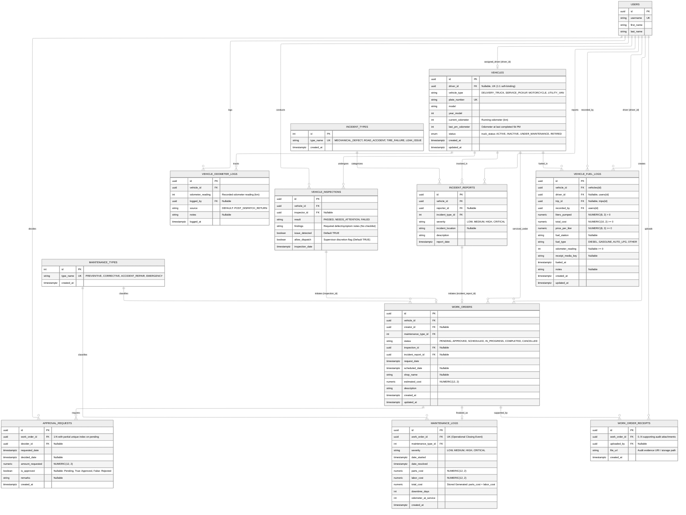

---

## 2. Table Specifications

### `vehicles`
Stores fleet assets across all operational vehicle categories with running telemetry and automated PM tracking.

| Column | Data Type | Nullable | Default / Constraints | Description |
| :--- | :--- | :--- | :--- | :--- |
| `id` | `UUID` | No | `PRIMARY KEY DEFAULT gen_random_uuid()` | Vehicle unique identifier |
| `driver_id` | `UUID` | Yes | `UNIQUE, FK -> users(id) ON DELETE SET NULL` | 1:1 soft-bound assigned driver |
| `vehicle_type` | `VARCHAR(30)` | No | `DEFAULT 'DELIVERY_TRUCK', CHECK IN (...)` | Category: `DELIVERY_TRUCK`, `SERVICE_PICKUP`, `MOTORCYCLE`, `UTILITY_VAN` |
| `plate_number` | `VARCHAR(20)` | No | `UNIQUE` | Official LTO registration plate number |
| `model` | `VARCHAR(100)` | No | Non-empty | Vehicle make/model (e.g. `Isuzu Elf 6-Wheeler`) |
| `year_model` | `INT` | No | Numeric year | Manufacture / model year |
| `current_odometer` | `INT` | No | `DEFAULT 0, CHECK >= 0` | Running vehicle mileage (km) |
| `last_pm_odometer` | `INT` | No | `DEFAULT 0, CHECK >= 0` | Mileage reading at last completed 5k PM service |
| `status` | `truck_status` | No | `DEFAULT 'ACTIVE'` | Operational status: `'ACTIVE'`, `'INACTIVE'`, `'UNDER_MAINTENANCE'`, `'RETIRED'` |
| `created_at` | `TIMESTAMPTZ` | No | `DEFAULT NOW()` | Record creation timestamp |
| `updated_at` | `TIMESTAMPTZ` | No | `DEFAULT NOW()` | Managed automatically via trigger |

---

### `vehicle_odometer_logs`
Logs odometer telemetry readings captured at plant yard check-in or service maintenance.

| Column | Data Type | Nullable | Default / Constraints | Description |
| :--- | :--- | :--- | :--- | :--- |
| `id` | `UUID` | No | `PRIMARY KEY DEFAULT gen_random_uuid()` | Telemetry log identifier |
| `vehicle_id` | `UUID` | No | `FK -> vehicles(id) ON DELETE CASCADE` | Target vehicle |
| `odometer_reading` | `INT` | No | `CHECK >= 0` | New recorded mileage in km |
| `logged_by` | `UUID` | Yes | `FK -> users(id) ON DELETE SET NULL` | Supervisor who recorded the mileage |
| `source` | `VARCHAR(30)` | No | `DEFAULT 'POST_DISPATCH_RETURN'` | Source: `POST_DISPATCH_RETURN`, `MAINTENANCE_INSPECTION`, `MANUAL_ADJUSTMENT` |
| `notes` | `TEXT` | Yes | `NULL` | Optional log notes |
| `logged_at` | `TIMESTAMPTZ` | No | `DEFAULT CURRENT_TIMESTAMP` | Recording timestamp |

---

### `vehicle_inspections`
Captures defect/symptom observation reports logged by inspectors. No routine checklist rows.

| Column | Data Type | Nullable | Default / Constraints | Description |
| :--- | :--- | :--- | :--- | :--- |
| `id` | `UUID` | No | `PRIMARY KEY DEFAULT gen_random_uuid()` | Inspection record identifier |
| `vehicle_id` | `UUID` | No | `FK -> vehicles(id) ON DELETE CASCADE` | Inspected vehicle |
| `inspector_id` | `UUID` | Yes | `FK -> users(id) ON DELETE SET NULL` | Performing user |
| `result` | `VARCHAR(20)` | No | `CHECK IN ('PASSED', 'NEEDS_ATTENTION', 'FAILED')` | Inspection outcome |
| `findings` | `TEXT` | No | Non-empty | Free-form observed defect/symptom notes |
| `issue_detected` | `BOOLEAN` | No | `DEFAULT TRUE` | Whether an anomaly was detected |
| `allow_dispatch` | `BOOLEAN` | No | `DEFAULT TRUE` | Supervisor discretion override flag for advisory findings |
| `inspection_date` | `TIMESTAMPTZ` | No | `DEFAULT CURRENT_TIMESTAMP` | Date and time inspection took place |

---

### `incident_types` & `incident_reports`
Categorizes and tracks road accidents, tire bursts, gas leaks, and mechanical defects.

**`incident_types`**:
| Column | Data Type | Nullable | Default / Constraints | Description |
| :--- | :--- | :--- | :--- | :--- |
| `id` | `SERIAL` | No | `PRIMARY KEY` | Classification ID |
| `type_name` | `VARCHAR(50)` | No | `UNIQUE` | Category (e.g. `ROAD_ACCIDENT`, `TIRE_FAILURE`) |
| `created_at` | `TIMESTAMPTZ` | No | `DEFAULT NOW()` | Record creation timestamp |

**`incident_reports`**:
| Column | Data Type | Nullable | Default / Constraints | Description |
| :--- | :--- | :--- | :--- | :--- |
| `id` | `UUID` | No | `PRIMARY KEY DEFAULT gen_random_uuid()` | Incident report identifier |
| `vehicle_id` | `UUID` | No | `FK -> vehicles(id) ON DELETE CASCADE` | Involved vehicle |
| `reporter_id` | `UUID` | Yes | `FK -> users(id) ON DELETE SET NULL` | Reporting user |
| `incident_type_id` | `INT` | No | `FK -> incident_types(id) ON DELETE RESTRICT` | Incident category |
| `severity` | `VARCHAR(20)` | No | `CHECK IN ('LOW', 'MEDIUM', 'HIGH', 'CRITICAL')` | Severity classification |
| `incident_location` | `VARCHAR(255)` | Yes | `NULL` | Location description or street name |
| `description` | `TEXT` | No | Non-empty | Narrative account of the incident |
| `report_date` | `TIMESTAMPTZ` | No | `DEFAULT CURRENT_TIMESTAMP` | Incident timestamp |

---

### `maintenance_types` & `work_orders`
Tracks service maintenance orders from initiation through completion.

**`maintenance_types`**:
| Column | Data Type | Nullable | Default / Constraints | Description |
| :--- | :--- | :--- | :--- | :--- |
| `id` | `SERIAL` | No | `PRIMARY KEY` | Maintenance category ID |
| `type_name` | `VARCHAR(50)` | No | `UNIQUE` | Category: `PREVENTIVE`, `CORRECTIVE`, `ACCIDENT_REPAIR`, `EMERGENCY` |
| `created_at` | `TIMESTAMPTZ` | No | `DEFAULT NOW()` | Creation timestamp |

**`work_orders`**:
| Column | Data Type | Nullable | Default / Constraints | Description |
| :--- | :--- | :--- | :--- | :--- |
| `id` | `UUID` | No | `PRIMARY KEY DEFAULT gen_random_uuid()` | Work order unique identifier |
| `vehicle_id` | `UUID` | No | `FK -> vehicles(id) ON DELETE CASCADE` | Serviced vehicle |
| `creator_id` | `UUID` | Yes | `FK -> users(id) ON DELETE SET NULL` | Creating supervisor/user |
| `maintenance_type_id` | `INT` | No | `FK -> maintenance_types(id) ON DELETE RESTRICT` | Classification |
| `status` | `VARCHAR(20)` | No | `DEFAULT 'PENDING', CHECK IN (...)` | Status: `PENDING`, `APPROVED`, `SCHEDULED`, `IN_PROGRESS`, `COMPLETED`, `CANCELLED` |
| `inspection_id` | `UUID` | Yes | `FK -> vehicle_inspections(id) ON DELETE SET NULL` | Linked inspection triggering service |
| `incident_report_id` | `UUID` | Yes | `FK -> incident_reports(id) ON DELETE SET NULL` | Linked incident report triggering service |
| `request_date` | `TIMESTAMPTZ` | No | `DEFAULT CURRENT_TIMESTAMP` | Initial request timestamp |
| `scheduled_date` | `TIMESTAMPTZ` | Yes | `NULL` | Scheduled repair shop date |
| `shop_name` | `VARCHAR(150)` | Yes | `NULL` | External machine shop / dealership name |
| `estimated_cost` | `NUMERIC(12, 2)` | No | `DEFAULT 0.00, CHECK >= 0` | Estimated repair cost |
| `description` | `TEXT` | No | Non-empty | Work order scope / service items |
| `created_at` | `TIMESTAMPTZ` | No | `DEFAULT CURRENT_TIMESTAMP` | Creation timestamp |
| `updated_at` | `TIMESTAMPTZ` | No | `DEFAULT CURRENT_TIMESTAMP` | Managed automatically via trigger |

---

### `approval_requests`
Supports multi-round cost approvals with pending guard.

| Column | Data Type | Nullable | Default / Constraints | Description |
| :--- | :--- | :--- | :--- | :--- |
| `id` | `UUID` | No | `PRIMARY KEY DEFAULT gen_random_uuid()` | Approval request identifier |
| `work_order_id` | `UUID` | No | `FK -> work_orders(id) ON DELETE CASCADE` | Associated work order |
| `decider_id` | `UUID` | Yes | `FK -> users(id) ON DELETE SET NULL` | Manager who approved/rejected the request |
| `requested_date` | `TIMESTAMPTZ` | No | `DEFAULT CURRENT_TIMESTAMP` | Submission timestamp |
| `decided_date` | `TIMESTAMPTZ` | Yes | `NULL` | Decision timestamp |
| `amount_requested` | `NUMERIC(12, 2)` | No | `CHECK >= 0` | Proposed budget amount |
| `is_approved` | `BOOLEAN` | Yes | `NULL` | State: `NULL` (Pending), `TRUE` (Approved), `FALSE` (Rejected) |
| `remarks` | `TEXT` | Yes | `NULL` | Decision rationale or rejection feedback |
| `created_at` | `TIMESTAMPTZ` | No | `DEFAULT CURRENT_TIMESTAMP` | Creation timestamp |

**Partial Unique Index:**
- `UQ_approval_requests_pending`: `CREATE UNIQUE INDEX ... (work_order_id) WHERE is_approved IS NULL` (ensures at most one pending approval request per work order, allowing revised requests after rejection).

---

### `maintenance_logs`
Operational closing record created when a work order transitions to `COMPLETED`.

| Column | Data Type | Nullable | Default / Constraints | Description |
| :--- | :--- | :--- | :--- | :--- |
| `id` | `UUID` | No | `PRIMARY KEY DEFAULT gen_random_uuid()` | Maintenance log identifier |
| `work_order_id` | `UUID` | No | `UNIQUE, FK -> work_orders(id) ON DELETE CASCADE` | 1:1 finalized work order |
| `maintenance_type_id` | `INT` | No | `FK -> maintenance_types(id) ON DELETE RESTRICT` | Final maintenance category |
| `severity` | `VARCHAR(20)` | No | `CHECK IN ('LOW', 'MEDIUM', 'HIGH', 'CRITICAL')` | Severity classification |
| `date_started` | `TIMESTAMPTZ` | No | Timestamp | Physical repair start timestamp |
| `date_resolved` | `TIMESTAMPTZ` | No | Timestamp | Physical repair completion timestamp |
| `parts_cost` | `NUMERIC(12, 2)` | No | `DEFAULT 0.00, CHECK >= 0` | Direct parts expense |
| `labor_cost` | `NUMERIC(12, 2)` | No | `DEFAULT 0.00, CHECK >= 0` | Direct labor expense |
| `total_cost` | `NUMERIC(12, 2)` | No | `GENERATED ALWAYS AS (parts + labor) STORED` | Automated total financial cost |
| `downtime_days` | `INT` | No | `DEFAULT 0, CHECK >= 0` | Vehicle operational downtime in days |
| `odometer_at_service`| `INT` | No | `CHECK >= 0` | Odometer reading when service was rendered |
| `created_at` | `TIMESTAMPTZ` | No | `DEFAULT CURRENT_TIMESTAMP` | Record creation timestamp |

---

### `work_order_receipts`
Decoupled supporting audit attachments (0..N) for work orders. Pure visual proof/media attachment ledger.

| Column | Data Type | Nullable | Default / Constraints | Description |
| :--- | :--- | :--- | :--- | :--- |
| `id` | `UUID` | No | `PRIMARY KEY DEFAULT gen_random_uuid()` | Receipt attachment identifier |
| `work_order_id` | `UUID` | No | `FK -> work_orders(id) ON DELETE CASCADE` | Target work order |
| `uploaded_by` | `UUID` | Yes | `FK -> users(id) ON DELETE SET NULL` | User who uploaded the receipt |
| `file_url` | `TEXT` | No | Non-empty | Storage URL or file path |
| `created_at` | `TIMESTAMPTZ` | No | `DEFAULT CURRENT_TIMESTAMP` | Upload timestamp |

---

## 3. Triggers & Automation

- **`trigger_update_vehicles_updated_at`**: `BEFORE UPDATE` trigger on `vehicles` executing `update_vehicles_updated_at_column()`.
- **`trigger_update_work_orders_updated_at`**: `BEFORE UPDATE` trigger on `work_orders` executing `update_work_orders_updated_at_column()`.
- **`trigger_update_vehicle_fuel_logs_updated_at`**: `BEFORE UPDATE` trigger on `vehicle_fuel_logs` executing `update_timestamp_column()`.

---

### `vehicle_fuel_logs`
Tracks vehicle fuel intake, expenditure, station details, and odometer telemetry.

| Column | Data Type | Nullable | Default / Constraints | Description |
| :--- | :--- | :--- | :--- | :--- |
| `id` | `UUID` | No | `PRIMARY KEY DEFAULT gen_random_uuid()` | Unique fuel log identifier |
| `vehicle_id` | `UUID` | No | `FK -> vehicles(id) ON DELETE RESTRICT` | Fueled vehicle |
| `driver_id` | `UUID` | Yes | `FK -> users(id) ON DELETE SET NULL` | Driver operating the vehicle |
| `trip_id` | `UUID` | Yes | `FK -> trips(id) ON DELETE SET NULL` | Associated delivery trip (if fueled en route) |
| `recorded_by` | `UUID` | No | `FK -> users(id) ON DELETE RESTRICT` | User who recorded the fuel log |
| `liters_pumped` | `NUMERIC(8, 2)` | No | `CHECK (liters_pumped > 0)` | Volume of fuel pumped in liters |
| `total_cost` | `NUMERIC(10, 2)` | No | `CHECK (total_cost >= 0)` | Total fuel expenditure |
| `price_per_liter` | `NUMERIC(8, 2)` | No | `CHECK (price_per_liter >= 0)` | Unit price per liter |
| `fuel_station` | `VARCHAR(150)` | Yes | `NULL` | Fuel station name or branch |
| `fuel_type` | `VARCHAR(50)` | No | `DEFAULT 'DIESEL'` (`'DIESEL'`, `'GASOLINE'`, `'AUTO_LPG'`, `'OTHER'`) | Fuel classification |
| `odometer_reading` | `INTEGER` | Yes | `CHECK (odometer_reading IS NULL OR odometer_reading >= 0)` | Odometer reading at refueling |
| `receipt_media_key` | `VARCHAR(255)` | Yes | `NULL` | Canonical media key for fuel receipt photo |
| `fueled_at` | `TIMESTAMPTZ` | No | `DEFAULT CURRENT_TIMESTAMP` | Timestamp of refueling |
| `notes` | `TEXT` | Yes | `NULL` | Remarks or fuel efficiency observations |
| `created_at` | `TIMESTAMPTZ` | No | `DEFAULT CURRENT_TIMESTAMP` | Record creation timestamp |
| `updated_at` | `TIMESTAMPTZ` | No | `DEFAULT CURRENT_TIMESTAMP` | Managed automatically via trigger |
`````

## File: docs/ERD_mermaid/master_database_erd.md
`````markdown
# Master Database Architecture — Unified Entity Relationship Diagram (ERD)

> **Database Engine**: PostgreSQL 18.x  
> **Schema Migrations**: 001 through 027 (`database/migrations/`)  
> **Total Tables**: 37 application/configuration tables (+1 internal `schema_migrations`, +2 compatibility views)  
> **Purpose**: Global enterprise data model showing all core subsystems, system logic infrastructure, and all cross-domain foreign key relationships.

---

## 1. Unified Mermaid Entity-Relationship Diagram

```mermaid
---
config:
  layout: elk
  theme: neutral
---

erDiagram

    %% ========================================================
    %% 1. USER MANAGEMENT & RBAC SUBSYSTEM (7 Tables)
    %% ========================================================

    ROLES {
        uuid id PK
        string name UK
        string description
        timestamptz created_at
    }

    PERMISSIONS {
        uuid id PK
        string name UK
        string description
    }

    ROLE_PERMISSIONS {
        uuid role_id PK,FK
        uuid permission_id PK,FK
    }

    USERS {
        uuid id PK
        string username UK
        string password_hash
        string first_name
        string last_name
        string phone
        date birthdate
        string avatar_media_key
        uuid role_id FK
        boolean is_active
        boolean is_blocked
        boolean must_change_password
        timestamptz created_at
    }

    USER_ROLES {
        uuid user_id PK,FK
        uuid role_id PK,FK
        boolean is_primary
        timestamptz assigned_at
    }

    SESSIONS {
        uuid id PK
        uuid user_id FK
        string token_hash
        timestamptz created_at
        timestamptz expires_at
        timestamptz revoked_at
    }

    AUDIT_LOGS {
        uuid id PK
        uuid user_id FK
        uuid target_user_id FK
        string action
        string description
        timestamptz created_at
    }


    %% ========================================================
    %% 2. SYSTEM EVENT HISTORY LOGS (1 Table)
    %% ========================================================

    HISTORY_LOGS {
        uuid id PK
        uuid user_id FK
        string user_name
        string user_role
        string action_type
        string module
        string action
        string details
        string target_id
        string target_type
        jsonb metadata
        timestamptz created_at
    }

    SYSTEM_SETTINGS {
        string key PK
        string value
        string value_type "INTEGER, NUMBER, BOOLEAN, STRING"
        string category
        string label
        string description
        string unit
        numeric min_value
        numeric max_value
        uuid updated_by FK "users(id) Nullable"
        timestamptz created_at
        timestamptz updated_at
    }

    SCHEMA_MIGRATIONS {
        int id PK
        string filename UK
        timestamptz applied_at
    }


    %% ========================================================
    %% 3. FLEET & MAINTENANCE SUBSYSTEM (10 Tables)
    %% ========================================================

    VEHICLES {
        uuid id PK
        uuid driver_id FK "UK"
        string vehicle_type
        string plate_number UK
        string model
        int year_model
        int current_odometer
        int last_pm_odometer
        enum status "truck_status"
        timestamptz created_at
        timestamptz updated_at
    }

    MAINTENANCE_TYPES {
        int id PK
        string type_name UK
        timestamptz created_at
    }

    INCIDENT_TYPES {
        int id PK
        string type_name UK
        timestamptz created_at
    }

    VEHICLE_ODOMETER_LOGS {
        uuid id PK
        uuid vehicle_id FK
        int odometer_reading
        uuid logged_by FK
        string source
        string notes
        timestamptz logged_at
    }

    VEHICLE_INSPECTIONS {
        uuid id PK
        uuid vehicle_id FK
        uuid inspector_id FK
        string result
        string findings
        boolean issue_detected
        boolean allow_dispatch
        timestamptz inspection_date
    }

    INCIDENT_REPORTS {
        uuid id PK
        uuid vehicle_id FK
        uuid reporter_id FK
        int incident_type_id FK
        string severity
        string incident_location
        string description
        timestamptz report_date
    }

    WORK_ORDERS {
        uuid id PK
        uuid vehicle_id FK
        uuid creator_id FK
        int maintenance_type_id FK
        string status
        uuid inspection_id FK
        uuid incident_report_id FK
        timestamptz request_date
        timestamptz scheduled_date
        string shop_name
        numeric estimated_cost
        string description
        timestamptz created_at
        timestamptz updated_at
    }

    APPROVAL_REQUESTS {
        uuid id PK
        uuid work_order_id FK
        uuid decider_id FK
        timestamptz requested_date
        timestamptz decided_date
        numeric amount_requested
        boolean is_approved
        string remarks
        timestamptz created_at
    }

    MAINTENANCE_LOGS {
        uuid id PK
        uuid work_order_id FK "UK"
        int maintenance_type_id FK
        string severity
        timestamptz date_started
        timestamptz date_resolved
        numeric parts_cost
        numeric labor_cost
        numeric total_cost "Stored Generated"
        int downtime_days
        int odometer_at_service
        timestamptz created_at
    }

    WORK_ORDER_RECEIPTS {
        uuid id PK
        uuid work_order_id FK
        uuid uploaded_by FK
        string file_url
        timestamptz created_at
    }


    %% ========================================================
    %% 4. INVENTORY SUBSYSTEM (3 Tables)
    %% ========================================================

    PRODUCTS {
        uuid id PK
        string name UK
        string category
        enum container_type "container_type_enum"
        numeric net_weight_kg
        numeric unit_price "DEFAULT 0.00, CHECK >= 0"
        boolean is_active
        timestamptz created_at
        timestamptz updated_at
    }

    PLANT_INVENTORY {
        uuid id PK
        uuid product_id FK "UK"
        int quantity_filled
        int quantity_empty_good
        int quantity_defective
        timestamptz last_counted_at
        timestamptz created_at
        timestamptz updated_at
    }

    PLANT_STOCK_ADJUSTMENTS {
        uuid id PK
        uuid product_id FK
        uuid recorded_by FK
        enum adjustment_type "plant_adjustment_type"
        enum target_condition "stock_condition"
        int delta_quantity
        enum source_condition "stock_condition Nullable"
        string supplier_invoice_number "Nullable"
        string reason
        timestamptz recorded_at
        timestamptz created_at
    }


    %% ========================================================
    %% 5. SALES & DELIVERY SUBSYSTEM (5 Tables)
    %% ========================================================

    CUSTOMERS {
        uuid id PK
        string name "Auto-synced"
        string business_name "Nullable"
        string contact_person
        string contact_number
        string alternate_contact_number "Nullable"
        string tin "Nullable"
        string address "Auto-synced"
        string delivery_address
        string customer_type "COMMERCIAL, RETAIL, RETAILER, WHOLESALE, HOUSEHOLD"
        uuid zone_id FK "service_zones(id) Nullable"
        boolean is_active
        uuid created_by FK "users(id) Nullable"
        timestamptz created_at
        timestamptz updated_at
    }

    SALES_TRANSACTIONS {
        uuid id PK
        string transaction_no UK
        uuid trip_id FK "trips(id)"
        uuid customer_id FK "customers(id)"
        uuid recorded_by FK "users(id)"
        string status "COMPLETED, CANCELLED"
        string cancellation_reason "Nullable"
        uuid cancelled_by FK "users(id) Nullable"
        timestamptz cancelled_at "Nullable"
        timestamptz transacted_at
        timestamptz synced_at
        timestamptz created_at
        timestamptz updated_at
    }

    SALES_TRANSACTION_ITEMS {
        uuid id PK
        uuid transaction_id FK "sales_transactions(id)"
        uuid product_id FK "products(id)"
        int quantity_sold
        int empties_returned
        int empties_defective
        numeric unit_price_at_sale
        numeric subtotal_amount
        timestamptz created_at
    }

    SALES_INVOICES {
        uuid id PK
        uuid transaction_id FK,UK "sales_transactions(id)"
        string invoice_number UK
        string declaration_number
        numeric total_amount
        string payment_method "CASH, GCASH"
        string payment_status "PAID_UNVERIFIED, FLAGGED, VERIFIED"
        string payment_reference_number "Nullable"
        string payment_proof_key "Nullable"
        uuid verified_by FK "users(id) Nullable"
        timestamptz verified_at "Nullable"
        string flag_reason "Nullable"
        string flag_notes "Nullable"
        uuid flagged_by FK "users(id) Nullable"
        timestamptz flagged_at "Nullable"
        timestamptz transacted_at
        timestamptz synced_at
        timestamptz created_at
        timestamptz updated_at
    }

    CANISTER_LEDGER {
        uuid id PK
        uuid customer_id FK "customers(id)"
        uuid product_id FK "products(id)"
        uuid trip_id FK "trips(id)"
        uuid transaction_id FK "sales_transactions(id)"
        int quantity_loaned
        int quantity_returned
        int net_balance_change
        timestamptz transacted_at
        timestamptz synced_at
        timestamptz created_at
    }


    %% ========================================================
    %% 6. SCHEDULE & TRIP SUBSYSTEM (7 Tables)
    %% ========================================================

    SERVICE_ZONES {
        uuid id PK
        string code UK
        string name UK
        string description
        boolean is_active
        timestamptz created_at
        timestamptz updated_at
    }

    SCHEDULE_TEMPLATES {
        uuid id PK
        uuid truck_id FK "References vehicles(id)"
        uuid zone_id FK
        int day_of_week
        uuid default_sales_user_id FK
        boolean is_active
        timestamptz created_at
        timestamptz updated_at
    }

    TRUCK_SCHEDULES {
        uuid id PK
        date scheduled_date
        uuid truck_id FK "References vehicles(id)"
        uuid sales_user_id FK
        uuid zone_id FK
        uuid created_by FK
        enum status "schedule_status"
        string notes
        timestamptz created_at
        timestamptz updated_at
    }

    TRIPS {
        uuid id PK
        uuid schedule_id FK "Nullable, Partial UK"
        uuid truck_id FK "References vehicles(id)"
        uuid driver_id FK "Snapshot"
        uuid sales_user_id FK "Snapshot"
        uuid zone_id FK
        uuid dispatched_by FK
        uuid ended_by FK "Nullable"
        uuid return_odometer_log_id FK "UK"
        string trip_number UK
        enum status "trip_status"
        timestamptz departure_time
        timestamptz return_time
        string notes
        timestamptz created_at
        timestamptz updated_at
    }

    TRIP_LOADS {
        uuid id PK
        uuid trip_id FK
        enum transfer_type "transfer_type"
        string slip_number UK
        uuid recorded_by FK
        timestamptz recorded_at
        string remarks
    }

    TRIP_LOAD_ITEMS {
        uuid id PK
        uuid load_id FK
        uuid product_id FK
        enum condition "stock_condition"
        int quantity_units
    }

    TRIP_STOCK_RECONCILIATIONS {
        uuid id PK
        uuid trip_id FK "UK"
        uuid verified_by FK
        int total_loaded_full
        int total_sold_full
        int total_returned_full
        int total_returned_empty_good
        int total_returned_defective
        int net_customer_debt_created
        int full_discrepancy
        int empty_discrepancy
        jsonb reconciliation_data
        enum status "reconciliation_status"
        string supervisor_notes
        timestamptz reconciled_at
        timestamptz created_at
        timestamptz updated_at
    }


    %% ========================================================
    %% 7. FRONTLINE OPERATIONS SUBSYSTEM (3 Tables)
    %% ========================================================

    DRIVER_APPREHENSIONS {
        uuid id PK
        uuid vehicle_id FK
        uuid driver_id FK
        uuid trip_id FK "Nullable"
        uuid recorded_by FK
        string citation_ticket_no "Nullable"
        string violation_type
        string apprehending_agency
        timestamptz incident_time
        string location "Nullable"
        numeric penalty_amount
        string ticket_media_key
        string notes "Nullable"
        string status "RECORDED, SETTLED, DISPUTED, CANCELLED"
        timestamptz settled_at "Nullable"
        uuid settled_by FK "Nullable"
        timestamptz created_at
        timestamptz updated_at
    }

    VEHICLE_FUEL_LOGS {
        uuid id PK
        uuid vehicle_id FK
        uuid driver_id FK "Nullable"
        uuid trip_id FK "Nullable"
        uuid recorded_by FK
        numeric liters_pumped
        numeric total_cost
        numeric price_per_liter
        string fuel_station "Nullable"
        string fuel_type "DIESEL, GASOLINE, AUTO_LPG, OTHER"
        int odometer_reading "Nullable"
        string receipt_media_key "Nullable"
        timestamptz fueled_at
        string notes "Nullable"
        timestamptz created_at
        timestamptz updated_at
    }

    EMERGENCY_ALERTS {
        uuid id PK
        uuid driver_id FK
        uuid vehicle_id FK "Nullable"
        uuid trip_id FK "Nullable"
        numeric latitude "Nullable"
        numeric longitude "Nullable"
        string emergency_type "GENERAL, ACCIDENT, VEHICLE_BREAKDOWN, MEDICAL, SECURITY, OTHER"
        string description "Nullable"
        string status "ACTIVE, ACKNOWLEDGED, RESOLVED, FALSE_ALARM"
        uuid acknowledged_by FK "Nullable"
        timestamptz acknowledged_at "Nullable"
        uuid resolved_by FK "Nullable"
        timestamptz resolved_at "Nullable"
        string resolution_notes "Nullable"
        timestamptz created_at
        timestamptz updated_at
    }


    %% ========================================================
    %% CROSS-SUBSYSTEM RELATIONSHIPS
    %% ========================================================

    %% Users & RBAC
    ROLES ||--|{ ROLE_PERMISSIONS : "defines"
    PERMISSIONS ||--|{ ROLE_PERMISSIONS : "grants"
    ROLES ||--o{ USERS : "primary_role"
    USERS ||--|{ USER_ROLES : "holds"
    ROLES ||--o{ USER_ROLES : "membership"
    USERS ||--o{ SESSIONS : "establishes"
    USERS ||--o{ AUDIT_LOGS : "logs_admin_action"

    %% Users -> History Logs
    USERS ||--o{ HISTORY_LOGS : "acts_in"

    %% Users -> Fleet
    USERS ||--o| VEHICLES : "soft_bound_driver (driver_id)"
    USERS ||--o{ VEHICLE_ODOMETER_LOGS : "recorded_by"
    USERS ||--o{ VEHICLE_INSPECTIONS : "inspected_by"
    USERS ||--o{ INCIDENT_REPORTS : "reported_by"
    USERS ||--o{ WORK_ORDERS : "created_by"
    USERS ||--o{ APPROVAL_REQUESTS : "decided_by"
    USERS ||--o{ WORK_ORDER_RECEIPTS : "uploaded_by"

    %% Fleet Internal
    VEHICLES ||--o{ VEHICLE_ODOMETER_LOGS : "has_readings"
    VEHICLES ||--o{ VEHICLE_INSPECTIONS : "undergoes"
    VEHICLES ||--o{ INCIDENT_REPORTS : "involved_in"
    VEHICLES ||--o{ WORK_ORDERS : "serviced_by"
    MAINTENANCE_TYPES ||--o{ WORK_ORDERS : "classified_as"
    MAINTENANCE_TYPES ||--o{ MAINTENANCE_LOGS : "categorized_as"
    INCIDENT_TYPES ||--o{ INCIDENT_REPORTS : "typed_as"
    VEHICLE_INSPECTIONS ||--o| WORK_ORDERS : "triggers"
    INCIDENT_REPORTS ||--o| WORK_ORDERS : "triggers"
    WORK_ORDERS ||--o{ APPROVAL_REQUESTS : "cost_requests"
    WORK_ORDERS ||--o| MAINTENANCE_LOGS : "finalized_as"
    WORK_ORDERS ||--o{ WORK_ORDER_RECEIPTS : "receipt_evidence"

    %% Users -> Schedules & Trips
    USERS ||--o{ SCHEDULE_TEMPLATES : "default_sales_rep"
    USERS ||--o{ TRUCK_SCHEDULES : "assigned_sales_rep"
    USERS ||--o{ TRUCK_SCHEDULES : "created_schedule"
    USERS ||--o{ TRIPS : "driver_snapshot"
    USERS ||--o{ TRIPS : "sales_rep_snapshot"
    USERS ||--o{ TRIPS : "dispatched_by"
    USERS ||--o{ TRIPS : "ended_by"
    USERS ||--o{ TRIP_LOADS : "recorded_by"
    USERS ||--o{ TRIP_STOCK_RECONCILIATIONS : "verified_by"

    %% Users -> Inventory
    USERS ||--o{ PLANT_STOCK_ADJUSTMENTS : "recorded_by"

    %% Inventory Internal
    PRODUCTS ||--|| PLANT_INVENTORY : "tracks_stock_for"
    PRODUCTS ||--o{ PLANT_STOCK_ADJUSTMENTS : "adjusts"

    %% Fleet -> Schedules & Trips
    VEHICLES ||--o{ SCHEDULE_TEMPLATES : "assigned_truck (truck_id)"
    VEHICLES ||--o{ TRUCK_SCHEDULES : "assigned_truck (truck_id)"
    VEHICLES ||--o{ TRIPS : "assigned_truck (truck_id)"
    VEHICLE_ODOMETER_LOGS ||--o| TRIPS : "return_odometer (return_odometer_log_id)"

    %% Service Zones -> Schedules & Trips
    SERVICE_ZONES ||--o{ SCHEDULE_TEMPLATES : "zoned_for"
    SERVICE_ZONES ||--o{ TRUCK_SCHEDULES : "zoned_for"
    SERVICE_ZONES ||--o{ TRIPS : "destined_for"

    %% Schedules -> Trips
    TRUCK_SCHEDULES |o--o| TRIPS : "executed_as (schedule_id)"

    %% Trips -> Inventory Movement
    TRIPS ||--o{ TRIP_LOADS : "manifests"
    TRIP_LOADS ||--|{ TRIP_LOAD_ITEMS : "items"
    PRODUCTS ||--o{ TRIP_LOAD_ITEMS : "manifest_item (product_id)"

    %% Trips -> Stock Reconciliation
    TRIPS ||--o| TRIP_STOCK_RECONCILIATIONS : "reconciled_via"

    %% Sales & Delivery Subsystem
    SERVICE_ZONES ||--o{ CUSTOMERS : "locates"
    USERS ||--o{ CUSTOMERS : "registered_by"
    TRIPS ||--o{ SALES_TRANSACTIONS : "delivers"
    CUSTOMERS ||--o{ SALES_TRANSACTIONS : "purchases"
    USERS ||--o{ SALES_TRANSACTIONS : "recorded_by"
    USERS ||--o{ SALES_TRANSACTIONS : "cancelled_by"
    SALES_TRANSACTIONS ||--|{ SALES_TRANSACTION_ITEMS : "contains"
    PRODUCTS ||--o{ SALES_TRANSACTION_ITEMS : "catalog_item"
    SALES_TRANSACTIONS ||--|| SALES_INVOICES : "bills"
    USERS ||--o{ SALES_INVOICES : "verified_by"
    USERS ||--o{ SALES_INVOICES : "flagged_by"
    USERS ||--o{ SYSTEM_SETTINGS : "updated_by"
    CUSTOMERS ||--o{ CANISTER_LEDGER : "owes_receivables"
    PRODUCTS ||--o{ CANISTER_LEDGER : "sku"
    TRIPS ||--o{ CANISTER_LEDGER : "trip_attribution"
    SALES_TRANSACTIONS ||--o{ CANISTER_LEDGER : "generates"

    %% Frontline Operations Subsystem
    VEHICLES ||--o{ DRIVER_APPREHENSIONS : "cited_in"
    USERS ||--o{ DRIVER_APPREHENSIONS : "driver"
    USERS ||--o{ DRIVER_APPREHENSIONS : "recorded_by"
    USERS ||--o{ DRIVER_APPREHENSIONS : "settled_by"
    TRIPS ||--o{ DRIVER_APPREHENSIONS : "occurred_during"

    VEHICLES ||--o{ VEHICLE_FUEL_LOGS : "fueled_in"
    USERS ||--o{ VEHICLE_FUEL_LOGS : "driver"
    USERS ||--o{ VEHICLE_FUEL_LOGS : "recorded_by"
    TRIPS ||--o{ VEHICLE_FUEL_LOGS : "fueled_during"

    USERS ||--o{ EMERGENCY_ALERTS : "triggered_by"
    USERS ||--o{ EMERGENCY_ALERTS : "acknowledged_by"
    USERS ||--o{ EMERGENCY_ALERTS : "resolved_by"
    VEHICLES ||--o{ EMERGENCY_ALERTS : "involved_in"
    TRIPS ||--o{ EMERGENCY_ALERTS : "occurred_during"
```

---

## 2. Subsystem Domain Directory

| Subsystem | Table Count | Domain Tables | Documentation File |
| :--- | :--- | :--- | :--- |
| **User Management & RBAC** | 7 | `roles`, `permissions`, `role_permissions`, `users`, `user_roles`, `sessions`, `audit_logs` | [`users_and_rbac_erd.md`](./users_and_rbac_erd.md) |
| **System Logic & Infrastructure** | 3 | `history_logs`, `system_settings`, `schema_migrations` | [`system_logic_erd.md`](./system_logic_erd.md) |
| **Fleet & Maintenance** | 11 | `vehicles`, `maintenance_types`, `incident_types`, `vehicle_odometer_logs`, `vehicle_inspections`, `incident_reports`, `work_orders`, `approval_requests`, `maintenance_logs`, `work_order_receipts`, `vehicle_fuel_logs` | [`fleet_and_maintenance_erd.md`](./fleet_and_maintenance_erd.md) |
| **Inventory** | 3 | `products`, `plant_inventory`, `plant_stock_adjustments` | [`inventory_erd.md`](./inventory_erd.md) |
| **Sales & Delivery** | 5 | `customers`, `sales_transactions`, `sales_transaction_items`, `sales_invoices`, `canister_ledger` | [`sales_and_delivery_erd.md`](./sales_and_delivery_erd.md) |
| **Schedule & Trips** | 9 | `service_zones`, `schedule_templates`, `truck_schedules`, `trips`, `trip_loads`, `trip_load_items`, `trip_stock_reconciliations`, `driver_apprehensions`, `emergency_alerts` | [`schedule_and_trip_erd.md`](./schedule_and_trip_erd.md) |

---

## 3. Database-Wide Constraints & Architectural Invariants

1. **Foreign Key Integrity**:
   - `RESTRICT` is applied to critical audit entities (preventing deletion of active vehicles, products, users, or zones currently referenced in schedules, trips, or work orders).
   - `CASCADE` is strictly scoped to dependent operational child items (`trip_load_items` on `trip_loads`, `trip_loads` on `trips`, `work_order_receipts` on `work_orders`, `user_roles` on `users`).
   - `SET NULL` is used for supervisory telemetry and historical attribution (`logged_by`, `dispatched_by`, `verified_by`, `uploaded_by`, `created_by`, `inspector_id`).

2. **Automated PostgreSQL Stored Generated Columns**:
   - `maintenance_logs.total_cost`: `NUMERIC(12, 2) GENERATED ALWAYS AS ("parts_cost" + "labor_cost") STORED`.

3. **Conditional / Partial Unique Indexes**:
   - `UQ_approval_requests_pending`: `CREATE UNIQUE INDEX ... (work_order_id) WHERE is_approved IS NULL` (guarantees at most 1 pending approval request per work order, enabling revised cost submissions).
   - `UQ_trips_schedule_id`: `CREATE UNIQUE INDEX ... (schedule_id) WHERE schedule_id IS NOT NULL` (ensures 1:1 execution for scheduled runs while permitting unconstrained ad-hoc trips).
   - `idx_sales_invoices_flagged`: `CREATE INDEX ... ON sales_invoices (payment_status) WHERE payment_status = 'FLAGGED'`.

4. **Timestamp Trigger Automation**:
   - All domain tables maintaining mutable state use `BEFORE UPDATE` triggers executing `update_timestamp_column()` or dedicated trigger functions to guarantee reliable `updated_at` synchronization.
`````

## File: src/features/fleet/availability/availability.service.js
`````javascript
const availabilityRepository = require('./availability.repository');
const vehiclesRepository = require('../vehicles/vehicles.repository');
const { historyService, EVENTS } = require('../../history');
const { safeEmitSocketEvent } = require('../../../socket');
const { settingsService } = require('../../settings');
const systemConfig = require('../../../config/system.config');

const DEFAULT_PM_THRESHOLD_KM = systemConfig.businessDefaults['fleet.pm_odometer_threshold_km'];

/**
 * Availability Service
 * Handles domain logic for fleet overview metrics, availability tracking, and operational status transitions.
 */
class AvailabilityService {
  /**
   * Retrieves summary overview of the fleet status and availability.
   */
  async getOverview() {
    const rawMetrics = await availabilityRepository.getOverviewMetrics();
    const total = rawMetrics.total || 0;
    const available = rawMetrics.available || 0;
    const assigned = rawMetrics.assigned || 0;
    const unassigned = rawMetrics.unassigned || 0;
    const underMaintenance = rawMetrics.under_maintenance || 0;
    const inactive = rawMetrics.inactive || 0;

    const operationalRate = total > 0 ? Number(((available / total) * 100).toFixed(1)) : 0;

    return {
      metrics: {
        totalVehicles: total,
        availableVehicles: available,
        assignedVehicles: assigned,
        unassignedVehicles: unassigned,
        underMaintenanceVehicles: underMaintenance,
        inactiveVehicles: inactive,
      },
      summary: {
        operationalTotal: available,
        operationalRatePercent: operationalRate,
      },
    };
  }

  /**
   * Retrieves all vehicles ready and available for operation (status = 'ACTIVE'),
   * including their dedicated soft-bounded driver details.
   */
  async getAvailability(filters = {}) {
    const [rows, pmThresholdKm] = await Promise.all([
      availabilityRepository.getAvailableTrucks(filters),
      settingsService.getInteger('fleet.pm_odometer_threshold_km', DEFAULT_PM_THRESHOLD_KM),
    ]);
    const availableVehicles = rows.map((row) => {
      const isPmDue = Number(row.current_odometer) - Number(row.last_pm_odometer) >= pmThresholdKm;
      return {
        id: row.id,
        plateNumber: row.plate_number,
        model: row.model,
        yearModel: Number(row.year_model),
        vehicleType: row.vehicle_type || 'DELIVERY_TRUCK',
        currentOdometer: Number(row.current_odometer),
        lastPmOdometer: Number(row.last_pm_odometer),
        isPmDue,
        pmDueFlag: isPmDue,
        status: row.status,
        operationalStatus: 'ACTIVE',
        isAvailable: true,
        driverId: row.driver_id || null,
        driver: row.driver_id
          ? {
              id: row.driver_id,
              firstName: row.driver_first_name,
              lastName: row.driver_last_name,
              phone: row.driver_phone,
              username: row.driver_username,
            }
          : null,
        createdAt: row.created_at,
        updatedAt: row.updated_at,
      };
    });

    return {
      availableCount: availableVehicles.length,
      vehicles: availableVehicles,
      trucks: availableVehicles,
    };
  }

  /**
   * Retrieves the current availability and operational status of a specific vehicle.
   */
  async getTruckStatus(vehicleId) {
    if (!vehicleId || typeof vehicleId !== 'string') {
      throw new Error('Vehicle ID is required');
    }

    const row = await availabilityRepository.getTruckStatusById(vehicleId);
    if (!row) {
      throw new Error('Vehicle not found');
    }

    return {
      id: row.id,
      plateNumber: row.plate_number,
      model: row.model,
      vehicleType: row.vehicle_type || 'DELIVERY_TRUCK',
      status: row.status,
      operationalStatus: row.status,
      isAvailable: row.status === 'ACTIVE',
      driver: row.driver_id
        ? {
            id: row.driver_id,
            firstName: row.driver_first_name,
            lastName: row.driver_last_name,
            phone: row.driver_phone,
            username: row.driver_username,
          }
        : null,
    };
  }

  /**
   * Sets vehicle operational availability status and handles driver assignment state transitions.
   *
   * Business Rules:
   * - ACTIVE -> UNDER_MAINTENANCE: Preserves assigned driver.
   * - ACTIVE -> INACTIVE / RETIRED: Clears driver assignment, returning driver to AVAILABLE pool.
   * - Re-activating a deactivated vehicle does NOT automatically re-assign past drivers.
   */
  async updateTruckStatus(vehicleId, status) {
    if (!vehicleId || typeof vehicleId !== 'string') {
      throw new Error('Vehicle ID is required');
    }

    if (!status || typeof status !== 'string') {
      throw new Error('Status is required');
    }

    const cleanStatus = status.trim().toUpperCase();
    const validStatuses = ['ACTIVE', 'INACTIVE', 'UNDER_MAINTENANCE', 'RETIRED'];

    if (!validStatuses.includes(cleanStatus)) {
      throw new Error(`Invalid status: ${cleanStatus}. Valid options are: ${validStatuses.join(', ')}`);
    }

    const existing = await availabilityRepository.getTruckStatusById(vehicleId);
    if (!existing) {
      throw new Error('Vehicle not found');
    }

    const shouldClearDriver = cleanStatus === 'INACTIVE' || cleanStatus === 'RETIRED';
    const targetDriverId = shouldClearDriver ? null : existing.driver_id;

    await availabilityRepository.updateTruckStatus(vehicleId, cleanStatus, targetDriverId);

    // Real-Time WebSocket Operational Status Broadcast
    if (cleanStatus === 'UNDER_MAINTENANCE') {
      safeEmitSocketEvent('FLEET_VEHICLE_GROUNDED', {
        vehicleId,
        plateNumber: existing.plate_number,
        status: 'UNDER_MAINTENANCE',
        reason: 'MANUAL_STATUS_UPDATE',
        sourceId: vehicleId,
        findings: `Vehicle status manually transitioned from ${existing.status} to UNDER_MAINTENANCE`,
        groundedAt: new Date().toISOString(),
      }, 'room:fleet');
    } else if (cleanStatus === 'ACTIVE') {
      safeEmitSocketEvent('FLEET_VEHICLE_RELEASED', {
        vehicleId,
        plateNumber: existing.plate_number,
        status: 'ACTIVE',
        releasedAt: new Date().toISOString(),
      }, 'room:fleet');
    }

    try {
      const eventKey = EVENTS.VEHICLE_STATUS_UPDATED || EVENTS.TRUCK_STATUS_UPDATED;
      await historyService.log(eventKey, {
        actorUser: null,
        targetId: vehicleId,
        payload: {
          plateNumber: existing.plate_number,
          status: cleanStatus,
        },
      });
    } catch (auditErr) {
      console.error('Failed to emit history log for VEHICLE_STATUS_UPDATED:', auditErr);
    }

    return this.getTruckStatus(vehicleId);
  }
}

module.exports = new AvailabilityService();
`````

## File: src/features/fleet/maintenance/maintenance.repository.js
`````javascript
const { query, pool } = require('../../../../database/connection');
const systemConfig = require('../../../config/system.config');

const DEFAULT_PM_THRESHOLD_KM = systemConfig.businessDefaults['fleet.pm_odometer_threshold_km'];

/**
 * Maintenance Repository
 * Data access layer for vehicle odometer logging, truck mileage tracking,
 * and preventive maintenance status queries.
 */
class MaintenanceRepository {
  /**
   * Inserts an odometer log entry into vehicle_odometer_logs.
   * Supports execution within an optional transaction client.
   * @param {Object} data - { truckId, odometerReading, loggedBy, source, notes }
   * @param {Object} [client] - Optional pg transaction client
   * @returns {Promise<Object>} Created odometer log row
   */
  async insertOdometerLog({ vehicleId, truckId, odometerReading, loggedBy, source, notes }, client = null) {
    const targetVehicleId = vehicleId || truckId;
    const db = client || { query };
    const sql = `
      INSERT INTO vehicle_odometer_logs (
        vehicle_id,
        odometer_reading,
        logged_by,
        source,
        notes,
        logged_at
      )
      VALUES ($1, $2, $3, $4, $5, NOW())
      RETURNING 
        id,
        vehicle_id,
        vehicle_id AS truck_id,
        odometer_reading,
        logged_by,
        source,
        notes,
        logged_at
    `;

    const result = await db.query(sql, [
      targetVehicleId,
      odometerReading,
      loggedBy || null,
      source || 'POST_DISPATCH_RETURN',
      notes || null,
    ]);

    return result.rows[0];
  }

  /**
   * Updates a truck's current registered odometer.
   * @param {Object} params - { truckId, currentOdometer }
   * @param {Object} [client] - Optional pg transaction client
   * @returns {Promise<Object>} Updated truck row
   */
  async updateTruckOdometer({ truckId, currentOdometer }, client = null) {
    const db = client || { query };
    const sql = `
      UPDATE vehicles
      SET 
        current_odometer = $1,
        updated_at = NOW()
      WHERE id = $2
      RETURNING 
        id,
        plate_number,
        model,
        year_model,
        current_odometer,
        last_pm_odometer,
        status,
        updated_at
    `;

    const result = await db.query(sql, [currentOdometer, truckId]);
    return result.rows[0] || null;
  }

  /**
   * Fetches current odometer and PM baseline state for a given truck.
   * @param {string} truckId - Truck UUID
   * @param {Object} [client] - Optional pg transaction client
   * @returns {Promise<Object|null>} Truck state or null if not found
   */
  async getTruckOdometerState(truckId, client = null) {
    const db = client || { query };
    const sql = `
      SELECT 
        t.id,
        t.plate_number,
        t.model,
        t.year_model,
        t.current_odometer,
        t.last_pm_odometer,
        t.status,
        t.driver_id,
        u.first_name AS driver_first_name,
        u.last_name AS driver_last_name
      FROM vehicles t
      LEFT JOIN users u ON t.driver_id = u.id
      WHERE t.id = $1
    `;

    const result = await db.query(sql, [truckId]);
    return result.rows[0] || null;
  }

  /**
   * Retrieves paginated odometer history logs for a specific truck.
   * @param {string} truckId - Truck UUID
   * @param {Object} pagination - { limit, offset }
   * @returns {Promise<Array<Object>>} Array of odometer log records
   */
  async getOdometerHistory(truckId, { limit = 50, offset = 0 } = {}) {
    const sql = `
      SELECT 
        vol.id,
        vol.vehicle_id,
        vol.odometer_reading,
        vol.logged_by,
        vol.source,
        vol.notes,
        vol.logged_at,
        u.username AS logged_by_username,
        u.first_name AS logged_by_first_name,
        u.last_name AS logged_by_last_name
      FROM vehicle_odometer_logs vol
      LEFT JOIN users u ON vol.logged_by = u.id
      WHERE vol.vehicle_id = $1
      ORDER BY vol.logged_at DESC
      LIMIT $2 OFFSET $3
    `;

    const result = await query(sql, [truckId, limit, offset]);
    return result.rows;
  }

  /**
   * Counts total odometer logs recorded for a specific truck.
   * @param {string} truckId - Truck UUID
   * @returns {Promise<number>} Total count of logs
   */
  async countOdometerLogs(truckId) {
    const sql = `
      SELECT COUNT(*)::int AS count
      FROM vehicle_odometer_logs
      WHERE vehicle_id = $1
    `;

    const result = await query(sql, [truckId]);
    return result.rows[0]?.count || 0;
  }

  /**
   * Retrieves fleet trucks with calculated preventive maintenance (PM) health status.
   * Calculates distance since last PM service and flags vehicles due for 5,000-km maintenance.
   * @param {Object} [filters] - Optional filters: { status, search, isPmDue }
   * @returns {Promise<Array<Object>>} Array of trucks with PM calculations
   */
  async getFleetPmStatusOverview(filters = {}, pmThresholdKm = DEFAULT_PM_THRESHOLD_KM) {
    const { status, search, isPmDue } = filters;
    const threshold = Number.isFinite(Number(pmThresholdKm)) ? Number(pmThresholdKm) : DEFAULT_PM_THRESHOLD_KM;
    const conditions = [];
    const params = [threshold];
    let paramIndex = 2;

    if (status) {
      conditions.push(`t.status = $${paramIndex++}`);
      params.push(status.toUpperCase());
    }

    if (search) {
      conditions.push(`(t.plate_number ILIKE $${paramIndex} OR t.model ILIKE $${paramIndex})`);
      params.push(`%${search}%`);
      paramIndex++;
    }

    if (isPmDue !== undefined && isPmDue !== null && isPmDue !== '') {
      const pmBool = isPmDue === true || isPmDue === 'true';
      conditions.push(`((t.current_odometer - t.last_pm_odometer) >= $1) = $${paramIndex++}`);
      params.push(pmBool);
    }

    const whereClause = conditions.length > 0 ? `WHERE ${conditions.join(' AND ')}` : '';

    const sql = `
      SELECT 
        t.id,
        t.plate_number,
        t.model,
        t.year_model,
        t.vehicle_type,
        t.status,
        t.current_odometer,
        t.last_pm_odometer,
        (t.current_odometer - t.last_pm_odometer) AS distance_since_pm,
        ((t.current_odometer - t.last_pm_odometer) >= $1) AS is_pm_due,
        ((t.current_odometer - t.last_pm_odometer) >= $1) AS pm_due_flag,
        GREATEST(0, $1 - (t.current_odometer - t.last_pm_odometer)) AS remaining_km_before_pm,
        t.driver_id,
        u.first_name AS driver_first_name,
        u.last_name AS driver_last_name,
        t.created_at,
        t.updated_at
      FROM vehicles t
      LEFT JOIN users u ON t.driver_id = u.id
      ${whereClause}
      ORDER BY 
        (t.current_odometer - t.last_pm_odometer) DESC,
        t.plate_number ASC
    `;

    const result = await query(sql, params);
    return result.rows;
  }

  /**
   * Updates a truck's operational status.
   * Supports execution within an optional transaction client.
   * @param {Object} params - { truckId, status }
   * @param {Object} [client] - Optional pg transaction client
   * @returns {Promise<Object>} Updated truck record
   */
  async updateTruckStatus({ truckId, status }, client = null) {
    const db = client || { query };
    const sql = `
      UPDATE vehicles
      SET 
        status = $1,
        updated_at = NOW()
      WHERE id = $2
      RETURNING 
        id,
        plate_number,
        model,
        year_model,
        current_odometer,
        last_pm_odometer,
        status,
        updated_at
    `;

    const result = await db.query(sql, [status, truckId]);
    return result.rows[0] || null;
  }

  // ============================================================
  // SAFETY INSPECTION QUERIES (Issue-Reporting Only - No Checklist)
  // ============================================================

  /**
   * Inserts an inspection record into vehicle_inspections.
   * Supports execution within an optional transaction client.
   * @param {Object} data - { truckId, inspectorId, result, findings, issueDetected, inspectionDate }
   * @param {Object} [client] - Optional pg transaction client
   * @returns {Promise<Object>} Created inspection record
   */
  async insertInspection({ vehicleId, truckId, inspectorId, result, findings, issueDetected, allowDispatch = true, inspectionDate }, client = null) {
    const targetVehicleId = vehicleId || truckId;
    const db = client || { query };
    const sql = `
      INSERT INTO vehicle_inspections (
        vehicle_id,
        inspector_id,
        result,
        findings,
        issue_detected,
        allow_dispatch,
        inspection_date
      )
      VALUES ($1, $2, $3, $4, $5, $6, COALESCE($7, NOW()))
      RETURNING 
        id,
        vehicle_id,
        vehicle_id AS truck_id,
        inspector_id,
        result,
        findings,
        issue_detected,
        allow_dispatch,
        inspection_date
    `;

    const res = await db.query(sql, [
      targetVehicleId,
      inspectorId || null,
      result,
      findings,
      issueDetected !== undefined ? issueDetected : true,
      allowDispatch !== undefined ? allowDispatch : true,
      inspectionDate || null,
    ]);

    return res.rows[0];
  }

  /**
   * Retrieves paginated inspections for a specific truck with inspector details.
   * @param {string} truckId - Truck UUID
   * @param {Object} options - { limit, offset, result }
   * @returns {Promise<Array<Object>>} Array of inspection records
   */
  async getInspectionsByTruck(truckId, { limit = 50, offset = 0, result = null } = {}) {
    const conditions = ['vi.vehicle_id = $1'];
    const params = [truckId];
    let paramIndex = 2;

    if (result) {
      conditions.push(`vi.result = $${paramIndex++}`);
      params.push(result.toUpperCase());
    }

    params.push(limit, offset);

    const sql = `
      SELECT 
        vi.id,
        vi.vehicle_id,
        vi.inspector_id,
        vi.result,
        vi.findings,
        vi.issue_detected,
        vi.allow_dispatch,
        vi.inspection_date,
        u.username AS inspector_username,
        u.first_name AS inspector_first_name,
        u.last_name AS inspector_last_name,
        t.plate_number,
        t.model AS truck_model,
        t.status AS truck_status
      FROM vehicle_inspections vi
      LEFT JOIN users u ON vi.inspector_id = u.id
      JOIN vehicles t ON vi.vehicle_id = t.id
      WHERE ${conditions.join(' AND ')}
      ORDER BY vi.inspection_date DESC
      LIMIT $${paramIndex++} OFFSET $${paramIndex}
    `;

    const res = await query(sql, params);
    return res.rows;
  }

  /**
   * Counts total inspections for a specific truck.
   * @param {string} truckId - Truck UUID
   * @param {Object} [filters] - { result }
   * @returns {Promise<number>} Total inspection count
   */
  async countInspectionsByTruck(truckId, { result = null } = {}) {
    const conditions = ['vehicle_id = $1'];
    const params = [truckId];

    if (result) {
      conditions.push('result = $2');
      params.push(result.toUpperCase());
    }

    const sql = `
      SELECT COUNT(*)::int AS count
      FROM vehicle_inspections
      WHERE ${conditions.join(' AND ')}
    `;

    const res = await query(sql, params);
    return res.rows[0]?.count || 0;
  }

  /**
   * Retrieves single inspection record by UUID with truck and inspector details.
   * @param {string} id - Inspection UUID
   * @returns {Promise<Object|null>} Inspection record or null
   */
  async getInspectionById(id) {
    const sql = `
      SELECT 
        vi.id,
        vi.vehicle_id,
        vi.inspector_id,
        vi.result,
        vi.findings,
        vi.issue_detected,
        vi.allow_dispatch,
        vi.inspection_date,
        u.username AS inspector_username,
        u.first_name AS inspector_first_name,
        u.last_name AS inspector_last_name,
        t.plate_number,
        t.model AS truck_model,
        t.status AS truck_status
      FROM vehicle_inspections vi
      LEFT JOIN users u ON vi.inspector_id = u.id
      JOIN vehicles t ON vi.vehicle_id = t.id
      WHERE vi.id = $1
    `;

    const res = await query(sql, [id]);
    return res.rows[0] || null;
  }

  // ============================================================
  // INCIDENT REPORTING QUERIES
  // ============================================================

  /**
   * Retrieves all available incident classification types.
   * @returns {Promise<Array<Object>>} Array of incident types { id, type_name }
   */
  async getIncidentTypes() {
    const sql = `
      SELECT id, type_name, created_at
      FROM incident_types
      ORDER BY id ASC
    `;
    const res = await query(sql);
    return res.rows;
  }

  /**
   * Retrieves a single incident type by ID.
   * @param {number} id - Incident Type ID
   * @returns {Promise<Object|null>} Incident type row or null
   */
  async getIncidentTypeById(id) {
    const sql = `
      SELECT id, type_name, created_at
      FROM incident_types
      WHERE id = $1
    `;
    const res = await query(sql, [id]);
    return res.rows[0] || null;
  }

  /**
   * Inserts an incident report into incident_reports.
   * Supports execution within an optional transaction client.
   * @param {Object} data - { truckId, reporterId, incidentTypeId, severity, incidentLocation, description, reportDate }
   * @param {Object} [client] - Optional pg transaction client
   * @returns {Promise<Object>} Created incident report row
   */
  async insertIncidentReport({ vehicleId, truckId, reporterId, incidentTypeId, severity, incidentLocation, description, reportDate }, client = null) {
    const targetVehicleId = vehicleId || truckId;
    const db = client || { query };
    const sql = `
      INSERT INTO incident_reports (
        vehicle_id,
        reporter_id,
        incident_type_id,
        severity,
        incident_location,
        description,
        report_date
      )
      VALUES ($1, $2, $3, $4, $5, $6, COALESCE($7, NOW()))
      RETURNING 
        id,
        vehicle_id,
        vehicle_id AS truck_id,
        reporter_id,
        incident_type_id,
        severity,
        incident_location,
        description,
        report_date
    `;

    const res = await db.query(sql, [
      targetVehicleId,
      reporterId || null,
      incidentTypeId,
      severity,
      incidentLocation || null,
      description,
      reportDate || null,
    ]);

    return res.rows[0];
  }

  /**
   * Retrieves paginated incidents for a specific truck.
   * @param {string} truckId - Truck UUID
   * @param {Object} pagination - { limit, offset }
   * @returns {Promise<Array<Object>>} Array of incident report records
   */
  async getIncidentsByTruck(truckId, { limit = 50, offset = 0 } = {}) {
    const sql = `
      SELECT 
        ir.id,
        ir.vehicle_id,
        ir.vehicle_id AS truck_id,
        ir.reporter_id,
        ir.incident_type_id,
        it.type_name AS incident_type_name,
        ir.severity,
        ir.incident_location,
        ir.description,
        ir.report_date,
        u.username AS reporter_username,
        u.first_name AS reporter_first_name,
        u.last_name AS reporter_last_name,
        t.plate_number,
        t.model AS truck_model,
        t.status AS truck_status
      FROM incident_reports ir
      JOIN incident_types it ON ir.incident_type_id = it.id
      LEFT JOIN users u ON ir.reporter_id = u.id
      JOIN vehicles t ON ir.vehicle_id = t.id
      WHERE ir.vehicle_id = $1
      ORDER BY ir.report_date DESC
      LIMIT $2 OFFSET $3
    `;

    const res = await query(sql, [truckId, limit, offset]);
    return res.rows;
  }

  /**
   * Counts total incident reports for a specific truck.
   * @param {string} truckId - Truck UUID
   * @returns {Promise<number>} Total incident count
   */
  async countIncidentsByTruck(truckId) {
    const sql = `
      SELECT COUNT(*)::int AS count
      FROM incident_reports
      WHERE vehicle_id = $1
    `;

    const res = await query(sql, [truckId]);
    return res.rows[0]?.count || 0;
  }

  /**
   * Retrieves fleet-wide incident reports with optional filtering.
   * @param {Object} filters - { truckId, severity, incidentTypeId, startDate, endDate, search }
   * @param {Object} pagination - { limit, offset }
   * @returns {Promise<Array<Object>>} Filtered incident records
   */
  async getAllIncidents(filters = {}, { limit = 50, offset = 0 } = {}) {
    const { truckId, severity, incidentTypeId, startDate, endDate, search } = filters;
    const conditions = [];
    const params = [];
    let paramIndex = 1;

    if (truckId) {
      conditions.push(`ir.vehicle_id = $${paramIndex++}`);
      params.push(truckId);
    }

    if (severity) {
      conditions.push(`ir.severity = $${paramIndex++}`);
      params.push(severity.toUpperCase());
    }

    if (incidentTypeId) {
      conditions.push(`ir.incident_type_id = $${paramIndex++}`);
      params.push(Number(incidentTypeId));
    }

    if (startDate) {
      conditions.push(`ir.report_date >= $${paramIndex++}`);
      params.push(startDate);
    }

    if (endDate) {
      conditions.push(`ir.report_date <= $${paramIndex++}`);
      params.push(endDate);
    }

    if (search) {
      conditions.push(`(
        t.plate_number ILIKE $${paramIndex} 
        OR t.model ILIKE $${paramIndex}
        OR ir.description ILIKE $${paramIndex}
        OR ir.incident_location ILIKE $${paramIndex}
      )`);
      params.push(`%${search}%`);
      paramIndex++;
    }

    const whereClause = conditions.length > 0 ? `WHERE ${conditions.join(' AND ')}` : '';
    params.push(limit, offset);

    const sql = `
      SELECT 
        ir.id,
        ir.vehicle_id,
        ir.vehicle_id AS truck_id,
        ir.reporter_id,
        ir.incident_type_id,
        it.type_name AS incident_type_name,
        ir.severity,
        ir.incident_location,
        ir.description,
        ir.report_date,
        u.username AS reporter_username,
        u.first_name AS reporter_first_name,
        u.last_name AS reporter_last_name,
        t.plate_number,
        t.model AS truck_model,
        t.status AS truck_status
      FROM incident_reports ir
      JOIN incident_types it ON ir.incident_type_id = it.id
      LEFT JOIN users u ON ir.reporter_id = u.id
      JOIN vehicles t ON ir.vehicle_id = t.id
      ${whereClause}
      ORDER BY ir.report_date DESC
      LIMIT $${paramIndex++} OFFSET $${paramIndex}
    `;

    const res = await query(sql, params);
    return res.rows;
  }

  /**
   * Counts total fleet-wide incident reports matching filters.
   * @param {Object} filters - { truckId, severity, incidentTypeId, startDate, endDate, search }
   * @returns {Promise<number>} Total count of matching incidents
   */
  async countAllIncidents(filters = {}) {
    const { truckId, severity, incidentTypeId, startDate, endDate, search } = filters;
    const conditions = [];
    const params = [];
    let paramIndex = 1;

    if (truckId) {
      conditions.push(`ir.vehicle_id = $${paramIndex++}`);
      params.push(truckId);
    }

    if (severity) {
      conditions.push(`ir.severity = $${paramIndex++}`);
      params.push(severity.toUpperCase());
    }

    if (incidentTypeId) {
      conditions.push(`ir.incident_type_id = $${paramIndex++}`);
      params.push(Number(incidentTypeId));
    }

    if (startDate) {
      conditions.push(`ir.report_date >= $${paramIndex++}`);
      params.push(startDate);
    }

    if (endDate) {
      conditions.push(`ir.report_date <= $${paramIndex++}`);
      params.push(endDate);
    }

    if (search) {
      conditions.push(`(
        t.plate_number ILIKE $${paramIndex} 
        OR t.model ILIKE $${paramIndex}
        OR ir.description ILIKE $${paramIndex}
        OR ir.incident_location ILIKE $${paramIndex}
      )`);
      params.push(`%${search}%`);
      paramIndex++;
    }

    const whereClause = conditions.length > 0 ? `WHERE ${conditions.join(' AND ')}` : '';

    const sql = `
      SELECT COUNT(*)::int AS count
      FROM incident_reports ir
      JOIN incident_types it ON ir.incident_type_id = it.id
      JOIN vehicles t ON ir.vehicle_id = t.id
      ${whereClause}
    `;

    const res = await query(sql, params);
    return res.rows[0]?.count || 0;
  }

  /**
   * Retrieves single incident report by UUID with joined details.
   * @param {string} id - Incident Report UUID
   * @returns {Promise<Object|null>} Incident report row or null
   */
  async getIncidentById(id) {
    const sql = `
      SELECT 
        ir.id,
        ir.vehicle_id,
        ir.vehicle_id AS truck_id,
        ir.reporter_id,
        ir.incident_type_id,
        it.type_name AS incident_type_name,
        ir.severity,
        ir.incident_location,
        ir.description,
        ir.report_date,
        u.username AS reporter_username,
        u.first_name AS reporter_first_name,
        u.last_name AS reporter_last_name,
        t.plate_number,
        t.model AS truck_model,
        t.status AS truck_status
      FROM incident_reports ir
      JOIN incident_types it ON ir.incident_type_id = it.id
      LEFT JOIN users u ON ir.reporter_id = u.id
      JOIN vehicles t ON ir.vehicle_id = t.id
      WHERE ir.id = $1
    `;

    const res = await query(sql, [id]);
    return res.rows[0] || null;
  }

  // ============================================================
  // WORK ORDERS & REPAIR LIFECYCLE QUERIES
  // ============================================================

  /**
   * Retrieves all available maintenance types (e.g. PREVENTIVE, CORRECTIVE).
   * @returns {Promise<Array<Object>>}
   */
  async getMaintenanceTypes() {
    const sql = `
      SELECT id, type_name, created_at
      FROM maintenance_types
      ORDER BY id ASC
    `;
    const res = await query(sql);
    return res.rows;
  }

  /**
   * Retrieves single maintenance type by ID.
   * @param {number} id
   * @returns {Promise<Object|null>}
   */
  async getMaintenanceTypeById(id) {
    const sql = `
      SELECT id, type_name, created_at
      FROM maintenance_types
      WHERE id = $1
    `;
    const res = await query(sql, [id]);
    return res.rows[0] || null;
  }

  /**
   * Inserts a new work order record.
   * Supports transactional execution.
   */
  async insertWorkOrder(
    {
      vehicleId,
      truckId,
      creatorId,
      maintenanceTypeId,
      status = 'PENDING',
      inspectionId = null,
      incidentReportId = null,
      requestDate = null,
      scheduledDate = null,
      shopName = null,
      estimatedCost = 0.0,
      description,
    },
    client = null
  ) {
    const targetVehicleId = vehicleId || truckId;
    const db = client || { query };
    const sql = `
      INSERT INTO work_orders (
        vehicle_id,
        creator_id,
        maintenance_type_id,
        inspection_id,
        incident_report_id,
        request_date,
        scheduled_date,
        shop_name,
        estimated_cost,
        description,
        status
      )
      VALUES ($1, $2, $3, $4, $5, COALESCE($6, NOW()), $7, $8, $9, $10, $11)
      RETURNING 
        id,
        vehicle_id,
        vehicle_id AS truck_id,
        creator_id,
        maintenance_type_id,
        inspection_id,
        incident_report_id,
        request_date,
        scheduled_date,
        shop_name,
        estimated_cost,
        description,
        status,
        created_at,
        updated_at
    `;

    const res = await db.query(sql, [
      targetVehicleId,
      creatorId || null,
      maintenanceTypeId,
      inspectionId || null,
      incidentReportId || null,
      requestDate || null,
      scheduledDate || null,
      shopName || null,
      estimatedCost,
      description,
      status || 'PENDING',
    ]);

    return res.rows[0];
  }

  /**
   * Retrieves single work order by UUID with joined truck, type, and approval details.
   */
  async getWorkOrderById(id, client = null) {
    const db = client || { query };
    const sql = `
      SELECT 
        wo.id,
        wo.vehicle_id,
        wo.creator_id,
        wo.maintenance_type_id,
        mt.type_name AS maintenance_type_name,
        wo.status,
        wo.inspection_id,
        wo.incident_report_id,
        wo.request_date,
        wo.scheduled_date,
        wo.shop_name,
        wo.estimated_cost,
        wo.description,
        wo.created_at,
        wo.updated_at,
        t.plate_number,
        t.model AS truck_model,
        t.status AS truck_status,
        t.current_odometer,
        t.last_pm_odometer,
        u.username AS creator_username,
        u.first_name AS creator_first_name,
        u.last_name AS creator_last_name,
        ar.id AS approval_request_id,
        ar.amount_requested AS approval_amount_requested,
        ar.is_approved AS approval_is_approved,
        ar.remarks AS approval_remarks,
        ar.requested_date AS approval_requested_date,
        ar.decided_date AS approval_decided_date,
        ar.decider_id AS approval_decider_id,
        du.username AS decider_username,
        du.first_name AS decider_first_name,
        du.last_name AS decider_last_name,
        ml.id AS maintenance_log_id,
        ml.total_cost
      FROM work_orders wo
      JOIN vehicles t ON wo.vehicle_id = t.id
      JOIN maintenance_types mt ON wo.maintenance_type_id = mt.id
      LEFT JOIN users u ON wo.creator_id = u.id
      LEFT JOIN LATERAL (
        SELECT * FROM approval_requests
        WHERE work_order_id = wo.id
        ORDER BY requested_date DESC, created_at DESC
        LIMIT 1
      ) ar ON TRUE
      LEFT JOIN users du ON ar.decider_id = du.id
      LEFT JOIN maintenance_logs ml ON wo.id = ml.work_order_id
      WHERE wo.id = $1
    `;
    const res = await db.query(sql, [id]);
    return res.rows[0] || null;
  }

  /**
   * Retrieves paginated work orders with filtering.
   */
  async getWorkOrders(filters = {}, { limit = 50, offset = 0 } = {}) {
    const conditions = [];
    const params = [];
    let paramIndex = 1;

    if (filters.truckId) {
      conditions.push(`wo.vehicle_id = $${paramIndex++}`);
      params.push(filters.truckId);
    }

    if (filters.status) {
      conditions.push(`wo.status = $${paramIndex++}`);
      params.push(filters.status.toUpperCase());
    }

    if (filters.maintenanceTypeId) {
      conditions.push(`wo.maintenance_type_id = $${paramIndex++}`);
      params.push(filters.maintenanceTypeId);
    }

    if (filters.search) {
      conditions.push(
        `(t.plate_number ILIKE $${paramIndex} OR wo.description ILIKE $${paramIndex} OR wo.shop_name ILIKE $${paramIndex})`
      );
      params.push(`%${filters.search}%`);
      paramIndex++;
    }

    const whereClause = conditions.length > 0 ? `WHERE ${conditions.join(' AND ')}` : '';
    params.push(limit, offset);

    const sql = `
      SELECT 
        wo.id,
        wo.vehicle_id,
        wo.creator_id,
        wo.maintenance_type_id,
        mt.type_name AS maintenance_type_name,
        wo.status,
        wo.inspection_id,
        wo.incident_report_id,
        wo.request_date,
        wo.scheduled_date,
        wo.shop_name,
        wo.estimated_cost,
        wo.description,
        wo.created_at,
        wo.updated_at,
        t.plate_number,
        t.model AS truck_model,
        t.status AS truck_status,
        u.username AS creator_username,
        u.first_name AS creator_first_name,
        u.last_name AS creator_last_name,
        ar.id AS approval_request_id,
        ar.is_approved AS approval_is_approved
      FROM work_orders wo
      JOIN vehicles t ON wo.vehicle_id = t.id
      JOIN maintenance_types mt ON wo.maintenance_type_id = mt.id
      LEFT JOIN users u ON wo.creator_id = u.id
      LEFT JOIN LATERAL (
        SELECT id, is_approved FROM approval_requests
        WHERE work_order_id = wo.id
        ORDER BY requested_date DESC, created_at DESC
        LIMIT 1
      ) ar ON TRUE
      ${whereClause}
      ORDER BY wo.created_at DESC
      LIMIT $${paramIndex++} OFFSET $${paramIndex}
    `;

    const res = await query(sql, params);
    return res.rows;
  }

  /**
   * Counts total work orders matching filters.
   */
  async countWorkOrders(filters = {}) {
    const conditions = [];
    const params = [];
    let paramIndex = 1;

    if (filters.truckId) {
      conditions.push(`wo.vehicle_id = $${paramIndex++}`);
      params.push(filters.truckId);
    }

    if (filters.status) {
      conditions.push(`wo.status = $${paramIndex++}`);
      params.push(filters.status.toUpperCase());
    }

    if (filters.maintenanceTypeId) {
      conditions.push(`wo.maintenance_type_id = $${paramIndex++}`);
      params.push(filters.maintenanceTypeId);
    }

    if (filters.search) {
      conditions.push(
        `(t.plate_number ILIKE $${paramIndex} OR wo.description ILIKE $${paramIndex} OR wo.shop_name ILIKE $${paramIndex})`
      );
      params.push(`%${filters.search}%`);
      paramIndex++;
    }

    const whereClause = conditions.length > 0 ? `WHERE ${conditions.join(' AND ')}` : '';

    const sql = `
      SELECT COUNT(*)::int AS count
      FROM work_orders wo
      JOIN vehicles t ON wo.vehicle_id = t.id
      ${whereClause}
    `;

    const res = await query(sql, params);
    return res.rows[0]?.count || 0;
  }

  /**
   * Updates work order status.
   */
  async updateWorkOrderStatus({ id, status }, client = null) {
    const db = client || { query };
    const sql = `
      UPDATE work_orders
      SET 
        status = $1,
        updated_at = NOW()
      WHERE id = $2
      RETURNING *
    `;
    const res = await db.query(sql, [status, id]);
    return res.rows[0] || null;
  }

  // ============================================================
  // COST APPROVAL REQUEST QUERIES
  // ============================================================

  /**
   * Inserts an approval request row for a work order.
   */
  async insertApprovalRequest({ workOrderId, amountRequested, remarks = null }, client = null) {
    const db = client || { query };
    const sql = `
      INSERT INTO approval_requests (
        work_order_id,
        amount_requested,
        remarks
      )
      VALUES ($1, $2, $3)
      RETURNING *
    `;
    const res = await db.query(sql, [workOrderId, amountRequested, remarks]);
    return res.rows[0];
  }

  /**
   * Updates pending approval request decision.
   * Targets the currently pending request (is_approved IS NULL).
   */
  async updateApprovalRequest({ workOrderId, deciderId, isApproved, remarks = null }, client = null) {
    const db = client || { query };
    const sql = `
      UPDATE approval_requests
      SET 
        decider_id = $1,
        is_approved = $2,
        remarks = $3,
        decided_date = NOW()
      WHERE work_order_id = $4 AND is_approved IS NULL
      RETURNING *
    `;
    const res = await db.query(sql, [deciderId, isApproved, remarks, workOrderId]);
    return res.rows[0] || null;
  }

  /**
   * Retrieves the active pending approval request for a work order if one exists.
   */
  async getPendingApprovalRequestByWorkOrderId(workOrderId, client = null) {
    const db = client || { query };
    const sql = `
      SELECT 
        ar.*,
        u.username AS decider_username,
        u.first_name AS decider_first_name,
        u.last_name AS decider_last_name
      FROM approval_requests ar
      LEFT JOIN users u ON ar.decider_id = u.id
      WHERE ar.work_order_id = $1 AND ar.is_approved IS NULL
      ORDER BY ar.created_at DESC
      LIMIT 1
    `;
    const res = await db.query(sql, [workOrderId]);
    return res.rows[0] || null;
  }

  /**
   * Retrieves all approval requests for a work order in chronological descending order.
   */
  async getApprovalRequestsByWorkOrderId(workOrderId, client = null) {
    const db = client || { query };
    const sql = `
      SELECT 
        ar.*,
        u.username AS decider_username,
        u.first_name AS decider_first_name,
        u.last_name AS decider_last_name
      FROM approval_requests ar
      LEFT JOIN users u ON ar.decider_id = u.id
      WHERE ar.work_order_id = $1
      ORDER BY ar.requested_date DESC, ar.created_at DESC
    `;
    const res = await db.query(sql, [workOrderId]);
    return res.rows;
  }

  /**
   * Retrieves the latest approval request by work order ID.
   */
  async getApprovalRequestByWorkOrderId(workOrderId, client = null) {
    const db = client || { query };
    const sql = `
      SELECT 
        ar.*,
        u.username AS decider_username,
        u.first_name AS decider_first_name,
        u.last_name AS decider_last_name
      FROM approval_requests ar
      LEFT JOIN users u ON ar.decider_id = u.id
      WHERE ar.work_order_id = $1
      ORDER BY ar.requested_date DESC, ar.created_at DESC
      LIMIT 1
    `;
    const res = await db.query(sql, [workOrderId]);
    return res.rows[0] || null;
  }

  /**
   * Updates the estimated cost on a work order.
   */
  async updateWorkOrderEstimatedCost({ id, estimatedCost }, client = null) {
    const db = client || { query };
    const sql = `
      UPDATE work_orders
      SET 
        estimated_cost = $1,
        updated_at = NOW()
      WHERE id = $2
      RETURNING *
    `;
    const res = await db.query(sql, [estimatedCost, id]);
    return res.rows[0] || null;
  }

  // ============================================================
  // MAINTENANCE LOGS & FINALIZATION QUERIES
  // ============================================================

  /**
   * Retrieves maintenance log associated with a work order ID if any.
   */
  async getMaintenanceLogByWorkOrderId(workOrderId, client = null) {
    const db = client || { query };
    const sql = `
      SELECT * FROM maintenance_logs
      WHERE work_order_id = $1
    `;
    const res = await db.query(sql, [workOrderId]);
    return res.rows[0] || null;
  }

  /**
   * Inserts permanent maintenance log record.
   */
  async insertMaintenanceLog(
    {
      workOrderId,
      maintenanceTypeId,
      severity,
      dateStarted,
      dateResolved,
      partsCost = 0.0,
      laborCost = 0.0,
      downtimeDays = 0,
      odometerAtService,
    },
    client = null
  ) {
    const db = client || { query };
    const sql = `
      INSERT INTO maintenance_logs (
        work_order_id,
        maintenance_type_id,
        severity,
        date_started,
        date_resolved,
        parts_cost,
        labor_cost,
        downtime_days,
        odometer_at_service
      )
      VALUES ($1, $2, $3, $4, $5, $6, $7, $8, $9)
      RETURNING *
    `;
    const res = await db.query(sql, [
      workOrderId,
      maintenanceTypeId,
      severity,
      dateStarted,
      dateResolved,
      partsCost,
      laborCost,
      downtimeDays,
      odometerAtService,
    ]);
    return res.rows[0];
  }

  /**
   * Resets truck PM baseline odometer upon PREVENTIVE maintenance completion.
   */
  async resetTruckPmOdometer({ truckId, serviceOdometer }, client = null) {
    const db = client || { query };
    const sql = `
      UPDATE vehicles
      SET 
        last_pm_odometer = $1,
        current_odometer = GREATEST(current_odometer, $1),
        updated_at = NOW()
      WHERE id = $2
      RETURNING *
    `;
    const res = await db.query(sql, [serviceOdometer, truckId]);
    return res.rows[0] || null;
  }

  /**
   * Retrieves paginated maintenance logs with joined work order and truck details.
   */
  async getMaintenanceLogs(filters = {}, { limit = 50, offset = 0 } = {}) {
    const conditions = [];
    const params = [];
    let paramIndex = 1;

    if (filters.truckId) {
      conditions.push(`wo.vehicle_id = $${paramIndex++}`);
      params.push(filters.truckId);
    }

    if (filters.maintenanceTypeId) {
      conditions.push(`ml.maintenance_type_id = $${paramIndex++}`);
      params.push(filters.maintenanceTypeId);
    }

    if (filters.startDate) {
      conditions.push(`ml.date_resolved >= $${paramIndex++}`);
      params.push(filters.startDate);
    }

    if (filters.endDate) {
      conditions.push(`ml.date_resolved <= $${paramIndex++}`);
      params.push(filters.endDate);
    }

    if (filters.search) {
      conditions.push(
        `(ml.total_cost::text ILIKE $${paramIndex} OR t.plate_number ILIKE $${paramIndex} OR wo.shop_name ILIKE $${paramIndex} OR wo.description ILIKE $${paramIndex})`
      );
      params.push(`%${filters.search}%`);
      paramIndex++;
    }

    const whereClause = conditions.length > 0 ? `WHERE ${conditions.join(' AND ')}` : '';
    params.push(limit, offset);

    const sql = `
      SELECT 
        ml.id,
        ml.work_order_id,
        ml.maintenance_type_id,
        mt.type_name AS maintenance_type_name,
        ml.severity,
        ml.date_started,
        ml.date_resolved,
        ml.parts_cost,
        ml.labor_cost,
        ml.total_cost,
        ml.downtime_days,
        ml.odometer_at_service,
        ml.created_at,
        (SELECT COUNT(*)::int FROM work_order_receipts wor WHERE wor.work_order_id = wo.id) AS receipts_count,
        wo.vehicle_id,
        wo.shop_name,
        wo.description AS work_order_description,
        t.plate_number,
        t.model AS truck_model,
        t.status AS truck_status
      FROM maintenance_logs ml
      JOIN maintenance_types mt ON ml.maintenance_type_id = mt.id
      JOIN work_orders wo ON ml.work_order_id = wo.id
      JOIN vehicles t ON wo.vehicle_id = t.id
      ${whereClause}
      ORDER BY ml.date_resolved DESC
      LIMIT $${paramIndex++} OFFSET $${paramIndex}
    `;

    const res = await query(sql, params);
    return res.rows;
  }

  /**
   * Counts total maintenance logs matching filters.
   */
  async countMaintenanceLogs(filters = {}) {
    const conditions = [];
    const params = [];
    let paramIndex = 1;

    if (filters.truckId) {
      conditions.push(`wo.vehicle_id = $${paramIndex++}`);
      params.push(filters.truckId);
    }

    if (filters.maintenanceTypeId) {
      conditions.push(`ml.maintenance_type_id = $${paramIndex++}`);
      params.push(filters.maintenanceTypeId);
    }

    if (filters.startDate) {
      conditions.push(`ml.date_resolved >= $${paramIndex++}`);
      params.push(filters.startDate);
    }

    if (filters.endDate) {
      conditions.push(`ml.date_resolved <= $${paramIndex++}`);
      params.push(filters.endDate);
    }

    if (filters.search) {
      conditions.push(
        `(ml.total_cost::text ILIKE $${paramIndex} OR t.plate_number ILIKE $${paramIndex} OR wo.shop_name ILIKE $${paramIndex} OR wo.description ILIKE $${paramIndex})`
      );
      params.push(`%${filters.search}%`);
      paramIndex++;
    }

    const whereClause = conditions.length > 0 ? `WHERE ${conditions.join(' AND ')}` : '';

    const sql = `
      SELECT COUNT(*)::int AS count
      FROM maintenance_logs ml
      JOIN work_orders wo ON ml.work_order_id = wo.id
      JOIN vehicles t ON wo.vehicle_id = t.id
      ${whereClause}
    `;

    const res = await query(sql, params);
    return res.rows[0]?.count || 0;
  }

  // ============================================================
  // FLEET ANALYTICS
  // ============================================================

  /**
   * Aggregates recurring vehicle incidents grouped by vehicle and incident type.
   * Filters by time interval (days) and recurrence threshold (minOccurrences).
   * 
   * @param {Object} options - { truckId, days, minOccurrences }
   * @param {Object} [client] - Optional transactional client
   * @returns {Promise<Array<Object>>} Grouped recurring incident defects
   */
  async getRecurringIssues({ truckId = null, days = 90, minOccurrences = 2 } = {}, client = null) {
    const db = client || { query };
    const numDays = Math.max(1, parseInt(days) || 90);
    const numMin = Math.max(1, parseInt(minOccurrences) || 2);

    const conditions = [
      `ir.report_date >= NOW() - ($1 || ' days')::interval`
    ];
    const params = [String(numDays)];
    let paramIndex = 2;

    if (truckId && typeof truckId === 'string' && truckId.trim().length > 0) {
      conditions.push(`ir.vehicle_id = $${paramIndex++}`);
      params.push(truckId.trim());
    }

    params.push(numMin);

    const sql = `
      SELECT 
        ir.vehicle_id,
        ir.vehicle_id AS truck_id,
        t.plate_number,
        t.model AS truck_model,
        ir.incident_type_id,
        it.type_name AS incident_type_name,
        COUNT(*)::int AS occurrence_count,
        (ARRAY_AGG(ir.severity ORDER BY ir.report_date DESC))[1] AS latest_severity,
        MAX(ir.report_date) AS latest_incident_date,
        ARRAY_AGG(ir.description ORDER BY ir.report_date DESC) AS descriptions
      FROM incident_reports ir
      JOIN incident_types it ON ir.incident_type_id = it.id
      JOIN vehicles t ON ir.vehicle_id = t.id
      WHERE ${conditions.join(' AND ')}
      GROUP BY ir.vehicle_id, t.plate_number, t.model, ir.incident_type_id, it.type_name
      HAVING COUNT(*) >= $${paramIndex}
      ORDER BY occurrence_count DESC, latest_incident_date DESC
    `;

    const res = await db.query(sql, params);
    return res.rows;
  }

  // ============================================================
  // WORK ORDER RECEIPTS QUERIES (0..N AUDIT ATTACHMENTS)
  // ============================================================

  /**
   * Inserts a receipt audit attachment for a work order.
   */
  async insertWorkOrderReceipt(
    {
      workOrderId,
      uploadedBy = null,
      fileUrl,
    },
    client = null
  ) {
    const db = client || { query };
    const sql = `
      INSERT INTO work_order_receipts (
        work_order_id,
        uploaded_by,
        file_url
      )
      VALUES ($1, $2, $3)
      RETURNING *
    `;
    const res = await db.query(sql, [
      workOrderId,
      uploadedBy || null,
      fileUrl,
    ]);
    return res.rows[0];
  }

  /**
   * Retrieves all receipts attached to a specific work order.
   */
  async getReceiptsByWorkOrderId(workOrderId) {
    const sql = `
      SELECT 
        wor.id,
        wor.work_order_id,
        wor.uploaded_by,
        wor.file_url,
        wor.created_at,
        u.username AS uploader_username,
        u.first_name AS uploader_first_name,
        u.last_name AS uploader_last_name
      FROM work_order_receipts wor
      LEFT JOIN users u ON wor.uploaded_by = u.id
      WHERE wor.work_order_id = $1
      ORDER BY wor.created_at DESC
    `;
    const res = await query(sql, [workOrderId]);
    return res.rows;
  }

  /**
   * Retrieves a single receipt by ID.
   */
  async getReceiptById(receiptId) {
    const sql = `
      SELECT * FROM work_order_receipts
      WHERE id = $1
    `;
    const res = await query(sql, [receiptId]);
    return res.rows[0] || null;
  }

  /**
   * Deletes a receipt attachment.
   */
  async deleteReceipt(receiptId, client = null) {
    const db = client || { query };
    const sql = `
      DELETE FROM work_order_receipts
      WHERE id = $1
      RETURNING *
    `;
    const res = await db.query(sql, [receiptId]);
    return res.rows[0] || null;
  }
}


module.exports = new MaintenanceRepository();
`````

## File: src/features/inventory/inventory.service.js
`````javascript
const crypto = require('crypto');
const { pool } = require('../../../database/connection');
const inventoryRepository = require('./inventory.repository');
const productsRepository = require('./products/products.repository');
const { historyService, EVENTS } = require('../history');
const { buildPaginationMeta } = require('../../utils/pagination');
const { safeEmitSocketEvent } = require('../../socket');
const { settingsService } = require('../settings');
const systemConfig = require('../../config/system.config');

const DEFAULT_CANISTERS_PER_CRATE = systemConfig.businessDefaults['inventory.canisters_per_crate'];

/**
 * Inventory Service
 * Domain logic for Bunawan yard plant bulk inventory, supplier restock,
 * yard defect quarantine, vehicle route stock transfers, cabin on-board stock lookups,
 * and post-trip multi-SKU stock reconciliation.
 */
class InventoryService {
  /**
   * Generates unique transfer slip number.
   * @param {string} prefix - 'LOAD' or 'UNLOAD'
   */
  generateSlipNumber(prefix = 'LOAD') {
    const now = new Date();
    const dateStr = now.toISOString().slice(0, 10).replace(/-/g, '');
    const rand = crypto.randomBytes(3).toString('hex').toUpperCase();
    return `${prefix}-${dateStr}-${rand}`;
  }

  /**
   * Helper to validate transfer line items.
   * @param {Array} items
   * @param {boolean} requireCondition
   */
  async validateTransferItems(items, requireCondition = false) {
    if (!Array.isArray(items) || items.length === 0) {
      const err = new Error('Items must be a non-empty array');
      err.statusCode = 400;
      throw err;
    }

    const validatedItems = [];
    const validConditions = ['FILLED', 'EMPTY_GOOD', 'DEFECTIVE'];

    for (let i = 0; i < items.length; i++) {
      const item = items[i];
      if (!item.productId || typeof item.productId !== 'string') {
        const err = new Error(`Item at index ${i}: productId is required`);
        err.statusCode = 400;
        throw err;
      }

      const product = await productsRepository.getProductById(item.productId.trim());
      if (!product) {
        const err = new Error(`Item at index ${i}: Product with ID '${item.productId}' not found`);
        err.statusCode = 404;
        throw err;
      }

      if (!product.is_active) {
        const err = new Error(
          `Item at index ${i}: Product '${product.name}' is inactive and cannot be transferred`
        );
        err.statusCode = 400;
        throw err;
      }

      let condition = 'FILLED';
      if (requireCondition || item.condition) {
        condition = (item.condition || 'FILLED').toUpperCase().trim();
        if (!validConditions.includes(condition)) {
          const err = new Error(
            `Item at index ${i}: condition must be one of ${validConditions.join(', ')}`
          );
          err.statusCode = 400;
          throw err;
        }
      }

      const qty = parseInt(item.quantityUnits, 10);
      if (isNaN(qty) || qty <= 0) {
        const err = new Error(`Item at index ${i}: quantityUnits must be a positive integer`);
        err.statusCode = 400;
        throw err;
      }

      validatedItems.push({
        productId: product.id,
        productName: product.name,
        condition,
        quantityUnits: qty,
      });
    }

    return validatedItems;
  }

  /**
   * Retrieves plant bulk inventory balances across all catalog products.
   */
  async getPlantInventory() {
    const [items, canistersPerCrate] = await Promise.all([
      inventoryRepository.getPlantInventory(),
      settingsService.getInteger('inventory.canisters_per_crate', DEFAULT_CANISTERS_PER_CRATE),
    ]);

    return items.map((item) => {
      const isCanister = item.container_type === 'CANISTER';
      return {
        ...item,
        cratesFilled: isCanister ? Math.floor(item.quantity_filled / canistersPerCrate) : null,
        cratesEmptyGood: isCanister ? Math.floor(item.quantity_empty_good / canistersPerCrate) : null,
        cratesDefective: isCanister ? Math.floor(item.quantity_defective / canistersPerCrate) : null,
      };
    });
  }

  /**
   * Restocks plant inventory directly from supplier delivery.
   * Increments plant quantity_filled or quantity_empty_good and logs audit trail.
   *
   * @param {Object} actorUser
   * @param {Object} payload - { productId, condition, quantityUnits, supplierInvoiceNumber, reason }
   */
  async restockFromSupplier(actorUser, payload = {}) {
    const { productId, condition = 'FILLED', quantityUnits, supplierInvoiceNumber, reason } = payload;

    if (!productId || typeof productId !== 'string') {
      const err = new Error('productId is required');
      err.statusCode = 400;
      throw err;
    }

    const product = await productsRepository.getProductById(productId.trim());
    if (!product) {
      const err = new Error(`Product with ID '${productId}' not found`);
      err.statusCode = 404;
      throw err;
    }

    if (!product.is_active) {
      const err = new Error(`Product '${product.name}' is inactive and cannot be restocked`);
      err.statusCode = 400;
      throw err;
    }

    const targetCond = (condition || 'FILLED').toUpperCase().trim();
    if (!['FILLED', 'EMPTY_GOOD'].includes(targetCond)) {
      const err = new Error("Restock condition must be either 'FILLED' or 'EMPTY_GOOD'");
      err.statusCode = 400;
      throw err;
    }

    const qty = parseInt(quantityUnits, 10);
    if (isNaN(qty) || qty <= 0) {
      const err = new Error('quantityUnits must be a positive integer');
      err.statusCode = 400;
      throw err;
    }

    const resolvedReason = reason && typeof reason === 'string' && reason.trim().length > 0
      ? reason.trim()
      : 'Supplier procurement restock delivery';

    const client = await pool.connect();
    let updatedStock;
    let adjustmentRecord;

    try {
      await client.query('BEGIN');

      const deltaFilled = targetCond === 'FILLED' ? qty : 0;
      const deltaEmptyGood = targetCond === 'EMPTY_GOOD' ? qty : 0;

      updatedStock = await inventoryRepository.adjustPlantStock(
        {
          productId: product.id,
          deltaFilled,
          deltaEmptyGood,
          deltaDefective: 0,
        },
        client
      );

      adjustmentRecord = await inventoryRepository.recordStockAdjustment(
        {
          productId: product.id,
          recordedBy: actorUser?.id || null,
          adjustmentType: 'SUPPLIER_PURCHASE',
          targetCondition: targetCond,
          deltaQuantity: qty,
          sourceCondition: null,
          supplierInvoiceNumber: supplierInvoiceNumber ? supplierInvoiceNumber.trim() : null,
          reason: resolvedReason,
        },
        client
      );

      await client.query('COMMIT');
    } catch (txErr) {
      await client.query('ROLLBACK');
      throw txErr;
    } finally {
      client.release();
    }

    // Real-Time WebSocket Plant Stock Broadcast
    safeEmitSocketEvent('PLANT_STOCK_UPDATED', {
      operation: 'SUPPLIER_RESTOCK',
      tripId: null,
      slipNumber: supplierInvoiceNumber || null,
      affectedProductIds: [product.id],
      updatedAt: new Date().toISOString(),
    }, 'room:inventory');

    await historyService.log(EVENTS.INVENTORY_SUPPLIER_RESTOCKED, {
      actorUser,
      targetId: updatedStock.id,
      payload: {
        productName: product.name,
        quantityUnits: qty,
        condition: targetCond,
        supplierInvoiceNumber: supplierInvoiceNumber || null,
      },
      metadata: {
        productId: product.id,
        adjustmentId: adjustmentRecord.id,
        reason: resolvedReason,
      },
    });

    return {
      stock: updatedStock,
      adjustment: adjustmentRecord,
    };
  }

  /**
   * Quarantines yard leakers or damaged stock into defective inventory bucket.
   * Deducts from filled or empty good and increments defective bucket.
   *
   * @param {Object} actorUser
   * @param {Object} payload - { productId, sourceCondition, quantityUnits, reason }
   */
  async quarantineDefects(actorUser, payload = {}) {
    const { productId, sourceCondition = 'FILLED', quantityUnits, reason } = payload;

    if (!productId || typeof productId !== 'string') {
      const err = new Error('productId is required');
      err.statusCode = 400;
      throw err;
    }

    const product = await productsRepository.getProductById(productId.trim());
    if (!product) {
      const err = new Error(`Product with ID '${productId}' not found`);
      err.statusCode = 404;
      throw err;
    }

    const sourceCond = (sourceCondition || 'FILLED').toUpperCase().trim();
    if (!['FILLED', 'EMPTY_GOOD'].includes(sourceCond)) {
      const err = new Error("sourceCondition must be either 'FILLED' or 'EMPTY_GOOD'");
      err.statusCode = 400;
      throw err;
    }

    const qty = parseInt(quantityUnits, 10);
    if (isNaN(qty) || qty <= 0) {
      const err = new Error('quantityUnits must be a positive integer');
      err.statusCode = 400;
      throw err;
    }

    if (!reason || typeof reason !== 'string' || reason.trim().length === 0) {
      const err = new Error('reason is required when quarantining defective stock');
      err.statusCode = 400;
      throw err;
    }

    const client = await pool.connect();
    let updatedStock;
    let adjustmentRecord;

    try {
      await client.query('BEGIN');

      const currentStock = await inventoryRepository.getPlantStockByProductId(
        product.id,
        client,
        true
      );

      if (!currentStock) {
        const err = new Error(`Plant inventory record for '${product.name}' not found`);
        err.statusCode = 404;
        throw err;
      }

      const available = sourceCond === 'FILLED'
        ? currentStock.quantity_filled
        : currentStock.quantity_empty_good;

      if (available < qty) {
        const err = new Error(
          `Insufficient plant ${sourceCond.toLowerCase()} stock to quarantine. Available: ${available}, Requested: ${qty}`
        );
        err.statusCode = 400;
        throw err;
      }

      const deltaFilled = sourceCond === 'FILLED' ? -qty : 0;
      const deltaEmptyGood = sourceCond === 'EMPTY_GOOD' ? -qty : 0;
      const deltaDefective = qty;

      updatedStock = await inventoryRepository.adjustPlantStock(
        {
          productId: product.id,
          deltaFilled,
          deltaEmptyGood,
          deltaDefective,
        },
        client
      );

      adjustmentRecord = await inventoryRepository.recordStockAdjustment(
        {
          productId: product.id,
          recordedBy: actorUser?.id || null,
          adjustmentType: 'DEFECT_ADJUSTMENT',
          targetCondition: 'DEFECTIVE',
          deltaQuantity: qty,
          sourceCondition: sourceCond,
          supplierInvoiceNumber: null,
          reason: reason.trim(),
        },
        client
      );

      await client.query('COMMIT');
    } catch (txErr) {
      await client.query('ROLLBACK');
      throw txErr;
    } finally {
      client.release();
    }

    // Real-Time WebSocket Plant Stock Broadcast
    safeEmitSocketEvent('PLANT_STOCK_UPDATED', {
      operation: 'DEFECT_QUARANTINE',
      tripId: null,
      slipNumber: null,
      affectedProductIds: [product.id],
      updatedAt: new Date().toISOString(),
    }, 'room:inventory');

    await historyService.log(EVENTS.INVENTORY_DEFECT_QUARANTINED, {
      actorUser,
      targetId: updatedStock.id,
      payload: {
        productName: product.name,
        quantityUnits: qty,
        sourceCondition: sourceCond,
        reason: reason.trim(),
      },
      metadata: {
        productId: product.id,
        adjustmentId: adjustmentRecord.id,
      },
    });

    return {
      stock: updatedStock,
      adjustment: adjustmentRecord,
    };
  }

  /**
   * Retrieves plant stock adjustments audit history.
   */
  async getPlantAdjustments(filters = {}, pagination = null) {
    if (!pagination || !pagination.isPaginated) {
      return inventoryRepository.getPlantAdjustments(filters, null);
    }

    const { rows, total } = await inventoryRepository.getPlantAdjustments(filters, pagination);
    const meta = buildPaginationMeta(total, pagination.page, pagination.limit);

    return { items: rows, meta };
  }

  /**
   * Comprehensive plant inventory adjustment (Physical Count Audit, Quantity Correction, Scrap Write-Off).
   * Supports setting absolute count or positive/negative delta across FILLED, EMPTY_GOOD, DEFECTIVE.
   *
   * @param {Object} actorUser
   * @param {Object} payload - { productId, adjustmentType, targetCondition, deltaQuantity, newQuantity, sourceCondition, supplierInvoiceNumber, reason }
   */
  async adjustPlantStockDirectly(actorUser, payload = {}) {
    const {
      productId,
      adjustmentType = 'PHYSICAL_COUNT',
      targetCondition = 'FILLED',
      deltaQuantity,
      newQuantity,
      sourceCondition = null,
      supplierInvoiceNumber = null,
      reason,
    } = payload;

    if (!productId || typeof productId !== 'string') {
      const err = new Error('productId is required');
      err.statusCode = 400;
      throw err;
    }

    const product = await productsRepository.getProductById(productId.trim());
    if (!product) {
      const err = new Error(`Product with ID '${productId}' not found`);
      err.statusCode = 404;
      throw err;
    }

    const validConditions = ['FILLED', 'EMPTY_GOOD', 'DEFECTIVE'];
    const targetCond = (targetCondition || 'FILLED').toUpperCase().trim();
    if (!validConditions.includes(targetCond)) {
      const err = new Error(`targetCondition must be one of ${validConditions.join(', ')}`);
      err.statusCode = 400;
      throw err;
    }

    const validAdjustmentTypes = ['PHYSICAL_COUNT', 'SUPPLIER_PURCHASE', 'DEFECT_ADJUSTMENT'];
    const adjType = (adjustmentType || 'PHYSICAL_COUNT').toUpperCase().trim();
    if (!validAdjustmentTypes.includes(adjType)) {
      const err = new Error(`adjustmentType must be one of ${validAdjustmentTypes.join(', ')}`);
      err.statusCode = 400;
      throw err;
    }

    const client = await pool.connect();
    let updatedStock;
    let adjustmentRecord;

    try {
      await client.query('BEGIN');

      const currentStock = await inventoryRepository.getPlantStockByProductId(product.id, client, true);
      if (!currentStock) {
        await inventoryRepository.adjustPlantStock(
          { productId: product.id, deltaFilled: 0, deltaEmptyGood: 0, deltaDefective: 0 },
          client
        );
      }

      const refreshedStock = await inventoryRepository.getPlantStockByProductId(product.id, client, true);
      const currentFilled = Number(refreshedStock?.quantity_filled || 0);
      const currentEmpty = Number(refreshedStock?.quantity_empty_good || 0);
      const currentDefective = Number(refreshedStock?.quantity_defective || 0);

      let delta = 0;
      if (newQuantity !== undefined && newQuantity !== null && newQuantity !== '') {
        const numNew = parseInt(newQuantity, 10);
        if (isNaN(numNew) || numNew < 0) {
          const err = new Error('newQuantity must be a non-negative integer');
          err.statusCode = 400;
          throw err;
        }
        if (targetCond === 'FILLED') delta = numNew - currentFilled;
        else if (targetCond === 'EMPTY_GOOD') delta = numNew - currentEmpty;
        else if (targetCond === 'DEFECTIVE') delta = numNew - currentDefective;
      } else if (deltaQuantity !== undefined && deltaQuantity !== null && deltaQuantity !== '') {
        delta = parseInt(deltaQuantity, 10);
        if (isNaN(delta)) {
          const err = new Error('deltaQuantity must be an integer');
          err.statusCode = 400;
          throw err;
        }
      } else {
        const err = new Error('Either deltaQuantity or newQuantity must be provided');
        err.statusCode = 400;
        throw err;
      }

      if (targetCond === 'FILLED' && currentFilled + delta < 0) {
        const err = new Error(`Adjustment would result in negative filled stock (${currentFilled + delta})`);
        err.statusCode = 400;
        throw err;
      }
      if (targetCond === 'EMPTY_GOOD' && currentEmpty + delta < 0) {
        const err = new Error(`Adjustment would result in negative empty stock (${currentEmpty + delta})`);
        err.statusCode = 400;
        throw err;
      }
      if (targetCond === 'DEFECTIVE' && currentDefective + delta < 0) {
        const err = new Error(`Adjustment would result in negative defective stock (${currentDefective + delta})`);
        err.statusCode = 400;
        throw err;
      }

      let srcDelta = 0;
      if (sourceCondition && sourceCondition !== targetCond) {
        const srcCond = sourceCondition.toUpperCase().trim();
        if (delta > 0) {
          srcDelta = -delta;
          if (srcCond === 'FILLED' && currentFilled - delta < 0) {
            const err = new Error(`Insufficient filled stock (${currentFilled}) to transfer ${delta} units`);
            err.statusCode = 400;
            throw err;
          }
          if (srcCond === 'EMPTY_GOOD' && currentEmpty - delta < 0) {
            const err = new Error(`Insufficient empty stock (${currentEmpty}) to transfer ${delta} units`);
            err.statusCode = 400;
            throw err;
          }
        }
      }

      const deltaFilled = (targetCond === 'FILLED' ? delta : 0) + (sourceCondition === 'FILLED' ? srcDelta : 0);
      const deltaEmptyGood = (targetCond === 'EMPTY_GOOD' ? delta : 0) + (sourceCondition === 'EMPTY_GOOD' ? srcDelta : 0);
      const deltaDefective = (targetCond === 'DEFECTIVE' ? delta : 0) + (sourceCondition === 'DEFECTIVE' ? srcDelta : 0);

      updatedStock = await inventoryRepository.adjustPlantStock(
        { productId: product.id, deltaFilled, deltaEmptyGood, deltaDefective },
        client
      );

      adjustmentRecord = await inventoryRepository.recordStockAdjustment(
        {
          productId: product.id,
          recordedBy: actorUser?.id || null,
          adjustmentType: adjType,
          targetCondition: targetCond,
          deltaQuantity: delta,
          sourceCondition: sourceCondition || null,
          supplierInvoiceNumber: supplierInvoiceNumber ? String(supplierInvoiceNumber).trim() : null,
          reason: reason ? String(reason).trim() : 'Plant yard physical inventory adjustment',
        },
        client
      );

      await client.query('COMMIT');
    } catch (txErr) {
      await client.query('ROLLBACK');
      throw txErr;
    } finally {
      client.release();
    }

    safeEmitSocketEvent('PLANT_STOCK_UPDATED', {
      operation: 'STOCK_ADJUSTMENT',
      tripId: null,
      slipNumber: null,
      affectedProductIds: [product.id],
      updatedAt: new Date().toISOString(),
    }, 'room:inventory');

    return {
      stock: updatedStock,
      adjustment: adjustmentRecord,
    };
  }

  /**
   * Computes suggested equal loading split per active truck with supervisor override baseline.
   * Formula: floor(plant_inventory.quantity_filled / activeTruckCount)
   *
   * @param {string} productId
   * @param {number} [activeTripCount]
   */
  async getSuggestedEqualSplit(productId, activeTripCount = null) {
    if (!productId || typeof productId !== 'string') {
      const err = new Error('productId is required');
      err.statusCode = 400;
      throw err;
    }

    const product = await productsRepository.getProductById(productId.trim());
    if (!product) {
      const err = new Error('Product not found');
      err.statusCode = 404;
      throw err;
    }

    const stock = await inventoryRepository.getPlantStockByProductId(product.id);
    const filledAvailable = stock ? stock.quantity_filled : 0;

    let targetCount = activeTripCount ? parseInt(activeTripCount, 10) : null;
    if (!targetCount || isNaN(targetCount) || targetCount <= 0) {
      const counts = await inventoryRepository.getActiveCounts();
      targetCount = counts.activeTripCount > 0 ? counts.activeTripCount : counts.activeTruckCount;
    }

    if (!targetCount || targetCount <= 0) {
      targetCount = 1;
    }

    const canistersPerCrate = await settingsService.getInteger(
      'inventory.canisters_per_crate',
      DEFAULT_CANISTERS_PER_CRATE
    );
    const suggestedUnitsPerTruck = Math.floor(filledAvailable / targetCount);
    const isCanister = product.container_type === 'CANISTER';
    const suggestedCratesPerTruck = isCanister ? Math.floor(suggestedUnitsPerTruck / canistersPerCrate) : null;
    const remainingUnits = filledAvailable - suggestedUnitsPerTruck * targetCount;

    return {
      product: {
        id: product.id,
        name: product.name,
        category: product.category,
        containerType: product.container_type,
      },
      plantStockFilled: filledAvailable,
      activeTruckCount: targetCount,
      suggestedUnitsPerTruck,
      suggestedCratesPerTruck,
      remainingUnits,
    };
  }

  /**
   * Creates a DISPATCH_LOAD transfer slip (initial morning load or midday reload).
   * Validates plant has sufficient quantity_filled, decrements plant stock atomically,
   * and records transfer slip + line items.
   *
   * @param {Object} actorUser
   * @param {Object} payload - { tripId, items, remarks }
   */
  async createDispatchLoad(actorUser, payload = {}) {
    const { tripId, items, remarks } = payload;

    if (!tripId || typeof tripId !== 'string') {
      const err = new Error('tripId is required');
      err.statusCode = 400;
      throw err;
    }

    const trip = await inventoryRepository.getTripById(tripId.trim());
    if (!trip) {
      const err = new Error('Trip not found');
      err.statusCode = 404;
      throw err;
    }

    if (trip.status !== 'IN_PROGRESS') {
      const err = new Error(`Cannot dispatch load for trip in '${trip.status}' status`);
      err.statusCode = 400;
      throw err;
    }

    const validatedItems = await this.validateTransferItems(items, false);
    const slipNumber = this.generateSlipNumber('LOAD');

    const client = await pool.connect();
    let createdLoad;

    try {
      await client.query('BEGIN');

      // 1. Verify plant stock and decrement quantity_filled
      for (const item of validatedItems) {
        const stock = await inventoryRepository.getPlantStockByProductId(
          item.productId,
          client,
          true
        );

        const available = stock ? stock.quantity_filled : 0;
        if (available < item.quantityUnits) {
          const err = new Error(
            `Insufficient plant filled stock for '${item.productName}'. Available: ${available}, Requested: ${item.quantityUnits}`
          );
          err.statusCode = 400;
          throw err;
        }

        await inventoryRepository.adjustPlantStock(
          {
            productId: item.productId,
            deltaFilled: -item.quantityUnits,
            deltaEmptyGood: 0,
            deltaDefective: 0,
          },
          client
        );
      }

      // 2. Insert load and load items
      createdLoad = await inventoryRepository.createTripTransferWithItems(
        {
          tripId: trip.id,
          transferType: 'DISPATCH_LOAD',
          slipNumber,
          recordedBy: actorUser?.id || null,
          remarks: remarks ? remarks.trim() : 'Outbound dispatch load manifest',
          items: validatedItems.map((it) => ({
            productId: it.productId,
            condition: 'FILLED',
            quantityUnits: it.quantityUnits,
          })),
        },
        client
      );

      await client.query('COMMIT');
    } catch (txErr) {
      await client.query('ROLLBACK');
      throw txErr;
    } finally {
      client.release();
    }

    // Real-Time WebSocket Plant Stock Invalidation Broadcast
    safeEmitSocketEvent('PLANT_STOCK_UPDATED', {
      operation: 'DISPATCH_LOAD',
      tripId: trip.id,
      slipNumber: createdLoad.slip_number,
      affectedProductIds: validatedItems.map((it) => it.productId),
      updatedAt: new Date().toISOString(),
    }, 'room:inventory');

    const totalUnits = validatedItems.reduce((sum, it) => sum + it.quantityUnits, 0);

    await historyService.log(EVENTS.INVENTORY_TRIP_LOADED, {
      actorUser,
      targetId: createdLoad.id,
      payload: {
        tripNumber: trip.trip_number,
        slipNumber: createdLoad.slip_number,
        totalUnits,
      },
      metadata: {
        tripId: trip.id,
        plateNumber: trip.truck_plate_number,
        itemCount: validatedItems.length,
      },
    });

    return createdLoad;
  }

  /**
   * Records a RETURN_UNLOAD transfer slip upon plant check-in.
   * Increments plant inventory corresponding buckets (FILLED, EMPTY_GOOD, DEFECTIVE)
   * and records transfer slip + line items.
   *
   * @param {Object} actorUser
   * @param {Object} payload - { tripId, items, remarks }
   */
  async recordReturnUnload(actorUser, payload = {}) {
    const { tripId, items, remarks } = payload;

    if (!tripId || typeof tripId !== 'string') {
      const err = new Error('tripId is required');
      err.statusCode = 400;
      throw err;
    }

    const trip = await inventoryRepository.getTripById(tripId.trim());
    if (!trip) {
      const err = new Error('Trip not found');
      err.statusCode = 404;
      throw err;
    }

    if (!['IN_PROGRESS', 'RETURNED', 'COMPLETED'].includes(trip.status)) {
      const err = new Error(`Cannot record return unload for trip in '${trip.status}' status`);
      err.statusCode = 400;
      throw err;
    }

    const validatedItems = await this.validateTransferItems(items, true);
    const slipNumber = this.generateSlipNumber('UNLOAD');

    const client = await pool.connect();
    let createdUnload;

    try {
      await client.query('BEGIN');

      // 1. Increment plant inventory buckets based on condition
      for (const item of validatedItems) {
        const deltaFilled = item.condition === 'FILLED' ? item.quantityUnits : 0;
        const deltaEmptyGood = item.condition === 'EMPTY_GOOD' ? item.quantityUnits : 0;
        const deltaDefective = item.condition === 'DEFECTIVE' ? item.quantityUnits : 0;

        await inventoryRepository.adjustPlantStock(
          {
            productId: item.productId,
            deltaFilled,
            deltaEmptyGood,
            deltaDefective,
          },
          client
        );
      }

      // 2. Insert load and load items
      createdUnload = await inventoryRepository.createTripTransferWithItems(
        {
          tripId: trip.id,
          transferType: 'RETURN_UNLOAD',
          slipNumber,
          recordedBy: actorUser?.id || null,
          remarks: remarks ? remarks.trim() : 'Post-trip return unload manifest',
          items: validatedItems,
        },
        client
      );

      await client.query('COMMIT');
    } catch (txErr) {
      await client.query('ROLLBACK');
      throw txErr;
    } finally {
      client.release();
    }

    // Real-Time WebSocket Plant Stock Invalidation Broadcast
    safeEmitSocketEvent('PLANT_STOCK_UPDATED', {
      operation: 'RETURN_UNLOAD',
      tripId: trip.id,
      slipNumber: createdUnload.slip_number,
      affectedProductIds: validatedItems.map((it) => it.productId),
      updatedAt: new Date().toISOString(),
    }, 'room:inventory');

    const totalUnits = validatedItems.reduce((sum, it) => sum + it.quantityUnits, 0);

    await historyService.log(EVENTS.INVENTORY_TRIP_UNLOADED, {
      actorUser,
      targetId: createdUnload.id,
      payload: {
        tripNumber: trip.trip_number,
        slipNumber: createdUnload.slip_number,
        totalUnits,
      },
      metadata: {
        tripId: trip.id,
        plateNumber: trip.truck_plate_number,
        itemCount: validatedItems.length,
      },
    });

    return createdUnload;
  }

  /**
   * Retrieves all transfer slips and line items for a trip.
   * @param {string} tripId
   * @param {Object} actorUser
   */
  async getTripTransfers(tripId, actorUser) {
    if (!tripId || typeof tripId !== 'string') {
      const err = new Error('tripId is required');
      err.statusCode = 400;
      throw err;
    }

    const trip = await inventoryRepository.getTripById(tripId.trim());
    if (!trip) {
      const err = new Error('Trip not found');
      err.statusCode = 404;
      throw err;
    }

    return inventoryRepository.getTransfersByTripId(trip.id);
  }

  /**
   * Cabin app visibility: Computes cumulative loaded, returned, and current
   * on-board stock balances per product for the active vehicle trip.
   *
   * @param {string} tripId
   * @param {Object} actorUser
   */
  async getVehicleActiveStock(tripId, actorUser) {
    if (!tripId || typeof tripId !== 'string') {
      const err = new Error('tripId is required');
      err.statusCode = 400;
      throw err;
    }

    const trip = await inventoryRepository.getTripById(tripId.trim());
    if (!trip) {
      const err = new Error('Trip not found');
      err.statusCode = 404;
      throw err;
    }

    const permissions = actorUser?.permissions || [];
    const hasGlobalView =
      permissions.includes('inventory.view') ||
      permissions.includes('inventory.vehicle.manage') ||
      permissions.includes('route.manage');
    const hasOwnView = permissions.includes('inventory.view_own') || permissions.includes('route.view_own');

    if (!hasGlobalView && hasOwnView && trip.sales_user_id !== actorUser.id) {
      const err = new Error('Access denied: You can only view active stock for trips assigned to you');
      err.statusCode = 403;
      throw err;
    }

    const [stockItems, canistersPerCrate] = await Promise.all([
      inventoryRepository.getVehicleActiveStockPerProduct(trip.id),
      settingsService.getInteger('inventory.canisters_per_crate', DEFAULT_CANISTERS_PER_CRATE),
    ]);

    const items = stockItems.map((it) => {
      const onBoardFull = it.loaded_full - it.returned_full;
      const isCanister = it.container_type === 'CANISTER';

      return {
        productId: it.product_id,
        productName: it.product_name,
        category: it.category,
        containerType: it.container_type,
        netWeightKg: it.net_weight_kg,
        loadedFull: it.loaded_full,
        returnedFull: it.returned_full,
        returnedEmptyGood: it.returned_empty_good,
        returnedDefective: it.returned_defective,
        currentOnBoardFull: onBoardFull,
        currentOnBoardEmpty: it.returned_empty_good,
        currentOnBoardDefective: it.returned_defective,
        cratesOnBoardFull: isCanister ? Math.floor(onBoardFull / canistersPerCrate) : null,
      };
    });

    return {
      tripId: trip.id,
      tripNumber: trip.trip_number,
      truckPlateNumber: trip.truck_plate_number,
      tripStatus: trip.status,
      items,
    };
  }

  /**
   * Reconciles trip stock against physical returns, synchronized sales batches,
   * and customer cylinder debt movement.
   *
   * Formulas (evaluated per product and overall aggregate):
   * fullDiscrepancy = totalLoadedFull - totalSoldFull - totalReturnedFull - totalReturnedDefective
   * emptyDiscrepancy = totalSoldFull - (totalReturnedEmptyGood + netCustomerDebtCreated)
   *
   * @param {Object} actorUser
   * @param {Object} payload - { tripId, verifiedByUserId, supervisorNotes, syncCompleted = true, salesData = [] }
   */
  async reconcileTrip(actorUser, payload = {}) {
    const {
      tripId,
      verifiedByUserId,
      supervisorNotes,
      syncCompleted = true,
      salesData = [],
    } = payload;

    if (!tripId || typeof tripId !== 'string') {
      const err = new Error('tripId is required');
      err.statusCode = 400;
      throw err;
    }

    const trip = await inventoryRepository.getTripById(tripId.trim());
    if (!trip) {
      const err = new Error('Trip not found');
      err.statusCode = 404;
      throw err;
    }

    if (trip.status === 'CANCELLED') {
      const err = new Error('Cannot reconcile a cancelled trip');
      err.statusCode = 400;
      throw err;
    }

    // 1. Fetch physical transfer summary per product
    const stockItems = await inventoryRepository.getVehicleActiveStockPerProduct(trip.id);

    const hasReturnTransfers = stockItems.some(
      (it) => it.returned_full > 0 || it.returned_empty_good > 0 || it.returned_defective > 0
    );

    if (trip.status === 'IN_PROGRESS' && !hasReturnTransfers) {
      const err = new Error(
        `Cannot reconcile a trip that has not completed plant return check-in (current status: '${trip.status}')`
      );
      err.statusCode = 400;
      throw err;
    }

    // 2. Map sales and debt data by productId
    const salesMap = {};
    if (Array.isArray(salesData)) {
      for (const entry of salesData) {
        if (entry.productId) {
          const parsedSold = parseInt(entry.soldFull || 0, 10);
          if (parsedSold < 0) {
            const err = new Error(`soldFull for product '${entry.productId}' cannot be negative`);
            err.statusCode = 400;
            throw err;
          }
          salesMap[entry.productId] = {
            soldFull: isNaN(parsedSold) ? 0 : parsedSold,
            netCustomerDebtCreated: parseInt(entry.netCustomerDebtCreated || 0, 10) || 0,
          };
        }
      }
    }

    // 3. Compute per-product breakdown and check for zero variance
    let allProductsSettled = true;
    let totalLoadedFull = 0;
    let totalSoldFull = 0;
    let totalReturnedFull = 0;
    let totalReturnedEmptyGood = 0;
    let totalReturnedDefective = 0;
    let totalNetCustomerDebtCreated = 0;
    let totalFullDiscrepancy = 0;
    let totalEmptyDiscrepancy = 0;

    const reconciliationData = stockItems.map((item) => {
      const sales = salesMap[item.product_id] || { soldFull: 0, netCustomerDebtCreated: 0 };
      const soldFull = sales.soldFull;
      const netDebt = sales.netCustomerDebtCreated;

      const loadedFull = item.loaded_full;
      const returnedFull = item.returned_full;
      const returnedEmptyGood = item.returned_empty_good;
      const returnedDefective = item.returned_defective;

      // Invariant formulas
      const fullDiscrepancy = loadedFull - soldFull - returnedFull - returnedDefective;
      const emptyDiscrepancy = soldFull - (returnedEmptyGood + netDebt);

      if (fullDiscrepancy !== 0 || emptyDiscrepancy !== 0) {
        allProductsSettled = false;
      }

      totalLoadedFull += loadedFull;
      totalSoldFull += soldFull;
      totalReturnedFull += returnedFull;
      totalReturnedEmptyGood += returnedEmptyGood;
      totalReturnedDefective += returnedDefective;
      totalNetCustomerDebtCreated += netDebt;
      totalFullDiscrepancy += fullDiscrepancy;
      totalEmptyDiscrepancy += emptyDiscrepancy;

      return {
        productId: item.product_id,
        productName: item.product_name,
        category: item.category,
        containerType: item.container_type,
        loadedFull,
        soldFull,
        returnedFull,
        returnedEmptyGood,
        returnedDefective,
        netCustomerDebtCreated: netDebt,
        fullDiscrepancy,
        emptyDiscrepancy,
        isSettled: fullDiscrepancy === 0 && emptyDiscrepancy === 0,
      };
    });

    // 4. Determine status
    let status = 'AWAITING_SYNC';
    if (syncCompleted) {
      status = allProductsSettled ? 'SETTLED' : 'FLAGGED_VARIANCE';
    }

    const verifiedBy = verifiedByUserId ? verifiedByUserId.trim() : actorUser?.id || null;
    const reconciledAt = status !== 'AWAITING_SYNC' ? new Date() : null;

    const reconciledRecord = await inventoryRepository.upsertReconciliation({
      tripId: trip.id,
      verifiedBy,
      totalLoadedFull,
      totalSoldFull,
      totalReturnedFull,
      totalReturnedEmptyGood,
      totalReturnedDefective,
      netCustomerDebtCreated: totalNetCustomerDebtCreated,
      fullDiscrepancy: totalFullDiscrepancy,
      emptyDiscrepancy: totalEmptyDiscrepancy,
      reconciliationData,
      status,
      supervisorNotes: supervisorNotes ? supervisorNotes.trim() : null,
      reconciledAt,
    });

    if (status !== 'AWAITING_SYNC') {
      await pool.query(`UPDATE trips SET status = 'COMPLETED' WHERE id = $1`, [trip.id]);
    }

    // Real-Time WebSocket Reconciliation Broadcast
    safeEmitSocketEvent('TRIP_RECONCILIATION_UPDATED', {
      tripId: trip.id,
      tripNumber: trip.trip_number,
      status: reconciledRecord.status,
      hasVariance: reconciledRecord.status === 'FLAGGED_VARIANCE',
      reconciledAt: reconciledAt ? reconciledAt.toISOString() : null,
    }, 'room:inventory');

    // 5. Centralized Event History Logging
    const eventType =
      status === 'SETTLED'
        ? EVENTS.INVENTORY_RECONCILIATION_SETTLED
        : status === 'FLAGGED_VARIANCE'
          ? EVENTS.INVENTORY_RECONCILIATION_FLAGGED
          : null;

    if (eventType) {
      await historyService.log(eventType, {
        actorUser,
        targetId: trip.id,
        payload: {
          tripNumber: trip.trip_number,
          fullDiscrepancy: totalFullDiscrepancy,
          emptyDiscrepancy: totalEmptyDiscrepancy,
        },
        metadata: {
          status,
          itemCount: reconciliationData.length,
          totalLoadedFull,
          totalSoldFull,
          totalReturnedFull,
          totalReturnedEmptyGood,
          totalReturnedDefective,
          netCustomerDebtCreated: totalNetCustomerDebtCreated,
        },
      });
    }

    return {
      tripId: trip.id,
      tripNumber: trip.trip_number,
      truckPlateNumber: trip.truck_plate_number,
      status: reconciledRecord.status,
      isSettled: reconciledRecord.status === 'SETTLED',
      totalLoadedFull,
      totalSoldFull,
      totalReturnedFull,
      totalReturnedEmptyGood,
      totalReturnedDefective,
      netCustomerDebtCreated: totalNetCustomerDebtCreated,
      fullDiscrepancy: totalFullDiscrepancy,
      emptyDiscrepancy: totalEmptyDiscrepancy,
      reconciliationData,
      supervisorNotes: reconciledRecord.supervisor_notes,
      reconciledAt: reconciledRecord.reconciled_at,
    };
  }

  /**
   * Retrieves reconciliation breakdown and mathematical variance for a trip.
   * @param {string} tripId
   * @param {Object} actorUser
   */
  async getTripReconciliation(tripId, actorUser) {
    if (!tripId || typeof tripId !== 'string') {
      const err = new Error('tripId is required');
      err.statusCode = 400;
      throw err;
    }

    const trip = await inventoryRepository.getTripById(tripId.trim());
    if (!trip) {
      const err = new Error('Trip not found');
      err.statusCode = 404;
      throw err;
    }

    const rec = await inventoryRepository.getReconciliationByTripId(trip.id);
    if (!rec) {
      const err = new Error('Reconciliation record not found for this trip');
      err.statusCode = 404;
      throw err;
    }

    return {
      ...rec,
      tripNumber: trip.trip_number,
      truckPlateNumber: trip.truck_plate_number,
      isSettled: rec.status === 'SETTLED',
    };
  }

  /**
   * Retrieves global cross-fleet inventory transfer slips and plant adjustments.
   *
   * @param {Object} [filters]
   * @param {Object} [pagination]
   */
  async getGlobalTransfers(filters = {}, pagination = null) {
    const canistersPerCrate = await settingsService.getInteger(
      'inventory.canisters_per_crate',
      DEFAULT_CANISTERS_PER_CRATE
    );

    if (!pagination || !pagination.isPaginated) {
      return inventoryRepository.getGlobalTransfers(filters, null, canistersPerCrate);
    }

    const { rows, total } = await inventoryRepository.getGlobalTransfers(filters, pagination, canistersPerCrate);
    const meta = buildPaginationMeta(total, pagination.page, pagination.limit);

    return { items: rows, meta };
  }
}

module.exports = new InventoryService();
`````

## File: src/test/history.test.js
`````javascript
const test = require('node:test');
const assert = require('node:assert/strict');
const http = require('node:http');
const app = require('../app');
const { pool, query } = require('../../database/connection');

const PREFIX = 'test_hist_';

function makeRequest(server, options, body = null) {
  return new Promise((resolve, reject) => {
    const req = http.request(options, (res) => {
      let data = '';
      res.on('data', (chunk) => {
        data += chunk;
      });
      res.on('end', () => {
        let parsed = null;
        try {
          parsed = data ? JSON.parse(data) : null;
        } catch {
          parsed = data;
        }
        resolve({
          statusCode: res.statusCode,
          headers: res.headers,
          body: parsed,
        });
      });
    });

    req.on('error', reject);

    if (body) {
      req.write(typeof body === 'string' ? body : JSON.stringify(body));
    }
    req.end();
  });
}

function parseCookie(setCookieHeaders) {
  if (!setCookieHeaders) return '';
  const cookies = Array.isArray(setCookieHeaders) ? setCookieHeaders : [setCookieHeaders];
  for (const c of cookies) {
    if (c.startsWith('mg_sid=')) {
      return c.split(';')[0];
    }
  }
  return '';
}

test('System Event History Log Subsystem Tests', async (t) => {
  let server;
  let port;

  // Cleanup helper scoped to test_hist_ prefix
  async function cleanupTestData() {
    await query(
      `DELETE FROM history_logs WHERE user_name ILIKE '${PREFIX}%' OR details ILIKE '%${PREFIX}%' OR user_id IN (SELECT id FROM users WHERE username ILIKE '${PREFIX}%')`
    );
    await query(`DELETE FROM customers WHERE name ILIKE '${PREFIX}%'`);
    await query(`DELETE FROM products WHERE name ILIKE '${PREFIX}%'`);
    await query(`DELETE FROM vehicles WHERE plate_number ILIKE '${PREFIX}%'`);
    await query(
      `DELETE FROM sessions WHERE user_id IN (SELECT id FROM users WHERE username ILIKE '${PREFIX}%')`
    );
    await query(
      `DELETE FROM audit_logs WHERE user_id IN (SELECT id FROM users WHERE username ILIKE '${PREFIX}%') OR target_user_id IN (SELECT id FROM users WHERE username ILIKE '${PREFIX}%')`
    );
    await query(`DELETE FROM users WHERE username ILIKE '${PREFIX}%'`);
  }

  t.before(async () => {
    await new Promise((resolve) => {
      server = http.createServer(app);
      server.listen(0, () => {
        port = server.address().port;
        resolve();
      });
    });
  });

  t.after(async () => {
    await cleanupTestData();
    await new Promise((resolve) => server.close(resolve));
  });

  t.beforeEach(async () => {
    await cleanupTestData();
  });

  // Helper to log in as seed superadmin
  async function loginAsSuperAdmin() {
    const res = await makeRequest(
      server,
      {
        hostname: '127.0.0.1',
        port,
        path: '/api/users/login',
        method: 'POST',
        headers: { 'Content-Type': 'application/json' },
      },
      {
        username: 'superadmin',
        password: 'Superadmin123!',
      }
    );
    assert.equal(res.statusCode, 200);
    return parseCookie(res.headers['set-cookie']);
  }

  // Helper to log in as seed sales person
  async function loginAsSalesUser() {
    const res = await makeRequest(
      server,
      {
        hostname: '127.0.0.1',
        port,
        path: '/api/users/login',
        method: 'POST',
        headers: { 'Content-Type': 'application/json' },
      },
      {
        username: 'sales_user',
        password: 'SalesPass123!',
      }
    );
    assert.equal(res.statusCode, 200);
    return parseCookie(res.headers['set-cookie']);
  }

  await t.test('1. RBAC Route Protection - 401 Unauthorized vs 200 OK', async () => {
    // Missing session cookie -> 401
    const unauthRes = await makeRequest(server, {
      hostname: '127.0.0.1',
      port,
      path: '/api/history',
      method: 'GET',
    });
    assert.equal(unauthRes.statusCode, 401);
    assert.equal(unauthRes.body.status, 'fail');

    // Super Admin -> 200 OK
    const adminCookie = await loginAsSuperAdmin();
    const authRes = await makeRequest(server, {
      hostname: '127.0.0.1',
      port,
      path: '/api/history',
      method: 'GET',
      headers: { Cookie: adminCookie },
    });
    assert.equal(authRes.statusCode, 200);
    assert.equal(authRes.body.status, 'success');
    assert.ok(Array.isArray(authRes.body.data.logs));

    // Also verify alias /api/history-logs works identically
    const aliasRes = await makeRequest(server, {
      hostname: '127.0.0.1',
      port,
      path: '/api/history-logs',
      method: 'GET',
      headers: { Cookie: adminCookie },
    });
    assert.equal(aliasRes.statusCode, 200);
    assert.equal(aliasRes.body.status, 'success');
  });

  await t.test('2. Response Schema Validation matching Frontend Expectations', async () => {
    const adminCookie = await loginAsSuperAdmin();
    const res = await makeRequest(server, {
      hostname: '127.0.0.1',
      port,
      path: '/api/history',
      method: 'GET',
      headers: { Cookie: adminCookie },
    });

    assert.equal(res.statusCode, 200);
    assert.ok(res.body.data.logs.length > 0, 'Should return seeded logs');

    const sampleLog = res.body.data.logs[0];
    assert.ok(sampleLog.id, 'Log must have id');
    assert.ok(sampleLog.date, 'Log must have date formatted string');
    assert.ok(sampleLog.time, 'Log must have time formatted string');
    assert.ok(sampleLog.userName, 'Log must have userName');
    assert.ok(sampleLog.userRole, 'Log must have userRole');
    assert.ok(sampleLog.actionType, 'Log must have actionType');
    assert.ok(sampleLog.module, 'Log must have module');
    assert.ok(sampleLog.details, 'Log must have details');
    assert.ok(sampleLog.createdAt, 'Log must have createdAt ISO string');
  });

  await t.test('3. Module Filtering (User Management, Fleet Management, Inventory Management, Sales & Delivery)', async () => {
    const adminCookie = await loginAsSuperAdmin();

    // Filter Fleet Management
    const fleetRes = await makeRequest(server, {
      hostname: '127.0.0.1',
      port,
      path: '/api/history?module=Fleet%20Management',
      method: 'GET',
      headers: { Cookie: adminCookie },
    });
    assert.equal(fleetRes.statusCode, 200);
    assert.ok(fleetRes.body.data.logs.length > 0);
    for (const log of fleetRes.body.data.logs) {
      assert.equal(log.module, 'Fleet Management');
    }

    // Filter Inventory Management
    const invRes = await makeRequest(server, {
      hostname: '127.0.0.1',
      port,
      path: '/api/history?module=Inventory%20Management',
      method: 'GET',
      headers: { Cookie: adminCookie },
    });
    assert.equal(invRes.statusCode, 200);
    assert.ok(invRes.body.data.logs.length > 0);
    for (const log of invRes.body.data.logs) {
      assert.equal(log.module, 'Inventory Management');
    }

    // Filter All Modules
    const allRes = await makeRequest(server, {
      hostname: '127.0.0.1',
      port,
      path: '/api/history?module=All%20Modules',
      method: 'GET',
      headers: { Cookie: adminCookie },
    });
    assert.equal(allRes.statusCode, 200);
    const modules = new Set(allRes.body.data.logs.map((l) => l.module));
    assert.ok(modules.size > 1, 'All Modules should include multiple distinct modules');
  });

  await t.test('4. ActionType and Search Keyword Filtering', async () => {
    const adminCookie = await loginAsSuperAdmin();

    // Filter by actionType=Created
    const createdRes = await makeRequest(server, {
      hostname: '127.0.0.1',
      port,
      path: '/api/history?actionType=Created',
      method: 'GET',
      headers: { Cookie: adminCookie },
    });
    assert.equal(createdRes.statusCode, 200);
    for (const log of createdRes.body.data.logs) {
      assert.equal(log.actionType, 'Created');
    }

    // Search query: "Canister"
    const searchRes = await makeRequest(server, {
      hostname: '127.0.0.1',
      port,
      path: '/api/history?search=Canister',
      method: 'GET',
      headers: { Cookie: adminCookie },
    });
    assert.equal(searchRes.statusCode, 200);
    assert.ok(searchRes.body.data.logs.length > 0);
    for (const log of searchRes.body.data.logs) {
      const match =
        log.details.toLowerCase().includes('canister') ||
        log.userName.toLowerCase().includes('canister');
      assert.ok(match, 'Search results must match query');
    }
  });

  await t.test('5. Real-time Live Event Logging across Subsystems', async () => {
    const adminCookie = await loginAsSuperAdmin();

    // A. Create a Customer via Sales API
    const custRes = await makeRequest(
      server,
      {
        hostname: '127.0.0.1',
        port,
        path: '/api/sales/customers',
        method: 'POST',
        headers: { 'Content-Type': 'application/json', Cookie: adminCookie },
      },
      {
        name: `${PREFIX}Davao Bakery`,
        address: '100 Bolton St, Davao City',
        contactNumber: '+63821112222',
        customerType: 'COMMERCIAL',
      }
    );
    assert.equal(custRes.statusCode, 201);
    const createdCustomer = custRes.body.data.customer;

    // B. Create a Product via Inventory API
    const prodRes = await makeRequest(
      server,
      {
        hostname: '127.0.0.1',
        port,
        path: '/api/inventory/products',
        method: 'POST',
        headers: { 'Content-Type': 'application/json', Cookie: adminCookie },
      },
      {
        name: `${PREFIX}Special Gas 50kg`,
        category: 'LPG Cylinder',
        containerType: 'CYLINDER',
        netWeightKg: 50.0,
        unitPrice: 3950.0,
      }
    );
    assert.equal(prodRes.statusCode, 201);
    const createdProduct = prodRes.body.data.product;

    // C. Register a Truck via Fleet API
    const truckRes = await makeRequest(
      server,
      {
        hostname: '127.0.0.1',
        port,
        path: '/api/fleet/vehicles',
        method: 'POST',
        headers: { 'Content-Type': 'application/json', Cookie: adminCookie },
      },
      {
        plateNumber: `${PREFIX}999`,
        model: 'Mitsubishi Fuso Fighter',
        yearModel: 2024,
        currentOdometer: 12000,
        lastPmOdometer: 10000,
      }
    );
    assert.equal(truckRes.statusCode, 201);
    const createdTruck = truckRes.body.data.truck;

    // D. Fetch History Logs and verify all 3 newly created events appear at the top
    const historyRes = await makeRequest(server, {
      hostname: '127.0.0.1',
      port,
      path: '/api/history?limit=10',
      method: 'GET',
      headers: { Cookie: adminCookie },
    });
    assert.equal(historyRes.statusCode, 200);

    const logs = historyRes.body.data.logs;
    const custLog = logs.find((l) => l.targetId === createdCustomer.id);
    const prodLog = logs.find((l) => l.targetId === createdProduct.id);
    const truckLog = logs.find((l) => l.targetId === createdTruck.id);

    assert.ok(custLog, 'Customer creation should be recorded in history logs');
    assert.equal(custLog.module, 'Sales & Delivery');
    assert.equal(custLog.actionType, 'Created');

    assert.ok(prodLog, 'Product creation should be recorded in history logs');
    assert.equal(prodLog.module, 'Inventory Management');
    assert.equal(prodLog.actionType, 'Created');

    assert.ok(truckLog, 'Truck registration should be recorded in history logs');
    assert.equal(truckLog.module, 'Fleet Management');
    assert.equal(truckLog.actionType, 'Created');
  });

  await t.test('6. Single History Log Retrieval by ID and 404 Handling', async () => {
    const adminCookie = await loginAsSuperAdmin();

    // Create an isolated history log specific to this subtest
    const insertRes = await query(
      `INSERT INTO history_logs (user_name, user_role, action_type, module, action, details)
       VALUES ($1, $2, $3, $4, $5, $6) RETURNING id, details`,
      [`${PREFIX}admin`, 'Super Admin', 'Created', 'Media Management', 'Created Test', `${PREFIX} Isolated subtest log`]
    );
    const targetLog = insertRes.rows[0];
    assert.ok(targetLog, 'Should have created test log');

    // Get single log
    const singleRes = await makeRequest(server, {
      hostname: '127.0.0.1',
      port,
      path: `/api/history/${targetLog.id}`,
      method: 'GET',
      headers: { Cookie: adminCookie },
    });
    assert.equal(singleRes.statusCode, 200);
    assert.equal(singleRes.body.data.log.id, targetLog.id);
    assert.equal(singleRes.body.data.log.details, targetLog.details);

    // Non-existent ID -> 404
    const notFoundRes = await makeRequest(server, {
      hostname: '127.0.0.1',
      port,
      path: '/api/history/00000000-0000-0000-0000-000000000000',
      method: 'GET',
      headers: { Cookie: adminCookie },
    });
    assert.equal(notFoundRes.statusCode, 404);
    assert.equal(notFoundRes.body.status, 'fail');
  });

  await t.test('7. Centralized Template Resolver & Event Registry Functionality', async () => {
    const { EVENTS, resolveEvent, historyService } = require('../features/history');

    // A. Verify standard template resolution
    const userCreatedResolved = resolveEvent(EVENTS.USER_CREATED, {
      name: 'Maria Santos',
      role: 'Sales Person',
    });
    assert.equal(userCreatedResolved.module, 'User Management');
    assert.equal(userCreatedResolved.actionType, 'Created');
    assert.equal(userCreatedResolved.details, "Created new user account for 'Maria Santos' (Sales Person)");

    // B. Verify dynamic actionType evaluation (e.g. TRUCK_STATUS_UPDATED)
    const truckMaint = resolveEvent(EVENTS.TRUCK_STATUS_UPDATED, {
      plateNumber: 'XYZ-1234',
      status: 'UNDER_MAINTENANCE',
    });
    assert.equal(truckMaint.actionType, 'Updated');
    assert.equal(truckMaint.details, "Changed status for vehicle 'XYZ-1234' to 'UNDER_MAINTENANCE'");

    const truckRetired = resolveEvent(EVENTS.TRUCK_STATUS_UPDATED, {
      plateNumber: 'XYZ-1234',
      status: 'RETIRED',
    });
    assert.equal(truckRetired.actionType, 'Deactivated');

    // C. Verify graceful fallback for unlisted / custom events
    const customResolved = resolveEvent('CUSTOM_DISPATCH_EVENT', { sample: 123 }, {
      module: 'Route Dispatch',
      details: 'Custom dispatch event triggered',
    });
    assert.equal(customResolved.action, 'CUSTOM_DISPATCH_EVENT');
    assert.equal(customResolved.module, 'Route Dispatch');
    assert.equal(customResolved.details, 'Custom dispatch event triggered');

    // D. Verify historyService.log executes successfully with template resolver
    const logged = await historyService.log(EVENTS.PRODUCT_CREATED, {
      userName: `${PREFIX}Admin User`,
      userRole: 'Admin',
      targetId: '00000000-0000-0000-0000-000000000001',
      payload: { name: `${PREFIX}Test Tank 11kg`, category: 'LPG Cylinder' },
      metadata: { test: true },
    });
    assert.ok(logged);
    assert.equal(logged.module, 'Inventory Management');
    assert.equal(logged.actionType, 'Created');
    assert.equal(logged.details, `Created new inventory product '${PREFIX}Test Tank 11kg' (LPG Cylinder)`);

    // E. Verify Fleet Maintenance Subsystem Event Definitions
    const odoResolved = resolveEvent(EVENTS.MAINTENANCE_ODOMETER_LOGGED, {
      plateNumber: 'ABC-1001',
      odometerKm: 45200,
    });
    assert.equal(odoResolved.module, 'Fleet Management');
    assert.equal(odoResolved.actionType, 'Updated');
    assert.equal(odoResolved.targetType, 'VEHICLE');
    assert.equal(odoResolved.details, 'Recorded odometer reading for vehicle ABC-1001: 45200 km');

    const inspResolved = resolveEvent(EVENTS.MAINTENANCE_INSPECTION_RECORDED, {
      plateNumber: 'ABC-1003',
      result: 'NEEDS_ATTENTION',
    });
    assert.equal(inspResolved.module, 'Fleet Management');
    assert.equal(inspResolved.actionType, 'Created');
    assert.equal(inspResolved.targetType, 'INSPECTION');
    assert.equal(inspResolved.details, 'Recorded vehicle inspection for ABC-1003 with result: NEEDS_ATTENTION');

    const incResolved = resolveEvent(EVENTS.MAINTENANCE_INCIDENT_REPORTED, {
      severity: 'HIGH',
      plateNumber: 'ABC-1003',
      description: 'Brake fluid leakage on descent',
    });
    assert.equal(incResolved.module, 'Fleet Management');
    assert.equal(incResolved.actionType, 'Created');
    assert.equal(incResolved.targetType, 'INCIDENT');
    assert.equal(incResolved.details, 'Reported HIGH incident for vehicle ABC-1003: Brake fluid leakage on descent');

    const woResolved = resolveEvent(EVENTS.MAINTENANCE_WORK_ORDER_CREATED, {
      workOrderId: 'WO-2026-001',
      plateNumber: 'ABC-1003',
    });
    assert.equal(woResolved.module, 'Fleet Management');
    assert.equal(woResolved.actionType, 'Created');
    assert.equal(woResolved.targetType, 'WORK_ORDER');
    assert.equal(woResolved.details, 'Created work order #WO-2026-001 for vehicle ABC-1003');

    const appResolved = resolveEvent(EVENTS.MAINTENANCE_APPROVAL_DECIDED, {
      workOrderId: 'WO-2026-001',
      decision: 'APPROVED',
    });
    assert.equal(appResolved.module, 'Fleet Management');
    assert.equal(appResolved.actionType, 'Updated');
    assert.equal(appResolved.targetType, 'WORK_ORDER');
    assert.equal(appResolved.details, 'Work order #WO-2026-001 approval decision: APPROVED');

    const logResolved = resolveEvent(EVENTS.MAINTENANCE_LOG_FINALIZED, {
      workOrderId: 'WO-2026-001',
    });
    assert.equal(logResolved.module, 'Fleet Management');
    assert.equal(logResolved.actionType, 'Created');
    assert.equal(logResolved.targetType, 'MAINTENANCE_LOG');
    assert.equal(logResolved.details, 'Finalized maintenance log for work order #WO-2026-001');

    const receiptResolved = resolveEvent(EVENTS.MAINTENANCE_RECEIPT_ADDED, {
      workOrderId: 'WO-2026-001',
    });
    assert.equal(receiptResolved.module, 'Fleet Management');
    assert.equal(receiptResolved.actionType, 'Created');
    assert.equal(receiptResolved.targetType, 'RECEIPT');
    assert.equal(receiptResolved.details, 'Attached receipt image to work order #WO-2026-001');

    // F. Verify Phase 2 Inventory Domain Event Definitions
    const restockResolved = resolveEvent(EVENTS.INVENTORY_SUPPLIER_RESTOCKED, {
      productName: 'Butane Canister 170g',
      quantityUnits: 2400,
      condition: 'FILLED',
      supplierInvoiceNumber: 'INV-SUP-2026-001',
    });
    assert.equal(restockResolved.module, 'Inventory Management');
    assert.equal(restockResolved.actionType, 'Created');
    assert.equal(restockResolved.targetType, 'plant_inventory');
    assert.equal(restockResolved.details, "Recorded supplier restock of 2400 unit(s) of 'Butane Canister 170g' (FILLED) under invoice #INV-SUP-2026-001");

    const quarantineResolved = resolveEvent(EVENTS.INVENTORY_DEFECT_QUARANTINED, {
      productName: '11kg LPG Cylinder',
      quantityUnits: 5,
      sourceCondition: 'FILLED',
      reason: 'Valve leak during yard inspection',
    });
    assert.equal(quarantineResolved.module, 'Inventory Management');
    assert.equal(quarantineResolved.actionType, 'Updated');
    assert.equal(quarantineResolved.targetType, 'plant_inventory');
    assert.equal(quarantineResolved.details, "Quarantined 5 defective unit(s) of '11kg LPG Cylinder' (FILLED -> DEFECTIVE): Valve leak during yard inspection");

    const loadResolved = resolveEvent(EVENTS.INVENTORY_TRIP_LOADED, {
      tripNumber: 'TRIP-20261001-001',
      slipNumber: 'LOAD-20261001-001',
      totalUnits: 120,
    });
    assert.equal(loadResolved.module, 'Inventory Management');
    assert.equal(loadResolved.actionType, 'Created');
    assert.equal(loadResolved.targetType, 'trip_load');
    assert.equal(loadResolved.details, 'Dispatched load transfer slip #LOAD-20261001-001 with 120 unit(s) for trip #TRIP-20261001-001');

    const unloadResolved = resolveEvent(EVENTS.INVENTORY_TRIP_UNLOADED, {
      tripNumber: 'TRIP-20261001-001',
      slipNumber: 'UNLOAD-20261001-001',
      totalUnits: 95,
    });
    assert.equal(unloadResolved.module, 'Inventory Management');
    assert.equal(unloadResolved.actionType, 'Created');
    assert.equal(unloadResolved.targetType, 'trip_load');
    assert.equal(unloadResolved.details, 'Recorded return unload transfer slip #UNLOAD-20261001-001 with 95 unit(s) for trip #TRIP-20261001-001');

    const settledResolved = resolveEvent(EVENTS.INVENTORY_RECONCILIATION_SETTLED, {
      tripNumber: 'TRIP-20261001-001',
    });
    assert.equal(settledResolved.module, 'Inventory Management');
    assert.equal(settledResolved.actionType, 'Updated');
    assert.equal(settledResolved.targetType, 'trip_reconciliation');
    assert.equal(settledResolved.details, 'Settled stock reconciliation for trip #TRIP-20261001-001 with zero variance');

    const flaggedResolved = resolveEvent(EVENTS.INVENTORY_RECONCILIATION_FLAGGED, {
      tripNumber: 'TRIP-20261001-001',
      fullDiscrepancy: 2,
      emptyDiscrepancy: -1,
    });
    assert.equal(flaggedResolved.module, 'Inventory Management');
    assert.equal(flaggedResolved.actionType, 'Updated');
    assert.equal(flaggedResolved.targetType, 'trip_reconciliation');
    assert.equal(flaggedResolved.details, 'Flagged stock reconciliation variance for trip #TRIP-20261001-001 (Full Discrepancy: 2, Empty Discrepancy: -1)');
  });
});
`````

## File: src/socket.js
`````javascript
const { Server } = require('socket.io');
const corsOptions = require('./config/cors');
const { isProduction } = require('./config/env');
const authService = require('./features/users/auth.service');
const { COOKIE_NAME } = require('./config/cookie');
const ttlCache = require('./utils/ttlCache');

let io = null;

/**
 * Extracts session cookie value from a raw Cookie header string.
 *
 * @param {string} cookieHeader - Raw cookie header string
 * @param {string} [name=COOKIE_NAME] - Cookie name to extract
 * @returns {string|null} Cookie value or null
 */
function extractCookieToken(cookieHeader, name = COOKIE_NAME) {
  if (!cookieHeader || typeof cookieHeader !== 'string') return null;
  const match = cookieHeader.match(new RegExp('(?:^|;\\s*)' + name + '=([^;]*)'));
  return match ? decodeURIComponent(match[1]) : null;
}

/**
 * Initializes the Socket.IO server and binds it to the provided HTTP server.
 *
 * @param {import('node:http').Server} httpServer - Node.js HTTP server instance
 * @param {object} [customOptions={}] - Optional configuration overrides (e.g. skipAuth: true for tests)
 * @returns {Server} Initialized Socket.IO server instance
 */
function initializeSocket(httpServer, customOptions = {}) {
  if (io) {
    if (!isProduction) {
      console.warn('[Socket.IO] Warning: initializeSocket called when already initialized. Returning existing instance.');
    }
    return io;
  }

  if (!httpServer) {
    throw new Error('initializeSocket requires an HTTP server instance');
  }

  const defaultOptions = {
    cors: {
      origin: (origin, callback) => {
        // Socket.IO long-polling requests pass the Origin header.
        // For tools, native mobile apps, or same-origin requests, origin may be undefined.
        // corsOptions.isOriginAllowed treats undefined origin as allowed by default.
        if (corsOptions.isOriginAllowed(origin)) {
          return callback(null, true);
        }
        return callback(new Error(`CORS error: Origin ${origin} is not allowed`));
      },
      credentials: true,
      methods: ['GET', 'POST'],
    },
    transports: ['websocket', 'polling'],
  };

  const mergedOptions = {
    ...defaultOptions,
    ...customOptions,
    cors: {
      ...defaultOptions.cors,
      ...(customOptions.cors || {}),
    },
  };

  io = new Server(httpServer, mergedOptions);

  // Handshake Authentication Middleware
  if (!customOptions.skipAuth) {
    io.use(async (socket, next) => {
      try {
        const cookieHeader = socket.handshake.headers?.cookie || '';
        const cookieToken = extractCookieToken(cookieHeader);
        const authToken = socket.handshake.auth?.token;
        const authHeader = socket.handshake.headers?.authorization;
        const bearerToken = authHeader && /^Bearer\s+/i.test(authHeader)
          ? authHeader.replace(/^Bearer\s+/i, '').trim()
          : null;
        const customHeaderToken =
          (typeof socket.handshake.headers?.['x-access-token'] === 'string' && socket.handshake.headers['x-access-token'].trim()) ||
          (typeof socket.handshake.headers?.['x-auth-token'] === 'string' && socket.handshake.headers['x-auth-token'].trim()) ||
          null;

        const rawToken = cookieToken || authToken || bearerToken || customHeaderToken;

        if (!rawToken) {
          return next(new Error('Authentication error: Unauthorized'));
        }

        const authResult = await authService.validateSession(rawToken);
        if (!authResult || !authResult.user) {
          return next(new Error('Authentication error: Unauthorized'));
        }

        socket.user = authResult.user;
        socket.session = authResult.session;
        next();
      } catch (err) {
        next(new Error('Authentication error: Unauthorized'));
      }
    });
  }

  // Connection Lifecycle & Automatic Room Assignment
  io.on('connection', (socket) => {
    if (!isProduction) {
      console.log(`[Socket.IO] Client connected: ${socket.id} (User: ${socket.user?.username || 'unauthenticated'})`);
    }

    // Server-Side Automatic Room Assignment based on RBAC Permissions
    if (socket.user) {
      const permissions = socket.user.permissions || [];

      // Driver Emergency Alerts Room
      if (permissions.includes('alerts.view') || permissions.includes('alerts.manage')) {
        socket.join('room:alerts');
      }

      // Fleet Readiness & Maintenance Room
      if (
        permissions.includes('fleet.view') ||
        permissions.includes('fleet.manage')
      ) {
        socket.join('room:fleet');
      }

      // Inventory & Plant Stock Room
      if (
        permissions.includes('inventory.view') ||
        permissions.includes('inventory.plant.manage') ||
        permissions.includes('inventory.vehicle.manage')
      ) {
        socket.join('room:inventory');
      }

      // Sales & Delivery Shift Room
      if (permissions.includes('sales.view') || permissions.includes('dashboard.view')) {
        socket.join('room:sales');
      }

      // Product Catalog Room (Inventory, Supervisors, and Frontline Sales Reps)
      if (
        permissions.includes('inventory.view') ||
        permissions.includes('sales.view') ||
        permissions.includes('sales.view_own') ||
        permissions.includes('sales.create') ||
        permissions.includes('dashboard.view')
      ) {
        socket.join('room:catalog');
      }

      // Route Dispatch & Daily Schedules Rooms (Supervisors / Dispatchers / Admins)
      if (
        permissions.includes('route.view') ||
        permissions.includes('route.manage') ||
        permissions.includes('users.manage')
      ) {
        socket.join('room:trips');
        socket.join('room:schedules');
      }

      // Operations (Apprehensions, Fuel Telemetry, Emergency Alerts)
      if (
        permissions.includes('apprehensions.view') ||
        permissions.includes('apprehensions.manage') ||
        permissions.includes('fuel.view') ||
        permissions.includes('fuel.manage') ||
        permissions.includes('fleet.manage')
      ) {
        socket.join('room:operations');
      }

      // User Private Room
      if (socket.user.id) {
        socket.join(`user:${socket.user.id}`);
      }
    }

    socket.on('disconnect', (reason) => {
      if (!isProduction) {
        console.log(`[Socket.IO] Client disconnected: ${socket.id} (reason: ${reason})`);
      }
    });
  });

  return io;
}

/**
 * Retrieves the active Socket.IO server instance.
 *
 * @returns {Server} Active Socket.IO server instance
 * @throws {Error} If called before initializeSocket()
 */
function getIO() {
  if (!io) {
    throw new Error('Socket.IO has not been initialized. Call initializeSocket(httpServer) first.');
  }
  return io;
}

/**
 * Checks whether the Socket.IO server instance is currently initialized.
 *
 * @returns {boolean}
 */
function isSocketInitialized() {
  return io !== null;
}

/**
 * Emits an application-level event using the standardized event envelope.
 *
 * @param {string} eventName - The event name to emit
 * @param {any} [data={}] - Caller-supplied event payload
 * @param {string|string[]|null} [room=null] - Target room name(s) for scoped broadcasts
 * @returns {object} The emitted envelope payload
 */
function emitSocketEvent(eventName, data = {}, room = null) {
  if (!eventName || typeof eventName !== 'string') {
    throw new Error('emitSocketEvent requires a valid string eventName');
  }

  const activeIO = getIO();

  const payload = {
    event: eventName,
    data: data !== undefined && data !== null ? data : {},
    meta: {
      timestamp: new Date().toISOString(),
      version: '1.0',
    },
  };

  if (room) {
    if (Array.isArray(room)) {
      const cleanRooms = [...new Set(room.filter((r) => typeof r === 'string' && r.trim().length > 0))];
      if (cleanRooms.length > 0) {
        activeIO.to(cleanRooms).emit(eventName, payload);
      } else {
        activeIO.emit(eventName, payload);
      }
    } else {
      activeIO.to(room).emit(eventName, payload);
    }
  } else {
    activeIO.emit(eventName, payload);
  }

  return payload;
}

/**
 * Safely emits an application-level event if Socket.IO is initialized.
 * Avoids throwing in headless test environments where Socket.IO is not running.
 *
 * @param {string} eventName - The event name to emit
 * @param {any} [data={}] - Caller-supplied event payload
 * @param {string|string[]|null} [room=null] - Target room name(s) for scoped broadcasts
 * @returns {object|null} The emitted payload, or null if Socket.IO is uninitialized
 */
function safeEmitSocketEvent(eventName, data = {}, room = null) {
  if (
    typeof eventName === 'string' &&
    (eventName.startsWith('SALES_') || eventName.startsWith('TRIP_'))
  ) {
    ttlCache.invalidatePrefix('sales:analytics:');
  }
  if (!isSocketInitialized()) {
    return null;
  }
  try {
    return emitSocketEvent(eventName, data, room);
  } catch (err) {
    if (!isProduction) {
      console.warn(`[Socket.IO] Warning: safeEmitSocketEvent failed for '${eventName}':`, err.message);
    }
    return null;
  }
}

/**
 * Closes the active Socket.IO server and resets the singleton instance.
 * Useful for test teardowns and graceful server shutdown.
 *
 * @returns {Promise<void>}
 */
async function closeSocket() {
  if (io) {
    const currentIO = io;
    io = null;
    await new Promise((resolve) => {
      currentIO.close(() => resolve());
    });
  }
}

module.exports = {
  initializeSocket,
  getIO,
  isSocketInitialized,
  emitSocketEvent,
  safeEmitSocketEvent,
  closeSocket,
};
`````

## File: src/features/inventory/inventory.routes.js
`````javascript
const express = require('express');
const router = express.Router();

const productsController = require('./products/products.controller');
const inventoryController = require('./inventory.controller');
const {
  authenticate,
  requirePermission,
  requirePasswordConfirmation,
} = require('../../middleware/auth.middleware');
const asyncHandler = require('../../utils/asyncHandler');

// ============================================================
// 1. Plant Bulk Inventory Endpoints (/plant)
// ============================================================

/**
 * GET /api/inventory/plant
 * Overview of physical bulk stock at Bunawan yard across all products.
 */
router.get(
  '/plant',
  authenticate,
  requirePermission('inventory.view'),
  asyncHandler(inventoryController.getPlantInventory.bind(inventoryController))
);

/**
 * GET /api/inventory/plant/adjustments
 * Audit trail of plant stock adjustments.
 */
router.get(
  '/plant/adjustments',
  authenticate,
  requirePermission('inventory.view'),
  asyncHandler(inventoryController.getPlantAdjustments.bind(inventoryController))
);

/**
 * GET /api/inventory/plant/suggested-split
 * Suggested equal vehicle loading split with supervisor override baseline.
 */
router.get(
  '/plant/suggested-split',
  authenticate,
  requirePermission(['inventory.view', 'route.view', 'route.manage', 'inventory.vehicle.manage']),
  asyncHandler(inventoryController.getSuggestedEqualSplit.bind(inventoryController))
);

/**
 * POST /api/inventory/plant/restock
 * Supplier procurement restock directly into plant stock.
 * Restricted to plant supervisors and administrators.
 */
router.post(
  '/plant/restock',
  authenticate,
  requirePermission('inventory.plant.manage'),
  asyncHandler(inventoryController.restockFromSupplier.bind(inventoryController))
);

/**
 * POST /api/inventory/plant/quarantine-defects
 * Quarantine damaged stock or yard leakers into DEFECTIVE bucket.
 * Restricted to plant supervisors and administrators.
 */
router.post(
  '/plant/quarantine-defects',
  authenticate,
  requirePermission('inventory.plant.manage'),
  asyncHandler(inventoryController.quarantineDefects.bind(inventoryController))
);

/**
 * POST /api/inventory/plant/adjust
 * Comprehensive stock adjustment (Physical Count Audit, Quantity Correction, Scrap Write-Off).
 * Restricted to plant supervisors and administrators.
 */
router.post(
  '/plant/adjust',
  authenticate,
  requirePermission(['inventory.plant.manage', 'inventory.manage']),
  asyncHandler(inventoryController.adjustPlantStock.bind(inventoryController))
);


// ============================================================
// 2. Global Cross-Fleet Inventory Transfers Ledger (/transfers)
// ============================================================

/**
 * GET /api/inventory/transfers
 * Global cross-fleet paginated ledger of all inventory transfers
 * (Dispatch loads, midday reloads, return unloads, plant restocks, defect quarantines).
 */
router.get(
  '/transfers',
  authenticate,
  requirePermission('inventory.view'),
  asyncHandler(inventoryController.getGlobalTransfers.bind(inventoryController))
);


// ============================================================
// 3. Trip Transfers, Route Stock & Reconciliation (/trips/:tripId)
// ============================================================

/**
 * POST /api/inventory/trips/:tripId/dispatch-load
 * Dispatch load manifest (initial morning load or midday reload).
 * Decrements plant filled stock and attaches manifest to vehicle.
 * Authorized for vehicle stock managers (Sales/Logistics).
 */
router.post(
  '/trips/:tripId/dispatch-load',
  authenticate,
  requirePermission(['inventory.vehicle.manage', 'route.manage']),
  asyncHandler(inventoryController.createDispatchLoad.bind(inventoryController))
);

/**
 * POST /api/inventory/trips/:tripId/return-unload
 * Physical return unload manifest upon plant check-in.
 * Increments plant stock buckets (filled, empty good, defective).
 * Authorized for vehicle stock managers and plant receiving supervisors.
 */
router.post(
  '/trips/:tripId/return-unload',
  authenticate,
  requirePermission(['inventory.vehicle.manage', 'inventory.plant.manage', 'route.manage']),
  asyncHandler(inventoryController.recordReturnUnload.bind(inventoryController))
);

/**
 * GET /api/inventory/trips/:tripId/transfers
 * List all transfer slips and line items for a trip.
 */
router.get(
  '/trips/:tripId/transfers',
  authenticate,
  requirePermission(['inventory.view', 'route.view', 'route.manage', 'inventory.vehicle.manage']),
  asyncHandler(inventoryController.getTripTransfers.bind(inventoryController))
);

/**
 * GET /api/inventory/trips/:tripId/stock
 * Cabin mobile app view: Real-time on-board vehicle stock balance.
 * Accessible by logistics/sales supervisors or assigned frontline sales reps.
 */
router.get(
  '/trips/:tripId/stock',
  authenticate,
  requirePermission(['inventory.view', 'route.view', 'route.view_own', 'inventory.vehicle.manage']),
  asyncHandler(inventoryController.getVehicleActiveStock.bind(inventoryController))
);

/**
 * POST /api/inventory/trips/:tripId/reconcile
 * Evaluate post-trip stock variance math per product and settle or flag variance.
 * Authorized for vehicle stock managers (Sales/Logistics).
 */
router.post(
  '/trips/:tripId/reconcile',
  authenticate,
  requirePermission(['inventory.vehicle.manage', 'route.manage']),
  asyncHandler(inventoryController.reconcileTrip.bind(inventoryController))
);

/**
 * GET /api/inventory/trips/:tripId/reconciliation
 * Retrieve post-trip stock reconciliation record and per-product variance.
 */
router.get(
  '/trips/:tripId/reconciliation',
  authenticate,
  requirePermission(['inventory.view', 'route.view', 'route.manage', 'inventory.vehicle.manage']),
  asyncHandler(inventoryController.getTripReconciliation.bind(inventoryController))
);


// ============================================================
// 4. Products Catalog CRUD Endpoints (/products)
// ============================================================

/**
 * GET /api/inventory/products
 * List all inventory products with optional filtering.
 */
router.get(
  '/products',
  authenticate,
  requirePermission(['inventory.view', 'sales.view', 'sales.view_own', 'sales.create']),
  asyncHandler(productsController.getAllProducts.bind(productsController))
);

/**
 * POST /api/inventory/products
 * Register a new product item.
 */
router.post(
  '/products',
  authenticate,
  requirePermission('inventory.manage'),
  asyncHandler(productsController.createProduct.bind(productsController))
);

/**
 * PATCH /api/inventory/products/:id/deactivate
 * Deactivate a product item.
 */
router.patch(
  '/products/:id/deactivate',
  authenticate,
  requirePermission('inventory.manage'),
  requirePasswordConfirmation,
  asyncHandler(productsController.deactivateProduct.bind(productsController))
);

/**
 * PATCH /api/inventory/products/:id/activate
 * Re-activate a product item.
 */
router.patch(
  '/products/:id/activate',
  authenticate,
  requirePermission('inventory.manage'),
  asyncHandler(productsController.activateProduct.bind(productsController))
);

/**
 * GET /api/inventory/products/:id
 * Retrieve single product profile by UUID.
 */
router.get(
  '/products/:id',
  authenticate,
  requirePermission(['inventory.view', 'sales.view', 'sales.view_own', 'sales.create']),
  asyncHandler(productsController.getProductById.bind(productsController))
);

/**
 * PATCH /api/inventory/products/:id & PUT /api/inventory/products/:id
 * Update product item details.
 */
router.patch(
  '/products/:id',
  authenticate,
  requirePermission('inventory.manage'),
  asyncHandler(productsController.updateProduct.bind(productsController))
);

router.put(
  '/products/:id',
  authenticate,
  requirePermission('inventory.manage'),
  asyncHandler(productsController.updateProduct.bind(productsController))
);

module.exports = router;
`````

## File: src/features/users/management.service.js
`````javascript
const bcrypt = require('bcrypt');
const usersRepository = require('./users.repository');
const authService = require('./auth.service');
const profileService = require('./profile.service');
const permissionService = require('./permission.service');
const { historyService, EVENTS } = require('../history');
const { generateBaseUsername, resolveUniqueUsername } = require('../../utils/usernameGenerator');
const { generateTemporaryPassword } = require('../../utils/passwordGenerator');
const { parsePhoneNumber } = require('../../utils/phoneParser');
const { calculateOffset, buildPaginationMeta } = require('../../utils/pagination');
const mediaStorage = require('../media/media.storage');

/**
 * Management Service
 * Handles user administration, automatic account creation with auto-generated username
 * and temporary password, credential resets, account deactivation/blocking, and role assignments.
 */
class ManagementService {
  /**
   * Checks whether a target user account holds the Super Admin role
   * (by username, primary role, or secondary user_roles assignment).
   */
  async _isSuperAdminUser(targetUser) {
    if (!targetUser) return false;
    if (targetUser.username === 'superadmin' || targetUser.role_name === 'Super Admin') {
      return true;
    }
    const userRoles = await usersRepository.getUserRoles(targetUser.id);
    return userRoles.some((r) => r.name === 'Super Admin');
  }

  /**
   * Helper to verify the acting admin's password before performing dangerous actions.
   */
  async verifyAdminPassword(actorUserId, adminPassword) {
    if (!adminPassword || typeof adminPassword !== 'string' || adminPassword.trim().length === 0) {
      throw new Error('Admin password confirmation is required for this action');
    }

    const actor = await usersRepository.findUserWithPasswordById(actorUserId);
    if (!actor) {
      throw new Error('Unauthorized');
    }

    const isValid = await bcrypt.compare(adminPassword, actor.password_hash);
    if (!isValid) {
      throw new Error('Invalid admin password confirmation');
    }
  }

  /**
   * Registers/Creates a new user account (Admin operation).
   * Automatically generates the username (firstName[0] + lastName, e.g. jdoe)
   * and generates a cryptographically random temporary password.
   */
  async createUser(actorUser, userData) {
    const { firstName, lastName, phone, birthdate, roleId, roleIds, primaryRoleId } = userData || {};

    if (!firstName || !lastName) {
      throw new Error('First name and last name are required');
    }

    const effectiveRoleIds = Array.isArray(roleIds) && roleIds.length > 0
      ? roleIds
      : (roleId ? [roleId] : []);

    if (effectiveRoleIds.length === 0) {
      throw new Error('Role ID is required');
    }

    // Validate all roles exist
    const validatedRoles = [];
    for (const rId of effectiveRoleIds) {
      const foundRole = await usersRepository.findRoleById(rId);
      if (!foundRole) {
        throw new Error(`Invalid role ID: ${rId}`);
      }
      validatedRoles.push(foundRole);
    }

    const primaryRole = (primaryRoleId && validatedRoles.find((r) => r.id === primaryRoleId))
      ? validatedRoles.find((r) => r.id === primaryRoleId)
      : validatedRoles[0];

    // Auto-generate username strictly from firstName and lastName (e.g. John Doe -> jdoe)
    const baseUsername = generateBaseUsername(firstName, lastName);
    const existingUsernames = await usersRepository.findUsernamesLike(`${baseUsername}%`);
    const finalUsername = resolveUniqueUsername(baseUsername, existingUsernames);

    // Auto-generate randomized temporary password
    const temporaryPassword = generateTemporaryPassword();
    const passwordHash = await bcrypt.hash(temporaryPassword, 10);

    const createdUser = await usersRepository.createUser({
      username: finalUsername,
      passwordHash,
      firstName: firstName.trim(),
      lastName: lastName.trim(),
      phone: parsePhoneNumber(phone, { required: false }),
      birthdate,
      roleId: primaryRole.id,
      roleIds: validatedRoles.map((r) => r.id),
      primaryRoleId: primaryRole.id,
      mustChangePassword: true,
    });

    const userRoles = await usersRepository.getUserRoles(createdUser.id);
    const roleNamesStr = userRoles.map((r) => r.name).join(', ');

    if (actorUser) {
      await usersRepository.createAuditLog({
        userId: actorUser.id,
        targetUserId: createdUser.id,
        action: 'USER_CREATED',
        description: `Created user ${createdUser.username} with role(s) ${roleNamesStr}`,
      });
    }

    await historyService.log(EVENTS.USER_CREATED, {
      actorUser,
      targetId: createdUser.id,
      payload: { name: `${createdUser.first_name} ${createdUser.last_name}`, role: roleNamesStr },
      metadata: { username: createdUser.username, role: roleNamesStr, roles: userRoles.map((r) => r.name) },
    });

    return {
      user: {
        id: createdUser.id,
        username: createdUser.username,
        firstName: createdUser.first_name,
        lastName: createdUser.last_name,
        phone: createdUser.phone,
        birthdate: createdUser.birthdate,
        role: primaryRole.name,
        roleId: primaryRole.id,
        roles: userRoles.map((r) => ({ id: r.id, name: r.name, isPrimary: r.is_primary })),
        roleNames: userRoles.map((r) => r.name),
        isActive: createdUser.is_active,
        isBlocked: createdUser.is_blocked,
        mustChangePassword: createdUser.must_change_password,
        avatarMediaKey: createdUser.avatar_media_key || null,
        avatarUrl: createdUser.avatar_media_key ? mediaStorage.resolveMediaUrl(createdUser.avatar_media_key) : null,
        createdAt: createdUser.created_at,
      },
      temporaryPassword,
    };
  }

  /**
   * Returns list of all user accounts, with optional filtering and pagination.
   *
   * @param {Object} [filters={}] - Optional filters { search, roleId, isActive, isBlocked }
   * @param {Object} [pagination=null] - Optional pagination parameters { page, limit, sortColumn, sortOrder }
   * @returns {Promise<Array|Object>} Array of users (legacy) or { items, meta } (paginated)
   */
  async getAllUsers(filters = {}, pagination = null) {
    if (!pagination) {
      const users = await usersRepository.findAllUsers(filters);
      return users.map((u) => ({
        id: u.id,
        username: u.username,
        firstName: u.first_name,
        lastName: u.last_name,
        phone: u.phone,
        birthdate: u.birthdate,
        role: u.role_name,
        roleId: u.role_id,
        roles: u.roles || [],
        isActive: u.is_active,
        isBlocked: u.is_blocked,
        mustChangePassword: u.must_change_password,
        avatarMediaKey: u.avatar_media_key || null,
        avatarUrl: u.avatar_media_key ? mediaStorage.resolveMediaUrl(u.avatar_media_key) : null,
        createdAt: u.created_at,
      }));
    }

    const offset = calculateOffset(pagination.page, pagination.limit);
    const { rows, total } = await usersRepository.findAllUsers(filters, {
      ...pagination,
      offset,
    });

    const items = rows.map((u) => ({
      id: u.id,
      username: u.username,
      firstName: u.first_name,
      lastName: u.last_name,
      phone: u.phone,
      birthdate: u.birthdate,
      role: u.role_name,
      roleId: u.role_id,
      roles: u.roles || [],
      isActive: u.is_active,
      isBlocked: u.is_blocked,
      mustChangePassword: u.must_change_password,
      avatarMediaKey: u.avatar_media_key || null,
      avatarUrl: u.avatar_media_key ? mediaStorage.resolveMediaUrl(u.avatar_media_key) : null,
      createdAt: u.created_at,
    }));

    const meta = buildPaginationMeta(total, pagination.page, pagination.limit);

    return {
      items,
      meta,
    };
  }

  /**
   * Returns user details and permissions by user ID.
   */
  async getUserById(targetId) {
    return profileService.getProfile(targetId);
  }

  /**
   * Updates user role as an Administrator.
   * Supports assigning a single role or multiple roles (roleIds).
   * Revokes all active sessions for the target user so updated permissions apply immediately.
   */
  async updateUserRole(actorUser, targetUserId, roleOrRolesData) {
    const target = await usersRepository.findUserById(targetUserId);
    if (!target) {
      throw new Error('User not found');
    }

    let effectiveRoleIds = [];
    let primaryRoleId = null;

    if (typeof roleOrRolesData === 'string') {
      effectiveRoleIds = [roleOrRolesData];
      primaryRoleId = roleOrRolesData;
    } else if (roleOrRolesData && typeof roleOrRolesData === 'object') {
      const { roleId, roleIds, primaryRoleId: pId } = roleOrRolesData;
      if (Array.isArray(roleIds) && roleIds.length > 0) {
        effectiveRoleIds = roleIds;
      } else if (roleId) {
        effectiveRoleIds = [roleId];
      }
      primaryRoleId = pId || null;
    }

    if (effectiveRoleIds.length === 0) {
      throw new Error('Role ID is required');
    }

    // Validate all roles exist
    const validatedRoles = [];
    for (const rId of effectiveRoleIds) {
      const foundRole = await usersRepository.findRoleById(rId);
      if (!foundRole) {
        throw new Error(`Invalid role ID: ${rId}`);
      }
      validatedRoles.push(foundRole);
    }

    const hasSuperAdmin = validatedRoles.some((r) => r.name === 'Super Admin');
    const isTargetSuperAdmin = await this._isSuperAdminUser(target);
    if (isTargetSuperAdmin && (!hasSuperAdmin || actorUser.id !== target.id)) {
      throw new Error('Cannot change the role of a Super Admin account');
    }

    const primaryRole = (primaryRoleId && validatedRoles.find((r) => r.id === primaryRoleId))
      ? validatedRoles.find((r) => r.id === primaryRoleId)
      : validatedRoles[0];

    // Update user_roles and primary role
    await usersRepository.setUserRoles(
      targetUserId,
      validatedRoles.map((r) => r.id),
      primaryRole.id
    );

    // Revoke all active sessions so target user gets new permissions upon next login
    await authService.revokeAllUserSessions(targetUserId);

    const userRoles = await usersRepository.getUserRoles(targetUserId);
    const roleNamesStr = userRoles.map((r) => r.name).join(', ');

    await usersRepository.createAuditLog({
      userId: actorUser.id,
      targetUserId,
      action: 'USER_ROLE_UPDATED',
      description: `Updated role for user ${target.username} to ${roleNamesStr}`,
    });

    await historyService.log(EVENTS.USER_ROLE_UPDATED, {
      actorUser,
      targetId: targetUserId,
      payload: { username: target.username, role: roleNamesStr },
      metadata: { previousRole: target.role_name, newRole: roleNamesStr, roles: userRoles.map((r) => r.name) },
    });

    const permissions = await permissionService.getPermissionsForUser(targetUserId);

    return {
      id: target.id,
      username: target.username,
      firstName: target.first_name,
      lastName: target.last_name,
      phone: target.phone,
      birthdate: target.birthdate,
      role: primaryRole.name,
      roleId: primaryRole.id,
      roles: userRoles.map((r) => ({ id: r.id, name: r.name, isPrimary: r.is_primary })),
      roleNames: userRoles.map((r) => r.name),
      isActive: target.is_active,
      isBlocked: target.is_blocked,
      mustChangePassword: target.must_change_password,
      permissions,
      createdAt: target.created_at,
    };
  }

  /**
   * Updates user credentials (username and/or triggers password reset) as an Administrator.
   * Requires admin password confirmation.
   * If resetPassword is true (or password requested), generates a new temporary password,
   * sets must_change_password = true, and revokes all active sessions for the target user.
   */
  async updateCredentials(actorUser, targetUserId, { username, resetPassword = false, password, adminPassword }) {
    await this.verifyAdminPassword(actorUser.id, adminPassword);

    const target = await usersRepository.findUserById(targetUserId);
    if (!target) {
      throw new Error('User not found');
    }

    if ((await this._isSuperAdminUser(target)) && actorUser.id !== target.id) {
      throw new Error('Super Admin credentials can only be modified by the Super Admin account itself');
    }

    const updatePayload = {};
    let generatedTemporaryPassword = null;

    if (username !== undefined) {
      if (typeof username !== 'string' || username.trim().length < 3) {
        throw new Error('Username must be at least 3 characters long');
      }
      const trimmed = username.trim();
      if (trimmed !== target.username) {
        const existing = await usersRepository.findUserByUsername(trimmed);
        if (existing) {
          throw new Error('Username is already in use');
        }
        updatePayload.username = trimmed;
      }
    }

    if (resetPassword || password !== undefined) {
      const tempPass = password && typeof password === 'string' && password.length >= 8
        ? password
        : generateTemporaryPassword();

      generatedTemporaryPassword = tempPass;
      updatePayload.passwordHash = await bcrypt.hash(tempPass, 10);
      updatePayload.mustChangePassword = true;
    }

    if (Object.keys(updatePayload).length === 0) {
      throw new Error('No credential updates provided');
    }

    const updated = await usersRepository.updateUserCredentials(targetUserId, updatePayload);

    // Revoke all existing sessions for target user
    await authService.revokeAllUserSessions(targetUserId);

    await usersRepository.createAuditLog({
      userId: actorUser.id,
      targetUserId,
      action: 'USER_CREDENTIALS_UPDATED',
      description: `Admin confirmed and updated credentials for user ${target.username}`,
    });

    const eventKey = generatedTemporaryPassword
      ? EVENTS.USER_CREDENTIALS_RESET
      : EVENTS.USER_USERNAME_UPDATED;

    await historyService.log(eventKey, {
      actorUser,
      targetId: targetUserId,
      payload: { username: target.username },
    });

    const response = {
      id: updated.id,
      username: updated.username,
      firstName: updated.first_name,
      lastName: updated.last_name,
      role: updated.role_name,
      roleId: updated.role_id,
      mustChangePassword: updated.must_change_password,
      message: 'User credentials updated successfully. Target user must log in again.',
    };

    if (generatedTemporaryPassword) {
      response.temporaryPassword = generatedTemporaryPassword;
      response.message = 'Temporary password generated. Target user must log in and change their password.';
    }

    return response;
  }

  /**
   * Deactivates/Activates or Blocks/Unblocks a user account (Admin operation).
   * Requires admin password confirmation.
   * Super Admin accounts cannot be deactivated or blocked.
   */
  async setUserStatus(actorUser, targetUserId, { isActive, isBlocked, adminPassword }) {
    await this.verifyAdminPassword(actorUser.id, adminPassword);

    const target = await usersRepository.findUserById(targetUserId);
    if (!target) {
      throw new Error('User not found');
    }

    // Protect Super Admin accounts from deactivation or blocking
    if (await this._isSuperAdminUser(target)) {
      if (isActive === false || isBlocked === true) {
        throw new Error('Super Admin account cannot be deactivated or blocked');
      }
    }

    const updatePayload = {};

    if (isActive !== undefined) {
      updatePayload.isActive = Boolean(isActive);
    }

    if (isBlocked !== undefined) {
      updatePayload.isBlocked = Boolean(isBlocked);
    }

    if (Object.keys(updatePayload).length === 0) {
      throw new Error('No status updates provided');
    }

    const updated = await usersRepository.updateUserStatus(targetUserId, updatePayload);

    // If deactivated or blocked, instantly revoke active sessions
    if (updatePayload.isActive === false || updatePayload.isBlocked === true) {
      await authService.revokeAllUserSessions(targetUserId);
    }

    const action =
      updatePayload.isActive === false
        ? 'USER_DEACTIVATED'
        : updatePayload.isBlocked === true
        ? 'USER_BLOCKED'
        : updatePayload.isBlocked === false
        ? 'USER_UNBLOCKED'
        : 'USER_ACTIVATED';

    await usersRepository.createAuditLog({
      userId: actorUser.id,
      targetUserId,
      action,
      description: `Admin confirmed and updated status for ${target.username}: active=${updated.is_active}, blocked=${updated.is_blocked}`,
    });

    const eventKey =
      updatePayload.isActive === false
        ? EVENTS.USER_DEACTIVATED
        : updatePayload.isBlocked === true
        ? EVENTS.USER_BLOCKED
        : updatePayload.isBlocked === false
        ? EVENTS.USER_UNBLOCKED
        : EVENTS.USER_ACTIVATED;

    await historyService.log(eventKey, {
      actorUser,
      targetId: targetUserId,
      payload: { username: target.username },
      metadata: { isActive: updated.is_active, isBlocked: updated.is_blocked },
    });

    return {
      id: updated.id,
      username: updated.username,
      firstName: updated.first_name,
      lastName: updated.last_name,
      phone: updated.phone,
      role: updated.role_name,
      isActive: updated.is_active,
      isBlocked: updated.is_blocked,
      mustChangePassword: updated.must_change_password,
    };
  }

  /**
   * Returns all roles with their assigned permissions and user count.
   */
  async getAllRoles() {
    const roles = await usersRepository.getAllRolesWithDetails();
    return roles.map((r) => ({
      id: r.id,
      name: r.name,
      description: r.description,
      permissions: r.permissions || [],
      userCount: Number(r.user_count) || 0,
      createdAt: r.created_at,
    }));
  }

  /**
   * Returns details for a single role by UUID.
   */
  async getRoleById(roleId) {
    if (!roleId) {
      throw new Error('Role ID is required');
    }

    const role = await usersRepository.getRoleByIdWithDetails(roleId);
    if (!role) {
      throw new Error('Role not found');
    }

    return {
      id: role.id,
      name: role.name,
      description: role.description,
      permissions: role.permissions || [],
      userCount: Number(role.user_count) || 0,
      createdAt: role.created_at,
    };
  }

  /**
   * Returns all registered system permissions.
   */
  async getAllPermissions() {
    return usersRepository.getAllPermissions();
  }

  /**
   * Creates a new custom system role.
   */
  async createRole(actorUser, { name, description = null, permissions = [] }) {
    if (!name || typeof name !== 'string' || name.trim().length < 2) {
      throw new Error('Role name must be at least 2 characters long');
    }

    const trimmedName = name.trim();
    const existing = await usersRepository.findRoleByName(trimmedName);
    if (existing) {
      throw new Error(`Role '${trimmedName}' already exists`);
    }

    const created = await usersRepository.createRole({
      name: trimmedName,
      description: description ? description.trim() : null,
    });

    let assignedPermissions = [];
    if (Array.isArray(permissions) && permissions.length > 0) {
      assignedPermissions = await usersRepository.setRolePermissions(created.id, permissions);
    }

    await historyService.log(EVENTS.ROLE_CREATED, {
      actorUser,
      targetId: created.id,
      payload: { name: created.name },
      metadata: { permissions: assignedPermissions },
    });

    return {
      id: created.id,
      name: created.name,
      description: created.description,
      permissions: assignedPermissions,
      userCount: 0,
      createdAt: created.created_at,
    };
  }

  /**
   * Updates an existing role's name, description, or assigned permissions.
   * Invariant: Automatically revokes active sessions for all users holding this role.
   */
  async updateRole(actorUser, roleId, { name, description, permissions }) {
    if (!roleId) {
      throw new Error('Role ID is required');
    }

    const existing = await usersRepository.findRoleById(roleId);
    if (!existing) {
      throw new Error('Role not found');
    }

    // Protect Super Admin from renaming
    if (existing.name === 'Super Admin' && name && name.trim() !== 'Super Admin') {
      throw new Error('Cannot rename the Super Admin role');
    }

    let updatedName = existing.name;
    if (name !== undefined) {
      const trimmed = name.trim();
      if (trimmed.length < 2) {
        throw new Error('Role name must be at least 2 characters long');
      }
      if (trimmed.toLowerCase() !== existing.name.toLowerCase()) {
        const duplicate = await usersRepository.findRoleByName(trimmed);
        if (duplicate) {
          throw new Error(`Role '${trimmed}' already exists`);
        }
      }
      updatedName = trimmed;
    }

    const updated = await usersRepository.updateRole(roleId, {
      name: updatedName,
      description: description !== undefined ? (description ? description.trim() : null) : undefined,
    });

    let assignedPermissions;
    if (Array.isArray(permissions)) {
      if (existing.name === 'Super Admin') {
        // Super Admin always maintains all permissions
        assignedPermissions = await usersRepository.getPermissionsByRoleId(roleId);
      } else {
        assignedPermissions = await usersRepository.setRolePermissions(roleId, permissions);
      }
    } else {
      assignedPermissions = await usersRepository.getPermissionsByRoleId(roleId);
    }

    // Invalidate all active sessions for all users assigned to this role
    await usersRepository.revokeAllSessionsByRoleId(roleId);

    await historyService.log(EVENTS.ROLE_UPDATED, {
      actorUser,
      targetId: roleId,
      payload: { name: updated.name },
      metadata: { permissions: assignedPermissions },
    });

    const userCount = await usersRepository.countUsersByRoleId(roleId);

    return {
      id: updated.id,
      name: updated.name,
      description: updated.description,
      permissions: assignedPermissions,
      userCount,
      createdAt: updated.created_at,
    };
  }

  /**
   * Deletes a role (Dangerous Operation).
   * Invariant: Cannot delete system roles or roles with assigned users.
   */
  async deleteRole(actorUser, roleId) {
    if (!roleId) {
      throw new Error('Role ID is required');
    }

    const existing = await usersRepository.findRoleById(roleId);
    if (!existing) {
      throw new Error('Role not found');
    }

    const PROTECTED_ROLES = [
      'Super Admin',
      'Admin',
      'Plant Supervisor',
      'Logistics Supervisor',
      'Sales Supervisor',
      'Sales Person',
      'Driver',
    ];

    if (PROTECTED_ROLES.includes(existing.name)) {
      throw new Error(`Cannot delete system default role '${existing.name}'`);
    }

    const userCount = await usersRepository.countUsersByRoleId(roleId);
    if (userCount > 0) {
      throw new Error(`Cannot delete role with ${userCount} assigned user(s). Reassign users first.`);
    }

    await usersRepository.deleteRole(roleId);

    await historyService.log(EVENTS.ROLE_DELETED, {
      actorUser,
      targetId: roleId,
      payload: { name: existing.name },
    });

    return { message: `Role '${existing.name}' successfully deleted` };
  }

  /**
   * Legacy alias for role selection list.
   */
  async getRoles() {
    return this.getAllRoles();
  }
}

module.exports = new ManagementService();
`````

## File: src/features/users/users.controller.js
`````javascript
const authService = require('./auth.service');
const profileService = require('./profile.service');
const managementService = require('./management.service');
const permissionService = require('./permission.service');
const { parsePaginationQuery, formatPaginatedEnvelope } = require('../../utils/pagination');
const { isProduction } = require('../../config/env');

const ALLOWED_USER_SORT_FIELDS = {
  createdAt: 'u.created_at',
  created_at: 'u.created_at',
  username: 'u.username',
  firstName: 'u.first_name',
  first_name: 'u.first_name',
  lastName: 'u.last_name',
  last_name: 'u.last_name',
  phone: 'u.phone',
  role: 'r.name',
  isActive: 'u.is_active',
  is_active: 'u.is_active',
  isBlocked: 'u.is_blocked',
  is_blocked: 'u.is_blocked',
};

const { COOKIE_NAME, getCookieOptions, getClearCookieOptions } = require('../../config/cookie');

/**
 * Users Controller
 * Handles HTTP request parameter extraction, cookie management, and status response formatting.
 */
class UsersController {
  /**
   * POST /api/users/login
   */
  async login(req, res) {
    const { username, password } = req.body || {};

    if (!username || !password) {
      return res.status(401).json({
        status: 'fail',
        message: 'Invalid credentials',
      });
    }

    try {
      const { token, user } = await authService.login(username, password);

      res.cookie(COOKIE_NAME, token, getCookieOptions(req));

      return res.status(200).json({
        status: 'success',
        data: {
          user,
          token,
        },
      });
    } catch (err) {
      if (err.message === 'Invalid credentials') {
        return res.status(401).json({
          status: 'fail',
          message: 'Invalid credentials',
        });
      }
      throw err;
    }
  }

  /**
   * POST /api/users/logout
   */
  async logout(req, res) {
    const cookieToken = req.cookies?.[COOKIE_NAME];
    const authHeader = req.headers.authorization;
    const bearerToken =
      authHeader && /^Bearer\s+/i.test(authHeader)
        ? authHeader.replace(/^Bearer\s+/i, '').trim()
        : null;
    const customHeaderToken =
      (typeof req.headers['x-access-token'] === 'string' && req.headers['x-access-token'].trim()) ||
      (typeof req.headers['x-auth-token'] === 'string' && req.headers['x-auth-token'].trim()) ||
      null;

    const rawToken = cookieToken || bearerToken || customHeaderToken;

    if (rawToken) {
      await authService.logout(rawToken);
    }

    res.clearCookie(COOKIE_NAME, getClearCookieOptions(req));

    return res.status(200).json({
      status: 'success',
      message: 'Successfully logged out',
    });
  }

  /**
   * GET /api/users/me
   */
  async getMe(req, res) {
    return res.status(200).json({
      status: 'success',
      data: {
        user: req.user,
      },
    });
  }

  /**
   * PATCH /api/users/me
   */
  async updateMe(req, res) {
    const { firstName, lastName, phone, birthdate, avatarMediaKey } = req.body || {};

    try {
      const updatedUser = await profileService.updateProfile(req.user, req.user.id, {
        firstName,
        lastName,
        phone,
        birthdate,
        avatarMediaKey,
      });

      return res.status(200).json({
        status: 'success',
        data: {
          user: updatedUser,
        },
      });
    } catch (err) {
      return res.status(400).json({
        status: 'fail',
        message: err.message,
      });
    }
  }

  /**
   * POST /api/users/me/avatar
   */
  async uploadMyAvatar(req, res) {
    if (!req.file) {
      return res.status(400).json({
        status: 'fail',
        code: 'FILE_REQUIRED',
        message: 'No avatar image uploaded or file field missing',
      });
    }

    try {
      const updatedUser = await profileService.uploadAvatar(req.user, req.user.id, req.file, req);
      return res.status(200).json({
        status: 'success',
        data: {
          user: updatedUser,
          avatarUrl: updatedUser.avatarUrl,
          avatarMediaKey: updatedUser.avatarMediaKey,
        },
      });
    } catch (err) {
      const statusCode = err.statusCode || 400;
      return res.status(statusCode).json({
        status: 'fail',
        code: err.code || 'AVATAR_UPLOAD_ERROR',
        message: err.message,
      });
    }
  }

  /**
   * DELETE /api/users/me/avatar
   */
  async deleteMyAvatar(req, res) {
    try {
      const updatedUser = await profileService.removeAvatar(req.user, req.user.id);
      return res.status(200).json({
        status: 'success',
        data: {
          user: updatedUser,
        },
      });
    } catch (err) {
      const statusCode = err.statusCode || 400;
      return res.status(statusCode).json({
        status: 'fail',
        code: err.code || 'AVATAR_DELETE_ERROR',
        message: err.message,
      });
    }
  }

  /**
   * POST /api/users/change-password
   */
  async changePassword(req, res) {
    const { currentPassword, newPassword } = req.body || {};

    try {
      await authService.changePassword(req.user, { currentPassword, newPassword });

      res.clearCookie(COOKIE_NAME, getClearCookieOptions());

      return res.status(200).json({
        status: 'success',
        message: 'Password changed successfully. Please log in again.',
      });
    } catch (err) {
      return res.status(400).json({
        status: 'fail',
        message: err.message,
      });
    }
  }

  /**
   * GET /api/users/roles
   */
  async getRoles(req, res) {
    const roles = await managementService.getRoles();
    return res.status(200).json({
      status: 'success',
      data: { roles },
    });
  }

  /**
   * GET /api/users/admin-only-test
   */
  adminOnlyTest(req, res) {
    return res.status(200).json({
      status: 'success',
      message: 'Access granted',
    });
  }

  /**
   * GET /api/users
   * Retrieves all users (legacy) or paginated slice with metadata.
   */
  async getAllUsers(req, res) {
    const { search, roleId, isActive, isBlocked } = req.query || {};
    const pagination = parsePaginationQuery(req.query, {
      defaultLimit: 20,
      maxLimit: 100,
      defaultSort: 'createdAt',
      defaultOrder: 'DESC',
      allowedSortFields: ALLOWED_USER_SORT_FIELDS,
    });

    if (!pagination.isPaginated) {
      const users = await managementService.getAllUsers({ search, roleId, isActive, isBlocked });
      return res.status(200).json({
        status: 'success',
        data: { users },
      });
    }

    const { items, meta } = await managementService.getAllUsers(
      { search, roleId, isActive, isBlocked },
      pagination
    );

    return res.status(200).json(formatPaginatedEnvelope(items, meta));
  }

  /**
   * POST /api/users
   * Creates a user account with auto-generated username (e.g. jdoe) and temporary password.
   */
  async createUser(req, res) {
    const { firstName, lastName, phone, birthdate, roleId, roleIds, primaryRoleId } = req.body || {};

    try {
      const result = await managementService.createUser(req.user, {
        firstName,
        lastName,
        phone,
        birthdate,
        roleId,
        roleIds,
        primaryRoleId,
      });

      return res.status(201).json({
        status: 'success',
        data: {
          user: result.user,
          temporaryPassword: result.temporaryPassword,
        },
      });
    } catch (err) {
      return res.status(400).json({
        status: 'fail',
        message: err.message,
      });
    }
  }

  /**
   * GET /api/users/:id
   */
  async getUserById(req, res) {
    const isSelf = req.user.id === req.params.id;
    const canView = permissionService.can(req.user, 'users.view');

    if (!isSelf && !canView) {
      return res.status(403).json({
        status: 'fail',
        message: 'Forbidden',
      });
    }

    try {
      const user = await profileService.getProfile(req.params.id);
      return res.status(200).json({
        status: 'success',
        data: { user },
      });
    } catch (err) {
      return res.status(404).json({
        status: 'fail',
        message: err.message,
      });
    }
  }

  /**
   * PATCH /api/users/:id
   */
  async updateUserProfile(req, res) {
    const { firstName, lastName, phone, birthdate, roleId, roleIds, primaryRoleId, avatarMediaKey } = req.body || {};

    try {
      let updatedUser;

      // Handle personal info updates
      if (
        firstName !== undefined ||
        lastName !== undefined ||
        phone !== undefined ||
        birthdate !== undefined ||
        avatarMediaKey !== undefined
      ) {
        updatedUser = await profileService.updateProfile(req.user, req.params.id, {
          firstName,
          lastName,
          phone,
          birthdate,
          avatarMediaKey,
        });
      }

      // Handle role updates (requires users.manage)
      if (roleId !== undefined || roleIds !== undefined) {
        if (!permissionService.can(req.user, 'users.manage')) {
          return res.status(403).json({
            status: 'fail',
            message: 'Forbidden: You do not have permission to change user roles',
          });
        }
        updatedUser = await managementService.updateUserRole(req.user, req.params.id, {
          roleId,
          roleIds,
          primaryRoleId,
        });
      }

      if (!updatedUser) {
        updatedUser = await profileService.getProfile(req.params.id);
      }

      return res.status(200).json({
        status: 'success',
        data: {
          user: updatedUser,
        },
      });
    } catch (err) {
      const statusCode = err.statusCode || (err.message.startsWith('Forbidden') ? 403 : 400);
      return res.status(statusCode).json({
        status: 'fail',
        message: err.message,
      });
    }
  }

  /**
   * POST /api/users/:id/avatar
   */
  async uploadUserAvatar(req, res) {
    if (!req.file) {
      return res.status(400).json({
        status: 'fail',
        code: 'FILE_REQUIRED',
        message: 'No avatar image uploaded or file field missing',
      });
    }

    try {
      const updatedUser = await profileService.uploadAvatar(req.user, req.params.id, req.file, req);
      return res.status(200).json({
        status: 'success',
        data: {
          user: updatedUser,
          avatarUrl: updatedUser.avatarUrl,
          avatarMediaKey: updatedUser.avatarMediaKey,
        },
      });
    } catch (err) {
      const statusCode = err.statusCode || 400;
      return res.status(statusCode).json({
        status: 'fail',
        code: err.code || 'AVATAR_UPLOAD_ERROR',
        message: err.message,
      });
    }
  }

  /**
   * DELETE /api/users/:id/avatar
   */
  async deleteUserAvatar(req, res) {
    try {
      const updatedUser = await profileService.removeAvatar(req.user, req.params.id);
      return res.status(200).json({
        status: 'success',
        data: {
          user: updatedUser,
        },
      });
    } catch (err) {
      const statusCode = err.statusCode || 400;
      return res.status(statusCode).json({
        status: 'fail',
        code: err.code || 'AVATAR_DELETE_ERROR',
        message: err.message,
      });
    }
  }

  /**
   * PATCH /api/users/:id/role
   * Admin updates a user's role and assigns new permissions.
   * Supports single role (roleId) or multiple roles (roleIds).
   */
  async updateUserRole(req, res) {
    const { roleId, roleIds, primaryRoleId } = req.body || {};

    if (!roleId && (!Array.isArray(roleIds) || roleIds.length === 0)) {
      return res.status(400).json({
        status: 'fail',
        message: 'Role ID or roleIds array is required',
      });
    }

    try {
      const updatedUser = await managementService.updateUserRole(req.user, req.params.id, {
        roleId,
        roleIds,
        primaryRoleId,
      });

      return res.status(200).json({
        status: 'success',
        message: 'User role updated successfully',
        data: {
          user: updatedUser,
        },
      });
    } catch (err) {
      return res.status(400).json({
        status: 'fail',
        message: err.message,
      });
    }
  }

  /**
   * PATCH /api/users/:id/credentials
   * Admin updates username or triggers temporary password reset (requires adminPassword).
   */
  async updateUserCredentials(req, res) {
    const { username, resetPassword, password, adminPassword } = req.body || {};

    try {
      const result = await managementService.updateCredentials(req.user, req.params.id, {
        username,
        resetPassword,
        password,
        adminPassword,
      });

      return res.status(200).json({
        status: 'success',
        data: result,
      });
    } catch (err) {
      const statusCode = err.message.toLowerCase().includes('admin password') ? 401 : 400;
      return res.status(statusCode).json({
        status: 'fail',
        message: err.message,
      });
    }
  }

  /**
   * PATCH /api/users/:id/status
   * Deactivates/Activates or Blocks/Unblocks user account (requires adminPassword).
   */
  async setUserStatus(req, res) {
    const { isActive, isBlocked, adminPassword } = req.body || {};

    try {
      const result = await managementService.setUserStatus(req.user, req.params.id, {
        isActive,
        isBlocked,
        adminPassword,
      });

      return res.status(200).json({
        status: 'success',
        data: {
          user: result,
        },
      });
    } catch (err) {
      const statusCode = err.message.toLowerCase().includes('admin password') ? 401 : 400;
      return res.status(statusCode).json({
        status: 'fail',
        message: err.message,
      });
    }
  }

  // ============================================================
  // Role & Permission Management Controllers
  // ============================================================

  /**
   * GET /api/users/roles
   * List all system roles with assigned permissions and user counts.
   */
  async getRoles(req, res) {
    const roles = await managementService.getAllRoles();
    return res.status(200).json({
      status: 'success',
      data: {
        roles,
      },
    });
  }

  /**
   * GET /api/users/roles/:id
   * Retrieve single role details with permissions and user count.
   */
  async getRoleById(req, res) {
    try {
      const role = await managementService.getRoleById(req.params.id);
      return res.status(200).json({
        status: 'success',
        data: {
          role,
        },
      });
    } catch (err) {
      const statusCode = err.message === 'Role not found' ? 404 : 400;
      return res.status(statusCode).json({
        status: 'fail',
        message: err.message,
      });
    }
  }

  /**
   * GET /api/users/permissions
   * List all registered system permissions.
   */
  async getPermissions(req, res) {
    const permissions = await managementService.getAllPermissions();
    return res.status(200).json({
      status: 'success',
      data: {
        permissions,
      },
    });
  }

  /**
   * POST /api/users/roles
   * Create a new custom role with assigned permissions.
   */
  async createRole(req, res) {
    const { name, description, permissions } = req.body || {};

    try {
      const role = await managementService.createRole(req.user, {
        name,
        description,
        permissions,
      });

      return res.status(201).json({
        status: 'success',
        message: 'Role created successfully',
        data: {
          role,
        },
      });
    } catch (err) {
      return res.status(400).json({
        status: 'fail',
        message: err.message,
      });
    }
  }

  /**
   * PATCH /api/users/roles/:id
   * Update role details and/or permissions list.
   */
  async updateRole(req, res) {
    const { name, description, permissions } = req.body || {};

    try {
      const role = await managementService.updateRole(req.user, req.params.id, {
        name,
        description,
        permissions,
      });

      return res.status(200).json({
        status: 'success',
        message: 'Role updated successfully',
        data: {
          role,
        },
      });
    } catch (err) {
      const statusCode = err.message === 'Role not found' ? 404 : 400;
      return res.status(statusCode).json({
        status: 'fail',
        message: err.message,
      });
    }
  }

  /**
   * DELETE /api/users/roles/:id
   * Delete custom role (Dangerous operation).
   */
  async deleteRole(req, res) {
    try {
      const result = await managementService.deleteRole(req.user, req.params.id);
      return res.status(200).json({
        status: 'success',
        message: result.message,
      });
    } catch (err) {
      const statusCode = err.message === 'Role not found' ? 404 : 400;
      return res.status(statusCode).json({
        status: 'fail',
        message: err.message,
      });
    }
  }
}

module.exports = new UsersController();
`````

## File: src/test/schedules.trips.test.js
`````javascript
const { test, before, after, beforeEach } = require('node:test');
const assert = require('node:assert/strict');
const bcrypt = require('bcrypt');
const app = require('../app');
const { query, pool } = require('../../database/connection');

let server;
let baseUrl;

before(async () => {
  await new Promise((resolve) => {
    server = app.listen(0, () => {
      const port = server.address().port;
      baseUrl = `http://localhost:${port}`;
      resolve();
    });
  });
});

after(async () => {
  if (server) {
    server.close();
  }
  await pool.end();
});

function parseCookieHeader(res) {
  const setCookie = res.headers.get('set-cookie');
  if (!setCookie) return null;
  const match = setCookie.match(/mg_sid=([^;]+)/);
  return match ? match[1] : null;
}

test('Schedule & Trip Subsystem Integration Tests', async (t) => {
  let adminCookie;
  let logisticsCookie;
  let salesSupCookie;
  let salesRep1Cookie;
  let salesRep2Cookie;
  let driverCookie;

  let adminUser;
  let logisticsUser;
  let salesSupUser;
  let salesRep1User;
  let salesRep2User;
  let driverUser;
  let driverUser2;

  let activeTruck;
  let activeTruck2;
  let maintenanceTruck;
  let testZone;
  let butaneProduct;
  let lpgProduct;

  beforeEach(async () => {
    // 1. Clean test records with isolation prefix
    await query(`
      DELETE FROM trip_load_items 
      WHERE load_id IN (
        SELECT id FROM trip_loads 
        WHERE trip_id IN (
          SELECT id FROM trips 
          WHERE trip_number LIKE 'TEST-SCHED-%' 
             OR notes LIKE '%test_sched_%' 
             OR truck_id IN (SELECT id FROM vehicles WHERE plate_number LIKE 'TEST-SCHED-%')
        )
      )
    `);

    await query(`
      DELETE FROM trip_loads 
      WHERE trip_id IN (
        SELECT id FROM trips 
        WHERE trip_number LIKE 'TEST-SCHED-%' 
           OR notes LIKE '%test_sched_%' 
           OR truck_id IN (SELECT id FROM vehicles WHERE plate_number LIKE 'TEST-SCHED-%')
      )
    `);

    await query(`
      DELETE FROM trip_stock_reconciliations 
      WHERE trip_id IN (
        SELECT id FROM trips 
        WHERE trip_number LIKE 'TEST-SCHED-%' 
           OR notes LIKE '%test_sched_%' 
           OR truck_id IN (SELECT id FROM vehicles WHERE plate_number LIKE 'TEST-SCHED-%')
      )
    `);

    await query(`
      DELETE FROM trips 
      WHERE trip_number LIKE 'TEST-SCHED-%' 
         OR notes LIKE '%test_sched_%' 
         OR truck_id IN (SELECT id FROM vehicles WHERE plate_number LIKE 'TEST-SCHED-%')
    `);

    await query(`
      DELETE FROM truck_schedules 
      WHERE notes LIKE '%test_sched_%' 
         OR truck_id IN (SELECT id FROM vehicles WHERE plate_number LIKE 'TEST-SCHED-%')
    `);

    await query(`
      DELETE FROM schedule_templates 
      WHERE truck_id IN (SELECT id FROM vehicles WHERE plate_number LIKE 'TEST-SCHED-%')
    `);

    await query(`DELETE FROM service_zones WHERE code LIKE 'TEST-SCHED-%'`);

    await query(`
      DELETE FROM vehicle_odometer_logs 
      WHERE notes LIKE '%test_sched_%' 
         OR vehicle_id IN (SELECT id FROM vehicles WHERE plate_number LIKE 'TEST-SCHED-%')
    `);

    await query(`DELETE FROM vehicles WHERE plate_number LIKE 'TEST-SCHED-%'`);

    await query(`
      DELETE FROM history_logs 
      WHERE user_id IN (SELECT id FROM users WHERE username LIKE 'test_sched_%') 
         OR details LIKE '%TEST-SCHED-%'
    `);

    await query(`
      DELETE FROM audit_logs 
      WHERE user_id IN (SELECT id FROM users WHERE username LIKE 'test_sched_%') 
         OR target_user_id IN (SELECT id FROM users WHERE username LIKE 'test_sched_%')
    `);

    await query(`DELETE FROM sessions WHERE user_id IN (SELECT id FROM users WHERE username LIKE 'test_sched_%')`);
    await query(`DELETE FROM user_roles WHERE user_id IN (SELECT id FROM users WHERE username LIKE 'test_sched_%')`);
    await query(`DELETE FROM users WHERE username LIKE 'test_sched_%'`);
    await query(`DELETE FROM plant_inventory WHERE product_id IN (SELECT id FROM products WHERE name LIKE 'TEST-SCHED-%')`);
    await query(`DELETE FROM products WHERE name LIKE 'TEST-SCHED-%'`);

    // 2. Fetch role IDs
    const adminRoleId = (await query(`SELECT id FROM roles WHERE name = 'Admin'`)).rows[0].id;
    const logisticsRoleId = (await query(`SELECT id FROM roles WHERE name = 'Logistics Supervisor'`)).rows[0].id;
    const salesSupMainRoleId = (await query(`SELECT id FROM roles WHERE name = 'Sales Supervisor'`)).rows[0].id;
    const salesPersonRoleId = (await query(`SELECT id FROM roles WHERE name = 'Sales Person'`)).rows[0].id;
    const driverRoleId = (await query(`SELECT id FROM roles WHERE name = 'Driver'`)).rows[0].id;

    // 3. Create test users
    const passwordHash = await bcrypt.hash('SchedPass123!', 10);

    const adminRes = await query(
      `INSERT INTO users (username, password_hash, first_name, last_name, phone, role_id, is_active, is_blocked, must_change_password)
       VALUES ($1, $2, $3, $4, $5, $6, TRUE, FALSE, FALSE) RETURNING *`,
      ['test_sched_admin', passwordHash, 'Admin', 'Officer', '+639174000001', adminRoleId]
    );
    adminUser = adminRes.rows[0];

    const logRes = await query(
      `INSERT INTO users (username, password_hash, first_name, last_name, phone, role_id, is_active, is_blocked, must_change_password)
       VALUES ($1, $2, $3, $4, $5, $6, TRUE, FALSE, FALSE) RETURNING *`,
      ['test_sched_logistics', passwordHash, 'Carlos', 'Logistics', '+639174000002', logisticsRoleId]
    );
    logisticsUser = logRes.rows[0];

    const ssRes = await query(
      `INSERT INTO users (username, password_hash, first_name, last_name, phone, role_id, is_active, is_blocked, must_change_password)
       VALUES ($1, $2, $3, $4, $5, $6, TRUE, FALSE, FALSE) RETURNING *`,
      ['test_sched_salessup_main', passwordHash, 'Elena', 'SalesSup', '+639174000012', salesSupMainRoleId]
    );
    salesSupUser = ssRes.rows[0];

    const sp1Res = await query(
      `INSERT INTO users (username, password_hash, first_name, last_name, phone, role_id, is_active, is_blocked, must_change_password)
       VALUES ($1, $2, $3, $4, $5, $6, TRUE, FALSE, FALSE) RETURNING *`,
      ['test_sched_sales1', passwordHash, 'Juan', 'SalesOne', '+639174000003', salesPersonRoleId]
    );
    salesRep1User = sp1Res.rows[0];

    const sp2Res = await query(
      `INSERT INTO users (username, password_hash, first_name, last_name, phone, role_id, is_active, is_blocked, must_change_password)
       VALUES ($1, $2, $3, $4, $5, $6, TRUE, FALSE, FALSE) RETURNING *`,
      ['test_sched_sales2', passwordHash, 'Maria', 'SalesTwo', '+639174000004', salesPersonRoleId]
    );
    salesRep2User = sp2Res.rows[0];

    const drvRes = await query(
      `INSERT INTO users (username, password_hash, first_name, last_name, phone, role_id, is_active, is_blocked, must_change_password)
       VALUES ($1, $2, $3, $4, $5, $6, TRUE, FALSE, FALSE) RETURNING *`,
      ['test_sched_driver', passwordHash, 'Pedro', 'Driver', '+639174000005', driverRoleId]
    );
    driverUser = drvRes.rows[0];

    const drv2Res = await query(
      `INSERT INTO users (username, password_hash, first_name, last_name, phone, role_id, is_active, is_blocked, must_change_password)
       VALUES ($1, $2, $3, $4, $5, $6, TRUE, FALSE, FALSE) RETURNING *`,
      ['test_sched_driver2', passwordHash, 'Ramon', 'DriverTwo', '+639174000006', driverRoleId]
    );
    driverUser2 = drv2Res.rows[0];

    // 4. Create vehicles
    const truck1Res = await query(`
      INSERT INTO vehicles (plate_number, model, year_model, vehicle_type, current_odometer, last_pm_odometer, status, driver_id)
      VALUES ('TEST-SCHED-TRK1', 'Isuzu Elf 4-Wheeler', 2022, 'DELIVERY_TRUCK', 10000, 10000, 'ACTIVE', $1)
      RETURNING *
    `, [driverUser.id]);
    activeTruck = truck1Res.rows[0];

    const truck2Res = await query(`
      INSERT INTO vehicles (plate_number, model, year_model, vehicle_type, current_odometer, last_pm_odometer, status, driver_id)
      VALUES ('TEST-SCHED-TRK2', 'Hino 300 Series', 2021, 'DELIVERY_TRUCK', 25000, 20000, 'UNDER_MAINTENANCE', NULL)
      RETURNING *
    `);
    maintenanceTruck = truck2Res.rows[0];

    const truck3Res = await query(`
      INSERT INTO vehicles (plate_number, model, year_model, vehicle_type, current_odometer, last_pm_odometer, status, driver_id)
      VALUES ('TEST-SCHED-TRK3', 'Mitsubishi Canter', 2023, 'DELIVERY_TRUCK', 15000, 15000, 'ACTIVE', $1)
      RETURNING *
    `, [driverUser2.id]);
    activeTruck2 = truck3Res.rows[0];

    // 5. Create service zone
    const zoneRes = await query(`
      INSERT INTO service_zones (code, name, description, is_active)
      VALUES ('TEST-SCHED-Z1', 'Test Scheduled Zone', 'Zone for testing route dispatch', TRUE)
      RETURNING *
    `);
    testZone = zoneRes.rows[0];

    // 6. Fetch products & guarantee test plant stock
    const prodRes = await query(`SELECT id, name FROM products WHERE is_active = TRUE LIMIT 2`);
    butaneProduct = prodRes.rows[0];
    lpgProduct = prodRes.rows[1] || prodRes.rows[0];

    if (butaneProduct) {
      await query(`
        INSERT INTO plant_inventory (product_id, quantity_filled, quantity_empty_good, quantity_defective)
        VALUES ($1, 5000, 1000, 50)
        ON CONFLICT (product_id) DO UPDATE SET quantity_filled = GREATEST(plant_inventory.quantity_filled, 5000)
      `, [butaneProduct.id]);
    }
    if (lpgProduct && lpgProduct.id !== butaneProduct?.id) {
      await query(`
        INSERT INTO plant_inventory (product_id, quantity_filled, quantity_empty_good, quantity_defective)
        VALUES ($1, 5000, 1000, 50)
        ON CONFLICT (product_id) DO UPDATE SET quantity_filled = GREATEST(plant_inventory.quantity_filled, 5000)
      `, [lpgProduct.id]);
    }

    // 7. Obtain session cookies
    const adminLogin = await fetch(`${baseUrl}/api/users/login`, {
      method: 'POST',
      headers: { 'Content-Type': 'application/json' },
      body: JSON.stringify({ username: 'test_sched_admin', password: 'SchedPass123!' }),
    });
    adminCookie = parseCookieHeader(adminLogin);

    const logLogin = await fetch(`${baseUrl}/api/users/login`, {
      method: 'POST',
      headers: { 'Content-Type': 'application/json' },
      body: JSON.stringify({ username: 'test_sched_logistics', password: 'SchedPass123!' }),
    });
    logisticsCookie = parseCookieHeader(logLogin);

    const ssLogin = await fetch(`${baseUrl}/api/users/login`, {
      method: 'POST',
      headers: { 'Content-Type': 'application/json' },
      body: JSON.stringify({ username: 'test_sched_salessup_main', password: 'SchedPass123!' }),
    });
    salesSupCookie = parseCookieHeader(ssLogin);

    const sp1Login = await fetch(`${baseUrl}/api/users/login`, {
      method: 'POST',
      headers: { 'Content-Type': 'application/json' },
      body: JSON.stringify({ username: 'test_sched_sales1', password: 'SchedPass123!' }),
    });
    salesRep1Cookie = parseCookieHeader(sp1Login);

    const sp2Login = await fetch(`${baseUrl}/api/users/login`, {
      method: 'POST',
      headers: { 'Content-Type': 'application/json' },
      body: JSON.stringify({ username: 'test_sched_sales2', password: 'SchedPass123!' }),
    });
    salesRep2Cookie = parseCookieHeader(sp2Login);

    const drvLogin = await fetch(`${baseUrl}/api/users/login`, {
      method: 'POST',
      headers: { 'Content-Type': 'application/json' },
      body: JSON.stringify({ username: 'test_sched_driver', password: 'SchedPass123!' }),
    });
    driverCookie = parseCookieHeader(drvLogin);
  });

  // ------------------------------------------------------------
  // Subtest 1: RBAC & Permission Route Protections
  // ------------------------------------------------------------
  await t.test('1. RBAC Route Protection - 401 Unauthorized vs 403 Forbidden vs 200/201 OK', async () => {
    // 1.1 Unauthenticated requests are rejected
    const unauthSchedules = await fetch(`${baseUrl}/api/schedules`);
    assert.equal(unauthSchedules.status, 401);

    const unauthTrips = await fetch(`${baseUrl}/api/trips`);
    assert.equal(unauthTrips.status, 401);

    // 1.2 Sales Person lacks route.manage -> Forbidden to create schedule
    const spCreateSchedule = await fetch(`${baseUrl}/api/schedules`, {
      method: 'POST',
      headers: {
        'Content-Type': 'application/json',
        Cookie: `mg_sid=${salesRep1Cookie}`,
      },
      body: JSON.stringify({
        scheduledDate: '2026-10-01',
        truckId: activeTruck.id,
        salesUserId: salesRep1User.id,
        zoneId: testZone.id,
      }),
    });
    assert.equal(spCreateSchedule.status, 403);

    // 1.3 Sales Person lacks route.manage -> Forbidden to dispatch trips
    const spDispatch = await fetch(`${baseUrl}/api/trips/dispatch`, {
      method: 'POST',
      headers: {
        'Content-Type': 'application/json',
        Cookie: `mg_sid=${salesRep1Cookie}`,
      },
      body: JSON.stringify({
        truckId: activeTruck.id,
        salesUserId: salesRep1User.id,
        zoneId: testZone.id,
      }),
    });
    assert.equal(spDispatch.status, 403);

    // 1.3b Logistics Supervisor is fleet-only (lacks route.view & route.manage) -> Forbidden on schedules & trips
    const logGetSchedules = await fetch(`${baseUrl}/api/schedules`, {
      headers: { Cookie: `mg_sid=${logisticsCookie}` },
    });
    assert.equal(logGetSchedules.status, 403);

    const logCreateScheduleAttempt = await fetch(`${baseUrl}/api/schedules`, {
      method: 'POST',
      headers: {
        'Content-Type': 'application/json',
        Cookie: `mg_sid=${logisticsCookie}`,
      },
      body: JSON.stringify({
        scheduledDate: '2026-10-01',
        truckId: activeTruck.id,
        salesUserId: salesRep1User.id,
        zoneId: testZone.id,
      }),
    });
    assert.equal(logCreateScheduleAttempt.status, 403);

    const logDispatchAttempt = await fetch(`${baseUrl}/api/trips/dispatch`, {
      method: 'POST',
      headers: {
        'Content-Type': 'application/json',
        Cookie: `mg_sid=${logisticsCookie}`,
      },
      body: JSON.stringify({
        truckId: activeTruck.id,
        salesUserId: salesRep1User.id,
        zoneId: testZone.id,
      }),
    });
    assert.equal(logDispatchAttempt.status, 403);

    const logGetTrips = await fetch(`${baseUrl}/api/trips`, {
      headers: { Cookie: `mg_sid=${logisticsCookie}` },
    });
    assert.equal(logGetTrips.status, 403);

    // 1.4 Sales Supervisor has route.manage -> Can create schedule
    const logCreateSchedule = await fetch(`${baseUrl}/api/schedules`, {
      method: 'POST',
      headers: {
        'Content-Type': 'application/json',
        Cookie: `mg_sid=${salesSupCookie}`,
      },
      body: JSON.stringify({
        scheduledDate: '2026-10-01',
        truckId: activeTruck.id,
        salesUserId: salesRep1User.id,
        zoneId: testZone.id,
        notes: 'test_sched_creation',
      }),
    });
    assert.equal(logCreateSchedule.status, 201);
    const createdData = await logCreateSchedule.json();
    assert.equal(createdData.status, 'success');
    assert.equal(createdData.data.schedule.truck_id, activeTruck.id);
  });

  // ------------------------------------------------------------
  // Subtest 2: Service Zones & Schedule Templates CRUD
  // ------------------------------------------------------------
  await t.test('2. Service Zones & Weekly Route Templates CRUD & Constraints', async () => {
    // 2.1 Create zone
    const zoneRes = await fetch(`${baseUrl}/api/schedules/zones`, {
      method: 'POST',
      headers: {
        'Content-Type': 'application/json',
        Cookie: `mg_sid=${salesSupCookie}`,
      },
      body: JSON.stringify({
        code: 'TEST-SCHED-Z2',
        name: 'Secondary Test Zone',
        description: 'Zone description',
      }),
    });
    assert.equal(zoneRes.status, 201);
    const zoneBody = await zoneRes.json();
    assert.equal(zoneBody.data.zone.code, 'TEST-SCHED-Z2');

    // 2.2 Reject duplicate zone code
    const dupZone = await fetch(`${baseUrl}/api/schedules/zones`, {
      method: 'POST',
      headers: {
        'Content-Type': 'application/json',
        Cookie: `mg_sid=${salesSupCookie}`,
      },
      body: JSON.stringify({
        code: 'TEST-SCHED-Z2',
        name: 'Another Name',
      }),
    });
    assert.equal(dupZone.status, 409);

    // 2.3 Create weekly route template for activeTruck on Monday (Day 1)
    const tplRes = await fetch(`${baseUrl}/api/schedules/templates`, {
      method: 'POST',
      headers: {
        'Content-Type': 'application/json',
        Cookie: `mg_sid=${salesSupCookie}`,
      },
      body: JSON.stringify({
        truckId: activeTruck.id,
        zoneId: testZone.id,
        dayOfWeek: 1, // Monday
        defaultSalesUserId: salesRep1User.id,
      }),
    });
    assert.equal(tplRes.status, 201);
    const tplBody = await tplRes.json();
    assert.equal(tplBody.data.template.truck_plate_number, 'TEST-SCHED-TRK1');
    assert.equal(tplBody.data.template.day_of_week, 1);

    // 2.4 Duplicate template on same truck and day of week is rejected (409 Conflict)
    const dupTpl = await fetch(`${baseUrl}/api/schedules/templates`, {
      method: 'POST',
      headers: {
        'Content-Type': 'application/json',
        Cookie: `mg_sid=${salesSupCookie}`,
      },
      body: JSON.stringify({
        truckId: activeTruck.id,
        zoneId: testZone.id,
        dayOfWeek: 1,
        defaultSalesUserId: salesRep1User.id,
      }),
    });
    assert.equal(dupTpl.status, 409);

    // 2.5 List templates
    const listTpl = await fetch(`${baseUrl}/api/schedules/templates?truckId=${activeTruck.id}`, {
      headers: { Cookie: `mg_sid=${salesSupCookie}` },
    });
    assert.equal(listTpl.status, 200);
    const listTplBody = await listTpl.json();
    assert.equal(listTplBody.data.templates.length, 1);
  });

  // ------------------------------------------------------------
  // Subtest 3: Operational Daily Schedules & Generator Engine
  // ------------------------------------------------------------
  await t.test('3. Daily Schedule Generation, Double-Booking Guard & Skip Grounded Trucks', async () => {
    // 3.1 Setup template for activeTruck on Monday (Day 1)
    await query(`
      INSERT INTO schedule_templates (truck_id, zone_id, day_of_week, default_sales_user_id, is_active)
      VALUES ($1, $2, 1, $3, TRUE)
    `, [activeTruck.id, testZone.id, salesRep1User.id]);

    // Setup template for maintenanceTruck on Monday (Day 1)
    await query(`
      INSERT INTO schedule_templates (truck_id, zone_id, day_of_week, default_sales_user_id, is_active)
      VALUES ($1, $2, 1, $3, TRUE)
    `, [maintenanceTruck.id, testZone.id, salesRep2User.id]);

    // 3.2 Generate schedules for a Monday: 2026-10-05 is a Monday
    const genRes = await fetch(`${baseUrl}/api/schedules/generate`, {
      method: 'POST',
      headers: {
        'Content-Type': 'application/json',
        Cookie: `mg_sid=${salesSupCookie}`,
      },
      body: JSON.stringify({
        startDate: '2026-10-05',
        endDate: '2026-10-05',
      }),
    });
    assert.equal(genRes.status, 201);
    const genBody = await genRes.json();
    assert.ok(genBody.data.generatedCount >= 1);
    const generatedActiveTruck = genBody.data.generatedSchedules.find((s) => s.truck_id === activeTruck.id);
    assert.ok(generatedActiveTruck, 'activeTruck should be generated');

    const skippedMaintenanceTruck = genBody.data.skippedDetails.find((s) => s.truckId === maintenanceTruck.id);
    assert.ok(skippedMaintenanceTruck, 'maintenanceTruck should be skipped');
    assert.match(skippedMaintenanceTruck.reason, /under maintenance/i);

    // 3.3 Double-booking prevention on same calendar date
    const dupDateRes = await fetch(`${baseUrl}/api/schedules`, {
      method: 'POST',
      headers: {
        'Content-Type': 'application/json',
        Cookie: `mg_sid=${salesSupCookie}`,
      },
      body: JSON.stringify({
        scheduledDate: '2026-10-05',
        truckId: activeTruck.id,
        salesUserId: salesRep2User.id,
        zoneId: testZone.id,
      }),
    });
    assert.equal(dupDateRes.status, 409);

    // 3.4 Cancel schedule
    const schedId = generatedActiveTruck.id;
    const cancelRes = await fetch(`${baseUrl}/api/schedules/${schedId}/cancel`, {
      method: 'PATCH',
      headers: {
        'Content-Type': 'application/json',
        Cookie: `mg_sid=${salesSupCookie}`,
      },
      body: JSON.stringify({ reason: 'Weather advisory cancellation' }),
    });
    assert.equal(cancelRes.status, 200);
    const cancelBody = await cancelRes.json();
    assert.equal(cancelBody.data.schedule.status, 'CANCELLED');
  });

  // ------------------------------------------------------------
  // Subtest 4: Trip Dispatch (Scheduled & Ad-Hoc) & Crew Attribution
  // ------------------------------------------------------------
  await t.test('4. Trip Dispatch - Scheduled & Ad-Hoc Lifecycles & Frozen Crew Attribution', async () => {
    // 4.1 Create an operational schedule for tomorrow
    const schedRes = await fetch(`${baseUrl}/api/schedules`, {
      method: 'POST',
      headers: {
        'Content-Type': 'application/json',
        Cookie: `mg_sid=${salesSupCookie}`,
      },
      body: JSON.stringify({
        scheduledDate: '2026-10-06',
        truckId: activeTruck.id,
        salesUserId: salesRep1User.id,
        zoneId: testZone.id,
        notes: 'test_sched_operational_run',
      }),
    });
    assert.equal(schedRes.status, 201);
    const schedule = (await schedRes.json()).data.schedule;

    // 4.2 Dispatch scheduled trip with initial loading manifest
    const dispatchRes = await fetch(`${baseUrl}/api/trips/dispatch`, {
      method: 'POST',
      headers: {
        'Content-Type': 'application/json',
        Cookie: `mg_sid=${salesSupCookie}`,
      },
      body: JSON.stringify({
        scheduleId: schedule.id,
        notes: 'test_sched_morning_dispatch',
        initialLoads: [
          { productId: butaneProduct.id, condition: 'FILLED', quantityUnits: 100 },
          { productId: lpgProduct.id, condition: 'FILLED', quantityUnits: 20 },
        ],
      }),
    });
    assert.equal(dispatchRes.status, 201);
    const dispatchBody = await dispatchRes.json();
    const trip = dispatchBody.data.trip;

    assert.equal(trip.status, 'IN_PROGRESS');
    assert.match(trip.trip_number, /^TRIP-\d{8}-[A-F0-9]+$/);
    assert.equal(trip.truck_id, activeTruck.id);
    assert.equal(trip.driver_id, driverUser.id); // Soft-bound driver snapshotted
    assert.equal(trip.sales_user_id, salesRep1User.id);
    assert.equal(trip.loads.length, 1);
    assert.equal(trip.loads[0].transfer_type, 'DISPATCH_LOAD');
    assert.equal(trip.loads[0].items.length, 2);

    // Verify schedule status transitioned to DISPATCHED
    const schedCheck = await fetch(`${baseUrl}/api/schedules/${schedule.id}`, {
      headers: { Cookie: `mg_sid=${salesSupCookie}` },
    });
    const schedCheckBody = await schedCheck.json();
    assert.equal(schedCheckBody.data.schedule.status, 'DISPATCHED');

    // 4.3 Attempting to dispatch another trip for the same truck while IN_PROGRESS is blocked (409)
    const busyDispatch = await fetch(`${baseUrl}/api/trips/dispatch`, {
      method: 'POST',
      headers: {
        'Content-Type': 'application/json',
        Cookie: `mg_sid=${salesSupCookie}`,
      },
      body: JSON.stringify({
        truckId: activeTruck.id,
        salesUserId: salesRep2User.id,
        driverId: driverUser.id,
        zoneId: testZone.id,
      }),
    });
    assert.equal(busyDispatch.status, 409);
  });

  // ------------------------------------------------------------
  // Subtest 5: Multi-Load Transfers (Midday Reload)
  // ------------------------------------------------------------
  await t.test('5. Multi-Load Inventory Transfers - Midday Reload & Canonical Quantities', async () => {
    // 5.1 Dispatch ad-hoc trip
    const dispatchRes = await fetch(`${baseUrl}/api/trips/dispatch`, {
      method: 'POST',
      headers: {
        'Content-Type': 'application/json',
        Cookie: `mg_sid=${salesSupCookie}`,
      },
      body: JSON.stringify({
        truckId: activeTruck.id,
        salesUserId: salesRep1User.id,
        driverId: driverUser.id,
        zoneId: testZone.id,
        notes: 'test_sched_multiload',
        initialLoads: [
          { productId: butaneProduct.id, condition: 'FILLED', quantityUnits: 50 },
        ],
      }),
    });
    assert.equal(dispatchRes.status, 201);
    const trip = (await dispatchRes.json()).data.trip;

    // 5.2 Record midday reload (DISPATCH_LOAD)
    const reloadRes = await fetch(`${baseUrl}/api/trips/${trip.id}/loads`, {
      method: 'POST',
      headers: {
        'Content-Type': 'application/json',
        Cookie: `mg_sid=${salesSupCookie}`,
      },
      body: JSON.stringify({
        transferType: 'DISPATCH_LOAD',
        remarks: 'Midday plant reload slip',
        items: [
          { productId: butaneProduct.id, condition: 'FILLED', quantityUnits: 30 },
          { productId: lpgProduct.id, condition: 'FILLED', quantityUnits: 10 },
        ],
      }),
    });
    assert.equal(reloadRes.status, 201);
    const reloadBody = await reloadRes.json();
    assert.equal(reloadBody.data.load.transfer_type, 'DISPATCH_LOAD');
    assert.equal(reloadBody.data.load.items.length, 2);

    // 5.3 Fetch all loads for trip
    const loadsRes = await fetch(`${baseUrl}/api/trips/${trip.id}/loads`, {
      headers: { Cookie: `mg_sid=${salesSupCookie}` },
    });
    assert.equal(loadsRes.status, 200);
    const loadsBody = await loadsRes.json();
    assert.equal(loadsBody.data.count, 2); // Initial load + Midday reload
  });

  // ------------------------------------------------------------
  // Subtest 6: Plant Return Check-In & Maintenance Engine
  // ------------------------------------------------------------
  await t.test('6. Plant Return Check-In - Monotonic Odometer Telemetry & PM Calculation', async () => {
    // 6.1 Dispatch trip
    const dispatchRes = await fetch(`${baseUrl}/api/trips/dispatch`, {
      method: 'POST',
      headers: {
        'Content-Type': 'application/json',
        Cookie: `mg_sid=${salesSupCookie}`,
      },
      body: JSON.stringify({
        truckId: activeTruck.id,
        salesUserId: salesRep1User.id,
        driverId: driverUser.id,
        zoneId: testZone.id,
        initialLoads: [
          { productId: butaneProduct.id, condition: 'FILLED', quantityUnits: 100 },
        ],
      }),
    });
    const trip = (await dispatchRes.json()).data.trip;

    // 6.2 Missing currentOdometer is rejected (400)
    const missingOdo = await fetch(`${baseUrl}/api/trips/${trip.id}/end`, {
      method: 'POST',
      headers: {
        'Content-Type': 'application/json',
        Cookie: `mg_sid=${driverCookie}`,
      },
      body: JSON.stringify({
        notes: 'Trying without odometer',
      }),
    });
    assert.equal(missingOdo.status, 400);
    const missingBody = await missingOdo.json();
    assert.match(missingBody.message, /currentOdometer is required/i);

    // 6.3 Sales Person attempting to end trip is forbidden (403 via route permission guard)
    const salesEndRes = await fetch(`${baseUrl}/api/trips/${trip.id}/end`, {
      method: 'POST',
      headers: {
        'Content-Type': 'application/json',
        Cookie: `mg_sid=${salesRep1Cookie}`,
      },
      body: JSON.stringify({
        currentOdometer: 10250,
      }),
    });
    assert.equal(salesEndRes.status, 403);
    const salesEndBody = await salesEndRes.json();
    assert.match(salesEndBody.message, /Forbidden/i);

    // 6.4 Plant check-in with invalid non-monotonic odometer (< 10000 km) is rejected (400)
    const invalidOdo = await fetch(`${baseUrl}/api/trips/${trip.id}/end`, {
      method: 'POST',
      headers: {
        'Content-Type': 'application/json',
        Cookie: `mg_sid=${driverCookie}`,
      },
      body: JSON.stringify({
        currentOdometer: 9500, // Current is 10000
      }),
    });
    assert.equal(invalidOdo.status, 400);
    const invalidBody = await invalidOdo.json();
    assert.match(invalidBody.message, /cannot be less than the current odometer/i);

    // 6.5 Assigned Driver successfully ends trip with mandatory currentOdometer
    const endRes = await fetch(`${baseUrl}/api/trips/${trip.id}/end`, {
      method: 'POST',
      headers: {
        'Content-Type': 'application/json',
        Cookie: `mg_sid=${driverCookie}`,
      },
      body: JSON.stringify({
        currentOdometer: 10250,
        notes: 'Driver finished delivery route and returned to plant yard',
      }),
    });
    assert.equal(endRes.status, 200);
    const endBody = await endRes.json();

    // Verify trip status transitioned to RETURNED
    assert.equal(endBody.data.trip.status, 'RETURNED');
    assert.equal(endBody.data.trip.ended_by, driverUser.id);
    assert.ok(endBody.data.trip.return_time);
    assert.ok(endBody.data.trip.return_odometer_log_id);

    // Verify Fleet Maintenance odometer telemetry integration
    const telemetry = endBody.data.odometerTelemetry;
    assert.equal(telemetry.currentOdometer, 10250);
    assert.equal(telemetry.distanceDrivenThisTrip, 250);
    assert.equal(telemetry.distanceSinceLastPm, 250);
    assert.equal(telemetry.isPmDue, false);

    // Verify vehicle record updated in DB
    const updatedVehicle = await query(`SELECT current_odometer FROM vehicles WHERE id = $1`, [activeTruck.id]);
    assert.equal(updatedVehicle.rows[0].current_odometer, 10250);

    // 6.6 Premature re-dispatch of RETURNED truck is blocked (409 Conflict)
    const redispatchRes = await fetch(`${baseUrl}/api/trips/dispatch`, {
      method: 'POST',
      headers: {
        'Content-Type': 'application/json',
        Cookie: `mg_sid=${salesSupCookie}`,
      },
      body: JSON.stringify({
        truckId: activeTruck.id,
        salesUserId: salesRep2User.id,
        driverId: driverUser2.id,
        zoneId: testZone.id,
      }),
    });
    assert.equal(redispatchRes.status, 409);

    // 6.7 Plant Reconciliation with physical return count settles stock and completes trip
    const reconcileRes = await fetch(`${baseUrl}/api/trips/${trip.id}/reconcile`, {
      method: 'POST',
      headers: {
        'Content-Type': 'application/json',
        Cookie: `mg_sid=${salesSupCookie}`,
      },
      body: JSON.stringify({
        returnLoads: [
          { productId: butaneProduct.id, condition: 'FILLED', quantityUnits: 20 },
          { productId: butaneProduct.id, condition: 'EMPTY_GOOD', quantityUnits: 75 },
          { productId: butaneProduct.id, condition: 'DEFECTIVE', quantityUnits: 5 },
        ],
        totalSoldFull: 75,
        netCustomerDebtCreated: 0,
        supervisorNotes: 'Physical count verified at plant gate',
      }),
    });
    assert.equal(reconcileRes.status, 200);
    const reconcileBody = await reconcileRes.json();
    assert.equal(reconcileBody.data.reconciliation.status, 'SETTLED');
    assert.equal(reconcileBody.data.reconciliation.fullDiscrepancy, 0);
    assert.equal(reconcileBody.data.trip.status, 'COMPLETED');
  });

  // ------------------------------------------------------------
  // Subtest 7: Stock Reconciliation Math & Discrepancy Settlement
  // ------------------------------------------------------------
  await t.test('7. Stock Reconciliation Math - Exact Settlement vs Flagged Variance', async () => {
    // 7.1 Dispatch and complete trip with known quantities
    const dispatchRes = await fetch(`${baseUrl}/api/trips/dispatch`, {
      method: 'POST',
      headers: {
        'Content-Type': 'application/json',
        Cookie: `mg_sid=${salesSupCookie}`,
      },
      body: JSON.stringify({
        truckId: activeTruck.id,
        salesUserId: salesRep1User.id,
        driverId: driverUser.id,
        zoneId: testZone.id,
        initialLoads: [
          { productId: butaneProduct.id, condition: 'FILLED', quantityUnits: 100 },
        ],
      }),
    });
    const trip = (await dispatchRes.json()).data.trip;

    // Driver ends trip
    const endRes = await fetch(`${baseUrl}/api/trips/${trip.id}/end`, {
      method: 'POST',
      headers: {
        'Content-Type': 'application/json',
        Cookie: `mg_sid=${driverCookie}`,
      },
      body: JSON.stringify({
        currentOdometer: 10500,
      }),
    });
    assert.equal(endRes.status, 200);

    // 7.2 Balanced Sync:
    // Loaded Full = 100
    // Sold Full = 80
    // Returned Full = 20
    // -> Full Discrepancy = 100 - 80 - 20 = 0
    // Returned Empty Good = 75
    // Net Customer Debt = 5
    // -> Empty Discrepancy = 80 - (75 + 5) = 0
    // -> Expect status: SETTLED
    const settleRes = await fetch(`${baseUrl}/api/trips/${trip.id}/reconcile`, {
      method: 'POST',
      headers: {
        'Content-Type': 'application/json',
        Cookie: `mg_sid=${salesSupCookie}`,
      },
      body: JSON.stringify({
        returnLoads: [
          { productId: butaneProduct.id, condition: 'FILLED', quantityUnits: 20 },
          { productId: butaneProduct.id, condition: 'EMPTY_GOOD', quantityUnits: 75 },
        ],
        totalSoldFull: 80,
        netCustomerDebtCreated: 5,
        supervisorNotes: 'All counts verified against driver physical manifest',
      }),
    });
    assert.equal(settleRes.status, 200);
    const settleBody = await settleRes.json();
    const rec = settleBody.data.reconciliation;

    assert.equal(rec.status, 'SETTLED');
    assert.equal(rec.fullDiscrepancy, 0);
    assert.equal(rec.emptyDiscrepancy, 0);
    assert.equal(rec.isSettled, true);

    // 7.3 Variance Sync (Discrepancy):
    // If sales were reported as 70 instead of 80:
    // Full Discrepancy = 100 - 70 - 20 = 10 (10 full missing!)
    const varianceRes = await fetch(`${baseUrl}/api/trips/${trip.id}/reconcile`, {
      method: 'POST',
      headers: {
        'Content-Type': 'application/json',
        Cookie: `mg_sid=${salesSupCookie}`,
      },
      body: JSON.stringify({
        totalSoldFull: 70,
        netCustomerDebtCreated: 5,
        supervisorNotes: 'Driver short 10 full cylinders',
      }),
    });
    assert.equal(varianceRes.status, 200);
    const varianceBody = await varianceRes.json();
    const varRec = varianceBody.data.reconciliation;

    assert.equal(varRec.status, 'FLAGGED_VARIANCE');
    assert.equal(varRec.fullDiscrepancy, 10);
    assert.equal(varRec.isSettled, false);
  });

  // ------------------------------------------------------------
  // Subtest 8: Audit Trail & Centralized Event History Logging
  // ------------------------------------------------------------
  await t.test('8. Centralized Event History Logging Across Lifecycle Events', async () => {
    // 8.1 Create schedule -> triggers SCHEDULE_CREATED
    const schedRes = await fetch(`${baseUrl}/api/schedules`, {
      method: 'POST',
      headers: {
        'Content-Type': 'application/json',
        Cookie: `mg_sid=${salesSupCookie}`,
      },
      body: JSON.stringify({
        scheduledDate: '2026-10-10',
        truckId: activeTruck.id,
        salesUserId: salesRep1User.id,
        zoneId: testZone.id,
        notes: 'test_sched_audit_flow',
      }),
    });
    const sched = (await schedRes.json()).data.schedule;

    // 8.2 Cancel schedule -> triggers SCHEDULE_CANCELLED
    await fetch(`${baseUrl}/api/schedules/${sched.id}/cancel`, {
      method: 'PATCH',
      headers: {
        'Content-Type': 'application/json',
        Cookie: `mg_sid=${salesSupCookie}`,
      },
      body: JSON.stringify({ reason: 'Audit cancellation test' }),
    });

    // 8.3 Dispatch trip with initial load -> triggers TRIP_DISPATCHED & TRIP_STOCK_LOADED
    const dispatchRes = await fetch(`${baseUrl}/api/trips/dispatch`, {
      method: 'POST',
      headers: {
        'Content-Type': 'application/json',
        Cookie: `mg_sid=${salesSupCookie}`,
      },
      body: JSON.stringify({
        truckId: activeTruck.id,
        salesUserId: salesRep1User.id,
        driverId: driverUser.id,
        zoneId: testZone.id,
        notes: 'test_sched_audit_dispatch',
        initialLoads: [
          { productId: butaneProduct.id, condition: 'FILLED', quantityUnits: 50 },
        ],
      }),
    });
    const trip = (await dispatchRes.json()).data.trip;

    // 8.4 Driver ends trip -> triggers TRIP_ENDED
    await fetch(`${baseUrl}/api/trips/${trip.id}/end`, {
      method: 'POST',
      headers: {
        'Content-Type': 'application/json',
        Cookie: `mg_sid=${driverCookie}`,
      },
      body: JSON.stringify({
        currentOdometer: 10800,
        notes: 'Audit completion',
      }),
    });

    // 8.5 Reconcile trip -> triggers TRIP_RECONCILED and TRIP_COMPLETED
    await fetch(`${baseUrl}/api/trips/${trip.id}/reconcile`, {
      method: 'POST',
      headers: {
        'Content-Type': 'application/json',
        Cookie: `mg_sid=${salesSupCookie}`,
      },
      body: JSON.stringify({
        totalSoldFull: 50,
        netCustomerDebtCreated: 0,
        supervisorNotes: 'Audit reconciliation',
      }),
    });

    // Check that history logs captured domain events
    const logsRes = await query(`
      SELECT action, module, action_type, details
      FROM history_logs
      WHERE action IN (
        'SCHEDULE_CREATED',
        'SCHEDULE_CANCELLED',
        'TRIP_DISPATCHED',
        'TRIP_STOCK_LOADED',
        'TRIP_ENDED',
        'TRIP_COMPLETED',
        'TRIP_RECONCILED'
      )
      ORDER BY created_at DESC
    `);

    const actions = logsRes.rows.map((r) => r.action);
    assert.ok(actions.includes('SCHEDULE_CREATED'), 'SCHEDULE_CREATED should be logged');
    assert.ok(actions.includes('SCHEDULE_CANCELLED'), 'SCHEDULE_CANCELLED should be logged');
    assert.ok(actions.includes('TRIP_DISPATCHED'), 'TRIP_DISPATCHED should be logged');
    assert.ok(actions.includes('TRIP_STOCK_LOADED'), 'TRIP_STOCK_LOADED should be logged');
    assert.ok(actions.includes('TRIP_ENDED'), 'TRIP_ENDED should be logged');
    assert.ok(actions.includes('TRIP_COMPLETED'), 'TRIP_COMPLETED should be logged');
    assert.ok(actions.includes('TRIP_RECONCILED'), 'TRIP_RECONCILED should be logged');
  });

  // ------------------------------------------------------------
  // Subtest 9: Scheduling Hardening & Anti-Collision Constraints
  // ------------------------------------------------------------
  await t.test('9. Scheduling Hardening - Sales Double-Booking & Cancelled Rescheduling', async () => {
    // 9.1 Double-booking sales person on same scheduled_date (409 Conflict)
    const sched1 = await fetch(`${baseUrl}/api/schedules`, {
      method: 'POST',
      headers: {
        'Content-Type': 'application/json',
        Cookie: `mg_sid=${salesSupCookie}`,
      },
      body: JSON.stringify({
        scheduledDate: '2026-10-15',
        truckId: activeTruck.id,
        salesUserId: salesRep1User.id,
        zoneId: testZone.id,
        notes: 'test_sched_double_book_1',
      }),
    });
    assert.equal(sched1.status, 201);
    const sched1Data = (await sched1.json()).data.schedule;

    // Attempting to schedule activeTruck2 with salesRep1User on the SAME date
    const dupSalesSched = await fetch(`${baseUrl}/api/schedules`, {
      method: 'POST',
      headers: {
        'Content-Type': 'application/json',
        Cookie: `mg_sid=${salesSupCookie}`,
      },
      body: JSON.stringify({
        scheduledDate: '2026-10-15',
        truckId: activeTruck2.id,
        salesUserId: salesRep1User.id,
        zoneId: testZone.id,
        notes: 'test_sched_double_book_2',
      }),
    });
    assert.equal(dupSalesSched.status, 409);
    const dupBody = await dupSalesSched.json();
    assert.match(dupBody.message, /already has a schedule for 2026-10-15/i);

    // 9.2 Updating an existing schedule to an already-booked sales rep triggers 409
    const sched2 = await fetch(`${baseUrl}/api/schedules`, {
      method: 'POST',
      headers: {
        'Content-Type': 'application/json',
        Cookie: `mg_sid=${salesSupCookie}`,
      },
      body: JSON.stringify({
        scheduledDate: '2026-10-15',
        truckId: activeTruck2.id,
        salesUserId: salesRep2User.id,
        zoneId: testZone.id,
        notes: 'test_sched_truck2_sched',
      }),
    });
    assert.equal(sched2.status, 201);
    const sched2Data = (await sched2.json()).data.schedule;

    const patchSalesConflict = await fetch(`${baseUrl}/api/schedules/${sched2Data.id}`, {
      method: 'PATCH',
      headers: {
        'Content-Type': 'application/json',
        Cookie: `mg_sid=${salesSupCookie}`,
      },
      body: JSON.stringify({
        salesUserId: salesRep1User.id,
      }),
    });
    assert.equal(patchSalesConflict.status, 409);

    // 9.3 Rescheduling truck on same date after previous schedule is CANCELLED (201 OK)
    const cancelRes = await fetch(`${baseUrl}/api/schedules/${sched1Data.id}/cancel`, {
      method: 'PATCH',
      headers: {
        'Content-Type': 'application/json',
        Cookie: `mg_sid=${salesSupCookie}`,
      },
      body: JSON.stringify({ reason: 'Morning cancellation for rescheduling test' }),
    });
    assert.equal(cancelRes.status, 200);

    // Now reschedule activeTruck on 2026-10-15 (should succeed because sched1 is CANCELLED)
    const rescheduleRes = await fetch(`${baseUrl}/api/schedules`, {
      method: 'POST',
      headers: {
        'Content-Type': 'application/json',
        Cookie: `mg_sid=${salesSupCookie}`,
      },
      body: JSON.stringify({
        scheduledDate: '2026-10-15',
        truckId: activeTruck.id,
        salesUserId: salesRep1User.id,
        zoneId: testZone.id,
        notes: 'test_sched_rescheduled_after_cancellation',
      }),
    });
    assert.equal(rescheduleRes.status, 201);

    // 9.4 Weekly template sales person uniqueness on the same day_of_week
    const tpl1 = await fetch(`${baseUrl}/api/schedules/templates`, {
      method: 'POST',
      headers: {
        'Content-Type': 'application/json',
        Cookie: `mg_sid=${salesSupCookie}`,
      },
      body: JSON.stringify({
        truckId: activeTruck.id,
        zoneId: testZone.id,
        dayOfWeek: 2,
        defaultSalesUserId: salesRep1User.id,
      }),
    });
    assert.equal(tpl1.status, 201);

    const tplDupSales = await fetch(`${baseUrl}/api/schedules/templates`, {
      method: 'POST',
      headers: {
        'Content-Type': 'application/json',
        Cookie: `mg_sid=${salesSupCookie}`,
      },
      body: JSON.stringify({
        truckId: activeTruck2.id,
        zoneId: testZone.id,
        dayOfWeek: 2,
        defaultSalesUserId: salesRep1User.id,
      }),
    });
    assert.equal(tplDupSales.status, 409);
    const tplDupBody = await tplDupSales.json();
    assert.match(tplDupBody.message, /is already the default sales rep/i);
  });

  // ------------------------------------------------------------
  // Subtest 10: Trip Crew Collisions & Unclosed Overnight Trips
  // ------------------------------------------------------------
  await t.test('10. Trip Crew Collisions, Unclosed Trips & Retroactive Clock-Out', async () => {
    // 10.1 Dispatch trip 1 for activeTruck with driverUser & salesRep1User
    const trip1Res = await fetch(`${baseUrl}/api/trips/dispatch`, {
      method: 'POST',
      headers: {
        'Content-Type': 'application/json',
        Cookie: `mg_sid=${salesSupCookie}`,
      },
      body: JSON.stringify({
        truckId: activeTruck.id,
        driverId: driverUser.id,
        salesUserId: salesRep1User.id,
        zoneId: testZone.id,
        notes: 'test_sched_crew_trip_1',
      }),
    });
    assert.equal(trip1Res.status, 201);
    const trip1 = (await trip1Res.json()).data.trip;

    // 10.2 Attempting to dispatch activeTruck2 with the SAME driverUser (409 Conflict)
    const dupDriverDispatch = await fetch(`${baseUrl}/api/trips/dispatch`, {
      method: 'POST',
      headers: {
        'Content-Type': 'application/json',
        Cookie: `mg_sid=${salesSupCookie}`,
      },
      body: JSON.stringify({
        truckId: activeTruck2.id,
        driverId: driverUser.id,
        salesUserId: salesRep2User.id,
        zoneId: testZone.id,
        notes: 'test_sched_dup_driver',
      }),
    });
    assert.equal(dupDriverDispatch.status, 409);
    const dupDriverBody = await dupDriverDispatch.json();
    assert.match(dupDriverBody.message, /already has an ongoing trip.*currently in progress/i);

    // 10.3 Attempting to dispatch activeTruck2 with the SAME salesRep1User (409 Conflict)
    const dupSalesDispatch = await fetch(`${baseUrl}/api/trips/dispatch`, {
      method: 'POST',
      headers: {
        'Content-Type': 'application/json',
        Cookie: `mg_sid=${salesSupCookie}`,
      },
      body: JSON.stringify({
        truckId: activeTruck2.id,
        driverId: driverUser2.id,
        salesUserId: salesRep1User.id,
        zoneId: testZone.id,
        notes: 'test_sched_dup_sales',
      }),
    });
    assert.equal(dupSalesDispatch.status, 409);
    const dupSalesBody = await dupSalesDispatch.json();
    assert.match(dupSalesBody.message, /already has an ongoing trip.*currently in progress/i);

    // 10.4 Unclosed Day 1 trip blocking Day 2 dispatch with descriptive 409 error
    await query(`
      UPDATE trips 
      SET departure_time = NOW() - INTERVAL '1 day'
      WHERE id = $1
    `, [trip1.id]);

    const day2BlockedRes = await fetch(`${baseUrl}/api/trips/dispatch`, {
      method: 'POST',
      headers: {
        'Content-Type': 'application/json',
        Cookie: `mg_sid=${salesSupCookie}`,
      },
      body: JSON.stringify({
        truckId: activeTruck.id,
        driverId: driverUser2.id,
        salesUserId: salesRep2User.id,
        zoneId: testZone.id,
        notes: 'test_sched_day_2_attempt',
      }),
    });
    assert.equal(day2BlockedRes.status, 409);
    const day2BlockedBody = await day2BlockedRes.json();
    assert.match(day2BlockedBody.message, /unclosed trip/i);
    assert.match(day2BlockedBody.message, /Complete yesterday's check-in/i);

    // 10.5 Graceful retroactive clock-out with returnTime and plant reconciliation unblocks Day 2 dispatch
    const retroactiveTime = new Date(Date.now() - 3600000).toISOString();
    const endRes = await fetch(`${baseUrl}/api/trips/${trip1.id}/end`, {
      method: 'POST',
      headers: {
        'Content-Type': 'application/json',
        Cookie: `mg_sid=${driverCookie}`,
      },
      body: JSON.stringify({
        currentOdometer: 10450,
        returnTime: retroactiveTime,
        notes: 'Retroactive evening clock-out for Day 1',
      }),
    });
    assert.equal(endRes.status, 200);

    const recRes = await fetch(`${baseUrl}/api/trips/${trip1.id}/reconcile`, {
      method: 'POST',
      headers: {
        'Content-Type': 'application/json',
        Cookie: `mg_sid=${salesSupCookie}`,
      },
      body: JSON.stringify({
        totalSoldFull: 0,
        netCustomerDebtCreated: 0,
      }),
    });
    assert.equal(recRes.status, 200);
    const completedTrip = (await recRes.json()).data.trip;
    assert.equal(completedTrip.status, 'COMPLETED');
    assert.ok(completedTrip.return_time);

    // Now Day 2 dispatch succeeds
    const day2SuccessRes = await fetch(`${baseUrl}/api/trips/dispatch`, {
      method: 'POST',
      headers: {
        'Content-Type': 'application/json',
        Cookie: `mg_sid=${salesSupCookie}`,
      },
      body: JSON.stringify({
        truckId: activeTruck.id,
        driverId: driverUser.id,
        salesUserId: salesRep1User.id,
        zoneId: testZone.id,
        notes: 'test_sched_day_2_unblocked',
      }),
    });
    assert.equal(day2SuccessRes.status, 201);
  });

  // ------------------------------------------------------------
  // Subtest 11: Inventory Stock Integrity, Multi-Load & Reconciliation
  // ------------------------------------------------------------
  await t.test('11. Inventory Integrity - Atomic Plant Stock Adjustments, Inactive Product Rejection & Cancel Reversal', async () => {
    // 11.1 Check initial plant stock
    const initialPlantRes = await query(
      `SELECT quantity_filled, quantity_empty_good, quantity_defective FROM plant_inventory WHERE product_id = $1`,
      [butaneProduct.id]
    );
    const initialFilled = initialPlantRes.rows[0].quantity_filled;
    const initialEmpty = initialPlantRes.rows[0].quantity_empty_good;
    const initialDefective = initialPlantRes.rows[0].quantity_defective;

    // Dispatch trip with 40 units filled butane
    const dispatchRes = await fetch(`${baseUrl}/api/trips/dispatch`, {
      method: 'POST',
      headers: {
        'Content-Type': 'application/json',
        Cookie: `mg_sid=${salesSupCookie}`,
      },
      body: JSON.stringify({
        truckId: activeTruck.id,
        driverId: driverUser.id,
        salesUserId: salesRep1User.id,
        zoneId: testZone.id,
        notes: 'test_sched_inv_trip',
        initialLoads: [
          { productId: butaneProduct.id, condition: 'FILLED', quantityUnits: 40 },
        ],
      }),
    });
    assert.equal(dispatchRes.status, 201);
    const trip = (await dispatchRes.json()).data.trip;

    // Verify plant stock was atomically decremented by 40
    const afterDispatchPlant = await query(
      `SELECT quantity_filled FROM plant_inventory WHERE product_id = $1`,
      [butaneProduct.id]
    );
    assert.equal(afterDispatchPlant.rows[0].quantity_filled, initialFilled - 40);

    // 11.2 Midday reload (DISPATCH_LOAD) decrements plant stock further
    const reloadRes = await fetch(`${baseUrl}/api/trips/${trip.id}/loads`, {
      method: 'POST',
      headers: {
        'Content-Type': 'application/json',
        Cookie: `mg_sid=${salesSupCookie}`,
      },
      body: JSON.stringify({
        transferType: 'DISPATCH_LOAD',
        remarks: 'Midday reload',
        items: [
          { productId: butaneProduct.id, condition: 'FILLED', quantityUnits: 15 },
        ],
      }),
    });
    assert.equal(reloadRes.status, 201);

    const afterReloadPlant = await query(
      `SELECT quantity_filled FROM plant_inventory WHERE product_id = $1`,
      [butaneProduct.id]
    );
    assert.equal(afterReloadPlant.rows[0].quantity_filled, initialFilled - 55);

    // 11.3 Inactive product rejection (400 Bad Request)
    const inactProdRes = await query(`
      INSERT INTO products (name, category, container_type, net_weight_kg, is_active)
      VALUES ('TEST-SCHED-DEACT-PROD', 'Canister', 'CANISTER', 0.250, FALSE)
      RETURNING *
    `);
    const deactivatedProduct = inactProdRes.rows[0];

    const inactLoadRes = await fetch(`${baseUrl}/api/trips/${trip.id}/loads`, {
      method: 'POST',
      headers: {
        'Content-Type': 'application/json',
        Cookie: `mg_sid=${salesSupCookie}`,
      },
      body: JSON.stringify({
        transferType: 'DISPATCH_LOAD',
        remarks: 'Attempt to load deactivated item',
        items: [
          { productId: deactivatedProduct.id, condition: 'FILLED', quantityUnits: 5 },
        ],
      }),
    });
    assert.equal(inactLoadRes.status, 400);
    const inactLoadBody = await inactLoadRes.json();
    assert.match(inactLoadBody.message, /is inactive and cannot be transferred/i);

    // 11.4 Premature reconciliation rejection while trip is IN_PROGRESS (400 Bad Request)
    const prematureRecRes = await fetch(`${baseUrl}/api/inventory/trips/${trip.id}/reconcile`, {
      method: 'POST',
      headers: {
        'Content-Type': 'application/json',
        Cookie: `mg_sid=${salesSupCookie}`,
      },
      body: JSON.stringify({
        syncCompleted: true,
        salesData: [{ productId: butaneProduct.id, soldFull: 30 }],
      }),
    });
    assert.equal(prematureRecRes.status, 400);
    const prematureRecBody = await prematureRecRes.json();
    assert.match(prematureRecBody.message, /Cannot reconcile a trip that has not completed plant return check-in/i);

    // 11.5 Driver ends trip with mandatory odometer
    const endTripRes = await fetch(`${baseUrl}/api/trips/${trip.id}/end`, {
      method: 'POST',
      headers: {
        'Content-Type': 'application/json',
        Cookie: `mg_sid=${driverCookie}`,
      },
      body: JSON.stringify({
        currentOdometer: 10600,
        notes: 'End of shift check-in',
      }),
    });
    assert.equal(endTripRes.status, 200);

    // 11.6 Plant reconciliation with returnLoads replenishes plant buckets
    const returnCheckinRes = await fetch(`${baseUrl}/api/trips/${trip.id}/reconcile`, {
      method: 'POST',
      headers: {
        'Content-Type': 'application/json',
        Cookie: `mg_sid=${salesSupCookie}`,
      },
      body: JSON.stringify({
        returnLoads: [
          { productId: butaneProduct.id, condition: 'FILLED', quantityUnits: 10 },
          { productId: butaneProduct.id, condition: 'EMPTY_GOOD', quantityUnits: 25 },
          { productId: butaneProduct.id, condition: 'DEFECTIVE', quantityUnits: 2 },
        ],
        totalSoldFull: 30,
        netCustomerDebtCreated: 0,
        supervisorNotes: 'End of shift check-in',
      }),
    });
    assert.equal(returnCheckinRes.status, 200);

    const afterReturnPlant = await query(
      `SELECT quantity_filled, quantity_empty_good, quantity_defective FROM plant_inventory WHERE product_id = $1`,
      [butaneProduct.id]
    );
    assert.equal(afterReturnPlant.rows[0].quantity_filled, initialFilled - 45);
    assert.equal(afterReturnPlant.rows[0].quantity_empty_good, initialEmpty + 25);
    assert.equal(afterReturnPlant.rows[0].quantity_defective, initialDefective + 2);

    // 11.6 Reconcile trip and verify fullDiscrepancy includes defective cylinders
    // Loaded: 40 + 15 = 55
    // Sold: 20
    // Returned filled: 10
    // Returned defective: 2
    // Discrepancy = 55 - 20 - 10 - 2 = 23
    const recRes = await fetch(`${baseUrl}/api/trips/${trip.id}/reconcile`, {
      method: 'POST',
      headers: {
        'Content-Type': 'application/json',
        Cookie: `mg_sid=${salesSupCookie}`,
      },
      body: JSON.stringify({
        totalSoldFull: 20,
        netCustomerDebtCreated: 0,
        supervisorNotes: 'Variance check with defective cylinders',
      }),
    });
    assert.equal(recRes.status, 200);
    const recBody = await recRes.json();
    assert.equal(recBody.data.reconciliation.fullDiscrepancy, 23);
    assert.equal(recBody.data.reconciliation.status, 'FLAGGED_VARIANCE');

    // 11.7 Trip cancellation net stock reversal
    const tripToCancelRes = await fetch(`${baseUrl}/api/trips/dispatch`, {
      method: 'POST',
      headers: {
        'Content-Type': 'application/json',
        Cookie: `mg_sid=${salesSupCookie}`,
      },
      body: JSON.stringify({
        truckId: activeTruck2.id,
        driverId: driverUser2.id,
        salesUserId: salesRep2User.id,
        zoneId: testZone.id,
        notes: 'test_sched_to_cancel',
        initialLoads: [
          { productId: butaneProduct.id, condition: 'FILLED', quantityUnits: 30 },
        ],
      }),
    });
    assert.equal(tripToCancelRes.status, 201);
    const tripToCancel = (await tripToCancelRes.json()).data.trip;

    const plantBeforeCancel = await query(
      `SELECT quantity_filled FROM plant_inventory WHERE product_id = $1`,
      [butaneProduct.id]
    );

    // Cancel trip
    const cancelTripRes = await fetch(`${baseUrl}/api/trips/${tripToCancel.id}/cancel`, {
      method: 'PATCH',
      headers: {
        'Content-Type': 'application/json',
        Cookie: `mg_sid=${salesSupCookie}`,
      },
      body: JSON.stringify({ cancellationReason: 'Emergency trip abort at depot' }),
    });
    assert.equal(cancelTripRes.status, 200);
    const cancelledTrip = (await cancelTripRes.json()).data.trip;
    assert.equal(cancelledTrip.status, 'CANCELLED');

    // Verify plant inventory was restored (+30)
    const plantAfterCancel = await query(
      `SELECT quantity_filled FROM plant_inventory WHERE product_id = $1`,
      [butaneProduct.id]
    );
    assert.equal(plantAfterCancel.rows[0].quantity_filled, plantBeforeCancel.rows[0].quantity_filled + 30);

    // Verify RETURN_UNLOAD load was recorded
    const cancelLoads = await query(
      `SELECT transfer_type, remarks FROM trip_loads WHERE trip_id = $1 AND transfer_type = 'RETURN_UNLOAD'`,
      [tripToCancel.id]
    );
    assert.equal(cancelLoads.rows.length, 1);
    assert.match(cancelLoads.rows[0].remarks, /Automated stock reversal upon trip cancellation/i);
  });

  // ------------------------------------------------------------
  // Subtest 12: Route & Schedule Invariants - Sales Persons Endpoint, UUID Sanitization & Date Formatting
  // ------------------------------------------------------------
  await t.test('12. Route & Schedule Invariants - Sales Persons Endpoint, UUID Sanitization & Date Formatting', async () => {
    // 12.1 GET /api/schedules/sales-persons requires authentication (401)
    const unauthRes = await fetch(`${baseUrl}/api/schedules/sales-persons`);
    assert.equal(unauthRes.status, 401);

    // 12.2 GET /api/schedules/sales-persons accessible to route managers (200 OK)
    const salesPersonsRes = await fetch(`${baseUrl}/api/schedules/sales-persons`, {
      headers: { Cookie: `mg_sid=${salesSupCookie}` },
    });
    assert.equal(salesPersonsRes.status, 200);
    const salesPersonsBody = await salesPersonsRes.json();
    assert.equal(salesPersonsBody.status, 'success');
    assert.ok(Array.isArray(salesPersonsBody.data.salesPersons));
    assert.ok(salesPersonsBody.data.salesPersons.length >= 2);

    const testSales = salesPersonsBody.data.salesPersons.find((s) => s.id === salesRep1User.id);
    assert.ok(testSales, 'Expected salesRep1User in salesPersons list');
    assert.equal(testSales.username, 'test_sched_sales1');
    assert.equal(testSales.roleName, 'Sales Person');
    assert.equal(testSales.fullName, 'Juan SalesOne');

    // 12.2a GET /api/schedules/sales-persons accessible to users.view (Admin: 200 OK)
    const adminSalesPersonsRes = await fetch(`${baseUrl}/api/schedules/sales-persons`, {
      headers: { Cookie: `mg_sid=${adminCookie}` },
    });
    assert.equal(adminSalesPersonsRes.status, 200);

    // 12.2b Sales Supervisor (sales.view) access to sales-persons & blocked from fleet drivers (403)
    const salesSupRoleId = (await query(`SELECT id FROM roles WHERE name = 'Sales Supervisor'`)).rows[0]?.id;
    if (salesSupRoleId) {
      const hash = await bcrypt.hash('SchedPass123!', 10);
      await query(
        `INSERT INTO users (username, password_hash, first_name, last_name, phone, role_id, is_active, is_blocked, must_change_password)
         VALUES ($1, $2, $3, $4, $5, $6, TRUE, FALSE, FALSE)
         ON CONFLICT (username) DO NOTHING`,
        ['test_sched_salessup', hash, 'Sarah', 'Supervisor', '+639174000099', salesSupRoleId]
      );
      const supLogin = await fetch(`${baseUrl}/api/users/login`, {
        method: 'POST',
        headers: { 'Content-Type': 'application/json' },
        body: JSON.stringify({ username: 'test_sched_salessup', password: 'SchedPass123!' }),
      });
      const supCookie = parseCookieHeader(supLogin);
      assert.ok(supCookie, 'Expected session cookie for test_sched_salessup');

      // Accessible via sales.view (200 OK)
      const supSalesPersonsRes = await fetch(`${baseUrl}/api/schedules/sales-persons`, {
        headers: { Cookie: `mg_sid=${supCookie}` },
      });
      assert.equal(supSalesPersonsRes.status, 200);

      // Sales supervisor holds route.view (can read /api/fleet/drivers),
      // while fleet.view endpoints like /api/fleet/overview remain 403 Forbidden.
      const supDriversRes = await fetch(`${baseUrl}/api/fleet/drivers`, {
        headers: { Cookie: `mg_sid=${supCookie}` },
      });
      assert.equal(supDriversRes.status, 200);

      const supFleetOverviewRes = await fetch(`${baseUrl}/api/fleet/overview`, {
        headers: { Cookie: `mg_sid=${supCookie}` },
      });
      assert.equal(supFleetOverviewRes.status, 403);
    }

    // 12.2c Unprivileged user with only sales.view_own is blocked from sales-persons and drivers (403 Forbidden)
    const repBlockedSalesPersons = await fetch(`${baseUrl}/api/schedules/sales-persons`, {
      headers: { Cookie: `mg_sid=${salesRep1Cookie}` },
    });
    assert.equal(repBlockedSalesPersons.status, 403);

    const repBlockedDrivers = await fetch(`${baseUrl}/api/fleet/drivers`, {
      headers: { Cookie: `mg_sid=${salesRep1Cookie}` },
    });
    assert.equal(repBlockedDrivers.status, 403);

    // 12.2d Route manager (salesSupCookie) can list drivers, available trucks, and all vehicles via route.view/route.manage (200 OK)
    const routeAllVehiclesRes = await fetch(`${baseUrl}/api/fleet/vehicles`, {
      headers: { Cookie: `mg_sid=${salesSupCookie}` },
    });
    assert.equal(routeAllVehiclesRes.status, 200);
    const routeAllVehiclesJson = await routeAllVehiclesRes.json();
    assert.equal(routeAllVehiclesJson.status, 'success');
    assert.ok(Array.isArray(routeAllVehiclesJson.data.vehicles));

    const multiStatusTripsRes = await fetch(`${baseUrl}/api/trips?status=IN_PROGRESS,RETURNED`, {
      headers: { Cookie: `mg_sid=${salesSupCookie}` },
    });
    assert.equal(multiStatusTripsRes.status, 200);
    const multiStatusTripsJson = await multiStatusTripsRes.json();
    assert.equal(multiStatusTripsJson.status, 'success');
    assert.ok(Array.isArray(multiStatusTripsJson.data.trips));
    assert.ok(
      multiStatusTripsJson.data.trips.every((t) => ['IN_PROGRESS', 'RETURNED'].includes(t.status))
    );

    const routeAvailTrucksRes = await fetch(`${baseUrl}/api/fleet/availability`, {
      headers: { Cookie: `mg_sid=${salesSupCookie}` },
    });
    assert.equal(routeAvailTrucksRes.status, 200);

    const routeDriversRes = await fetch(`${baseUrl}/api/fleet/drivers`, {
      headers: { Cookie: `mg_sid=${salesSupCookie}` },
    });
    assert.equal(routeDriversRes.status, 200);
    const routeDriversJson = await routeDriversRes.json();
    assert.equal(routeDriversJson.status, 'success');
    assert.ok(Array.isArray(routeDriversJson.data.drivers));

    const routeAvailDriversRes = await fetch(`${baseUrl}/api/fleet/drivers/available`, {
      headers: { Cookie: `mg_sid=${salesSupCookie}` },
    });
    assert.equal(routeAvailDriversRes.status, 200);
    const routeAvailDriversJson = await routeAvailDriversRes.json();
    assert.equal(routeAvailDriversJson.status, 'success');
    assert.ok(Array.isArray(routeAvailDriversJson.data.drivers));

    // 12.3 Mock UUID rejection on schedule template creation (400 Bad Request)
    const mockUuid = 'q1w2e3r4-t5y6-u7i8-o9p0-a1s2d3f4g5h6';
    const badTplRes = await fetch(`${baseUrl}/api/schedules/templates`, {
      method: 'POST',
      headers: {
        'Content-Type': 'application/json',
        Cookie: `mg_sid=${salesSupCookie}`,
      },
      body: JSON.stringify({
        truckId: activeTruck.id,
        zoneId: testZone.id,
        dayOfWeek: 2, // Tuesday
        defaultSalesUserId: mockUuid,
      }),
    });
    assert.equal(badTplRes.status, 400);
    const badTplBody = await badTplRes.json();
    assert.equal(badTplBody.status, 'fail');
    assert.match(badTplBody.message, /Sales User ID must be a valid UUID/i);

    // 12.4 Empty string defaultSalesUserId coercion to null (201 Created)
    const emptyStringTplRes = await fetch(`${baseUrl}/api/schedules/templates`, {
      method: 'POST',
      headers: {
        'Content-Type': 'application/json',
        Cookie: `mg_sid=${salesSupCookie}`,
      },
      body: JSON.stringify({
        truckId: activeTruck.id,
        zoneId: testZone.id,
        dayOfWeek: 2, // Tuesday
        defaultSalesUserId: '',
      }),
    });
    assert.equal(emptyStringTplRes.status, 201);
    const emptyStringTplBody = await emptyStringTplRes.json();
    assert.equal(emptyStringTplBody.data.template.default_sales_user_id, null);

    // 12.5 Mock UUID rejection on ad-hoc schedule creation (400 Bad Request)
    const badSchedRes = await fetch(`${baseUrl}/api/schedules`, {
      method: 'POST',
      headers: {
        'Content-Type': 'application/json',
        Cookie: `mg_sid=${salesSupCookie}`,
      },
      body: JSON.stringify({
        scheduledDate: '2026-10-14',
        truckId: activeTruck.id,
        salesUserId: mockUuid,
        zoneId: testZone.id,
      }),
    });
    assert.equal(badSchedRes.status, 400);
    const badSchedBody = await badSchedRes.json();
    assert.equal(badSchedBody.status, 'fail');
    assert.match(badSchedBody.message, /Sales User ID must be a valid UUID/i);

    // 12.6 Invalid vehicle UUID on schedule creation (400 Bad Request)
    const badTruckSchedRes = await fetch(`${baseUrl}/api/schedules`, {
      method: 'POST',
      headers: {
        'Content-Type': 'application/json',
        Cookie: `mg_sid=${salesSupCookie}`,
      },
      body: JSON.stringify({
        scheduledDate: '2026-10-14',
        truckId: 'not-a-valid-uuid',
        salesUserId: salesRep1User.id,
        zoneId: testZone.id,
      }),
    });
    assert.equal(badTruckSchedRes.status, 400);
    const badTruckSchedBody = await badTruckSchedRes.json();
    assert.equal(badTruckSchedBody.status, 'fail');
    assert.match(badTruckSchedBody.message, /Vehicle ID must be a valid UUID/i);

    // 12.7 Date string format invariance (YYYY-MM-DD preserved without timezone drift)
    const validSchedRes = await fetch(`${baseUrl}/api/schedules`, {
      method: 'POST',
      headers: {
        'Content-Type': 'application/json',
        Cookie: `mg_sid=${salesSupCookie}`,
      },
      body: JSON.stringify({
        scheduledDate: '2026-10-14',
        truckId: activeTruck.id,
        salesUserId: salesRep1User.id,
        zoneId: testZone.id,
        notes: 'test_sched_date_invariance',
      }),
    });
    assert.equal(validSchedRes.status, 201);
    const createdSched = (await validSchedRes.json()).data.schedule;
    assert.equal(createdSched.scheduled_date, '2026-10-14');

    // Retrieve via GET /api/schedules/:id
    const getSchedRes = await fetch(`${baseUrl}/api/schedules/${createdSched.id}`, {
      headers: { Cookie: `mg_sid=${salesSupCookie}` },
    });
    assert.equal(getSchedRes.status, 200);
    const fetchedSched = (await getSchedRes.json()).data.schedule;
    assert.equal(fetchedSched.scheduled_date, '2026-10-14');
    assert.notEqual(fetchedSched.scheduled_date, '2026-10-13');

    // 12.8 Batch schedule generator provides skipped alias with clear feedback
    const batchRes = await fetch(`${baseUrl}/api/schedules/generate`, {
      method: 'POST',
      headers: {
        'Content-Type': 'application/json',
        Cookie: `mg_sid=${salesSupCookie}`,
      },
      body: JSON.stringify({
        startDate: '2026-10-13', // Tuesday (dayOfWeek: 2)
        endDate: '2026-10-13',
        overwriteExisting: false,
      }),
    });
    assert.equal(batchRes.status, 201);
    const batchBody = await batchRes.json();
    assert.ok(batchBody.data.skipped !== undefined, 'Expected skipped alias in generator response');
    assert.deepEqual(batchBody.data.skipped, batchBody.data.skippedDetails);
    // Since emptyStringTpl has default_sales_user_id: null, it is skipped with clear reason
    const skippedTpl = batchBody.data.skipped.find((s) => s.plateNumber === activeTruck.plate_number);
    assert.ok(skippedTpl, 'Expected truck with null sales rep to be skipped');
    assert.match(skippedTpl.reason, /Template has no default Sales Person assigned/i);
  });

  // ------------------------------------------------------------
  // Subtest 13: Driver Dispatch & Multi-Trip Operations Without Attendance Prerequisites
  // ------------------------------------------------------------
  await t.test('13. Driver Dispatch & Multi-Trip Operations Without Attendance Prerequisites', async () => {
    // 13.1 Create a dedicated driver
    const passwordHash = await bcrypt.hash('SchedPass123!', 10);
    const driverRoleId = (await query(`SELECT id FROM roles WHERE name = 'Driver'`)).rows[0].id;
    const drv3Res = await query(
      `INSERT INTO users (username, password_hash, first_name, last_name, phone, role_id, is_active, is_blocked, must_change_password)
       VALUES ($1, $2, $3, $4, $5, $6, TRUE, FALSE, FALSE) RETURNING *`,
      ['test_sched_driver3', passwordHash, 'Emil', 'DriverThree', '+639174000007', driverRoleId]
    );
    const driver3 = drv3Res.rows[0];

    // Create a vehicle assigned to this driver
    const truck4Res = await query(`
      INSERT INTO vehicles (plate_number, model, year_model, vehicle_type, current_odometer, last_pm_odometer, status, driver_id)
      VALUES ('TEST-SCHED-TRK4', 'Fuso Canter 4-Wheeler', 2023, 'DELIVERY_TRUCK', 12000, 12000, 'ACTIVE', $1)
      RETURNING *
    `, [driver3.id]);
    const testTruck4 = truck4Res.rows[0];

    // 13.2 Advance route scheduling succeeds
    const schedDate = '2026-10-28';
    const createSchedRes = await fetch(`${baseUrl}/api/schedules`, {
      method: 'POST',
      headers: {
        'Content-Type': 'application/json',
        Cookie: `mg_sid=${salesSupCookie}`,
      },
      body: JSON.stringify({
        scheduledDate: schedDate,
        truckId: testTruck4.id,
        salesUserId: salesRep1User.id,
        zoneId: testZone.id,
        notes: 'Advance schedule for driver test',
      }),
    });
    assert.equal(createSchedRes.status, 201, 'Vehicle scheduling must succeed');
    const advanceSched = (await createSchedRes.json()).data.schedule;
    assert.equal(advanceSched.status, 'SCHEDULED');

    // 13.3 Scheduled dispatch succeeds directly without attendance prerequisite
    const schedDispatchRes = await fetch(`${baseUrl}/api/trips/dispatch`, {
      method: 'POST',
      headers: {
        'Content-Type': 'application/json',
        Cookie: `mg_sid=${salesSupCookie}`,
      },
      body: JSON.stringify({
        scheduleId: advanceSched.id,
        notes: 'Dispatched directly without attendance requirement',
      }),
    });
    assert.equal(schedDispatchRes.status, 201, 'Scheduled dispatch must succeed without driver clock-in');
    const trip1 = (await schedDispatchRes.json()).data.trip;
    assert.equal(trip1.status, 'IN_PROGRESS');
    assert.equal(trip1.driver_id, driver3.id);

    // 13.4 Concurrent dispatch attempt while trip is in progress is blocked (409 Conflict)
    const concurrentDispatchRes = await fetch(`${baseUrl}/api/trips/dispatch`, {
      method: 'POST',
      headers: {
        'Content-Type': 'application/json',
        Cookie: `mg_sid=${salesSupCookie}`,
      },
      body: JSON.stringify({
        truckId: testTruck4.id,
        salesUserId: salesRep2User.id,
        driverId: driver3.id,
        zoneId: testZone.id,
        notes: 'Attempt concurrent dispatch for same driver',
      }),
    });
    assert.equal(concurrentDispatchRes.status, 409, 'Concurrent dispatch for same driver must be blocked');

    // 13.5 End and reconcile trip 1 (Yard return check-in & settlement)
    const endRes = await fetch(`${baseUrl}/api/trips/${trip1.id}/end`, {
      method: 'POST',
      headers: {
        'Content-Type': 'application/json',
        Cookie: `mg_sid=${salesSupCookie}`,
      },
      body: JSON.stringify({
        currentOdometer: 12100,
        notes: 'Completed morning scheduled delivery',
      }),
    });
    assert.equal(endRes.status, 200);

    const recRes = await fetch(`${baseUrl}/api/trips/${trip1.id}/reconcile`, {
      method: 'POST',
      headers: {
        'Content-Type': 'application/json',
        Cookie: `mg_sid=${salesSupCookie}`,
      },
      body: JSON.stringify({
        totalSoldFull: 0,
      }),
    });
    assert.equal(recRes.status, 200);
    const completedTrip1 = (await recRes.json()).data.trip;
    assert.equal(completedTrip1.status, 'COMPLETED');

    // 13.6 Consecutive Multi-Trip Dispatch: Dispatch a second (ad-hoc) trip for the same driver succeeds
    const trip2Res = await fetch(`${baseUrl}/api/trips/dispatch`, {
      method: 'POST',
      headers: {
        'Content-Type': 'application/json',
        Cookie: `mg_sid=${salesSupCookie}`,
      },
      body: JSON.stringify({
        truckId: testTruck4.id,
        salesUserId: salesRep2User.id,
        driverId: driver3.id,
        zoneId: testZone.id,
        notes: 'Afternoon ad-hoc delivery for same driver',
      }),
    });
    assert.equal(trip2Res.status, 201, 'Second trip must dispatch cleanly for same driver');
    const trip2 = (await trip2Res.json()).data.trip;
    assert.equal(trip2.status, 'IN_PROGRESS');

    // End and reconcile trip 2
    const endTrip2Res = await fetch(`${baseUrl}/api/trips/${trip2.id}/end`, {
      method: 'POST',
      headers: {
        'Content-Type': 'application/json',
        Cookie: `mg_sid=${salesSupCookie}`,
      },
      body: JSON.stringify({
        currentOdometer: 12150,
        notes: 'Completed afternoon ad-hoc delivery',
      }),
    });
    assert.equal(endTrip2Res.status, 200);

    const recTrip2Res = await fetch(`${baseUrl}/api/trips/${trip2.id}/reconcile`, {
      method: 'POST',
      headers: {
        'Content-Type': 'application/json',
        Cookie: `mg_sid=${salesSupCookie}`,
      },
      body: JSON.stringify({
        totalSoldFull: 0,
      }),
    });
    assert.equal(recTrip2Res.status, 200);

    // Teardown Subtest 13 records to prevent cross-test contamination
    await query(`DELETE FROM trip_loads WHERE trip_id IN ($1, $2)`, [trip1.id, trip2.id]);
    await query(`DELETE FROM trips WHERE id IN ($1, $2)`, [trip1.id, trip2.id]);
    await query(`DELETE FROM truck_schedules WHERE id = $1`, [advanceSched.id]);
    await query(`DELETE FROM vehicle_odometer_logs WHERE vehicle_id = $1`, [testTruck4.id]);
    await query(`DELETE FROM vehicles WHERE id = $1`, [testTruck4.id]);
    await query(`DELETE FROM sessions WHERE user_id = $1`, [driver3.id]);
    await query(`DELETE FROM user_roles WHERE user_id = $1`, [driver3.id]);
    await query(`DELETE FROM users WHERE id = $1`, [driver3.id]);
  });
});
`````

## File: src/features/fleet/maintenance/maintenance.service.js
`````javascript
const { pool } = require('../../../../database/connection');
const maintenanceRepository = require('./maintenance.repository');
const vehiclesRepository = require('../vehicles/vehicles.repository');
const tripsRepository = require('../../trips/trips.repository');
const { historyService, EVENTS } = require('../../../features/history');
const { mediaStorage, mediaService, extractStorageKey } = require('../../media');
const { safeEmitSocketEvent } = require('../../../socket');
const { settingsService } = require('../../settings');
const systemConfig = require('../../../config/system.config');

const DEFAULT_PM_THRESHOLD_KM = systemConfig.businessDefaults['fleet.pm_odometer_threshold_km'];
const DEFAULT_WORK_ORDER_APPROVAL_THRESHOLD = systemConfig.businessDefaults['fleet.work_order_approval_threshold'];

/**
 * Normalizes and formats receipt file path adhering to the Storage Path Invariant:
 * - Ensures subfolder path structure: maintenance/receipts/{filename}
 * - If PRODUCTION=true: stores canonical Supabase storage public URL
 * - If PRODUCTION=false: stores local server path uploads/maintenance/receipts/{filename}
 * - Preserves external test/CDN mock URLs if explicitly provided as HTTP/HTTPS
 */
function formatReceiptStoragePath(fileUrl) {
  if (!fileUrl || typeof fileUrl !== 'string') return '';
  const trimmed = fileUrl.trim();

  const isHttp = /^https?:\/\//i.test(trimmed);
  const isSystemLocal = trimmed.includes('/media/');
  const isSupabase = trimmed.includes('/storage/v1/object/public/');

  const extractedKey = extractStorageKey(trimmed);
  let cleanKey = extractedKey || trimmed.replace(/^(\.\/)?uploads\//i, '').replace(/^\/+/, '');

  if (!cleanKey.includes('/')) {
    cleanKey = `maintenance/receipts/${cleanKey}`;
  }

  if (mediaStorage.isProductionMode()) {
    return mediaStorage.resolveMediaUrl(cleanKey);
  }

  // Development / Local mode
  if (isHttp && !isSystemLocal && !isSupabase) {
    return trimmed;
  }

  return `uploads/${cleanKey}`;
}

/**
 * Maintenance Service
 * Implements business logic for post-dispatch single-point odometer recording,
 * monotonic validation, 5,000-km preventive maintenance threshold evaluations,
 * and centralized audit event emissions.
 */
class MaintenanceService {
  /**
   * Records a single-point post-dispatch return odometer reading for a vehicle asset.
   * Enforces monotonic consistency (reading >= current_odometer) and updates running status.
   * Calculates distance driven this trip and distance accumulated toward 5,000-km PM threshold.
   *
   * @param {Object} actorUser - Authenticated user issuing the request (Logistics Supervisor or Admin)
   * @param {Object} payload - { truckId, odometerReading, source, notes }
   * @returns {Promise<Object>} Processed odometer update and PM status metadata
   */
  async logOdometerReading(actorUser, payload = {}) {
    const targetVehicleId = payload.vehicleId || payload.truckId;
    const rawOdometer = payload.odometerReading !== undefined ? payload.odometerReading : payload.odometer;
    const { source, notes } = payload;

    // 1. Validation: Required fields
    if (!targetVehicleId || typeof targetVehicleId !== 'string' || targetVehicleId.trim().length === 0) {
      const err = new Error('Vehicle ID is required');
      err.statusCode = 400;
      throw err;
    }

    if (rawOdometer === undefined || rawOdometer === null || rawOdometer === '') {
      const err = new Error('Odometer reading is required');
      err.statusCode = 400;
      throw err;
    }

    const numOdometer = Number(rawOdometer);
    if (isNaN(numOdometer) || !Number.isInteger(numOdometer) || numOdometer < 0) {
      const err = new Error('Odometer reading must be a non-negative integer');
      err.statusCode = 400;
      throw err;
    }

    // 2. Fetch existing truck state
    const truck = await maintenanceRepository.getTruckOdometerState(targetVehicleId.trim());
    if (!truck) {
      const err = new Error('Vehicle not found');
      err.statusCode = 404;
      throw err;
    }

    // 3. Monotonic Integrity Rule: New reading MUST be >= current registered reading
    if (numOdometer < truck.current_odometer) {
      const err = new Error(
        `New odometer reading (${numOdometer} km) cannot be less than the current odometer reading (${truck.current_odometer} km).`
      );
      err.statusCode = 400;
      throw err;
    }

    // 4. Distance-Based PM Math & Threshold Evaluation
    const pmThresholdKm = await settingsService.getInteger('fleet.pm_odometer_threshold_km', DEFAULT_PM_THRESHOLD_KM);
    const previousOdometer = truck.current_odometer;
    const distanceDrivenThisTrip = numOdometer - previousOdometer;
    const distanceSinceLastPm = numOdometer - truck.last_pm_odometer;
    const isPmDue = distanceSinceLastPm >= pmThresholdKm;
    const remainingKmBeforePm = Math.max(0, pmThresholdKm - distanceSinceLastPm);

    const logSource = source && typeof source === 'string' && source.trim().length > 0
      ? source.trim().toUpperCase()
      : 'POST_DISPATCH_RETURN';

    const logNotes = notes && typeof notes === 'string' ? notes.trim() : null;

    // 5. Transaction Execution (Insert Log + Update Truck Current Odometer)
    const client = await pool.connect();
    let createdLog;

    try {
      await client.query('BEGIN');

      createdLog = await maintenanceRepository.insertOdometerLog(
        {
          truckId: truck.id,
          odometerReading: numOdometer,
          loggedBy: actorUser?.id || null,
          source: logSource,
          notes: logNotes,
        },
        client
      );

      await maintenanceRepository.updateTruckOdometer(
        {
          truckId: truck.id,
          currentOdometer: numOdometer,
        },
        client
      );

      await client.query('COMMIT');
    } catch (txError) {
      await client.query('ROLLBACK');
      throw txError;
    } finally {
      client.release();
    }

    // 6. Centralized Event History Logging
    await historyService.log(EVENTS.MAINTENANCE_ODOMETER_LOGGED, {
      actorUser,
      targetId: truck.id,
      payload: {
        plateNumber: truck.plate_number,
        odometerKm: numOdometer,
      },
      metadata: {
        previousOdometer,
        distanceDrivenThisTrip,
        distanceSinceLastPm,
        isPmDue,
        remainingKmBeforePm,
        source: logSource,
      },
    });

    // 7. Return Standardized DTO
    return {
      logId: createdLog.id,
      truckId: truck.id,
      plateNumber: truck.plate_number,
      currentOdometer: numOdometer,
      previousOdometer,
      distanceDrivenThisTrip,
      lastPmOdometer: truck.last_pm_odometer,
      distanceSinceLastPm,
      isPmDue,
      remainingKmBeforePm,
      loggedAt: createdLog.logged_at,
    };
  }

  /**
   * Retrieves paginated odometer history logs for a specific vehicle.
   *
   * @param {string} truckId - Truck UUID
   * @param {Object} [queryParams] - { page, limit }
   * @returns {Promise<Object>} Paginated logs with vehicle metadata
   */
  async getTruckOdometerHistory(truckId, queryParams = {}, actorUser = null) {
    const targetVehicleId = truckId;
    if (!targetVehicleId || typeof targetVehicleId !== 'string' || targetVehicleId.trim().length === 0) {
      const err = new Error('Vehicle ID is required');
      err.statusCode = 400;
      throw err;
    }

    const truck = await maintenanceRepository.getTruckOdometerState(targetVehicleId.trim());
    if (!truck) {
      const err = new Error('Vehicle not found');
      err.statusCode = 404;
      throw err;
    }

    if (actorUser) {
      const permissions = actorUser.permissions || [];
      const hasGlobal = permissions.includes('fleet.view') || permissions.includes('fleet.manage');
      const hasOwn = permissions.includes('fleet.view_own');
      if (!hasGlobal && hasOwn && truck.driver_id !== actorUser.id) {
        const err = new Error('Access denied: You can only view maintenance records for your assigned vehicle');
        err.statusCode = 403;
        throw err;
      }
    }

    const page = Math.max(1, parseInt(queryParams.page, 10) || 1);
    const limit = Math.min(100, Math.max(1, parseInt(queryParams.limit, 10) || 50));
    const offset = (page - 1) * limit;

    const [logs, total] = await Promise.all([
      maintenanceRepository.getOdometerHistory(truck.id, { limit, offset }),
      maintenanceRepository.countOdometerLogs(truck.id),
    ]);

    return {
      truckId: truck.id,
      plateNumber: truck.plate_number,
      model: truck.model,
      currentOdometer: truck.current_odometer,
      lastPmOdometer: truck.last_pm_odometer,
      count: logs.length,
      total,
      page,
      limit,
      logs: logs.map((row) => ({
        id: row.id,
        truckId: row.truck_id,
        odometerReading: row.odometer_reading,
        loggedBy: row.logged_by,
        loggedByName:
          [row.logged_by_first_name, row.logged_by_last_name].filter(Boolean).join(' ') ||
          row.logged_by_username ||
          'System',
        source: row.source,
        notes: row.notes,
        loggedAt: row.logged_at,
      })),
    };
  }

  /**
   * Aggregates fleet-wide preventive maintenance overview and threshold metrics.
   *
   * @param {Object} [queryParams] - { status, search, isPmDue }
   * @returns {Promise<Object>} Aggregated overview and truck array
   */
  async getFleetPmOverview(queryParams = {}) {
    const pmThresholdKm = await settingsService.getInteger('fleet.pm_odometer_threshold_km', DEFAULT_PM_THRESHOLD_KM);
    const rows = await maintenanceRepository.getFleetPmStatusOverview(queryParams, pmThresholdKm);

    const vehicles = rows.map((r) => ({
      id: r.id,
      plateNumber: r.plate_number,
      model: r.model,
      yearModel: r.year_model,
      vehicleType: r.vehicle_type || 'DELIVERY_TRUCK',
      status: r.status,
      driverId: r.driver_id,
      driverName: [r.driver_first_name, r.driver_last_name].filter(Boolean).join(' ') || null,
      currentOdometer: r.current_odometer,
      lastPmOdometer: r.last_pm_odometer,
      distanceSinceLastPm: Number(r.distance_since_pm),
      isPmDue: Boolean(r.is_pm_due),
      pmDueFlag: Boolean(r.is_pm_due),
      remainingKmBeforePm: Number(r.remaining_km_before_pm),
      createdAt: r.created_at,
      updatedAt: r.updated_at,
    }));

    const totalCount = vehicles.length;
    const pmDueCount = vehicles.filter((t) => t.isPmDue).length;
    const operationalCount = vehicles.filter((t) => t.status === 'ACTIVE').length;
    const operationalPmDueCount = vehicles.filter((t) => t.status === 'ACTIVE' && t.isPmDue).length;

    return {
      count: totalCount,
      summary: {
        totalVehicles: totalCount,
        operationalVehicles: operationalCount,
        pmDueTotal: pmDueCount,
        operationalPmDue: operationalPmDueCount,
      },
      vehicles,
      trucks: vehicles,
    };
  }

  // ============================================================
  // SAFETY INSPECTION OPERATIONS (No Checklists - Issue Reporting Only)
  // ============================================================

  /**
   * Records a safety inspection for a fleet vehicle asset.
   * If result is 'FAILED', automatically grounds the vehicle (status -> 'UNDER_MAINTENANCE')
   * within an atomic database transaction.
   *
   * @param {Object} actorUser - Authenticated supervisor/admin recording the inspection
   * @param {Object} payload - { truckId, result, findings, issueDetected, inspectionDate }
   * @returns {Promise<Object>} Inspection record and truck operational status update
   */
  async recordInspection(actorUser, payload = {}) {
    const targetVehicleId = payload.vehicleId || payload.truckId;
    const { result, findings, issueDetected, inspectionDate, allowDispatch } = payload;

    // 1. Validation: Truck ID
    if (!targetVehicleId || typeof targetVehicleId !== 'string' || targetVehicleId.trim().length === 0) {
      const err = new Error('Vehicle ID is required');
      err.statusCode = 400;
      throw err;
    }

    // 2. Fetch existing truck state
    const truck = await maintenanceRepository.getTruckOdometerState(targetVehicleId.trim());
    if (!truck) {
      const err = new Error('Vehicle not found');
      err.statusCode = 404;
      throw err;
    }

    // 3. Validation: Result enum
    const validResults = ['PASSED', 'NEEDS_ATTENTION', 'FAILED'];
    if (!result || typeof result !== 'string' || !validResults.includes(result.trim().toUpperCase())) {
      const err = new Error(`Inspection result must be one of: ${validResults.join(', ')}`);
      err.statusCode = 400;
      throw err;
    }
    const cleanResult = result.trim().toUpperCase();

    // 4. Validation: Findings (Mandatory descriptive findings)
    if (!findings || typeof findings !== 'string' || findings.trim().length === 0) {
      const err = new Error('Inspection findings are required');
      err.statusCode = 400;
      throw err;
    }
    const cleanFindings = findings.trim();

    // 5. Default issue_detected based on result if not explicitly provided
    let cleanIssueDetected;
    if (issueDetected !== undefined && issueDetected !== null) {
      cleanIssueDetected = Boolean(issueDetected);
    } else {
      cleanIssueDetected = cleanResult === 'FAILED' || cleanResult === 'NEEDS_ATTENTION';
    }

    // Supervisor Dispatch Decision toggle (defaults to true)
    let shouldAllowDispatch = true;
    if (allowDispatch !== undefined && allowDispatch !== null) {
      shouldAllowDispatch = Boolean(allowDispatch);
    }

    let parsedDate = null;
    if (inspectionDate) {
      parsedDate = new Date(inspectionDate);
      if (isNaN(parsedDate.getTime())) {
        const err = new Error('Invalid inspection date format');
        err.statusCode = 400;
        throw err;
      }
    }

    // Grounding Invariant:
    // - FAILED: ALWAYS grounded, regardless of allowDispatch.
    // - NEEDS_ATTENTION: Grounded ONLY IF allowDispatch === false.
    // - PASSED: Never grounded.
    const shouldGround = cleanResult === 'FAILED' || (cleanResult === 'NEEDS_ATTENTION' && !shouldAllowDispatch);

    // 6. Atomic Database Transaction
    const client = await pool.connect();
    let createdInspection;
    let truckStatusAfter = truck.status;

    try {
      await client.query('BEGIN');

      createdInspection = await maintenanceRepository.insertInspection(
        {
          vehicleId: truck.id,
          truckId: truck.id,
          inspectorId: actorUser?.id || null,
          result: cleanResult,
          findings: cleanFindings,
          issueDetected: cleanIssueDetected,
          allowDispatch: shouldAllowDispatch,
          inspectionDate: parsedDate ? parsedDate.toISOString() : null,
        },
        client
      );

      // Automated or Supervisor-Initiated Grounding
      if (shouldGround) {
        await maintenanceRepository.updateTruckStatus(
          {
            truckId: truck.id,
            status: 'UNDER_MAINTENANCE',
          },
          client
        );
        truckStatusAfter = 'UNDER_MAINTENANCE';
      }

      await client.query('COMMIT');
    } catch (dbErr) {
      await client.query('ROLLBACK');
      throw dbErr;
    } finally {
      client.release();
    }

    // Real-Time WebSocket Grounding Broadcast
    if (shouldGround) {
      safeEmitSocketEvent('FLEET_VEHICLE_GROUNDED', {
        vehicleId: truck.id,
        plateNumber: truck.plate_number,
        status: 'UNDER_MAINTENANCE',
        reason: 'FAILED_INSPECTION',
        sourceId: createdInspection.id,
        findings: createdInspection.findings,
        groundedAt: new Date().toISOString(),
      }, 'room:fleet');
    }

    // 7. Centralized History Audit Logging
    try {
      await historyService.log(EVENTS.MAINTENANCE_INSPECTION_RECORDED, {
        actorUser,
        targetId: createdInspection.id,
        payload: {
          plateNumber: truck.plate_number,
          result: createdInspection.result,
        },
        metadata: {
          truckId: truck.id,
          findings: createdInspection.findings,
          issueDetected: createdInspection.issue_detected,
          allowDispatch: shouldAllowDispatch,
          previousStatus: truck.status,
          currentStatus: truckStatusAfter,
          isGrounded: shouldGround,
        },
      });
    } catch (histErr) {
      console.error('Failed to emit history log for MAINTENANCE_INSPECTION_RECORDED:', histErr);
    }

    // 8. Return Formatted DTO
    return {
      inspection: {
        id: createdInspection.id,
        truckId: truck.id,
        plateNumber: truck.plate_number,
        inspectorId: actorUser?.id || null,
        inspectorName: actorUser ? `${actorUser.firstName} ${actorUser.lastName}`.trim() : null,
        result: createdInspection.result,
        findings: createdInspection.findings,
        issueDetected: createdInspection.issue_detected,
        allowDispatch: shouldAllowDispatch,
        inspectionDate: createdInspection.inspection_date,
      },
      truck: {
        id: truck.id,
        plateNumber: truck.plate_number,
        previousStatus: truck.status,
        currentStatus: truckStatusAfter,
        isGrounded: shouldGround,
      },
    };
  }

  /**
   * Retrieves paginated safety inspections for a specific vehicle asset.
   * @param {string} truckId - Truck UUID
   * @param {Object} [queryParams] - Query parameters { page, limit, result }
   * @returns {Promise<Object>} Paginated inspections list
   */
  async getTruckInspections(truckId, queryParams = {}, actorUser = null) {
    const targetVehicleId = truckId;
    if (!targetVehicleId || typeof targetVehicleId !== 'string' || targetVehicleId.trim().length === 0) {
      const err = new Error('Vehicle ID is required');
      err.statusCode = 400;
      throw err;
    }

    const truck = await maintenanceRepository.getTruckOdometerState(targetVehicleId.trim());
    if (!truck) {
      const err = new Error('Vehicle not found');
      err.statusCode = 404;
      throw err;
    }

    if (actorUser) {
      const permissions = actorUser.permissions || [];
      const hasGlobal = permissions.includes('fleet.view') || permissions.includes('fleet.manage');
      const hasOwn = permissions.includes('fleet.view_own');
      if (!hasGlobal && hasOwn && truck.driver_id !== actorUser.id) {
        const err = new Error('Access denied: You can only view maintenance records for your assigned vehicle');
        err.statusCode = 403;
        throw err;
      }
    }

    const page = Math.max(1, parseInt(queryParams.page) || 1);
    const limit = Math.min(100, Math.max(1, parseInt(queryParams.limit) || 50));
    const offset = (page - 1) * limit;

    let filterResult = null;
    if (queryParams.result && typeof queryParams.result === 'string') {
      const upper = queryParams.result.trim().toUpperCase();
      if (['PASSED', 'NEEDS_ATTENTION', 'FAILED'].includes(upper)) {
        filterResult = upper;
      }
    }

    const [rows, total] = await Promise.all([
      maintenanceRepository.getInspectionsByTruck(truck.id, { limit, offset, result: filterResult }),
      maintenanceRepository.countInspectionsByTruck(truck.id, { result: filterResult }),
    ]);

    const inspections = rows.map((r) => ({
      id: r.id,
      vehicleId: r.vehicle_id || r.truck_id,
      truckId: r.vehicle_id || r.truck_id,
      plateNumber: r.plate_number,
      truckModel: r.truck_model,
      inspectorId: r.inspector_id,
      inspectorName: r.inspector_first_name && r.inspector_last_name
        ? `${r.inspector_first_name} ${r.inspector_last_name}`.trim()
        : r.inspector_username || null,
      inspectorUsername: r.inspector_username || null,
      result: r.result,
      findings: r.findings,
      issueDetected: r.issue_detected,
      allowDispatch: r.allow_dispatch !== undefined ? Boolean(r.allow_dispatch) : true,
      inspectionDate: r.inspection_date,
    }));

    return {
      vehicleId: truck.id,
      truckId: truck.id,
      plateNumber: truck.plate_number,
      count: inspections.length,
      total,
      page,
      limit,
      inspections,
    };
  }

  /**
   * Retrieves single inspection record by UUID.
   * @param {string} id - Inspection UUID
   * @returns {Promise<Object>} Detailed inspection record
   */
  async getInspectionById(id) {
    if (!id || typeof id !== 'string') {
      const err = new Error('Inspection ID is required');
      err.statusCode = 400;
      throw err;
    }

    const r = await maintenanceRepository.getInspectionById(id.trim());
    if (!r) {
      const err = new Error('Inspection not found');
      err.statusCode = 404;
      throw err;
    }

    return {
      inspection: {
        id: r.id,
        vehicleId: r.vehicle_id || r.truck_id,
        truckId: r.vehicle_id || r.truck_id,
        plateNumber: r.plate_number,
        truckModel: r.truck_model,
        truckStatus: r.truck_status,
        inspectorId: r.inspector_id,
        inspectorName: r.inspector_first_name && r.inspector_last_name
          ? `${r.inspector_first_name} ${r.inspector_last_name}`.trim()
          : r.inspector_username || null,
        inspectorUsername: r.inspector_username || null,
        result: r.result,
        findings: r.findings,
        issueDetected: r.issue_detected,
        allowDispatch: r.allow_dispatch !== undefined ? Boolean(r.allow_dispatch) : true,
        inspectionDate: r.inspection_date,
      },
    };
  }

  // ============================================================
  // INCIDENT REPORTING OPERATIONS
  // ============================================================

  /**
   * Retrieves all available incident classification categories.
   * @returns {Promise<Object>} Available incident types
   */
  async getIncidentTypesList() {
    const rows = await maintenanceRepository.getIncidentTypes();
    return {
      count: rows.length,
      types: rows.map((t) => ({
        id: t.id,
        typeName: t.type_name,
        createdAt: t.created_at,
      })),
    };
  }

  /**
   * Records a mid-route breakdown or roadside incident report.
   * If severity is 'CRITICAL', automatically grounds the vehicle (status -> 'UNDER_MAINTENANCE')
   * within an atomic database transaction.
   *
   * @param {Object} actorUser - Authenticated user submitting the incident report
   * @param {Object} payload - { truckId, incidentTypeId, severity, incidentLocation, description, reportDate }
   * @returns {Promise<Object>} Created incident report and truck status update
   */
  async reportIncident(actorUser, payload = {}) {
    let targetVehicleId = payload.vehicleId || payload.truckId;
    const { severity, incidentLocation, description, reportDate } = payload;
    let incidentTypeId = payload.incidentTypeId;

    const UUID_REGEX = /^[0-9a-f]{8}-[0-9a-f]{4}-[0-9a-f]{4}-[0-9a-f]{4}-[0-9a-f]{12}$/i;
    const isValidUuid = (val) => typeof val === 'string' && UUID_REGEX.test(val.trim());

    // Resolve vehicle from active trip or assigned vehicle if not a valid UUID
    if ((!targetVehicleId || !isValidUuid(targetVehicleId)) && actorUser?.id) {
      const activeTrip = await tripsRepository.findActiveTripByDriverId(actorUser.id);
      const tripVehicleId = activeTrip?.vehicle_id || activeTrip?.truck_id;
      if (tripVehicleId) {
        targetVehicleId = tripVehicleId;
      } else {
        const assignedVehicle = await vehiclesRepository.findVehicleByDriverId(actorUser.id);
        if (assignedVehicle && assignedVehicle.id) {
          targetVehicleId = assignedVehicle.id;
        }
      }
    }

    // 1. Validation: Vehicle ID
    if (!targetVehicleId || typeof targetVehicleId !== 'string' || targetVehicleId.trim().length === 0) {
      const err = new Error('Vehicle ID is required');
      err.statusCode = 400;
      throw err;
    }

    let truck = await maintenanceRepository.getTruckOdometerState(targetVehicleId.trim());
    if (!truck && actorUser?.id) {
      const assignedVehicle = await vehiclesRepository.findVehicleByDriverId(actorUser.id);
      if (assignedVehicle && assignedVehicle.id) {
        targetVehicleId = assignedVehicle.id;
        truck = await maintenanceRepository.getTruckOdometerState(targetVehicleId);
      }
    }
    if (!truck) {
      const err = new Error('Vehicle not found');
      err.statusCode = 404;
      throw err;
    }

    // 2. Validation: Incident Type ID (support string incidentType fallback)
    if ((incidentTypeId === undefined || incidentTypeId === null || incidentTypeId === '') && (payload.incidentType || payload.type)) {
      const typeStr = String(payload.incidentType || payload.type).toUpperCase().trim();
      if (typeStr.includes('DEFECT') || typeStr.includes('ENGINE') || typeStr.includes('BRAKE') || typeStr.includes('MECHANIC')) {
        incidentTypeId = 1; // MECHANICAL_DEFECT
      } else if (typeStr.includes('ACCIDENT') || typeStr.includes('COLLISION') || typeStr.includes('CRASH')) {
        incidentTypeId = 2; // ROAD_ACCIDENT
      } else if (typeStr.includes('TIRE') || typeStr.includes('TYRE') || typeStr.includes('PUNCTURE') || typeStr.includes('FLAT')) {
        incidentTypeId = 3; // TIRE_FAILURE
      } else if (typeStr.includes('LEAK') || typeStr.includes('FLUID') || typeStr.includes('OIL') || typeStr.includes('GAS')) {
        incidentTypeId = 4; // LEAK_ISSUE
      } else {
        incidentTypeId = 1;
      }
    }

    if (incidentTypeId === undefined || incidentTypeId === null || incidentTypeId === '') {
      const err = new Error('Incident type ID is required');
      err.statusCode = 400;
      throw err;
    }
    const numIncidentTypeId = Number(incidentTypeId);
    if (isNaN(numIncidentTypeId) || !Number.isInteger(numIncidentTypeId) || numIncidentTypeId <= 0) {
      const err = new Error('Invalid incident type ID');
      err.statusCode = 400;
      throw err;
    }

    const incidentType = await maintenanceRepository.getIncidentTypeById(numIncidentTypeId);
    if (!incidentType) {
      const err = new Error('Invalid incident type ID');
      err.statusCode = 400;
      throw err;
    }

    // 3. Validation: Severity
    const validSeverities = ['LOW', 'MEDIUM', 'HIGH', 'CRITICAL'];
    if (!severity || typeof severity !== 'string' || !validSeverities.includes(severity.trim().toUpperCase())) {
      const err = new Error(`Severity must be one of: ${validSeverities.join(', ')}`);
      err.statusCode = 400;
      throw err;
    }
    const cleanSeverity = severity.trim().toUpperCase();

    // 4. Validation: Description
    if (!description || typeof description !== 'string' || description.trim().length === 0) {
      const err = new Error('Incident description is required');
      err.statusCode = 400;
      throw err;
    }
    const cleanDescription = description.trim();

    let parsedDate = null;
    if (reportDate) {
      parsedDate = new Date(reportDate);
      if (isNaN(parsedDate.getTime())) {
        const err = new Error('Invalid report date format');
        err.statusCode = 400;
        throw err;
      }
    }

    const cleanLocation = incidentLocation && typeof incidentLocation === 'string'
      ? incidentLocation.trim()
      : null;

    // 5. Atomic Database Transaction
    const client = await pool.connect();
    let createdIncident;
    let truckStatusAfter = truck.status;

    try {
      await client.query('BEGIN');

      createdIncident = await maintenanceRepository.insertIncidentReport(
        {
          truckId: truck.id,
          reporterId: actorUser?.id || null,
          incidentTypeId: incidentType.id,
          severity: cleanSeverity,
          incidentLocation: cleanLocation,
          description: cleanDescription,
          reportDate: parsedDate ? parsedDate.toISOString() : null,
        },
        client
      );

      // Automated Grounding on Critical Incidents
      if (cleanSeverity === 'CRITICAL') {
        await maintenanceRepository.updateTruckStatus(
          {
            truckId: truck.id,
            status: 'UNDER_MAINTENANCE',
          },
          client
        );
        truckStatusAfter = 'UNDER_MAINTENANCE';
      }

      await client.query('COMMIT');
    } catch (dbErr) {
      await client.query('ROLLBACK');
      throw dbErr;
    } finally {
      client.release();
    }

    // Real-Time WebSocket Grounding Broadcast
    if (cleanSeverity === 'CRITICAL') {
      safeEmitSocketEvent('FLEET_VEHICLE_GROUNDED', {
        vehicleId: truck.id,
        plateNumber: truck.plate_number,
        status: 'UNDER_MAINTENANCE',
        reason: 'CRITICAL_INCIDENT',
        sourceId: createdIncident.id,
        findings: createdIncident.description,
        groundedAt: new Date().toISOString(),
      }, 'room:fleet');
    }

    // 6. Centralized History Audit Logging
    try {
      await historyService.log(EVENTS.MAINTENANCE_INCIDENT_REPORTED, {
        actorUser,
        targetId: createdIncident.id,
        payload: {
          plateNumber: truck.plate_number,
          severity: createdIncident.severity,
          description: createdIncident.description,
        },
        metadata: {
          truckId: truck.id,
          incidentTypeId: incidentType.id,
          incidentTypeName: incidentType.type_name,
          location: createdIncident.incident_location,
          previousStatus: truck.status,
          currentStatus: truckStatusAfter,
          isGrounded: cleanSeverity === 'CRITICAL',
        },
      });
    } catch (histErr) {
      console.error('Failed to emit history log for MAINTENANCE_INCIDENT_REPORTED:', histErr);
    }

    // 7. Return Formatted DTO
    return {
      incident: {
        id: createdIncident.id,
        truckId: truck.id,
        plateNumber: truck.plate_number,
        reporterId: actorUser?.id || null,
        reporterName: actorUser ? `${actorUser.firstName} ${actorUser.lastName}`.trim() : null,
        incidentTypeId: createdIncident.incident_type_id,
        incidentTypeName: incidentType.type_name,
        severity: createdIncident.severity,
        incidentLocation: createdIncident.incident_location,
        description: createdIncident.description,
        reportDate: createdIncident.report_date,
      },
      truck: {
        id: truck.id,
        plateNumber: truck.plate_number,
        previousStatus: truck.status,
        currentStatus: truckStatusAfter,
        isGrounded: cleanSeverity === 'CRITICAL',
      },
    };
  }

  /**
   * Retrieves fleet-wide incident reports with filter and pagination support.
   * @param {Object} queryParams - Query parameters { page, limit, truckId, severity, incidentTypeId, startDate, endDate, search }
   * @returns {Promise<Object>} Paginated fleet incident reports
   */
  async getIncidents(queryParams = {}) {
    const page = Math.max(1, parseInt(queryParams.page) || 1);
    const limit = Math.min(100, Math.max(1, parseInt(queryParams.limit) || 50));
    const offset = (page - 1) * limit;

    const filters = {
      truckId: queryParams.truckId && typeof queryParams.truckId === 'string' ? queryParams.truckId.trim() : null,
      severity: queryParams.severity && typeof queryParams.severity === 'string' ? queryParams.severity.trim().toUpperCase() : null,
      incidentTypeId: queryParams.incidentTypeId ? Number(queryParams.incidentTypeId) : null,
      startDate: queryParams.startDate || null,
      endDate: queryParams.endDate || null,
      search: queryParams.search && typeof queryParams.search === 'string' ? queryParams.search.trim() : null,
    };

    const [rows, total] = await Promise.all([
      maintenanceRepository.getAllIncidents(filters, { limit, offset }),
      maintenanceRepository.countAllIncidents(filters),
    ]);

    const incidents = rows.map((r) => ({
      id: r.id,
      vehicleId: r.vehicle_id || r.truck_id,
      truckId: r.vehicle_id || r.truck_id,
      plateNumber: r.plate_number,
      truckModel: r.truck_model,
      truckStatus: r.truck_status,
      reporterId: r.reporter_id,
      reporterName: r.reporter_first_name && r.reporter_last_name
        ? `${r.reporter_first_name} ${r.reporter_last_name}`.trim()
        : r.reporter_username || null,
      reporterUsername: r.reporter_username || null,
      incidentTypeId: r.incident_type_id,
      incidentTypeName: r.incident_type_name,
      severity: r.severity,
      incidentLocation: r.incident_location,
      description: r.description,
      reportDate: r.report_date,
    }));

    return {
      count: incidents.length,
      total,
      page,
      limit,
      incidents,
    };
  }

  /**
   * Retrieves paginated incidents for a specific vehicle asset.
   * @param {string} truckId - Truck UUID
   * @param {Object} queryParams - Query parameters { page, limit }
   * @returns {Promise<Object>} Paginated incidents for truck
   */
  async getTruckIncidents(truckId, queryParams = {}, actorUser = null) {
    const targetVehicleId = truckId;
    if (!targetVehicleId || typeof targetVehicleId !== 'string' || targetVehicleId.trim().length === 0) {
      const err = new Error('Vehicle ID is required');
      err.statusCode = 400;
      throw err;
    }

    const truck = await maintenanceRepository.getTruckOdometerState(targetVehicleId.trim());
    if (!truck) {
      const err = new Error('Vehicle not found');
      err.statusCode = 404;
      throw err;
    }

    if (actorUser) {
      const permissions = actorUser.permissions || [];
      const hasGlobal = permissions.includes('fleet.view') || permissions.includes('fleet.manage');
      const hasOwn = permissions.includes('fleet.view_own');
      if (!hasGlobal && hasOwn && truck.driver_id !== actorUser.id) {
        const err = new Error('Access denied: You can only view maintenance records for your assigned vehicle');
        err.statusCode = 403;
        throw err;
      }
    }

    const page = Math.max(1, parseInt(queryParams.page) || 1);
    const limit = Math.min(100, Math.max(1, parseInt(queryParams.limit) || 50));
    const offset = (page - 1) * limit;

    const [rows, total] = await Promise.all([
      maintenanceRepository.getIncidentsByTruck(truck.id, { limit, offset }),
      maintenanceRepository.countIncidentsByTruck(truck.id),
    ]);

    const incidents = rows.map((r) => ({
      id: r.id,
      vehicleId: r.vehicle_id || r.truck_id,
      truckId: r.vehicle_id || r.truck_id,
      plateNumber: r.plate_number,
      truckModel: r.truck_model,
      truckStatus: r.truck_status,
      reporterId: r.reporter_id,
      reporterName: r.reporter_first_name && r.reporter_last_name
        ? `${r.reporter_first_name} ${r.reporter_last_name}`.trim()
        : r.reporter_username || null,
      reporterUsername: r.reporter_username || null,
      incidentTypeId: r.incident_type_id,
      incidentTypeName: r.incident_type_name,
      severity: r.severity,
      incidentLocation: r.incident_location,
      description: r.description,
      reportDate: r.report_date,
    }));

    return {
      vehicleId: truck.id,
      truckId: truck.id,
      plateNumber: truck.plate_number,
      count: incidents.length,
      total,
      page,
      limit,
      incidents,
    };
  }

  /**
   * Retrieves single incident report by UUID.
   * @param {string} id - Incident UUID
   * @returns {Promise<Object>} Detailed incident report
   */
  async getIncidentById(id) {
    if (!id || typeof id !== 'string') {
      const err = new Error('Incident ID is required');
      err.statusCode = 400;
      throw err;
    }

    const r = await maintenanceRepository.getIncidentById(id.trim());
    if (!r) {
      const err = new Error('Incident report not found');
      err.statusCode = 404;
      throw err;
    }

    return {
      incident: {
        id: r.id,
        vehicleId: r.vehicle_id || r.truck_id,
        truckId: r.vehicle_id || r.truck_id,
        plateNumber: r.plate_number,
        truckModel: r.truck_model,
        truckStatus: r.truck_status,
        reporterId: r.reporter_id,
        reporterName: r.reporter_first_name && r.reporter_last_name
          ? `${r.reporter_first_name} ${r.reporter_last_name}`.trim()
          : r.reporter_username || null,
        reporterUsername: r.reporter_username || null,
        incidentTypeId: r.incident_type_id,
        incidentTypeName: r.incident_type_name,
        severity: r.severity,
        incidentLocation: r.incident_location,
        description: r.description,
        reportDate: r.report_date,
      },
    };
  }

  // ============================================================
  // WORK ORDERS & REPAIR LIFECYCLE OPERATIONS
  // ============================================================

  /**
   * Retrieves reference list of available maintenance types.
   */
  async getMaintenanceTypesList() {
    const rows = await maintenanceRepository.getMaintenanceTypes();
    return {
      count: rows.length,
      types: rows.map((t) => ({
        id: t.id,
        typeName: t.type_name,
        createdAt: t.created_at,
      })),
    };
  }

  /**
   * Creates a new vehicle work order.
   * If estimated cost >= ₱5,000.00 or marked for review, status is PENDING and creates an approval request.
   * Otherwise status is APPROVED (or SCHEDULED if scheduledDate is provided).
   * Automatically grounds the truck to UNDER_MAINTENANCE in an atomic transaction.
   */
  async createWorkOrder(actorUser, payload = {}) {
    const targetVehicleId = payload.vehicleId || payload.truckId;
    const {
      maintenanceTypeId,
      inspectionId,
      incidentReportId,
      scheduledDate,
      shopName,
      estimatedCost,
      description,
      requiresApproval,
    } = payload;

    // 1. Validation: Vehicle ID
    if (!targetVehicleId || typeof targetVehicleId !== 'string' || targetVehicleId.trim().length === 0) {
      const err = new Error('Vehicle ID is required');
      err.statusCode = 400;
      throw err;
    }

    const truck = await maintenanceRepository.getTruckOdometerState(targetVehicleId.trim());
    if (!truck) {
      const err = new Error('Vehicle not found');
      err.statusCode = 404;
      throw err;
    }

    // 2. Validation: Maintenance Type ID
    if (maintenanceTypeId === undefined || maintenanceTypeId === null || maintenanceTypeId === '') {
      const err = new Error('Maintenance type ID is required');
      err.statusCode = 400;
      throw err;
    }
    const numMaintenanceTypeId = Number(maintenanceTypeId);
    if (isNaN(numMaintenanceTypeId) || !Number.isInteger(numMaintenanceTypeId) || numMaintenanceTypeId <= 0) {
      const err = new Error('Invalid maintenance type ID');
      err.statusCode = 400;
      throw err;
    }

    const maintenanceType = await maintenanceRepository.getMaintenanceTypeById(numMaintenanceTypeId);
    if (!maintenanceType) {
      const err = new Error('Invalid maintenance type ID');
      err.statusCode = 400;
      throw err;
    }

    // 3. Validation: Description
    if (!description || typeof description !== 'string' || description.trim().length === 0) {
      const err = new Error('Work order description is required');
      err.statusCode = 400;
      throw err;
    }
    const cleanDescription = description.trim();

    // 4. Optional: Inspection ID link
    let cleanInspectionId = null;
    if (inspectionId) {
      if (typeof inspectionId !== 'string' || inspectionId.trim().length === 0) {
        const err = new Error('Invalid inspection ID');
        err.statusCode = 400;
        throw err;
      }
      const inspection = await maintenanceRepository.getInspectionById(inspectionId.trim());
      if (!inspection) {
        const err = new Error('Referenced inspection not found');
        err.statusCode = 404;
        throw err;
      }
      cleanInspectionId = inspection.id;
    }

    // 5. Optional: Incident Report ID link
    let cleanIncidentReportId = null;
    if (incidentReportId) {
      if (typeof incidentReportId !== 'string' || incidentReportId.trim().length === 0) {
        const err = new Error('Invalid incident report ID');
        err.statusCode = 400;
        throw err;
      }
      const incident = await maintenanceRepository.getIncidentById(incidentReportId.trim());
      if (!incident) {
        const err = new Error('Referenced incident report not found');
        err.statusCode = 404;
        throw err;
      }
      cleanIncidentReportId = incident.id;
    }

    // 6. Optional: Scheduled Date
    let parsedScheduledDate = null;
    if (scheduledDate) {
      parsedScheduledDate = new Date(scheduledDate);
      if (isNaN(parsedScheduledDate.getTime())) {
        const err = new Error('Invalid scheduled date format');
        err.statusCode = 400;
        throw err;
      }
    }

    // 7. Optional: Estimated Cost
    let numEstimatedCost = 0.0;
    if (estimatedCost !== undefined && estimatedCost !== null && estimatedCost !== '') {
      numEstimatedCost = Number(estimatedCost);
      if (isNaN(numEstimatedCost) || numEstimatedCost < 0) {
        const err = new Error('Estimated cost must be a non-negative number');
        err.statusCode = 400;
        throw err;
      }
    }

    const cleanShopName = shopName && typeof shopName === 'string' ? shopName.trim() : null;

    // 8. Cost Approval Threshold & Status Determination
    const approvalThreshold = await settingsService.getNumber('fleet.work_order_approval_threshold', DEFAULT_WORK_ORDER_APPROVAL_THRESHOLD);
    const needsApproval =
      Boolean(requiresApproval) || numEstimatedCost >= approvalThreshold;

    const initialStatus = needsApproval
      ? 'PENDING'
      : parsedScheduledDate
      ? 'SCHEDULED'
      : 'APPROVED';

    // 9. Atomic Database Transaction
    const client = await pool.connect();
    let createdOrder;
    let createdApproval = null;

    try {
      await client.query('BEGIN');

      createdOrder = await maintenanceRepository.insertWorkOrder(
        {
          truckId: truck.id,
          creatorId: actorUser?.id || null,
          maintenanceTypeId: maintenanceType.id,
          status: initialStatus,
          inspectionId: cleanInspectionId,
          incidentReportId: cleanIncidentReportId,
          scheduledDate: parsedScheduledDate ? parsedScheduledDate.toISOString() : null,
          shopName: cleanShopName,
          estimatedCost: numEstimatedCost,
          description: cleanDescription,
        },
        client
      );

      if (needsApproval) {
        createdApproval = await maintenanceRepository.insertApprovalRequest(
          {
            workOrderId: createdOrder.id,
            amountRequested: numEstimatedCost,
            remarks: 'Automated cost review trigger (>= ₱5,000.00)',
          },
          client
        );
      }

      // Ground truck to UNDER_MAINTENANCE if not already grounded
      if (truck.status !== 'UNDER_MAINTENANCE') {
        await maintenanceRepository.updateTruckStatus(
          {
            truckId: truck.id,
            status: 'UNDER_MAINTENANCE',
          },
          client
        );
      }

      await client.query('COMMIT');
    } catch (dbErr) {
      await client.query('ROLLBACK');
      throw dbErr;
    } finally {
      client.release();
    }

    // 10. History Audit Logging
    try {
      await historyService.log(EVENTS.MAINTENANCE_WORK_ORDER_CREATED, {
        actorUser,
        targetId: createdOrder.id,
        payload: {
          workOrderId: createdOrder.id,
          plateNumber: truck.plate_number,
        },
        metadata: {
          truckId: truck.id,
          maintenanceTypeId: maintenanceType.id,
          maintenanceTypeName: maintenanceType.type_name,
          estimatedCost: numEstimatedCost,
          status: initialStatus,
          needsApproval,
          shopName: cleanShopName,
        },
      });
    } catch (histErr) {
      console.error('Failed to emit history log for MAINTENANCE_WORK_ORDER_CREATED:', histErr);
    }

    // 11. Format and return DTO
    return {
      workOrder: {
        id: createdOrder.id,
        truckId: truck.id,
        plateNumber: truck.plate_number,
        truckModel: truck.model,
        creatorId: actorUser?.id || null,
        creatorName: actorUser ? `${actorUser.firstName} ${actorUser.lastName}`.trim() : null,
        maintenanceTypeId: maintenanceType.id,
        maintenanceTypeName: maintenanceType.type_name,
        status: createdOrder.status,
        inspectionId: createdOrder.inspection_id,
        incidentReportId: createdOrder.incident_report_id,
        requestDate: createdOrder.request_date,
        scheduledDate: createdOrder.scheduled_date,
        shopName: createdOrder.shop_name,
        estimatedCost: Number(createdOrder.estimated_cost),
        description: createdOrder.description,
        requiresApproval: needsApproval,
        createdAt: createdOrder.created_at,
        updatedAt: createdOrder.updated_at,
      },
      approvalRequest: createdApproval
        ? {
            id: createdApproval.id,
            workOrderId: createdOrder.id,
            amountRequested: Number(createdApproval.amount_requested),
            isApproved: null,
            status: 'PENDING_REVIEW',
            remarks: createdApproval.remarks,
            requestedDate: createdApproval.requested_date,
          }
        : null,
      truck: {
        id: truck.id,
        plateNumber: truck.plate_number,
        previousStatus: truck.status,
        currentStatus: 'UNDER_MAINTENANCE',
        isGrounded: true,
      },
    };
  }

  /**
   * Retrieves paginated work orders with filtering.
   */
  async getWorkOrders(queryParams = {}) {
    const page = Math.max(1, parseInt(queryParams.page) || 1);
    const limit = Math.min(100, Math.max(1, parseInt(queryParams.limit) || 50));
    const offset = (page - 1) * limit;

    const filters = {
      truckId:
        queryParams.truckId && typeof queryParams.truckId === 'string'
          ? queryParams.truckId.trim()
          : null,
      status:
        queryParams.status && typeof queryParams.status === 'string'
          ? queryParams.status.trim().toUpperCase()
          : null,
      maintenanceTypeId: queryParams.maintenanceTypeId
        ? Number(queryParams.maintenanceTypeId)
        : null,
      search:
        queryParams.search && typeof queryParams.search === 'string'
          ? queryParams.search.trim()
          : null,
    };

    const [rows, total] = await Promise.all([
      maintenanceRepository.getWorkOrders(filters, { limit, offset }),
      maintenanceRepository.countWorkOrders(filters),
    ]);

    const workOrders = rows.map((r) => ({
      id: r.id,
      truckId: r.truck_id,
      plateNumber: r.plate_number,
      truckModel: r.truck_model,
      truckStatus: r.truck_status,
      creatorId: r.creator_id,
      creatorName:
        r.creator_first_name && r.creator_last_name
          ? `${r.creator_first_name} ${r.creator_last_name}`.trim()
          : r.creator_username || null,
      maintenanceTypeId: r.maintenance_type_id,
      maintenanceTypeName: r.maintenance_type_name,
      status: r.status,
      inspectionId: r.inspection_id,
      incidentReportId: r.incident_report_id,
      requestDate: r.request_date,
      scheduledDate: r.scheduled_date,
      shopName: r.shop_name,
      estimatedCost: Number(r.estimated_cost),
      description: r.description,
      requiresApproval: Boolean(r.approval_request_id),
      approvalStatus:
        r.approval_is_approved === true
          ? 'APPROVED'
          : r.approval_is_approved === false
          ? 'REJECTED'
          : r.approval_request_id
          ? 'PENDING'
          : 'NOT_REQUIRED',
      createdAt: r.created_at,
      updatedAt: r.updated_at,
    }));

    return {
      count: workOrders.length,
      total,
      page,
      limit,
      workOrders,
    };
  }

  /**
   * Retrieves single work order by UUID with full joined context.
   */
  async getWorkOrderById(id) {
    if (!id || typeof id !== 'string') {
      const err = new Error('Work order ID is required');
      err.statusCode = 400;
      throw err;
    }

    const r = await maintenanceRepository.getWorkOrderById(id.trim());
    if (!r) {
      const err = new Error('Work order not found');
      err.statusCode = 404;
      throw err;
    }

    const [receiptsRows, approvalRequestsRows] = await Promise.all([
      maintenanceRepository.getReceiptsByWorkOrderId(r.id),
      maintenanceRepository.getApprovalRequestsByWorkOrderId(r.id),
    ]);

    const receipts = receiptsRows.map((rec) => ({
      id: rec.id,
      workOrderId: rec.work_order_id,
      fileUrl: mediaStorage.resolveMediaUrl(rec.file_url) || rec.file_url,
      uploadedBy: rec.uploaded_by,
      createdAt: rec.created_at,
    }));

    const approvalRequests = approvalRequestsRows.map((ar) => ({
      id: ar.id,
      workOrderId: ar.work_order_id,
      amountRequested: Number(ar.amount_requested),
      isApproved: ar.is_approved,
      status:
        ar.is_approved === true
          ? 'APPROVED'
          : ar.is_approved === false
          ? 'REJECTED'
          : 'PENDING',
      remarks: ar.remarks,
      requestedDate: ar.requested_date,
      decidedDate: ar.decided_date,
      deciderId: ar.decider_id,
      deciderName:
        ar.decider_first_name && ar.decider_last_name
          ? `${ar.decider_first_name} ${ar.decider_last_name}`.trim()
          : ar.decider_username || null,
      createdAt: ar.created_at,
    }));

    const latestApprovalRequest = approvalRequests[0] || (r.approval_request_id ? {
      id: r.approval_request_id,
      amountRequested: Number(r.approval_amount_requested),
      isApproved: r.approval_is_approved,
      status:
        r.approval_is_approved === true
          ? 'APPROVED'
          : r.approval_is_approved === false
          ? 'REJECTED'
          : 'PENDING',
      remarks: r.approval_remarks,
      requestedDate: r.approval_requested_date,
      decidedDate: r.approval_decided_date,
      deciderId: r.approval_decider_id,
      deciderName:
        r.decider_first_name && r.decider_last_name
          ? `${r.decider_first_name} ${r.decider_last_name}`.trim()
          : r.decider_username || null,
    } : null);

    return {
      workOrder: {
        id: r.id,
        vehicleId: r.vehicle_id || r.truck_id,
        truckId: r.vehicle_id || r.truck_id,
        plateNumber: r.plate_number,
        truckModel: r.truck_model,
        truckStatus: r.truck_status,
        currentOdometer: r.current_odometer,
        lastPmOdometer: r.last_pm_odometer,
        creatorId: r.creator_id,
        creatorName:
          r.creator_first_name && r.creator_last_name
            ? `${r.creator_first_name} ${r.creator_last_name}`.trim()
            : r.creator_username || null,
        maintenanceTypeId: r.maintenance_type_id,
        maintenanceTypeName: r.maintenance_type_name,
        status: r.status,
        inspectionId: r.inspection_id,
        incidentReportId: r.incident_report_id,
        requestDate: r.request_date,
        scheduledDate: r.scheduled_date,
        shopName: r.shop_name,
        estimatedCost: Number(r.estimated_cost),
        description: r.description,
        createdAt: r.created_at,
        updatedAt: r.updated_at,
        approvalRequests,
        approvalRequest: latestApprovalRequest,
        receipts,
        receiptsCount: receipts.length,
        maintenanceLog: r.maintenance_log_id
          ? {
              id: r.maintenance_log_id,
              totalCost: Number(r.total_cost),
            }
          : null,
      },
    };
  }

  /**
   * Executive cost approval decision on PENDING work order.
   * Strictly restricted to Super Admin or Admin.
   */
  async decideApprovalRequest(actorUser, workOrderId, payload = {}) {
    // 1. Role Authority Gatekeeper
    const isAdmin =
      actorUser?.roleNames?.some((r) => ['Super Admin', 'Admin'].includes(r)) ||
      ['Super Admin', 'Admin'].includes(actorUser?.role) ||
      actorUser?.permissions?.includes('users.manage') ||
      actorUser?.permissions?.includes('*');

    if (!isAdmin) {
      const err = new Error('Only Super Admin or Admin can decide cost approval requests');
      err.statusCode = 403;
      throw err;
    }

    // 2. Validate Work Order ID
    if (!workOrderId || typeof workOrderId !== 'string') {
      const err = new Error('Work order ID is required');
      err.statusCode = 400;
      throw err;
    }

    const order = await maintenanceRepository.getWorkOrderById(workOrderId.trim());
    if (!order) {
      const err = new Error('Work order not found');
      err.statusCode = 404;
      throw err;
    }

    // 3. Work Order Status Check
    if (order.status !== 'PENDING') {
      const err = new Error(
        `Only work orders in PENDING status can be decided for cost approval (current: ${order.status})`
      );
      err.statusCode = 400;
      throw err;
    }

    // 4. Approval Request Check
    const approval = await maintenanceRepository.getPendingApprovalRequestByWorkOrderId(order.id);
    if (!approval) {
      const err = new Error('No pending approval request found for this work order');
      err.statusCode = 400;
      throw err;
    }

    // 5. Validate Decision Input
    const { isApproved, remarks } = payload;
    if (typeof isApproved !== 'boolean') {
      const err = new Error('Approval decision (isApproved: true | false) is required');
      err.statusCode = 400;
      throw err;
    }

    const cleanRemarks = remarks && typeof remarks === 'string' ? remarks.trim() : null;

    // 6. Transition State
    const newStatus = isApproved
      ? order.scheduled_date
        ? 'SCHEDULED'
        : 'APPROVED'
      : 'CANCELLED';

    // 7. Atomic Transaction
    const client = await pool.connect();
    let updatedApproval;
    let updatedOrder;

    try {
      await client.query('BEGIN');

      updatedApproval = await maintenanceRepository.updateApprovalRequest(
        {
          workOrderId: order.id,
          deciderId: actorUser.id,
          isApproved,
          remarks: cleanRemarks,
        },
        client
      );

      updatedOrder = await maintenanceRepository.updateWorkOrderStatus(
        {
          id: order.id,
          status: newStatus,
        },
        client
      );

      await client.query('COMMIT');
    } catch (dbErr) {
      await client.query('ROLLBACK');
      throw dbErr;
    } finally {
      client.release();
    }

    // 8. History Audit Logging
    try {
      await historyService.log(EVENTS.MAINTENANCE_APPROVAL_DECIDED, {
        actorUser,
        targetId: order.id,
        payload: {
          workOrderId: order.id,
          decision: isApproved ? 'APPROVED' : 'REJECTED',
        },
        metadata: {
          workOrderId: order.id,
          truckId: order.truck_id,
          plateNumber: order.plate_number,
          isApproved,
          previousStatus: order.status,
          newStatus,
          remarks: cleanRemarks,
          amountRequested: Number(approval.amount_requested),
        },
      });
    } catch (histErr) {
      console.error('Failed to emit history log for MAINTENANCE_APPROVAL_DECIDED:', histErr);
    }

    // 9. Return DTO
    return {
      workOrder: {
        id: updatedOrder.id,
        truckId: order.truck_id,
        plateNumber: order.plate_number,
        status: updatedOrder.status,
        previousStatus: order.status,
        updatedAt: updatedOrder.updated_at,
      },
      approvalRequest: {
        id: updatedApproval.id,
        workOrderId: order.id,
        amountRequested: Number(updatedApproval.amount_requested),
        isApproved: updatedApproval.is_approved,
        status: isApproved ? 'APPROVED' : 'REJECTED',
        remarks: updatedApproval.remarks,
        decidedDate: updatedApproval.decided_date,
        deciderId: actorUser.id,
        deciderName: `${actorUser.firstName} ${actorUser.lastName}`.trim(),
      },
    };
  }

  /**
   * Submits a cost approval request for a work order.
   * Enables sequential approval requests (1:N) if costs increase or if a previous request was rejected.
   *
   * @param {Object} actorUser - Authenticated user submitting the request
   * @param {string} workOrderId - Work Order UUID
   * @param {Object} payload - { amountRequested, remarks, estimatedCost }
   * @returns {Promise<Object>} Created approval request and updated work order
   */
  async requestApproval(actorUser, workOrderId, payload = {}) {
    if (!workOrderId || typeof workOrderId !== 'string') {
      const err = new Error('Work order ID is required');
      err.statusCode = 400;
      throw err;
    }

    const order = await maintenanceRepository.getWorkOrderById(workOrderId.trim());
    if (!order) {
      const err = new Error('Work order not found');
      err.statusCode = 404;
      throw err;
    }

    if (order.status === 'COMPLETED') {
      const err = new Error('Cannot request approval for a completed work order');
      err.statusCode = 400;
      throw err;
    }

    // Check if there is already an active pending approval request
    const existingPending = await maintenanceRepository.getPendingApprovalRequestByWorkOrderId(order.id);
    if (existingPending) {
      const err = new Error('Work order already has a pending approval request under review');
      err.statusCode = 400;
      throw err;
    }

    const rawAmount = payload.amountRequested !== undefined ? payload.amountRequested : payload.estimatedCost !== undefined ? payload.estimatedCost : order.estimated_cost;
    const numAmount = Number(rawAmount);
    if (isNaN(numAmount) || numAmount < 0) {
      const err = new Error('Amount requested must be a non-negative number');
      err.statusCode = 400;
      throw err;
    }

    const cleanRemarks = payload.remarks && typeof payload.remarks === 'string' && payload.remarks.trim().length > 0
      ? payload.remarks.trim()
      : 'Cost review requested';

    // Atomic transaction: Insert approval request + update work order status to PENDING
    const client = await pool.connect();
    let createdApproval;
    let updatedOrder;

    try {
      await client.query('BEGIN');

      createdApproval = await maintenanceRepository.insertApprovalRequest(
        {
          workOrderId: order.id,
          amountRequested: numAmount,
          remarks: cleanRemarks,
        },
        client
      );

      // Reset work order status to PENDING
      updatedOrder = await maintenanceRepository.updateWorkOrderStatus(
        {
          id: order.id,
          status: 'PENDING',
        },
        client
      );

      // Update estimated cost if different
      if (numAmount !== Number(order.estimated_cost)) {
        await maintenanceRepository.updateWorkOrderEstimatedCost(
          {
            id: order.id,
            estimatedCost: numAmount,
          },
          client
        );
        updatedOrder.estimated_cost = numAmount;
      }

      await client.query('COMMIT');
    } catch (dbErr) {
      await client.query('ROLLBACK');
      throw dbErr;
    } finally {
      client.release();
    }

    // History audit logging
    try {
      await historyService.log(EVENTS.MAINTENANCE_APPROVAL_REQUESTED, {
        actorUser,
        targetId: createdApproval.id,
        payload: {
          workOrderId: order.id,
          amountRequested: numAmount,
        },
        metadata: {
          workOrderId: order.id,
          truckId: order.vehicle_id || order.truck_id,
          plateNumber: order.plate_number,
          previousStatus: order.status,
          amountRequested: numAmount,
          remarks: cleanRemarks,
        },
      });
    } catch (histErr) {
      console.error('Failed to emit history log for MAINTENANCE_APPROVAL_REQUESTED:', histErr);
    }

    return {
      workOrder: {
        id: updatedOrder.id,
        vehicleId: order.vehicle_id || order.truck_id,
        truckId: order.vehicle_id || order.truck_id,
        plateNumber: order.plate_number,
        status: updatedOrder.status,
        previousStatus: order.status,
        estimatedCost: numAmount,
        updatedAt: updatedOrder.updated_at,
      },
      approvalRequest: {
        id: createdApproval.id,
        workOrderId: order.id,
        amountRequested: numAmount,
        isApproved: null,
        status: 'PENDING',
        remarks: createdApproval.remarks,
        requestedDate: createdApproval.requested_date,
      },
    };
  }

  /**
   * Retrieves all historical approval requests for a work order.
   */
  async getWorkOrderApprovalRequests(workOrderId) {
    if (!workOrderId || typeof workOrderId !== 'string') {
      const err = new Error('Work order ID is required');
      err.statusCode = 400;
      throw err;
    }

    const order = await maintenanceRepository.getWorkOrderById(workOrderId.trim());
    if (!order) {
      const err = new Error('Work order not found');
      err.statusCode = 404;
      throw err;
    }

    const rows = await maintenanceRepository.getApprovalRequestsByWorkOrderId(order.id);
    return rows.map((ar) => ({
      id: ar.id,
      workOrderId: ar.work_order_id,
      amountRequested: Number(ar.amount_requested),
      isApproved: ar.is_approved,
      status:
        ar.is_approved === true
          ? 'APPROVED'
          : ar.is_approved === false
          ? 'REJECTED'
          : 'PENDING',
      remarks: ar.remarks,
      requestedDate: ar.requested_date,
      decidedDate: ar.decided_date,
      deciderId: ar.decider_id,
      deciderName:
        ar.decider_first_name && ar.decider_last_name
          ? `${ar.decider_first_name} ${ar.decider_last_name}`.trim()
          : ar.decider_username || null,
      createdAt: ar.created_at,
    }));
  }

  /**
   * Advances repair execution state (e.g. APPROVED -> SCHEDULED -> IN_PROGRESS or CANCELLED).
   * Manual completion is rejected (must use finalizeMaintenanceLog).
   */
  async updateWorkOrderStatus(actorUser, workOrderId, payload = {}) {
    if (!workOrderId || typeof workOrderId !== 'string') {
      const err = new Error('Work order ID is required');
      err.statusCode = 400;
      throw err;
    }

    const order = await maintenanceRepository.getWorkOrderById(workOrderId.trim());
    if (!order) {
      const err = new Error('Work order not found');
      err.statusCode = 404;
      throw err;
    }

    const { status } = payload;
    if (!status || typeof status !== 'string') {
      const err = new Error('Status is required');
      err.statusCode = 400;
      throw err;
    }
    const targetStatus = status.trim().toUpperCase();

    // Guard against manual direct completion
    if (targetStatus === 'COMPLETED') {
      const err = new Error(
        'Work order can only be completed by finalizing the maintenance log via /api/fleet/maintenance/work-orders/:id/finalize'
      );
      err.statusCode = 400;
      throw err;
    }

    // Enforce terminal state invariants
    if (order.status === 'COMPLETED' || order.status === 'CANCELLED') {
      const err = new Error(`Cannot change status of a ${order.status.toLowerCase()} work order`);
      err.statusCode = 400;
      throw err;
    }

    // State machine allowed transitions
    const validTransitions = {
      PENDING: ['CANCELLED'],
      APPROVED: ['SCHEDULED', 'IN_PROGRESS', 'CANCELLED'],
      SCHEDULED: ['IN_PROGRESS', 'CANCELLED'],
      IN_PROGRESS: ['CANCELLED'],
    };

    const allowed = validTransitions[order.status] || [];
    if (!allowed.includes(targetStatus)) {
      const err = new Error(
        `Invalid status transition from ${order.status} to ${targetStatus}. Allowed transitions: ${allowed.join(', ') || 'None'}`
      );
      err.statusCode = 400;
      throw err;
    }

    // Atomic Transaction
    const client = await pool.connect();
    let updatedOrder;

    try {
      await client.query('BEGIN');

      updatedOrder = await maintenanceRepository.updateWorkOrderStatus(
        {
          id: order.id,
          status: targetStatus,
        },
        client
      );

      // Transitioning to IN_PROGRESS ensures truck is UNDER_MAINTENANCE
      if (targetStatus === 'IN_PROGRESS') {
        await maintenanceRepository.updateTruckStatus(
          {
            truckId: order.truck_id,
            status: 'UNDER_MAINTENANCE',
          },
          client
        );
      }

      await client.query('COMMIT');
    } catch (dbErr) {
      await client.query('ROLLBACK');
      throw dbErr;
    } finally {
      client.release();
    }

    return {
      workOrder: {
        id: updatedOrder.id,
        truckId: order.truck_id,
        plateNumber: order.plate_number,
        previousStatus: order.status,
        status: updatedOrder.status,
        updatedAt: updatedOrder.updated_at,
      },
    };
  }

  /**
   * Finalizes maintenance servicing, creates permanent maintenance_logs entry,
   * resets PM odometer delta if PREVENTIVE type, and releases truck back to ACTIVE.
   */
  async finalizeMaintenanceLog(actorUser, workOrderId, payload = {}) {
    if (!workOrderId || typeof workOrderId !== 'string') {
      const err = new Error('Work order ID is required');
      err.statusCode = 400;
      throw err;
    }

    const order = await maintenanceRepository.getWorkOrderById(workOrderId.trim());
    if (!order) {
      const err = new Error('Work order not found');
      err.statusCode = 404;
      throw err;
    }

    // Validate work order status
    if (order.status === 'PENDING') {
      const err = new Error('Cannot finalize work order that is pending cost approval');
      err.statusCode = 400;
      throw err;
    }

    if (order.status === 'COMPLETED') {
      const err = new Error('Work order is already completed and finalized');
      err.statusCode = 400;
      throw err;
    }

    if (order.status === 'CANCELLED') {
      const err = new Error('Cannot finalize a cancelled work order');
      err.statusCode = 400;
      throw err;
    }

    // Check if log already exists
    const existingLog = await maintenanceRepository.getMaintenanceLogByWorkOrderId(order.id);
    if (existingLog) {
      const err = new Error('A maintenance log has already been finalized for this work order');
      err.statusCode = 400;
      throw err;
    }

    const {
      severity,
      dateStarted,
      dateResolved,
      partsCost = 0.0,
      laborCost = 0.0,
      downtimeDays,
      odometerAtService,
      receiptUrls,
    } = payload;

    // 1. Validation: Severity
    const validSeverities = ['LOW', 'MEDIUM', 'HIGH', 'CRITICAL'];
    if (!severity || typeof severity !== 'string' || !validSeverities.includes(severity.trim().toUpperCase())) {
      const err = new Error(`Severity must be one of: ${validSeverities.join(', ')}`);
      err.statusCode = 400;
      throw err;
    }
    const cleanSeverity = severity.trim().toUpperCase();

    // 3. Validation: Dates
    if (!dateStarted) {
      const err = new Error('Date started is required');
      err.statusCode = 400;
      throw err;
    }
    const parsedDateStarted = new Date(dateStarted);
    if (isNaN(parsedDateStarted.getTime())) {
      const err = new Error('Invalid date started format');
      err.statusCode = 400;
      throw err;
    }

    if (!dateResolved) {
      const err = new Error('Date resolved is required');
      err.statusCode = 400;
      throw err;
    }
    const parsedDateResolved = new Date(dateResolved);
    if (isNaN(parsedDateResolved.getTime())) {
      const err = new Error('Invalid date resolved format');
      err.statusCode = 400;
      throw err;
    }

    if (parsedDateResolved < parsedDateStarted) {
      const err = new Error('Date resolved cannot be earlier than date started');
      err.statusCode = 400;
      throw err;
    }

    // 4. Validation: Costs
    const numPartsCost = Number(partsCost) || 0.0;
    if (isNaN(numPartsCost) || numPartsCost < 0) {
      const err = new Error('Parts cost must be a non-negative number');
      err.statusCode = 400;
      throw err;
    }

    const numLaborCost = Number(laborCost) || 0.0;
    if (isNaN(numLaborCost) || numLaborCost < 0) {
      const err = new Error('Labor cost must be a non-negative number');
      err.statusCode = 400;
      throw err;
    }

    // 5. Downtime Days calculation or validation
    let numDowntimeDays = 0;
    if (downtimeDays !== undefined && downtimeDays !== null && downtimeDays !== '') {
      numDowntimeDays = Number(downtimeDays);
      if (isNaN(numDowntimeDays) || !Number.isInteger(numDowntimeDays) || numDowntimeDays < 0) {
        const err = new Error('Downtime days must be a non-negative integer');
        err.statusCode = 400;
        throw err;
      }
    } else {
      const diffMs = parsedDateResolved.getTime() - parsedDateStarted.getTime();
      numDowntimeDays = Math.max(0, Math.ceil(diffMs / (1000 * 60 * 60 * 24)));
    }

    // 6. Validation: Odometer at Service
    if (odometerAtService === undefined || odometerAtService === null || odometerAtService === '') {
      const err = new Error('Odometer at service is required');
      err.statusCode = 400;
      throw err;
    }
    const numOdometerAtService = Number(odometerAtService);
    if (isNaN(numOdometerAtService) || !Number.isInteger(numOdometerAtService) || numOdometerAtService < 0) {
      const err = new Error('Odometer at service must be a non-negative integer');
      err.statusCode = 400;
      throw err;
    }

    const isPreventive = order.maintenance_type_name === 'PREVENTIVE';

    // 7. Atomic Database Transaction
    const client = await pool.connect();
    let createdLog;

    try {
      await client.query('BEGIN');

      createdLog = await maintenanceRepository.insertMaintenanceLog(
        {
          workOrderId: order.id,
          maintenanceTypeId: order.maintenance_type_id,
          severity: cleanSeverity,
          dateStarted: parsedDateStarted.toISOString(),
          dateResolved: parsedDateResolved.toISOString(),
          partsCost: numPartsCost,
          laborCost: numLaborCost,
          downtimeDays: numDowntimeDays,
          odometerAtService: numOdometerAtService,
        },
        client
      );

      if (Array.isArray(receiptUrls) && receiptUrls.length > 0) {
        for (const rawUrl of receiptUrls) {
          if (rawUrl && typeof rawUrl === 'string' && rawUrl.trim().length > 0) {
            const cleanUrl = rawUrl.trim();
            const invalidPlaceholders = ['receipts/n/a', 'n/a', 'null', 'undefined', '[object object]'];
            if (!invalidPlaceholders.includes(cleanUrl.toLowerCase())) {
              const storagePath = formatReceiptStoragePath(cleanUrl);
              await maintenanceRepository.insertWorkOrderReceipt(
                {
                  workOrderId: order.id,
                  uploadedBy: actorUser?.id || null,
                  fileUrl: storagePath,
                },
                client
              );
            }
          }
        }
      }

      // Transition work order status to COMPLETED
      await maintenanceRepository.updateWorkOrderStatus(
        {
          id: order.id,
          status: 'COMPLETED',
        },
        client
      );

      // Reset PM odometer baseline if PREVENTIVE maintenance
      if (isPreventive) {
        await maintenanceRepository.resetTruckPmOdometer(
          {
            truckId: order.vehicle_id || order.truck_id,
            serviceOdometer: numOdometerAtService,
          },
          client
        );
      } else if (numOdometerAtService > order.current_odometer) {
        // Advance current odometer if higher
        await client.query(
          'UPDATE vehicles SET current_odometer = $1, updated_at = NOW() WHERE id = $2',
          [numOdometerAtService, order.vehicle_id || order.truck_id]
        );
      }

      // Operational Release: Truck status returns to ACTIVE (driver assignment preserved)
      await maintenanceRepository.updateTruckStatus(
        {
          truckId: order.vehicle_id || order.truck_id,
          status: 'ACTIVE',
        },
        client
      );

      await client.query('COMMIT');
    } catch (dbErr) {
      await client.query('ROLLBACK');
      throw dbErr;
    } finally {
      client.release();
    }

    // Real-Time WebSocket Operational Release Broadcast
    safeEmitSocketEvent('FLEET_VEHICLE_RELEASED', {
      vehicleId: order.vehicle_id || order.truck_id,
      plateNumber: order.plate_number,
      status: 'ACTIVE',
      workOrderId: order.id,
      releasedAt: new Date().toISOString(),
    }, 'room:fleet');

    // 8. History Audit Logging
    try {
      await historyService.log(EVENTS.MAINTENANCE_LOG_FINALIZED, {
        actorUser,
        targetId: createdLog.id,
        payload: {
          workOrderId: order.id,
        },
        metadata: {
          workOrderId: order.id,
          truckId: order.truck_id,
          plateNumber: order.plate_number,
          maintenanceType: order.maintenance_type_name,
          partsCost: numPartsCost,
          laborCost: numLaborCost,
          totalCost: numPartsCost + numLaborCost,
          downtimeDays: numDowntimeDays,
          odometerAtService: numOdometerAtService,
          isPmReset: isPreventive,
        },
      });
    } catch (histErr) {
      console.error('Failed to emit history log for MAINTENANCE_LOG_FINALIZED:', histErr);
    }

    // 9. Return Formatted DTO
    return {
      maintenanceLog: {
        id: createdLog.id,
        workOrderId: order.id,
        maintenanceTypeId: order.maintenance_type_id,
        maintenanceTypeName: order.maintenance_type_name,
        severity: createdLog.severity,
        dateStarted: createdLog.date_started,
        dateResolved: createdLog.date_resolved,
        partsCost: Number(createdLog.parts_cost),
        laborCost: Number(createdLog.labor_cost),
        totalCost: Number(createdLog.total_cost || (Number(createdLog.parts_cost) + Number(createdLog.labor_cost))),
        downtimeDays: createdLog.downtime_days,
        odometerAtService: createdLog.odometer_at_service,
        createdAt: createdLog.created_at,
      },
      workOrder: {
        id: order.id,
        vehicleId: order.vehicle_id || order.truck_id,
        truckId: order.vehicle_id || order.truck_id,
        status: 'COMPLETED',
        shopName: order.shop_name,
        description: order.description,
      },
      vehicle: {
        id: order.vehicle_id || order.truck_id,
        plateNumber: order.plate_number,
        status: 'ACTIVE',
        currentOdometer: Math.max(order.current_odometer, numOdometerAtService),
        lastPmOdometer: isPreventive ? numOdometerAtService : order.last_pm_odometer,
        isPmReset: isPreventive,
      },
      truck: {
        id: order.vehicle_id || order.truck_id,
        plateNumber: order.plate_number,
        status: 'ACTIVE',
        currentOdometer: Math.max(order.current_odometer, numOdometerAtService),
        lastPmOdometer: isPreventive ? numOdometerAtService : order.last_pm_odometer,
        isPmReset: isPreventive,
      },
    };
  }
  /**
   * Retrieves paginated historical maintenance logs with filtering.
   */
  async getMaintenanceLogs(queryParams = {}) {
    const page = Math.max(1, parseInt(queryParams.page) || 1);
    const limit = Math.min(100, Math.max(1, parseInt(queryParams.limit) || 50));
    const offset = (page - 1) * limit;

    const filters = {
      truckId:
        queryParams.vehicleId && typeof queryParams.vehicleId === 'string'
          ? queryParams.vehicleId.trim()
          : queryParams.truckId && typeof queryParams.truckId === 'string'
          ? queryParams.truckId.trim()
          : null,
      maintenanceTypeId: queryParams.maintenanceTypeId
        ? Number(queryParams.maintenanceTypeId)
        : null,
      startDate: queryParams.startDate || null,
      endDate: queryParams.endDate || null,
      search:
        queryParams.search && typeof queryParams.search === 'string'
          ? queryParams.search.trim()
          : null,
    };

    const [rows, total] = await Promise.all([
      maintenanceRepository.getMaintenanceLogs(filters, { limit, offset }),
      maintenanceRepository.countMaintenanceLogs(filters),
    ]);

    const logs = rows.map((r) => ({
      id: r.id,
      workOrderId: r.work_order_id,
      vehicleId: r.vehicle_id || r.truck_id,
      truckId: r.vehicle_id || r.truck_id,
      plateNumber: r.plate_number,
      maintenanceTypeId: r.maintenance_type_id,
      maintenanceTypeName: r.maintenance_type_name,
      severity: r.severity,
      dateStarted: r.date_started,
      dateResolved: r.date_resolved,
      partsCost: Number(r.parts_cost),
      laborCost: Number(r.labor_cost),
      totalCost: Number(r.total_cost),
      downtimeDays: r.downtime_days,
      odometerAtService: r.odometer_at_service,
      receiptsCount: Number(r.receipts_count || 0),
      createdAt: r.created_at,
      vehicle: {
        id: r.vehicle_id || r.truck_id,
        plateNumber: r.plate_number,
        model: r.truck_model,
        status: r.truck_status,
      },
      truck: {
        id: r.vehicle_id || r.truck_id,
        plateNumber: r.plate_number,
        model: r.truck_model,
        status: r.truck_status,
      },
      workOrder: {
        shopName: r.shop_name,
        description: r.work_order_description,
      },
    }));

    return {
      count: logs.length,
      total,
      page,
      limit,
      logs,
    };
  }

  // ============================================================
  // FLEET ANALYTICS
  // ============================================================

  /**
   * Retrieves recurring vehicle defects and incident analytics.
   * Groups reported mid-route incidents by truck and defect category within a time window.
   *
   * @param {Object} [queryParams] - { truckId, days, minOccurrences }
   * @returns {Promise<Object>} Aggregated recurring defects
   */
  async getRecurringIssuesAnalytics(queryParams = {}) {
    const days = Math.max(1, Math.min(3650, parseInt(queryParams.days) || 90));
    const minOccurrences = Math.max(1, parseInt(queryParams.minOccurrences) || 2);
    const truckId = queryParams.truckId && typeof queryParams.truckId === 'string' && queryParams.truckId.trim().length > 0
      ? queryParams.truckId.trim()
      : null;

    if (truckId) {
      const truck = await maintenanceRepository.getTruckOdometerState(truckId);
      if (!truck) {
        const err = new Error('Vehicle not found');
        err.statusCode = 404;
        throw err;
      }
    }

    const rows = await maintenanceRepository.getRecurringIssues({
      truckId,
      days,
      minOccurrences,
    });

    const recurringIssues = rows.map((r) => ({
      truckId: r.truck_id,
      plateNumber: r.plate_number,
      truckModel: r.truck_model,
      incidentTypeId: r.incident_type_id,
      incidentTypeName: r.incident_type_name,
      occurrenceCount: Number(r.occurrence_count),
      latestSeverity: r.latest_severity,
      latestIncidentDate: r.latest_incident_date,
      descriptions: Array.isArray(r.descriptions) ? r.descriptions : [],
    }));

    return {
      days,
      minOccurrences,
      count: recurringIssues.length,
      recurringIssues,
    };
  }

  /**
   * Attaches a receipt document to an existing work order.
   */
  async addWorkOrderReceipt(actorUser, workOrderId, payload = {}) {
    if (!workOrderId || typeof workOrderId !== 'string' || workOrderId.trim().length === 0) {
      const err = new Error('Work order ID is required');
      err.statusCode = 400;
      throw err;
    }

    const order = await maintenanceRepository.getWorkOrderById(workOrderId.trim());
    if (!order) {
      const err = new Error('Work order not found');
      err.statusCode = 404;
      throw err;
    }

    const { fileUrl } = payload;

    if (!fileUrl || typeof fileUrl !== 'string' || fileUrl.trim().length === 0) {
      const err = new Error('Receipt file URL is required and must be valid');
      err.statusCode = 400;
      throw err;
    }

    const cleanFileUrl = fileUrl.trim();
    const invalidPlaceholders = ['receipts/n/a', 'n/a', 'null', 'undefined', '[object object]'];
    if (invalidPlaceholders.includes(cleanFileUrl.toLowerCase())) {
      const err = new Error('Receipt file URL cannot be a placeholder');
      err.statusCode = 400;
      throw err;
    }

    const formattedStoragePath = formatReceiptStoragePath(cleanFileUrl);

    const createdReceipt = await maintenanceRepository.insertWorkOrderReceipt({
      workOrderId: order.id,
      uploadedBy: actorUser?.id || null,
      fileUrl: formattedStoragePath,
    });

    try {
      await historyService.log(EVENTS.MAINTENANCE_RECEIPT_ADDED, {
        actorUser,
        targetId: createdReceipt.id,
        payload: {
          workOrderId: order.id,
        },
      });
    } catch (auditErr) {
      console.error('Failed to emit history log for MAINTENANCE_RECEIPT_ADDED:', auditErr);
    }

    return {
      id: createdReceipt.id,
      workOrderId: createdReceipt.work_order_id,
      fileUrl: mediaStorage.resolveMediaUrl(createdReceipt.file_url) || createdReceipt.file_url,
      uploadedBy: createdReceipt.uploaded_by,
      createdAt: createdReceipt.created_at,
    };
  }

  /**
   * Retrieves all receipts attached to a work order.
   */
  async getWorkOrderReceipts(workOrderId) {
    if (!workOrderId || typeof workOrderId !== 'string' || workOrderId.trim().length === 0) {
      const err = new Error('Work order ID is required');
      err.statusCode = 400;
      throw err;
    }

    const order = await maintenanceRepository.getWorkOrderById(workOrderId.trim());
    if (!order) {
      const err = new Error('Work order not found');
      err.statusCode = 404;
      throw err;
    }

    const rows = await maintenanceRepository.getReceiptsByWorkOrderId(order.id);
    return rows.map((r) => ({
      id: r.id,
      workOrderId: r.work_order_id,
      fileUrl: mediaStorage.resolveMediaUrl(r.file_url) || r.file_url,
      uploadedBy: r.uploaded_by,
      createdAt: r.created_at,
    }));
  }

  /**
   * Deletes a receipt attachment.
   */
  async deleteWorkOrderReceipt(actorUser, receiptId) {
    if (!receiptId || typeof receiptId !== 'string' || receiptId.trim().length === 0) {
      const err = new Error('Receipt ID is required');
      err.statusCode = 400;
      throw err;
    }

    const existing = await maintenanceRepository.getReceiptById(receiptId.trim());
    if (!existing) {
      const err = new Error('Receipt not found');
      err.statusCode = 404;
      throw err;
    }

    // Attempt physical cleanup in storage if stored key exists
    if (existing.file_url) {
      try {
        await mediaService.deleteMedia(existing.file_url);
      } catch (mediaErr) {
        console.warn('Failed to delete media asset during receipt deletion:', mediaErr.message);
      }
    }

    await maintenanceRepository.deleteReceipt(existing.id);

    try {
      await historyService.log(EVENTS.MAINTENANCE_RECEIPT_DELETED, {
        actorUser,
        targetId: existing.id,
        payload: {
          workOrderId: existing.work_order_id,
        },
      });
    } catch (auditErr) {
      console.error('Failed to emit history log for MAINTENANCE_RECEIPT_DELETED:', auditErr);
    }

    return { success: true, message: 'Receipt deleted successfully' };
  }
}

module.exports = new MaintenanceService();
`````

## File: src/features/fleet/fleet.routes.js
`````javascript
const express = require('express');
const router = express.Router();

const vehiclesController = require('./vehicles/vehicles.controller');
const availabilityController = require('./availability/availability.controller');
const maintenanceRoutes = require('./maintenance/maintenance.routes');
const fuelController = require('../operations/fuel/fuel.controller');
const { authenticate, requirePermission, requirePasswordConfirmation } = require('../../middleware/auth.middleware');

const asyncHandler = require('../../utils/asyncHandler');

// ============================================================
// 0. Sub-Module Routes (Mounted first for clean namespace isolation)
// ============================================================
router.use('/maintenance', maintenanceRoutes);

// ============================================================
// 1. Static Routes (Declared first to avoid routing conflicts)
// ============================================================

/**
 * GET /api/fleet/overview
 * Fleet summary overview and operational statistics.
 */
router.get(
  '/overview',
  authenticate,
  requirePermission('fleet.view'),
  asyncHandler(availabilityController.getOverview.bind(availabilityController))
);

/**
 * GET /api/fleet/availability
 * List of available active vehicles ready for dispatch.
 */
router.get(
  '/availability',
  authenticate,
  requirePermission(['fleet.view', 'route.view', 'route.manage']),
  asyncHandler(availabilityController.getAvailability.bind(availabilityController))
);

/**
 * GET /api/fleet/my-vehicle
 * Assigned vehicle profile for the authenticated driver.
 */
router.get(
  '/my-vehicle',
  authenticate,
  requirePermission(['fleet.view', 'fleet.view_own']),
  asyncHandler(vehiclesController.getMyAssignedVehicle.bind(vehiclesController))
);

/**
 * GET /api/fleet/register-options
 * Form configuration metadata & available unassigned drivers for vehicle registration.
 */
router.get(
  '/register-options',
  authenticate,
  requirePermission('fleet.manage'),
  asyncHandler(vehiclesController.getRegisterOptions.bind(vehiclesController))
);

/**
 * GET /api/fleet/drivers
 * List all eligible drivers with their current vehicle assignment status.
 */
router.get(
  '/drivers',
  authenticate,
  requirePermission(['fleet.view', 'fleet.manage', 'route.view', 'route.manage']),
  asyncHandler(vehiclesController.getAllDrivers.bind(vehiclesController))
);

/**
 * GET /api/fleet/drivers/available & GET /api/fleet/available-drivers
 * List only available (unassigned) eligible drivers.
 */
router.get(
  '/drivers/available',
  authenticate,
  requirePermission(['fleet.view', 'fleet.manage', 'route.view', 'route.manage']),
  asyncHandler(vehiclesController.getAvailableDrivers.bind(vehiclesController))
);

router.get(
  '/available-drivers',
  authenticate,
  requirePermission(['fleet.view', 'fleet.manage', 'route.view', 'route.manage']),
  asyncHandler(vehiclesController.getAvailableDrivers.bind(vehiclesController))
);

/**
 * GET /api/fleet/fuel-analysis
 * Fleet-wide fuel analytics alias.
 */
router.get(
  '/fuel-analysis',
  authenticate,
  requirePermission(['fleet.view', 'fleet.view_own', 'fuel.view', 'fuel.view_own']),
  asyncHandler(fuelController.getFleetFuelAnalysis.bind(fuelController))
);


// ============================================================
// 2. Collection Level Endpoints (/vehicles and root /)
// ============================================================

/**
 * GET /api/fleet/vehicles & GET /api/fleet
 * List all fleet vehicles with optional search, status, and driver filters.
 */
router.get(
  '/vehicles',
  authenticate,
  requirePermission(['fleet.view', 'fleet.view_own', 'route.view', 'route.manage']),
  asyncHandler(vehiclesController.getAllVehicles.bind(vehiclesController))
);

router.get(
  '/',
  authenticate,
  requirePermission(['fleet.view', 'fleet.view_own', 'route.view', 'route.manage']),
  asyncHandler(vehiclesController.getAllVehicles.bind(vehiclesController))
);

/**
 * POST /api/fleet/vehicles & POST /api/fleet
 * Register a new vehicle in the fleet.
 */
router.post(
  '/vehicles',
  authenticate,
  requirePermission('fleet.manage'),
  asyncHandler(vehiclesController.createVehicle.bind(vehiclesController))
);

router.post(
  '/',
  authenticate,
  requirePermission('fleet.manage'),
  asyncHandler(vehiclesController.createVehicle.bind(vehiclesController))
);

// ============================================================
// 3. Specific Sub-Resource Endpoints (Before generic :id)
// ============================================================

/**
 * GET /api/fleet/vehicles/:id/status
 * View specific vehicle availability status and operational condition.
 */
router.get(
  '/vehicles/:id/status',
  authenticate,
  requirePermission(['fleet.view', 'fleet.view_own', 'route.view', 'route.manage']),
  asyncHandler(availabilityController.getTruckStatus.bind(availabilityController))
);

/**
 * PATCH /api/fleet/vehicles/:id/status
 * Set vehicle operational availability status (ACTIVE, INACTIVE, UNDER_MAINTENANCE, RETIRED).
 */
router.patch(
  '/vehicles/:id/status',
  authenticate,
  requirePermission('fleet.manage'),
  asyncHandler(availabilityController.updateTruckStatus.bind(availabilityController))
);

/**
 * PATCH /api/fleet/vehicles/:id/deactivate
 * Deactivate vehicle asset and unassign driver.
 */
router.patch(
  '/vehicles/:id/deactivate',
  authenticate,
  requirePermission('fleet.manage'),
  requirePasswordConfirmation,
  asyncHandler(vehiclesController.deactivateVehicle.bind(vehiclesController))
);

/**
 * PATCH /api/fleet/vehicles/:id/assign & POST /api/fleet/vehicles/:id/assign
 * Assign an active driver to vehicle.
 */
router.patch(
  '/vehicles/:id/assign',
  authenticate,
  requirePermission('fleet.manage'),
  asyncHandler(vehiclesController.assignDriver.bind(vehiclesController))
);

router.post(
  '/vehicles/:id/assign',
  authenticate,
  requirePermission('fleet.manage'),
  asyncHandler(vehiclesController.assignDriver.bind(vehiclesController))
);

router.patch(
  '/vehicles/:id/assign-driver',
  authenticate,
  requirePermission('fleet.manage'),
  asyncHandler(vehiclesController.assignDriver.bind(vehiclesController))
);

router.post(
  '/vehicles/:id/assign-driver',
  authenticate,
  requirePermission('fleet.manage'),
  asyncHandler(vehiclesController.assignDriver.bind(vehiclesController))
);

/**
 * PATCH /api/fleet/vehicles/:id/unassign & POST /api/fleet/vehicles/:id/unassign
 * Unassign driver from vehicle, making the driver AVAILABLE again.
 */
router.patch(
  '/vehicles/:id/unassign',
  authenticate,
  requirePermission('fleet.manage'),
  asyncHandler(vehiclesController.unassignDriver.bind(vehiclesController))
);

router.post(
  '/vehicles/:id/unassign',
  authenticate,
  requirePermission('fleet.manage'),
  asyncHandler(vehiclesController.unassignDriver.bind(vehiclesController))
);

router.patch(
  '/vehicles/:id/unassign-driver',
  authenticate,
  requirePermission('fleet.manage'),
  asyncHandler(vehiclesController.unassignDriver.bind(vehiclesController))
);

router.post(
  '/vehicles/:id/unassign-driver',
  authenticate,
  requirePermission('fleet.manage'),
  asyncHandler(vehiclesController.unassignDriver.bind(vehiclesController))
);

/**
 * POST /api/fleet/vehicles/:id/mileage and PATCH /api/fleet/vehicles/:id/mileage
 * Record vehicle mileage reading and calculate usage/maintenance metrics.
 */
router.post(
  '/vehicles/:id/mileage',
  authenticate,
  requirePermission('fleet.manage'),
  asyncHandler(vehiclesController.recordMileage.bind(vehiclesController))
);

router.patch(
  '/vehicles/:id/mileage',
  authenticate,
  requirePermission('fleet.manage'),
  asyncHandler(vehiclesController.recordMileage.bind(vehiclesController))
);

/**
 * GET /api/fleet/vehicles/:id/fuel-analysis
 * Single vehicle fuel analysis alias.
 */
router.get(
  '/vehicles/:id/fuel-analysis',
  authenticate,
  requirePermission(['fleet.view', 'fleet.view_own', 'fuel.view', 'fuel.view_own']),
  asyncHandler(fuelController.getSingleVehicleFuelAnalysis.bind(fuelController))
);

// ============================================================
// 4. Generic Parameterized Endpoints (:id)
// ============================================================


/**
 * GET /api/fleet/vehicles/:id
 * Get single vehicle detail by UUID.
 */
router.get(
  '/vehicles/:id',
  authenticate,
  requirePermission(['fleet.view', 'fleet.view_own', 'route.view', 'route.manage']),
  asyncHandler(vehiclesController.getVehicleById.bind(vehiclesController))
);

/**
 * PATCH /api/fleet/vehicles/:id & PUT /api/fleet/vehicles/:id
 * Update vehicle information (plate, model, year, vehicleType, odometer readings).
 */
router.patch(
  '/vehicles/:id',
  authenticate,
  requirePermission('fleet.manage'),
  asyncHandler(vehiclesController.updateVehicle.bind(vehiclesController))
);

router.put(
  '/vehicles/:id',
  authenticate,
  requirePermission('fleet.manage'),
  asyncHandler(vehiclesController.updateVehicle.bind(vehiclesController))
);

module.exports = router;
`````

## File: src/features/trips/trips.service.js
`````javascript
const crypto = require('crypto');
const { pool } = require('../../../database/connection');
const tripsRepository = require('./trips.repository');
const loadsRepository = require('./loads/loads.repository');
const reconciliationRepository = require('./reconciliation/reconciliation.repository');
const schedulesRepository = require('../schedules/schedules.repository');
const templatesService = require('../schedules/templates/templates.service');
const zonesRepository = require('../schedules/zones/zones.repository');
const vehiclesRepository = require('../fleet/vehicles/vehicles.repository');
const productsRepository = require('../inventory/products/products.repository');
const inventoryRepository = require('../inventory/inventory.repository');
const { maintenanceService } = require('../fleet/maintenance');
const { historyService, EVENTS } = require('../history');
const { buildPaginationMeta } = require('../../utils/pagination');
const { safeEmitSocketEvent } = require('../../socket');

/**
 * Trips Service
 * Orchestrates real-time dispatch, multi-load inventory transfers, plant check-in,
 * single-point return odometer telemetry, and post-trip stock reconciliation.
 */
class TripsService {
  /**
   * Helper to validate line items against the products catalog.
   * @param {Array} items
   */
  async validateLineItems(items) {
    if (!Array.isArray(items) || items.length === 0) {
      const err = new Error('Items must be a non-empty array');
      err.statusCode = 400;
      throw err;
    }

    const validatedItems = [];
    const validConditions = ['FILLED', 'EMPTY_GOOD', 'DEFECTIVE'];

    for (let i = 0; i < items.length; i++) {
      const item = items[i];
      if (!item.productId || typeof item.productId !== 'string') {
        const err = new Error(`Item at index ${i}: productId is required`);
        err.statusCode = 400;
        throw err;
      }

      const product = await productsRepository.getProductById(item.productId.trim());
      if (!product) {
        const err = new Error(`Item at index ${i}: Product with ID '${item.productId}' not found`);
        err.statusCode = 404;
        throw err;
      }

      if (!product.is_active) {
        const err = new Error(
          `Item at index ${i}: Product '${product.name}' is inactive and cannot be transferred`
        );
        err.statusCode = 400;
        throw err;
      }

      const condition = (item.condition || 'FILLED').toUpperCase().trim();
      if (!validConditions.includes(condition)) {
        const err = new Error(
          `Item at index ${i}: condition must be one of ${validConditions.join(', ')}`
        );
        err.statusCode = 400;
        throw err;
      }

      const qty = parseInt(item.quantityUnits, 10);
      if (isNaN(qty) || qty <= 0) {
        const err = new Error(`Item at index ${i}: quantityUnits must be a positive integer`);
        err.statusCode = 400;
        throw err;
      }

      validatedItems.push({
        productId: product.id,
        condition,
        quantityUnits: qty,
      });
    }

    return validatedItems;
  }

  /**
   * Formats a trip_stock_reconciliations row with computed discrepancy totals.
   * @param {Object|null} rec
   */
  _formatReconciliation(rec) {
    if (!rec) return null;
    const isAwaiting = rec.status === 'AWAITING_SYNC';
    const fullDiscrepancy = isAwaiting
      ? null
      : (rec.total_loaded_full || 0) -
        (rec.total_sold_full || 0) -
        (rec.total_returned_full || 0) -
        (rec.total_returned_defective || 0);
    const emptyDiscrepancy = isAwaiting
      ? null
      : (rec.total_sold_full || 0) -
        ((rec.total_returned_empty_good || 0) + (rec.net_customer_debt_created || 0));

    return {
      ...rec,
      fullDiscrepancy,
      emptyDiscrepancy,
      isSettled: rec.status === 'SETTLED',
    };
  }

  /**
   * Hydrates an array of trips with their respective load slips and reconciliation records.
   * @param {Array} trips
   */
  async attachDetailsToTrips(trips) {
    if (!Array.isArray(trips) || trips.length === 0) return trips;
    const tripIds = trips.map((t) => t.id).filter(Boolean);
    if (tripIds.length === 0) return trips;

    const [loadsByTrip, reconsByTrip] = await Promise.all([
      loadsRepository.getLoadsByTripIds(tripIds),
      reconciliationRepository.getByTripIds(tripIds),
    ]);

    return trips.map((trip) => ({
      ...trip,
      loads: loadsByTrip[trip.id] || [],
      reconciliation: this._formatReconciliation(reconsByTrip[trip.id] || null),
    }));
  }

  /**
   * Retrieves trips with optional filtering and pagination.
   * Scopes to actorUser's assignments if user holds only 'route.view_own'.
   * @param {Object} actorUser
   * @param {Object} filters
   * @param {Object|null} pagination
   */
  async getAllTrips(actorUser, filters = {}, pagination = null) {
    const permissions = actorUser?.permissions || [];
    const hasGlobalView = permissions.includes('route.view') || permissions.includes('route.manage');
    const hasOwnView = permissions.includes('route.view_own');

    const effectiveFilters = { ...filters };

    if (!hasGlobalView && hasOwnView) {
      effectiveFilters.crewUserId = actorUser.id;
    }

    if (!pagination || !pagination.isPaginated) {
      const rows = await tripsRepository.getAllTrips(effectiveFilters, null);
      return this.attachDetailsToTrips(rows);
    }

    const { rows, total } = await tripsRepository.getAllTrips(effectiveFilters, pagination);
    const enrichedRows = await this.attachDetailsToTrips(rows);
    const meta = buildPaginationMeta(total, pagination.page, pagination.limit);

    return { items: enrichedRows, meta };
  }

  /**
   * Retrieves single trip by UUID, including loads and stock reconciliation records.
   * @param {string} id - Trip UUID
   * @param {Object} actorUser
   */
  async getTripById(id, actorUser) {
    if (!id || typeof id !== 'string') {
      const err = new Error('Trip ID is required');
      err.statusCode = 400;
      throw err;
    }

    const trip = await tripsRepository.getTripById(id);
    if (!trip) {
      const err = new Error('Trip not found');
      err.statusCode = 404;
      throw err;
    }

    const permissions = actorUser?.permissions || [];
    const hasGlobalView = permissions.includes('route.view') || permissions.includes('route.manage');
    const hasOwnView = permissions.includes('route.view_own');

    if (!hasGlobalView && hasOwnView && trip.sales_user_id !== actorUser.id && trip.driver_id !== actorUser.id) {
      const err = new Error('Access denied: You can only view trips assigned to you');
      err.statusCode = 403;
      throw err;
    }

    const [loads, reconciliation, shiftSummary] = await Promise.all([
      loadsRepository.getLoadsByTripId(trip.id),
      reconciliationRepository.getByTripId(trip.id),
      require('../sales')
        .getTripShiftSummary(trip.id)
        .catch(() => null),
    ]);

    const salesSummary = shiftSummary
      ? {
          completedTransactions: shiftSummary.completedTransactions || 0,
          totalSoldFull: (shiftSummary.empties?.breakdown || []).reduce(
            (sum, item) => sum + (item.quantitySold || 0),
            0
          ),
          netCustomerDebtCreated: shiftSummary.netCustomerDebtCreated || 0,
          byProduct: (shiftSummary.empties?.breakdown || []).map((item) => ({
            productId: item.productId,
            productName: item.productName,
            quantitySold: item.quantitySold || 0,
            emptiesReturned: item.emptiesReturned || 0,
            netCustomerDebtCreated: item.netCustomerDebtCreated || 0,
          })),
        }
      : null;

    return {
      ...trip,
      loads,
      reconciliation: this._formatReconciliation(reconciliation),
      salesSummary,
    };
  }

  /**
   * Retrieves active trip assigned to authenticated driver or sales user.
   * @param {Object} actorUser
   */
  async getActiveAssignment(actorUser) {
    if (!actorUser || !actorUser.id) {
      const err = new Error('Unauthorized');
      err.statusCode = 401;
      throw err;
    }

    let activeTrip = await tripsRepository.findActiveTripByDriverId(actorUser.id);
    if (!activeTrip) {
      activeTrip = await tripsRepository.findActiveTripBySalesUserId(actorUser.id);
    }

    if (!activeTrip) {
      return null;
    }

    const fullTrip = await this.getTripById(activeTrip.id, actorUser);
    return {
      ...fullTrip,
      id: fullTrip.id,
      tripNumber: fullTrip.trip_number,
      truckId: fullTrip.truck_id,
      truckPlateNumber: fullTrip.truck_plate_number,
      truckModel: fullTrip.truck_model,
      driverId: fullTrip.driver_id,
      driverName: [fullTrip.driver_first_name, fullTrip.driver_last_name].filter(Boolean).join(' ') || fullTrip.driver_username,
      salesUserId: fullTrip.sales_user_id,
      salesUserName: [fullTrip.sales_user_first_name, fullTrip.sales_user_last_name].filter(Boolean).join(' ') || fullTrip.sales_user_username,
      zoneId: fullTrip.zone_id,
      zoneName: fullTrip.zone_name,
      status: fullTrip.status,
      departureTime: fullTrip.departure_time,
      returnTime: fullTrip.return_time,
      notes: fullTrip.notes,
    };
  }

  /**
   * Dispatches a trip from a date schedule or as an ad-hoc emergency run.
   * Validates truck availability, snapshots crew attribution, and transitions schedule status.
   *
   * @param {Object} actorUser - Acting logistics supervisor/admin
   * @param {Object} payload - { scheduleId, truckId, salesUserId, driverId, zoneId, notes, initialLoads }
   */
  async dispatchTrip(actorUser, payload = {}) {
    let { scheduleId, truckId, salesUserId, driverId, zoneId, notes, initialLoads } = payload;
    let schedule = null;

    // 1. Resolve from schedule if scheduleId is provided
    if (scheduleId) {
      schedule = await schedulesRepository.getScheduleById(scheduleId.trim());
      if (!schedule) {
        const err = new Error('Specified schedule not found');
        err.statusCode = 404;
        throw err;
      }

      if (schedule.status === 'DISPATCHED') {
        const err = new Error('Schedule has already been dispatched');
        err.statusCode = 400;
        throw err;
      }

      if (schedule.status === 'CANCELLED') {
        const err = new Error('Cannot dispatch a cancelled schedule');
        err.statusCode = 400;
        throw err;
      }

      truckId = schedule.truck_id;
      salesUserId = salesUserId || schedule.sales_user_id;
      zoneId = zoneId || schedule.zone_id;
    }

    // 2. Ad-Hoc Run Validation
    if (!truckId) {
      const err = new Error('Vehicle ID is required for trip dispatch');
      err.statusCode = 400;
      throw err;
    }

    if (!salesUserId) {
      const err = new Error('Sales Person user ID is required for trip dispatch');
      err.statusCode = 400;
      throw err;
    }

    if (!zoneId) {
      const err = new Error('Service zone ID is required for trip dispatch');
      err.statusCode = 400;
      throw err;
    }

    // 3. Vehicle Availability & Condition
    const vehicle = await vehiclesRepository.getVehicleById(truckId.trim());
    if (!vehicle) {
      const err = new Error('Vehicle not found');
      err.statusCode = 404;
      throw err;
    }

    if (vehicle.status !== 'ACTIVE') {
      const err = new Error(
        `Cannot dispatch vehicle '${vehicle.plate_number}' because it is currently ${vehicle.status}`
      );
      err.statusCode = 400;
      throw err;
    }

    const activeTrip = await tripsRepository.findActiveTripByTruckId(vehicle.id);
    if (activeTrip) {
      const manilaFmt = new Intl.DateTimeFormat('en-CA', { timeZone: 'Asia/Manila' });
      const depDate = manilaFmt.format(new Date(activeTrip.departure_time));
      const todayDate = manilaFmt.format(new Date());
      const isPreviousDay = depDate < todayDate;
      const err = new Error(
        isPreviousDay
          ? `Vehicle '${vehicle.plate_number}' has an unclosed trip (#${activeTrip.trip_number}) from ${depDate} that has not completed plant return check-in. Complete yesterday's check-in before dispatching today's route.`
          : `Vehicle '${vehicle.plate_number}' already has an ongoing trip (#${activeTrip.trip_number}) currently in progress`
      );
      err.statusCode = 409;
      throw err;
    }

    // 4. Crew Modeling: Driver Snapshot
    let resolvedDriverId = driverId ? driverId.trim() : vehicle.driver_id;
    if (!resolvedDriverId) {
      const err = new Error(
        `Vehicle '${vehicle.plate_number}' has no assigned driver. A driver must be assigned or specified in the dispatch request.`
      );
      err.statusCode = 400;
      throw err;
    }

    const driverUser = await vehiclesRepository.findDriverUserById(resolvedDriverId);
    if (!driverUser) {
      const err = new Error('Driver user not found');
      err.statusCode = 404;
      throw err;
    }

    if (!driverUser.is_active || driverUser.is_blocked) {
      const err = new Error('Driver user account is inactive or blocked');
      err.statusCode = 400;
      throw err;
    }

    if (!driverUser.is_driver) {
      const err = new Error(`User '${driverUser.username}' does not hold the Driver role`);
      err.statusCode = 400;
      throw err;
    }

    const activeDriverTrip = await tripsRepository.findActiveTripByDriverId(driverUser.id);
    if (activeDriverTrip) {
      const err = new Error(
        `Driver '${driverUser.username}' already has an ongoing trip (#${activeDriverTrip.trip_number}) currently in progress`
      );
      err.statusCode = 409;
      throw err;
    }

    // 5. Sales Person Verification
    const salesUser = await templatesService.verifySalesUser(salesUserId.trim());

    const activeSalesTrip = await tripsRepository.findActiveTripBySalesUserId(salesUser.id);
    if (activeSalesTrip) {
      const err = new Error(
        `Sales representative '${salesUser.username}' already has an ongoing trip (#${activeSalesTrip.trip_number}) currently in progress`
      );
      err.statusCode = 409;
      throw err;
    }

    // 6. Zone Verification
    const zone = await zonesRepository.getZoneById(zoneId.trim());
    if (!zone) {
      const err = new Error('Service zone not found');
      err.statusCode = 404;
      throw err;
    }

    if (!zone.is_active) {
      const err = new Error(`Service zone '${zone.name}' is inactive`);
      err.statusCode = 400;
      throw err;
    }

    // 7. Validate initial loads if provided
    let validatedLoads = null;
    if (initialLoads) {
      validatedLoads = await this.validateLineItems(initialLoads);
    }

    // 8. Generate Unique Trip Number
    const now = new Date();
    const dateComponent = now.toISOString().slice(0, 10).replace(/-/g, '');
    const randComponent = crypto.randomBytes(3).toString('hex').toUpperCase();
    const tripNumber = `TRIP-${dateComponent}-${randComponent}`;

    // 9. Execute Atomic Transaction
    const client = await pool.connect();
    let createdTrip;
    let initialLoadSlip = null;

    try {
      await client.query('BEGIN');

      // Insert trip
      createdTrip = await tripsRepository.createTrip(
        {
          scheduleId: schedule ? schedule.id : null,
          truckId: vehicle.id,
          driverId: driverUser.id,
          salesUserId: salesUser.id,
          zoneId: zone.id,
          dispatchedBy: actorUser?.id || null,
          tripNumber,
          status: 'IN_PROGRESS',
          departureTime: now,
          notes: notes ? notes.trim() : null,
        },
        client
      );

      // Transition schedule status to DISPATCHED if linked
      if (schedule) {
        await schedulesRepository.updateStatus(schedule.id, 'DISPATCHED', client);
      }

      // Record initial dispatch load manifest if items provided
      if (validatedLoads && validatedLoads.length > 0) {
        for (const it of validatedLoads) {
          const plantStock = await inventoryRepository.getPlantStockByProductId(it.productId, client, true);
          const available = plantStock ? plantStock.quantity_filled : 0;
          if (available < it.quantityUnits) {
            const err = new Error(
              `Insufficient Bunawan plant filled stock for product. Available: ${available}, Requested: ${it.quantityUnits}`
            );
            err.statusCode = 400;
            throw err;
          }
          await inventoryRepository.adjustPlantStock(
            {
              productId: it.productId,
              deltaFilled: -it.quantityUnits,
              deltaEmptyGood: 0,
              deltaDefective: 0,
            },
            client
          );
        }

        const slipNumber = `LOAD-${dateComponent}-${crypto.randomBytes(2).toString('hex').toUpperCase()}`;
        initialLoadSlip = await loadsRepository.createLoadWithItems(
          {
            tripId: createdTrip.id,
            transferType: 'DISPATCH_LOAD',
            slipNumber,
            recordedBy: actorUser?.id || null,
            remarks: 'Initial morning dispatch load manifest',
            items: validatedLoads,
          },
          client
        );
      }

      await client.query('COMMIT');
    } catch (txErr) {
      await client.query('ROLLBACK');
      throw txErr;
    } finally {
      client.release();
    }

    // 10. Audit History Logging
    await historyService.log(EVENTS.TRIP_DISPATCHED, {
      actorUser,
      targetId: createdTrip.id,
      payload: {
        tripNumber: createdTrip.trip_number,
        plateNumber: vehicle.plate_number,
      },
      metadata: {
        truckModel: vehicle.model,
        driver: `${driverUser.first_name} ${driverUser.last_name}`,
        salesRep: `${salesUser.first_name} ${salesUser.last_name}`,
        zoneName: zone.name,
        isAdHoc: !schedule,
      },
    });

    if (initialLoadSlip) {
      await historyService.log(EVENTS.TRIP_STOCK_LOADED, {
        actorUser,
        targetId: initialLoadSlip.id,
        payload: {
          tripNumber: createdTrip.trip_number,
          slipNumber: initialLoadSlip.slip_number,
          transferType: 'DISPATCH_LOAD',
        },
        metadata: {
          itemCount: validatedLoads.length,
          totalUnits: validatedLoads.reduce((sum, it) => sum + it.quantityUnits, 0),
        },
      });
    }

    // 11. Real-Time WebSocket Emission
    const dispatchTargets = [
      'room:trips',
      'room:schedules',
      `user:${driverUser.id}`,
      `user:${salesUser.id}`,
    ];
    safeEmitSocketEvent('TRIP_DISPATCHED', {
      tripId: createdTrip.id,
      tripNumber: createdTrip.trip_number,
      truckId: vehicle.id,
      truckPlateNumber: vehicle.plate_number,
      truckModel: vehicle.model,
      driverId: driverUser.id,
      driverName: `${driverUser.first_name} ${driverUser.last_name}`.trim(),
      salesUserId: salesUser.id,
      salesUserName: `${salesUser.first_name} ${salesUser.last_name}`.trim(),
      zoneId: zone.id,
      zoneName: zone.name,
      status: 'IN_PROGRESS',
      departureTime: createdTrip.departure_time,
      scheduleId: schedule ? schedule.id : null,
      notes: createdTrip.notes,
      initialLoads: validatedLoads || [],
      dispatchedAt: now.toISOString(),
    }, dispatchTargets);

    if (initialLoadSlip) {
      safeEmitSocketEvent('PLANT_STOCK_UPDATED', {
        operation: 'DISPATCH_LOAD',
        tripId: createdTrip.id,
        slipNumber: initialLoadSlip.slip_number,
        affectedProductIds: validatedLoads.map((it) => it.productId),
        updatedAt: now.toISOString(),
      }, 'room:inventory');

      safeEmitSocketEvent('VEHICLE_STOCK_UPDATED', {
        tripId: createdTrip.id,
        tripNumber: createdTrip.trip_number,
        operation: 'DISPATCH_LOAD',
        slipNumber: initialLoadSlip.slip_number,
        items: validatedLoads,
        updatedAt: now.toISOString(),
      }, ['room:inventory', `user:${driverUser.id}`, `user:${salesUser.id}`]);
    }

    return this.getTripById(createdTrip.id, actorUser);
  }

  /**
   * Records a multi-load inventory transfer slip (midday reload or return unload) on an active trip.
   *
   * @param {string} tripId
   * @param {Object} actorUser
   * @param {Object} payload - { transferType, slipNumber, remarks, items }
   */
  async recordTripLoad(tripId, actorUser, payload = {}) {
    const { transferType, slipNumber, remarks, items } = payload;

    const trip = await tripsRepository.getTripById(tripId);
    if (!trip) {
      const err = new Error('Trip not found');
      err.statusCode = 404;
      throw err;
    }

    if (trip.status !== 'IN_PROGRESS') {
      const err = new Error(`Cannot record load for trip in '${trip.status}' status`);
      err.statusCode = 400;
      throw err;
    }

    const typeUpper = (transferType || '').toUpperCase().trim();
    if (!['DISPATCH_LOAD', 'RETURN_UNLOAD'].includes(typeUpper)) {
      const err = new Error("transferType must be either 'DISPATCH_LOAD' or 'RETURN_UNLOAD'");
      err.statusCode = 400;
      throw err;
    }

    const validatedItems = await this.validateLineItems(items);

    const now = new Date();
    const dateStr = now.toISOString().slice(0, 10).replace(/-/g, '');
    const prefix = typeUpper === 'DISPATCH_LOAD' ? 'LOAD' : 'UNLOAD';
    const resolvedSlip =
      slipNumber && typeof slipNumber === 'string' && slipNumber.trim().length > 0
        ? slipNumber.trim().toUpperCase()
        : `${prefix}-${dateStr}-${crypto.randomBytes(3).toString('hex').toUpperCase()}`;

    const client = await pool.connect();
    let createdLoad;

    try {
      await client.query('BEGIN');

      if (typeUpper === 'DISPATCH_LOAD') {
        for (const it of validatedItems) {
          const plantStock = await inventoryRepository.getPlantStockByProductId(it.productId, client, true);
          const available = plantStock ? plantStock.quantity_filled : 0;
          if (available < it.quantityUnits) {
            const err = new Error(
              `Insufficient Bunawan plant filled stock for product. Available: ${available}, Requested: ${it.quantityUnits}`
            );
            err.statusCode = 400;
            throw err;
          }
          await inventoryRepository.adjustPlantStock(
            {
              productId: it.productId,
              deltaFilled: -it.quantityUnits,
              deltaEmptyGood: 0,
              deltaDefective: 0,
            },
            client
          );
        }
      } else if (typeUpper === 'RETURN_UNLOAD') {
        for (const it of validatedItems) {
          const deltaFilled = it.condition === 'FILLED' ? it.quantityUnits : 0;
          const deltaEmptyGood = it.condition === 'EMPTY_GOOD' ? it.quantityUnits : 0;
          const deltaDefective = it.condition === 'DEFECTIVE' ? it.quantityUnits : 0;
          await inventoryRepository.adjustPlantStock(
            {
              productId: it.productId,
              deltaFilled,
              deltaEmptyGood,
              deltaDefective,
            },
            client
          );
        }
      }

      createdLoad = await loadsRepository.createLoadWithItems(
        {
          tripId: trip.id,
          transferType: typeUpper,
          slipNumber: resolvedSlip,
          recordedBy: actorUser?.id || null,
          remarks: remarks ? remarks.trim() : null,
          items: validatedItems,
        },
        client
      );

      await client.query('COMMIT');
    } catch (txErr) {
      await client.query('ROLLBACK');
      throw txErr;
    } finally {
      client.release();
    }

    await historyService.log(EVENTS.TRIP_STOCK_LOADED, {
      actorUser,
      targetId: createdLoad.id,
      payload: {
        tripNumber: trip.trip_number,
        slipNumber: createdLoad.slip_number,
        transferType: typeUpper,
      },
      metadata: {
        itemCount: validatedItems.length,
        totalUnits: validatedItems.reduce((sum, it) => sum + it.quantityUnits, 0),
      },
    });

    const crewRooms = [
      'room:trips',
      trip.driver_id ? `user:${trip.driver_id}` : null,
      trip.sales_user_id ? `user:${trip.sales_user_id}` : null,
    ].filter(Boolean);

    safeEmitSocketEvent('TRIP_LOAD_RECORDED', {
      tripId: trip.id,
      tripNumber: trip.trip_number,
      transferType: typeUpper,
      slipNumber: createdLoad.slip_number,
      items: validatedItems,
      totalUnits: validatedItems.reduce((sum, it) => sum + it.quantityUnits, 0),
      recordedAt: now.toISOString(),
    }, crewRooms);

    safeEmitSocketEvent('PLANT_STOCK_UPDATED', {
      operation: typeUpper,
      tripId: trip.id,
      slipNumber: createdLoad.slip_number,
      affectedProductIds: validatedItems.map((it) => it.productId),
      updatedAt: now.toISOString(),
    }, 'room:inventory');

    safeEmitSocketEvent('VEHICLE_STOCK_UPDATED', {
      tripId: trip.id,
      tripNumber: trip.trip_number,
      operation: typeUpper,
      slipNumber: createdLoad.slip_number,
      items: validatedItems,
      updatedAt: now.toISOString(),
    }, ['room:inventory', ...crewRooms]);

    return createdLoad;
  }

  /**
   * Retrieves all load transfer slips for a trip.
   * @param {string} tripId
   * @param {Object} actorUser
   */
  async getTripLoads(tripId, actorUser) {
    await this.getTripById(tripId, actorUser);
    return loadsRepository.getLoadsByTripId(tripId);
  }

  /**
   * Driver ends an active delivery trip upon returning to the yard.
   * Mandates current odometer reading to advance vehicle telemetry and PM baseline.
   * Transitions trip status to 'RETURNED', releasing driver from active route duty
   * while locking the truck for plant physical count & stock reconciliation.
   *
   * @param {string} tripId
   * @param {Object} actorUser - Authenticated user (must be assigned Driver or Supervisor override)
   * @param {Object} payload - { currentOdometer, returnOdometerKm, notes, returnTime }
   */
  async endTrip(tripId, actorUser, payload = {}) {
    const rawOdo = payload.currentOdometer !== undefined
      ? payload.currentOdometer
      : (payload.odometerReading !== undefined ? payload.odometerReading : payload.returnOdometerKm);
    const { notes, returnTime } = payload;

    const trip = await tripsRepository.getTripById(tripId);
    if (!trip) {
      const err = new Error('Trip not found');
      err.statusCode = 404;
      throw err;
    }

    // 1. Authorization: Only assigned Driver or Supervisor with route.manage can end the trip
    const permissions = actorUser?.permissions || [];
    const hasManage = permissions.includes('route.manage');
    const isAssignedDriver = trip.driver_id === actorUser.id;

    if (!hasManage && !isAssignedDriver) {
      const isSalesUser = trip.sales_user_id === actorUser.id;
      const err = new Error(
        isSalesUser
          ? 'Access denied: Only the assigned driver (or a supervisor) can end this trip'
          : 'Access denied: You are not authorized to end this trip'
      );
      err.statusCode = 403;
      throw err;
    }

    // 2. State Guard: Only IN_PROGRESS trips can be ended
    if (trip.status !== 'IN_PROGRESS') {
      const err = new Error(
        `Cannot end trip in '${trip.status}' status (only active trips in 'IN_PROGRESS' can be ended)`
      );
      err.statusCode = 400;
      throw err;
    }

    // 3. Mandatory Odometer Validation
    if (rawOdo === undefined || rawOdo === null || rawOdo === '') {
      const err = new Error('currentOdometer is required to end a trip');
      err.statusCode = 400;
      throw err;
    }

    const numOdometer = Number(rawOdo);
    if (isNaN(numOdometer) || !Number.isInteger(numOdometer) || numOdometer < 0) {
      const err = new Error('currentOdometer must be a non-negative integer');
      err.statusCode = 400;
      throw err;
    }

    let resolvedReturnTime = new Date();
    if (returnTime) {
      const parsedReturn = new Date(returnTime);
      if (isNaN(parsedReturn.getTime())) {
        const err = new Error('Invalid returnTime format');
        err.statusCode = 400;
        throw err;
      }
      if (parsedReturn < new Date(trip.departure_time)) {
        const err = new Error('returnTime cannot be earlier than departureTime');
        err.statusCode = 400;
        throw err;
      }
      resolvedReturnTime = parsedReturn;
    }

    // 4. Process single-point return odometer reading through Fleet Maintenance engine
    const odoResult = await maintenanceService.logOdometerReading(actorUser, {
      truckId: trip.truck_id,
      odometerReading: numOdometer,
      source: 'POST_DISPATCH_RETURN',
      notes: notes ? `Trip #${trip.trip_number} return: ${notes.trim()}` : `Trip #${trip.trip_number} return check-in`,
    });

    // 5. Update Trip status to RETURNED
    const updatedTrip = await tripsRepository.updateTrip(trip.id, {
      status: 'RETURNED',
      endedBy: actorUser.id,
      returnTime: resolvedReturnTime,
      returnOdometerLogId: odoResult.logId,
      notes: notes ? `${trip.notes ? `${trip.notes} | ` : ''}${notes.trim()}` : trip.notes,
    });

    // 6. Centralized Event History Logging
    await historyService.log(EVENTS.TRIP_ENDED, {
      actorUser,
      targetId: trip.id,
      payload: {
        tripNumber: trip.trip_number,
        plateNumber: trip.truck_plate_number,
        odometerKm: numOdometer,
      },
      metadata: {
        distanceDrivenKm: odoResult.distanceDrivenThisTrip,
        isPmDue: odoResult.isPmDue,
        remainingKmBeforePm: odoResult.remainingKmBeforePm,
        endedByDriver: isAssignedDriver,
      },
    });

    // 7. Real-Time WebSocket Emission
    const crewRooms = [
      'room:trips',
      'room:fleet',
      'room:operations',
      trip.driver_id ? `user:${trip.driver_id}` : null,
      trip.sales_user_id ? `user:${trip.sales_user_id}` : null,
    ].filter(Boolean);

    safeEmitSocketEvent('TRIP_ENDED', {
      tripId: trip.id,
      tripNumber: trip.trip_number,
      truckId: trip.truck_id,
      plateNumber: trip.truck_plate_number,
      status: 'RETURNED',
      endedBy: actorUser.id,
      returnOdometerKm: numOdometer,
      distanceDrivenKm: odoResult.distanceDrivenThisTrip,
      isPmDue: odoResult.isPmDue,
      returnTime: resolvedReturnTime.toISOString(),
    }, crewRooms);

    return {
      trip: updatedTrip,
      odometerTelemetry: odoResult,
    };
  }

  /**
   * Reconciles stock against loaded stock, physical return manifests, and synchronized field sales / canister debt.
   * Can only occur after the trip has been ended by the driver (status = 'RETURNED').
   * If physical returnLoads are provided, automatically records a RETURN_UNLOAD transfer slip and updates plant stock.
   * Sets reconciliation record to SETTLED or FLAGGED_VARIANCE and transitions trip status to COMPLETED.
   *
   * Formulas:
   * Full Discrepancy = Total Loaded Full - Total Sold Full - Total Returned Full - Total Returned Defective
   * Empty Discrepancy = Total Sold Full - (Total Returned Empty Good + Net Customer Canister Debt Created)
   *
   * @param {string} tripId
   * @param {Object} actorUser
   * @param {Object} payload - { returnLoads, totalSoldFull, netCustomerDebtCreated, supervisorNotes }
   */
  async reconcileTrip(tripId, actorUser, payload = {}) {
    const { returnLoads, totalSoldFull, netCustomerDebtCreated, supervisorNotes } = payload;

    const trip = await tripsRepository.getTripById(tripId);
    if (!trip) {
      const err = new Error('Trip not found');
      err.statusCode = 404;
      throw err;
    }

    if (trip.status === 'IN_PROGRESS') {
      const err = new Error(
        `Cannot reconcile trip: Trip must be ended by the driver before plant reconciliation can occur (current status: '${trip.status}')`
      );
      err.statusCode = 400;
      throw err;
    }

    if (trip.status === 'CANCELLED') {
      const err = new Error('Cannot reconcile a cancelled trip');
      err.statusCode = 400;
      throw err;
    }

    if (!['RETURNED', 'COMPLETED'].includes(trip.status)) {
      const err = new Error(`Cannot reconcile a trip in '${trip.status}' status`);
      err.statusCode = 400;
      throw err;
    }

    const hasReturnLoadsOverride = Array.isArray(returnLoads);
    const validatedReturnItems =
      hasReturnLoadsOverride && returnLoads.length > 0
        ? await this.validateLineItems(returnLoads)
        : [];

    // Pre-calculate projected reconciliation totals BEFORE mutating plant inventory / creating RETURN_UNLOAD slips
    const existingStockSummary = await loadsRepository.calculateTripStockSummary(trip.id);
    let projectedReturnedFull = hasReturnLoadsOverride ? 0 : existingStockSummary.total_returned_full;
    let projectedReturnedEmptyGood = hasReturnLoadsOverride
      ? 0
      : existingStockSummary.total_returned_empty_good;
    let projectedReturnedDefective = hasReturnLoadsOverride
      ? 0
      : existingStockSummary.total_returned_defective;

    for (const it of validatedReturnItems) {
      if (it.condition === 'FILLED') projectedReturnedFull += it.quantityUnits;
      else if (it.condition === 'EMPTY_GOOD') projectedReturnedEmptyGood += it.quantityUnits;
      else if (it.condition === 'DEFECTIVE') projectedReturnedDefective += it.quantityUnits;
    }

    const salesSubsystem = require('../sales');
    let resolvedTotalSoldFull = totalSoldFull;
    if (resolvedTotalSoldFull === undefined || resolvedTotalSoldFull === null) {
      if (payload.useSyncedSales || payload.syncSales) {
        resolvedTotalSoldFull = await salesSubsystem.getTripTotalSoldFull(trip.id);
      }
    }

    let status = 'AWAITING_SYNC';
    let soldFull = 0;
    let netDebt = 0;
    let fullDiscrepancy = null;
    let emptyDiscrepancy = null;

    if (resolvedTotalSoldFull !== undefined && resolvedTotalSoldFull !== null) {
      soldFull = parseInt(resolvedTotalSoldFull, 10);
      if (isNaN(soldFull) || soldFull < 0) {
        const err = new Error('totalSoldFull must be a non-negative integer');
        err.statusCode = 400;
        throw err;
      }

      if (netCustomerDebtCreated !== undefined && netCustomerDebtCreated !== null) {
        netDebt = parseInt(netCustomerDebtCreated, 10);
        if (isNaN(netDebt)) {
          const err = new Error('netCustomerDebtCreated must be an integer');
          err.statusCode = 400;
          throw err;
        }
      } else {
        netDebt = await salesSubsystem.getTripTotalNetCustomerDebtCreated(trip.id);
      }

      fullDiscrepancy =
        existingStockSummary.total_loaded_full -
        soldFull -
        projectedReturnedFull -
        projectedReturnedDefective;
      emptyDiscrepancy = soldFull - (projectedReturnedEmptyGood + netDebt);

      status = fullDiscrepancy === 0 && emptyDiscrepancy === 0 ? 'SETTLED' : 'FLAGGED_VARIANCE';
    }

    const trimmedNotes = typeof supervisorNotes === 'string' ? supervisorNotes.trim() : '';
    if (status === 'FLAGGED_VARIANCE') {
      const existingRecon = await reconciliationRepository.getByTripId(trip.id);
      const existingNotes = existingRecon?.supervisor_notes ? existingRecon.supervisor_notes.trim() : '';
      const isExplicitlyCleared = supervisorNotes !== undefined && !trimmedNotes;
      if (isExplicitlyCleared || (!trimmedNotes && !existingNotes)) {
        const err = new Error(
          'Supervisor notes are required when settling a trip with a stock discrepancy (FLAGGED_VARIANCE).'
        );
        err.statusCode = 400;
        throw err;
      }
    }

    // 1. If returnLoads array is provided, replace any prior RETURN_UNLOAD slips and update plant stock cleanly
    if (hasReturnLoadsOverride && (validatedReturnItems.length > 0 || trip.status === 'COMPLETED')) {
      const client = await pool.connect();
      const affectedProductIds = new Set(validatedReturnItems.map((it) => it.productId));

      try {
        await client.query('BEGIN');

        // Reverse previous RETURN_UNLOAD plant stock deltas if re-reconciling
        const previousReturnItems = await loadsRepository.getReturnUnloadItemsByTripId(trip.id, client);
        if (previousReturnItems.length > 0) {
          for (const prev of previousReturnItems) {
            const qty = parseInt(prev.quantity_units, 10) || 0;
            if (qty <= 0) continue;
            affectedProductIds.add(prev.product_id);
            await inventoryRepository.adjustPlantStock(
              {
                productId: prev.product_id,
                deltaFilled: prev.condition === 'FILLED' ? -qty : 0,
                deltaEmptyGood: prev.condition === 'EMPTY_GOOD' ? -qty : 0,
                deltaDefective: prev.condition === 'DEFECTIVE' ? -qty : 0,
              },
              client
            );
          }
          await loadsRepository.deleteReturnUnloadsByTripId(trip.id, client);
        }

        if (validatedReturnItems.length > 0) {
          for (const it of validatedReturnItems) {
            const deltaFilled = it.condition === 'FILLED' ? it.quantityUnits : 0;
            const deltaEmptyGood = it.condition === 'EMPTY_GOOD' ? it.quantityUnits : 0;
            const deltaDefective = it.condition === 'DEFECTIVE' ? it.quantityUnits : 0;

            await inventoryRepository.adjustPlantStock(
              {
                productId: it.productId,
                deltaFilled,
                deltaEmptyGood,
                deltaDefective,
              },
              client
            );
          }

          const now = new Date();
          const dateStr = now.toISOString().slice(0, 10).replace(/-/g, '');
          const returnSlip = `UNLOAD-${dateStr}-${crypto.randomBytes(3).toString('hex').toUpperCase()}`;

          await loadsRepository.createLoadWithItems(
            {
              tripId: trip.id,
              transferType: 'RETURN_UNLOAD',
              slipNumber: returnSlip,
              recordedBy: actorUser?.id || null,
              remarks: trimmedNotes || 'Post-trip physical return unload',
              items: validatedReturnItems,
            },
            client
          );
        }

        await client.query('COMMIT');
      } catch (unloadErr) {
        await client.query('ROLLBACK');
        throw unloadErr;
      } finally {
        client.release();
      }

      if (affectedProductIds.size > 0) {
        safeEmitSocketEvent('PLANT_STOCK_UPDATED', {
          operation: 'RETURN_UNLOAD',
          tripId: trip.id,
          affectedProductIds: Array.from(affectedProductIds),
          updatedAt: new Date().toISOString(),
        }, 'room:inventory');
      }
    }

    // 2. Calculate aggregated inventory numbers from actual recorded loads
    const stockSummary = await loadsRepository.calculateTripStockSummary(trip.id);
    const totalLoadedFull = stockSummary.total_loaded_full;
    const totalReturnedFull = stockSummary.total_returned_full;
    const totalReturnedEmptyGood = stockSummary.total_returned_empty_good;
    const totalReturnedDefective = stockSummary.total_returned_defective;

    if (resolvedTotalSoldFull !== undefined && resolvedTotalSoldFull !== null) {
      fullDiscrepancy = totalLoadedFull - soldFull - totalReturnedFull - totalReturnedDefective;
      emptyDiscrepancy = soldFull - (totalReturnedEmptyGood + netDebt);
      status = fullDiscrepancy === 0 && emptyDiscrepancy === 0 ? 'SETTLED' : 'FLAGGED_VARIANCE';
    }

    const reconciledRecord = await reconciliationRepository.upsertReconciliation({
      tripId: trip.id,
      verifiedBy: actorUser?.id || null,
      totalLoadedFull,
      totalSoldFull: soldFull,
      totalReturnedFull,
      totalReturnedEmptyGood,
      totalReturnedDefective,
      netCustomerDebtCreated: netDebt,
      status,
      supervisorNotes: trimmedNotes || null,
      reconciledAt: status !== 'AWAITING_SYNC' ? new Date() : null,
    });

    // 3. Update trip status to COMPLETED
    const updatedTrip = await tripsRepository.updateTrip(trip.id, {
      status: 'COMPLETED',
      notes: supervisorNotes
        ? `${trip.notes ? `${trip.notes} | ` : ''}${supervisorNotes.trim()}`
        : trip.notes,
    });

    await historyService.log(EVENTS.TRIP_RECONCILED, {
      actorUser,
      targetId: trip.id,
      payload: {
        tripNumber: trip.trip_number,
        status,
      },
      metadata: {
        totalLoadedFull,
        totalSoldFull: soldFull,
        totalReturnedFull,
        totalReturnedEmptyGood,
        totalReturnedDefective,
        netCustomerDebtCreated: netDebt,
        fullDiscrepancy,
        emptyDiscrepancy,
      },
    });

    safeEmitSocketEvent('TRIP_RECONCILED', {
      tripId: trip.id,
      tripNumber: trip.trip_number,
      status: reconciledRecord.status,
      isSettled: status === 'SETTLED',
      hasVariance: status === 'FLAGGED_VARIANCE',
      totalLoadedFull,
      totalSoldFull: soldFull,
      totalReturnedFull,
      totalReturnedEmptyGood,
      totalReturnedDefective,
      netCustomerDebtCreated: netDebt,
      fullDiscrepancy,
      emptyDiscrepancy,
      reconciledAt: reconciledRecord.reconciled_at ? new Date(reconciledRecord.reconciled_at).toISOString() : null,
    }, ['room:trips', 'room:inventory', 'room:sales']);

    safeEmitSocketEvent('TRIP_COMPLETED', {
      tripId: trip.id,
      tripNumber: trip.trip_number,
      plateNumber: trip.truck_plate_number,
      status: 'COMPLETED',
      reconciliationStatus: reconciledRecord.status,
    }, ['room:trips', 'room:fleet']);

    return {
      trip: updatedTrip,
      tripId: trip.id,
      tripNumber: trip.trip_number,
      status: reconciledRecord.status,
      totalLoadedFull,
      totalSoldFull: soldFull,
      totalReturnedFull,
      totalReturnedEmptyGood,
      totalReturnedDefective,
      netCustomerDebtCreated: netDebt,
      fullDiscrepancy,
      emptyDiscrepancy,
      isSettled: status === 'SETTLED',
      reconciledAt: reconciledRecord.reconciled_at,
      supervisorNotes: reconciledRecord.supervisor_notes,
    };
  }

  /**
   * Retrieves reconciliation breakdown and mathematical variance for a trip.
   * @param {string} tripId
   * @param {Object} actorUser
   */
  async getTripReconciliation(tripId, actorUser) {
    const trip = await this.getTripById(tripId, actorUser);
    const rec = trip.reconciliation;

    if (!rec) {
      const err = new Error('Reconciliation record not found for this trip');
      err.statusCode = 404;
      throw err;
    }

    const fullDiscrepancy =
      rec.total_loaded_full - rec.total_sold_full - rec.total_returned_full - (rec.total_returned_defective || 0);
    const emptyDiscrepancy =
      rec.total_sold_full - (rec.total_returned_empty_good + rec.net_customer_debt_created);

    return {
      ...rec,
      tripNumber: trip.trip_number,
      fullDiscrepancy,
      emptyDiscrepancy,
      isSettled: rec.status === 'SETTLED',
    };
  }

  /**
   * Cancels a trip in PENDING or IN_PROGRESS state.
   * Restores any loaded stock back to Bunawan yard plant inventory.
   * @param {string} id
   * @param {Object} actorUser
   * @param {Object} data - { cancellationReason }
   */
  async cancelTrip(id, actorUser, data = {}) {
    const trip = await tripsRepository.getTripById(id);
    if (!trip) {
      const err = new Error('Trip not found');
      err.statusCode = 404;
      throw err;
    }

    if (trip.status === 'COMPLETED') {
      const err = new Error('Cannot cancel a trip that has already been completed');
      err.statusCode = 400;
      throw err;
    }

    if (trip.status === 'RETURNED') {
      const err = new Error(
        'Cannot cancel a trip that has already been ended by the driver; proceed with reconciliation'
      );
      err.statusCode = 400;
      throw err;
    }

    if (trip.status === 'CANCELLED') {
      return trip;
    }

    // Check if trip had loaded stock that needs reversal to plant inventory
    const activeStock = await inventoryRepository.getVehicleActiveStockPerProduct(trip.id);
    const itemsToReverse = activeStock
      .filter((it) => it.loaded_full - it.returned_full > 0)
      .map((it) => ({
        productId: it.product_id,
        condition: 'FILLED',
        quantityUnits: it.loaded_full - it.returned_full,
      }));

    const client = await pool.connect();
    let updated;

    try {
      await client.query('BEGIN');

      if (itemsToReverse.length > 0) {
        for (const item of itemsToReverse) {
          await inventoryRepository.adjustPlantStock(
            {
              productId: item.productId,
              deltaFilled: item.quantityUnits,
              deltaEmptyGood: 0,
              deltaDefective: 0,
            },
            client
          );
        }

        const now = new Date();
        const dateStr = now.toISOString().slice(0, 10).replace(/-/g, '');
        const returnSlip = `UNLOAD-${dateStr}-${crypto.randomBytes(3).toString('hex').toUpperCase()}`;

        await loadsRepository.createLoadWithItems(
          {
            tripId: trip.id,
            transferType: 'RETURN_UNLOAD',
            slipNumber: returnSlip,
            recordedBy: actorUser?.id || null,
            remarks: 'Automated stock reversal upon trip cancellation',
            items: itemsToReverse,
          },
          client
        );
      }

      updated = await tripsRepository.updateTrip(
        trip.id,
        {
          status: 'CANCELLED',
          notes: data.cancellationReason
            ? `${trip.notes ? `${trip.notes} | ` : ''}Cancelled: ${data.cancellationReason.trim()}`
            : trip.notes,
        },
        client
      );

      if (trip.schedule_id) {
        await schedulesRepository.updateStatus(trip.schedule_id, 'SCHEDULED', client);
      }

      await client.query('COMMIT');
    } catch (txErr) {
      await client.query('ROLLBACK');
      throw txErr;
    } finally {
      client.release();
    }

    const crewRooms = [
      'room:trips',
      'room:schedules',
      trip.driver_id ? `user:${trip.driver_id}` : null,
      trip.sales_user_id ? `user:${trip.sales_user_id}` : null,
    ].filter(Boolean);

    safeEmitSocketEvent('TRIP_CANCELLED', {
      tripId: trip.id,
      tripNumber: trip.trip_number,
      status: 'CANCELLED',
      cancellationReason: data.cancellationReason ? data.cancellationReason.trim() : null,
      scheduleId: trip.schedule_id || null,
      cancelledAt: new Date().toISOString(),
    }, crewRooms);

    if (itemsToReverse.length > 0) {
      safeEmitSocketEvent('PLANT_STOCK_UPDATED', {
        operation: 'CANCEL_REVERSAL',
        tripId: trip.id,
        affectedProductIds: itemsToReverse.map((it) => it.productId),
        updatedAt: new Date().toISOString(),
      }, 'room:inventory');
    }

    return updated;
  }
}

module.exports = new TripsService();
`````

## File: src/routes/index.js
`````javascript
const express = require('express');
const router = express.Router();

const usersRoutes = require('../features/users/users.routes');
const fleetRoutes = require('../features/fleet/fleet.routes');
const inventoryRoutes = require('../features/inventory/inventory.routes');
const { salesRoutes } = require('../features/sales');
const { historyRoutes } = require('../features/history');
const { schedulesRoutes } = require('../features/schedules');
const { tripsRoutes } = require('../features/trips');

const { mediaRoutes } = require('../features/media');
const { operationsRoutes } = require('../features/operations');
const { settingsRoutes } = require('../features/settings');
const { dashboardRoutes } = require('../features/dashboard');

// Register API Module Routes

router.use('/users', usersRoutes);
router.use('/fleet', fleetRoutes);
router.use('/inventory', inventoryRoutes);
router.use('/sales', salesRoutes);
router.use('/history', historyRoutes);
router.use('/history-logs', historyRoutes);
router.use('/schedules', schedulesRoutes);
router.use('/trips', tripsRoutes);
router.use('/media', mediaRoutes);
router.use('/operations', operationsRoutes);
router.use('/settings', settingsRoutes);
router.use('/dashboard', dashboardRoutes);

module.exports = router;
`````

## File: src/test/inventory.test.js
`````javascript
const { test, before, after, beforeEach } = require('node:test');
const assert = require('node:assert/strict');
const bcrypt = require('bcrypt');
const app = require('../app');
const { query, pool } = require('../../database/connection');

let server;
let baseUrl;

before(async () => {
  await new Promise((resolve) => {
    server = app.listen(0, () => {
      const port = server.address().port;
      baseUrl = `http://localhost:${port}`;
      resolve();
    });
  });
});

after(async () => {
  if (server) {
    server.close();
  }
  await pool.end();
});

function parseCookieHeader(res) {
  const setCookie = res.headers.get('set-cookie');
  if (!setCookie) return null;
  const match = setCookie.match(/mg_sid=([^;]+)/);
  return match ? match[1] : null;
}

test('Inventory Item/Product CRUD Subsystem Tests', async (t) => {
  let superAdminCookie;
  let adminCookie;
  let salesManagerCookie;
  let fleetManagerCookie;
  let plantSupervisorCookie;
  let salesPersonCookie;

  beforeEach(async () => {
    // 1. Clean test records with isolation prefix test_inv_ and TEST-PROD-
    await query(`DELETE FROM history_logs WHERE user_id IN (SELECT id FROM users WHERE username LIKE 'test_inv_%') OR details LIKE '%TEST-PROD-%'`);
    await query(`DELETE FROM products WHERE name LIKE 'TEST-PROD-%'`);
    await query(`DELETE FROM audit_logs WHERE user_id IN (SELECT id FROM users WHERE username LIKE 'test_inv_%') OR target_user_id IN (SELECT id FROM users WHERE username LIKE 'test_inv_%')`);
    await query(`DELETE FROM sessions WHERE user_id IN (SELECT id FROM users WHERE username LIKE 'test_inv_%')`);
    await query(`DELETE FROM users WHERE username LIKE 'test_inv_%'`);

    // 2. Fetch role IDs
    const superAdminRole = (await query(`SELECT id FROM roles WHERE name = 'Super Admin'`)).rows[0].id;
    const adminRole = (await query(`SELECT id FROM roles WHERE name = 'Admin'`)).rows[0].id;
    const salesManagerRole = (await query(`SELECT id FROM roles WHERE name = 'Sales Supervisor'`)).rows[0].id;
    const fleetManagerRole = (await query(`SELECT id FROM roles WHERE name = 'Logistics Supervisor'`)).rows[0].id;
    const plantSupervisorRole = (await query(`SELECT id FROM roles WHERE name = 'Plant Supervisor'`)).rows[0].id;
    const salesPersonRole = (await query(`SELECT id FROM roles WHERE name = 'Sales Person'`)).rows[0].id;

    // 3. Create test users
    const passwordHash = await bcrypt.hash('InvPass123!', 10);

    await query(
      `INSERT INTO users (username, password_hash, first_name, last_name, phone, role_id, is_active, is_blocked, must_change_password)
       VALUES ($1, $2, $3, $4, $5, $6, TRUE, FALSE, FALSE)`,
      ['test_inv_superadmin', passwordHash, 'Super', 'Admin', '+639172000001', superAdminRole]
    );

    await query(
      `INSERT INTO users (username, password_hash, first_name, last_name, phone, role_id, is_active, is_blocked, must_change_password)
       VALUES ($1, $2, $3, $4, $5, $6, TRUE, FALSE, FALSE)`,
      ['test_inv_admin', passwordHash, 'Admin', 'User', '+639172000002', adminRole]
    );

    await query(
      `INSERT INTO users (username, password_hash, first_name, last_name, phone, role_id, is_active, is_blocked, must_change_password)
       VALUES ($1, $2, $3, $4, $5, $6, TRUE, FALSE, FALSE)`,
      ['test_inv_sales_mgr', passwordHash, 'Sales', 'Supervisor', '+639172000003', salesManagerRole]
    );

    await query(
      `INSERT INTO users (username, password_hash, first_name, last_name, phone, role_id, is_active, is_blocked, must_change_password)
       VALUES ($1, $2, $3, $4, $5, $6, TRUE, FALSE, FALSE)`,
      ['test_inv_fleet', passwordHash, 'Logistics', 'Supervisor', '+639172000004', fleetManagerRole]
    );

    await query(
      `INSERT INTO users (username, password_hash, first_name, last_name, phone, role_id, is_active, is_blocked, must_change_password)
       VALUES ($1, $2, $3, $4, $5, $6, TRUE, FALSE, FALSE)`,
      ['test_inv_plant', passwordHash, 'Plant', 'Supervisor', '+639172000006', plantSupervisorRole]
    );

    await query(
      `INSERT INTO users (username, password_hash, first_name, last_name, phone, role_id, is_active, is_blocked, must_change_password)
       VALUES ($1, $2, $3, $4, $5, $6, TRUE, FALSE, FALSE)`,
      ['test_inv_sales', passwordHash, 'Sales', 'Rep', '+639172000005', salesPersonRole]
    );

    // 4. Authenticate users to obtain session cookies
    const saLogin = await fetch(`${baseUrl}/api/users/login`, {
      method: 'POST',
      headers: { 'Content-Type': 'application/json' },
      body: JSON.stringify({ username: 'test_inv_superadmin', password: 'InvPass123!' }),
    });
    superAdminCookie = parseCookieHeader(saLogin);

    const adminLogin = await fetch(`${baseUrl}/api/users/login`, {
      method: 'POST',
      headers: { 'Content-Type': 'application/json' },
      body: JSON.stringify({ username: 'test_inv_admin', password: 'InvPass123!' }),
    });
    adminCookie = parseCookieHeader(adminLogin);

    const smLogin = await fetch(`${baseUrl}/api/users/login`, {
      method: 'POST',
      headers: { 'Content-Type': 'application/json' },
      body: JSON.stringify({ username: 'test_inv_sales_mgr', password: 'InvPass123!' }),
    });
    salesManagerCookie = parseCookieHeader(smLogin);

    const fmLogin = await fetch(`${baseUrl}/api/users/login`, {
      method: 'POST',
      headers: { 'Content-Type': 'application/json' },
      body: JSON.stringify({ username: 'test_inv_fleet', password: 'InvPass123!' }),
    });
    fleetManagerCookie = parseCookieHeader(fmLogin);

    const psLogin = await fetch(`${baseUrl}/api/users/login`, {
      method: 'POST',
      headers: { 'Content-Type': 'application/json' },
      body: JSON.stringify({ username: 'test_inv_plant', password: 'InvPass123!' }),
    });
    plantSupervisorCookie = parseCookieHeader(psLogin);

    const salesLogin = await fetch(`${baseUrl}/api/users/login`, {
      method: 'POST',
      headers: { 'Content-Type': 'application/json' },
      body: JSON.stringify({ username: 'test_inv_sales', password: 'InvPass123!' }),
    });
    salesPersonCookie = parseCookieHeader(salesLogin);
  });

  // ============================================================
  // Subtest 1: RBAC Route Protection
  // ============================================================
  await t.test('1. RBAC Route Protection - 401 Unauthorized vs 403 Forbidden vs 200/201 OK', async () => {
    // A. Unauthenticated request -> 401 Unauthorized
    const unauthGet = await fetch(`${baseUrl}/api/inventory/products`);
    assert.equal(unauthGet.status, 401);
    const unauthJson = await unauthGet.json();
    assert.equal(unauthJson.status, 'fail');
    assert.equal(unauthJson.message, 'Unauthorized');

    const unauthPost = await fetch(`${baseUrl}/api/inventory/products`, {
      method: 'POST',
      headers: { 'Content-Type': 'application/json' },
      body: JSON.stringify({ name: 'TEST-PROD- Unauth Item' }),
    });
    assert.equal(unauthPost.status, 401);

    // B. Sales Person can view product catalog (200 OK) for sales selection, but cannot register products (403 Forbidden)
    const salesGet = await fetch(`${baseUrl}/api/inventory/products`, {
      headers: { Cookie: `mg_sid=${salesPersonCookie}` },
    });
    assert.equal(salesGet.status, 200);

    // Logistics Supervisor (fleet-only, lacks inventory.view and inventory.manage) -> GET 403, POST 403
    const fmGet = await fetch(`${baseUrl}/api/inventory/products`, {
      headers: { Cookie: `mg_sid=${fleetManagerCookie}` },
    });
    assert.equal(fmGet.status, 403);

    const fmPost = await fetch(`${baseUrl}/api/inventory/products`, {
      method: 'POST',
      headers: {
        'Content-Type': 'application/json',
        Cookie: `mg_sid=${fleetManagerCookie}`,
      },
      body: JSON.stringify({
        name: 'TEST-PROD- 11kg LS Create',
        category: 'LPG',
        containerType: 'CYLINDER',
        netWeightKg: 11.0,
      }),
    });
    assert.equal(fmPost.status, 403);

    const salesPost = await fetch(`${baseUrl}/api/inventory/products`, {
      method: 'POST',
      headers: {
        'Content-Type': 'application/json',
        Cookie: `mg_sid=${salesPersonCookie}`,
      },
      body: JSON.stringify({
        name: 'TEST-PROD- 11kg Forbidden',
        category: 'LPG',
        containerType: 'CYLINDER',
        netWeightKg: 11.0,
      }),
    });
    assert.equal(salesPost.status, 403);

    // C. Sales Supervisor (has inventory.view & inventory.vehicle.manage, but lacks inventory.manage) -> GET 200, POST 403
    const smGet = await fetch(`${baseUrl}/api/inventory/products`, {
      headers: { Cookie: `mg_sid=${salesManagerCookie}` },
    });
    assert.equal(smGet.status, 200);

    const smPost = await fetch(`${baseUrl}/api/inventory/products`, {
      method: 'POST',
      headers: {
        'Content-Type': 'application/json',
        Cookie: `mg_sid=${salesManagerCookie}`,
      },
      body: JSON.stringify({
        name: 'TEST-PROD- 11kg SM Create',
        category: 'LPG',
        containerType: 'CYLINDER',
        netWeightKg: 11.0,
      }),
    });
    assert.equal(smPost.status, 403);

    // D. Plant Supervisor (has inventory.view, inventory.manage, inventory.plant.manage) -> GET 200, POST 201
    const psGet = await fetch(`${baseUrl}/api/inventory/products`, {
      headers: { Cookie: `mg_sid=${plantSupervisorCookie}` },
    });
    assert.equal(psGet.status, 200);

    const psPost = await fetch(`${baseUrl}/api/inventory/products`, {
      method: 'POST',
      headers: {
        'Content-Type': 'application/json',
        Cookie: `mg_sid=${plantSupervisorCookie}`,
      },
      body: JSON.stringify({
        name: 'TEST-PROD- Plant Supervisor Item',
        category: 'LPG Cylinder',
        containerType: 'CYLINDER',
        netWeightKg: 11.0,
        unitPrice: 980.0,
      }),
    });
    assert.equal(psPost.status, 201);

    // E. Admin (has inventory.manage) -> POST 201
    const adminPost = await fetch(`${baseUrl}/api/inventory/products`, {
      method: 'POST',
      headers: {
        'Content-Type': 'application/json',
        Cookie: `mg_sid=${adminCookie}`,
      },
      body: JSON.stringify({
        name: 'TEST-PROD- Admin Created Item',
        category: 'LPG Cylinder',
        containerType: 'CYLINDER',
        netWeightKg: 11.0,
        unitPrice: 980.0,
      }),
    });
    assert.equal(adminPost.status, 201);
  });

  // ============================================================
  // Subtest 2: Register Item / Product (POST /api/inventory/products)
  // ============================================================
  await t.test('2. Register Item - Validation, Container Types & Creation', async () => {
    // A. Successfully create CYLINDER product
    const createCylinderRes = await fetch(`${baseUrl}/api/inventory/products`, {
      method: 'POST',
      headers: {
        'Content-Type': 'application/json',
        Cookie: `mg_sid=${superAdminCookie}`,
      },
      body: JSON.stringify({
        name: 'TEST-PROD- 11kg Household Cylinder',
        category: 'Household LPG',
        containerType: 'CYLINDER',
        netWeightKg: 11.0,
        unitPrice: 980.0,
      }),
    });
    assert.equal(createCylinderRes.status, 201);
    const cylinderData = await createCylinderRes.json();
    assert.equal(cylinderData.status, 'success');
    assert.ok(cylinderData.data.product.id);
    assert.equal(cylinderData.data.product.name, 'TEST-PROD- 11kg Household Cylinder');
    assert.equal(cylinderData.data.product.category, 'Household LPG');
    assert.equal(cylinderData.data.product.containerType, 'CYLINDER');
    assert.equal(cylinderData.data.product.netWeightKg, 11.0);
    assert.equal(cylinderData.data.product.unitPrice, 980.0);
    assert.equal(cylinderData.data.product.isActive, true);
    assert.ok(cylinderData.data.product.createdAt);
    assert.ok(cylinderData.data.product.updatedAt);

    // B. Successfully create CANISTER product (Butane Canister 250g) with 0.00 unitPrice
    const createCanisterRes = await fetch(`${baseUrl}/api/inventory/products`, {
      method: 'POST',
      headers: {
        'Content-Type': 'application/json',
        Cookie: `mg_sid=${adminCookie}`,
      },
      body: JSON.stringify({
        name: 'TEST-PROD- Butane Canister 250g',
        category: 'Canister',
        containerType: 'CANISTER',
        netWeightKg: 0.25,
        unitPrice: 0.0,
      }),
    });
    assert.equal(createCanisterRes.status, 201);
    const canisterData = await createCanisterRes.json();
    assert.equal(canisterData.status, 'success');
    assert.equal(canisterData.data.product.containerType, 'CANISTER');
    assert.equal(canisterData.data.product.netWeightKg, 0.25);
    assert.equal(canisterData.data.product.unitPrice, 0);

    // B2. Validation: Missing unitPrice -> 400
    const missingPriceRes = await fetch(`${baseUrl}/api/inventory/products`, {
      method: 'POST',
      headers: {
        'Content-Type': 'application/json',
        Cookie: `mg_sid=${adminCookie}`,
      },
      body: JSON.stringify({
        name: 'TEST-PROD- Missing Price',
        category: 'Canister',
        containerType: 'CANISTER',
        netWeightKg: 0.25,
      }),
    });
    assert.equal(missingPriceRes.status, 400);
    const missingPriceJson = await missingPriceRes.json();
    assert.match(missingPriceJson.message, /Unit price is required/i);

    // B3. Validation: Negative unitPrice -> 400
    const negPriceRes = await fetch(`${baseUrl}/api/inventory/products`, {
      method: 'POST',
      headers: {
        'Content-Type': 'application/json',
        Cookie: `mg_sid=${adminCookie}`,
      },
      body: JSON.stringify({
        name: 'TEST-PROD- Negative Price',
        category: 'Canister',
        containerType: 'CANISTER',
        netWeightKg: 0.25,
        unitPrice: -10,
      }),
    });
    assert.equal(negPriceRes.status, 400);
    const negPriceJson = await negPriceRes.json();
    assert.match(negPriceJson.message, /Unit price must be a non-negative number/i);

    // C. Validation: Missing name
    const missingNameRes = await fetch(`${baseUrl}/api/inventory/products`, {
      method: 'POST',
      headers: {
        'Content-Type': 'application/json',
        Cookie: `mg_sid=${adminCookie}`,
      },
      body: JSON.stringify({
        category: 'LPG',
        containerType: 'CYLINDER',
        netWeightKg: 11.0,
      }),
    });
    assert.equal(missingNameRes.status, 400);
    const missingNameJson = await missingNameRes.json();
    assert.equal(missingNameJson.status, 'fail');
    assert.match(missingNameJson.message, /Product name is required/i);

    // D. Validation: Missing category
    const missingCatRes = await fetch(`${baseUrl}/api/inventory/products`, {
      method: 'POST',
      headers: {
        'Content-Type': 'application/json',
        Cookie: `mg_sid=${adminCookie}`,
      },
      body: JSON.stringify({
        name: 'TEST-PROD- No Category Item',
        containerType: 'CYLINDER',
        netWeightKg: 11.0,
      }),
    });
    assert.equal(missingCatRes.status, 400);
    const missingCatJson = await missingCatRes.json();
    assert.equal(missingCatJson.status, 'fail');
    assert.match(missingCatJson.message, /Category is required/i);

    // E. Validation: Invalid container type
    const invalidTypeRes = await fetch(`${baseUrl}/api/inventory/products`, {
      method: 'POST',
      headers: {
        'Content-Type': 'application/json',
        Cookie: `mg_sid=${adminCookie}`,
      },
      body: JSON.stringify({
        name: 'TEST-PROD- Invalid Type Item',
        category: 'LPG',
        containerType: 'BARREL',
        netWeightKg: 11.0,
      }),
    });
    assert.equal(invalidTypeRes.status, 400);
    const invalidTypeJson = await invalidTypeRes.json();
    assert.equal(invalidTypeJson.status, 'fail');
    assert.match(invalidTypeJson.message, /Invalid container type/i);

    // F. Validation: Non-positive net weight (0 or negative)
    const zeroWeightRes = await fetch(`${baseUrl}/api/inventory/products`, {
      method: 'POST',
      headers: {
        'Content-Type': 'application/json',
        Cookie: `mg_sid=${adminCookie}`,
      },
      body: JSON.stringify({
        name: 'TEST-PROD- Zero Weight Item',
        category: 'LPG',
        containerType: 'CYLINDER',
        netWeightKg: 0,
      }),
    });
    assert.equal(zeroWeightRes.status, 400);
    const zeroWeightJson = await zeroWeightRes.json();
    assert.equal(zeroWeightJson.status, 'fail');
    assert.match(zeroWeightJson.message, /Net weight.*must be a positive number/i);

    // G. Duplicate Name Conflict -> 409 Conflict
    const dupRes = await fetch(`${baseUrl}/api/inventory/products`, {
      method: 'POST',
      headers: {
        'Content-Type': 'application/json',
        Cookie: `mg_sid=${adminCookie}`,
      },
      body: JSON.stringify({
        name: 'TEST-PROD- 11kg Household Cylinder',
        category: 'Duplicate LPG',
        containerType: 'CYLINDER',
        netWeightKg: 11.0,
        unitPrice: 980.0,
      }),
    });
    assert.equal(dupRes.status, 409);
    const dupJson = await dupRes.json();
    assert.equal(dupJson.status, 'fail');
    assert.match(dupJson.message, /already exists/i);
  });

  // ============================================================
  // Subtest 3: View Item Profile (List & Single Detail)
  // ============================================================
  await t.test('3. View Item Profile - List, Filters, Single Detail & 404', async () => {
    // 1. Seed multiple products
    const p1 = await fetch(`${baseUrl}/api/inventory/products`, {
      method: 'POST',
      headers: { 'Content-Type': 'application/json', Cookie: `mg_sid=${superAdminCookie}` },
      body: JSON.stringify({
        name: 'TEST-PROD- 11kg Household Cylinder',
        category: 'Household LPG',
        containerType: 'CYLINDER',
        netWeightKg: 11.0,
        unitPrice: 980.0,
      }),
    });
    const p1Id = (await p1.json()).data.product.id;

    const p2 = await fetch(`${baseUrl}/api/inventory/products`, {
      method: 'POST',
      headers: { 'Content-Type': 'application/json', Cookie: `mg_sid=${superAdminCookie}` },
      body: JSON.stringify({
        name: 'TEST-PROD- 22kg Commercial Cylinder',
        category: 'Commercial LPG',
        containerType: 'CYLINDER',
        netWeightKg: 22.0,
        unitPrice: 1950.0,
      }),
    });
    const p2Id = (await p2.json()).data.product.id;

    const p3 = await fetch(`${baseUrl}/api/inventory/products`, {
      method: 'POST',
      headers: { 'Content-Type': 'application/json', Cookie: `mg_sid=${superAdminCookie}` },
      body: JSON.stringify({
        name: 'TEST-PROD- Butane Canister 250g',
        category: 'Canister',
        containerType: 'CANISTER',
        netWeightKg: 0.25,
        unitPrice: 95.0,
      }),
    });
    const p3Id = (await p3.json()).data.product.id;

    // 2. View all products list
    const listRes = await fetch(`${baseUrl}/api/inventory/products`, {
      headers: { Cookie: `mg_sid=${salesManagerCookie}` },
    });
    assert.equal(listRes.status, 200);
    const listJson = await listRes.json();
    assert.equal(listJson.status, 'success');
    assert.ok(listJson.data.count >= 3);
    const testItems = listJson.data.products.filter((p) => p.name.startsWith('TEST-PROD-'));
    assert.equal(testItems.length, 3);

    // 3. Filter by containerType=CANISTER
    const canisterFilterRes = await fetch(`${baseUrl}/api/inventory/products?containerType=CANISTER`, {
      headers: { Cookie: `mg_sid=${salesManagerCookie}` },
    });
    const canisterJson = await canisterFilterRes.json();
    const testCanisters = canisterJson.data.products.filter((p) => p.name.startsWith('TEST-PROD-'));
    assert.equal(testCanisters.length, 1);
    assert.equal(testCanisters[0].id, p3Id);

    // 4. Search filter
    const searchRes = await fetch(`${baseUrl}/api/inventory/products?search=Commercial`, {
      headers: { Cookie: `mg_sid=${salesManagerCookie}` },
    });
    const searchJson = await searchRes.json();
    const searchMatches = searchJson.data.products.filter((p) => p.name.startsWith('TEST-PROD-'));
    assert.equal(searchMatches.length, 1);
    assert.equal(searchMatches[0].id, p2Id);

    // 5. Get single product detail by ID
    const singleRes = await fetch(`${baseUrl}/api/inventory/products/${p1Id}`, {
      headers: { Cookie: `mg_sid=${salesManagerCookie}` },
    });
    assert.equal(singleRes.status, 200);
    const singleJson = await singleRes.json();
    assert.equal(singleJson.status, 'success');
    assert.equal(singleJson.data.product.id, p1Id);
    assert.equal(singleJson.data.product.name, 'TEST-PROD- 11kg Household Cylinder');
    assert.equal(singleJson.data.product.netWeightKg, 11.0);

    // 6. Non-existent product ID -> 404
    const notFoundRes = await fetch(`${baseUrl}/api/inventory/products/00000000-0000-0000-0000-000000000000`, {
      headers: { Cookie: `mg_sid=${salesManagerCookie}` },
    });
    assert.equal(notFoundRes.status, 404);
    const notFoundJson = await notFoundRes.json();
    assert.equal(notFoundJson.status, 'fail');
    assert.equal(notFoundJson.message, 'Product not found');
  });

  // ============================================================
  // Subtest 4: Update Item Profile (PATCH /api/inventory/products/:id)
  // ============================================================
  await t.test('4. Update Item Profile - Information Modifications & Validation', async () => {
    // 1. Create product
    const createRes = await fetch(`${baseUrl}/api/inventory/products`, {
      method: 'POST',
      headers: { 'Content-Type': 'application/json', Cookie: `mg_sid=${adminCookie}` },
      body: JSON.stringify({
        name: 'TEST-PROD- Original Name',
        category: 'Original Category',
        containerType: 'CYLINDER',
        netWeightKg: 11.0,
        unitPrice: 950.0,
      }),
    });
    const createdProduct = (await createRes.json()).data.product;

    // 2. Update multiple fields including unitPrice
    const updateRes = await fetch(`${baseUrl}/api/inventory/products/${createdProduct.id}`, {
      method: 'PATCH',
      headers: { 'Content-Type': 'application/json', Cookie: `mg_sid=${adminCookie}` },
      body: JSON.stringify({
        name: 'TEST-PROD- Updated Name',
        category: 'Updated Category',
        netWeightKg: 11.5,
        unitPrice: 1025.5,
      }),
    });
    assert.equal(updateRes.status, 200);
    const updateJson = await updateRes.json();
    assert.equal(updateJson.status, 'success');
    assert.equal(updateJson.data.product.id, createdProduct.id);
    assert.equal(updateJson.data.product.name, 'TEST-PROD- Updated Name');
    assert.equal(updateJson.data.product.category, 'Updated Category');
    assert.equal(updateJson.data.product.netWeightKg, 11.5);
    assert.equal(updateJson.data.product.unitPrice, 1025.5);
    assert.equal(updateJson.data.product.containerType, 'CYLINDER');

    // 2b. Verify PUT alias updates unitPrice and history log records actor user_id
    const putRes = await fetch(`${baseUrl}/api/inventory/products/${createdProduct.id}`, {
      method: 'PUT',
      headers: { 'Content-Type': 'application/json', Cookie: `mg_sid=${adminCookie}` },
      body: JSON.stringify({ unitPrice: 999.0 }),
    });
    assert.equal(putRes.status, 200);
    const putJson = await putRes.json();
    assert.equal(putJson.data.product.unitPrice, 999.0);

    const histRows = (await query(
      `SELECT user_id, action FROM history_logs WHERE target_id = $1 AND action = 'PRODUCT_UPDATED' ORDER BY created_at DESC LIMIT 1`,
      [createdProduct.id]
    )).rows;
    assert.equal(histRows.length, 1);
    assert.ok(histRows[0].user_id, 'PRODUCT_UPDATED audit log must record actor user_id');

    // 2c. Direct deactivation via PATCH /:id { isActive: false } is blocked (must use /deactivate)
    const bypassRes = await fetch(`${baseUrl}/api/inventory/products/${createdProduct.id}`, {
      method: 'PATCH',
      headers: { 'Content-Type': 'application/json', Cookie: `mg_sid=${adminCookie}` },
      body: JSON.stringify({ isActive: false }),
    });
    assert.equal(bypassRes.status, 400);

    // 3. Validation: Empty name on update -> 400
    const invalidUpdate = await fetch(`${baseUrl}/api/inventory/products/${createdProduct.id}`, {
      method: 'PATCH',
      headers: { 'Content-Type': 'application/json', Cookie: `mg_sid=${adminCookie}` },
      body: JSON.stringify({ name: '   ' }),
    });
    assert.equal(invalidUpdate.status, 400);
    const invalidJson = await invalidUpdate.json();
    assert.equal(invalidJson.status, 'fail');
    assert.match(invalidJson.message, /Product name cannot be empty/i);

    // 4. Update non-existent product -> 404
    const notFoundUpdate = await fetch(`${baseUrl}/api/inventory/products/00000000-0000-0000-0000-000000000000`, {
      method: 'PATCH',
      headers: { 'Content-Type': 'application/json', Cookie: `mg_sid=${adminCookie}` },
      body: JSON.stringify({ name: 'TEST-PROD- Nonexistent' }),
    });
    assert.equal(notFoundUpdate.status, 404);
    const notFoundJson = await notFoundUpdate.json();
    assert.equal(notFoundJson.status, 'fail');
    assert.equal(notFoundJson.message, 'Product not found');
  });

  // ============================================================
  // Subtest 5: Deactivate Item (PATCH /api/inventory/products/:id/deactivate)
  // ============================================================
  await t.test('5. Deactivate Item - Soft Deactivation & Status Reflection', async () => {
    // 1. Create product (default is_active = true)
    const createRes = await fetch(`${baseUrl}/api/inventory/products`, {
      method: 'POST',
      headers: { 'Content-Type': 'application/json', Cookie: `mg_sid=${adminCookie}` },
      body: JSON.stringify({
        name: 'TEST-PROD- To Be Deactivated',
        category: 'Discontinued',
        containerType: 'CYLINDER',
        netWeightKg: 22.0,
        unitPrice: 1950.0,
      }),
    });
    const createdProduct = (await createRes.json()).data.product;
    assert.equal(createdProduct.isActive, true);

    // 2. Rejection without password confirmation
    const noPassDeact = await fetch(`${baseUrl}/api/inventory/products/${createdProduct.id}/deactivate`, {
      method: 'PATCH',
      headers: { Cookie: `mg_sid=${adminCookie}` },
    });
    assert.equal(noPassDeact.status, 401);
    const noPassJson = await noPassDeact.json();
    assert.equal(noPassJson.code, 'PASSWORD_CONFIRMATION_REQUIRED');

    // 3. Rejection with incorrect confirmation password
    const wrongPassDeact = await fetch(`${baseUrl}/api/inventory/products/${createdProduct.id}/deactivate`, {
      method: 'PATCH',
      headers: { 'Content-Type': 'application/json', Cookie: `mg_sid=${adminCookie}` },
      body: JSON.stringify({ confirmPassword: 'WrongPassword123!' }),
    });
    assert.equal(wrongPassDeact.status, 401);
    const wrongPassJson = await wrongPassDeact.json();
    assert.equal(wrongPassJson.code, 'INVALID_CONFIRMATION_PASSWORD');

    // 4. Successfully deactivate item with valid password
    const deactRes = await fetch(`${baseUrl}/api/inventory/products/${createdProduct.id}/deactivate`, {
      method: 'PATCH',
      headers: { 'Content-Type': 'application/json', Cookie: `mg_sid=${adminCookie}` },
      body: JSON.stringify({ confirmPassword: 'InvPass123!' }),
    });
    assert.equal(deactRes.status, 200);
    const deactJson = await deactRes.json();
    assert.equal(deactJson.status, 'success');
    assert.equal(deactJson.message, 'Product successfully deactivated');
    assert.equal(deactJson.data.product.id, createdProduct.id);
    assert.equal(deactJson.data.product.isActive, false);

    // 5. Verify single get shows isActive = false
    const getRes = await fetch(`${baseUrl}/api/inventory/products/${createdProduct.id}`, {
      headers: { Cookie: `mg_sid=${salesManagerCookie}` },
    });
    const getJson = await getRes.json();
    assert.equal(getJson.data.product.isActive, false);

    // 6. Verify isActive=true filter excludes the deactivated product
    const activeFilterRes = await fetch(`${baseUrl}/api/inventory/products?isActive=true`, {
      headers: { Cookie: `mg_sid=${salesManagerCookie}` },
    });
    const activeJson = await activeFilterRes.json();
    const activeMatch = activeJson.data.products.find((p) => p.id === createdProduct.id);
    assert.equal(activeMatch, undefined);

    // 7. Verify isActive=false filter includes the deactivated product
    const inactiveFilterRes = await fetch(`${baseUrl}/api/inventory/products?isActive=false`, {
      headers: { Cookie: `mg_sid=${salesManagerCookie}` },
    });
    const inactiveJson = await inactiveFilterRes.json();
    const inactiveMatch = inactiveJson.data.products.find((p) => p.id === createdProduct.id);
    assert.ok(inactiveMatch);
    assert.equal(inactiveMatch.isActive, false);

    // 8. Deactivating non-existent product with valid password -> 404
    const notFoundDeact = await fetch(`${baseUrl}/api/inventory/products/00000000-0000-0000-0000-000000000000/deactivate`, {
      method: 'PATCH',
      headers: { 'Content-Type': 'application/json', Cookie: `mg_sid=${adminCookie}` },
      body: JSON.stringify({ confirmPassword: 'InvPass123!' }),
    });
    assert.equal(notFoundDeact.status, 404);
    const notFoundJson = await notFoundDeact.json();
    assert.equal(notFoundJson.status, 'fail');
    assert.equal(notFoundJson.message, 'Product not found');

    // 9. Re-activate deactivated product via PATCH /api/inventory/products/:id/activate
    const actRes = await fetch(`${baseUrl}/api/inventory/products/${createdProduct.id}/activate`, {
      method: 'PATCH',
      headers: { Cookie: `mg_sid=${adminCookie}` },
    });
    assert.equal(actRes.status, 200);
    const actJson = await actRes.json();
    assert.equal(actJson.data.product.isActive, true);
  });
});
`````

## File: database/seeds/001_user_management_seed.sql
`````sql
-- ============================================================
-- RBAC SEED
-- Roles, Permissions, and Role-Permissions
-- ============================================================


-- ============================================================
-- 1. ROLES
-- ============================================================

INSERT INTO roles (name, description)
VALUES
    (
        'Super Admin',
        'System owner with unrestricted access. This role cannot be deleted.'
    ),
    (
        'Admin',
        'Administrator with unrestricted access to the system.'
    ),
    (
        'Plant Supervisor',
        'Oversees plant operations, product catalog, cylinder refilling, and master plant inventory.'
    ),
    (
        'Logistics Supervisor',
        'Manages fleet, vehicles, maintenance, and operational truck activities (fuel, apprehensions, SOS alerts).'
    ),
    (
        'Sales Supervisor',
        'Oversees sales, customers, transactions, route dispatch, vehicle stock reconciliation, and delivery fulfillment.'
    ),
    (
        'Sales Person',
        'Handles frontline customer accounts, sales transactions, and deliveries assigned to the user.'
    ),
    (
        'Driver',
        'Vehicle driver assigned to fleet trucks with mobile access for trips, fuel logs, apprehensions, and SOS alerts.'
    )
ON CONFLICT (name) DO UPDATE SET
    description = EXCLUDED.description;

-- Clean up legacy alias roles if present
UPDATE users
SET role_id = (SELECT id FROM roles WHERE name = 'Logistics Supervisor')
WHERE role_id IN (SELECT id FROM roles WHERE name = 'Fleet Manager');

UPDATE users
SET role_id = (SELECT id FROM roles WHERE name = 'Sales Supervisor')
WHERE role_id IN (SELECT id FROM roles WHERE name = 'Sales Manager');

INSERT INTO user_roles (user_id, role_id, is_primary, assigned_at)
SELECT ur.user_id, target_r.id, ur.is_primary, ur.assigned_at
FROM user_roles ur
JOIN roles old_r ON ur.role_id = old_r.id
JOIN roles target_r ON target_r.name = 'Logistics Supervisor'
WHERE old_r.name = 'Fleet Manager'
ON CONFLICT (user_id, role_id) DO UPDATE SET
    is_primary = (user_roles.is_primary OR EXCLUDED.is_primary);

INSERT INTO user_roles (user_id, role_id, is_primary, assigned_at)
SELECT ur.user_id, target_r.id, ur.is_primary, ur.assigned_at
FROM user_roles ur
JOIN roles old_r ON ur.role_id = old_r.id
JOIN roles target_r ON target_r.name = 'Sales Supervisor'
WHERE old_r.name = 'Sales Manager'
ON CONFLICT (user_id, role_id) DO UPDATE SET
    is_primary = (user_roles.is_primary OR EXCLUDED.is_primary);

DELETE FROM user_roles
WHERE role_id IN (SELECT id FROM roles WHERE name IN ('Fleet Manager', 'Sales Manager'));

DELETE FROM role_permissions
WHERE role_id IN (SELECT id FROM roles WHERE name IN ('Fleet Manager', 'Sales Manager'));

DELETE FROM roles
WHERE name IN ('Fleet Manager', 'Sales Manager');


-- ============================================================
-- 2. PERMISSIONS
-- ============================================================

INSERT INTO permissions (name, description)
VALUES

    -- --------------------------------------------------------
    -- Dashboard
    -- --------------------------------------------------------

    (
        'dashboard.view',
        'View the main operational dashboard.'
    ),


    -- --------------------------------------------------------
    -- Fleet & Maintenance
    -- --------------------------------------------------------

    (
        'fleet.view',
        'View fleet and maintenance overview and vehicle profiles.'
    ),
    (
        'fleet.view_own',
        'View details and maintenance records for own assigned vehicle.'
    ),
    (
        'fleet.manage',
        'Register vehicles, update info, set condition, assign drivers, and manage maintenance.'
    ),


    -- --------------------------------------------------------
    -- Route Dispatch
    -- --------------------------------------------------------

    (
        'route.view',
        'View all route dispatch schedules and trip logs.'
    ),
    (
        'route.view_own',
        'View routes and trip schedules assigned to the current user.'
    ),
    (
        'route.end_own',
        'End an active delivery trip and record final vehicle return odometer reading.'
    ),
    (
        'route.manage',
        'Create, update, assign, and dispatch delivery routes.'
    ),


    -- --------------------------------------------------------
    -- Inventory
    -- --------------------------------------------------------

    (
        'inventory.view',
        'View inventory product catalog and stock levels.'
    ),
    (
        'inventory.manage',
        'Register, update, and deactivate product catalog items.'
    ),
    (
        'inventory.plant.manage',
        'Manage master plant physical stock, supplier restocks, and yard defect quarantines.'
    ),
    (
        'inventory.vehicle.manage',
        'Manage vehicle fleet stock, transfers between plant and trucks, and route reconciliations.'
    ),


    -- --------------------------------------------------------
    -- Sales & Delivery
    -- --------------------------------------------------------

    (
        'sales.view',
        'View all sales and customer profiles across the organization.'
    ),
    (
        'sales.view_own',
        'View customer profiles and sales created by the current user.'
    ),
    (
        'sales.create',
        'Register new sales customers and create frontline sales orders.'
    ),
    (
        'sales.update',
        'Update sales customer profiles and sales orders.'
    ),
    (
        'sales.delete',
        'Delete, cancel, or void sales records.'
    ),

    (
        'delivery.view',
        'View all delivery fulfillment transactions.'
    ),
    (
        'delivery.view_own',
        'View delivery fulfillment assigned to the current user.'
    ),
    (
        'delivery.update',
        'Update delivery statuses and completion records.'
    ),
    (
        'delivery.update_own',
        'Update delivery progress assigned to the current user.'
    ),


    -- --------------------------------------------------------
    -- Operational Logging (Apprehensions, Fuel, Emergency Alerts)
    -- --------------------------------------------------------

    (
        'apprehensions.view',
        'View all roadside traffic apprehension records.'
    ),
    (
        'apprehensions.view_own',
        'View roadside apprehensions involving own vehicle or trip.'
    ),
    (
        'apprehensions.create',
        'Record road traffic apprehension with mandatory ticket proof.'
    ),
    (
        'apprehensions.manage',
        'Update, settle, or dispute road apprehension tickets.'
    ),

    (
        'fuel.view',
        'View all vehicle fuel intake records and consumption summaries.'
    ),
    (
        'fuel.view_own',
        'View fuel intake logs for assigned vehicle only.'
    ),
    (
        'fuel.create',
        'Record vehicle fuel intake, cost, and odometer reading.'
    ),
    (
        'fuel.manage',
        'Edit or delete vehicle fuel log records.'
    ),

    (
        'alerts.view',
        'View organizational driver emergency alerts feed.'
    ),
    (
        'alerts.view_own',
        'View own submitted driver emergency alerts.'
    ),
    (
        'alerts.trigger',
        'Single-action mobile emergency alert SOS dispatch.'
    ),
    (
        'alerts.manage',
        'Acknowledge and resolve driver emergency alerts.'
    ),


    -- --------------------------------------------------------
    -- User Management
    -- --------------------------------------------------------

    (
        'users.view',
        'View employee profiles and user lists.'
    ),
    (
        'users.manage',
        'Create accounts, reset credentials, deactivate, and manage roles & permissions.'
    ),


    -- --------------------------------------------------------
    -- System Event History Logs
    -- --------------------------------------------------------

    (
        'history.view',
        'View system event historical audit logs.'
    )


ON CONFLICT (name) DO NOTHING;


-- Reset existing role_permissions for the 7 canonical roles
DELETE FROM role_permissions
WHERE role_id IN (
    SELECT id FROM roles
    WHERE name IN (
        'Super Admin',
        'Admin',
        'Plant Supervisor',
        'Logistics Supervisor',
        'Sales Supervisor',
        'Sales Person',
        'Driver'
    )
);


-- ============================================================
-- 3. SUPER ADMIN
-- ============================================================
-- Super Admin receives every permission.

INSERT INTO role_permissions (role_id, permission_id)
SELECT
    r.id,
    p.id
FROM roles r
CROSS JOIN permissions p
WHERE r.name = 'Super Admin'
ON CONFLICT DO NOTHING;


-- ============================================================
-- 4. ADMIN
-- ============================================================
-- Admin also receives every permission.

INSERT INTO role_permissions (role_id, permission_id)
SELECT
    r.id,
    p.id
FROM roles r
CROSS JOIN permissions p
WHERE r.name = 'Admin'
ON CONFLICT DO NOTHING;


-- ============================================================
-- 5. PLANT SUPERVISOR
-- ============================================================
-- Plant Supervisor oversees plant operations, product catalog,
-- cylinder refilling, and master plant inventory.

INSERT INTO role_permissions (role_id, permission_id)
SELECT
    r.id,
    p.id
FROM roles r
JOIN permissions p
    ON p.name IN (
        -- Inventory & Product Catalog
        'inventory.view',
        'inventory.manage',
        'inventory.plant.manage',

        -- Routes (view returning trips for yard return-unloads)
        'route.view',

        -- History Logs
        'history.view'
    )
WHERE r.name = 'Plant Supervisor'
ON CONFLICT DO NOTHING;


-- ============================================================
-- 6. LOGISTICS SUPERVISOR
-- ============================================================

INSERT INTO role_permissions (role_id, permission_id)
SELECT
    r.id,
    p.id
FROM roles r
JOIN permissions p
    ON p.name IN (

        -- Fleet & Maintenance
        'fleet.view',
        'fleet.view_own',
        'fleet.manage',

        -- Road Apprehensions
        'apprehensions.view',
        'apprehensions.view_own',
        'apprehensions.create',
        'apprehensions.manage',

        -- Vehicle Fuel
        'fuel.view',
        'fuel.view_own',
        'fuel.create',
        'fuel.manage',

        -- Emergency Alerts
        'alerts.view',
        'alerts.view_own',
        'alerts.trigger',
        'alerts.manage',

        -- History Logs
        'history.view'

    )
WHERE r.name = 'Logistics Supervisor'
ON CONFLICT DO NOTHING;


-- ============================================================
-- 7. SALES SUPERVISOR
-- ============================================================

INSERT INTO role_permissions (role_id, permission_id)
SELECT
    r.id,
    p.id
FROM roles r
JOIN permissions p
    ON p.name IN (

        -- Route Dispatch & Scheduling
        'route.view',
        'route.manage',

        -- Inventory & Vehicle Stock Reconciliation
        'inventory.view',
        'inventory.vehicle.manage',

        -- Sales
        'sales.view',
        'sales.create',
        'sales.update',
        'sales.delete',

        -- Deliveries
        'delivery.view',
        'delivery.update',

        -- History Logs
        'history.view'

    )
WHERE r.name = 'Sales Supervisor'
ON CONFLICT DO NOTHING;


-- ============================================================
-- 8. SALES PERSON
-- ============================================================

INSERT INTO role_permissions (role_id, permission_id)
SELECT
    r.id,
    p.id
FROM roles r
JOIN permissions p
    ON p.name IN (

        -- Route Dispatch
        'route.view_own',

        -- Sales
        'sales.view_own',
        'sales.create',
        'sales.update',

        -- Deliveries
        'delivery.view_own',
        'delivery.update_own'

    )
WHERE r.name = 'Sales Person'
ON CONFLICT DO NOTHING;


-- ============================================================
-- 9. DRIVER
-- ============================================================

INSERT INTO role_permissions (role_id, permission_id)
SELECT
    r.id,
    p.id
FROM roles r
JOIN permissions p
    ON p.name IN (
        -- Fleet
        'fleet.view_own',

        -- Route
        'route.view_own',
        'route.end_own',

        -- Apprehensions
        'apprehensions.create',
        'apprehensions.view_own',

        -- Fuel
        'fuel.create',
        'fuel.view_own',

        -- Emergency Alerts
        'alerts.trigger',
        'alerts.view_own'
    )
WHERE r.name = 'Driver'
ON CONFLICT DO NOTHING;


-- ============================================================
-- 9. INITIAL SUPER ADMIN ACCOUNT
-- ============================================================

INSERT INTO users (username, password_hash, first_name, last_name, phone, role_id, is_active, is_blocked, must_change_password)
SELECT
    'superadmin',
    '$2b$10$0axa4jTJYzHFEpL2wKKOq.HDDez0ahaSATrPZJIhdD2LM7M.w2yFy',
    'Super',
    'Admin',
    '+639170000001',
    r.id,
    TRUE,
    FALSE,
    FALSE
FROM roles r
WHERE r.name = 'Super Admin'
ON CONFLICT (username) DO UPDATE SET
    password_hash = EXCLUDED.password_hash,
    phone = EXCLUDED.phone,
    must_change_password = FALSE;


-- ============================================================
-- 10. SAMPLE ADMIN ACCOUNT
-- ============================================================

INSERT INTO users (username, password_hash, first_name, last_name, phone, role_id, is_active, is_blocked, must_change_password)
SELECT
    'admin_user',
    '$2b$10$FzzQKJciH89gnOyNK12FuOZmZMIDa/0Ak/y42YK8J4SHoDKHugtoi',
    'System',
    'Admin',
    '+639170000002',
    r.id,
    TRUE,
    FALSE,
    FALSE
FROM roles r
WHERE r.name = 'Admin'
ON CONFLICT (username) DO UPDATE SET
    password_hash = EXCLUDED.password_hash,
    phone = EXCLUDED.phone,
    must_change_password = FALSE;


-- ============================================================
-- 11. SAMPLE LOGISTICS SUPERVISOR ACCOUNT
-- ============================================================

INSERT INTO users (username, password_hash, first_name, last_name, phone, role_id, is_active, is_blocked, must_change_password)
SELECT
    'logistics_supervisor',
    '$2b$10$56nsx0uG2s4z3bnqAdWhj.IUNx2WfuL062gBrrGKzuUOApJEzlGSu',
    'Carlos',
    'Logistics',
    '+639170000003',
    r.id,
    TRUE,
    FALSE,
    FALSE
FROM roles r
WHERE r.name = 'Logistics Supervisor'
ON CONFLICT (username) DO UPDATE SET
    password_hash = EXCLUDED.password_hash,
    phone = EXCLUDED.phone,
    role_id = EXCLUDED.role_id,
    must_change_password = FALSE;


-- ============================================================
-- 12. SAMPLE SALES SUPERVISOR ACCOUNT
-- ============================================================

INSERT INTO users (username, password_hash, first_name, last_name, phone, role_id, is_active, is_blocked, must_change_password)
SELECT
    'sales_supervisor',
    '$2b$10$h6cUCFj3jDW5RyReECnBaesvsae7WuKpWEJTd8pXyuhSC2yiosJfK',
    'Elena',
    'Supervisor',
    '+639170000006',
    r.id,
    TRUE,
    FALSE,
    FALSE
FROM roles r
WHERE r.name = 'Sales Supervisor'
ON CONFLICT (username) DO UPDATE SET
    password_hash = EXCLUDED.password_hash,
    phone = EXCLUDED.phone,
    role_id = EXCLUDED.role_id,
    must_change_password = FALSE;


-- ============================================================
-- 13. SAMPLE SALES PERSON ACCOUNT
-- ============================================================

INSERT INTO users (username, password_hash, first_name, last_name, phone, role_id, is_active, is_blocked, must_change_password)
SELECT
    'sales_user',
    '$2b$10$eGYcRPDQYEBlyxHUPkP6yeZexdeaguo/JoeJ.W2yinWo2f4BcF.I.',
    'Juan',
    'Sales',
    '+639170000004',
    r.id,
    TRUE,
    FALSE,
    FALSE
FROM roles r
WHERE r.name = 'Sales Person'
ON CONFLICT (username) DO UPDATE SET
    password_hash = EXCLUDED.password_hash,
    phone = EXCLUDED.phone,
    must_change_password = FALSE;


-- ============================================================
-- 14. SAMPLE DRIVER ACCOUNT
-- ============================================================

INSERT INTO users (username, password_hash, first_name, last_name, phone, role_id, is_active, is_blocked, must_change_password)
SELECT
    'driver_user',
    '$2b$10$3clbX9EqLvdbCduxDMC8G.DSkCKgvV6W2lB8yD3P.skKKRIOrGOL2',
    'Danilo',
    'Driver',
    '+639170000005',
    r.id,
    TRUE,
    FALSE,
    FALSE
FROM roles r
WHERE r.name = 'Driver'
ON CONFLICT (username) DO UPDATE SET
    password_hash = EXCLUDED.password_hash,
    phone = EXCLUDED.phone,
    must_change_password = FALSE;


-- ============================================================
-- 14.1. SAMPLE DRIVER ACCOUNT 2 (Roberto Driver)
-- ============================================================

INSERT INTO users (username, password_hash, first_name, last_name, phone, role_id, is_active, is_blocked, must_change_password)
SELECT
    'driver_user2',
    '$2b$10$3clbX9EqLvdbCduxDMC8G.DSkCKgvV6W2lB8yD3P.skKKRIOrGOL2',
    'Roberto',
    'Driver',
    '+639170000009',
    r.id,
    TRUE,
    FALSE,
    FALSE
FROM roles r
WHERE r.name = 'Driver'
ON CONFLICT (username) DO UPDATE SET
    password_hash = EXCLUDED.password_hash,
    phone = EXCLUDED.phone,
    must_change_password = FALSE;


-- ============================================================
-- 14.2. SAMPLE DRIVER ACCOUNT 3 (Eduardo Driver)
-- ============================================================

INSERT INTO users (username, password_hash, first_name, last_name, phone, role_id, is_active, is_blocked, must_change_password)
SELECT
    'driver_user3',
    '$2b$10$3clbX9EqLvdbCduxDMC8G.DSkCKgvV6W2lB8yD3P.skKKRIOrGOL2',
    'Eduardo',
    'Driver',
    '+639170000010',
    r.id,
    TRUE,
    FALSE,
    FALSE
FROM roles r
WHERE r.name = 'Driver'
ON CONFLICT (username) DO UPDATE SET
    password_hash = EXCLUDED.password_hash,
    phone = EXCLUDED.phone,
    must_change_password = FALSE;


-- ============================================================
-- 15. SAMPLE PLANT SUPERVISOR ACCOUNT
-- ============================================================

INSERT INTO users (username, password_hash, first_name, last_name, phone, role_id, is_active, is_blocked, must_change_password)
SELECT
    'plant_supervisor',
    '$2b$10$UK0JoGm5oyEYt/ZU8Ed3iuGjjygA7SyzEl5v15Gdq6yA6rmahNlU2',
    'Pedro',
    'Plant',
    '+639170000007',
    r.id,
    TRUE,
    FALSE,
    FALSE
FROM roles r
WHERE r.name = 'Plant Supervisor'
ON CONFLICT (username) DO UPDATE SET
    password_hash = EXCLUDED.password_hash,
    phone = EXCLUDED.phone,
    must_change_password = FALSE;


-- ============================================================
-- 16. SAMPLE MULTI-ROLE SUPERVISOR ACCOUNT (Samantha Doe)
-- Holds both Sales Supervisor (primary) and Logistics Supervisor
-- ============================================================

INSERT INTO users (username, password_hash, first_name, last_name, phone, role_id, is_active, is_blocked, must_change_password)
SELECT
    'samantha_supervisor',
    '$2b$10$/3w/eoUL2RF6hxPSm/CXP.5ewt8h84HjSCjvtAcQkKpVECRxeC8gO',
    'Samantha',
    'Doe',
    '+639170000008',
    r.id,
    TRUE,
    FALSE,
    FALSE
FROM roles r
WHERE r.name = 'Sales Supervisor'
ON CONFLICT (username) DO UPDATE SET
    password_hash = EXCLUDED.password_hash,
    phone = EXCLUDED.phone,
    must_change_password = FALSE;


-- ============================================================
-- 17. SYNC USER_ROLES JUNCTION TABLE
-- ============================================================

-- Backfill / sync all primary roles
INSERT INTO user_roles (user_id, role_id, is_primary)
SELECT u.id, u.role_id, TRUE
FROM users u
ON CONFLICT (user_id, role_id) DO UPDATE SET is_primary = EXCLUDED.is_primary;

-- Assign Logistics Supervisor as secondary role for samantha_supervisor
INSERT INTO user_roles (user_id, role_id, is_primary)
SELECT u.id, r.id, FALSE
FROM users u
CROSS JOIN roles r
WHERE u.username = 'samantha_supervisor'
  AND r.name = 'Logistics Supervisor'
ON CONFLICT (user_id, role_id) DO NOTHING;
`````

## File: src/features/history/history.events.js
`````javascript
/**
 * History Event Definitions & Template Registry
 * Central single source of truth for all system events, modules, action types,
 * target classifications, and detail message templates.
 */

const MODULES = Object.freeze({
  USER_MANAGEMENT: 'User Management',
  FLEET_MANAGEMENT: 'Fleet Management',
  FLEET: 'Fleet Management',
  INVENTORY_MANAGEMENT: 'Inventory Management',
  INVENTORY: 'Inventory Management',
  SALES_DELIVERY: 'Sales & Delivery',
  SALES: 'Sales & Delivery',
  ROUTE_DISPATCH: 'Route Dispatch',
  SCHEDULE: 'SCHEDULE',
  TRIP: 'TRIP',
  OPERATIONS: 'Operations',
  SETTINGS: 'System Settings',
});

const DOMAINS = MODULES;

const ACTION_TYPES = Object.freeze({
  CREATED: 'Created',
  UPDATED: 'Updated',
  DEACTIVATED: 'Deactivated',
  ASSIGNED: 'Assigned',
  STATUS_CHANGED: 'Status Changed',
  DELETED: 'Deleted',
});

const EVENT_DEFINITIONS = {
  // ============================================================
  // 1. USER MANAGEMENT EVENTS
  // ============================================================
  USER_CREATED: {
    module: MODULES.USER_MANAGEMENT,
    actionType: ACTION_TYPES.CREATED,
    targetType: 'user',
    template: (p) =>
      `Created new user account for '${p.name || p.username}'${p.role ? ` (${p.role})` : ''}`,
  },
  USER_ROLE_UPDATED: {
    module: MODULES.USER_MANAGEMENT,
    actionType: ACTION_TYPES.UPDATED,
    targetType: 'user',
    template: (p) =>
      `Updated role for user '${p.username}' to '${p.role}'`,
  },
  USER_CREDENTIALS_RESET: {
    module: MODULES.USER_MANAGEMENT,
    actionType: ACTION_TYPES.UPDATED,
    targetType: 'user',
    template: (p) =>
      `Admin reset temporary password for user '${p.username}'`,
  },
  USER_USERNAME_UPDATED: {
    module: MODULES.USER_MANAGEMENT,
    actionType: ACTION_TYPES.UPDATED,
    targetType: 'user',
    template: (p) =>
      `Admin updated username for user '${p.username}'`,
  },
  USER_DEACTIVATED: {
    module: MODULES.USER_MANAGEMENT,
    actionType: ACTION_TYPES.DEACTIVATED,
    targetType: 'user',
    template: (p) =>
      `Deactivated account access for '${p.username}'`,
  },
  USER_BLOCKED: {
    module: MODULES.USER_MANAGEMENT,
    actionType: ACTION_TYPES.DEACTIVATED,
    targetType: 'user',
    template: (p) =>
      `Blocked account access for '${p.username}'`,
  },
  USER_ACTIVATED: {
    module: MODULES.USER_MANAGEMENT,
    actionType: ACTION_TYPES.UPDATED,
    targetType: 'user',
    template: (p) =>
      `Activated account access for '${p.username}'`,
  },
  USER_UNBLOCKED: {
    module: MODULES.USER_MANAGEMENT,
    actionType: ACTION_TYPES.UPDATED,
    targetType: 'user',
    template: (p) =>
      `Unblocked account access for '${p.username}'`,
  },
  USER_PROFILE_UPDATED: {
    module: MODULES.USER_MANAGEMENT,
    actionType: ACTION_TYPES.UPDATED,
    targetType: 'user',
    template: (p) =>
      p.isSelf
        ? 'Updated personal profile details'
        : `Updated profile details for '${p.username}'`,
  },
  USER_AVATAR_UPDATED: {
    module: MODULES.USER_MANAGEMENT,
    actionType: ACTION_TYPES.UPDATED,
    targetType: 'user',
    template: (p) =>
      p.isSelf
        ? 'Updated personal profile photo'
        : `Updated profile photo for '${p.username}'`,
  },
  USER_AVATAR_REMOVED: {
    module: MODULES.USER_MANAGEMENT,
    actionType: ACTION_TYPES.UPDATED,
    targetType: 'user',
    template: (p) =>
      p.isSelf
        ? 'Removed personal profile photo'
        : `Removed profile photo for '${p.username}'`,
  },
  ROLE_CREATED: {
    module: MODULES.USER_MANAGEMENT,
    actionType: ACTION_TYPES.CREATED,
    targetType: 'role',
    template: (p) => `Created new role '${p.name}'`,
  },
  ROLE_UPDATED: {
    module: MODULES.USER_MANAGEMENT,
    actionType: ACTION_TYPES.UPDATED,
    targetType: 'role',
    template: (p) => `Updated role '${p.name}'`,
  },
  ROLE_DELETED: {
    module: MODULES.USER_MANAGEMENT,
    actionType: ACTION_TYPES.DELETED,
    targetType: 'role',
    template: (p) => `Deleted role '${p.name}'`,
  },

  // ============================================================
  // 2. FLEET MANAGEMENT EVENTS
  // ============================================================
  VEHICLE_REGISTERED: {
    module: MODULES.FLEET_MANAGEMENT,
    actionType: ACTION_TYPES.CREATED,
    targetType: 'vehicle',
    template: (p) =>
      `Registered new fleet vehicle '${p.plateNumber}'${p.model ? ` (${p.model})` : ''}`,
  },
  VEHICLE_UPDATED: {
    module: MODULES.FLEET_MANAGEMENT,
    actionType: ACTION_TYPES.UPDATED,
    targetType: 'vehicle',
    template: (p) =>
      `Updated fleet vehicle details for '${p.plateNumber}'`,
  },
  VEHICLE_STATUS_UPDATED: {
    module: MODULES.FLEET_MANAGEMENT,
    actionType: (p) =>
      p.status === 'INACTIVE' || p.status === 'RETIRED'
        ? ACTION_TYPES.DEACTIVATED
        : ACTION_TYPES.UPDATED,
    targetType: 'vehicle',
    template: (p) =>
      `Changed status for vehicle '${p.plateNumber}' to '${p.status}'`,
  },
  VEHICLE_DEACTIVATED: {
    module: MODULES.FLEET_MANAGEMENT,
    actionType: ACTION_TYPES.DEACTIVATED,
    targetType: 'vehicle',
    template: (p) =>
      `Deactivated fleet vehicle '${p.plateNumber}' and unassigned driver`,
  },
  VEHICLE_DRIVER_ASSIGNED: {
    module: MODULES.FLEET_MANAGEMENT,
    actionType: ACTION_TYPES.ASSIGNED,
    targetType: 'vehicle',
    template: (p) =>
      `Assigned driver '${p.driverName}' to vehicle '${p.plateNumber}'`,
  },
  VEHICLE_DRIVER_UNASSIGNED: {
    module: MODULES.FLEET_MANAGEMENT,
    actionType: ACTION_TYPES.UPDATED,
    targetType: 'vehicle',
    template: (p) =>
      `Unassigned driver from vehicle '${p.plateNumber}'`,
  },
  VEHICLE_ODOMETER_RECORDED: {
    module: MODULES.FLEET_MANAGEMENT,
    actionType: ACTION_TYPES.UPDATED,
    targetType: 'vehicle',
    template: (p) =>
      `Recorded odometer update for vehicle '${p.plateNumber}' (${p.odometer} km)`,
  },

  // Legacy TRUCK aliases for backward compatibility
  TRUCK_REGISTERED: {
    module: MODULES.FLEET_MANAGEMENT,
    actionType: ACTION_TYPES.CREATED,
    targetType: 'vehicle',
    template: (p) =>
      `Registered new fleet vehicle '${p.plateNumber}'${p.model ? ` (${p.model})` : ''}`,
  },
  TRUCK_UPDATED: {
    module: MODULES.FLEET_MANAGEMENT,
    actionType: ACTION_TYPES.UPDATED,
    targetType: 'vehicle',
    template: (p) =>
      `Updated fleet vehicle details for '${p.plateNumber}'`,
  },
  TRUCK_STATUS_UPDATED: {
    module: MODULES.FLEET_MANAGEMENT,
    actionType: (p) =>
      p.status === 'INACTIVE' || p.status === 'RETIRED'
        ? ACTION_TYPES.DEACTIVATED
        : ACTION_TYPES.UPDATED,
    targetType: 'vehicle',
    template: (p) =>
      `Changed status for vehicle '${p.plateNumber}' to '${p.status}'`,
  },
  TRUCK_DEACTIVATED: {
    module: MODULES.FLEET_MANAGEMENT,
    actionType: ACTION_TYPES.DEACTIVATED,
    targetType: 'vehicle',
    template: (p) =>
      `Deactivated fleet vehicle '${p.plateNumber}' and unassigned driver`,
  },
  TRUCK_DRIVER_ASSIGNED: {
    module: MODULES.FLEET_MANAGEMENT,
    actionType: ACTION_TYPES.ASSIGNED,
    targetType: 'vehicle',
    template: (p) =>
      `Assigned driver '${p.driverName}' to vehicle '${p.plateNumber}'`,
  },
  TRUCK_DRIVER_UNASSIGNED: {
    module: MODULES.FLEET_MANAGEMENT,
    actionType: ACTION_TYPES.UPDATED,
    targetType: 'vehicle',
    template: (p) =>
      `Unassigned driver from vehicle '${p.plateNumber}'`,
  },
  TRUCK_ODOMETER_RECORDED: {
    module: MODULES.FLEET_MANAGEMENT,
    actionType: ACTION_TYPES.UPDATED,
    targetType: 'vehicle',
    template: (p) =>
      `Recorded odometer update for vehicle '${p.plateNumber}' (${p.odometer} km)`,
  },
  MAINTENANCE_ODOMETER_LOGGED: {
    module: MODULES.FLEET,
    actionType: ACTION_TYPES.UPDATED,
    targetType: 'VEHICLE',
    template: (p) =>
      `Recorded odometer reading for vehicle ${p.plateNumber}: ${p.odometerKm} km`,
  },
  MAINTENANCE_INSPECTION_RECORDED: {
    module: MODULES.FLEET,
    actionType: ACTION_TYPES.CREATED,
    targetType: 'INSPECTION',
    template: (p) =>
      `Recorded vehicle inspection for ${p.plateNumber} with result: ${p.result}`,
  },
  MAINTENANCE_INCIDENT_REPORTED: {
    module: MODULES.FLEET,
    actionType: ACTION_TYPES.CREATED,
    targetType: 'INCIDENT',
    template: (p) =>
      `Reported ${p.severity} incident for vehicle ${p.plateNumber}: ${p.description}`,
  },
  MAINTENANCE_WORK_ORDER_CREATED: {
    module: MODULES.FLEET,
    actionType: ACTION_TYPES.CREATED,
    targetType: 'WORK_ORDER',
    template: (p) =>
      `Created work order #${p.workOrderId} for vehicle ${p.plateNumber}`,
  },
  MAINTENANCE_APPROVAL_REQUESTED: {
    module: MODULES.FLEET,
    actionType: ACTION_TYPES.CREATED,
    targetType: 'APPROVAL_REQUEST',
    template: (p) =>
      `Submitted cost approval request (₱${p.amountRequested}) for work order #${p.workOrderId}`,
  },
  MAINTENANCE_APPROVAL_DECIDED: {
    module: MODULES.FLEET,
    actionType: ACTION_TYPES.UPDATED,
    targetType: 'WORK_ORDER',
    template: (p) =>
      `Work order #${p.workOrderId} approval decision: ${p.decision}`,
  },
  MAINTENANCE_LOG_FINALIZED: {
    module: MODULES.FLEET,
    actionType: ACTION_TYPES.CREATED,
    targetType: 'MAINTENANCE_LOG',
    template: (p) =>
      `Finalized maintenance log for work order #${p.workOrderId}`,
  },
  MAINTENANCE_RECEIPT_ADDED: {
    module: MODULES.FLEET,
    actionType: ACTION_TYPES.CREATED,
    targetType: 'RECEIPT',
    template: (p) =>
      `Attached receipt image to work order #${p.workOrderId}`,
  },
  MAINTENANCE_RECEIPT_DELETED: {
    module: MODULES.FLEET,
    actionType: ACTION_TYPES.DELETED,
    targetType: 'RECEIPT',
    template: (p) =>
      `Removed receipt from work order #${p.workOrderId}`,
  },

  // ============================================================
  // 3. INVENTORY MANAGEMENT EVENTS
  // ============================================================
  PRODUCT_CREATED: {
    module: MODULES.INVENTORY_MANAGEMENT,
    actionType: ACTION_TYPES.CREATED,
    targetType: 'product',
    template: (p) =>
      `Created new inventory product '${p.name}'${p.category ? ` (${p.category})` : ''}`,
  },
  PRODUCT_UPDATED: {
    module: MODULES.INVENTORY_MANAGEMENT,
    actionType: ACTION_TYPES.UPDATED,
    targetType: 'product',
    template: (p) =>
      `Updated inventory product '${p.name}'`,
  },
  PRODUCT_DEACTIVATED: {
    module: MODULES.INVENTORY_MANAGEMENT,
    actionType: ACTION_TYPES.DEACTIVATED,
    targetType: 'product',
    template: (p) =>
      `Deactivated inventory product '${p.name}'`,
  },
  INVENTORY_SUPPLIER_RESTOCKED: {
    module: MODULES.INVENTORY,
    actionType: ACTION_TYPES.CREATED,
    targetType: 'plant_inventory',
    template: (p) =>
      `Recorded supplier restock of ${p.quantityUnits} unit(s) of '${p.productName || p.name}' (${p.condition || 'FILLED'})${p.supplierInvoiceNumber || p.invoiceNumber ? ` under invoice #${p.supplierInvoiceNumber || p.invoiceNumber}` : ''}`,
  },
  INVENTORY_DEFECT_QUARANTINED: {
    module: MODULES.INVENTORY,
    actionType: ACTION_TYPES.UPDATED,
    targetType: 'plant_inventory',
    template: (p) =>
      `Quarantined ${p.quantityUnits} defective unit(s) of '${p.productName || p.name}' (${p.sourceCondition || 'FILLED'} -> DEFECTIVE)${p.reason ? `: ${p.reason}` : ''}`,
  },
  INVENTORY_TRIP_LOADED: {
    module: MODULES.INVENTORY,
    actionType: ACTION_TYPES.CREATED,
    targetType: 'trip_load',
    template: (p) =>
      `Dispatched load transfer slip #${p.slipNumber} with ${p.totalUnits || p.itemCount} unit(s) for trip #${p.tripNumber}`,
  },
  INVENTORY_TRIP_UNLOADED: {
    module: MODULES.INVENTORY,
    actionType: ACTION_TYPES.CREATED,
    targetType: 'trip_load',
    template: (p) =>
      `Recorded return unload transfer slip #${p.slipNumber} with ${p.totalUnits || p.itemCount} unit(s) for trip #${p.tripNumber}`,
  },
  INVENTORY_RECONCILIATION_SETTLED: {
    module: MODULES.INVENTORY,
    actionType: ACTION_TYPES.UPDATED,
    targetType: 'trip_reconciliation',
    template: (p) =>
      `Settled stock reconciliation for trip #${p.tripNumber} with zero variance`,
  },
  INVENTORY_RECONCILIATION_FLAGGED: {
    module: MODULES.INVENTORY,
    actionType: ACTION_TYPES.UPDATED,
    targetType: 'trip_reconciliation',
    template: (p) =>
      `Flagged stock reconciliation variance for trip #${p.tripNumber} (Full Discrepancy: ${p.fullDiscrepancy ?? 'N/A'}, Empty Discrepancy: ${p.emptyDiscrepancy ?? 'N/A'})`,
  },

  // ============================================================
  // 4. SALES & DELIVERY EVENTS
  // ============================================================
  CUSTOMER_CREATED: {
    module: MODULES.SALES_DELIVERY,
    actionType: ACTION_TYPES.CREATED,
    targetType: 'customer',
    template: (p) =>
      `Registered new customer profile '${p.name}'${p.customerType ? ` (${p.customerType})` : ''}`,
  },
  CUSTOMER_UPDATED: {
    module: MODULES.SALES_DELIVERY,
    actionType: ACTION_TYPES.UPDATED,
    targetType: 'customer',
    template: (p) =>
      `Updated customer profile for '${p.name}'`,
  },
  CUSTOMER_DEACTIVATED: {
    module: MODULES.SALES_DELIVERY,
    actionType: ACTION_TYPES.DEACTIVATED,
    targetType: 'customer',
    template: (p) =>
      `Deactivated customer profile for '${p.name}'`,
  },
  SALES_CUSTOMER_REGISTERED: {
    module: MODULES.SALES,
    actionType: ACTION_TYPES.CREATED,
    targetType: 'customer',
    template: (p) =>
      `Registered new customer: ${p.customerName || p.name || 'Customer'}${p.customerType ? ` (${p.customerType})` : ''}`,
  },
  SALES_CUSTOMER_UPDATED: {
    module: MODULES.SALES,
    actionType: ACTION_TYPES.UPDATED,
    targetType: 'customer',
    template: (p) =>
      `Updated details for customer: ${p.customerName || p.name || 'Customer'}`,
  },
  SALES_CUSTOMER_DEACTIVATED: {
    module: MODULES.SALES,
    actionType: ACTION_TYPES.UPDATED,
    targetType: 'customer',
    template: (p) =>
      `Deactivated customer account: ${p.customerName || p.name || 'Customer'}`,
  },
  SALES_CUSTOMER_ACTIVATED: {
    module: MODULES.SALES,
    actionType: ACTION_TYPES.UPDATED,
    targetType: 'customer',
    template: (p) =>
      `Re-activated customer account: ${p.customerName || p.name || 'Customer'}`,
  },
  SALES_BATCH_SYNCED: {
    module: MODULES.SALES,
    actionType: ACTION_TYPES.CREATED,
    targetType: 'sales_batch',
    template: (p) =>
      `Synchronized batch of ${p.count || p.processedCount || 0} mobile sales transaction(s) for trip #${p.tripNumber || p.tripId}${p.failedCount ? ` (${p.failedCount} quarantined/failed)` : ''}`,
  },
  SALES_TRANSACTION_CANCELLED: {
    module: MODULES.SALES,
    actionType: ACTION_TYPES.UPDATED,
    targetType: 'sales_transaction',
    template: (p) =>
      `Cancelled sales transaction #${p.transactionNo || p.transaction_no}${p.reason ? `: ${p.reason}` : ''}`,
  },
  SALES_INVOICE_VERIFIED: {
    module: MODULES.SALES,
    actionType: ACTION_TYPES.UPDATED,
    targetType: 'sales_invoice',
    template: (p) =>
      `Verified payment for invoice #${p.invoiceNumber || p.invoice_number}${p.paymentMethod ? ` (${p.paymentMethod})` : ''}`,
  },

  // ============================================================
  // 5. SCHEDULE & TRIP SUBSYSTEM EVENTS
  // ============================================================
  SCHEDULE_CREATED: {
    module: MODULES.SCHEDULE,
    actionType: ACTION_TYPES.CREATED,
    targetType: 'schedule',
    template: (p) =>
      `Scheduled route for vehicle '${p.plateNumber || p.truckId}' on ${p.date || p.scheduledDate}`,
  },
  SCHEDULE_CANCELLED: {
    module: MODULES.SCHEDULE,
    actionType: ACTION_TYPES.UPDATED,
    targetType: 'schedule',
    template: (p) =>
      `Cancelled scheduled route for vehicle '${p.plateNumber || p.truckId}' on ${p.date || p.scheduledDate}`,
  },
  TRIP_DISPATCHED: {
    module: MODULES.TRIP,
    actionType: ACTION_TYPES.CREATED,
    targetType: 'trip',
    template: (p) =>
      `Dispatched trip #${p.tripNumber} for vehicle '${p.plateNumber || p.truckId}'`,
  },
  TRIP_STOCK_LOADED: {
    module: MODULES.TRIP,
    actionType: ACTION_TYPES.CREATED,
    targetType: 'trip_load',
    template: (p) =>
      `Recorded stock transfer slip #${p.slipNumber} (${p.transferType}) for trip #${p.tripNumber}`,
  },
  TRIP_ENDED: {
    module: MODULES.TRIP,
    actionType: ACTION_TYPES.UPDATED,
    targetType: 'trip',
    template: (p) =>
      `Driver ended delivery trip #${p.tripNumber} with return odometer reading of ${p.odometerKm || p.returnOdometerKm || p.currentOdometer} km`,
  },
  TRIP_COMPLETED: {
    module: MODULES.TRIP,
    actionType: ACTION_TYPES.UPDATED,
    targetType: 'trip',
    template: (p) =>
      `Completed trip #${p.tripNumber} with return odometer reading of ${p.odometerKm || p.returnOdometerKm} km`,
  },
  TRIP_RECONCILED: {
    module: MODULES.TRIP,
    actionType: ACTION_TYPES.UPDATED,
    targetType: 'trip_reconciliation',
    template: (p) =>
      `Settled stock reconciliation for trip #${p.tripNumber} with status '${p.status}'`,
  },

  // ============================================================
  // 9. OPERATIONAL SUBSYSTEM EVENTS
  // ============================================================
  APPREHENSION_LOGGED: {
    module: MODULES.OPERATIONS,
    actionType: ACTION_TYPES.CREATED,
    targetType: 'driver_apprehension',
    template: (p) =>
      `Logged road apprehension for vehicle '${p.plateNumber || p.vehicleId}' driven by '${p.driverName || p.driverId}': ${p.violationType} by ${p.apprehendingAgency}`,
  },
  APPREHENSION_STATUS_UPDATED: {
    module: MODULES.OPERATIONS,
    actionType: ACTION_TYPES.UPDATED,
    targetType: 'driver_apprehension',
    template: (p) =>
      `Updated apprehension '${p.citationTicketNo || p.id}' status to '${p.status}'`,
  },
  APPREHENSION_UPDATED: {
    module: MODULES.OPERATIONS,
    actionType: ACTION_TYPES.UPDATED,
    targetType: 'driver_apprehension',
    template: (p) =>
      `Updated apprehension details for '${p.citationTicketNo || p.id}'`,
  },
  FUEL_LOGGED: {
    module: MODULES.OPERATIONS,
    actionType: ACTION_TYPES.CREATED,
    targetType: 'vehicle_fuel_log',
    template: (p) =>
      `Logged fuel intake of ${p.litersPumped}L (₱${p.totalCost}) for vehicle '${p.plateNumber || p.vehicleId}'`,
  },
  FUEL_UPDATED: {
    module: MODULES.OPERATIONS,
    actionType: ACTION_TYPES.UPDATED,
    targetType: 'vehicle_fuel_log',
    template: (p) =>
      `Updated fuel log (${p.litersPumped}L, ₱${p.totalCost}) for vehicle '${p.plateNumber || p.vehicleId}'`,
  },
  FUEL_DELETED: {
    module: MODULES.OPERATIONS,
    actionType: ACTION_TYPES.DELETED,
    targetType: 'vehicle_fuel_log',
    template: (p) =>
      `Deleted fuel log (${p.litersPumped}L, ₱${p.totalCost}) for vehicle '${p.plateNumber || p.vehicleId}'`,
  },
  PRODUCT_ACTIVATED: {
    module: MODULES.INVENTORY_MANAGEMENT,
    actionType: ACTION_TYPES.UPDATED,
    targetType: 'product',
    template: (p) =>
      `Activated product '${p.name}'`,
  },
  SALES_BATCH_SYNC_FAILED: {
    module: MODULES.SALES_DELIVERY,
    actionType: ACTION_TYPES.UPDATED,
    targetType: 'trip',
    template: (p) =>
      `Sales batch sync failed for trip '${p.tripNumber || p.tripId}' (${p.failedCount} failed transaction(s))`,
  },
  SALES_TRANSACTION_UPDATED: {
    module: MODULES.SALES_DELIVERY,
    actionType: ACTION_TYPES.UPDATED,
    targetType: 'sales_transaction',
    template: (p) =>
      `Updated sales transaction #${p.transactionNo || p.id}`,
  },
  INVOICE_PAYMENT_UPDATED: {
    module: MODULES.SALES_DELIVERY,
    actionType: ACTION_TYPES.UPDATED,
    targetType: 'sales_invoice',
    template: (p) =>
      `Updated payment status for invoice '${p.invoiceNumber || p.id}' to '${p.paymentStatus}'`,
  },
  EMERGENCY_ALERT_TRIGGERED: {
    module: MODULES.OPERATIONS,
    actionType: ACTION_TYPES.CREATED,
    targetType: 'emergency_alert',
    template: (p) =>
      `EMERGENCY ALERT: ${p.emergencyType || 'GENERAL'} triggered by driver '${p.driverName || p.driverId}' for vehicle '${p.plateNumber || p.vehicleId || 'N/A'}'`,
  },
  EMERGENCY_ALERT_ACKNOWLEDGED: {
    module: MODULES.OPERATIONS,
    actionType: ACTION_TYPES.UPDATED,
    targetType: 'emergency_alert',
    template: (p) =>
      `Emergency alert #${p.alertId || p.id} acknowledged by supervisor '${p.supervisorName || p.supervisorId}'`,
  },
  EMERGENCY_ALERT_RESOLVED: {
    module: MODULES.OPERATIONS,
    actionType: ACTION_TYPES.UPDATED,
    targetType: 'emergency_alert',
    template: (p) =>
      `Emergency alert #${p.alertId || p.id} resolved by supervisor '${p.supervisorName || p.supervisorId}'`,
  },

  // ============================================================
  // SYSTEM SETTINGS EVENTS
  // ============================================================
  SYSTEM_SETTING_UPDATED: {
    module: MODULES.SETTINGS,
    actionType: ACTION_TYPES.UPDATED,
    targetType: 'system_setting',
    template: (p) =>
      `System setting '${p.key}' updated from '${p.oldValue}' to '${p.newValue}'`,
  },
};

// Export enum keys mapping to definition keys
const EVENTS = Object.freeze(
  Object.keys(EVENT_DEFINITIONS).reduce((acc, key) => {
    acc[key] = key;
    return acc;
  }, {})
);

/**
 * Resolves an event definition and renders its template.
 * @param {string} eventKey - Event identifier (e.g. EVENTS.PRODUCT_CREATED or 'PRODUCT_CREATED')
 * @param {Object} payload - Data passed to the template resolver
 * @param {Object} overrides - Optional direct overrides for module, actionType, details, targetType
 * @returns {Object} Resolved event payload { module, actionType, action, details, targetType }
 */
function resolveEvent(eventKey, payload = {}, overrides = {}) {
  const def = EVENT_DEFINITIONS[eventKey];

  if (!def) {
    // Graceful fallback for custom or unlisted events
    return {
      action: eventKey || 'EVENT_LOGGED',
      module: overrides.module || 'System',
      actionType: overrides.actionType || 'Updated',
      details: overrides.details || `Event ${eventKey || 'occurred'}`,
      targetType: overrides.targetType || null,
    };
  }

  const resolvedActionType =
    overrides.actionType ||
    (typeof def.actionType === 'function'
      ? def.actionType(payload)
      : def.actionType);

  const resolvedDetails =
    overrides.details ||
    (typeof def.template === 'function'
      ? def.template(payload)
      : String(def.template || eventKey));

  return {
    action: eventKey,
    module: overrides.module || def.module,
    actionType: resolvedActionType,
    details: resolvedDetails,
    targetType: overrides.targetType || def.targetType || null,
  };
}

module.exports = {
  MODULES,
  DOMAINS,
  ACTION_TYPES,
  EVENTS,
  EVENT_DEFINITIONS,
  resolveEvent,
};
`````

## File: src/test/management.test.js
`````javascript
const { test, before, after, beforeEach } = require('node:test');
const assert = require('node:assert/strict');
const bcrypt = require('bcrypt');
const app = require('../app');
const { query, pool } = require('../../database/connection');

let server;
let baseUrl;

before(async () => {
  await new Promise((resolve) => {
    server = app.listen(0, () => {
      const port = server.address().port;
      baseUrl = `http://localhost:${port}`;
      resolve();
    });
  });
});

after(async () => {
  if (server) {
    server.close();
  }
  await pool.end();
});

function parseCookieHeader(res) {
  const setCookie = res.headers.get('set-cookie');
  if (!setCookie) return null;
  const match = setCookie.match(/mg_sid=([^;]+)/);
  return match ? match[1] : null;
}

test('User Administration & Management Tests', async (t) => {
  let testUserId;
  let testRoleId;
  let salesPersonRoleId;

  beforeEach(async () => {
    // Clean test_mgmt sessions & users
    await query(`DELETE FROM history_logs WHERE user_id IN (SELECT id FROM users WHERE username LIKE 'test_mgmt_%' OR username IN ('jcruz', 'jcruz1') OR username LIKE 'sdoe%' OR username LIKE 'pplant%') OR user_name LIKE '%test_mgmt_%' OR details LIKE '%jcruz%' OR details LIKE '%sdoe%' OR details LIKE '%pplant%'`);
    await query(`DELETE FROM audit_logs WHERE user_id IN (SELECT id FROM users WHERE username LIKE 'test_mgmt_%' OR username IN ('jcruz', 'jcruz1') OR username LIKE 'sdoe%' OR username LIKE 'pplant%') OR target_user_id IN (SELECT id FROM users WHERE username LIKE 'test_mgmt_%' OR username IN ('jcruz', 'jcruz1') OR username LIKE 'sdoe%' OR username LIKE 'pplant%')`);
    await query(`DELETE FROM sessions WHERE user_id IN (SELECT id FROM users WHERE username LIKE 'test_mgmt_%' OR username IN ('jcruz', 'jcruz1') OR username LIKE 'sdoe%' OR username LIKE 'pplant%')`);
    await query(`DELETE FROM users WHERE username LIKE 'test_mgmt_%' OR username IN ('jcruz', 'jcruz1') OR username LIKE 'sdoe%' OR username LIKE 'pplant%'`);

    const roleRes = await query(`SELECT id FROM roles WHERE name = 'Super Admin'`);
    testRoleId = roleRes.rows[0].id;

    const salesRoleRes = await query(`SELECT id FROM roles WHERE name = 'Sales Person'`);
    salesPersonRoleId = salesRoleRes.rows[0].id;

    const passwordHash = await bcrypt.hash('TestPass123!', 10);
    const userRes = await query(
      `INSERT INTO users (username, password_hash, first_name, last_name, phone, role_id, is_active, is_blocked, must_change_password)
       VALUES ($1, $2, $3, $4, $5, $6, TRUE, FALSE, FALSE)
       RETURNING id`,
      ['test_mgmt_superadmin', passwordHash, 'Test', 'Admin', '+639170000001', testRoleId]
    );
    testUserId = userRes.rows[0].id;
  });

  await t.test('1. Register / Create User Account - Automatic username & temporary password generation', async () => {
    const adminLogin = await fetch(`${baseUrl}/api/users/login`, {
      method: 'POST',
      headers: { 'Content-Type': 'application/json' },
      body: JSON.stringify({ username: 'test_mgmt_superadmin', password: 'TestPass123!' }),
    });
    const adminCookie = parseCookieHeader(adminLogin);

    // 1) Admin creates user without providing username or password
    const createRes1 = await fetch(`${baseUrl}/api/users`, {
      method: 'POST',
      headers: {
        'Content-Type': 'application/json',
        Cookie: `mg_sid=${adminCookie}`,
      },
      body: JSON.stringify({
        firstName: 'Juan',
        lastName: 'Cruz',
        phone: '+639171234567',
        birthdate: '1992-04-10',
        roleId: salesPersonRoleId,
      }),
    });

    assert.equal(createRes1.status, 201);
    const createBody1 = await createRes1.json();
    assert.equal(createBody1.status, 'success');
    assert.equal(createBody1.data.user.username, 'jcruz');
    assert.equal(createBody1.data.user.phone, '+639171234567');
    assert.equal(createBody1.data.user.role, 'Sales Person');
    assert.equal(createBody1.data.user.mustChangePassword, true);
    assert.ok(createBody1.data.temporaryPassword, 'Temporary password should be returned');

    // Verify new user can log in with auto-generated username and temporary password
    const userLogin = await fetch(`${baseUrl}/api/users/login`, {
      method: 'POST',
      headers: { 'Content-Type': 'application/json' },
      body: JSON.stringify({
        username: 'jcruz',
        password: createBody1.data.temporaryPassword,
      }),
    });
    assert.equal(userLogin.status, 200);
    const userLoginBody = await userLogin.json();
    assert.equal(userLoginBody.data.user.mustChangePassword, true);

    // 2) Automatic username collision resolution: create another user named Jane Cruz -> jcruz1
    const createRes2 = await fetch(`${baseUrl}/api/users`, {
      method: 'POST',
      headers: {
        'Content-Type': 'application/json',
        Cookie: `mg_sid=${adminCookie}`,
      },
      body: JSON.stringify({
        firstName: 'Jane',
        lastName: 'Cruz',
        phone: '0917-987-6543', // Formatted mobile
        roleId: salesPersonRoleId,
      }),
    });
    assert.equal(createRes2.status, 201);
    const createBody2 = await createRes2.json();
    assert.equal(createBody2.data.user.username, 'jcruz1');
    assert.equal(createBody2.data.user.phone, '+639179876543'); // Standardized to +63...

    // 3) Non-admin prevented from creating users
    const userCookie = parseCookieHeader(userLogin);
    const unauthorizedCreate = await fetch(`${baseUrl}/api/users`, {
      method: 'POST',
      headers: {
        'Content-Type': 'application/json',
        Cookie: `mg_sid=${userCookie}`,
      },
      body: JSON.stringify({
        firstName: 'Bad',
        lastName: 'Actor',
        roleId: salesPersonRoleId,
      }),
    });
    assert.equal(unauthorizedCreate.status, 403);
  });

  await t.test('2. Update User Credentials / Reset Temporary Password by Administrator with Password Confirmation', async () => {
    const adminLogin = await fetch(`${baseUrl}/api/users/login`, {
      method: 'POST',
      headers: { 'Content-Type': 'application/json' },
      body: JSON.stringify({ username: 'test_mgmt_superadmin', password: 'TestPass123!' }),
    });
    const adminCookie = parseCookieHeader(adminLogin);

    // Create target user
    const createRes = await fetch(`${baseUrl}/api/users`, {
      method: 'POST',
      headers: { 'Content-Type': 'application/json', Cookie: `mg_sid=${adminCookie}` },
      body: JSON.stringify({
        firstName: 'Cred',
        lastName: 'User',
        phone: '+639171112222',
        roleId: salesPersonRoleId,
      }),
    });
    const created = await createRes.json();
    const targetUserId = created.data.user.id;
    const initialTempPassword = created.data.temporaryPassword;
    const generatedUsername = created.data.user.username;

    // Login as target user
    const userLogin = await fetch(`${baseUrl}/api/users/login`, {
      method: 'POST',
      headers: { 'Content-Type': 'application/json' },
      body: JSON.stringify({ username: generatedUsername, password: initialTempPassword }),
    });
    const userCookie = parseCookieHeader(userLogin);

    // 1) Fails without adminPassword confirmation
    const unconfirmedReset = await fetch(`${baseUrl}/api/users/${targetUserId}/credentials`, {
      method: 'PATCH',
      headers: { 'Content-Type': 'application/json', Cookie: `mg_sid=${adminCookie}` },
      body: JSON.stringify({
        resetPassword: true,
      }),
    });
    assert.equal(unconfirmedReset.status, 401);

    // 2) Fails with wrong adminPassword confirmation
    const wrongPassReset = await fetch(`${baseUrl}/api/users/${targetUserId}/credentials`, {
      method: 'PATCH',
      headers: { 'Content-Type': 'application/json', Cookie: `mg_sid=${adminCookie}` },
      body: JSON.stringify({
        resetPassword: true,
        adminPassword: 'WrongAdminPassword123!',
      }),
    });
    assert.equal(wrongPassReset.status, 401);

    // 3) Admin successfully resets target user's password with valid adminPassword
    const resetRes = await fetch(`${baseUrl}/api/users/${targetUserId}/credentials`, {
      method: 'PATCH',
      headers: { 'Content-Type': 'application/json', Cookie: `mg_sid=${adminCookie}` },
      body: JSON.stringify({
        resetPassword: true,
        username: 'test_mgmt_cred_renamed',
        adminPassword: 'TestPass123!',
      }),
    });
    assert.equal(resetRes.status, 200);
    const resetBody = await resetRes.json();
    assert.ok(resetBody.data.temporaryPassword, 'New temporary password should be generated');
    assert.equal(resetBody.data.mustChangePassword, true);

    // Target user's active session is immediately revoked
    const checkRevoked = await fetch(`${baseUrl}/api/users/me`, {
      headers: { Cookie: `mg_sid=${userCookie}` },
    });
    assert.equal(checkRevoked.status, 401);

    // Old temporary password fails
    const oldLogin = await fetch(`${baseUrl}/api/users/login`, {
      method: 'POST',
      headers: { 'Content-Type': 'application/json' },
      body: JSON.stringify({ username: generatedUsername, password: initialTempPassword }),
    });
    assert.equal(oldLogin.status, 401);

    // New temporary password and new username succeed
    const newLogin = await fetch(`${baseUrl}/api/users/login`, {
      method: 'POST',
      headers: { 'Content-Type': 'application/json' },
      body: JSON.stringify({ username: 'test_mgmt_cred_renamed', password: resetBody.data.temporaryPassword }),
    });
    assert.equal(newLogin.status, 200);
  });

  await t.test('3. Deactivate / Block User Account with Admin Password Confirmation and Super Admin Protection', async () => {
    const adminLogin = await fetch(`${baseUrl}/api/users/login`, {
      method: 'POST',
      headers: { 'Content-Type': 'application/json' },
      body: JSON.stringify({ username: 'test_mgmt_superadmin', password: 'TestPass123!' }),
    });
    const adminCookie = parseCookieHeader(adminLogin);

    // Create target user
    const createRes = await fetch(`${baseUrl}/api/users`, {
      method: 'POST',
      headers: { 'Content-Type': 'application/json', Cookie: `mg_sid=${adminCookie}` },
      body: JSON.stringify({
        firstName: 'Status',
        lastName: 'User',
        roleId: salesPersonRoleId,
      }),
    });
    const created = await createRes.json();
    const targetUserId = created.data.user.id;
    const targetUsername = created.data.user.username;
    const targetPassword = created.data.temporaryPassword;

    // Login as target user
    const userLogin = await fetch(`${baseUrl}/api/users/login`, {
      method: 'POST',
      headers: { 'Content-Type': 'application/json' },
      body: JSON.stringify({ username: targetUsername, password: targetPassword }),
    });
    const userCookie = parseCookieHeader(userLogin);

    // 1) Rejects deactivation without adminPassword
    const noPassDeactivate = await fetch(`${baseUrl}/api/users/${targetUserId}/status`, {
      method: 'PATCH',
      headers: { 'Content-Type': 'application/json', Cookie: `mg_sid=${adminCookie}` },
      body: JSON.stringify({ isActive: false }),
    });
    assert.equal(noPassDeactivate.status, 401);

    // 2) Rejects deactivation with incorrect adminPassword
    const badPassDeactivate = await fetch(`${baseUrl}/api/users/${targetUserId}/status`, {
      method: 'PATCH',
      headers: { 'Content-Type': 'application/json', Cookie: `mg_sid=${adminCookie}` },
      body: JSON.stringify({ isActive: false, adminPassword: 'WrongPassword!' }),
    });
    assert.equal(badPassDeactivate.status, 401);

    // 3) Admin successfully deactivates target user with valid adminPassword
    const deactivateRes = await fetch(`${baseUrl}/api/users/${targetUserId}/status`, {
      method: 'PATCH',
      headers: { 'Content-Type': 'application/json', Cookie: `mg_sid=${adminCookie}` },
      body: JSON.stringify({ isActive: false, adminPassword: 'TestPass123!' }),
    });
    assert.equal(deactivateRes.status, 200);

    // Target user's active session is revoked immediately
    const checkDeactivated = await fetch(`${baseUrl}/api/users/me`, {
      headers: { Cookie: `mg_sid=${userCookie}` },
    });
    assert.equal(checkDeactivated.status, 401);

    // Deactivated user cannot log in
    const deactLogin = await fetch(`${baseUrl}/api/users/login`, {
      method: 'POST',
      headers: { 'Content-Type': 'application/json' },
      body: JSON.stringify({ username: targetUsername, password: targetPassword }),
    });
    assert.equal(deactLogin.status, 401);

    // 4) Admin reactivates and blocks user with valid adminPassword
    const blockRes = await fetch(`${baseUrl}/api/users/${targetUserId}/status`, {
      method: 'PATCH',
      headers: { 'Content-Type': 'application/json', Cookie: `mg_sid=${adminCookie}` },
      body: JSON.stringify({ isActive: true, isBlocked: true, adminPassword: 'TestPass123!' }),
    });
    assert.equal(blockRes.status, 200);

    // Blocked user cannot log in
    const blockedLogin = await fetch(`${baseUrl}/api/users/login`, {
      method: 'POST',
      headers: { 'Content-Type': 'application/json' },
      body: JSON.stringify({ username: targetUsername, password: targetPassword }),
    });
    assert.equal(blockedLogin.status, 401);

    // 5) Attempting to deactivate or block Super Admin must be rejected (400)
    const superAdminBlock = await fetch(`${baseUrl}/api/users/${testUserId}/status`, {
      method: 'PATCH',
      headers: { 'Content-Type': 'application/json', Cookie: `mg_sid=${adminCookie}` },
      body: JSON.stringify({ isBlocked: true, adminPassword: 'TestPass123!' }),
    });
    assert.equal(superAdminBlock.status, 400);
    const errBody = await superAdminBlock.json();
    assert.equal(errBody.message, 'Super Admin account cannot be deactivated or blocked');
  });

  await t.test('4. List All Users & Get Roles (Admin)', async () => {
    const adminLogin = await fetch(`${baseUrl}/api/users/login`, {
      method: 'POST',
      headers: { 'Content-Type': 'application/json' },
      body: JSON.stringify({ username: 'test_mgmt_superadmin', password: 'TestPass123!' }),
    });
    const adminCookie = parseCookieHeader(adminLogin);

    // List users
    const usersRes = await fetch(`${baseUrl}/api/users`, {
      headers: { Cookie: `mg_sid=${adminCookie}` },
    });
    assert.equal(usersRes.status, 200);
    const usersData = await usersRes.json();
    assert.ok(Array.isArray(usersData.data.users));

    // Get roles
    const rolesRes = await fetch(`${baseUrl}/api/users/roles`, {
      headers: { Cookie: `mg_sid=${adminCookie}` },
    });
    assert.equal(rolesRes.status, 200);
    const rolesData = await rolesRes.json();
    assert.ok(Array.isArray(rolesData.data.roles));
    assert.ok(rolesData.data.roles.some((r) => r.name === 'Super Admin'));
  });

  await t.test('5. Change User Role (Admin Operation: PATCH /api/users/:id/role)', async () => {
    const adminLogin = await fetch(`${baseUrl}/api/users/login`, {
      method: 'POST',
      headers: { 'Content-Type': 'application/json' },
      body: JSON.stringify({ username: 'test_mgmt_superadmin', password: 'TestPass123!' }),
    });
    const adminCookie = parseCookieHeader(adminLogin);

    const fleetRoleRes = await query(`SELECT id FROM roles WHERE name = 'Logistics Supervisor'`);
    const fleetRoleId = fleetRoleRes.rows[0].id;

    // 1) Create a user with Sales Person role
    const userPassHash = await bcrypt.hash('TargetPass123!', 10);
    const userRes = await query(
      `INSERT INTO users (username, password_hash, first_name, last_name, phone, role_id, is_active, is_blocked, must_change_password)
       VALUES ($1, $2, $3, $4, $5, $6, TRUE, FALSE, FALSE)
       RETURNING id`,
      ['test_mgmt_target_role', userPassHash, 'Role', 'Target', '+639170000088', salesPersonRoleId]
    );
    const targetUserId = userRes.rows[0].id;

    // Log in as target user to establish active session
    const targetLogin = await fetch(`${baseUrl}/api/users/login`, {
      method: 'POST',
      headers: { 'Content-Type': 'application/json' },
      body: JSON.stringify({ username: 'test_mgmt_target_role', password: 'TargetPass123!' }),
    });
    assert.equal(targetLogin.status, 200);
    const targetCookie = parseCookieHeader(targetLogin);

    // 2) Non-admin cannot change roles (403 Forbidden)
    const unauthorizedRoleChange = await fetch(`${baseUrl}/api/users/${targetUserId}/role`, {
      method: 'PATCH',
      headers: { 'Content-Type': 'application/json', Cookie: `mg_sid=${targetCookie}` },
      body: JSON.stringify({ roleId: fleetRoleId, confirmPassword: 'TargetPass123!' }),
    });
    assert.equal(unauthorizedRoleChange.status, 403);

    // 3) Admin role change rejected without password confirmation
    const noPassRoleChange = await fetch(`${baseUrl}/api/users/${targetUserId}/role`, {
      method: 'PATCH',
      headers: { 'Content-Type': 'application/json', Cookie: `mg_sid=${adminCookie}` },
      body: JSON.stringify({ roleId: fleetRoleId }),
    });
    assert.equal(noPassRoleChange.status, 401);
    const noPassJson = await noPassRoleChange.json();
    assert.equal(noPassJson.code, 'PASSWORD_CONFIRMATION_REQUIRED');

    // 4) Admin role change rejected with wrong password confirmation
    const wrongPassRoleChange = await fetch(`${baseUrl}/api/users/${targetUserId}/role`, {
      method: 'PATCH',
      headers: { 'Content-Type': 'application/json', Cookie: `mg_sid=${adminCookie}` },
      body: JSON.stringify({ roleId: fleetRoleId, confirmPassword: 'WrongPassword!' }),
    });
    assert.equal(wrongPassRoleChange.status, 401);
    const wrongPassJson = await wrongPassRoleChange.json();
    assert.equal(wrongPassJson.code, 'INVALID_CONFIRMATION_PASSWORD');

    // 5) Admin successfully changes user's role to Logistics Supervisor with valid confirmation password
    const adminRoleChange = await fetch(`${baseUrl}/api/users/${targetUserId}/role`, {
      method: 'PATCH',
      headers: { 'Content-Type': 'application/json', Cookie: `mg_sid=${adminCookie}` },
      body: JSON.stringify({ roleId: fleetRoleId, confirmPassword: 'TestPass123!' }),
    });
    assert.equal(adminRoleChange.status, 200);
    const roleChangeBody = await adminRoleChange.json();
    assert.equal(roleChangeBody.status, 'success');
    assert.equal(roleChangeBody.data.user.role, 'Logistics Supervisor');
    assert.ok(Array.isArray(roleChangeBody.data.user.permissions));
    assert.ok(roleChangeBody.data.user.permissions.includes('fleet.view'));

    // 6) Target user's active session is invalidated immediately
    const checkTargetSession = await fetch(`${baseUrl}/api/users/me`, {
      headers: { Cookie: `mg_sid=${targetCookie}` },
    });
    assert.equal(checkTargetSession.status, 401);

    // 7) Invalid role ID returns 400 Bad Request
    const invalidRoleChange = await fetch(`${baseUrl}/api/users/${targetUserId}/role`, {
      method: 'PATCH',
      headers: { 'Content-Type': 'application/json', Cookie: `mg_sid=${adminCookie}` },
      body: JSON.stringify({ roleId: '00000000-0000-0000-0000-000000000000', confirmPassword: 'TestPass123!' }),
    });
    assert.equal(invalidRoleChange.status, 400);

    // 8) Primary superadmin role cannot be changed
    const superAdminRoleChange = await fetch(`${baseUrl}/api/users/${testUserId}/role`, {
      method: 'PATCH',
      headers: { 'Content-Type': 'application/json', Cookie: `mg_sid=${adminCookie}` },
      body: JSON.stringify({ roleId: salesPersonRoleId, confirmPassword: 'TestPass123!' }),
    });
    assert.equal(superAdminRoleChange.status, 400);
    const superAdminErr = await superAdminRoleChange.json();
    assert.equal(superAdminErr.message, 'Cannot change the role of a Super Admin account');
  });

  // ============================================================
  // Subtest 6: Role Management CRUD & Permissions System Tests
  // ============================================================
  await t.test('6. Role Management CRUD, Permission Selection & Safeguards', async () => {
    const adminLogin = await fetch(`${baseUrl}/api/users/login`, {
      method: 'POST',
      headers: { 'Content-Type': 'application/json' },
      body: JSON.stringify({ username: 'test_mgmt_superadmin', password: 'TestPass123!' }),
    });
    const adminCookie = parseCookieHeader(adminLogin);

    // 1. List all permissions (GET /api/users/permissions)
    const permsRes = await fetch(`${baseUrl}/api/users/permissions`, {
      headers: { Cookie: `mg_sid=${adminCookie}` },
    });
    assert.equal(permsRes.status, 200);
    const permsBody = await permsRes.json();
    assert.ok(Array.isArray(permsBody.data.permissions));
    assert.ok(permsBody.data.permissions.some((p) => p.name === 'fleet.view'));
    assert.ok(permsBody.data.permissions.some((p) => p.name === 'sales.view'));

    // 2. List all roles (GET /api/users/roles) - checks presence of all 7 canonical roles and absence of legacy aliases
    const rolesRes = await fetch(`${baseUrl}/api/users/roles`, {
      headers: { Cookie: `mg_sid=${adminCookie}` },
    });
    assert.equal(rolesRes.status, 200);
    const rolesBody = await rolesRes.json();
    const roles = rolesBody.data.roles;
    assert.ok(Array.isArray(roles));

    const roleNames = roles.map((r) => r.name);
    assert.ok(roleNames.includes('Super Admin'));
    assert.ok(roleNames.includes('Admin'));
    assert.ok(roleNames.includes('Plant Supervisor'));
    assert.ok(roleNames.includes('Logistics Supervisor'));
    assert.ok(roleNames.includes('Sales Supervisor'));
    assert.ok(roleNames.includes('Sales Person'));
    assert.ok(roleNames.includes('Driver'));
    assert.ok(!roleNames.includes('Fleet Manager'));
    assert.ok(!roleNames.includes('Sales Manager'));

    const salesSupervisor = roles.find((r) => r.name === 'Sales Supervisor');
    assert.ok(salesSupervisor.permissions.includes('inventory.view'));
    assert.ok(salesSupervisor.permissions.includes('sales.view'));
    assert.ok(salesSupervisor.permissions.includes('sales.create'));
    assert.ok(salesSupervisor.permissions.includes('route.view'));
    assert.ok(salesSupervisor.permissions.includes('route.manage'));

    const logisticsSupervisor = roles.find((r) => r.name === 'Logistics Supervisor');
    assert.ok(logisticsSupervisor.permissions.includes('fleet.view'));
    assert.ok(logisticsSupervisor.permissions.includes('fleet.manage'));
    assert.ok(!logisticsSupervisor.permissions.includes('route.view'));
    assert.ok(!logisticsSupervisor.permissions.includes('route.manage'));
    assert.ok(!logisticsSupervisor.permissions.includes('route.end_own'));
    assert.ok(!logisticsSupervisor.permissions.includes('inventory.view'));
    assert.ok(!logisticsSupervisor.permissions.includes('inventory.vehicle.manage'));
    assert.ok(!logisticsSupervisor.permissions.includes('delivery.view'));
    assert.ok(!logisticsSupervisor.permissions.includes('delivery.update'));

    const driverRole = roles.find((r) => r.name === 'Driver');
    assert.ok(driverRole.permissions.includes('alerts.trigger'));
    assert.ok(driverRole.permissions.includes('fuel.create'));
    assert.ok(driverRole.permissions.includes('fleet.view_own'));

    // Dashboard access is restricted exclusively to Super Admin and Admin
    const superAdminRole = roles.find((r) => r.name === 'Super Admin');
    const adminRole = roles.find((r) => r.name === 'Admin');
    const plantSupervisorRole = roles.find((r) => r.name === 'Plant Supervisor');
    const logisticsSupervisorRole = roles.find((r) => r.name === 'Logistics Supervisor');
    const salesPersonRole = roles.find((r) => r.name === 'Sales Person');

    assert.ok(superAdminRole.permissions.includes('dashboard.view'));
    assert.ok(adminRole.permissions.includes('dashboard.view'));
    assert.ok(!plantSupervisorRole.permissions.includes('dashboard.view'));
    assert.ok(!logisticsSupervisorRole.permissions.includes('dashboard.view'));
    assert.ok(!salesSupervisor.permissions.includes('dashboard.view'));
    assert.ok(!salesPersonRole.permissions.includes('dashboard.view'));
    assert.ok(!driverRole.permissions.includes('dashboard.view'));

    // 3. Create a new custom role (POST /api/users/roles)
    const createRoleRes = await fetch(`${baseUrl}/api/users/roles`, {
      method: 'POST',
      headers: { 'Content-Type': 'application/json', Cookie: `mg_sid=${adminCookie}` },
      body: JSON.stringify({
        name: 'Quality Inspector',
        description: 'Inspects LPG tanks and vehicle maintenance quality',
        permissions: ['fleet.view', 'inventory.view', 'dashboard.view'],
      }),
    });
    assert.equal(createRoleRes.status, 201);
    const createRoleBody = await createRoleRes.json();
    assert.equal(createRoleBody.status, 'success');
    const createdRole = createRoleBody.data.role;
    assert.equal(createdRole.name, 'Quality Inspector');
    assert.equal(createdRole.userCount, 0);
    assert.equal(createdRole.permissions.length, 3);
    assert.ok(createdRole.permissions.includes('inventory.view'));

    // 4. Duplicate role name rejected (400)
    const dupRoleRes = await fetch(`${baseUrl}/api/users/roles`, {
      method: 'POST',
      headers: { 'Content-Type': 'application/json', Cookie: `mg_sid=${adminCookie}` },
      body: JSON.stringify({
        name: 'Quality Inspector',
        description: 'Duplicate test',
      }),
    });
    assert.equal(dupRoleRes.status, 400);

    // 5. Get role by ID (GET /api/users/roles/:id)
    const getRoleRes = await fetch(`${baseUrl}/api/users/roles/${createdRole.id}`, {
      headers: { Cookie: `mg_sid=${adminCookie}` },
    });
    assert.equal(getRoleRes.status, 200);
    const getRoleBody = await getRoleRes.json();
    assert.equal(getRoleBody.data.role.id, createdRole.id);
    assert.equal(getRoleBody.data.role.name, 'Quality Inspector');

    // 6. Update role details and permissions (PATCH /api/users/roles/:id)
    const updateRoleRes = await fetch(`${baseUrl}/api/users/roles/${createdRole.id}`, {
      method: 'PATCH',
      headers: { 'Content-Type': 'application/json', Cookie: `mg_sid=${adminCookie}` },
      body: JSON.stringify({
        name: 'Lead Quality Inspector',
        description: 'Updated description',
        permissions: ['fleet.view', 'fleet.manage', 'inventory.view', 'inventory.manage'],
      }),
    });
    assert.equal(updateRoleRes.status, 200);
    const updateRoleBody = await updateRoleRes.json();
    assert.equal(updateRoleBody.data.role.name, 'Lead Quality Inspector');
    assert.equal(updateRoleBody.data.role.permissions.length, 4);
    assert.ok(updateRoleBody.data.role.permissions.includes('fleet.manage'));

    // 7. Protected System Roles cannot be deleted (400)
    const delSystemRoleRes = await fetch(`${baseUrl}/api/users/roles/${driverRole.id}`, {
      method: 'DELETE',
      headers: { 'Content-Type': 'application/json', Cookie: `mg_sid=${adminCookie}` },
      body: JSON.stringify({ confirmPassword: 'TestPass123!' }),
    });
    assert.equal(delSystemRoleRes.status, 400);
    const delSystemRoleJson = await delSystemRoleRes.json();
    assert.ok(delSystemRoleJson.message.includes('Cannot delete system default role'));

    // 8. Role deletion requires password confirmation
    const noPassDel = await fetch(`${baseUrl}/api/users/roles/${createdRole.id}`, {
      method: 'DELETE',
      headers: { 'Content-Type': 'application/json', Cookie: `mg_sid=${adminCookie}` },
    });
    assert.equal(noPassDel.status, 401);
    const noPassDelJson = await noPassDel.json();
    assert.equal(noPassDelJson.code, 'PASSWORD_CONFIRMATION_REQUIRED');

    const wrongPassDel = await fetch(`${baseUrl}/api/users/roles/${createdRole.id}`, {
      method: 'DELETE',
      headers: { 'Content-Type': 'application/json', Cookie: `mg_sid=${adminCookie}` },
      body: JSON.stringify({ confirmPassword: 'WrongPassword!' }),
    });
    assert.equal(wrongPassDel.status, 401);
    const wrongPassDelJson = await wrongPassDel.json();
    assert.equal(wrongPassDelJson.code, 'INVALID_CONFIRMATION_PASSWORD');

    // 9. Successfully delete custom role with valid password confirmation (200)
    const successDel = await fetch(`${baseUrl}/api/users/roles/${createdRole.id}`, {
      method: 'DELETE',
      headers: { 'Content-Type': 'application/json', Cookie: `mg_sid=${adminCookie}` },
      body: JSON.stringify({ confirmPassword: 'TestPass123!' }),
    });
    assert.equal(successDel.status, 200);

    // Verify role is deleted (404)
    const verifyDel = await fetch(`${baseUrl}/api/users/roles/${createdRole.id}`, {
      headers: { Cookie: `mg_sid=${adminCookie}` },
    });
    assert.equal(verifyDel.status, 404);
  });

  await t.test('7. Multi-Role User Operations & Org Chart Roles Alignment', async () => {
    const adminLogin = await fetch(`${baseUrl}/api/users/login`, {
      method: 'POST',
      headers: { 'Content-Type': 'application/json' },
      body: JSON.stringify({ username: 'test_mgmt_superadmin', password: 'TestPass123!' }),
    });
    const adminCookie = parseCookieHeader(adminLogin);

    // Fetch org chart role IDs
    const salesSupRes = await query(`SELECT id FROM roles WHERE name = 'Sales Supervisor'`);
    const salesSupId = salesSupRes.rows[0].id;

    const logisticsSupRes = await query(`SELECT id FROM roles WHERE name = 'Logistics Supervisor'`);
    const logisticsSupId = logisticsSupRes.rows[0].id;

    const plantSupRes = await query(`SELECT id FROM roles WHERE name = 'Plant Supervisor'`);
    const plantSupId = plantSupRes.rows[0].id;

    // 1. Admin creates a multi-role user (Samantha Doe: Sales Supervisor + Logistics Supervisor)
    const createMultiRes = await fetch(`${baseUrl}/api/users`, {
      method: 'POST',
      headers: { 'Content-Type': 'application/json', Cookie: `mg_sid=${adminCookie}` },
      body: JSON.stringify({
        firstName: 'Samantha',
        lastName: 'Doe',
        phone: '+639178889999',
        roleIds: [salesSupId, logisticsSupId],
      }),
    });
    assert.equal(createMultiRes.status, 201);
    const createMultiJson = await createMultiRes.json();
    assert.equal(createMultiJson.status, 'success');
    assert.equal(createMultiJson.data.user.role, 'Sales Supervisor'); // Primary role preserved
    assert.ok(Array.isArray(createMultiJson.data.user.roles));
    assert.equal(createMultiJson.data.user.roles.length, 2);
    assert.ok(createMultiJson.data.user.roleNames.includes('Sales Supervisor'));
    assert.ok(createMultiJson.data.user.roleNames.includes('Logistics Supervisor'));
    const samanthaTempPassword = createMultiJson.data.temporaryPassword;
    const samanthaUserId = createMultiJson.data.user.id;

    // 2. Samantha logs in and changes temporary password
    const samanthaUsername = createMultiJson.data.user.username;
    const samanthaLogin1 = await fetch(`${baseUrl}/api/users/login`, {
      method: 'POST',
      headers: { 'Content-Type': 'application/json' },
      body: JSON.stringify({ username: samanthaUsername, password: samanthaTempPassword }),
    });
    assert.equal(samanthaLogin1.status, 200);
    const samanthaCookie1 = parseCookieHeader(samanthaLogin1);

    const passChangeRes = await fetch(`${baseUrl}/api/users/change-password`, {
      method: 'POST',
      headers: { 'Content-Type': 'application/json', Cookie: `mg_sid=${samanthaCookie1}` },
      body: JSON.stringify({ newPassword: 'NewSupervisorPass123!' }),
    });
    assert.equal(passChangeRes.status, 200);

    // Re-login with new password
    const samanthaLogin2 = await fetch(`${baseUrl}/api/users/login`, {
      method: 'POST',
      headers: { 'Content-Type': 'application/json' },
      body: JSON.stringify({ username: samanthaUsername, password: 'NewSupervisorPass123!' }),
    });
    assert.equal(samanthaLogin2.status, 200);
    const samanthaCookie2 = parseCookieHeader(samanthaLogin2);
    const samanthaProfile = await samanthaLogin2.json();

    // 3. Verify union permissions across both Sales and Logistics roles
    const samanthaPerms = samanthaProfile.data.user.permissions;
    assert.ok(samanthaPerms.includes('sales.view'), 'Must have Sales Supervisor permission');
    assert.ok(samanthaPerms.includes('sales.update'), 'Must have Sales Supervisor permission');
    assert.ok(samanthaPerms.includes('fleet.view'), 'Must have Logistics Supervisor permission');
    assert.ok(samanthaPerms.includes('fleet.manage'), 'Must have Logistics Supervisor permission');
    assert.ok(samanthaPerms.includes('route.view'), 'Must have Sales Supervisor permission');
    assert.ok(samanthaPerms.includes('route.manage'), 'Must have Sales Supervisor permission');
    assert.ok(!samanthaPerms.includes('users.manage'), 'Must not have User Management permission');

    // Access Sales endpoint -> 200 OK
    const salesAccess = await fetch(`${baseUrl}/api/sales/customers`, {
      headers: { Cookie: `mg_sid=${samanthaCookie2}` },
    });
    assert.equal(salesAccess.status, 200);

    // Access Fleet endpoint -> 200 OK
    const fleetAccess = await fetch(`${baseUrl}/api/fleet/overview`, {
      headers: { Cookie: `mg_sid=${samanthaCookie2}` },
    });
    assert.equal(fleetAccess.status, 200);

    // Access Admin Users endpoint -> 403 Forbidden
    const adminAccess = await fetch(`${baseUrl}/api/users`, {
      headers: { Cookie: `mg_sid=${samanthaCookie2}` },
    });
    assert.equal(adminAccess.status, 403);

    // 4. Plant Supervisor role verification (6 finalized permissions)
    const createPlantRes = await fetch(`${baseUrl}/api/users`, {
      method: 'POST',
      headers: { 'Content-Type': 'application/json', Cookie: `mg_sid=${adminCookie}` },
      body: JSON.stringify({
        firstName: 'Pedro',
        lastName: 'Plant',
        phone: '+639177776666',
        roleId: plantSupId,
      }),
    });
    assert.equal(createPlantRes.status, 201);
    const createPlantJson = await createPlantRes.json();
    assert.equal(createPlantJson.data.user.role, 'Plant Supervisor');

    // Plant user login & session verification
    const plantUsername = createPlantJson.data.user.username;
    const plantLogin = await fetch(`${baseUrl}/api/users/login`, {
      method: 'POST',
      headers: { 'Content-Type': 'application/json' },
      body: JSON.stringify({ username: plantUsername, password: createPlantJson.data.temporaryPassword }),
    });
    assert.equal(plantLogin.status, 200);
    const plantProfile = await plantLogin.json();
    assert.ok(Array.isArray(plantProfile.data.user.permissions));
    assert.deepEqual(
      [...plantProfile.data.user.permissions].sort(),
      ['history.view', 'inventory.manage', 'inventory.plant.manage', 'inventory.view', 'route.view'].sort()
    );


    // 5. Admin updates a user to multi-role via PATCH /api/users/:id/role
    const roleUpdateRes = await fetch(`${baseUrl}/api/users/${samanthaUserId}/role`, {
      method: 'PATCH',
      headers: { 'Content-Type': 'application/json', Cookie: `mg_sid=${adminCookie}` },
      body: JSON.stringify({
        roleIds: [plantSupId, salesSupId],
        primaryRoleId: plantSupId,
        confirmPassword: 'TestPass123!',
      }),
    });
    assert.equal(roleUpdateRes.status, 200);
    const roleUpdateJson = await roleUpdateRes.json();
    assert.equal(roleUpdateJson.data.user.role, 'Plant Supervisor');
    assert.equal(roleUpdateJson.data.user.roles.length, 2);

    // 6. Delete role protection for org chart roles (400 Bad Request)
    for (const protectedRole of ['Plant Supervisor', 'Logistics Supervisor', 'Sales Supervisor']) {
      const pRoleRes = await query(`SELECT id FROM roles WHERE name = $1`, [protectedRole]);
      const delRes = await fetch(`${baseUrl}/api/users/roles/${pRoleRes.rows[0].id}`, {
        method: 'DELETE',
        headers: { 'Content-Type': 'application/json', Cookie: `mg_sid=${adminCookie}` },
        body: JSON.stringify({ confirmPassword: 'TestPass123!' }),
      });
      assert.equal(delRes.status, 400);
      const delJson = await delRes.json();
      assert.ok(delJson.message.includes('Cannot delete system default role'));
    }
  });

  await t.test('8. Super Admin Self-Only Account Protection Against Other Admins', async () => {
    const adminRoleRes = await query(`SELECT id FROM roles WHERE name = 'Admin'`);
    const adminRoleId = adminRoleRes.rows[0].id;

    const passHash = await bcrypt.hash('AdminActorPass123!', 10);
    await query(
      `INSERT INTO users (username, password_hash, first_name, last_name, phone, role_id, is_active, is_blocked, must_change_password)
       VALUES ($1, $2, $3, $4, $5, $6, TRUE, FALSE, FALSE)`,
      ['test_mgmt_admin_actor', passHash, 'Other', 'Admin', '+639170000099', adminRoleId]
    );

    const otherAdminLogin = await fetch(`${baseUrl}/api/users/login`, {
      method: 'POST',
      headers: { 'Content-Type': 'application/json' },
      body: JSON.stringify({ username: 'test_mgmt_admin_actor', password: 'AdminActorPass123!' }),
    });
    assert.equal(otherAdminLogin.status, 200);
    const otherAdminCookie = parseCookieHeader(otherAdminLogin);

    // 1) Non-self Admin cannot reset Super Admin's password or change username -> 400
    const credResetRes = await fetch(`${baseUrl}/api/users/${testUserId}/credentials`, {
      method: 'PATCH',
      headers: { 'Content-Type': 'application/json', Cookie: `mg_sid=${otherAdminCookie}` },
      body: JSON.stringify({
        resetPassword: true,
        adminPassword: 'AdminActorPass123!',
      }),
    });
    assert.equal(credResetRes.status, 400);
    const credResetBody = await credResetRes.json();
    assert.equal(credResetBody.message, 'Super Admin credentials can only be modified by the Super Admin account itself');

    const usernameChangeRes = await fetch(`${baseUrl}/api/users/${testUserId}/credentials`, {
      method: 'PATCH',
      headers: { 'Content-Type': 'application/json', Cookie: `mg_sid=${otherAdminCookie}` },
      body: JSON.stringify({
        username: 'hijacked_superadmin',
        adminPassword: 'AdminActorPass123!',
      }),
    });
    assert.equal(usernameChangeRes.status, 400);

    // 2) Non-self Admin cannot edit Super Admin's profile -> 403
    const profilePatchRes = await fetch(`${baseUrl}/api/users/${testUserId}`, {
      method: 'PATCH',
      headers: { 'Content-Type': 'application/json', Cookie: `mg_sid=${otherAdminCookie}` },
      body: JSON.stringify({ firstName: 'Tampered' }),
    });
    assert.equal(profilePatchRes.status, 403);

    // 3) Non-self Admin cannot upload or delete Super Admin's avatar -> 403
    const avatarForm = new FormData();
    avatarForm.append('avatar', new Blob([Buffer.from('TEST_AVATAR_BYTES')], { type: 'image/jpeg' }), 'sa.jpg');
    const avatarPostRes = await fetch(`${baseUrl}/api/users/${testUserId}/avatar`, {
      method: 'POST',
      headers: { Cookie: `mg_sid=${otherAdminCookie}` },
      body: avatarForm,
    });
    assert.equal(avatarPostRes.status, 403);

    const avatarDelRes = await fetch(`${baseUrl}/api/users/${testUserId}/avatar`, {
      method: 'DELETE',
      headers: { Cookie: `mg_sid=${otherAdminCookie}` },
    });
    assert.equal(avatarDelRes.status, 403);

    // 4) Super Admin CAN update their own profile and credentials
    const saLogin = await fetch(`${baseUrl}/api/users/login`, {
      method: 'POST',
      headers: { 'Content-Type': 'application/json' },
      body: JSON.stringify({ username: 'test_mgmt_superadmin', password: 'TestPass123!' }),
    });
    assert.equal(saLogin.status, 200);
    const saCookie = parseCookieHeader(saLogin);

    const selfProfileRes = await fetch(`${baseUrl}/api/users/${testUserId}`, {
      method: 'PATCH',
      headers: { 'Content-Type': 'application/json', Cookie: `mg_sid=${saCookie}` },
      body: JSON.stringify({ firstName: 'UpdatedSuper' }),
    });
    assert.equal(selfProfileRes.status, 200);
    const selfProfileBody = await selfProfileRes.json();
    assert.equal(selfProfileBody.data.user.firstName, 'UpdatedSuper');

    const selfCredRes = await fetch(`${baseUrl}/api/users/${testUserId}/credentials`, {
      method: 'PATCH',
      headers: { 'Content-Type': 'application/json', Cookie: `mg_sid=${saCookie}` },
      body: JSON.stringify({
        resetPassword: true,
        adminPassword: 'TestPass123!',
      }),
    });
    assert.equal(selfCredRes.status, 200);
    const selfCredBody = await selfCredRes.json();
    assert.ok(selfCredBody.data.temporaryPassword);
  });
});
`````

## File: docs/permissions.md
`````markdown
# System Permissions & RBAC Matrix

## 1. Role Permissions Matrix

| Permission | Super Admin | Admin | Plant Supervisor | Logistics Supervisor | Sales Supervisor | Sales Person | Driver | Description |
| :--- | :---: | :---: | :---: | :---: | :---: | :---: | :---: | :--- |
| **`dashboard.view`** | ✅ | ✅ | ❌ | ❌ | ❌ | ❌ | ❌ | View the main operational dashboard |
| **`fleet.view`** | ✅ | ✅ | ❌ | ✅ | ❌ | ❌ | ❌ | View fleet and maintenance overview & vehicle profiles |
| **`fleet.view_own`** | ✅ | ✅ | ❌ | ✅ | ❌ | ❌ | ✅ | View details & maintenance for assigned truck only |
| **`fleet.manage`** | ✅ | ✅ | ❌ | ✅ | ❌ | ❌ | ❌ | Register vehicles, update info, set condition, assign drivers, deactivate |
| **`route.view`** | ✅ | ✅ | ✅ | ❌ | ✅ | ❌ | ❌ | View all route dispatch schedules and trip logs |
| **`route.view_own`** | ✅ | ✅ | ❌ | ❌ | ❌ | ✅ | ✅ | View routes and trip schedules assigned to current user |
| **`route.end_own`** | ✅ | ✅ | ❌ | ❌ | ❌ | ❌ | ✅ | End active delivery trip with mandatory odometer reading |
| **`route.manage`** | ✅ | ✅ | ❌ | ❌ | ✅ | ❌ | ❌ | Create, update, assign, and dispatch delivery routes |
| **`inventory.view`** | ✅ | ✅ | ✅ | ❌ | ✅ | ❌ | ❌ | View inventory product catalog and stock levels |
| **`inventory.manage`** | ✅ | ✅ | ✅ | ❌ | ❌ | ❌ | ❌ | Register, update, and deactivate product catalog items |
| **`inventory.plant.manage`** | ✅ | ✅ | ✅ | ❌ | ❌ | ❌ | ❌ | Master plant stock management, supplier restocks, and yard defect quarantines |
| **`inventory.vehicle.manage`** | ✅ | ✅ | ❌ | ❌ | ✅ | ❌ | ❌ | Manage vehicle fleet stock, transfers between plant and trucks, and route reconciliations |
| **`sales.view`** | ✅ | ✅ | ❌ | ❌ | ✅ | ❌ | ❌ | View all sales and customer profiles across the organization |
| **`sales.view_own`** | ✅ | ✅ | ❌ | ❌ | ❌ | ✅ | ❌ | View customer profiles and sales created by the current user |
| **`sales.create`** | ✅ | ✅ | ❌ | ❌ | ✅ | ✅ | ❌ | Register new sales customers and create frontline sales orders |
| **`sales.update`** | ✅ | ✅ | ❌ | ❌ | ✅ | ✅ | ❌ | Update sales customer profiles and sales orders |
| **`sales.delete`** | ✅ | ✅ | ❌ | ❌ | ✅ | ❌ | ❌ | Delete, cancel, or void sales records |
| **`delivery.view`** | ✅ | ✅ | ❌ | ❌ | ✅ | ❌ | ❌ | View all delivery fulfillment transactions |
| **`delivery.view_own`** | ✅ | ✅ | ❌ | ❌ | ❌ | ✅ | ❌ | View delivery fulfillment assigned to the current user |
| **`delivery.update`** | ✅ | ✅ | ❌ | ❌ | ✅ | ❌ | ❌ | Update delivery statuses and completion records |
| **`delivery.update_own`**| ✅ | ✅ | ❌ | ❌ | ❌ | ✅ | ❌ | Update delivery progress assigned to the current user |
| **`apprehensions.view`** | ✅ | ✅ | ❌ | ✅ | ❌ | ❌ | ❌ | View all roadside traffic apprehension records |
| **`apprehensions.view_own`** | ✅ | ✅ | ❌ | ✅ | ❌ | ❌ | ✅ | View roadside apprehensions involving own vehicle or trip |
| **`apprehensions.create`** | ✅ | ✅ | ❌ | ✅ | ❌ | ❌ | ✅ | Record road traffic apprehension with mandatory ticket proof |
| **`apprehensions.manage`** | ✅ | ✅ | ❌ | ✅ | ❌ | ❌ | ❌ | Update, settle, or dispute road apprehension tickets |
| **`fuel.view`** | ✅ | ✅ | ❌ | ✅ | ❌ | ❌ | ❌ | View all vehicle fuel intake records and consumption summaries |
| **`fuel.view_own`** | ✅ | ✅ | ❌ | ✅ | ❌ | ❌ | ✅ | View fuel intake logs for assigned vehicle only |
| **`fuel.create`** | ✅ | ✅ | ❌ | ✅ | ❌ | ❌ | ✅ | Record vehicle fuel intake, cost, and odometer reading |
| **`fuel.manage`** | ✅ | ✅ | ❌ | ✅ | ❌ | ❌ | ❌ | Edit or delete vehicle fuel log records |
| **`alerts.view`** | ✅ | ✅ | ❌ | ✅ | ❌ | ❌ | ❌ | View organizational driver emergency alerts feed |
| **`alerts.view_own`** | ✅ | ✅ | ❌ | ✅ | ❌ | ❌ | ✅ | View own submitted driver emergency alerts |
| **`alerts.trigger`** | ✅ | ✅ | ❌ | ✅ | ❌ | ❌ | ✅ | Single-action mobile emergency alert SOS dispatch |
| **`alerts.manage`** | ✅ | ✅ | ❌ | ✅ | ❌ | ❌ | ❌ | Acknowledge and resolve driver emergency alerts |
| **`users.view`** | ✅ | ✅ | ❌ | ❌ | ❌ | ❌ | ❌ | View employee profiles and user lists |
| **`users.manage`** | ✅ | ✅ | ❌ | ❌ | ❌ | ❌ | ❌ | Create accounts, reset credentials, deactivate, manage roles & permissions |
| **`settings.view`** | ✅ | ✅ | ❌ | ❌ | ❌ | ❌ | ❌ | View organization business system settings and variable configurations |
| **`settings.manage`** | ✅ | ✅ | ❌ | ❌ | ❌ | ❌ | ❌ | Update organization business system settings and variable configurations |
| **`history.view`** | ✅ | ✅ | ✅ | ✅ | ✅ | ❌ | ❌ | View system event historical audit logs |

> [!NOTE]
> * **Canonical Roles (7 Total)**: `Super Admin`, `Admin`, `Plant Supervisor`, `Logistics Supervisor`, `Sales Supervisor`, `Sales Person`, and `Driver`. Legacy alias roles (`Fleet Manager`, `Sales Manager`) have been deprecated and removed.
> * **Super Admin Self-Only Protection**: `Super Admin` accounts cannot be deactivated, blocked, or have their role changed. In addition, non-self `Admin` accounts are blocked from modifying a `Super Admin` account's credentials (password reset or username change), profile details, or avatar — only the `Super Admin` account itself can modify its own credentials and profile.
> * **Plant Supervisor**: Oversees Bunawan refilling yard bulk physical inventory, product catalog items (`inventory.manage`), supplier purchases, defect quarantining, and yard return receiving (`route.view`). Has total control of master plant stock, but no direct control over vehicle fleet stock or trip reconciliations.
> * **Logistics Supervisor**: Oversees fleet, vehicle registration/assignment, maintenance, and all operational truck logging (road apprehensions, vehicle fuel, and driver SOS emergency alerts). Has no access to route scheduling, trip dispatching, vehicle stock transfers, reconciliation, or deliveries.
> * **Sales Supervisor**: Oversees frontline sales (`sales.*`), customers, transactions, delivery fulfillment (`delivery.*`), route scheduling & trip dispatching (`route.view`, `route.manage`), and vehicle stock loading & post-trip reconciliation (`inventory.view`, `inventory.vehicle.manage`). Road/vehicle operational logs (apprehensions, fuel, SOS alerts) and fleet maintenance remain strictly under `Logistics Supervisor`.
> * **Sales Person**: Focused strictly on frontline sales (`sales.view_own`, `sales.create`, `sales.update`), assigned deliveries (`delivery.view_own`, `delivery.update_own`), and assigned route schedules (`route.view_own`).
> * **Driver Role**: Drivers possess authenticated login capabilities for the mobile application with frontline permissions (`apprehensions.create`, `apprehensions.view_own`, `fuel.create`, `fuel.view_own`, `alerts.trigger`, `alerts.view_own`, `route.view_own`, `route.end_own`, and `fleet.view_own`). Access to vehicle telemetry, maintenance, and trips is strictly scoped to the driver's assigned vehicle and trips.
> * **Product Catalog Visibility**: To empower mobile and in-field sales operations without exposing sensitive plant storage ledgers, `GET /api/inventory/products` and `GET /api/inventory/products/:id` permit users holding `inventory.view`, `sales.view`, `sales.view_own`, or `sales.create`. Frontline `Sales Person` accounts can freely read available products and specifications while plant physical stock (`/plant`) and cross-fleet transfers (`/transfers`) remain strictly guarded by `inventory.view`.
> * **Multi-Role Employees**: Users assigned multiple roles (such as an employee holding both `Sales Supervisor` and `Logistics Supervisor`) automatically receive the union of all permissions across their assigned roles.

---

## 2. Complete Permissions Reference

| Permission | Subsystem Domain | Description |
| :--- | :--- | :--- |
| `dashboard.view` | Dashboard | View operational dashboard metrics and summaries. |
| `fleet.view` | Fleet & Maintenance | View fleet inventory, condition metrics, and vehicle records. |
| `fleet.view_own` | Fleet & Maintenance | View details and maintenance records for own assigned vehicle. |
| `fleet.manage` | Fleet & Maintenance | Register vehicles, update odometer/details, set status, and assign drivers. |
| `route.view` | Schedule & Trip | View all organizational route dispatch schedules. |
| `route.view_own` | Schedule & Trip | View routes and trip schedules assigned to the current user. |
| `route.end_own` | Schedule & Trip | End active delivery trip with mandatory odometer reading for own assigned trip. |
| `route.manage` | Schedule & Trip | Create, update, assign, and manage route dispatches. |
| `inventory.view` | Inventory Management | View inventory products catalog and stock levels. |
| `inventory.manage` | Inventory Management | Register, modify, and deactivate inventory items. |
| `inventory.plant.manage` | Inventory Management | Manage master plant physical stock, supplier restocks, and yard defect quarantines. |
| `inventory.vehicle.manage` | Inventory Management | Manage vehicle fleet stock, transfers between plant and trucks, and route reconciliations. |
| `sales.view` | Sales & Delivery | View all customer accounts and sales records. |
| `sales.view_own` | Sales & Delivery | View sales and customers created by the current user. |
| `sales.create` | Sales & Delivery | Register new customer accounts and create sales orders. |
| `sales.update` | Sales & Delivery | Update customer account profiles and edit sales transactions. |
| `sales.delete` | Sales & Delivery | Void, delete, or cancel sales transactions. |
| `delivery.view` | Sales & Delivery | View all delivery transactions across the system. |
| `delivery.view_own` | Sales & Delivery | View deliveries assigned to the current user. |
| `delivery.update` | Sales & Delivery | Update delivery status and proof of delivery information. |
| `delivery.update_own` | Sales & Delivery | Update delivery status for own assigned deliveries. |
| `apprehensions.view` | Operations | View all roadside traffic apprehension records. |
| `apprehensions.view_own` | Operations | View roadside apprehensions involving own vehicle or trip. |
| `apprehensions.create` | Operations | Record road traffic apprehension with mandatory ticket proof. |
| `apprehensions.manage` | Operations | Update, settle, or dispute road apprehension tickets. |
| `fuel.view` | Operations | View all vehicle fuel intake records and consumption summaries. |
| `fuel.view_own` | Operations | View fuel intake logs for assigned vehicle only. |
| `fuel.create` | Operations | Record vehicle fuel intake, cost, and odometer reading. |
| `fuel.manage` | Operations | Edit or delete vehicle fuel log records. |
| `alerts.view` | Operations | View organizational driver emergency alerts feed. |
| `alerts.view_own` | Operations | View own submitted driver emergency alerts. |
| `alerts.trigger` | Operations | Single-action mobile emergency alert SOS dispatch. |
| `alerts.manage` | Operations | Acknowledge and resolve driver emergency alerts. |
| `users.view` | User Management | View user directory and employee profiles. |
| `users.manage` | User Management | Create users, manage credentials, deactivate accounts, and manage roles. |
| `settings.view` | System Settings | View organization business system settings and variable configurations. |
| `settings.manage` | System Settings | Update organization business system settings and variable configurations. |
| `history.view` | System Event Logs | View system event history and audit trails. |
`````

## File: docs/api-contracts/README.md
`````markdown
# MadayawGas API Contracts & Documentation Directory

Welcome to the MadayawGas Backend RESTful API documentation. This directory provides the comprehensive API contracts, payload schemas, query parameters, authentication mechanics, and response envelopes for all subsystems of the MadayawGas operations management platform.

---

## 1. Global API Standards & Architecture

### Base URL Paths

MadayawGas is organized into **5 Main Subsystems**, supported by **System Logic** cross-cutting utilities:

| Classification | Base Path(s) | Description |
| :--- | :--- | :--- |
| **1. User Management** | `/api/users` | Authentication, sessions, user profiles, avatars, admin management, and RBAC |
| **2. Fleet & Maintenance** | `/api/fleet`, `/api/operations/fuel` | Fleet overview, vehicle inventory, driver assignments, maintenance tracking, and fuel telemetry |
| **3. Trip & Schedule** | `/api/schedules`, `/api/trips`, `/api/operations/apprehensions`, `/api/operations/alerts` | Service zones, weekly route templates, daily schedules, trip dispatch, loads, reconciliation, road apprehensions, and emergency SOS alerts |
| **4. Inventory** | `/api/inventory` | LPG product catalog, Bunawan plant bulk stock, adjustments, and stock transfers |
| **5. Sales & Delivery** | `/api/sales` | Customer profiles, offline batch sync, transactions, invoices, shift closeout, and sales analytics |
| **System Logic** *(Cross-Cutting Infrastructure)* | `/api/history`, `/api/media`, `/api/settings` | Centralized system event history logs, media/document storage utilities, and configurable business system settings (non-subsystem) |

- **Request / Response Format**: `application/json`
- **Authentication**: Stateful server-side sessions stored in PostgreSQL, conveyed via HTTP-Only cookie `mg_sid`.
- **Session Security**:
  - Cookie: `mg_sid` (`HttpOnly`, `SameSite=Lax`, `Path=/`, `Secure` in production)
  - Idle Expiration: 8 Hours (refreshed automatically on activity)
  - Absolute Expiration: 30 Days (hard ceiling from session creation)
  - First-Login Gatekeeper: Accounts with `mustChangePassword = true` are restricted to password changes and profile viewing until their initial temporary password is reset.

### Standard Response Envelopes

#### Success Envelope (`200 OK`, `201 Created`)
```json
{
  "status": "success",
  "message": "Optional human-readable success message",
  "data": {
    "...": "Payload data object or list"
  }
}
```

#### Standard Paginated Envelope (`200 OK`)
When opt-in pagination parameters (`page`, `limit`, or `pageSize`) are provided on high-volume listing endpoints:
```json
{
  "status": "success",
  "data": [
    { "...": "Entity item 1" },
    { "...": "Entity item 2" }
  ],
  "meta": {
    "page": 1,
    "limit": 20,
    "totalItems": 45,
    "totalPages": 3,
    "hasNextPage": true,
    "hasPrevPage": false
  }
}
```

#### Error Envelope (`400`, `401`, `403`, `404`, `409`, `500`)
```json
{
  "status": "fail",
  "message": "Descriptive error message explaining the failure",
  "code": "OPTIONAL_MACHINE_READABLE_ERROR_CODE"
}
```

### Dangerous Operations Protection (`requirePasswordConfirmation`)
High-impact actions require administrator password confirmation before execution (accepted via `confirmPassword` or `adminPassword` in JSON body, or `x-confirm-password` header):
- Account status changes (`PATCH /api/users/:id/status`)
- Admin password resets (`PATCH /api/users/:id/credentials`)
- Role assignments (`PATCH /api/users/:id/role`)
- Role deletions (`DELETE /api/users/roles/:id`)
- Vehicle deactivations (`PATCH /api/fleet/vehicles/:id/deactivate`)
- Product deactivations (`PATCH /api/inventory/products/:id/deactivate`)
- Customer deactivations (`PATCH /api/sales/customers/:id/deactivate`)

---

## 2. Directory Structure

The contracts are organized around the **5 Main Subsystems** plus **System Logic** cross-cutting utilities:

```text
docs/api-contracts/
├── README.md                                # This master directory & route index
├── websockets.md                            # Real-Time WebSocket events, handshake auth & rooms catalog
│
├── users/                                   # Subsystem 1: User Management
│   ├── auth.api.md                          # Login, logout, self password change
│   ├── profile.api.md                       # /me profile inspection, personal updates & avatar upload/delete
│   ├── management.api.md                    # User account administration, credentials, roles, status
│   └── roles.api.md                         # Role CRUD, system permissions catalog
│
├── fleet/                                   # Subsystem 2: Fleet & Maintenance
│   ├── availability.api.md                  # Overview, availability metrics, vehicle state changes
│   ├── vehicles.api.md                      # Vehicle inventory CRUD, my-vehicle, registration options, deactivation
│   ├── drivers.api.md                       # Driver assignment, unassignment, driver directory
│   ├── maintenance.api.md                   # Odometer return log, 5,000-km PM engine, inspections, incidents, work orders
│   └── fuel.api.md                          # Fuel intake logging, consumption summary & km/L efficiency analysis
│
├── schedules/                               # Subsystem 3: Trip & Schedule
│   └── schedules.api.md                     # Service zones, weekly master templates, daily schedules
├── trips/                                   # Subsystem 3: Trip & Schedule
│   ├── trips.api.md                         # Real-time dispatch, active assignment, multi-load transfers, reconciliation
│   ├── apprehensions.api.md                 # Driver roadside traffic apprehensions & resolution statuses
│   └── alerts.api.md                        # Driver emergency SOS alerts, polling & triage
│
├── inventory/                               # Subsystem 4: Inventory
│   ├── products.api.md                      # Product CRUD, cylinder/canister specs, deactivation
│   └── plant-inventory-and-reconciliation.api.md # Plant bulk stock, adjustments, transfers & cabin stock
│
├── sales/                                   # Subsystem 5: Sales & Delivery
│   ├── customer.api.md                      # Customer Profile CRUD, activation/deactivation
│   ├── sync.api.md                          # Offline mobile store-and-forward batch sync
│   ├── transactions.api.md                  # Transactions, voiding, overview analytics, trip performance & shift summary
│   └── invoices.api.md                      # Sales invoices listing & supervisor GCash verification
│
├── history/                                 # System Logic: Audit & History Logs
│   └── history.api.md                       # System event history logs, module filters, search, detail
│
├── media/                                   # System Logic: Media & Documents
│   └── media.api.md                         # Ingest, validate, store, resolve canonical media assets
│
├── settings/                                # System Logic: Business System Settings
│   └── settings.api.md                      # Configurable operational thresholds & effective config
│
└── _archive/                                # Preserved original monolithic contract files
    ├── fleet-and-maintenance.api.md
    ├── history-log.api.md
    ├── inventory-products.api.md
    ├── sales-customer.api.md
    └── user-management.api.md
```

---

## 3. Master Endpoint Routing Matrix

### 1. Subsystem: User Management (`/api/users`)

| Method | Endpoint | Description | Permissions | Contract Document |
| :--- | :--- | :--- | :--- | :--- |
| `POST` | `/api/users/login` | Authenticate credentials & create session | Public | [users/auth.api.md](file:///docs/api-contracts/users/auth.api.md#1-user-login) |
| `POST` | `/api/users/logout` | Invalidate active session & clear cookie | Authenticated | [users/auth.api.md](file:///docs/api-contracts/users/auth.api.md#2-user-logout) |
| `POST` | `/api/users/change-password` | Change user password (first login or self-service) | Authenticated | [users/auth.api.md](file:///docs/api-contracts/users/auth.api.md#3-change-password-self) |
| `GET` | `/api/users/me` | Get current authenticated user profile | Authenticated | [users/profile.api.md](file:///docs/api-contracts/users/profile.api.md#1-get-current-user-profile-me) |
| `PATCH` | `/api/users/me` | Update current user's personal details | Authenticated | [users/profile.api.md](file:///docs/api-contracts/users/profile.api.md#2-update-current-user-profile-me) |
| `POST` | `/api/users/me/avatar` | Upload/replace own profile avatar | Authenticated | [users/profile.api.md](file:///docs/api-contracts/users/profile.api.md#3-upload--replace-own-profile-picture-post-meavatar) |
| `DELETE` | `/api/users/me/avatar` | Remove own profile avatar | Authenticated | [users/profile.api.md](file:///docs/api-contracts/users/profile.api.md#4-remove-own-profile-picture-delete-meavatar) |
| `GET` | `/api/users` | List all user accounts with filtering | `users.view` | [users/management.api.md](file:///docs/api-contracts/users/management.api.md#1-list-all-users) |
| `POST` | `/api/users` | Register new user account (auto credentials) | `users.manage` | [users/management.api.md](file:///docs/api-contracts/users/management.api.md#2-register--create-user-account) |
| `GET` | `/api/users/:id` | View specific user account details | `users.view` / Self | [users/management.api.md](file:///docs/api-contracts/users/management.api.md#3-view-user-profile-by-id) |
| `PATCH` | `/api/users/:id` | Update target user profile attributes | `users.manage` / Self | [users/management.api.md](file:///docs/api-contracts/users/management.api.md#4-update-user-profile-by-id) |
| `POST` | `/api/users/:id/avatar` | Upload/replace target user avatar | `users.manage` / Self | [users/profile.api.md](file:///docs/api-contracts/users/profile.api.md#5-admin-upload--replace-avatar-post-idavatar) |
| `DELETE` | `/api/users/:id/avatar` | Remove target user avatar | `users.manage` / Self | [users/profile.api.md](file:///docs/api-contracts/users/profile.api.md#6-admin-remove-avatar-delete-idavatar) |
| `PATCH` | `/api/users/:id/role` | Change user role & revoke active sessions | `users.manage` + Password | [users/management.api.md](file:///docs/api-contracts/users/management.api.md#5-change-user-role-admin) |
| `PATCH` | `/api/users/:id/credentials` | Admin password reset & credentials update | `users.manage` + Password | [users/management.api.md](file:///docs/api-contracts/users/management.api.md#6-update-user-credentials--reset-password-admin-reset) |
| `PATCH` | `/api/users/:id/status` | Activate/deactivate or block/unblock user | `users.manage` + Password | [users/management.api.md](file:///docs/api-contracts/users/management.api.md#7-deactivate--activate-or-block--unblock-user-account) |
| `GET` | `/api/users/roles` | List all system roles and user counts | `users.manage` | [users/roles.api.md](file:///docs/api-contracts/users/roles.api.md#1-get-system-roles-list) |
| `GET` | `/api/users/roles/:id` | View single role details & permissions | `users.manage` | [users/roles.api.md](file:///docs/api-contracts/users/roles.api.md#2-get-single-role-details) |
| `GET` | `/api/users/permissions` | System catalog of all available permissions | `users.manage` | [users/roles.api.md](file:///docs/api-contracts/users/roles.api.md#3-get-system-permissions-catalog) |
| `POST` | `/api/users/roles` | Create new custom system role | `users.manage` | [users/roles.api.md](file:///docs/api-contracts/users/roles.api.md#4-create-system-role) |
| `PATCH` | `/api/users/roles/:id` | Update custom role name or permissions | `users.manage` | [users/roles.api.md](file:///docs/api-contracts/users/roles.api.md#5-update-system-role) |
| `DELETE` | `/api/users/roles/:id` | Delete custom role | `users.manage` + Password | [users/roles.api.md](file:///docs/api-contracts/users/roles.api.md#6-delete-system-role) |

---

### 2. Subsystem: Fleet & Maintenance (`/api/fleet`, `/api/operations/fuel`)

| Method | Endpoint | Description | Permissions | Contract Document |
| :--- | :--- | :--- | :--- | :--- |
| `GET` | `/api/fleet/overview` | Aggregated fleet counts and operational metrics | `fleet.view` | [fleet/availability.api.md](file:///docs/api-contracts/fleet/availability.api.md#1-view-fleet-overview) |
| `GET` | `/api/fleet/availability` | List operational active vehicles ready for dispatch | `fleet.view` | [fleet/availability.api.md](file:///docs/api-contracts/fleet/availability.api.md#2-view-fleet-availability) |
| `GET` | `/api/fleet/vehicles/:id/status` | View operational and availability status of a vehicle | `fleet.view` | [fleet/availability.api.md](file:///docs/api-contracts/fleet/availability.api.md#3-view-vehicle-status) |
| `PATCH` | `/api/fleet/vehicles/:id/status` | Transition operational condition (`ACTIVE`, `MAINTENANCE`, etc.) | `fleet.manage` | [fleet/availability.api.md](file:///docs/api-contracts/fleet/availability.api.md#4-set-vehicle-availability-status) |
| `GET` | `/api/fleet/vehicles` | List all fleet vehicles with filters & pagination | `fleet.view` | [fleet/vehicles.api.md](file:///docs/api-contracts/fleet/vehicles.api.md#1-list-all-vehicles) |
| `GET` | `/api/fleet/vehicles/:id` | Get vehicle details by UUID | `fleet.view` | [fleet/vehicles.api.md](file:///docs/api-contracts/fleet/vehicles.api.md#2-get-vehicle-by-id) |
| `POST` | `/api/fleet/vehicles` | Register a new vehicle into the fleet | `fleet.manage` | [fleet/vehicles.api.md](file:///docs/api-contracts/fleet/vehicles.api.md#3-register-vehicle) |
| `PATCH` | `/api/fleet/vehicles/:id` | Update vehicle model, plate, or specifications | `fleet.manage` | [fleet/vehicles.api.md](file:///docs/api-contracts/fleet/vehicles.api.md#4-update-vehicle-information) |
| `PATCH` | `/api/fleet/vehicles/:id/deactivate` | Soft-deactivate vehicle & release driver | `fleet.manage` + Password | [fleet/vehicles.api.md](file:///docs/api-contracts/fleet/vehicles.api.md#5-deactivate-vehicle) |
| `GET` | `/api/fleet/register-options` | Dropdown metadata and available unassigned drivers | `fleet.manage` | [fleet/vehicles.api.md](file:///docs/api-contracts/fleet/vehicles.api.md#6-fleet-register-page-options) |
| `PATCH` | `/api/fleet/vehicles/:id/assign` | Assign dedicated default driver to vehicle | `fleet.manage` | [fleet/drivers.api.md](file:///docs/api-contracts/fleet/drivers.api.md#1-assign-driver-to-vehicle) |
| `PATCH` | `/api/fleet/vehicles/:id/unassign` | Unassign driver from vehicle | `fleet.manage` | [fleet/drivers.api.md](file:///docs/api-contracts/fleet/drivers.api.md#2-unassign-driver-from-vehicle) |
| `GET` | `/api/fleet/drivers` | Directory of all eligible drivers & status | `fleet.view` / `fleet.manage` / `route.view` / `route.manage` | [fleet/drivers.api.md](file:///docs/api-contracts/fleet/drivers.api.md#3-driver-directory-list-all-drivers) |
| `GET` | `/api/fleet/drivers/available` | List available unassigned drivers | `fleet.view` / `fleet.manage` / `route.view` / `route.manage` | [fleet/drivers.api.md](file:///docs/api-contracts/fleet/drivers.api.md#4-list-available-drivers) |
| `POST` | `/api/fleet/maintenance/odometer` | Record yard return odometer & evaluate 5,000-km PM | `fleet.manage` | [fleet/maintenance.api.md](file:///docs/api-contracts/fleet/maintenance.api.md#1-record-single-point-return-odometer-reading) |
| `GET` | `/api/fleet/maintenance/odometer/vehicle/:vehicleId` | Chronological odometer log history for vehicle | `fleet.view` | [fleet/maintenance.api.md](file:///docs/api-contracts/fleet/maintenance.api.md#2-view-truck-odometer-log-history) |
| `GET` | `/api/fleet/maintenance/pm-overview` | 5,000-km preventive maintenance fleet overview | `fleet.view` | [fleet/maintenance.api.md](file:///docs/api-contracts/fleet/maintenance.api.md#3-view-fleet-pm-status-overview) |
| `POST` | `/api/fleet/vehicles/:id/mileage` | Record vehicle mileage reading (legacy) | `fleet.manage` | [fleet/maintenance.api.md](file:///docs/api-contracts/fleet/maintenance.api.md#4-record-vehicle-mileage-legacy) |
| `POST` | `/api/fleet/maintenance/inspections` | Record safety inspection & ground on failure/discretion | `fleet.manage` | [fleet/maintenance.api.md](file:///docs/api-contracts/fleet/maintenance.api.md#5-record-safety-inspection) |
| `GET` | `/api/fleet/maintenance/inspections/vehicle/:vehicleId` | View paginated inspection history for vehicle | `fleet.view` | [fleet/maintenance.api.md](file:///docs/api-contracts/fleet/maintenance.api.md#6-view-truck-inspections-history) |
| `GET` | `/api/fleet/maintenance/inspections/:id` | Get single safety inspection record detail | `fleet.view` | [fleet/maintenance.api.md](file:///docs/api-contracts/fleet/maintenance.api.md#7-get-inspection-record-by-id) |
| `GET` | `/api/fleet/maintenance/incidents/types` | Reference catalog of incident classification types | `fleet.view` | [fleet/maintenance.api.md](file:///docs/api-contracts/fleet/maintenance.api.md#8-get-incident-types-catalog) |
| `POST` | `/api/fleet/maintenance/incidents` | Report breakdown/incident & ground on critical | `fleet.manage` | [fleet/maintenance.api.md](file:///docs/api-contracts/fleet/maintenance.api.md#9-report-incident--breakdown) |
| `GET` | `/api/fleet/maintenance/incidents` | Fleet-wide incident reports list with filters | `fleet.view` | [fleet/maintenance.api.md](file:///docs/api-contracts/fleet/maintenance.api.md#10-list-fleet-incidents) |
| `GET` | `/api/fleet/maintenance/incidents/vehicle/:vehicleId` | View incident history for specific vehicle | `fleet.view` | [fleet/maintenance.api.md](file:///docs/api-contracts/fleet/maintenance.api.md#11-view-truck-incident-history) |
| `GET` | `/api/fleet/maintenance/incidents/:id` | Get single incident report detail | `fleet.view` | [fleet/maintenance.api.md](file:///docs/api-contracts/fleet/maintenance.api.md#12-get-incident-report-by-id) |
| `GET` | `/api/fleet/maintenance/work-orders/types` | Reference catalog of maintenance types | `fleet.view` | [fleet/maintenance.api.md](file:///docs/api-contracts/fleet/maintenance.api.md#13-list-maintenance-types) |
| `POST` | `/api/fleet/maintenance/work-orders` | Create work order & ground vehicle (approval gate >= 5000) | `fleet.manage` | [fleet/maintenance.api.md](file:///docs/api-contracts/fleet/maintenance.api.md#14-create-maintenance-work-order) |
| `GET` | `/api/fleet/maintenance/work-orders` | List fleet work orders with filters & status | `fleet.view` | [fleet/maintenance.api.md](file:///docs/api-contracts/fleet/maintenance.api.md#15-list-fleet-work-orders) |
| `GET` | `/api/fleet/maintenance/work-orders/:id` | Get single work order details, receipts & approval history | `fleet.view` | [fleet/maintenance.api.md](file:///docs/api-contracts/fleet/maintenance.api.md#16-get-work-order-details-by-id) |
| `PATCH` | `/api/fleet/maintenance/work-orders/:id/status` | Update work order operational state | `fleet.manage` | [fleet/maintenance.api.md](file:///docs/api-contracts/fleet/maintenance.api.md#17-update-work-order-status) |
| `POST` | `/api/fleet/maintenance/work-orders/:id/approve` | Cost approval decision for high-cost repair | Super Admin / Admin | [fleet/maintenance.api.md](file:///docs/api-contracts/fleet/maintenance.api.md#18-executive-cost-approval-decision) |
| `POST` | `/api/fleet/maintenance/work-orders/:id/approval-requests` | Submit sequential cost approval request | `fleet.manage` | [fleet/maintenance.api.md](file:///docs/api-contracts/fleet/maintenance.api.md#181-request-work-order-cost-approval) |
| `GET` | `/api/fleet/maintenance/work-orders/:id/approval-requests` | Retrieve approval request history | `fleet.view` | [fleet/maintenance.api.md](file:///docs/api-contracts/fleet/maintenance.api.md#182-get-work-order-approval-requests) |
| `POST` | `/api/fleet/maintenance/work-orders/:id/finalize` | Finalize maintenance log, reset PM & release vehicle | `fleet.manage` | [fleet/maintenance.api.md](file:///docs/api-contracts/fleet/maintenance.api.md#19-finalize-maintenance-log--release-vehicle) |
| `GET` | `/api/fleet/maintenance/logs` | Query historical maintenance servicing logs | `fleet.view` | [fleet/maintenance.api.md](file:///docs/api-contracts/fleet/maintenance.api.md#20-query-historical-maintenance-logs) |
| `GET` | `/api/fleet/maintenance/analytics/recurring-issues` | Fleet recurring issues aggregation & analytics | `fleet.view` | [fleet/maintenance.api.md](file:///docs/api-contracts/fleet/maintenance.api.md#21-get-recurring-issues-fleet-analytics) |
| `POST` | `/api/fleet/maintenance/work-orders/:id/receipts` | Attach proof receipt document to work order | `fleet.manage` | [fleet/maintenance.api.md](file:///docs/api-contracts/fleet/maintenance.api.md#22-attach-receipt-to-work-order) |
| `GET` | `/api/fleet/maintenance/work-orders/:id/receipts` | List all receipts attached to work order | `fleet.view` | [fleet/maintenance.api.md](file:///docs/api-contracts/fleet/maintenance.api.md#23-list-work-order-receipts) |
| `DELETE` | `/api/fleet/maintenance/receipts/:receiptId` | Delete a receipt attachment | `fleet.manage` | [fleet/maintenance.api.md](file:///docs/api-contracts/fleet/maintenance.api.md#24-delete-work-order-receipt) |
| `GET` | `/api/fleet/my-vehicle` | Get authenticated driver's assigned vehicle | `fleet.view` / `fleet.view_own` | [fleet/vehicles.api.md](file:///docs/api-contracts/fleet/vehicles.api.md#8-get-authenticated-drivers-assigned-vehicle) |
| `GET` | `/api/fleet/fuel-analysis` | Fleet-wide fuel efficiency & `km/L` analytics (alias) | `fleet.view` / `fuel.view` | [fleet/fuel.api.md](file:///docs/api-contracts/fleet/fuel.api.md#24-fleet-fuel-efficiency-analysis) |
| `GET` | `/api/fleet/vehicles/:id/fuel-analysis` | Single-vehicle fuel efficiency analysis (alias) | `fleet.view` / `fuel.view` | [fleet/fuel.api.md](file:///docs/api-contracts/fleet/fuel.api.md#25-single-vehicle-fuel-analysis) |
| `POST` | `/api/operations/fuel` | Record vehicle fuel intake & optional odometer reading | `fuel.create` | [fleet/fuel.api.md](file:///docs/api-contracts/fleet/fuel.api.md#21-record-fuel-entry) |
| `GET` | `/api/operations/fuel` | List fuel logs with filtering & pagination | `fuel.view` / `fuel.view_own` | [fleet/fuel.api.md](file:///docs/api-contracts/fleet/fuel.api.md#22-list-fuel-logs) |
| `GET` | `/api/operations/fuel/summary` | Fuel consumption summary statistics | `fuel.view` / `fuel.view_own` | [fleet/fuel.api.md](file:///docs/api-contracts/fleet/fuel.api.md#23-fuel-summary) |
| `GET` | `/api/operations/fuel/analysis` | Fleet-wide fuel efficiency & `km/L` analytics | `fuel.view` / `fleet.view` | [fleet/fuel.api.md](file:///docs/api-contracts/fleet/fuel.api.md#24-fleet-fuel-efficiency-analysis) |
| `GET` | `/api/operations/fuel/analysis/:vehicleId` | Single-vehicle fuel efficiency & fill-up breakdown | `fuel.view` / `fleet.view` | [fleet/fuel.api.md](file:///docs/api-contracts/fleet/fuel.api.md#25-single-vehicle-fuel-analysis) |
| `GET` | `/api/operations/fuel/:id` | Get single fuel log entry details | `fuel.view` / `fuel.view_own` | [fleet/fuel.api.md](file:///docs/api-contracts/fleet/fuel.api.md#26-get-single-fuel-log) |
| `PATCH` | `/api/operations/fuel/:id` | Edit vehicle fuel log record | `fuel.manage` | [fleet/fuel.api.md](file:///docs/api-contracts/fleet/fuel.api.md) |
| `DELETE` | `/api/operations/fuel/:id` | Delete vehicle fuel log record | `fuel.manage` | [fleet/fuel.api.md](file:///docs/api-contracts/fleet/fuel.api.md) |

---

### 3. Subsystem: Trip & Schedule (`/api/schedules`, `/api/trips`, `/api/operations/apprehensions`, `/api/operations/alerts`)

| Method | Endpoint | Description | Permissions | Contract Document |
| :--- | :--- | :--- | :--- | :--- |
| `GET` | `/api/schedules/zones` | List delivery service zones | `route.view` / `route.view_own` | [schedules/schedules.api.md](file:///docs/api-contracts/schedules/schedules.api.md#1-service-zones) |
| `GET` | `/api/schedules/zones/:id` | Get single delivery service zone | `route.view` / `route.view_own` | [schedules/schedules.api.md](file:///docs/api-contracts/schedules/schedules.api.md#1-service-zones) |
| `POST` | `/api/schedules/zones` | Register new delivery service zone | `route.manage` | [schedules/schedules.api.md](file:///docs/api-contracts/schedules/schedules.api.md#1-service-zones) |
| `PATCH` | `/api/schedules/zones/:id` | Update delivery service zone | `route.manage` | [schedules/schedules.api.md](file:///docs/api-contracts/schedules/schedules.api.md#1-service-zones) |
| `GET` | `/api/schedules/templates` | List recurring weekly route templates | `route.view` | [schedules/schedules.api.md](file:///docs/api-contracts/schedules/schedules.api.md#2-weekly-master-route-templates) |
| `GET` | `/api/schedules/templates/:id` | Get single weekly route template | `route.view` | [schedules/schedules.api.md](file:///docs/api-contracts/schedules/schedules.api.md#2-weekly-master-route-templates) |
| `POST` | `/api/schedules/templates` | Create recurring weekly master template | `route.manage` | [schedules/schedules.api.md](file:///docs/api-contracts/schedules/schedules.api.md#2-weekly-master-route-templates) |
| `PATCH` | `/api/schedules/templates/:id` | Update weekly master template | `route.manage` | [schedules/schedules.api.md](file:///docs/api-contracts/schedules/schedules.api.md#2-weekly-master-route-templates) |
| `DELETE` | `/api/schedules/templates/:id` | Delete weekly master template | `route.manage` | [schedules/schedules.api.md](file:///docs/api-contracts/schedules/schedules.api.md#2-weekly-master-route-templates) |
| `GET` | `/api/schedules` | List operational daily truck schedules | `route.view` / `route.view_own` | [schedules/schedules.api.md](file:///docs/api-contracts/schedules/schedules.api.md#3-operational-daily-truck-schedules) |
| `POST` | `/api/schedules` | Create ad-hoc single-day truck schedule | `route.manage` | [schedules/schedules.api.md](file:///docs/api-contracts/schedules/schedules.api.md#3-operational-daily-truck-schedules) |
| `POST` | `/api/schedules/generate` | Batch generate daily schedules from templates | `route.manage` | [schedules/schedules.api.md](file:///docs/api-contracts/schedules/schedules.api.md#3-operational-daily-truck-schedules) |
| `GET` | `/api/schedules/:id` | View single operational schedule detail | `route.view` / `route.view_own` | [schedules/schedules.api.md](file:///docs/api-contracts/schedules/schedules.api.md#3-operational-daily-truck-schedules) |
| `PATCH` | `/api/schedules/:id` | Modify operational schedule parameters | `route.manage` | [schedules/schedules.api.md](file:///docs/api-contracts/schedules/schedules.api.md#3-operational-daily-truck-schedules) |
| `PATCH` | `/api/schedules/:id/cancel` | Cancel scheduled operational run | `route.manage` | [schedules/schedules.api.md](file:///docs/api-contracts/schedules/schedules.api.md#3-operational-daily-truck-schedules) |
| `GET` | `/api/schedules/sales-persons` | Active sales representatives directory | `route.view` / `route.manage` / `sales.view` / `users.view` | [schedules/schedules.api.md](file:///docs/api-contracts/schedules/schedules.api.md#4-sales-representatives-directory) |
| `POST` | `/api/trips/dispatch` | Dispatch truck for scheduled or ad-hoc run | `route.manage` | [trips/trips.api.md](file:///docs/api-contracts/trips/trips.api.md#1-dispatch-trip-post-apitripsdispatch) |
| `GET` | `/api/trips` | List delivery trips with filters & pagination | `route.view` / `route.view_own` | [trips/trips.api.md](file:///docs/api-contracts/trips/trips.api.md) |
| `GET` | `/api/trips/active-assignment` | Get current user's active trip assignment | `route.view` / `route.view_own` / `route.end_own` | [trips/trips.api.md](file:///docs/api-contracts/trips/trips.api.md#5-driver-active-assignment-get-apitripsactive-assignment) |
| `GET` | `/api/trips/:id` | View trip detail, crew snapshot & loads | `route.view` / `route.view_own` | [trips/trips.api.md](file:///docs/api-contracts/trips/trips.api.md) |
| `PATCH` | `/api/trips/:id/cancel` | Cancel active or pending trip | `route.manage` | [trips/trips.api.md](file:///docs/api-contracts/trips/trips.api.md) |
| `POST` | `/api/trips/:id/loads` | Record multi-load transfer slip (reload/unload) | `route.manage` | [trips/trips.api.md](file:///docs/api-contracts/trips/trips.api.md#2-multi-load-inventory-transfer-post-apitripsidloads) |
| `GET` | `/api/trips/:id/loads` | List all transfer slips and line items for trip | `route.view` / `route.view_own` | [trips/trips.api.md](file:///docs/api-contracts/trips/trips.api.md) |
| `POST` | `/api/trips/:id/end` | Driver end trip with mandatory odometer reading | `route.end_own` / `route.manage` | [trips/trips.api.md](file:///docs/api-contracts/trips/trips.api.md#3-driver-end-trip-post-apitripsidend) |
| `POST` | `/api/trips/:id/reconcile` | Settle post-trip stock variance, return unloads & discrepancies | `route.manage` / `inventory.vehicle.manage` / `inventory.plant.manage` | [trips/trips.api.md](file:///docs/api-contracts/trips/trips.api.md#4-post-trip-stock-reconciliation-post-apitripsidreconcile) |
| `GET` | `/api/trips/:id/reconciliation` | View reconciliation discrepancy breakdown | `route.view` / `route.view_own` | [trips/trips.api.md](file:///docs/api-contracts/trips/trips.api.md) |
| `POST` | `/api/operations/apprehensions` | Record roadside traffic apprehension with ticket photo | `apprehensions.create` | [trips/apprehensions.api.md](file:///docs/api-contracts/trips/apprehensions.api.md#21-record-road-apprehension) |
| `GET` | `/api/operations/apprehensions` | List road apprehensions with filters & pagination | `apprehensions.view` / `apprehensions.view_own` | [trips/apprehensions.api.md](file:///docs/api-contracts/trips/apprehensions.api.md#22-list-road-apprehensions) |
| `GET` | `/api/operations/apprehensions/:id` | Get single apprehension detail | `apprehensions.view` / `apprehensions.view_own` | [trips/apprehensions.api.md](file:///docs/api-contracts/trips/apprehensions.api.md#23-get-single-apprehension-detail) |
| `PATCH` | `/api/operations/apprehensions/:id` | Update editable citation details | `apprehensions.manage` | [trips/apprehensions.api.md](file:///docs/api-contracts/trips/apprehensions.api.md) |
| `PATCH` | `/api/operations/apprehensions/:id/status` | Update apprehension resolution status | `apprehensions.manage` | [trips/apprehensions.api.md](file:///docs/api-contracts/trips/apprehensions.api.md#24-update-apprehension-status) |
| `POST` | `/api/operations/alerts` | Trigger mobile emergency SOS alert | `alerts.trigger` | [trips/alerts.api.md](file:///docs/api-contracts/trips/alerts.api.md#21-trigger-emergency-sos-alert) |
| `GET` | `/api/operations/alerts/active` | List active (`ACTIVE`, `ACKNOWLEDGED`) SOS alerts | `alerts.view` | [trips/alerts.api.md](file:///docs/api-contracts/trips/alerts.api.md#22-list-active-emergency-alerts) |
| `GET` | `/api/operations/alerts/poll` | Delta polling for emergency alerts (`?since=`) | `alerts.view` | [trips/alerts.api.md](file:///docs/api-contracts/trips/alerts.api.md#23-poll-delta-alerts) |
| `GET` | `/api/operations/alerts` | List all emergency alert logs | `alerts.view` / `alerts.view_own` | [trips/alerts.api.md](file:///docs/api-contracts/trips/alerts.api.md#24-list-all-alert-logs) |
| `GET` | `/api/operations/alerts/:id` | Get single emergency alert detail | `alerts.view` / `alerts.view_own` | [trips/alerts.api.md](file:///docs/api-contracts/trips/alerts.api.md#25-get-single-alert-detail) |
| `PATCH` | `/api/operations/alerts/:id/acknowledge` | Acknowledge emergency alert | `alerts.manage` | [trips/alerts.api.md](file:///docs/api-contracts/trips/alerts.api.md#26-acknowledge-emergency-alert) |
| `PATCH` | `/api/operations/alerts/:id/resolve` | Resolve emergency alert with notes | `alerts.manage` | [trips/alerts.api.md](file:///docs/api-contracts/trips/alerts.api.md#27-resolve-emergency-alert) |

---

### 4. Subsystem: Inventory (`/api/inventory`)

| Method | Endpoint | Description | Permissions | Contract Document |
| :--- | :--- | :--- | :--- | :--- |
| `POST` | `/api/inventory/products` | Register a new product item | `inventory.manage` | [inventory/products.api.md](file:///docs/api-contracts/inventory/products.api.md#1-register-item--product) |
| `GET` | `/api/inventory/products` | List and search products with filters | `inventory.view` | [inventory/products.api.md](file:///docs/api-contracts/inventory/products.api.md#2-view-item-profiles-list--search) |
| `GET` | `/api/inventory/products/:id` | View single product profile by UUID | `inventory.view` | [inventory/products.api.md](file:///docs/api-contracts/inventory/products.api.md#3-view-single-item-profile) |
| `PATCH` / `PUT` | `/api/inventory/products/:id` | Update product item attributes (including `unitPrice`) | `inventory.manage` | [inventory/products.api.md](file:///docs/api-contracts/inventory/products.api.md#4-update-item-profile) |
| `PATCH` | `/api/inventory/products/:id/deactivate` | Soft-deactivate product item | `inventory.manage` + Password | [inventory/products.api.md](file:///docs/api-contracts/inventory/products.api.md#5-deactivate-item) |
| `PATCH` | `/api/inventory/products/:id/activate` | Re-activate deactivated product item | `inventory.manage` | [inventory/products.api.md](file:///docs/api-contracts/inventory/products.api.md#4b-activate-item) |
| `GET` | `/api/inventory/plant` | Master Bunawan yard stock overview across all active products | `inventory.view` | [inventory/plant-inventory-and-reconciliation.api.md](file:///docs/api-contracts/inventory/plant-inventory-and-reconciliation.api.md#31-master-plant-bulk-inventory-overview) |
| `POST` | `/api/inventory/plant/restock` | Supplier bulk shipment stock-in (increments plant stock) | `inventory.plant.manage` | [inventory/plant-inventory-and-reconciliation.api.md](file:///docs/api-contracts/inventory/plant-inventory-and-reconciliation.api.md#32-supplier-bulk-restock) |
| `POST` | `/api/inventory/plant/quarantine-defects` | Quarantines yard leakers/defective stock into defective bucket | `inventory.plant.manage` | [inventory/plant-inventory-and-reconciliation.api.md](file:///docs/api-contracts/inventory/plant-inventory-and-reconciliation.api.md#33-quarantine-yard-defects) |
| `POST` | `/api/inventory/plant/adjust` | Manual plant stock / physical count adjustment | `inventory.plant.manage` | [inventory/plant-inventory-and-reconciliation.api.md](file:///docs/api-contracts/inventory/plant-inventory-and-reconciliation.api.md#310-manual-plant-stock-adjustment) |
| `GET` | `/api/inventory/plant/adjustments` | Historical plant stock adjustments audit log | `inventory.view` | [inventory/plant-inventory-and-reconciliation.api.md](file:///docs/api-contracts/inventory/plant-inventory-and-reconciliation.api.md#2-endpoints-matrix) |
| `GET` | `/api/inventory/plant/suggested-split` | Equal truck loading split suggestion helper | `inventory.view` / `inventory.vehicle.manage` / `route.manage` | [inventory/plant-inventory-and-reconciliation.api.md](file:///docs/api-contracts/inventory/plant-inventory-and-reconciliation.api.md#34-suggested-equal-loading-split-helper) |
| `GET` | `/api/inventory/transfers` | Global cross-fleet paginated ledger of all transfer slips & plant restocks | `inventory.view` | [inventory/plant-inventory-and-reconciliation.api.md](file:///docs/api-contracts/inventory/plant-inventory-and-reconciliation.api.md#39-global-cross-fleet-inventory-transfers-ledger) |
| `POST` | `/api/inventory/trips/:tripId/dispatch-load` | Staging/dispatch load or midday reload (deducts plant stock) | `inventory.vehicle.manage` / `route.manage` | [inventory/plant-inventory-and-reconciliation.api.md](file:///docs/api-contracts/inventory/plant-inventory-and-reconciliation.api.md#35-dispatch-load--midday-reload) |
| `POST` | `/api/inventory/trips/:tripId/return-unload` | Post-dispatch physical return unload manifest | `inventory.vehicle.manage` / `inventory.plant.manage` / `route.manage` | [inventory/plant-inventory-and-reconciliation.api.md](file:///docs/api-contracts/inventory/plant-inventory-and-reconciliation.api.md#36-post-dispatch-physical-return-unload) |
| `GET` | `/api/inventory/trips/:tripId/transfers` | Retrieves all multi-load and return transfer slips for a trip | `inventory.view` / `inventory.vehicle.manage` / `route.manage` | [inventory/plant-inventory-and-reconciliation.api.md](file:///docs/api-contracts/inventory/plant-inventory-and-reconciliation.api.md#2-endpoints-matrix) |
| `GET` | `/api/inventory/trips/:tripId/stock` | Cabin visibility: Current on-board unit balance per product | `inventory.view` / `inventory.view_own` / `inventory.vehicle.manage` | [inventory/plant-inventory-and-reconciliation.api.md](file:///docs/api-contracts/inventory/plant-inventory-and-reconciliation.api.md#37-cabin-vehicle-active-stock-visibility) |
| `POST` | `/api/inventory/trips/:tripId/reconcile` | Evaluates post-trip reconciliation math per SKU & settles trip | `inventory.vehicle.manage` / `route.manage` | [inventory/plant-inventory-and-reconciliation.api.md](file:///docs/api-contracts/inventory/plant-inventory-and-reconciliation.api.md#38-post-trip-multi-sku-reconciliation-engine) |
| `GET` | `/api/inventory/trips/:tripId/reconciliation` | Retrieves trip reconciliation report and per-SKU variance breakdown | `inventory.view` / `inventory.vehicle.manage` / `route.manage` | [inventory/plant-inventory-and-reconciliation.api.md](file:///docs/api-contracts/inventory/plant-inventory-and-reconciliation.api.md#2-endpoints-matrix) |


---

### 5. Subsystem: Sales & Delivery (`/api/sales`)

| Method | Endpoint | Description | Permissions | Contract Document |
| :--- | :--- | :--- | :--- | :--- |
| `POST` | `/api/sales/customers` | Register a new customer profile | `sales.create` | [sales/customer.api.md](file:///docs/api-contracts/sales/customer.api.md#1-register-customer) |
| `GET` | `/api/sales/customers` | List and search customers | `sales.view` / `sales.view_own` | [sales/customer.api.md](file:///docs/api-contracts/sales/customer.api.md#2-view-customer-overview-list--search) |
| `GET` | `/api/sales/customers/:id` | View single customer profile by UUID | `sales.view` / `sales.view_own` | [sales/customer.api.md](file:///docs/api-contracts/sales/customer.api.md#3-view-single-customer-profile) |
| `PATCH` | `/api/sales/customers/:id` | Update customer profile attributes | `sales.update` | [sales/customer.api.md](file:///docs/api-contracts/sales/customer.api.md#4-update-customer-profile) |
| `PATCH` | `/api/sales/customers/:id/deactivate` | Soft-deactivate customer profile | `sales.update` + Password | [sales/customer.api.md](file:///docs/api-contracts/sales/customer.api.md#5-deactivate-customer) |
| `PATCH` | `/api/sales/customers/:id/activate` | Reactivate deactivated customer profile | `sales.update` | [sales/customer.api.md](file:///docs/api-contracts/sales/customer.api.md#6-activate-customer) |
| `POST` | `/api/sales/sync-batch` | Itemized batch ingestion of offline mobile sales transactions with partial-success resilience | `sales.create` / `sales.view_own` | [sales/sync.api.md](file:///docs/api-contracts/sales/sync.api.md) |
| `GET` | `/api/sales/overview` | High-level sales KPIs, SKU/payment breakdowns & trends | `sales.view` / `sales.view_own` / `dashboard.view` | [sales/transactions.api.md](file:///docs/api-contracts/sales/transactions.api.md#24-sales-overview--analytics) |
| `GET` | `/api/sales/analytics` | Sales analytics alias (`/overview`) | `sales.view` / `sales.view_own` / `dashboard.view` | [sales/transactions.api.md](file:///docs/api-contracts/sales/transactions.api.md#24-sales-overview--analytics) |
| `GET` | `/api/sales/trip-performance` | Operational delivery trip sales revenue attribution | `sales.view` / `sales.view_own` | [sales/transactions.api.md](file:///docs/api-contracts/sales/transactions.api.md#25-operational-delivery-trip-performance) |
| `GET` | `/api/sales/transactions` | List and search sales transactions with filters & pagination | `sales.view` / `sales.view_own` | [sales/transactions.api.md](file:///docs/api-contracts/sales/transactions.api.md#21-list-sales-transactions) |
| `GET` | `/api/sales/transactions/:id` | View single transaction details with line items and invoice | `sales.view` / `sales.view_own` | [sales/transactions.api.md](file:///docs/api-contracts/sales/transactions.api.md#22-get-single-transaction-details) |
| `PATCH` | `/api/sales/transactions/:id` | Update editable transaction metadata (`customerId`, `transactedAt`, `cancellationReason`) | `sales.update` | [sales/transactions.api.md](file:///docs/api-contracts/sales/transactions.api.md) |
| `PATCH` | `/api/sales/transactions/:id/cancel` | Supervisor cancellation of a transaction with canister ledger reversal | `sales.delete` | [sales/transactions.api.md](file:///docs/api-contracts/sales/transactions.api.md#23-cancel--void-sales-transaction) |
| `GET` | `/api/sales/trips/:tripId/shift-summary` | End-of-shift remittance summary — revenue, GCash refs, empties aggregation | `sales.view` / `sales.view_own` | [sales/transactions.api.md](file:///docs/api-contracts/sales/transactions.api.md#26-shift-closeout-remittance-summary) |
| `GET` | `/api/sales/invoices` | List sales invoices with payment status filters | `sales.view` / `sales.view_own` | [sales/invoices.api.md](file:///docs/api-contracts/sales/invoices.api.md#21-list-sales-invoices) |
| `GET` | `/api/sales/invoices/:id` | View single invoice detail | `sales.view` / `sales.view_own` | [sales/invoices.api.md](file:///docs/api-contracts/sales/invoices.api.md#22-get-single-invoice-details) |
| `PATCH` | `/api/sales/invoices/:id/verify` | Supervisor GCash payment verification | `sales.view` + `sales.update` | [sales/invoices.api.md](file:///docs/api-contracts/sales/invoices.api.md#23-verify-invoice-payment-supervisor) |
| `PATCH` | `/api/sales/invoices/:id/payment` | Update payment method, reference number, or proof on unverified invoice | `sales.update` | [sales/transactions.api.md](file:///docs/api-contracts/sales/transactions.api.md) |

---

### 6. Subsystem: Executive Dashboard (`/api/dashboard`)

| Method | Endpoint | Description | Permissions | Contract Document |
| :--- | :--- | :--- | :--- | :--- |
| `GET` | `/api/dashboard/overview` | Unified cross-domain operational KPIs (Fleet, Trips, Operations, Inventory, Sales) | `dashboard.view` | [dashboard/dashboard.api.md](file:///docs/api-contracts/dashboard/dashboard.api.md) |

---

### System Logic (Cross-Cutting Infrastructure — Non-Subsystem)

#### System History (`/api/history`)

| Method | Endpoint | Description | Permissions | Contract Document |
| :--- | :--- | :--- | :--- | :--- |
| `GET` | `/api/history` | Query paginated audit logs with filters | `history.view` | [history/history.api.md](file:///docs/api-contracts/history/history.api.md#1-view-history-logs-list-filter-search--pagination) |
| `GET` | `/api/history/:id` | View single history log record detail | `history.view` | [history/history.api.md](file:///docs/api-contracts/history/history.api.md#2-view-single-history-log-detail) |

#### Media & Documents (`/api/media`)

| Method | Endpoint | Description | Permissions | Contract Document |
| :--- | :--- | :--- | :--- | :--- |
| `POST` | `/api/media/upload` | Upload binary media asset & generate canonical storage key | Authenticated | [media/media.api.md](file:///docs/api-contracts/media/media.api.md#41-upload-media-post-apimediaupload) |
| `POST` | `/api/media/resolve` | Resolve canonical relative storage key into public URL | Authenticated | [media/media.api.md](file:///docs/api-contracts/media/media.api.md#42-resolve-media-key-post-apimediaresolve) |
| `DELETE` | `/api/media` | Delete media asset from active storage by key or URL | Authenticated | [media/media.api.md](file:///docs/api-contracts/media/media.api.md#43-delete-media-delete-apimedia) |

#### System Settings (`/api/settings`)

| Method | Endpoint | Description | Permissions | Contract Document |
| :--- | :--- | :--- | :--- | :--- |
| `GET` | `/api/settings/effective` | Retrieve non-secret effective operational thresholds for authenticated clients | Authenticated | [settings/settings.api.md](file:///docs/api-contracts/settings/settings.api.md#21-get-effective-operational-config-get-apisettingseffective) |
| `GET` | `/api/settings` | List all configurable business system settings | `settings.view` | [settings/settings.api.md](file:///docs/api-contracts/settings/settings.api.md#22-list-all-system-settings-get-apisettings) |
| `GET` | `/api/settings/:key` | Retrieve a single system setting by key | `settings.view` | [settings/settings.api.md](file:///docs/api-contracts/settings/settings.api.md#23-get-setting-by-key-get-apisettingskey) |
| `PATCH` | `/api/settings/:key` | Update a configurable system setting value | `settings.manage` | [settings/settings.api.md](file:///docs/api-contracts/settings/settings.api.md#24-update-system-setting-patch-apisettingskey) |

---

## 4. Real-Time WebSocket Events & Subscriptions

Comprehensive WebSocket event schemas, handshake authentication requirements, mobile client hooks, and room scoping rules are documented in [**websockets.md**](file:///docs/api-contracts/websockets.md).

| Event Name | Domain Channel | Target Room(s) | Trigger Origin | Invalidation / Client Action |
| :--- | :--- | :--- | :--- | :--- |
| **`EMERGENCY_ALERT_TRIGGERED`** | Driver SOS | `room:alerts` | `POST /api/operations/alerts` | Alarm audio + Modal takeover |
| **`EMERGENCY_ALERT_STATUS_UPDATED`** | Driver SOS | `room:alerts` | `PATCH /api/operations/alerts/:id/acknowledge` or `.../resolve` | Update triage badge |
| **`TRIP_DISPATCHED`** | Trips & Route | `room:trips`, `user:{driverUserId}` | `POST /api/trips/:id/dispatch` | Driver mobile auto-hydrates active trip; invalidate `['active-trips']` |
| **`TRIP_LOAD_RECORDED`** | Trips & Route | `room:trips`, `room:inventory`, `user:{driverUserId}` | `POST /api/trips/:id/loads` | Update cabin stock; invalidate transfers |
| **`VEHICLE_STOCK_UPDATED`** | Cabin Inventory | `room:inventory`, `room:trips`, `user:{driverUserId}` | Load additions or trip return settlement | Invalidate `['vehicle-stock']`, `['trip-stock']` |
| **`TRIP_ENDED`** | Trips & Route | `room:trips`, `user:{driverUserId}` | `POST /api/trips/:id/end` | Driver transitions to return state; trigger plant physical count; invalidate `['active-trips']` |
| **`TRIP_COMPLETED`** | Trips & Route | `room:trips`, `user:{driverUserId}` | `POST /api/trips/:id/reconcile` | Final settlement completed; vehicle released; invalidate `['active-trips']` |
| **`TRIP_RECONCILED`** | Trips & Inventory | `room:trips`, `room:inventory`, `user:{driverUserId}` | `POST /api/trips/:id/reconcile` | Invalidate `['trip-reconciliation']`, `['active-trips']` |
| **`TRIP_CANCELLED`** | Trips & Route | `room:trips`, `user:{driverUserId}` | `POST /api/trips/:id/cancel` | Reset driver active trip screen to standby |
| **`SCHEDULE_CREATED`** | Daily Schedules | `room:schedules` | `POST /api/schedules` | Invalidate `['daily-schedules']` |
| **`SCHEDULES_BATCH_GENERATED`** | Daily Schedules | `room:schedules` | `POST /api/schedules/generate-batch` | Invalidate `['daily-schedules']` |
| **`SCHEDULE_UPDATED`** | Daily Schedules | `room:schedules` | `PUT/PATCH /api/schedules/:id` | Invalidate `['daily-schedules']` |
| **`SCHEDULE_CANCELLED`** | Daily Schedules | `room:schedules` | `POST /api/schedules/:id/cancel` | Invalidate `['daily-schedules']` |
| **`FLEET_VEHICLE_GROUNDED`** | Fleet Readiness | `room:fleet` | Failed inspection, critical incident, or status change | Invalidate `['fleet-availability']`, `['fleet-vehicles']` |
| **`FLEET_VEHICLE_RELEASED`** | Fleet Readiness | `room:fleet` | Work order finalized or status returned to `ACTIVE` | Invalidate `['fleet-availability']`, `['fleet-vehicles']` |
| **`VEHICLE_DRIVER_ASSIGNED`** | Fleet Assets | `room:fleet`, `user:{driverUserId}` | `POST /api/fleet/trucks/:id/assign-driver` | Driver mobile updates assigned truck profile |
| **`VEHICLE_DRIVER_UNASSIGNED`** | Fleet Assets | `room:fleet`, `user:{unassignedDriverUserId}` | `POST /api/fleet/trucks/:id/unassign-driver` | Driver mobile clears assigned truck profile |
| **`VEHICLE_STATUS_UPDATED`** | Fleet Assets | `room:fleet` | `PATCH /api/fleet/trucks/:id/status` | Invalidate `['fleet-vehicles']`, `['fleet-availability']` |
| **`PLANT_STOCK_UPDATED`** | Yard Inventory | `room:inventory` | Dispatch load, return unload, restock, or quarantine | Invalidate `['inventory-plant']`, `['transfers']` |
| **`PRODUCT_CATALOG_UPDATED`** | Product Catalog | `room:inventory`, `room:sales`, `room:catalog` | Product created, updated (incl. `unitPrice`), activated, or deactivated | Invalidate `['inventory-products']` |
| **`SALES_BATCH_SYNCED`** | Commercial Sales | `room:sales` | `POST /api/sales/sync-batch` (`processedCount > 0`) | Invalidate `['sales-shift-summary']`, `['sales-transactions']` |
| **`SALES_TRANSACTION_UPDATED`** | Commercial Sales | `room:sales` | `PATCH /api/sales/transactions/:id` | Invalidate `['sales-transactions']` |
| **`SALES_TRANSACTION_CANCELLED`** | Commercial Sales | `room:sales` | `PATCH /api/sales/transactions/:id/cancel` | Invalidate `['sales-transactions']`, reverse customer debt |
| **`SALES_INVOICE_VERIFIED`** | Commercial Sales | `room:sales` | `PATCH /api/sales/invoices/:id/verify` | Invalidate `['sales-invoices']`, badge `VERIFIED` |
| **`SALES_INVOICE_UPDATED`** | Commercial Sales | `room:sales` | `PATCH /api/sales/invoices/:id/payment` | Invalidate `['sales-invoices']` |
| **`APPREHENSION_LOGGED`** | Operational Telemetry | `room:operations`, `user:{driverUserId}` | `POST /api/operations/apprehensions` | Invalidate `['operations-apprehensions']` |
| **`APPREHENSION_UPDATED`** | Operational Telemetry | `room:operations`, `room:fleet`, `user:{driverUserId}` | `PATCH /api/operations/apprehensions/:id` | Invalidate `['operations-apprehensions']` |
| **`APPREHENSION_STATUS_UPDATED`** | Operational Telemetry | `room:operations`, `user:{driverUserId}` | `PATCH /api/operations/apprehensions/:id/status` | Update citation resolution status |
| **`FUEL_LOGGED`** | Operational Telemetry | `room:operations` | `POST /api/operations/fuel` | Invalidate `['operations-fuel']`, update truck odometer |
| **`FUEL_LOG_UPDATED`** | Operational Telemetry | `room:operations`, `room:fleet`, `user:{driverUserId}` | `PATCH /api/operations/fuel/:id` | Invalidate `['operations-fuel']`, `['fleet-vehicles']` |
| **`FUEL_LOG_DELETED`** | Operational Telemetry | `room:operations`, `room:fleet`, `user:{driverUserId}` | `DELETE /api/operations/fuel/:id` | Invalidate `['operations-fuel']` |
| **`AUTH_SESSION_REVOKED`** | User Security | `user:{userId}` | Password change, role update, deactivation | Immediate disconnect, clear token & redirect to login |
`````

## File: AGENTS.md
`````markdown
# AGENTS.md — MadayawGas Backend System Context & Engineering Handbook

> **Last Updated**: October 16, 2026  
> **Purpose**: Single source of truth for developer context, system architecture, engineering standards, current work status, and future roadmap across AI agent sessions.

---

## 1. Overview & Tech Stack

MadayawGas Backend is a modular RESTful API built for an internal enterprise LPG distribution and operations management system.

- **Runtime & Language**: Node.js `22.19.0` (native `node:test` runner, native `crypto`, `fetch`).
- **Web Framework & Real-Time**: Express `v5.2.1` (`express.json()`, custom cookie middleware, centralized error handling) & Socket.IO (`v4.8.4`).
- **Database Engine**: PostgreSQL `18.x` (managed with `pg` / `pg.Pool` connection pooling).
- **Security & Cryptography**:
  - `bcrypt` (`v6.0.0`, 10 salt rounds) for password hashing.
  - Native `crypto` for session tokens (32-byte hex) and SHA-256 token hashing.
- **Validation**: `zod` (`v4.4.3`).
- **Primary Entry Points**:
  - `src/server.js`: Server startup, native HTTP server + Socket.IO binding, graceful shutdown handling.
  - `src/socket.js`: Centralized Socket.IO lifecycle, standardized event envelope, and room emission.
  - `src/app.js`: Express application setup, global middleware pipeline, and route mount points.
  - `database/connection.js`: PostgreSQL connection pool helper (`query`, `pool`).
- **Database Lifecycle Scripts (`package.json`)**:
  - `npm run db:setup`: Verifies PostgreSQL 18, creates database if not exists, applies migrations.
  - `npm run db:migrate`: Executes versioned SQL migrations in transaction blocks (`database/migrations/`).
  - `npm run db:seed`: Executes SQL seeds (`database/seeds/`).
  - `npm run db:reset`: Drops DB, recreates fresh DB, runs migrations and seeds.
  - `npm run db:export`: Schema dumping utility (`pg_dump`).
  - `npm test`: Runs native Node.js test suite concurrently (`node --test src/test/*.test.js`).

---

## 2. Current Architecture & Key Files

The project follows a **Package by Feature (Vertical Slice)** architecture combined with a strict **3-Layer Architecture** within each feature.

```text
madayawgas-backend/
├── AGENTS.md                                # This agent context file
├── database/
│   ├── connection.js                        # pg.Pool database connection & query helper
│   ├── migrations/
│   │   ├── 001_initial-setup.sql            # RBAC, users, sessions, audit_logs schema
│   │   ├── 002_fleet_and_maintenance.sql    # Vehicles, maintenance, dispatch schema
│   │   ├── 003_products.sql                 # Inventory products schema
│   │   ├── 004_customers.sql                # Sales customers schema
│   │   ├── 005_history_logs.sql             # System event history logs schema
│   │   ├── 006_roles_and_permissions_expansion.sql # Roles matrix expansion schema
│   │   ├── 007_multi_role_and_org_chart_roles.sql # Multi-role junction & org chart roles schema
│   │   ├── 008_maintenance_and_work_orders.sql # Maintenance, odometer logs, inspections, work orders schema
│   │   ├── 009_vehicles_and_receipts_refactor.sql # Vehicles generalization, receipts & work orders refactor
│   │   ├── 010_schedules_and_trips.sql     # Schedules, templates, zones, trips, loads, reconciliations schema
│   │   ├── 011_plant_inventory_and_reconciliation.sql # Plant inventory, adjustments, reconciliation fields, views
│   │   ├── 012_normalize_work_order_receipts.sql # Normalized work order receipts media attachment ledger
│   │   ├── 013_plant_and_vehicle_stock_permissions.sql # Plant vs vehicle stock permissions segregation schema
│   │   ├── 014_hardening_schedules_trips_and_inventory.sql # Status-filtered partial unique indexes & active trip guards
│   │   ├── 017_ensure_driver_route_permissions.sql # Ensure driver route permissions
│   │   ├── 018_remove_driver_attendance.sql        # Remove driver attendance schema
│   │   ├── 019_user_profile_avatar.sql             # User profile avatar media key schema
│   │   ├── 020_add_returned_to_trip_status.sql     # Safe enum alteration adding RETURNED to trip_status
│   │   ├── 021_trip_handling_and_reconciliation_flow.sql # Ended_by column, active truck index, route.end_own permission
│   │   └── 022_finalize_roles_and_permissions.sql  # Canonical 7 roles & finalized RBAC permissions matrix
│   ├── scripts/
│   │   ├── setup.js                         # DB initialization script
│   │   ├── migrate.js                       # Migration runner
│   │   ├── seed.js                          # Seed runner
│   │   ├── reset.js                         # Complete database reset script
│   │   └── export-schema.js                 # Schema export script
│   └── seeds/
│       ├── 001_user_management_seed.sql     # Roles, permissions, role_permissions, seed users
│       ├── 002_fleet_and_maintenance_seed.sql # Seed vehicles and maintenance logs
│       ├── 003_inventory_products_seed.sql  # Seed product items
│       ├── 004_sales_customers_seed.sql     # Seed customer profiles
│       ├── 005_history_logs_seed.sql        # Seed system event historical logs
│       ├── 006_schedules_and_trips_seed.sql # Seed service zones and weekly schedule templates
│       ├── 007_plant_inventory_seed.sql     # Seed product catalog standardization, plant bulk stock & adjustments
│       └── 008_sales_and_delivery_seed.sql  # Seed baseline customer profiles across Davao service zones
├── docs/
│   ├── api-contracts/
│   │   ├── README.md                        # Master directory & route matrix
│   │   ├── fleet/                           # Fleet availability, trucks, drivers, maintenance
│   │   ├── history/                         # System event history logs
│   │   ├── inventory/                       # Inventory product CRUD
│   │   ├── sales/                           # Sales customer profile CRUD
│   │   ├── users/                           # Auth, profile, management, roles & permissions
│   │   └── _archive/                        # Preserved original monolithic contract files
│   ├── ERD_mermaid/
│   │   ├── README.md                        # ERD navigation index, ENUM catalog & DB conventions
│   │   ├── master_database_erd.md           # Master 27-table unified system architecture ERD
│   │   ├── fleet_and_maintenance_erd.md     # Fleet & Maintenance ERD diagram
│   │   ├── inventory_erd.md                 # Inventory products ERD diagram
│   │   ├── sales_and_delivery_erd.md        # Sales customer ERD diagram
│   │   ├── schedule_and_trip_erd.md         # Schedules & Trips ERD diagram
│   │   ├── system_history_logs_erd.md       # System event history logs ERD diagram
│   │   └── users_and_rbac_erd.md            # User Management, RBAC & sessions ERD diagram
│   ├── QA/
│   │   ├── (1)_qa-testing-guide.md          # General QA testing guide & principles
│   │   ├── (2)_seed-credentials.md          # Seed accounts, roles, and test credentials
│   │   └── [example] postman_testing_guide.md # Postman test execution steps
│   ├── backend-developer-guide.md           # Architecture standards & layer conventions
│   ├── frontend-integration-guide.md        # Frontend connection, cookies, and CORS guide
│   ├── permissions.md                       # Comprehensive RBAC permissions list
│   └── user-management-guide.md             # Non-technical PM & QA user flow handbook
├── src/
│   ├── app.js                               # Express app configuration & middleware pipeline
│   ├── server.js                            # Server entry point (native HTTP + Socket.IO)
│   ├── socket.js                            # Centralized Socket.IO lifecycle & standardized event emitter
│   ├── config/                              # Constants & environment configurations
│   ├── features/
│   │   ├── users/                           # User Management Domain
│   │   │   ├── index.js                     # Unified feature export
│   │   │   ├── users.routes.js              # Express route declarations & route guards
│   │   │   ├── users.controller.js          # HTTP parameter parsing & response formatting
│   │   │   ├── users.repository.js          # Parameterized SQL database queries
│   │   │   ├── auth.service.js              # Session lifecycle, login, logout, password change
│   │   │   ├── profile.service.js           # Profile viewing & personal info updates
│   │   │   ├── management.service.js        # User creation, credentials, deactivation, roles
│   │   │   └── permission.service.js        # RBAC helpers (can, canAll, canAny, isScopedToOwn)
│   │   ├── fleet/
│   │   │   ├── availability/                # Availability metrics and status transitions
│   │   │   ├── maintenance/                 # Odometer logging & distance-based PM engine
│   │   │   ├── trucks/                      # Vehicle CRUD and driver assignments
│   │   │   ├── fleet.routes.js              # Express fleet route definitions
│   │   │   └── index.js                     # Fleet barrel export
│   │   ├── history/                         # System Event History Log Feature
│   │   │   ├── history.repository.js        # History logs data access & queries
│   │   │   ├── history.service.js           # History DTO formatting & event logging
│   │   │   ├── history.controller.js        # History logs HTTP controller
│   │   │   ├── history.routes.js            # Express history route definitions
│   │   │   └── index.js                     # History barrel export
│   │   ├── inventory/                       # Inventory Subsystem
│   │   │   ├── products/                    # Item/Product CRUD (Repository, Service, Controller)
│   │   │   ├── inventory.routes.js          # Express inventory route definitions
│   │   │   └── index.js                     # Inventory barrel export
│   │   ├── schedules/                       # Schedule Subsystem
│   │   │   ├── zones/                       # Service Zones CRUD
│   │   │   ├── templates/                   # Weekly Master Route Templates CRUD
│   │   │   ├── schedules.repository.js      # Daily truck schedules data access
│   │   │   ├── schedules.service.js         # Generation & validation logic
│   │   │   ├── schedules.controller.js      # Schedules HTTP controller
│   │   │   ├── schedules.routes.js          # Express route declarations
│   │   │   └── index.js                     # Barrel export
│   │   ├── trips/                           # Trip & Reconciliation Subsystem
│   │   │   ├── loads/                       # Multi-load transfer slips & items
│   │   │   ├── reconciliation/              # Post-trip stock reconciliation & variance
│   │   │   ├── trips.repository.js          # Trip lifecycles & crew snapshots data access
│   │   │   ├── trips.service.js             # Dispatch, check-in & reconciliation math
│   │   │   ├── trips.controller.js          # Trips HTTP controller
│   │   │   ├── trips.routes.js              # Express route declarations
│   │   │   └── index.js                     # Barrel export
│   │   ├── media/                           # Media & Document Storage Subsystem
│   │   │   ├── media.storage.js             # Dual-mode storage driver (Local vs Supabase Storage)
│   │   │   ├── media.service.js             # Domain validation, collision-resistant keys, upload/resolve
│   │   │   ├── media.middleware.js          # Multer memory storage (5MB limit & MIME whitelist)
│   │   │   ├── media.controller.js          # HTTP parameter parsing & JSON response formatting
│   │   │   ├── media.routes.js              # Express media routes (/upload, /resolve)
│   │   │   └── index.js                     # Media barrel export
│   │   ├── operations/                      # Frontline Operational Logging Subsystems
│   │   │   ├── apprehensions/               # Road Traffic Apprehensions & Citations
│   │   │   ├── fuel/                        # Vehicle Fuel Tracking & Odometer Advancement
│   │   │   ├── alerts/                      # Driver Emergency SOS Dispatches & Triage
│   │   │   ├── operations.routes.js         # Master operations router (/api/operations)
│   │   │   └── index.js                     # Operations barrel export
│   │   └── sales/                           # Sales & Delivery Subsystem
│   │       ├── customers/                   # Customer 3-layer subdomain (Repository, Service, Controller, Routes)
│   │       ├── transactions/                # Sales transactions and line items (Scaffolded)
│   │       ├── invoices/                    # Sales invoices and payment verification (Scaffolded)
│   │       ├── sync/                        # Offline mobile store-and-forward batch sync (Scaffolded)
│   │       ├── sales.routes.js              # Express sales route definitions
│   │       └── index.js                     # Sales unified barrel export
│   ├── middleware/
│   │   ├── auth.middleware.js               # authenticate, requirePermission, mustChangePassword guard
│   │   ├── cookie.middleware.js             # Zero-dependency HTTP cookie parser
│   │   └── error.middleware.js              # Centralized global error handler
│   ├── test/                                # Modular domain test suites (node:test)
│   │   ├── auth.test.js                     # Authentication & session tests (prefix: test_auth_)
│   │   ├── customer.test.js                 # Sales customer CRUD tests (prefix: test_cust_)
│   │   ├── fleet.maintenance.test.js        # Fleet odometer & PM tests (prefix: test_maint_odo_)
│   │   ├── fleet.test.js                    # Fleet subsystem tests (prefix: test_fleet_)
│   │   ├── fuel.analysis.test.js            # Vehicle & fleet fuel analysis telemetry tests (prefix: test_fa_)
│   │   ├── history.test.js                  # System event history log tests (prefix: test_hist_)

│   │   ├── inventory.test.js                # Inventory product CRUD tests (prefix: test_inv_)
│   │   ├── management.test.js               # User management tests (prefix: test_mgmt_)
│   │   ├── media.test.js                    # Media subsystem tests (prefix: test_media_)
│   │   ├── operations.logging.test.js       # Operational Logging tests (prefix: test_ops_)
│   │   ├── pagination.test.js               # Pagination tests (prefix: test_pagi_)
│   │   ├── permission.test.js               # RBAC & permission tests (prefix: test_perm_)
│   │   ├── phone.test.js                    # Phone normalizer unit tests
│   │   ├── profile.avatar.test.js           # User profile avatar upload, storage & lifecycle tests (prefix: test_avatar_)
│   │   ├── profile.test.js                  # Profile tests (prefix: test_prof_)
│   │   ├── sales.customer.test.js           # Sales customer master data & receivables tests (prefix: test_sales_cust_)
│   │   ├── sales.transactions.test.js       # Store-and-forward batch sync, invoices & shift tests (prefix: test_sales_tx_)
│   │   ├── schedules.trips.test.js          # Schedule & Trip Subsystem tests (prefix: test_sched_)
│   │   └── socket.test.js                   # Socket.IO foundation & event envelope tests
│   └── utils/
│       ├── asyncHandler.js                  # Wrapper for async route error catching
│       ├── passwordGenerator.js             # Cryptographic temporary password generator
│       └── usernameGenerator.js             # Automatic username generator with collision handling
```

---

## 3. Coding Standards & Architectural Patterns

### A. 3-Layer Architecture Rules
1. **Route Layer (`*.routes.js` & `*.controller.js`)**:
   * Extracts HTTP params/body, attaches cookies, sets HTTP status codes (`200`, `201`, `400`, `401`, `403`, `404`).
   * **Rule**: NEVER write SQL queries or complex business logic in routes or controllers.
   * Specific static routes (`/roles`, `/me`, `/admin-only-test`) must be declared BEFORE dynamic parameter routes (`/:id`, `/:id/status`).
2. **Service Layer (`*.service.js`)**:
   * Encapsulates domain logic, validation, security checks, and audit logging.
   * **Rule**: NEVER import Express `req` or `res` objects into services. Services receive plain values/objects and return plain objects or throw descriptive `Error`s.
3. **Repository Layer (`*.repository.js`)**:
   * Pure PostgreSQL data access.
   * **Rule**: ALWAYS use parameterized queries (`$1`, `$2`, `$3`) to prevent SQL injection. Never concatenate raw strings into SQL.

### B. Authentication & Session Management
* **Session Cookie**: `mg_sid` (`HttpOnly`, `SameSite=None`, `Path=/`, `Secure=true`). Conveys session token cross-origin between frontends (localhost and Vercel) and backend (Render).
* **Dual Authentication Fallback**: Authenticate middleware accepts token from `req.cookies.mg_sid` or `Authorization: Bearer <token>` fallback.
* **Express Reverse Proxy**: `app.set('trust proxy', 1)` enables TLS protocol detection behind Render's load balancer.
* **CORS Dynamic Whitelist**: Dynamic origin validation in `src/config/cors.js` allows `localhost:*`, `127.0.0.1:*`, `https://madayawgas.vercel.app`, Vercel deploy previews, and `CORS_ORIGIN` with `credentials: true`.
* **Expiration Invariant**: `now < expires_at` (8-hour idle timeout, refreshed on each valid request) AND `now < created_at + 30 days` (absolute maximum session lifetime).
* **Revocation Invariant**: When a user's role is updated, credentials are reset, status is deactivated/blocked, or password is changed, `authService.revokeAllUserSessions(targetUserId)` is invoked immediately (`revoked_at = NOW()`).

### C. System Autonomy in User Credentials
* **Username Creation**: 100% system-automated using formula `first_name[0].toLowerCase() + last_name.toLowerCase()` (e.g. `John Doe` ➔ `jdoe`). Collision resolution is handled automatically (`jdoe1`, `jdoe2`). The frontend never supplies or touches usernames on creation.
* **Temporary Password Creation**: System generates a cryptographically random temporary password (e.g. `Mg#8xK9pL2!`), bcrypt hashes it, sets `must_change_password = TRUE`, and returns it **once** in the creation response (`data.temporaryPassword`). Plain text passwords are never stored in the database.
* **First-Login Gatekeeper**:
  * Users with `mustChangePassword === true` are blocked by `authenticate` middleware on all feature endpoints with `403 Forbidden` (`code: MUST_CHANGE_PASSWORD`).
  * Only `/api/users/change-password`, `/api/users/me`, and `/api/users/logout` are allowed.
  * On first login, submitting `POST /api/users/change-password` requires **only `newPassword`** (no redundant `currentPassword` entry).
  * Voluntary password changes by established users (`mustChangePassword === false`) require valid `currentPassword` verification.

### D. Dangerous Operations Protection (Password Confirmation Middleware)
* High-impact and destructive actions are protected by the unified `requirePasswordConfirmation` Express middleware (`src/middleware/auth.middleware.js`):
  * **Users**: `PATCH /api/users/:id/status`, `PATCH /api/users/:id/credentials`, `PATCH /api/users/:id/role`.
  * **Fleet**: `PATCH /api/fleet/trucks/:id/deactivate`.
  * **Inventory**: `PATCH /api/inventory/products/:id/deactivate`.
  * **Sales**: `PATCH /api/sales/customers/:id/deactivate`.
* **Flexible Multi-Channel Extraction**: Extracts password from `req.body.confirmPassword`, `req.body.adminPassword`, `req.body.password`, or header `x-confirm-password`.
* **Standardized Rejection Codes**:
  - Missing password: `401 Unauthorized` with `code: 'PASSWORD_CONFIRMATION_REQUIRED'`.
  - Wrong password: `401 Unauthorized` with `code: 'INVALID_CONFIRMATION_PASSWORD'`.
* **Super Admin Protection**: Super Admin accounts cannot be deactivated, blocked, or have their role changed (`400 Bad Request`). In addition, non-self `Admin` users cannot modify a Super Admin's credentials (`400 Bad Request`) or personal profile/avatar (`403 Forbidden`); only the Super Admin account itself can edit its own credentials and profile.

### E. Test Concurrency & Isolation
* Node.js test runner (`node --test src/test/*.test.js`) runs test files in parallel worker processes.
* To prevent database race conditions and duplicate key collisions:
  - `auth.test.js` uses prefix `test_auth_`
  - `customer.test.js` uses prefix `test_cust_`
  - `fleet.test.js` uses prefix `test_fleet_`
  - `fuel.analysis.test.js` uses prefix `test_fa_` and `TEST-FA-`
  - `history.test.js` uses prefix `test_hist_`

  - `inventory.test.js` uses prefix `test_inv_`
  - `management.test.js` uses prefix `test_mgmt_`
  - `permission.test.js` uses prefix `test_perm_`
  - `profile.avatar.test.js` uses prefix `test_avatar_`
  - `profile.test.js` uses prefix `test_prof_`
  - `sales.customer.test.js` uses prefix `test_sales_cust_` and `TEST-SALES-`
  - `sales.transactions.test.js` uses prefix `test_sales_tx_` and `TEST-TXSYNC-`
  - `schedules.trips.test.js` uses prefix `test_sched_` and `TEST-SCHED-`
* Each test file cleans its own prefixed records in `beforeEach()`.

### F. Centralized Event History Logging & Template Resolver
* **Single Source of Truth (`src/features/history/history.events.js`)**: All system events, standard module names, action types (`Created`, `Updated`, `Deactivated`, `Assigned`), target entity classifications, and detail message string templates are registered in a centralized dictionary (`EVENT_DEFINITIONS`, `EVENTS`).
* **Clean Caller Interface**: Domain services never hardcode detail message strings or module names. They invoke:
  ```javascript
  await historyService.log(EVENTS.PRODUCT_CREATED, {
    actorUser,
    targetId: result.id,
    payload: { name: result.name, category: result.category },
    metadata: { ... },
  });
  ```
* **Template Resolver Engine (`resolveEvent`)**: Resolves module, actionType, and renders dynamic detail templates with safe fallbacks.

### G. Socket.IO Real-Time Foundation (`src/socket.js`)
* **Dedicated Singleton Module**: Encapsulates Socket.IO server initialization, connection lifecycle, room emission, and shutdown management.
* **Exports**:
  - `initializeSocket(httpServer, customOptions = {})`: Initializes Socket.IO on the native HTTP server with unified CORS configuration, transports `['websocket', 'polling']`, and credentials `true`. Idempotent: repeated calls emit a non-production warning and return the existing singleton.
  - `getIO()`: Retrieves the active `io` server or throws descriptive `Error('Socket.IO has not been initialized. Call initializeSocket(httpServer) first.')`.
  - `emitSocketEvent(eventName, data = {}, room = null)`: Emits an application-level event using the standardized event envelope. If `room` is provided (string or array of room strings), dispatches to `io.to(room).emit()`; otherwise dispatches to `io.emit()`.
  - `safeEmitSocketEvent(eventName, data = {}, room = null)`: Headless-safe wrapper that catches and swallows uninitialized socket errors, allowing domain services to execute smoothly during automated testing or offline/CLI execution.
  - `closeSocket()`: Cleanly terminates active connections, closes the socket server, and resets the singleton instance (used in graceful shutdown and automated test teardowns).
* **Auto-Joined RBAC Rooms**:
  Upon connection authentication, clients are joined to authorized rooms:
  - `room:alerts`: `alerts.view` / `alerts.manage`
  - `room:fleet`: `fleet.view` / `fleet.manage` / `route.manage`
  - `room:inventory`: `inventory.view` / `inventory.plant.manage` / `inventory.vehicle.manage`
  - `room:sales`: `sales.view` / `dashboard.view`
  - `room:trips`: `route.manage` / `route.view_all` / `route.reconcile`
  - `room:schedules`: `route.manage` / `route.view_all`
  - `room:operations`: `operations.apprehensions.*` / `operations.fuel.*`
  - `user:${userId}`: Dedicated private channel for all authenticated users (used for driver targeted dispatches, assignments, and session revocations).
* **Standardized Event Envelope**:
  ```json
  {
    "event": "EVENT_NAME",
    "data": {},
    "meta": {
      "timestamp": "2026-10-19T08:00:00.000Z",
      "version": "1.0"
    }
  }
  ```
  - `event`: String event name.
  - `data`: Caller-provided payload (defaults to `{}` if null or undefined).
  - `meta.timestamp`: Server-generated ISO 8601 UTC timestamp.
  - `meta.version`: String `"1.0"`.
* **CORS & Origin Validation**: Reuses `src/config/cors.js` (`isOriginAllowed`). Supports whitelisted web domains, `FRONTEND_URL`, `CORS_ORIGIN`, localhost development, and mobile private networks.
* **Room Security Invariant**: No unrestricted client-side `join_room` or `leave_room` listeners are exposed. Room subscriptions are managed strictly server-side by database-verified RBAC permissions and user identities.

---

## 4. Recent Work Completed

1. **Modular Service Refactoring**:
   * Split monolithic user service into dedicated domain services: `auth.service.js`, `profile.service.js`, `management.service.js`, and `permission.service.js`.
   * Maintained facade `users.service.js` for backward compatibility.
2. **Modular Test Suite**:
   * Divided tests into dedicated files in `src/test/`.
   * Replaced test credentials with unique isolation prefixes.
3. **Automated Credentials & Contact Fields**:
   * Built `src/utils/usernameGenerator.js` (formula + collision resolution).
   * Built `src/utils/passwordGenerator.js` (secure 8-char random temporary password).
   * Added `phone VARCHAR(20)` and `must_change_password BOOLEAN DEFAULT TRUE` columns to `users` table.
4. **First-Login & Route Guarding**:
   * Streamlined first-login password change (omits redundant `currentPassword`).
   * Enforced `MUST_CHANGE_PASSWORD` route blocking in `auth.middleware.js`.
5. **Security Hardening**:
   * Added `verifyAdminPassword` to `management.service.js` enforcing admin password confirmation on account status updates and admin resets.
6. **Documentation & QA Assets**:
   * Created `docs/user-management-guide.md` (PM/QA visual workflow handbook).
   * Updated `docs/API Contract/user-management.api.md`.
7. **Fleet & Maintenance Subsystem Implementation (`src/features/fleet/`)**:
   * Implemented modular subdomain architecture:
     * `src/features/fleet/trucks/`: Vehicle CRUD, registration options, deactivation, and single-driver assignment.
     * `src/features/fleet/availability/`: Overview aggregate metrics, available vehicle filtering, and operational condition state transitions.
     * `src/features/fleet/fleet.routes.js`: Route registration guarded with `fleet.view` and `fleet.manage`.
   * Created integration test suite in `src/test/fleet.test.js` covering RBAC, overview, registration, updates, status transitions, deactivation, and driver assignment constraints.
   * Created formal API contract `docs/API Contract/fleet-and-maintenance.api.md`.
   * Enhanced `trucks` table with `created_at` and `updated_at` timestamps backed by PostgreSQL `BEFORE UPDATE` trigger function (`trigger_update_trucks_updated_at`), synced ERD and API contract.
8. **User Administration: Change User Role (`PATCH /api/users/:id/role`)**:
   * Implemented dedicated route `PATCH /api/users/:id/role` guarded with `users.manage` permission.
   * Service automatically updates user's role, fetches updated permissions array, logs audit trail (`USER_ROLE_UPDATED`), and immediately invalidates active sessions so new permissions take effect immediately.
   * Enforced safety guard preventing role modification on the primary Super Admin account.
   * Added comprehensive integration test suite in `src/test/management.test.js`.
9. **Inventory Subsystem: Item Profile / Product CRUD (`src/features/inventory/`)**:
   * Implemented 3-Layer Architecture for Item Profile management (`products.repository.js`, `products.service.js`, `products.controller.js`, `inventory.routes.js`).
   * Maintained schema fields from `003_products.sql` + `025_product_unit_price.sql` (`id`, `name`, `category`, `container_type`, `net_weight_kg`, `unit_price`, `is_active`, timestamps). `unitPrice` is required on creation (`>= 0.00`), editable via `PATCH`/`PUT /api/inventory/products/:id`, and products support `PATCH /api/inventory/products/:id/activate`.
   * Enforced RBAC route protections (`inventory.view` for listing/detail viewing, `inventory.manage` for creation, updates, and soft-deactivation).
   * Implemented comprehensive test suite in `src/test/inventory.test.js` covering all 4 user stories, validations, container type enforcement (`CYLINDER`, `CANISTER`), weight validation, and soft-deactivation filtering.
   * Created formal API contract `docs/API Contract/inventory-products.api.md`.
10. **Sales & Delivery Subsystem: Customer Profile CRUD (`src/features/sales/customers/`)**:
    * Implemented 3-Layer Architecture for Customer Profile management (`customer.repository.js`, `customer.service.js`, `customer.controller.js`, `sales.routes.js`).
    * Created migration `004_customers.sql` (`id`, `name`, `address`, `contact_number`, `customer_type_enum`, `is_active`, timestamps) with `BEFORE UPDATE` trigger and performance indexes.
    * Enforced RBAC route protections (`sales.view` / `sales.view_own` for overview/detail viewing, `sales.create` for registration, `sales.update` for profile updates and soft-deactivation).
    * Implemented comprehensive test suite in `src/test/customer.test.js` covering all 5 user stories, enum constraints (`RETAIL`, `COMMERCIAL`, `WHOLESALE`), text search, and soft-deactivation filtering.
    * Created formal API contract `docs/API Contract/sales-customer.api.md` and Mermaid ERD `docs/ERD_mermaid/sales_and_delivery_erd.md`.
11. **System Event History Log Subsystem (`src/features/history/`)**:
    * Implemented 3-Layer Architecture for System Event History Logs (`history.repository.js`, `history.service.js`, `history.controller.js`, `history.routes.js`).
    * Created migration `005_history_logs.sql` (`id`, `user_id`, `user_name`, `user_role`, `action_type`, `module`, `action`, `details`, `target_id`, `target_type`, `metadata`, `created_at`) with performance indexes.
    * Added `history.view` permission assigned to `Super Admin` and `Admin`.
    * Built Centralized Event Definitions Registry & Template Resolver (`src/features/history/history.events.js`, `EVENTS`, `resolveEvent`) removing hardcoded message strings from domain services and standardizing vocabulary across modules.
    * Refactored all domain services (`management.service.js`, `profile.service.js`, `trucks.service.js`, `availability.service.js`, `products.service.js`, `customer.service.js`) to use `historyService.log(EVENTS.KEY, ...)`.
    * Formatted DTOs matching exact frontend expectations (`id`, `date`, `time`, `userName`, `userRole`, `actionType`, `module`, `details`, `action`, `targetId`, `targetType`, `metadata`, `createdAt`).
    * Created seed file `005_history_logs_seed.sql` generating authentic historical logs referencing the seeded accounts, vehicles, products, and customers; standardized all seed filenames with numeric prefixes (`001_...` to `005_...`).
    * Implemented comprehensive test suite in `src/test/history.test.js` covering RBAC, schema matching frontend mock, module filtering, search query filtering, live cross-subsystem event creation, single log retrieval, and template resolver functionality (52 total project tests passing with 100% success).
    * Created formal API contract `docs/API Contract/history-log.api.md`.
12. **Dangerous Operations Password Confirmation Guard (`requirePasswordConfirmation`)**:
    * Created composable Express route middleware `requirePasswordConfirmation` in `src/middleware/auth.middleware.js` powered by `authService.verifyPassword`.
    * Applied guard across all high-impact destructive routes:
      - Users: `PATCH /api/users/:id/status`, `PATCH /api/users/:id/credentials`, `PATCH /api/users/:id/role`.
      - Fleet: `PATCH /api/fleet/trucks/:id/deactivate`.
      - Inventory: `PATCH /api/inventory/products/:id/deactivate`.
      - Sales: `PATCH /api/sales/customers/:id/deactivate`.
    * Supports multi-channel password extraction (`req.body.confirmPassword`, `req.body.adminPassword`, `req.body.password`, `req.headers['x-confirm-password']`).
    * Rejects with standard `401 Unauthorized` (`PASSWORD_CONFIRMATION_REQUIRED` or `INVALID_CONFIRMATION_PASSWORD`) before executing any domain service or database logic.
    * Updated all 8 test suites and confirmed 100% test pass rate across all 52 project tests.
13. **Role Management CRUD & System Roles Matrix Expansion**:
    * Created migration `006_roles_and_permissions_expansion.sql` and updated `001_user_management_seed.sql` to expand system roles to the final defined set: `Super Admin`, `Admin`, `Fleet Manager`, `Sales Manager`, `Sales Person`, and `Driver`.
    * Implemented full Role Management CRUD & Permission Catalog (`GET /api/users/roles`, `GET /api/users/roles/:id`, `GET /api/users/permissions`, `POST /api/users/roles`, `PATCH /api/users/roles/:id`, `DELETE /api/users/roles/:id`).
    * Deleting a role is protected by `requirePasswordConfirmation` and enforces system safeguards (cannot delete core system default roles or roles with assigned users).
    * Updating a role's permissions automatically invalidates active sessions for all users holding that role.
    * Added comprehensive Subtest 6 in `src/test/management.test.js` with 100% test pass rate (53 tests passing across 8 files).
    * Updated `docs/permissions.md` and `docs/API Contract/user-management.api.md`.
14. **Philippine Phone Number Parsing & Standardization (`src/utils/phoneParser.js`)**:
    * Built centralized phone number parsing utility supporting all Philippine mobile formats (`+63917...`, `0917...`, `(+63) 917...`, `0917-123-4567`) and landline formats (`+6382...`, `(082) 224-5678`, `(02) 8123-4567`).
    * Automatically validates and normalizes all incoming contact numbers to the standard canonical international format (`+63...`) in PostgreSQL and API responses.
    * Integrated into Customer Profile CRUD (`customer.service.js`) and User Account Management (`management.service.js`, `profile.service.js`).
    * Added dedicated unit test suite in `src/test/phone.test.js` and updated integration tests (60 total tests passing with 100% success across 9 test files).
15. **Multi-Role Architecture & Organizational Chart Roles Alignment**:
    * Created migration `007_multi_role_and_org_chart_roles.sql` introducing normalized `user_roles` junction table (`user_id`, `role_id`, `is_primary`, `assigned_at`, `PRIMARY KEY (user_id, role_id)`).
    * Seeded and aligned organizational chart roles: `Plant Supervisor` (seeded with empty permissions `[]`, plant inventory deferred, filling & shifts deferred), `Logistics Supervisor`, and `Sales Supervisor` while retaining `Fleet Manager` and `Sales Manager` aliases for complete backward compatibility.
    * Zero breaking changes: Models and endpoints preserve `user.role` (primary role name) and `user.roleId` (primary role ID) while attaching `user.roles: [{ id, name, isPrimary }]` and `user.roleNames: [...]`.
    * Permission unification engine (`permissionService.getPermissionsForUser`) dynamically unions permissions across all assigned roles without duplicate entries.
    * Enhanced user creation (`POST /api/users`), profile updates (`PATCH /api/users/:id`), and admin role modification (`PATCH /api/users/:id/role`) to accept both single `roleId` and multi-role `roleIds` + `primaryRoleId`.
    * Fleet driver checks (`findDriverUserById`, `getAllDrivers`) check `user_roles` so multi-role users holding the `Driver` role are recognized as eligible drivers.
    * Expanded role deletion safeguards in `management.service.js` to protect all core system default roles (`Super Admin`, `Admin`, `Plant Supervisor`, `Logistics Supervisor`, `Sales Supervisor`, `Fleet Manager`, `Sales Manager`, `Sales Person`, `Driver`).
    * Added comprehensive Subtest 7 in `src/test/management.test.js` verifying multi-role creation, credential initialization, endpoint authorization unions, 403 route blocking, and role modifications. All 62 project tests passing with 100% success across 9 test files.
16. **Fleet & Maintenance Subsystem - Part 1: Schema Migration & History Events Foundation**:
    * Created migration `008_maintenance_and_work_orders.sql` establishing the relational schema, constraints, foreign keys, cascade deletes, and performance indexes for:
      - `maintenance_types` (`id SERIAL PRIMARY KEY`, `type_name VARCHAR(50) UNIQUE NOT NULL`).
      - `incident_types` (`id SERIAL PRIMARY KEY`, `type_name VARCHAR(50) UNIQUE NOT NULL`).
      - `vehicle_odometer_logs` for single-point post-dispatch return logging driving 5,000-km PM threshold alerts (`(current_odometer - last_pm_odometer) >= 5000`).
      - `vehicle_inspections` implementing the **No Checklist** rule (strictly issue-reporting records with `findings TEXT NOT NULL` and `issue_detected BOOLEAN DEFAULT TRUE NOT NULL`).
      - `incident_reports` for mid-route breakdowns/accidents (`LOW`, `MEDIUM`, `HIGH`, `CRITICAL`).
      - `work_orders` with status transitions (`PENDING`, `APPROVED`, `SCHEDULED`, `IN_PROGRESS`, `COMPLETED`, `CANCELLED`) and `BEFORE UPDATE` timestamp trigger.
      - `approval_requests` supporting executive cost approvals.
      - `maintenance_logs` tracking financial closure, parts/labor breakdown, and downtime.
    * Streamlined `002_fleet_and_maintenance.sql` to isolate fleet vehicle management (`truck_status`, `trucks` table, trigger, and index).
    * Registered all 6 maintenance events in `src/features/history/history.events.js` (`MAINTENANCE_ODOMETER_LOGGED`, `MAINTENANCE_INSPECTION_RECORDED`, `MAINTENANCE_INCIDENT_REPORTED`, `MAINTENANCE_WORK_ORDER_CREATED`, `MAINTENANCE_APPROVAL_DECIDED`, `MAINTENANCE_LOG_FINALIZED`) and added alias `MODULES.FLEET`.
    * Updated `002_fleet_and_maintenance_seed.sql` with standardized lookup types, delivery trucks with odometer threshold deltas, and sample operational records across all entities.
    * Synchronized `docs/ERD_mermaid/fleet_and_maintenance_erd.md` with `vehicle_odometer_logs` and operational workflow annotations.
    * Added comprehensive unit test assertions under Subtest 7 of `src/test/history.test.js`. Full test suite passing with 100% success across all 62 tests in 9 files.
17. **Fleet & Maintenance Subsystem - Part 2: Odometer Engine & Distance-Based PM Tracking**:
    * Implemented complete 3-layer slice under `src/features/fleet/maintenance/`:
      - `maintenance.repository.js`: Parameterized queries with transaction support (`insertOdometerLog`, `updateTruckOdometer`, `getTruckOdometerState`, `getOdometerHistory`, `countOdometerLogs`, `getFleetPmStatusOverview`).
      - `maintenance.service.js`: Enforces monotonic integrity check (`odometerReading >= currentOdometer`, rejects decreasing values with `400 Bad Request`), computes 5,000-km PM threshold indicators (`distanceSinceLastPm >= 5000`), wraps database operations in atomic transactions, and emits centralized history events (`MAINTENANCE_ODOMETER_LOGGED`).
      - `maintenance.controller.js`: Handles HTTP extraction, response code formatting (`201 Created`, `200 OK`, `400 Bad Request`, `404 Not Found`).
      - `maintenance.routes.js`: Exposes REST endpoints mounted under `/api/fleet/maintenance` (`POST /odometer`, `GET /pm-overview`, `GET /odometer/truck/:truckId`).
    * Mounted sub-router in `src/features/fleet/fleet.routes.js` and barrel-exported in `src/features/fleet/index.js`.
    * Updated formal API contract in `docs/API Contract/fleet-and-maintenance.api.md`.
    * Built comprehensive integration test suite `src/test/fleet.maintenance.test.js` covering RBAC route protection, monotonic integrity, distance calculations, threshold alert flags, audit trail validation, and overview retrieval (10 test suites, 68 tests passing with 100% success across the repository).
18. **Fleet & Maintenance Subsystem - Part 3: Safety Inspections & Incident Reporting**:
    * Implemented complete 3-layer architecture for vehicle safety inspections and roadside incidents under `src/features/fleet/maintenance/`:
      - `maintenance.repository.js`: Parameterized queries with transaction client support (`insertInspection`, `getInspectionsByTruck`, `countInspectionsByTruck`, `getInspectionById`, `getIncidentTypes`, `getIncidentTypeById`, `insertIncidentReport`, `getIncidentsByTruck`, `countIncidentsByTruck`, `getAllIncidents`, `countAllIncidents`, `getIncidentById`, `updateTruckStatus`).
      - `maintenance.service.js`:
        - Safety Inspections: Enforces the **No Checklists Rule** (strictly issue-reporting records with mandatory text `findings` and `issueDetected` boolean). If `result === 'FAILED'`, atomically transitions the vehicle operational status to `'UNDER_MAINTENANCE'` while preserving the assigned driver (`driver_id`). Emits centralized history event `MAINTENANCE_INSPECTION_RECORDED`.
        - Incident & Breakdown Reporting: Retrieves reference types (`GET /incidents/types`). Supports severity classification (`LOW`, `MEDIUM`, `HIGH`, `CRITICAL`). If `severity === 'CRITICAL'`, atomically grounds the vehicle to `'UNDER_MAINTENANCE'` while preserving driver assignment. Emits centralized history event `MAINTENANCE_INCIDENT_REPORTED`.
      - `maintenance.controller.js`: Parameter validation, error handling with standard HTTP status codes (`201`, `200`, `400`, `404`), and formatted camelCase DTOs.
      - `maintenance.routes.js`: Mounted 8 new endpoints under `/api/fleet/maintenance` guarded with `fleet.manage` (recording inspections & incidents) and `fleet.view` (viewing lists, catalogs, and single records). Declared static routes before parameterized routes to eliminate routing collisions.
    * Expanded integration test suite `src/test/fleet.maintenance.test.js` with Subtests 6 and 7 covering RBAC, input validation, automated grounding on failure, automated grounding on critical incident, driver retention invariants, search & severity filtering, single detail lookups, and audit log verification. Full test suite passing with 100% success (70 tests across 10 test files).
    * Updated formal API contracts in `docs/api-contracts/fleet/maintenance.api.md`, `docs/api-contracts/README.md`, and archive.
19. **Fleet & Maintenance Subsystem - Part 4: Work Orders, Cost Approvals & Repair Lifecycles**:
    * Implemented complete operational lifecycle for vehicle repair management across the 3-layer architecture:
      - `maintenance.repository.js`: Added methods for maintenance types lookup (`getMaintenanceTypes`, `getMaintenanceTypeById`), work order management (`insertWorkOrder`, `getWorkOrderById`, `getWorkOrders`, `countWorkOrders`, `updateWorkOrderStatus`), approval requests (`insertApprovalRequest`, `updateApprovalRequest`, `getApprovalRequestByWorkOrderId`), receipt validation & completion (`checkReceiptNumberExists`, `insertMaintenanceLog`, `getMaintenanceLogByWorkOrderId`, `resetTruckPmOdometer`, `getMaintenanceLogs`, `countMaintenanceLogs`).
      - `maintenance.service.js`:
        - **Work Order Creation & Grounding**: Accepts `truckId`, `maintenanceTypeId`, optional `inspectionId`, `incidentReportId`, `shopName`, `estimatedCost`, `description`, `scheduledDate`. Work orders automatically ground the vehicle (`status -> UNDER_MAINTENANCE`) while preserving assigned drivers. If `estimatedCost >= 5000.00` or `requiresApproval: true`, work order initiates in `'PENDING'` status and creates an automatic entry in `approval_requests`. Otherwise initiates in `'APPROVED'`. Emits centralized history log `MAINTENANCE_WORK_ORDER_CREATED`.
        - **Executive Cost Approval Gate**: Endpoint `POST /api/fleet/maintenance/work-orders/:id/approve` restricted to executive administrators (`Super Admin` or `Admin`). Supervisors receive `403 Forbidden`. If approved, transitions to `'APPROVED'`; if rejected, transitions to `'CANCELLED'`. Emits `MAINTENANCE_APPROVAL_DECIDED`.
        - **Work Order State Machine**: Permitted state transitions (`APPROVED -> SCHEDULED/IN_PROGRESS`, `SCHEDULED -> IN_PROGRESS`, any -> `CANCELLED`). Direct manual transition to `COMPLETED` is strictly prohibited (`400 Bad Request`) to enforce finalization through maintenance logs.
        - **Maintenance Finalization & PM Reset**: Endpoint `POST /api/fleet/maintenance/work-orders/:id/finalize` requires unique `officialReceiptNumber` (duplicate receipt returns `409 Conflict`), `severity`, start/end dates, costs, downtime, and `odometerAtService`. Transitions work order to `'COMPLETED'`. If maintenance type is `'PREVENTIVE'`, updates `trucks.last_pm_odometer = odometerAtService`, resetting the 5,000-km PM delta. Restores vehicle operational status to `'ACTIVE'` while preserving driver assignment. Emits `MAINTENANCE_LOG_FINALIZED`.
        - **Maintenance Logs Querying**: Endpoint `GET /api/fleet/maintenance/logs` supports filtering by truck, type, date ranges, and full-text search across receipt numbers, plate numbers, and shops.
      - `maintenance.controller.js`: Request extraction, validation, error mapping, and camelCase response formatting.
      - `maintenance.routes.js`: Mounted 8 new routes under `/api/fleet/maintenance` guarded with `fleet.manage`, `fleet.view`, and executive approval decider checks.
    * Added Subtests 8, 9, and 10 to `src/test/fleet.maintenance.test.js` covering creation, financial approval threshold, executive decider authorization, state machine progressions, manual completion rejection, PM reset, operational release, driver preservation, receipt uniqueness, audit trail verification, and historical logs querying.
    * Verified 100% test pass rate across all 73 tests in 10 test files (`npm test`).
    * Updated formal API contracts in `docs/api-contracts/fleet/maintenance.api.md`, `docs/api-contracts/README.md`, and archive.
20. **Fleet & Maintenance Subsystem - Part 5: Operational Gap Refinements**:
    * Implemented supervisor dispatch decision toggle (`allowDispatch`) on vehicle safety inspections (`POST /api/fleet/maintenance/inspections`):
      - Allows logistics supervisors to evaluate minor/advisory findings (`result === 'NEEDS_ATTENTION'`) and decide whether the truck should be grounded (`allowDispatch: false` -> `status = 'UNDER_MAINTENANCE'`) or permitted to proceed with deliveries (`allowDispatch: true` -> truck remains operational, e.g. `'ACTIVE'`).
      - Preserves failure grounding invariant: if `result === 'FAILED'`, the truck is ALWAYS grounded regardless of `allowDispatch`.
      - Preserves assigned driver (`trucks.driver_id`) in all grounding cases.
      - Includes `allowDispatch` and `isGrounded` in response DTO and centralized audit log metadata.
    * Implemented Fleet Recurring Issues Analytics endpoint (`GET /api/fleet/maintenance/analytics/recurring-issues`):
      - Guarded with `authenticate` and `requirePermission('fleet.view')`.
      - Aggregates `incident_reports` grouped by `truck_id`, `plate_number`, `truck_model`, `incident_type_id`, and `incident_types.type_name`.
      - Computes `occurrenceCount`, `latestSeverity`, `latestIncidentDate`, and aggregates descriptive notes array.
      - Supports lookback window filtering (`days`, default 90), occurrence thresholding (`minOccurrences`, default 2), and vehicle asset filtering (`truckId`).
    * Added Subtest 11 to `src/test/fleet.maintenance.test.js` covering supervisor dispatch decisions on advisory inspections, failure grounding invariant enforcement, driver preservation, and recurring issues aggregation. Full test suite passing with 100% success across all 74 tests in 10 test files (`npm test`).
    * Updated formal API contracts in `docs/api-contracts/fleet/maintenance.api.md`, `docs/api-contracts/README.md`, and archive.
20. **Standardized Server-Side Pagination Across Large-Dataset Endpoints (`src/utils/pagination.js`)**:
    * Created centralized pagination utility `src/utils/pagination.js` providing `parsePaginationQuery`, `calculateOffset`, `buildPaginationMeta`, and `formatPaginatedEnvelope`.
    * Implemented opt-in, non-breaking server-side slicing across all high-volume entities:
      - **User Management**: `GET /api/users`
      - **Fleet Vehicles**: `GET /api/fleet/trucks` and alias `GET /api/fleet`
      - **Fleet Drivers**: `GET /api/fleet/drivers`
      - **Inventory Products**: `GET /api/inventory/products`
      - **Sales Customers**: `GET /api/sales/customers`
      - **History Logs**: `GET /api/history` and alias `GET /api/history-logs`
    * Enforced full-stack 3-layer architecture compliance:
      - **Controller Layer**: Parses and clamps pagination parameters (`page >= 1`, `1 <= limit <= 100`, default limit `20`), validates `sortBy` against strict internal column whitelists to prevent SQL injection, and selectively formats the standardized pagination envelope (`{ status: 'success', data, meta }`) or preserves legacy envelopes when pagination parameters are omitted.
      - **Service Layer**: Coordinates offset calculations (`offset = (page - 1) * limit`), passes sanitized criteria to repositories, formats DTOs, and constructs metadata (`totalItems`, `totalPages`, `hasNextPage`, `hasPrevPage`).
      - **Repository Layer**: Applies dynamic `whereClause` identically to data and count queries, enforces deterministic tie-breaking sorting (`ORDER BY ${sortColumn} ${sortOrder}, id DESC`), and runs data slice and count queries concurrently via `Promise.all`.
    * Created dedicated integration test suite `src/test/pagination.test.js` covering opt-in envelopes, page boundaries, out-of-bounds queries, limit clamping, sorting, SQL injection resistance, filter/search synchronization, and legacy fallbacks. Full test suite passing with 100% success across all 81 tests in 11 test files (`npm test`).
    * Updated `docs/guides/backend-developer-guide.md` with Section 10 documenting the standardized pagination pattern and developer checklist.
21. **Fleet & Maintenance Subsystem Refactor (Phase 1: Database Migration, Schema Generalization & Route Replacement)**:
    * Created and applied migration `009_vehicles_and_receipts_refactor.sql`:
      - Generalized `trucks` table into `vehicles` with `vehicle_type` enum (`DELIVERY_TRUCK`, `SERVICE_PICKUP`, `MOTORCYCLE`, `UTILITY_VAN`).
      - Added PostgreSQL stored generated column `pm_due_flag` (`BOOLEAN GENERATED ALWAYS AS (("current_odometer" - "last_pm_odometer") >= 5000) STORED`).
      - Added `allow_dispatch BOOLEAN DEFAULT TRUE` to `vehicle_inspections` empowering supervisor dispatch discretion.
      - Decoupled `official_receipt_number` from `maintenance_logs` into dedicated `work_order_receipts` table (`id`, `work_order_id`, `uploaded_by`, `file_url`, `receipt_number`, `vendor_name`, `amount`, `receipt_type`, `receipt_date`, `created_at`) supporting 0..N audit receipt attachments per job.
      - Converted `approval_requests.work_order_id` from unique to non-unique supporting sequential approval requests per work order.
    * Completely replaced old `/api/fleet/trucks` routes with `/api/fleet/vehicles` (`src/features/fleet/vehicles/` replacing `src/features/fleet/trucks/`).
    * Added dual-keyed response body aliasing (`data: { vehicle, truck: vehicle }` and `data: { vehicles, trucks: vehicles }`) to guarantee seamless client compatibility.
    * Added receipt attachment management endpoints:
      - `POST /api/fleet/maintenance/work-orders/:id/receipts`
      - `GET /api/fleet/maintenance/work-orders/:id/receipts`
      - `DELETE /api/fleet/maintenance/receipts/:id`
    * Synchronized seeds (`002_fleet_and_maintenance_seed.sql`, `005_history_logs_seed.sql`), Mermaid ERD (`docs/ERD_mermaid/fleet_and_maintenance_erd.md`), and API contracts (`docs/api-contracts/fleet/vehicles.api.md`).
    * Updated all affected test suites (`fleet.test.js`, `fleet.maintenance.test.js`, `history.test.js`, `pagination.test.js`); verified 100% test pass rate across all 81 project tests in 11 suites (`npm test`) and successful clean database rebuild (`npm run db:reset`).
22. **Fleet & Maintenance Subsystem Refactor (Phase 2: Business Logic, Multi-Approval Workflow, Receipts Integration, PM Due Generated Column & Parameter Aliases)**:
    * **1:N Multi-Approval Workflow**:
      - Implemented sequential cost approval requests (`POST /api/fleet/maintenance/work-orders/:id/approval-requests` and `GET /api/fleet/maintenance/work-orders/:id/approval-requests`).
      - Enforced pending guard preventing duplicate pending approval requests while allowing revised submissions following cost re-negotiation or initial rejection.
      - Integrated `LEFT JOIN LATERAL` in work order queries to isolate the latest approval request and prevent row duplication.
      - Registered `MAINTENANCE_APPROVAL_REQUESTED` in centralized history event dictionary.
    * **Work Order Receipts Integration & Aggregation**:
      - Updated `GET /api/fleet/maintenance/work-orders/:id` to join attached receipts array (`receipts: [...]`), `receiptsCount`, and computed `totalReceiptsAmount`.
      - Enhanced `finalizeMaintenanceLog` to accept batch `receipts: [...]` array payloads while preserving scalar `officialReceiptNumber` backward compatibility, decoupling financial math from receipt audit attachments.
    * **Supervisor Discretion on Inspections (`allow_dispatch`)**:
      - Updated `recordInspection`, `getInspectionsByTruck`, and `getInspectionById` to incorporate `allow_dispatch`.
      - Enforced supervisor discretion on advisory findings (`NEEDS_ATTENTION` with `allow_dispatch: false` grounds vehicle to `UNDER_MAINTENANCE`, while `allow_dispatch: true` keeps vehicle `ACTIVE`).
      - Preserved critical failure invariant (`FAILED` always unconditionally grounds vehicle).
    * **Stored Generated Column `pm_due_flag` & Vehicle Type Optimization**:
      - Refactored `getPmOverview` repository query to directly query stored generated column `pm_due_flag`.
      - Added support for `vehicleType` query filtering on PM overview.
      - Exposed dual keys `vehicles` and `trucks`, and dual boolean flags `pmDueFlag` and `isPmDue` across maintenance, vehicles, and availability endpoints.
    * **Route Parameter Unification & Dual Key Mapping**:
      - Mounted modern parameter aliases: `/odometer/vehicle/:vehicleId`, `/inspections/vehicle/:vehicleId`, and `/incidents/vehicle/:vehicleId`.
      - Updated controller parameter extractors to support `vehicleId || truckId` and property aliases (`odometerReading || odometer`).
    * **Comprehensive Integration Testing**:
      - Added Subtest 12 to `src/test/fleet.maintenance.test.js` validating the full Phase 2 feature set.
      - Verified 100% test pass rate across all 82 project tests in 11 test suites (`npm test`).
    * **Documentation & Contracts**:
      - Synchronized `docs/api-contracts/fleet/maintenance.api.md` and `docs/api-contracts/fleet/availability.api.md`.
23. **Fleet & Maintenance Subsystem Refactor (Phase 3: Verification, Test Alignment, Contract Modernization & Clean DB Rebuild)**:
    * **Fleet Vehicles Test Suite Alignment (`src/test/fleet.test.js`)**:
      - Added Subtest 12 to `src/test/fleet.test.js` covering all 4 operational `vehicleType` categories (`DELIVERY_TRUCK`, `SERVICE_PICKUP`, `MOTORCYCLE`, `UTILITY_VAN`).
      - Verified validation rejection on invalid `vehicleType` on creation and updates (`400 Bad Request`).
      - Verified query filtering by `vehicleType` (`GET /api/fleet/vehicles?vehicleType=MOTORCYCLE` and alias `?type=SERVICE_PICKUP`).
      - Verified database-native reactivity of the PostgreSQL stored generated column `pm_due_flag` across initial registration, post-dispatch mileage updates (automatically flipping to `true`), and last PM baseline resets (automatically flipping to `false`).
    * **Availability Subsystem Enhancement (`src/features/fleet/availability/`)**:
      - Enhanced `availabilityRepository.getAvailableTrucks` and `availabilityController.getAvailability` to support `vehicleType` and `type` filtering (`GET /api/fleet/availability?vehicleType=SERVICE_PICKUP`).
      - Exposed dual keys (`vehicles` and `trucks`, `pmDueFlag` and `isPmDue`) on availability responses.
    * **Master API Contracts Modernization**:
      - Updated `docs/api-contracts/README.md` to replace all legacy `/trucks` paths with `/vehicles`, updated links to `vehicles.api.md`, and indexed all Phase 2 endpoints (`/approval-requests`, `/receipts`, parameter aliases).
      - Updated `docs/api-contracts/fleet/drivers.api.md` modernizing driver assignment endpoints to `/api/fleet/vehicles/:id/assign` and `/unassign`.
      - Updated `docs/api-contracts/fleet/availability.api.md` documenting `vehicleType` filter.
      - Updated `docs/api-contracts/fleet/maintenance.api.md` Section 19 documenting decoupled receipts on finalization.
    * **Clean Database Rebuild & 100% Test Regression**:
      - Executed `npm run db:reset` cleanly applying migrations 001–009 and seeds 001–005 from scratch on PostgreSQL 18.
      - Verified 100% pass rate across all 83 tests in all 11 test suites (`npm test`).
      - Synchronized AST knowledge graph with `graphify update .`.
24. **Schedule & Trip Subsystem Implementation (`src/features/schedules/` & `src/features/trips/`)**:
    * **Database Migration & Seeds**:
      - Created migration `010_schedules_and_trips.sql` establishing strict 3NF tables: `service_zones`, `schedule_templates`, `truck_schedules`, `trips`, `trip_loads`, `trip_load_items`, and `trip_stock_reconciliations` with custom ENUMs (`schedule_status`, `trip_status`, `transfer_type`, `stock_condition`, `reconciliation_status`).
      - Created seed `006_schedules_and_trips_seed.sql` populating primary service zones (`Toril`, `Bankerohan`, `Calinan`, `Buhangin`, `Panacan`, `Matina`) and sample weekly master templates.
    * **Centralized Event History Registry**:
      - Registered 6 domain events in `src/features/history/history.events.js`: `SCHEDULE_CREATED`, `SCHEDULE_CANCELLED`, `TRIP_DISPATCHED`, `TRIP_STOCK_LOADED`, `TRIP_COMPLETED`, and `TRIP_RECONCILED`.
    * **Schedule Domain (`src/features/schedules/`)**:
      - Service Zones CRUD (`/api/schedules/zones`).
      - Recurring Weekly Master Templates CRUD (`/api/schedules/templates`) with `day_of_week` (1-7) and `UNIQUE(truck_id, day_of_week)`.
      - Operational Daily Truck Schedules (`/api/schedules`) with batch generator engine (`POST /api/schedules/generate`) skipping grounded trucks (`UNDER_MAINTENANCE`), honoring overrides, and enforcing `UNIQUE(truck_id, scheduled_date)`.
    * **Trip & Reconciliation Domain (`src/features/trips/`)**:
      - Scheduled and ad-hoc trip dispatch (`POST /api/trips/dispatch`) snapshotting crew (`driver_id`, `sales_user_id`) and transitioning schedule to `DISPATCHED`.
      - Multi-load transfers (`POST /api/trips/:id/loads`) for midday reloads and unloads with canonical integer unit counts.
      - Plant return check-in (`POST /api/trips/:id/complete`) directly integrated with fleet maintenance single-point return odometer engine (`maintenanceService.logOdometerReading`) enforcing monotonic readings and 5,000-km PM evaluation.
      - Post-trip stock reconciliation engine (`POST /api/trips/:id/reconcile`) evaluating Full Discrepancy and Empty Discrepancy formulas against synchronized cabin app sales and customer canister debt (`SETTLED` vs `FLAGGED_VARIANCE`).
    * **Integration Test Suite**:
      - Implemented `src/test/schedules.trips.test.js` covering RBAC, generator engine, double-booking guard, trip lifecycles, odometer check-in, reconciliation math, and audit trails.
      - 100% test pass rate across all 92 project tests in 12 test suites (`npm test`).
    * **Documentation & Contracts**:
      - Created formal contracts `docs/api-contracts/schedules/schedules.api.md` and `docs/api-contracts/trips/trips.api.md`.
      - Synchronized `docs/api-contracts/README.md`.
25. **Database ERD Documentation Synchronization & Master Architecture Alignment**:
    * **Direct PostgreSQL 18 Live Introspection**:
      - Exported and cross-verified complete PostgreSQL schema snapshot (`npm run db:export` -> `database/snapshots/schema.sql`).
    * **Schedule & Trip ERD Alignment (`docs/ERD_mermaid/schedule_and_trip_erd.md`)**:
      - Updated legacy `TRUCKS` stub to actual `VEHICLES` table (`truck_id REFERENCES vehicles(id)`).
      - Added exhaustive markdown table specifications, custom ENUMs (`schedule_status`, `trip_status`, `transfer_type`, `stock_condition`, `reconciliation_status`), partial unique index (`UQ_trips_schedule_id`), and trigger documentation.
    * **Fleet & Maintenance ERD Alignment (`docs/ERD_mermaid/fleet_and_maintenance_erd.md`)**:
      - Updated temporal data types from `datetime` to `TIMESTAMPTZ`.
      - Aligned `VEHICLES.status` with custom ENUM `truck_status`.
      - Documented multi-approval cardinality (`approval_requests` partial unique index `UQ_approval_requests_pending`), generated columns (`pm_due_flag`, `total_cost`), decoupled `work_order_receipts`, and `allow_dispatch`.
    * **New Domain ERD Documentation**:
      - Created `docs/ERD_mermaid/users_and_rbac_erd.md` covering all 7 RBAC tables, sessions, and audit logs.
      - Created `docs/ERD_mermaid/inventory_erd.md` covering `products` and `container_type_enum`.
      - Created `docs/ERD_mermaid/system_history_logs_erd.md` covering `history_logs`, actor snapshots, and JSONB `metadata`.
    * **Master Database Architecture & Navigation Index**:
       - Created unified 27-table master system ERD in `docs/ERD_mermaid/master_database_erd.md` displaying all cross-subsystem foreign keys.
       - Created `docs/ERD_mermaid/README.md` cataloging all subsystem diagrams, PostgreSQL ENUM types, and database conventions.
17. **Inventory Subsystem & Route Reconciliation Engine — Phase 1: Database Migration & Seeds**:
    * Created migration `011_plant_inventory_and_reconciliation.sql`:
      - Created `plant_inventory` table (`product_id` UK, non-negative CHECK constraints on `quantity_filled`, `quantity_empty_good`, `quantity_defective`, `last_counted_at`, `BEFORE UPDATE` trigger).
      - Created `plant_stock_adjustments` table (`product_id`, `recorded_by`, `adjustment_type`, `target_condition`, `delta_quantity`, `source_condition`, `supplier_invoice_number`, `reason`, `recorded_at`).
      - Created custom ENUM `plant_adjustment_type` (`SUPPLIER_PURCHASE`, `DEFECT_ADJUSTMENT`, `PHYSICAL_COUNT`) and guarded `inventory_transfer_type`.
      - Enhanced `trip_stock_reconciliations` with `full_discrepancy INT`, `empty_discrepancy INT`, and structured `reconciliation_data JSONB` for per-product SKU variance tracking (canisters vs cylinders).
      - Added compatibility views `trip_stock_transfers` and `trip_stock_transfer_items` aliasing `trip_loads` and `trip_load_items`.
      - Granted `dashboard.view`, `inventory.view`, `inventory.manage`, and `route.view` permissions to role `Plant Supervisor` in `role_permissions`.
    * Created seed `007_plant_inventory_seed.sql`:
      - Standardized product catalog scope with `Butane Canister 170g` and `50kg LPG Cylinder`.
      - Initialized Bunawan yard physical inventory unit counts across all active products.
      - Seeded initial `SUPPLIER_PURCHASE` audit adjustment records logged by `plant_supervisor`.
    * Updated documentation & Mermaid ERDs:
      - Synchronized `docs/ERD_mermaid/inventory_erd.md` with table specifications, ENUMs, and compatibility views.
      - Updated `docs/ERD_mermaid/master_database_erd.md` (29 application domain tables + 2 compatibility views).
18. **Inventory Subsystem & Route Reconciliation Engine — Phase 2: Centralized Event History Registry**:
    * Registered domain events in `src/features/history/history.events.js`:
      - `INVENTORY_SUPPLIER_RESTOCKED` (`module: 'Inventory Management'`, `actionType: 'Created'`)
      - `INVENTORY_DEFECT_QUARANTINED` (`module: 'Inventory Management'`, `actionType: 'Updated'`)
      - `INVENTORY_TRIP_LOADED` (`module: 'Inventory Management'`, `actionType: 'Created'`)
      - `INVENTORY_TRIP_UNLOADED` (`module: 'Inventory Management'`, `actionType: 'Created'`)
      - `INVENTORY_RECONCILIATION_SETTLED` (`module: 'Inventory Management'`, `actionType: 'Updated'`)
      - `INVENTORY_RECONCILIATION_FLAGGED` (`module: 'Inventory Management'`, `actionType: 'Updated'`)
    * Added comprehensive unit test assertions in `src/test/history.test.js` validating template rendering, target entity typing, and action classifications.
19. **Inventory Subsystem & Route Reconciliation Engine — Phase 3: 3-Layer Feature Implementation**:
    * **Repository Layer (`src/features/inventory/inventory.repository.js`)**:
      - Master plant inventory data access (`plant_inventory`), transactional stock adjustments (`plant_stock_adjustments`).
      - Trip dispatch loading with atomic plant stock validation and deduction (`createTripTransferWithItems`).
      - Post-dispatch physical return unloads with multi-condition plant replenishment (`FILLED`, `EMPTY_GOOD`, `DEFECTIVE`).
      - Active on-board cabin stock aggregation per SKU (`getVehicleActiveStockPerProduct`).
      - Multi-SKU reconciliation upsert (`upsertTripReconciliation`) storing discrete discrepancy totals and JSONB breakdown.
    * **Service Layer (`src/features/inventory/inventory.service.js`)**:
      - `restockFromSupplier`: Supplier delivery recording with invoice auditing and event logging.
      - `quarantineDefects`: Plant yard defect quarantine from filled or empty good to defective bucket.
      - `getSuggestedEqualSplit`: Mathematical truck allocation helper with floor division and remaining units.
      - `createDispatchLoad`: Multi-load outbound manifest generation with strict non-negative plant stock protection.
      - `recordReturnUnload`: Inbound physical return manifests crediting plant condition buckets.
      - `getVehicleActiveStock`: Cabin visibility with sales ownership scoping (`route.view_own` / `inventory.view_own`).
      - `reconcileTrip`: Mathematical reconciliation engine evaluating full and empty variances per SKU against mobile sales and canister debt offsets ($fullDiscrepancy = loaded - sold - returnedFull - returnedDefective$; $emptyDiscrepancy = sold - (returnedEmptyGood + netCustomerDebtCreated)$). Transitions to `SETTLED` (discrepancy = 0), `FLAGGED_VARIANCE` (variance present), or `AWAITING_SYNC`.
    * **Controller & Route Layer (`inventory.controller.js`, `inventory.routes.js`)**:
      - Express v5 route mounts guarded by `inventory.view`, `inventory.manage`, `route.view`, `route.manage`.
      - Zod schemas validating payloads: `RestockSupplierSchema`, `QuarantineDefectsSchema`, `DispatchLoadSchema`, `ReturnUnloadSchema`, `ReconcileTripSchema`.
20. **Inventory Subsystem & Route Reconciliation Engine — Phase 4: Integration Tests & Zero Regression Verification**:
    * Implemented comprehensive test suite in `src/test/inventory.reconciliation.test.js` covering RBAC, plant restock/quarantine, split helper, dispatch loads, active stock visibility, return unloads, exact reconciliation math, and variance/awaiting sync lifecycles.
    * Isolated test namespaces (`test_recon_`, `TEST-RECON-`) avoiding concurrent test run collisions.
    * Fixed cascading foreign keys in `011_plant_inventory_and_reconciliation.sql` (`ON DELETE CASCADE` on `product_id`).
    * Granted `Plant Supervisor` permissions in `001_user_management_seed.sql`, `007_plant_inventory_seed.sql`, and `docs/permissions.md`.
    * Verified 100% test pass rate across all 13 test suites (101 out of 101 tests passing) with clean database reset (`npm run db:reset`).
    * Created dedicated API contract `docs/api-contracts/inventory/plant-inventory-and-reconciliation.api.md` and updated `docs/api-contracts/README.md`.
21. **Standardized Backend Media Subsystem (`src/features/media/`)**:
    * **Dual Runtime Storage Driver (`media.storage.js`)**:
      - Local Mode (`PRODUCTION=false` or unset): Files written to `./uploads/` (or `LOCAL_MEDIA_PATH`), served statically via Express at `/media/*`.
      - Cloud Mode (`PRODUCTION=true`): Files streamed directly to Supabase Storage bucket `madayawgas-media` via `@supabase/supabase-js` service client, preventing ephemeral disk leaks on Render.
    * **In-Memory Streaming & Safety Ceilings (`media.middleware.js`)**:
      - Configured `multer.memoryStorage()` with 5 MB ceiling (`5 * 1024 * 1024` bytes) rejecting excess payloads with `413 Payload Too Large` (`FILE_TOO_LARGE`).
      - Whitelisted MIME types: `image/jpeg`, `image/png`, `image/webp`, `application/pdf`, rejecting unapproved types with `400 Bad Request` (`UNSUPPORTED_MEDIA_TYPE`).
    * **Deterministic Relative Storage Keys & Canonical Domains (`media.service.js`)**:
      - Enforced relative storage key invariant: `{domain}/{timestamp}-{randomHex}{extension}` (e.g. `maintenance/receipts/1775731200000-4b2a8f9c1d0e.jpg`).
      - Restricted uploads to canonical domain whitelist: `maintenance/receipts`, `maintenance/inspections`, `fleet/vehicles`, `sales/receipts`, `sales/payments`, `users/avatars` with directory traversal protection.
    * **Endpoints & Routes (`media.controller.js`, `media.routes.js`)**:
      - `POST /api/media/upload`: Authenticated multipart upload endpoint returning metadata and resolved URL.
      - `POST /api/media/resolve`: Authenticated endpoint resolving canonical relative storage keys to public URLs.
    * **Comprehensive Integration Test Suite (`src/test/media.test.js`)**:
      - 9 integration tests covering RBAC authentication guards, input validation, MIME whitelist rejection, 5MB payload limit enforcement, canonical domain whitelist & path traversal rejection, local storage write and static retrieval via `/media/*`, URL resolution in local and production simulation modes, and safe asset deletion.
      - 100% pass rate across all 15 test suites (127 out of 127 tests passing) with zero regressions.
    * **API Contracts & Documentation**:
      - Created formal API contract `docs/api-contracts/media/media.api.md` and registered endpoints in `docs/api-contracts/README.md`.
22. **Work Order Receipts Normalization & Attachment Ledger Refactor (`src/features/fleet/maintenance/`)**:
    * **Database Migration & Schema Normalization (`012_normalize_work_order_receipts.sql`)**:
      - Dropped redundant and misused columns from `work_order_receipts`: `receipt_number`, `vendor_name`, `amount`, `receipt_type`, and `receipt_date`.
      - Normalized table into a lean visual media proof attachment ledger: `id (UUID PK)`, `work_order_id (UUID FK -> work_orders ON DELETE CASCADE)`, `uploaded_by (UUID FK -> users ON DELETE SET NULL)`, `file_url (TEXT NOT NULL)`, `created_at (TIMESTAMPTZ)`.
      - Cleaned placeholder and corrupted rows (`receipts/N/A`) and updated seed `002_fleet_and_maintenance_seed.sql`.
    * **Storage Invariant & Media Subsystem Interoperability**:
      - Storage keys/URLs seamlessly supported across both environments: local server paths (`uploads/maintenance/receipts/...`) when `PRODUCTION=false`, and Supabase CDN URLs (`https://<ref>.supabase.co/storage/v1/object/public/madayawgas-media/maintenance/receipts/...`) when `PRODUCTION=true`.
      - Canonical subfolder invariant: `maintenance/receipts/{filename}`.
      - Updated `media.storage.js` and `media.service.js` to strip leading `./uploads/` or `uploads/` path prefixes safely when extracting storage keys.
    * **3-Layer Architecture Refactor & Endpoint Standardization**:
      - **Repository Layer (`maintenance.repository.js`)**: Updated `insertWorkOrderReceipt` and `getReceiptsByWorkOrderId` to query strictly the normalized 5 columns. Removed `checkReceiptNumberExists` and dropped the subquery on `receipt_number` from `getMaintenanceLogs`.
      - **Service Layer (`maintenance.service.js`)**: Updated `addWorkOrderReceipt` (validates `fileUrl`, rejects placeholders, formats path), `getWorkOrderReceipts` (returns array of normalized 5-field DTOs: `id`, `workOrderId`, `fileUrl`, `uploadedBy`, `createdAt`), `finalizeMaintenanceLog` (strictly accepts batch `receiptUrls: string[]`), `getWorkOrderDetails` (normalized receipts, dropped `totalReceiptsAmount`), and `getMaintenanceLogs` (dropped `receiptNumber`).
      - **Controller Layer (`maintenance.controller.js`)**: Implemented Zod schemas `AttachReceiptSchema` (`fileUrl` required string) and `FinalizeWorkOrderSchema` (`receiptUrls` optional string array). Updated `getWorkOrderReceipts` to return `{ status: 'success', data }` where `data` is a direct array.
    * **Centralized Event History Registry (`src/features/history/history.events.js`)**:
      - Updated `MAINTENANCE_LOG_FINALIZED` template (`Finalized maintenance log for work order #${p.workOrderId}`) and `MAINTENANCE_RECEIPT_ADDED` template (`Attached receipt image to work order #${p.workOrderId}`).
    * **Testing & Zero Regression Verification**:
      - Added Subtest 13 (`Normalized work_order_receipts Attachment Ledger & Storage Invariants`) to `src/test/fleet.maintenance.test.js`.
      - Updated `src/test/history.test.js` template resolver assertions.
      - 100% test pass rate across all 15 test suites (130 out of 130 tests passing) with `npm test`.
    * **Documentation & Contracts**:
      - Synchronized `docs/ERD_mermaid/fleet_and_maintenance_erd.md`, `docs/ERD_mermaid/master_database_erd.md`, and `docs/api-contracts/fleet/maintenance.api.md` (Sections 16, 19, 20, 22, 23).
23. **Global Cross-Fleet Inventory Transfers Ledger (`GET /api/inventory/transfers`)**:
    * **Cross-Fleet Unified Transfers Endpoint (`src/features/inventory/`)**:
      - Implemented `GET /api/inventory/transfers` guarded with `inventory.view`.
      - Supports opt-in standardized server-side pagination (`parsePaginationQuery` with default limit: 20, max: 100, sort: `recordedAt DESC`) as well as unpaginated envelope fallback (`{ status: 'success', data: { count, transfers } }`).
      - Combines route transfers (`trip_loads` + `trip_load_items` with types `DISPATCH_LOAD`, `RETURN_UNLOAD`) and plant bulk stock adjustments (`plant_stock_adjustments` with types `SUPPLIER_PURCHASE`, `DEFECT_ADJUSTMENT`, `PHYSICAL_COUNT`) into a unified reverse-chronological ledger via parameterized SQL `UNION ALL`.
      - Dynamic filtering support: `transferType`, `sourceType` (`TRIP_LOAD` vs `PLANT_ADJUSTMENT`), `productId`, `tripId`, `truckId`, `startDate`, `endDate`, and `search`.
      - Formats line items with canister crate calculation (1 crate = 24 canisters).
    * **Testing & Zero Regression Verification**:
      - Added Subtest 9 (`Global Cross-Fleet Inventory Transfers Ledger - Pagination, Unified Records, and Filters`) to `src/test/inventory.reconciliation.test.js` and updated RBAC assertions in Subtest 1.
      - 100% test pass rate across all test suites with `npm test`.
    * **Documentation & Contracts**:
      - Updated `docs/api-contracts/inventory/plant-inventory-and-reconciliation.api.md` (Endpoints Matrix + Section 3.9).
      - Updated `docs/api-contracts/README.md` master routing matrix.
24. **Plant & Vehicle Stock RBAC Segregation (`inventory.plant.manage` vs `inventory.vehicle.manage`)**:
    * **Database Migration & Role Permissions Alignment (`013_plant_and_vehicle_stock_permissions.sql`)**:
      - Created migration `013_plant_and_vehicle_stock_permissions.sql` adding granular inventory permissions:
        - `inventory.plant.manage`: Manage master plant physical stock, supplier restocks, and yard defect quarantines.
        - `inventory.vehicle.manage`: Manage vehicle fleet stock, transfers between plant and trucks, and route reconciliations.
      - Granted `inventory.plant.manage` to `Plant Supervisor`, `Admin`, and `Super Admin`.
      - Granted `inventory.vehicle.manage` to `Sales Supervisor`, `Sales Manager`, `Logistics Supervisor`, `Fleet Manager`, `Admin`, and `Super Admin`.
      - Revoked broad catalog `inventory.manage` from `Plant Supervisor`, `Sales Supervisor`, and `Sales Manager`, restricting SKU definitions strictly to Admins.
      - Synchronized `database/seeds/001_user_management_seed.sql` for clean `npm run db:reset` execution.
    * **Route & Authorization Layer Hardening**:
      - Hardened Plant Bulk Stock endpoints in `src/features/inventory/inventory.routes.js`:
        - `POST /api/inventory/plant/restock` guarded strictly by `inventory.plant.manage`.
        - `POST /api/inventory/plant/quarantine-defects` guarded strictly by `inventory.plant.manage`.
      - Updated Route Dispatch & Transfer endpoints in `src/features/inventory/inventory.routes.js` and `src/features/trips/trips.routes.js`:
        - `POST /api/inventory/trips/:tripId/dispatch-load` guarded by `['inventory.vehicle.manage', 'route.manage']`.
        - `POST /api/inventory/trips/:tripId/return-unload` guarded by `['inventory.vehicle.manage', 'inventory.plant.manage', 'route.manage']`.
        - `POST /api/inventory/trips/:tripId/reconcile` guarded by `['inventory.vehicle.manage', 'route.manage']`.
        - `GET /api/inventory/suggested-split`, `GET /api/inventory/transfers`, `GET /api/inventory/vehicles/:vehicleId/stock`, and `GET /api/inventory/trips/:tripId/reconciliation` accept `inventory.vehicle.manage`.
        - `POST /api/trips/:id/loads` and `POST /api/trips/:id/reconcile` accept `['route.manage', 'inventory.vehicle.manage']`.
    * **Service Scoping & Cabin Stock Visibility**:
      - Updated `hasGlobalView` check in `inventoryService.getVehicleActiveStock` to recognize `inventory.vehicle.manage` as possessing global truck stock visibility.
    * **Testing & Zero Regression Verification**:
      - Added Subtest 10 in `src/test/inventory.reconciliation.test.js` validating:
        - Sales Supervisor can execute dispatch loading, return unloads, and trip reconciliation.
        - Sales Supervisor is blocked with `403 Forbidden` (`INSUFFICIENT_PERMISSIONS`) from `POST /plant/restock` and `POST /plant/quarantine-defects`.
        - Plant Supervisor can execute restock and quarantine, but is blocked from dispatch loads and reconciliation.
      - Verified `inventory.test.js`, `management.test.js`, and `media.test.js` with zero regressions.
      - 100% test pass rate across all 15 test suites (131 out of 131 tests passing) with `npm test`.
    * **Documentation & Contracts**:
      - Synchronized `docs/permissions.md`, `docs/api-contracts/inventory/plant-inventory-and-reconciliation.api.md`, and `docs/api-contracts/README.md`.
25. **Hardening Schedules, Trip Operations & Inventory Integrity (Option 1 Implementation)**:
    * **Database Migration (`014_hardening_schedules_trips_and_inventory.sql`)**:
      - Replaced unconditional `UQ_truck_schedules_truck_date` with partial unique index `WHERE status != 'CANCELLED'`, allowing trucks to be rescheduled on the same date after a prior cancellation.
      - Enforced active sales representative schedule uniqueness via partial index `UQ_truck_schedules_active_sales_date` on `(sales_user_id, scheduled_date) WHERE status != 'CANCELLED'`.
      - Enforced weekly master route template sales representative uniqueness via `UQ_schedule_templates_active_sales_day` on `(default_sales_user_id, day_of_week) WHERE is_active = TRUE AND default_sales_user_id IS NOT NULL`.
      - Prevented concurrent trip assignment collisions via partial unique indexes:
        - `UQ_trips_active_truck` on `(truck_id) WHERE status IN ('PENDING', 'IN_PROGRESS')`
        - `UQ_trips_active_driver` on `(driver_id) WHERE status IN ('PENDING', 'IN_PROGRESS')`
        - `UQ_trips_active_sales_user` on `(sales_user_id) WHERE status IN ('PENDING', 'IN_PROGRESS')`
      - Added operational index `IX_trips_overdue_checkin` on `trips(departure_time) WHERE status IN ('PENDING', 'IN_PROGRESS')` for overdue unclosed trip tracking.
      - Cleanly deduplicated legacy historical duplicate schedules prior to index creation.
    * **Schedules Subsystem Hardening (`src/features/schedules/`)**:
      - Implemented sales person double-booking checks in `createSchedule`, `updateSchedule`, and `generateWeeklySchedules`.
      - Implemented active sales person template conflict validation in `templates.service.js` (`createTemplate`, `updateTemplate`).
      - Added `expirePastSchedules` query in repository to safely expire un-dispatched past-due schedules to `CANCELLED` status.
    * **Trips Subsystem Hardening (`src/features/trips/`)**:
      - Enforced unclosed prior-day trip blocking on `dispatchTrip`: if a truck has an active trip dispatched prior to today, dispatches are blocked with a descriptive `409 Conflict` instructing supervisors to complete yesterday's check-in first.
      - Added active driver check (`findActiveTripByDriverId`) and active sales rep check (`findActiveTripBySalesUserId`) returning `409 Conflict`.
      - Integrated atomic plant stock validation and deduction into `dispatchTrip` (`initialLoads`) and `recordTripLoad` (`DISPATCH_LOAD`).
      - Added retroactive `returnTime` support to `completeTrip` for unclosed overnight runs, alongside atomic plant replenishment for `returnLoads`.
      - Updated stock reconciliation discrepancy calculation to account for defective cylinders: $fullDiscrepancy = loaded - sold - returnedFull - returnedDefective$.
      - Hardened `cancelTrip` with automatic net on-board stock reversal restoring inventory to `plant_inventory` and generating a `CANCELLATION_RETURN` transfer slip.
      - Invariant: deactivated products are rejected with `400 Bad Request` across loading and dispatch line items.
    * **Inventory Subsystem Hardening (`src/features/inventory/`)**:
      - Prevented premature reconciliation on trips still out on the road (`IN_PROGRESS` without physical return unloads logged).
      - Added non-negative sold quantity validation (`soldFull >= 0`) in `reconcileTrip`.
      - Blocked deactivated products in `validateTransferItems` and `restockFromSupplier`.
    * **Comprehensive Integration Testing (`npm test`)**:
      - Added Subtests 9, 10, and 11 to `src/test/schedules.trips.test.js` validating all edge cases, sales collisions, retroactive check-ins, atomic plant stock deductions/replenishments, and cancellation reversals.
      - Refined `inventory.reconciliation.test.js` to ensure 100% interoperability.
      - 100% test pass rate across all 15 test suites (134 out of 134 tests passing) with zero regressions.
26. **Route & Schedule Invariants Enforcement & Bug Prevention**:
    * **Dedicated Sales Representatives Directory (`GET /api/schedules/sales-persons`)**:
      - Created dedicated route accessible to roles with `route.view` or `route.manage` (e.g. Logistics Supervisor) without needing administrative `users.view`.
      - Returns active, unblocked users holding the 'Sales Person' role (supporting both primary role and `user_roles` multi-role associations).
      - Resolved frontend permission fallback bug where logistics managers saw cached mock IDs in route dropdowns.
    * **Request Input Validation & UUID Sanitization (Zod)**:
      - Integrated Zod schema validation across `templates.controller.js` and `schedules.controller.js` (`CreateTemplateSchema`, `UpdateTemplateSchema`, `CreateScheduleSchema`, `UpdateScheduleSchema`, `GenerateSchedulesSchema`, `CancelScheduleSchema`, `UUIDParamSchema`).
      - Coerced empty strings `""` and whitespace to `null` on `defaultSalesUserId` via `z.preprocess`, cleanly resolving template creation payload errors.
      - Intercepted invalid / mock UUIDs (e.g. `"q1w2e3r4-t5y6-u7i8-o9p0-a1s2d3f4g5h6"`) at controller and service layer (`verifySalesUser`), returning descriptive `400 Bad Request` without hitting PostgreSQL or leaking raw database exceptions.
    * **PostgreSQL DATE Timezone Invariance**:
      - Configured node-postgres custom type parser for OID 1082 (`DATE`) to return raw `"YYYY-MM-DD"` date strings in `database/connection.js`.
      - Applied `TO_CHAR(ts.scheduled_date, 'YYYY-MM-DD') AS scheduled_date` across `schedules.repository.js` queries (`baseSelect`, `getScheduleById`), eliminating UTC date rollback shifts.
    * **Enhanced Batch Schedule Generator Feedback**:
      - Added `skipped: skippedDetails` alias in `generateWeeklySchedules` response containing vehicle plate numbers, dates, and clear skip explanations (e.g. `Template has no default Sales Person assigned`).
    * **Comprehensive Integration Testing**:
      - Added Subtest 12 to `src/test/schedules.trips.test.js` validating authentication guards, mock UUID rejection (400), empty string coercion to null (201), date string invariance, and generator skipped feedback.
      - 100% test pass rate across all 15 test suites (135 out of 135 tests passing) with `npm test`.
27. **Cross-Functional Driver & Sales Representative Permissions Expansion**:
    * **Driver Listing Endpoints (`/api/fleet/drivers`, `/api/fleet/drivers/available`, `/api/fleet/available-drivers`)**:
      - Expanded `requirePermission` guard from `fleet.view` to `['fleet.view', 'fleet.manage', 'route.view', 'route.manage']`.
      - Allows Route Managers and Dispatchers to query eligible and available drivers for trip planning and dispatches without requiring broad fleet asset management privileges (`fleet.manage`).
    * **Sales Persons Directory Endpoint (`/api/schedules/sales-persons`)**:
      - Expanded `requirePermission` guard to `['route.view', 'route.manage', 'sales.view', 'users.view']`.
      - Allows Sales Supervisors (`sales.view`) and User Administrators (`users.view`) cross-domain visibility into active sales personnel for order oversight and team scheduling.
    * **Contract & API Documentation Synchronization**:
      - Updated `docs/api-contracts/fleet/drivers.api.md`, `docs/api-contracts/schedules/schedules.api.md`, and `docs/api-contracts/README.md`.
    * **Comprehensive Integration Testing**:
      - Added cross-role authorization and negative barrier checks to Subtest 12 in `src/test/schedules.trips.test.js`.
      - 100% test pass rate across all 15 test suites (135 out of 135 tests passing) with `npm test`.
28. **Sales & Delivery Subsystem (Phase 1: Database Migration, Seed Baseline & Scaffolding)**:
    * **Multi-Client Architecture Foundation**:
      - Established schema foundation to support the companion offline-first mobile app (React Native + Expo SQLite) syncing intermittently over fringe cellular networks with authoritative PostgreSQL backend.
    * **Database Migration (`015_sales_and_delivery_phase1.sql`)**:
      - Extended `customers` table with `business_name`, `contact_person`, `alternate_contact_number`, `tin`, `delivery_address`, `zone_id` (`REFERENCES service_zones(id)`), `created_by`, and converted `customer_type` to `VARCHAR(30)` supporting `COMMERCIAL`, `RETAIL`, `RETAILER`, `WHOLESALE`, and `HOUSEHOLD`.
      - Attached bidirectional trigger `trigger_sync_customer_profile` maintaining compatibility between legacy (`name`, `address`) and new fields.
      - Created `sales_transactions` table with UUIDv4 primary key, unique `transaction_no`, trip attribution (`trip_id`), customer attribution (`customer_id`), status machine (`COMPLETED`, `CANCELLED`), cancellation audit columns, dual timestamps (`transacted_at` for mobile wall-clock, `synced_at` for ingestion), and indexes.
      - Created `sales_transaction_items` table with frozen price snapshots (`unit_price_at_sale`, `subtotal_amount`), unit counts (`quantity_sold`, `empties_returned`, `empties_defective`), cascading FK to transaction, and check constraints.
      - Created `sales_invoices` table with 1:1 transaction link, unique `invoice_number`, `declaration_number`, payment method (`CASH`, `GCASH`), payment status (`PAID_UNVERIFIED`, `VERIFIED`), GCash reference and proof key, supervisor verification fields, and `updated_at` trigger.
      - Created `canister_ledger` table providing append-only receivables ledger with signed delta calculation (`net_balance_change = quantity_loaned - quantity_returned`), trip attribution for downstream inventory reconciliation, and product SKU links.
    * **Seed Baseline (`008_sales_and_delivery_seed.sql`)**:
      - Seeded baseline customer profiles across Davao service zones (`TORIL`, `BANKEROHAN`, `MATINA`, `BUHANGIN`, `CALINAN`, `PANACAN`) spanning `COMMERCIAL`, `RETAILER`, and `HOUSEHOLD` classifications with referential integrity to `service_zones` and seed `users`.
    * **Feature Scaffolding under `src/features/sales/`**:
      - Established subdirectories and 3-layer architecture files: `customers/index.js`, `transactions/` (`repository`, `service`, `controller`, `index.js`), `invoices/` (`repository`, `service`, `controller`, `index.js`), `sync/` (`service`, `controller`, `index.js`), and updated unified barrel export in `src/features/sales/index.js`.
    * **Documentation & Master ERDs**:
      - Updated `docs/ERD_mermaid/sales_and_delivery_erd.md` and `docs/ERD_mermaid/master_database_erd.md` (33 domain tables).
23. **Sales & Delivery Subsystem (Phase 2 & Phase 3 Combined: Domain Events, Customer Master Data, & Receivables)**:
    * **Domain Events & Audit Logging (`src/features/history/history.events.js`)**:
      - Registered `MODULES.SALES = 'Sales & Delivery'` and events `SALES_CUSTOMER_REGISTERED`, `SALES_CUSTOMER_UPDATED`, `SALES_CUSTOMER_DEACTIVATED`, `SALES_CUSTOMER_ACTIVATED` with dynamic message resolvers.
    * **Customer 3-Layer Implementation (`src/features/sales/customers/`)**:
      - Built authoritative repository, service, controller, and routes slice.
      - Enforced immediate field activation (`is_active = TRUE`), password-protected deactivation (`requirePasswordConfirmation`), and re-activation endpoint (`PATCH /:id/activate`).
      - Implemented dynamic SKU-grouped canister debt calculation from append-only `canister_ledger` (guaranteeing no mutable balance columns on `customers`).
      - Supported dual response envelopes (paginated metadata vs unpaginated legacy fallback) and multi-column ILIKE search with Philippine phone query normalization.
    * **Integration Test Suite (`src/test/sales.customer.test.js`)**:
      - 6 comprehensive subtests covering creation, dual envelopes, dynamic debt math, security controls, and audit trails. Maintained 100% pass rate across all 16 test suites (142 tests passing).
24. **Sales & Delivery Subsystem (Phase 4 & Phase 5 Combined: Store-and-Forward Ingestion, Invoicing & Receivables)**:
    * **Store-and-Forward Ingestion Engine (`POST /api/sales/sync-batch`)**:
      - Built atomic and idempotent transaction sync endpoint (`src/features/sales/sync/`) supporting companion offline mobile app (`madayaw-mobile`) operating in vehicle cabins.
      - Uses client-provided UUIDv4 primary keys for `sales_transactions`, `sales_transaction_items`, `sales_invoices`, and `canister_ledger`.
      - Strict idempotency via `ON CONFLICT (id) DO NOTHING` — retried batch uploads are acknowledged safely (`processedCount`, `ignoredCount`, `transactionIds`) without duplicate orders, revenue double-charging, or ledger duplication.
      - Dual timestamps recorded: `transacted_at` (offline device wall-clock) and `synced_at` (server ingestion timestamp).
      - Permissive selling policy: In-field sales are never blocked by negative or unhydrated vehicle stock.
    * **Deterministic Append-Only Canister Debt Accounting (`canister_ledger`)**:
      - Ingestion engine automatically populates signed delta rows per product SKU tagged by `trip_id`: `quantity_loaned = GREATEST(0, sold - returned)`, `quantity_returned = GREATEST(0, returned - sold)`, `net_balance_change = quantity_loaned - quantity_returned`.
      - Supports zero-sale canister pickup/return stops (`quantity_sold = 0`, `empties_returned > 0`, generating ₱0.00 collection declaration `CD-...`).
    * **Invoicing, Document Series & Supervisor Verification (`src/features/sales/invoices/`)**:
      - Full 3-layer architecture for invoice browsing (`GET /api/sales/invoices`, `GET /api/sales/invoices/:id`) supporting document numbers (`INV-...`, `CD-...`), payment methods (`CASH`, `GCASH`), and payment statuses (`PAID_UNVERIFIED`, `VERIFIED`).
      - Supervisor payment verification endpoint `PATCH /api/sales/invoices/:id/verify` guarded with both `sales.view` and `sales.update` permissions, validating GCash reference numbers and optional payment proof media URLs, recording verifier user ID and timestamp. Unverified invoice payment details can be updated via `PATCH /api/sales/invoices/:id/payment`.
    * **Transaction Oversight & Controlled Voiding (`src/features/sales/transactions/`)**:
      - Full 3-layer architecture for transactions (`GET /api/sales/transactions`, `GET /api/sales/transactions/:id`, `PATCH /api/sales/transactions/:id` for editable metadata).
      - Ownership scoping: Frontline sales representatives with `sales.view_own` are strictly filtered to transactions created by their user account; supervisors with `sales.view` have global visibility.
      - Transaction cancellation endpoint `PATCH /api/sales/transactions/:id/cancel` guarded with `sales.delete` (blocking frontline sales reps). Updates transaction status to `CANCELLED`, records `cancellation_reason`, `cancelled_by`, and automatically deletes associated `canister_ledger` records to reverse customer debt impact.
    * **Shift Closeout Remittance (`GET /api/sales/trips/:tripId/shift-summary`)**:
      - Provides end-of-shift reconciliation summary aggregated by `trip_id`: gross revenue, total cash collection, total GCash collection with individual reference slips, and discrete returned empty counts (good vs defective) grouped by product SKU.
    * **Cross-Subsystem Plant Inventory Reconciliation Hook**:
      - Exported `getTripNetCustomerDebtCreated(tripId)`, `getTripTotalNetCustomerDebtCreated(tripId)`, and `getTripTotalSoldFull(tripId)`.
      - Integrated directly into `src/features/trips/trips.service.js` `reconcileTrip` engine, automatically fulfilling downstream formula: `emptyDiscrepancy = totalSoldFull - (totalReturnedEmptyGood + netCustomerDebtCreated)`.
    * **Domain Events & Audit Logging (`src/features/history/history.events.js`)**:
      - Registered `SALES_BATCH_SYNCED`, `SALES_TRANSACTION_CANCELLED`, and `SALES_INVOICE_VERIFIED` with dynamic template resolvers.
    * **Integration Testing Suite (`src/test/sales.transactions.test.js`)**:
      - 8 comprehensive subtests validating dual-clock sync, idempotency retries, canister debt accounting, supervisor verification, shift closeout aggregations, transaction cancellation, reconciliation hooks, and audit trails.
      - 100% test pass rate across all 17 test suites (151 out of 151 tests passing) with `npm test`.
18. **Operational Logging Subsystems & Frontline Driver Empowerment (`016_operational_logging_subsystems.sql`)**:
    * **Frontline Driver Authentication & Scoped Authorization**:
      - Granted `Driver` role login capabilities and assigned frontline operational permissions: `apprehensions.create`, `apprehensions.view_own`, `fuel.create`, `fuel.view_own`, `alerts.trigger`, `alerts.view_own`, `route.view_own`, `fleet.view_own`.
      - Scoped access controls across Subsystems: Drivers can only access their assigned truck (`GET /api/fleet/my-vehicle`, `GET /api/fleet/vehicles/:id` when `driver_id === actorUser.id`), view maintenance odometer/inspections for their vehicle only, and view trips assigned to their driver account (`route.view_own`). Access to unassigned vehicles or other drivers' trips returns `403 Forbidden`.
    * **Driver Road Apprehension Logging (`src/features/operations/apprehensions/`)**:
      - Roadside traffic citation recording with mandatory ticket proof (`ticket_media_key`), strictly rejecting submissions lacking proof (`MEDIA_KEY_REQUIRED`).
      - Automatically auto-associates active trip in progress (`trip_id`) and assigned vehicle.
      - Status transitions (`RECORDED`, `SETTLED`, `DISPUTED`, `CANCELLED`) with supervisor resolution.
    * **Vehicle Fuel Tracking & Telemetry (`src/features/operations/fuel/`)**:
      - Volume intake (`liters_pumped > 0`), direct cost (`total_cost >= 0`), and optional pump receipt attachment (`receipt_media_key`).
      - Monotonic odometer validation: rejects backward readings against `vehicles.current_odometer` (`INVALID_ODOMETER_SEQUENCE`). If advancing odometer reading is provided, executes inside atomic transaction advancing `vehicles.current_odometer` and inserting into `vehicle_odometer_logs` (`source = 'FUEL_ENTRY'`).
      - Consumption analytics: `GET /api/operations/fuel/summary` computes aggregate liters pumped, total cost, and average price per liter.
    * **Driver Emergency Alerts (`src/features/operations/alerts/`)**:
      - Single-action mobile SOS dispatch (`POST /api/operations/alerts`) auto-resolving operational context (assigned vehicle and active trip) with graceful null GPS handling.
      - 60-second anti-spam idempotency: immediate repeated presses return existing active alert with `isDuplicate: true`.
      - Real-time dispatcher notification adapter (`alerts.notifier.js` EventEmitter with `registerWebSocketBroadcaster` hook ready for future WebSockets) and dashboard delta polling (`GET /api/operations/alerts/poll?since=...`).
      - Triage lifecycle: supervisor acknowledgment (`PATCH /:id/acknowledge`) and resolution (`PATCH /:id/resolve`).
    * **Media Storage Whitelisting (`src/features/media/media.service.js`)**:
      - Whitelisted `operations/apprehensions`, `operations/fuel`, `fleet/apprehensions`, `fleet/fuel`.
    * **Event History Definitions (`src/features/history/history.events.js`)**:
      - Added `MODULES.OPERATIONS` and registered event templates for `APPREHENSION_LOGGED`, `APPREHENSION_UPDATED`, `APPREHENSION_STATUS_UPDATED`, `FUEL_LOGGED`, `FUEL_UPDATED`, `FUEL_DELETED`, `EMERGENCY_ALERT_TRIGGERED`, `EMERGENCY_ALERT_ACKNOWLEDGED`, `EMERGENCY_ALERT_RESOLVED`.
      - Fuel logs support `PATCH /api/operations/fuel/:id` and `DELETE /api/operations/fuel/:id` (`fuel.manage`); apprehensions support `PATCH /api/operations/apprehensions/:id` (`apprehensions.manage`).
      - Unified executive dashboard endpoint `GET /api/dashboard/overview` (`src/features/dashboard/`, guarded by `dashboard.view`) aggregates Fleet, Trips, Operations, Plant Inventory, and Sales KPIs.
    * **Comprehensive Integration Test Suite (`src/test/operations.logging.test.js`)**:
      - 4 modular subtests verifying driver scoping, road apprehensions, fuel tracking with odometer updates, and emergency SOS alerts.
      - 100% test pass rate across all 18 test suites with `npm test`.
22. **Socket.IO Foundation Integration (`src/socket.js`)**:
    * **Dependency & Server Binding**: Installed production dependency `socket.io` (v4.8.4) and devDependency `socket.io-client` (v4.8.4). Refactored `src/server.js` to create native `node:http.createServer(app)`, initialize Socket.IO before listening, implement graceful shutdown handlers (`SIGTERM`, `SIGINT`), and export `{ server, startServer }`.
    * **Centralized Configuration & Single Source of Truth**:
      - Created `src/socket.js` exporting `initializeSocket`, `getIO`, `emitSocketEvent`, and `closeSocket`.
      - Idempotent initialization prevents multiple socket servers; descriptive error throws if `getIO()` is invoked prior to initialization.
      - Reuses `src/config/cors.js` origin checking (`isOriginAllowed`) with `FRONTEND_URL` support, enabling unified CORS for both REST and real-time transports (`['websocket', 'polling']`).
    * **Standardized Event Envelope**:
      - Emits all application-level events via `emitSocketEvent(eventName, data, room)` wrapped in the standardized envelope:
        `{ event, data, meta: { timestamp, version: "1.0" } }`.
      - Provides safe room-targeted broadcasting (`io.to(room).emit`) without exposing client-side join listeners.
    * **Automated Test Suite (`src/test/socket.test.js`)**:
      - 10 unit and integration tests verifying pre-init guards, idempotent re-initialization, envelope construction, timestamp validity, global and room-scoped event delivery, whitelisted vs disallowed CORS origins, and teardown cleanup.
25. **Domain-Wide Real-Time WebSocket Synchronization (Trips, Schedules, Fleet, Inventory, Sales, Operations, Auth)**:
    * **Targeted Delivery & Privacy Scoping**:
      - Solved mobile field worker pull-to-refresh friction: Dispatched trips, midday reload slips, return completions, vehicle assignments, and emergency notifications are instantly broadcast to target drivers via private `user:${driverUserId}` rooms.
      - Field crews holding scoped permissions (`route.view_own`, `fleet.view_own`) are excluded from broad supervisor rooms (`room:trips`, `room:fleet`) to protect operational confidentiality.
    * **Multi-Room & Headless Resilience (`src/socket.js`)**:
      - Upgraded `emitSocketEvent` and added `safeEmitSocketEvent` to accept multi-room arrays (`string[]`), automatically trimming, validating, and deduplicating targets.
      - Headless safety ensures domain services never crash during test execution or when Socket.IO is uninitialized.
    * **Domain Emissions Implemented Across 7 Subsystems**:
      - **Trips (`trips.service.js`)**: `TRIP_DISPATCHED`, `TRIP_LOAD_RECORDED`, `VEHICLE_STOCK_UPDATED`, `TRIP_COMPLETED`, `TRIP_RECONCILED`, `TRIP_CANCELLED`, and `PLANT_STOCK_UPDATED`.
      - **Schedules (`schedules.service.js`)**: `SCHEDULE_CREATED`, `SCHEDULES_BATCH_GENERATED`, `SCHEDULE_UPDATED`, `SCHEDULE_CANCELLED`.
      - **Fleet (`vehicles.service.js`)**: `VEHICLE_DRIVER_ASSIGNED`, `VEHICLE_DRIVER_UNASSIGNED`, `VEHICLE_STATUS_UPDATED` (alongside existing `FLEET_VEHICLE_GROUNDED`, `FLEET_VEHICLE_RELEASED`).
      - **Inventory (`products.service.js`)**: `PRODUCT_CATALOG_UPDATED` on item creation, modification, and deactivation.
      - **Sales (`transactions.service.js`, `invoices.service.js`, `sync.service.js`)**: `SALES_TRANSACTION_CANCELLED`, `SALES_INVOICE_VERIFIED` (alongside existing `SALES_BATCH_SYNCED`).
      - **Operations (`apprehensions.service.js`, `fuel.service.js`)**: `APPREHENSION_LOGGED`, `APPREHENSION_STATUS_UPDATED`, `FUEL_LOGGED`.
      - **Authentication (`auth.service.js`)**: `AUTH_SESSION_REVOKED` emitted to `user:${userId}` on role changes, password resets, account deactivation, or password changes (with lazy require preventing circular dependency).
    * **Comprehensive Integration Test Suite (`src/test/socket.test.js`)**:
      - Extended test suite with tests 18–22 verifying multi-room arrays, driver user room targeting, and uninitialized socket graceful fallbacks.
      - 100% test pass rate across all 19 test suites with `npm test`.
26. **Frontline Product Catalog Viewing Authorization Alignment (`src/features/inventory/inventory.routes.js`)**:
    * **Expanded Product Catalog Permissions**:
      - Updated `GET /api/inventory/products` and `GET /api/inventory/products/:id` route guards from strictly requiring `inventory.view` to accepting `['inventory.view', 'sales.view', 'sales.view_own', 'sales.create']`.
      - Empowers frontline mobile sales agents (`sales_user` holding `Sales Person` role) to query the authoritative product catalog during mobile order placement without receiving `403 Forbidden`.
      - Preserved strict security boundaries: Plant bulk inventory (`/plant`), restock (`/plant/restock`), quarantine (`/plant/quarantine-defects`), and global cross-fleet transfers (`/transfers`) remain strictly guarded by `inventory.view` and `inventory.plant.manage`.
    * **Test Suite & API Contracts Synchronization**:
      - Updated Subtest 1 in `src/test/inventory.test.js` verifying that `Sales Person` can view the product catalog (`200 OK`) while remaining forbidden from registering or modifying products (`403 Forbidden`), and that unauthorized roles (e.g. `Fleet Manager`) receive `403 Forbidden`.
      - Synchronized `docs/api-contracts/inventory/products.api.md` and `docs/permissions.md`.
27. **Sequential Trip Handling & Plant Reconciliation Architecture (`src/features/trips/`, `src/features/inventory/`)**:
    * **Sequential 4-Stage Trip Flow Enforcement**:
      - Replaced ambiguous return mechanics with a strict 4-stage lifecycle: `Dispatch (Supervisor)` ➔ `Active Trip (IN_PROGRESS)` ➔ `End Trip (Driver only, mandatory odometer)` ➔ `Reconciliation (Plant physical count & settlement)`.
    * **Database Migrations (`020`, `021`)**:
      - `020_add_returned_to_trip_status.sql`: Safely added `'RETURNED'` to `trip_status` PostgreSQL enum in an isolated transaction to prevent enum unsafe-use transaction conflicts.
      - `021_trip_handling_and_reconciliation_flow.sql`:
        - Added `ended_by UUID REFERENCES users(id) ON DELETE SET NULL` and index `IX_trips_ended_by`.
        - Updated partial unique index `UQ_trips_active_truck` to cover `status IN ('PENDING', 'IN_PROGRESS', 'RETURNED')`, ensuring vehicle remains locked to the trip until physical plant reconciliation is settled.
        - Registered new RBAC permission `route.end_own` in `permissions` and mapped it to `Driver`, `Logistics Supervisor`, `Admin`, and `Super Admin`.
    * **Driver End Trip Engine (`POST /api/trips/:id/end`)**:
      - Restricted to assigned Driver (or supervisor with `route.manage`). Frontline `Sales Person` accounts are rejected (`403 Forbidden`).
      - Mandates monotonic `currentOdometer` (`>= truck.current_odometer`) which invokes `maintenanceService.logOdometerReading` to advance vehicle asset odometer and evaluate 5,000-km PM baseline.
      - Transitions trip `status: IN_PROGRESS` ➔ `RETURNED`, records `ended_by`, `return_time`, and `return_odometer_log_id`.
      - Emits `TRIP_ENDED` via WebSocket to `room:trips` and `user:${trip.driver_id}`, and logs `TRIP_ENDED` audit event.
    * **Plant Physical Count & Reconciliation (`POST /api/trips/:id/reconcile`)**:
      - Enforces strict prerequisite: trip must be in `RETURNED` status (or re-reconciling a `COMPLETED` trip); attempts to reconcile `IN_PROGRESS` trips return `400 Bad Request`.
      - Supports physical return unload manifests (`returnLoads`), automatically creating `RETURN_UNLOAD` transfer slips and replenishing Bunawan bulk plant stock.
      - Calculates full cylinder and empty canister discrepancy formulas against synced cabin sales and customer debt, marking reconciliation `SETTLED` or `FLAGGED_VARIANCE`.
      - Transitions trip `status` to `COMPLETED`, releasing vehicle asset from `UQ_trips_active_truck`.
      - Emits `TRIP_RECONCILED` and `TRIP_COMPLETED` WebSockets.
    * **Legacy Monolith Cleanup**:
      - Completely removed legacy check-in endpoint `POST /api/trips/:id/complete` across route, controller, service, repository, and test suites.

---

## 5. Seed Users & Permanent Test Accounts

The database seed provides permanent accounts for system testing (`must_change_password = FALSE`):

| Username | Password | Role(s) | Phone | Permissions Summary |
| :--- | :--- | :--- | :--- | :--- |
| **`superadmin`** | `Superadmin123!` | **Super Admin** | `+639170000001` | Full unrestricted access (`*`). Cannot be deactivated, blocked, or demoted. |
| **`admin_user`** | `AdminPass123!` | **Admin** | `+639170000002` | Administrator access (`*`): user management, role CRUD, fleet, inventory, sales, history, operations. |
| **`logistics_supervisor`** | `LogisticsPass123!` | **Logistics Supervisor** | `+639170000003` | Fleet, logistics & operations oversight (`dashboard.view`, `fleet.*`, `route.*`, `apprehensions.*`, `fuel.*`, `alerts.*`, `inventory.vehicle.manage`, `history.view`). |
| **`driver_user`** | `DriverPass123!` | **Driver** | `+639170000005` | Field Driver with mobile login capabilities (`apprehensions.create`, `apprehensions.view_own`, `fuel.create`, `fuel.view_own`, `alerts.trigger`, `alerts.view_own`, `fleet.view_own`, `route.view_own`, `route.end_own`). Scoped to assigned vehicle and own trips only. |
| **`sales_supervisor`** | `SalesSupPass123!` | **Sales Supervisor** | `+639170000006` | Sales oversight & operations (`dashboard.view`, `inventory.view`, `inventory.vehicle.manage`, `sales.view/update/delete`, `alerts.view/manage`, `delivery.*`, `history.view`). |
| **`sales_user`** | `SalesPass123!` | **Sales Person** | `+639170000004` | Frontline sales rep (`sales.view_own`, `sales.create`, `sales.update`, `delivery.view_own`, `delivery.update_own`, `route.view_own`, `apprehensions.create`, `alerts.trigger`). |
| **`plant_supervisor`** | `PlantPass123!` | **Plant Supervisor** | `+639170000007` | Plant Operations: Master Bunawan yard stock & defect quarantines (`dashboard.view`, `inventory.view`, `inventory.plant.manage`). Route dispatches, vehicle stock manipulation, fleet, sales, and user admin are strictly blocked. |
| **`samantha_supervisor`** | `SamanthaPass123!` | **Sales Supervisor** *(Primary)* + **Logistics Supervisor** *(Multi-role)* | `+639170000008` | Multi-role Employee: Unions permissions across Sales Supervisor and Logistics Supervisor (`fleet.*`, `route.*`, `inventory.view`, `inventory.vehicle.manage`, `sales.view/update/delete`, `delivery.*`, `alerts.*`, `history.view`). |

---

## 6. Next Steps & Roadmap

1. **Sales & Orders Feature Implementation (`src/features/sales/orders/`)**:
   - Build 3-layer architecture for Orders and Sales Transactions with ownership scoping (`sales.view_own` vs `sales.view`).
2. **Inventory & Cylinder Tracking Module**:
   - Track LPG tank types (11kg, 22kg, 50kg), filled vs empty inventory, and refill logs.
3. **Optional In-App Password Reset Queue**:
   - If requested, implement `password_reset_requests` table and `POST /api/users/forgot-password` endpoint.
`````
